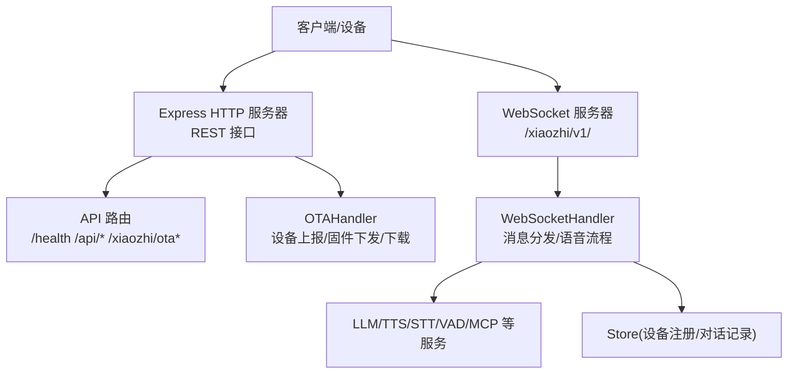
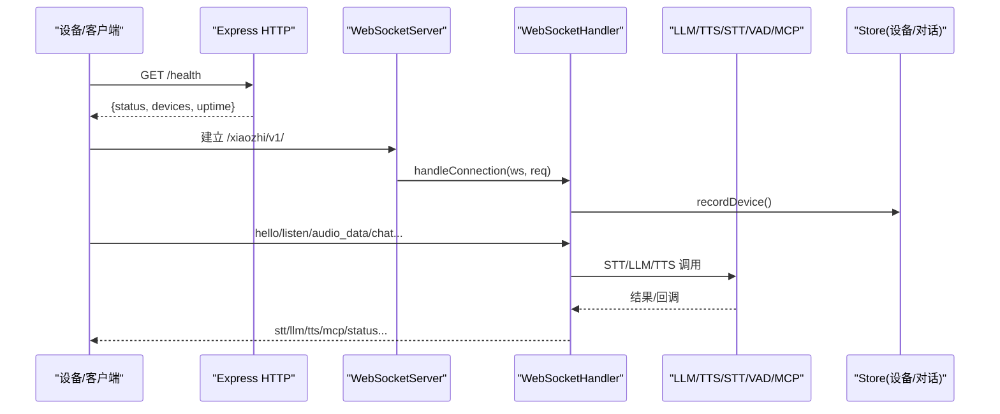
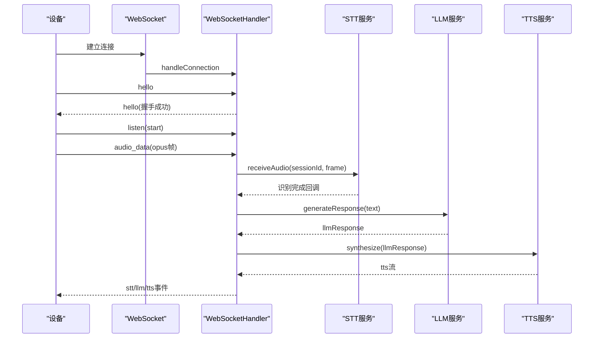
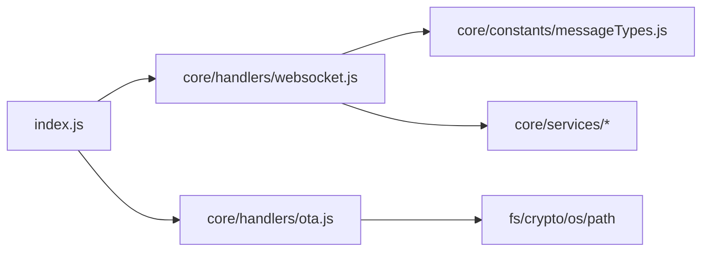

# API接口文档

<cite>
**本文引用的文件**   
- [index.js](file://index.js)
- [package.json](file://package.json)
- [core/handlers/websocket.js](file://core/handlers/websocket.js)
- [core/handlers/ota.js](file://core/handlers/ota.js)
- [core/constants/messageTypes.js](file://core/constants/messageTypes.js)
- [config/loader.js](file://config/loader.js)
</cite>

## 目录
1. [简介](#简介)
2. [项目结构](#项目结构)
3. [核心组件](#核心组件)
4. [架构总览](#架构总览)
5. [详细接口说明](#详细接口说明)
6. [WebSocket协议与实时交互](#websocket协议与实时交互)
7. [依赖关系分析](#依赖关系分析)
8. [性能与限流](#性能与限流)
9. [安全与认证](#安全与认证)
10. [错误码与排错](#错误码与排错)
11. [版本管理](#版本管理)
12. [集成指南与最佳实践](#集成指南与最佳实践)
13. [调试工具推荐](#调试工具推荐)
14. [结论](#结论)

## 简介
本仓库提供“小智语音交互频道”的独立运行服务，基于 Express + WebSocket 暴露 REST 管理接口与实时语音对话通道。系统支持：
- RESTful 管理接口：健康检查、设备与会话查询、广播、音频阈值配置、OTA 固件升级等
- WebSocket 实时通道：设备握手、音频流、语音识别、LLM 回复、TTS 播放、MCP 工具调用等
- OTA 固件下发与下载
- 设备注册表与会话持久化（通过 Store）

该文档聚焦于对外暴露的 API 端点、WebSocket 消息格式、认证与安全、错误码、版本策略、性能优化与集成建议。

## 项目结构
- 入口与路由：index.js 负责启动 Express、注册 HTTP 路由、创建 WebSocketServer 并转发连接
- 核心处理器：core/handlers/websocket.js 处理 WebSocket 连接、消息分发、语音流程
- OTA 处理器：core/handlers/ota.js 处理设备上报、MQTT/WebSocket 配置下发、固件版本比较与下载
- 消息类型常量：core/constants/messageTypes.js 定义客户端与服务端消息类型
- 配置加载器：config/loader.js 统一读取 config.json 与环境变量覆盖
- 包信息：package.json 声明依赖与脚本

图表来源
- [index.js:254-488](file://index.js#L254-L488)
- [core/handlers/websocket.js:22-169](file://core/handlers/websocket.js#L22-L169)
- [core/handlers/ota.js:7-394](file://core/handlers/ota.js#L7-L394)

章节来源
- [index.js:1-706](file://index.js#L1-L706)
- [package.json:1-29](file://package.json#L1-L29)

## 核心组件
- XiaozhiChannel（index.js）：封装 Express 应用、HTTP 服务器、WebSocketServer、路由、服务初始化与生命周期管理
- WebSocketHandler（core/handlers/websocket.js）：连接管理、消息解析、VAD/STT/LLM/TTS 流程、MCP 工具、会话与轮次串行化
- OTAHandler（core/handlers/ota.js）：设备上报、WebSocket/MQTT 配置下发、固件版本比较、二进制固件下载
- 消息类型常量（core/constants/messageTypes.js）：客户端与服务端消息类型、状态枚举
- 配置加载器（config/loader.js）：从 config.json 加载配置，支持环境变量覆盖

章节来源
- [index.js:44-216](file://index.js#L44-L216)
- [core/handlers/websocket.js:22-169](file://core/handlers/websocket.js#L22-L169)
- [core/handlers/ota.js:7-394](file://core/handlers/ota.js#L7-L394)
- [core/constants/messageTypes.js:1-144](file://core/constants/messageTypes.js#L1-L144)
- [config/loader.js:13-225](file://config/loader.js#L13-L225)

## 架构总览
系统采用“HTTP 管理面 + WebSocket 数据面”的双通道设计：
- HTTP 管理面：用于运维监控、设备管理、配置更新、OTA 升级
- WebSocket 数据面：承载设备实时音视频流、语音识别、大模型回复、TTS 播放、MCP 工具调用

图表来源
- [index.js:254-488](file://index.js#L254-L488)
- [core/handlers/websocket.js:67-169](file://core/handlers/websocket.js#L67-L169)

## 详细接口说明

### 健康检查
- 方法：GET
- URL：/health
- 认证：无
- 响应体字段：
  - status：字符串，固定为 ok
  - channel：频道标识
  - devices：当前在线设备数量
  - uptime：进程运行时长（秒）

示例请求
- curl http://host:port/health

示例响应
- { "status": "ok", "channel": "xiaozhi", "devices": 2, "uptime": 123.4 }

章节来源
- [index.js:289-296](file://index.js#L289-L296)

### 音频有效性阈值配置
- 获取阈值
  - 方法：GET
  - URL：/api/settings/audio
  - 认证：无
  - 响应体字段：
    - ok：布尔
    - thresholds.minMaxAmplitude：整数，范围 0~10000
    - thresholds.minAvgAmplitude：整数，范围 0~10000
    - thresholds.silenceThresholdMs：整数，范围 300~5000
- 设置阈值
  - 方法：POST
  - URL：/api/settings/audio
  - 认证：无
  - 请求体字段：
    - minMaxAmplitude：整数
    - minAvgAmplitude：整数
    - silenceThresholdMs：整数
  - 校验规则：
    - 振幅阈值须为 0~10000 的整数
    - 静默阈值须为 300~5000ms 的整数
  - 行为：
    - 热更新运行时默认阈值（对未设置设备专属阈值的会话立即生效）
    - 持久化到 config.json（失败仅告警不影响返回）

示例请求
- POST /api/settings/audio
- Body: { "minMaxAmplitude": 500, "minAvgAmplitude": 50, "silenceThresholdMs": 1500 }

示例响应
- { "ok": true, "thresholds": {...}, "persisted": true/false }

章节来源
- [index.js:299-344](file://index.js#L299-L344)

### 断开指定设备连接
- 方法：POST
- URL：/api/disconnect
- 认证：无
- 请求体字段：
  - clientId：字符串，必填
- 响应体字段：
  - success：布尔
  - error：可选，当设备不在线或未找到时返回

示例请求
- POST /api/disconnect
- Body: { "clientId": "xxx" }

示例响应
- { "success": true } 或 { "success": false, "error": "设备不在线或未找到" }

章节来源
- [index.js:347-355](file://index.js#L347-L355)

### 设备管理
- 当前在线设备
  - 方法：GET
  - URL：/api/devices
  - 认证：无
  - 响应体：数组，元素为设备对象（toJSON 序列化）
- 已知设备列表（含离线，来自持久化注册表）
  - 方法：GET
  - URL：/api/devices/known
  - 查询参数：
    - limit：整数，默认 100，最大 500
    - offset：整数，默认 0
  - 响应体：分页后的设备列表
- 设备/对话统计
  - 方法：GET
  - URL：/api/devices/stats
  - 响应体字段：
    - live：在线设备统计
    - registered：注册设备统计

示例请求
- GET /api/devices/known?limit=100&offset=0

章节来源
- [index.js:358-381](file://index.js#L358-L381)

### 对话记录查询
- 方法：GET
- URL：/api/conversations
- 查询参数：
  - deviceId：可选，按设备过滤
  - role：可选，user 或 bot
  - limit：整数，默认 50，最大 200
  - offset：整数，默认 0
- 响应体：分页后的对话记录

示例请求
- GET /api/conversations?role=user&limit=50&offset=0

章节来源
- [index.js:384-395](file://index.js#L384-L395)

### 会话管理
- 方法：GET
- URL：/api/sessions
- 认证：无
- 响应体：会话映射（sessionId -> 会话对象）

章节来源
- [index.js:398-404](file://index.js#L398-L404)

### 语音放送（广播）
- 方法：POST
- URL：/api/broadcast
- 认证：无
- 请求体字段：
  - text：字符串，必填
  - deviceId：可选，目标设备ID；为空则广播给所有在线设备
- 行为：
  - 先验设备再受理后异步发送
  - 合成+推流耗时，接口立即返回 accepted
- 响应体字段：
  - success：布尔
  - accepted：布尔
  - devices：目标设备数量
  - message：队列提示

示例请求
- POST /api/broadcast
- Body: { "text": "欢迎使用小智", "deviceId": "device-123" }

示例响应
- { "success": true, "accepted": true, "devices": 1, "message": "broadcast queued" }

章节来源
- [index.js:406-425](file://index.js#L406-L425)

### WebSocket 连接信息
- 方法：GET
- URL：/api/websocket/urls
- 认证：无
- 响应体字段：
  - urls.ws：ws 地址
  - urls.wss：wss 地址
  - current：当前实际协议地址（受 USE_HTTPS 影响）
  - use_https：布尔
  - port/host：服务器端口与主机

示例响应
- { "message": "WebSocket连接信息", "urls": { "ws": "...", "wss": "..." }, "current": "...", "use_https": false, "port": 8003, "host": "0.0.0.0" }

章节来源
- [index.js:427-443](file://index.js#L427-L443)

### OTA 接口
- 获取 OTA 能力
  - 方法：GET
  - URL：/xiaozhi/ota/
  - 认证：无
  - 响应体：包含 websocket_url 等信息
- 设备上报与配置下发
  - 方法：POST
  - URL：/xiaozhi/ota/
  - 认证：可选（由 server.auth 控制）
  - 请求头（大小写兼容）：
    - device-id / Device-Id / device_id
    - client-id / Client-Id / client_id
    - device-model / Device-Model / device_model
    - device-version / Device-Version / device_version
    - mac-address / Mac-Address / mac_address
  - 响应体：
    - server_time.timestamp/timezone_offset
    - firmware.version/url（若存在更高版本）
    - mqtt 或 websocket 配置（二选一）
- 固件下载
  - 方法：GET
  - URL：/xiaozhi/ota/download/:filename
  - 认证：无
  - 路径参数：filename（仅允许 basename，白名单校验）
  - 响应：二进制 .bin 文件

注意：
- 当配置了 MQTT 网关时，返回 MQTT 配置；否则返回 WebSocket 配置与 token（若启用 auth）
- 固件文件名需匹配正则 ^[A-Za-z0-9.\-_]+\.bin$，且必须位于 data/bin 目录

章节来源
- [index.js:445-487](file://index.js#L445-L487)
- [core/handlers/ota.js:158-394](file://core/handlers/ota.js#L158-L394)

## WebSocket协议与实时交互

### 连接与握手
- 连接URL：/xiaozhi/v1/
- 协议：ws 或 wss（取决于 USE_HTTPS）
- 关键请求头：
  - client-id：客户端ID（可选，未提供则服务端生成）
  - device-id：设备ID（可选，未提供则服务端生成）
- URL参数：
  - client_type：设备类型（sensor/agent/hard/manager/unknown），默认 hard
  - timestamp：连接时间戳（可选）
- 连接确认：
  - 非 hard 客户端会收到 CONNECTION_ACK

章节来源
- [core/handlers/websocket.js:67-94](file://core/handlers/websocket.js#L67-L94)

### 消息类型与方向
- 客户端消息类型（CLIENT_MESSAGE_TYPES）：hello、listen、abort、iot、chat、mcp、start_recognition、audio_data、wake_word_detected、friend、echo
- 服务端消息类型（SERVER_MESSAGE_TYPES）：connection_ack、error、hello、recognition_started、stt、llm、tts、tts_fallback、tts_disabled、mcp、sleep、audio_received、wake_word_acknowledged、friend、friend_ack、status、message、user、bot、system

章节来源
- [core/constants/messageTypes.js:7-60](file://core/constants/messageTypes.js#L7-L60)

### 核心流程时序

图表来源
- [core/handlers/websocket.js:228-283](file://core/handlers/websocket.js#L228-L283)
- [core/handlers/websocket.js:450-643](file://core/handlers/websocket.js#L450-L643)
- [core/handlers/websocket.js:651-800](file://core/handlers/websocket.js#L651-L800)

### 监听与语音识别
- listen(start)：开始监听，清空缓冲区，准备新一轮采集
- listen(stop)：手动停止，触发识别
- listen(detect)：检测模式，可直接携带文本进行聊天
- VAD 静默判定：
  - 窗口内超过一半帧有声音即认为有语音
  - 静默阈值可配置（默认 1500ms）
  - 最长语音兜底：连续有声超过 maxUtteranceMs（默认 8000ms）强制触发识别

章节来源
- [core/handlers/websocket.js:515-590](file://core/handlers/websocket.js#L515-L590)
- [core/handlers/websocket.js:373-446](file://core/handlers/websocket.js#L373-L446)

### 完整聊天轮次
- 输入过滤：
  - 无效输入（过短/语气词）直接忽略
  - 回声拾取（与近期播放内容高度相似）忽略且不中止播放
- 轮次串行化：
  - 同一连接同一时刻只有一条应答流程在发送音频，避免 Opus 帧交错
  - 看门狗超时防止单轮挂死（默认 90s）
- 打断机制：
  - abortUpTo 带轮次归属，只中止旧轮，不误杀新轮
  - 新一轮接管后放弃过期轮次

章节来源
- [core/handlers/websocket.js:651-722](file://core/handlers/websocket.js#L651-L722)
- [core/handlers/websocket.js:724-800](file://core/handlers/websocket.js#L724-L800)

### MCP 工具调用
- 设备支持 mcp 特性时，握手成功后延迟发送 initialize
- 客户端可通过 mcp 消息类型调用工具，服务端转发至 McpService

章节来源
- [core/handlers/websocket.js:506-512](file://core/handlers/websocket.js#L506-L512)
- [core/handlers/websocket.js:196-223](file://core/handlers/websocket.js#L196-L223)

## 依赖关系分析
- index.js 依赖：
  - core/handlers/websocket.js：WebSocket 连接与消息处理
  - core/handlers/ota.js：OTA 设备上报与固件下发
  - core/managers/*：设备与会话管理
  - core/services/*：LLM/TTS/STT/VAD/MCP 等外部服务
  - config/loader.js：配置加载与环境覆盖
- core/handlers/websocket.js 依赖：
  - core/constants/messageTypes.js：消息类型常量
  - core/managers/device.js、session.js：设备与会话
  - core/services/*：语音与对话链路
  - core/utils/audioConverter.js：音频转换
- core/handlers/ota.js 依赖：
  - crypto/fs/os/path：签名、文件系统、网络接口

图表来源
- [index.js:16-27](file://index.js#L16-L27)
- [core/handlers/websocket.js:1-15](file://core/handlers/websocket.js#L1-L15)
- [core/handlers/ota.js:1-5](file://core/handlers/ota.js#L1-L5)

章节来源
- [index.js:16-27](file://index.js#L16-L27)
- [core/handlers/websocket.js:1-15](file://core/handlers/websocket.js#L1-L15)
- [core/handlers/ota.js:1-5](file://core/handlers/ota.js#L1-L5)

## 性能与限流
- 音频流处理：
  - VAD 窗口与静默阈值可调，减少误触发
  - 最长语音兜底防止无限“倾听中”
- 轮次串行化与超时：
  - 同一连接同一时刻只有一条应答流程，避免音频帧交错
  - 默认 90s 看门狗保护，防止单轮挂死阻塞后续轮次
- 广播异步化：
  - /api/broadcast 先验设备再异步发送，避免阻塞接口
- 限流策略：
  - 代码中未实现显式限流中间件
  - 建议在反向代理层（Nginx/Cloudflare）或网关层实施速率限制与并发控制

章节来源
- [core/handlers/websocket.js:373-446](file://core/handlers/websocket.js#L373-L446)
- [core/handlers/websocket.js:677-693](file://core/handlers/websocket.js#L677-L693)
- [index.js:406-425](file://index.js#L406-L425)

## 安全与认证
- OTA 认证：
  - 由 server.auth.enabled 控制
  - 可配置 allowed_devices 白名单
  - 未配置 MQTT 时返回 WebSocket 配置与 token（基于 HMAC-SHA256 签名，含 clientId|username|timestamp）
- WebSocket 连接：
  - 支持 client-id、device-id 请求头
  - 非 hard 客户端连接后会收到 CONNECTION_ACK
- 固件下载安全：
  - 仅允许 basename，正则校验文件名
  - 路径必须在 data/bin 目录内，防止路径穿越

章节来源
- [core/handlers/ota.js:30-39](file://core/handlers/ota.js#L30-L39)
- [core/handlers/ota.js:335-353](file://core/handlers/ota.js#L335-L353)
- [core/handlers/ota.js:358-391](file://core/handlers/ota.js#L358-L391)
- [core/handlers/websocket.js:67-94](file://core/handlers/websocket.js#L67-L94)

## 错误码与排错
- HTTP 状态码：
  - 400：参数校验失败（如振幅阈值、静默阈值、缺少 clientId、text 为空）
  - 404：资源不存在（如无在线设备）
  - 500：内部错误（管理器未初始化、OTA handler 未初始化、请求异常、下载失败等）
- WebSocket 错误：
  - SERVER_MESSAGE_TYPES.ERROR：通用错误消息
  - 连接/消息处理异常会记录日志并尝试关闭连接
- 常见排查：
  - 设备注册失败：检查 client_type 是否在白名单，必要时降级为 unknown
  - 音频数据不足：空帧触发识别前检查缓冲帧数
  - 广播无目标：确保至少一个在线设备

章节来源
- [index.js:312-344](file://index.js#L312-L344)
- [index.js:347-355](file://index.js#L347-L355)
- [index.js:406-425](file://index.js#L406-L425)
- [core/handlers/websocket.js:135-141](file://core/handlers/websocket.js#L135-L141)
- [core/handlers/websocket.js:289-324](file://core/handlers/websocket.js#L289-L324)

## 版本管理
- 软件版本：
  - package.json 中 version 为 1.0.0
- 插件元数据：
  - pluginMetadata.version 固定为 1.0.0
- WebSocket 路径版本：
  - /xiaozhi/v1/ 作为当前协议版本
- OTA 固件版本：
  - 服务端比较设备版本与候选固件版本，选择更高版本下发

章节来源
- [package.json:1-29](file://package.json#L1-L29)
- [index.js:614-622](file://index.js#L614-L622)
- [index.js:427-443](file://index.js#L427-L443)
- [core/handlers/ota.js:87-110](file://core/handlers/ota.js#L87-L110)

## 集成指南与最佳实践
- 快速接入步骤：
  1. 启动服务：npm start 或 node run-server.js
  2. 访问 /health 检查服务状态
  3. 通过 /api/websocket/urls 获取 ws/wss 地址
  4. 设备侧建立 WebSocket 连接，发送 hello 握手
  5. 发送 listen(start) 并开始上传 opus 音频帧
  6. 接收 stt/llm/tts 事件，完成语音对话
- 设备端注意事项：
  - 正确设置 client_type（hard/agent/sensor/manager/unknown）
  - 提供 device-id 以便设备注册与统计
  - 合理配置 VAD 阈值与静默阈值，避免误触发
- 服务端配置：
  - 通过 /api/settings/audio 热更新音频阈值
  - 如需 HTTPS，设置 USE_HTTPS=true 以切换 wss
  - 配置 server.auth 以启用 OTA 认证与 token 下发
- 广播与多设备：
  - 使用 /api/broadcast 向单设备或全部在线设备推送语音
  - 关注 devices 数量与 accepted 标志，确保异步任务已入队

章节来源
- [index.js:289-296](file://index.js#L289-L296)
- [index.js:427-443](file://index.js#L427-L443)
- [core/handlers/websocket.js:67-94](file://core/handlers/websocket.js#L67-L94)
- [core/handlers/websocket.js:515-590](file://core/handlers/websocket.js#L515-L590)

## 调试工具推荐
- HTTP 接口调试：curl、Postman、Insomnia
- WebSocket 调试：Chrome DevTools、wscat、WebStorm WebSocket 面板
- 日志与监控：
  - 查看控制台输出与 channelLogger 日志
  - 结合系统日志与反向代理日志定位问题
- 性能分析：
  - Node.js 内置 --inspect 与 Chrome DevTools Profiler
  - 针对音频流与 LLM/TTS 调用链进行采样分析

## 结论
本服务以简洁的 REST 管理面与强大的 WebSocket 数据面，为小智语音交互提供了完整的后端支撑。通过合理的 VAD/STT/LLM/TTS 流程、轮次串行化与超时保护，系统在实时性与稳定性之间取得平衡。建议在部署层补充限流与鉴权，结合 OTA 认证与路径安全校验，进一步提升整体安全性与可维护性。