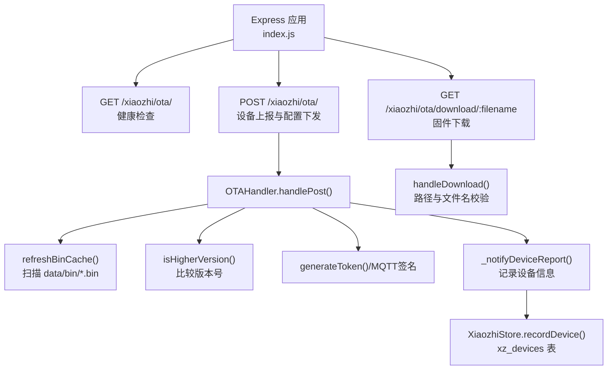
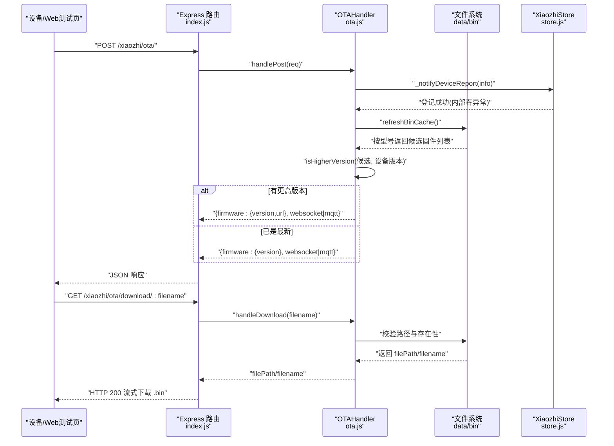
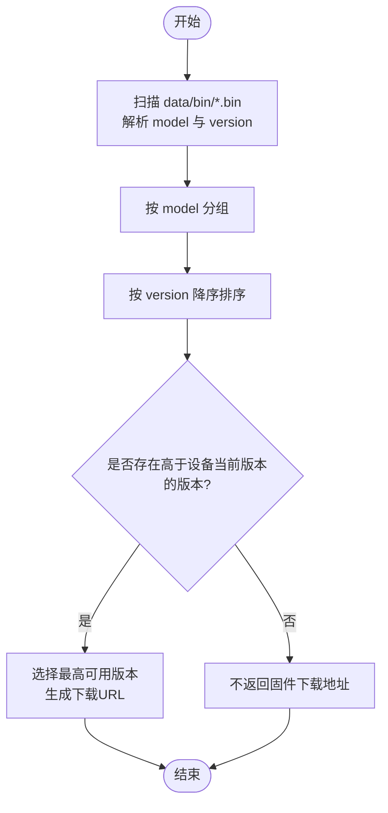
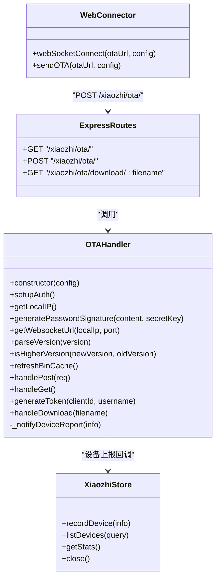

# OTA固件升级接口

<cite>
**本文引用的文件**   
- [index.js](file://index.js)
- [ota.js](file://core/handlers/ota.js)
- [ota-connector.js](file://public/chat/js/core/network/ota-connector.js)
- [store.js](file://core/managers/store.js)
</cite>

## 目录
1. [简介](#简介)
2. [项目结构与入口](#项目结构与入口)
3. [核心组件](#核心组件)
4. [架构总览](#架构总览)
5. [接口规范](#接口规范)
6. [详细流程与实现](#详细流程与实现)
7. [依赖关系分析](#依赖关系分析)
8. [性能与可靠性](#性能与可靠性)
9. [故障排查](#故障排查)
10. [结论](#结论)

## 简介
本文件面向设备端、Web 测试页与运维人员，系统化说明本仓库中的 OTA 固件升级能力。内容覆盖：
- 固件版本查询与下发
- 固件下载接口
- 连接配置（WebSocket/MQTT）下发
- 请求参数校验、响应数据结构、错误处理
- 固件文件格式与版本兼容性检查
- 安全验证与权限控制
- 设备注册与持久化
- 批量升级与灰度发布的扩展思路
- 失败回滚机制的落地建议

当前代码实现了“设备上报 → 服务器返回连接配置与可选固件下载地址 → 设备通过 HTTP GET 下载 .bin 固件”的主干流程；同时提供 Web 测试页侧发起 OTA 请求并建立 WebSocket 连接的示例逻辑。

## 项目结构与入口
OTA 相关能力由 Express 路由暴露，并由 `OTAHandler` 统一处理业务逻辑；设备信息通过回调写入持久化存储；Web 测试页通过前端脚本发起 OTA 请求并自动拼接 WebSocket 连接地址。

图表来源
- [index.js:445-487](file://index.js#L445-L487)
- [ota.js:112-156](file://core/handlers/ota.js#L112-L156)
- [ota.js:158-311](file://core/handlers/ota.js#L158-L311)
- [ota.js:355-391](file://core/handlers/ota.js#L355-L391)
- [store.js:44-75](file://core/managers/store.js#L44-L75)
- [store.js:87-123](file://core/managers/store.js#L87-L123)

章节来源
- [index.js:254-487](file://index.js#L254-L487)

## 核心组件
- OTAHandler：封装 OTA 业务逻辑，包括设备上报解析、连接配置下发、固件缓存刷新、版本比较、Token/MQTT 签名生成、固件下载校验等。
- Express 路由：在 index.js 中挂载 `/xiaozhi/ota/`、`/xiaozhi/ota/download/:filename` 等路由，将请求委派给 OTAHandler。
- XiaozhiStore：持久化设备信息与对话记录，OTA 上报时通过回调写入 xz_devices 表。
- Web 测试页 ota-connector：模拟设备端发起 POST 到 OTA 接口，并根据返回结果构造 WebSocket 连接。

章节来源
- [ota.js:7-394](file://core/handlers/ota.js#L7-L394)
- [index.js:445-487](file://index.js#L445-L487)
- [store.js:29-123](file://core/managers/store.js#L29-L123)
- [ota-connector.js:1-132](file://public/chat/js/core/network/ota-connector.js#L1-L132)

## 架构总览
下图展示一次完整 OTA 交互的生命周期：设备发起 POST 上报 → 服务器返回连接配置与可选固件下载地址 → 设备按 URL 下载 .bin 固件 → 后续通过 WebSocket/MQTT 进行语音交互。

图表来源
- [index.js:445-487](file://index.js#L445-L487)
- [ota.js:112-156](file://core/handlers/ota.js#L112-L156)
- [ota.js:158-311](file://core/handlers/ota.js#L158-L311)
- [ota.js:355-391](file://core/handlers/ota.js#L355-L391)
- [store.js:87-123](file://core/managers/store.js#L87-L123)

## 接口规范

### 通用约定
- 协议：HTTP/HTTPS
- 数据格式：JSON
- 端口：默认使用 Express 监听端口（可通过 server.port 或 http_port 配置）
- 设备标识：优先从请求头获取 deviceId/clientId/deviceModel/deviceVersion/macAddress，其次从请求体字段兜底

### 1) 固件版本查询与连接配置下发
- 方法：POST
- 路径：`/xiaozhi/ota/`
- 用途：设备上报自身信息，服务器返回 WebSocket/MQTT 连接配置，以及可选的固件下载地址与目标版本。

#### 请求头（优先）
- device-id / Device-Id / device_id
- client-id / Client-Id / client_id
- device-model / Device-Model / device_model
- device-version / Device-Version / device_version
- mac-address / Mac-Address / mac_address

#### 请求体（兜底）
- board.type / model
- application.version / version
- mac_address / mac

#### 响应结构
- server_time.timestamp：服务器时间戳（毫秒）
- server_time.timezone_offset：时区偏移（小时）
- firmware.version：目标固件版本（若无可更新则为空或保持原版本）
- firmware.url：固件下载地址（若无可更新为空字符串）
- websocket.url：WebSocket 地址（未配置 MQTT 网关时）
- websocket.token：鉴权 Token（启用 auth 时）
- mqtt.endpoint / client_id / username / password / publish_topic / subscribe_topic（配置了 MQTT 网关时）

#### 关键行为
- 设备登记：通过 onDeviceReport 回调写入 xz_devices 表，包含 deviceId、model、version、mac、ip、source=ota 等。
- 连接配置：
  - 若配置了 mqtt_gateway，则返回 MQTT 连接信息，并基于 mqtt_signature_key 生成密码签名。
  - 否则返回 WebSocket 地址与 token（auth.enabled 为真时）。
- 固件选择：扫描 data/bin 目录下符合命名规则的 .bin 文件，按型号分组并按版本号降序排序，选择第一个高于设备当前版本的固件作为下载地址。

#### 错误处理
- 整体 try/catch 包裹，异常时返回 `{ success: false, message: 'request error' }`。
- 固件缓存刷新与版本比较异常会被捕获并记录日志，不影响基础连接配置返回。

章节来源
- [ota.js:158-311](file://core/handlers/ota.js#L158-L311)
- [index.js:454-465](file://index.js#L454-L465)
- [store.js:87-123](file://core/managers/store.js#L87-L123)

### 2) 固件下载
- 方法：GET
- 路径：`/xiaozhi/ota/download/:filename`
- 用途：设备根据 POST 响应中的 firmware.url 下载合并后的 .bin 固件。

#### 路径参数
- filename：固件文件名，必须匹配正则 `^[A-Za-z0-9.\-_]+\.bin$`

#### 安全校验
- 仅允许 basename，防止目录穿越。
- 最终解析路径必须在 data/bin 目录内，否则返回 forbidden。
- 不存在则返回 file not found。

#### 响应
- 成功：HTTP 200，直接流式下载二进制文件。
- 失败：返回 JSON 错误对象，如 `{ error: 'invalid filename', status: 400 }`、`{ error: 'forbidden', status: 403 }`、`{ error: 'file not found', status: 404 }`、`{ error: 'download error', status: 500 }`。

章节来源
- [ota.js:355-391](file://core/handlers/ota.js#L355-L391)
- [index.js:467-487](file://index.js#L467-L487)

### 3) 健康检查
- 方法：GET
- 路径：`/xiaozhi/ota/`
- 用途：返回运行状态与 WebSocket 地址提示。

#### 响应
- message：提示信息
- websocket_url：WebSocket 地址

章节来源
- [ota.js:313-333](file://core/handlers/ota.js#L313-L333)
- [index.js:445-452](file://index.js#L445-L452)

## 详细流程与实现

### 固件文件格式要求
- 存放目录：data/bin
- 文件后缀：.bin
- 命名规则：`{model}_{version}.bin`
  - model：设备型号（与请求头 device-model 或 body.board.type/body.model 对应）
  - version：语义化版本号，支持数字段比较（例如 1.2.3）

服务器启动后首次访问或每次检查时会扫描该目录，按型号分组并排序，供后续版本比较使用。

章节来源
- [ota.js:112-156](file://core/handlers/ota.js#L112-L156)

### 版本兼容性检查
- 解析版本号：提取所有数字段进行比较。
- 比较策略：从左到右逐段比较，较大者即为更高版本；长度不同时缺失段视为 0。
- 选择策略：对同一型号的所有候选固件按降序排列，取第一个高于设备当前版本的固件作为下载地址。

图表来源
- [ota.js:87-110](file://core/handlers/ota.js#L87-L110)
- [ota.js:112-156](file://core/handlers/ota.js#L112-L156)
- [ota.js:277-304](file://core/handlers/ota.js#L277-L304)

章节来源
- [ota.js:87-110](file://core/handlers/ota.js#L87-L110)
- [ota.js:112-156](file://core/handlers/ota.js#L112-L156)
- [ota.js:277-304](file://core/handlers/ota.js#L277-L304)

### 升级流程控制
- 设备上报：设备调用 POST /xiaozhi/ota/，携带设备标识、型号、版本、MAC 等信息。
- 服务器处理：
  - 登记设备信息至 xz_devices 表。
  - 返回连接配置（WebSocket 或 MQTT）。
  - 若有更高版本固件，返回 firmware.url 与 target version。
- 设备下载：设备根据 firmware.url 调用 GET /xiaozhi/ota/download/:filename 下载 .bin 文件。
- 后续交互：设备通过返回的 WebSocket/MQTT 通道进行语音交互与控制。

章节来源
- [index.js:445-487](file://index.js#L445-L487)
- [ota.js:158-311](file://core/handlers/ota.js#L158-L311)
- [ota.js:355-391](file://core/handlers/ota.js#L355-L391)

### 安全验证与权限控制
- 认证开关：server.auth.enabled 为真时启用。
- 白名单：server.auth.allowed_devices 可配置允许的 deviceId 集合；若为空则对所有设备发放 token。
- Token 生成：基于 clientId、deviceId、时间戳与服务端 secretKey（server.auth_key）计算 HMAC-SHA256，并以 base64url 编码，附加时间戳。
- MQTT 签名：当配置 mqtt_signature_key 时，使用相同算法为客户端用户名生成密码签名。
- 下载安全：仅允许 basename，且最终路径必须在 data/bin 目录内，防止目录穿越。

章节来源
- [ota.js:30-39](file://core/handlers/ota.js#L30-L39)
- [ota.js:335-353](file://core/handlers/ota.js#L335-L353)
- [ota.js:355-391](file://core/handlers/ota.js#L355-L391)

### 设备注册与持久化
- OTA 上报时通过 onDeviceReport 回调写入 xz_devices 表，字段包括 device_id、client_id、name、type、model、firmware_version、mac、ip、source、online、connect_count、first_seen、last_seen。
- 写操作失败不会阻断 OTA 主流程，仅记录警告日志。
- 提供已知设备列表与统计接口（/api/devices/known、/api/devices/stats），便于运维查看设备在线与离线情况。

章节来源
- [index.js:187-191](file://index.js#L187-L191)
- [index.js:366-381](file://index.js#L366-L381)
- [store.js:44-75](file://core/managers/store.js#L44-L75)
- [store.js:87-123](file://core/managers/store.js#L87-L123)
- [store.js:137-150](file://core/managers/store.js#L137-L150)
- [store.js:204-226](file://core/managers/store.js#L204-L226)

### Web 测试页示例
- 前端脚本 ota-connector.js 会：
  - 校验必要配置（deviceMac、clientId）。
  - 发送 POST 到 OTA 接口，携带设备信息（含 board、application、mac_address 等）。
  - 解析返回的 websocket.url 与 token，替换 host 与协议（http→ws，https→wss），并追加 authorization 与设备参数。
  - 创建 WebSocket 连接。

章节来源
- [ota-connector.js:1-132](file://public/chat/js/core/network/ota-connector.js#L1-L132)

## 依赖关系分析

图表来源
- [ota.js:7-394](file://core/handlers/ota.js#L7-L394)
- [index.js:445-487](file://index.js#L445-L487)
- [store.js:29-123](file://core/managers/store.js#L29-L123)
- [ota-connector.js:1-132](file://public/chat/js/core/network/ota-connector.js#L1-L132)

章节来源
- [ota.js:7-394](file://core/handlers/ota.js#L7-L394)
- [index.js:445-487](file://index.js#L445-L487)
- [store.js:29-123](file://core/managers/store.js#L29-L123)
- [ota-connector.js:1-132](file://public/chat/js/core/network/ota-connector.js#L1-L132)

## 性能与可靠性
- 固件缓存：每次 POST 都会刷新 data/bin 目录缓存，适合小中型部署；若 bin 目录很大，可在外部触发缓存刷新或引入内存缓存层。
- 文件下载：Express res.download 流式传输，避免一次性加载大文件到内存。
- 数据库降级：XiaozhiStore 初始化失败会禁用持久化，但不影响主流程；设备登记失败仅记录警告。
- 日志与监控：关键步骤均有 logger 输出，便于定位问题。

优化建议
- 对 data/bin 目录扫描结果做定时刷新与缓存，减少频繁 IO。
- 对固件下载增加断点续传与分片校验（服务端可扩展 Range 支持）。
- 对高频设备上报场景，考虑异步队列与批处理写入。

[本节为通用指导，不直接分析具体文件]

## 故障排查
常见问题与定位要点：
- 无法获取 WebSocket 地址
  - 检查 server.use_https 与端口配置，确认 getWebsocketUrl 返回的协议与主机名正确。
- 设备未登记到 xz_devices
  - 检查 onDeviceReport 是否注入，以及 store.recordDevice 是否被调用。
- 固件未下发
  - 检查 data/bin 下是否有符合命名规则的 .bin 文件，且版本号高于设备当前版本。
- 下载失败
  - 检查 filename 是否符合正则，路径是否在 data/bin 内，文件是否存在。
- 鉴权失败
  - 检查 server.auth.enabled、server.auth_key、allowed_devices 配置是否正确。

章节来源
- [ota.js:30-39](file://core/handlers/ota.js#L30-L39)
- [ota.js:112-156](file://core/handlers/ota.js#L112-L156)
- [ota.js:355-391](file://core/handlers/ota.js#L355-L391)
- [index.js:445-487](file://index.js#L445-L487)

## 结论
本仓库提供了完整的 OTA 主干能力：设备上报、连接配置下发、固件版本比较与下载、设备信息持久化。在此基础上，可按需扩展：
- 批量升级：结合 /api/devices/known 与广播接口，按型号筛选目标设备，分批推送升级指令。
- 灰度发布：通过 allowed_devices 白名单或自定义策略（如按模型/地区/用户组）限制特定设备获取新版本。
- 失败回滚：在设备端实现“下载完成→校验→安装→重启→回滚标记”，若新固件不可用则回退至旧版本；服务端可增加“版本黑名单/回滚策略”配合管理接口。
- 高级校验：在 handleDownload 中增加 SHA256 校验、签名验证与速率限制，提升安全性与稳定性。

[本节为总结性内容，不直接分析具体文件]