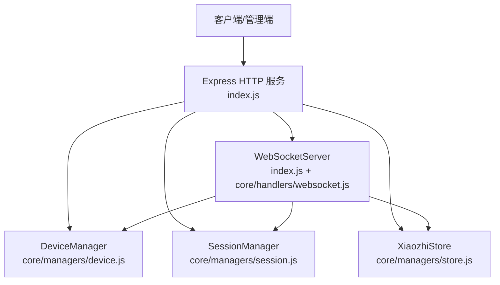
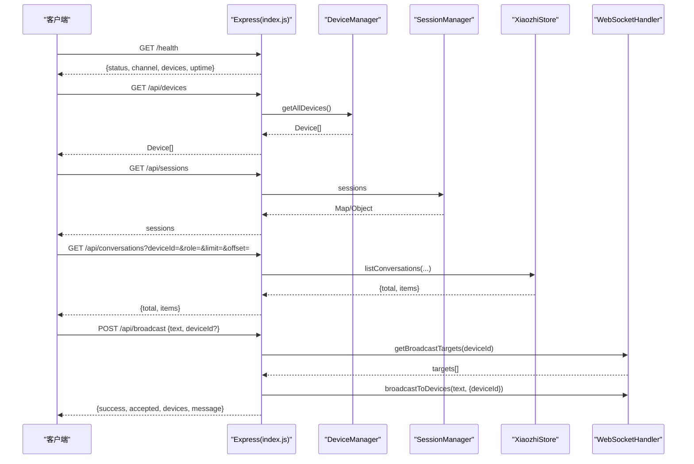
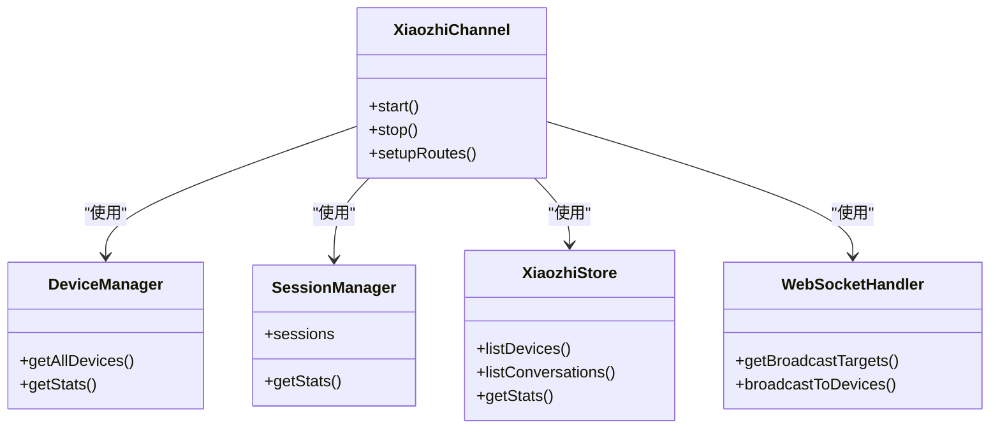

# RESTful API规范

<cite>
**本文引用的文件**   
- [index.js](file://index.js)
- [package.json](file://package.json)
- [core/managers/device.js](file://core/managers/device.js)
- [core/managers/session.js](file://core/managers/session.js)
- [core/managers/store.js](file://core/managers/store.js)
- [core/handlers/websocket.js](file://core/handlers/websocket.js)
</cite>

## 目录
1. [简介](#简介)
2. [项目结构](#项目结构)
3. [核心组件](#核心组件)
4. [架构总览](#架构总览)
5. [接口规范](#接口规范)
6. [依赖关系分析](#依赖关系分析)
7. [性能与容量特性](#性能与容量特性)
8. [故障排查指南](#故障排查指南)
9. [结论](#结论)
10. [附录：版本与安全建议](#附录版本与安全建议)

## 简介
本仓库提供小智语音交互频道服务，基于 Express 暴露一组 RESTful HTTP 管理接口，并通过 WebSocket 实现设备语音交互。本文档聚焦于所有对外暴露的 HTTP 端点，包括健康检查、设备管理、会话管理、对话记录查询、语音广播以及 WebSocket URL 获取等，并给出认证方式、参数校验规则、错误响应格式与调用示例说明。同时补充版本管理与安全考虑建议。

## 项目结构
- 入口与服务启动：[index.js](file://index.js)
- 包元数据与运行脚本：[package.json](file://package.json)
- 设备在线状态与统计：[core/managers/device.js](file://core/managers/device.js)
- 会话生命周期与统计：[core/managers/session.js](file://core/managers/session.js)
- 设备注册表与对话记录持久化（SQLite）：[core/managers/store.js](file://core/managers/store.js)
- WebSocket 连接与消息处理（含广播能力）：[core/handlers/websocket.js](file://core/handlers/websocket.js)

**图表来源**
- [index.js:254-281](file://index.js#L254-L281)
- [core/managers/device.js:4-136](file://core/managers/device.js#L4-L136)
- [core/managers/session.js:4-167](file://core/managers/session.js#L4-L167)
- [core/managers/store.js:29-233](file://core/managers/store.js#L29-L233)
- [core/handlers/websocket.js:22-169](file://core/handlers/websocket.js#L22-L169)

**章节来源**
- [index.js:254-281](file://index.js#L254-L281)
- [package.json:1-29](file://package.json#L1-L29)

## 核心组件
- XiaozhiChannel：封装 Express、HTTP Server、WebSocketServer 与核心服务初始化、路由注册、启停流程。
- DeviceManager：维护在线设备 Map、设备查找、统计与批量操作。
- SessionManager：维护会话 Map、活动性检测、清理策略与统计。
- XiaozhiStore：基于 SQLite 的设备注册表与对话记录持久化，写失败降级为 no-op。
- WebSocketHandler：负责设备连接、协议消息、音频流、VAD/STT/TTS 协作与广播。

**章节来源**
- [index.js:44-125](file://index.js#L44-L125)
- [core/managers/device.js:4-136](file://core/managers/device.js#L4-L136)
- [core/managers/session.js:4-167](file://core/managers/session.js#L4-L167)
- [core/managers/store.js:29-233](file://core/managers/store.js#L29-L233)
- [core/handlers/websocket.js:22-169](file://core/handlers/websocket.js#L22-L169)

## 架构总览
REST 管理接口由 index.js 中的 setupRoutes 统一注册；业务逻辑委托给 DeviceManager、SessionManager 与 XiaozhiStore；广播类接口通过 WebSocketHandler 获取在线目标并异步推送。

**图表来源**
- [index.js:287-443](file://index.js#L287-L443)
- [core/managers/device.js:54-136](file://core/managers/device.js#L54-L136)
- [core/managers/session.js:47-167](file://core/managers/session.js#L47-L167)
- [core/managers/store.js:181-201](file://core/managers/store.js#L181-L201)
- [core/handlers/websocket.js:22-169](file://core/handlers/websocket.js#L22-L169)

## 接口规范

### 通用约定
- 内容类型：JSON（请求/响应）。
- 认证方式：当前未启用鉴权中间件，默认无需 Token。
- 错误响应：多数接口在参数错误或内部异常时返回 JSON 对象，包含 error 或 success=false 字段。
- 分页参数：limit 与 offset 均为整数；服务端对 limit 做上限保护。
- 时间戳：ISO 字符串或毫秒级时间戳，视具体字段而定。

---

### 健康检查
- 方法：GET
- 路径：/health
- 认证：无
- 请求参数：无
- 成功响应 200：
  - status: string，固定值 ok
  - channel: string，频道标识
  - devices: number，当前在线设备数
  - uptime: number，进程运行秒数
- 错误响应：无（通常不会失败）

调用示例
- curl http://host:port/health

**章节来源**
- [index.js:287-296](file://index.js#L287-L296)

---

### 音频有效性阈值配置
- 读取配置
  - 方法：GET
  - 路径：/api/settings/audio
  - 认证：无
  - 请求参数：无
  - 成功响应 200：
    - ok: true
    - thresholds.minMaxAmplitude: number
    - thresholds.minAvgAmplitude: number
    - thresholds.silenceThresholdMs: number
- 更新配置
  - 方法：POST
  - 路径：/api/settings/audio
  - 认证：无
  - 请求体：
    - minMaxAmplitude: integer，范围 0~10000
    - minAvgAmplitude: integer，范围 0~10000
    - silenceThresholdMs: integer，范围 300~5000
  - 成功响应 200：
    - ok: true
    - thresholds: 当前生效阈值
    - persisted: boolean，是否写入 config.json
  - 失败响应 400：
    - ok: false
    - error: 中文错误信息（振幅或静默阈值不合法）

调用示例
- curl -X POST http://host:port/api/settings/audio -H 'Content-Type: application/json' -d '{"minMaxAmplitude":500,"minAvgAmplitude":50,"silenceThresholdMs":1500}'

**章节来源**
- [index.js:298-344](file://index.js#L298-L344)

---

### 断开指定设备连接
- 方法：POST
- 路径：/api/disconnect
- 认证：无
- 请求体：
  - clientId: string，必填
- 成功响应 200：
  - success: boolean
  - 若关闭成功则无额外字段；否则可能返回 error 提示“设备不在线或未找到”
- 失败响应 400：
  - success: false
  - error: “缺少 clientId”

调用示例
- curl -X POST http://host:port/api/disconnect -H 'Content-Type: application/json' -d '{"clientId":"abc"}'

**章节来源**
- [index.js:346-355](file://index.js#L346-L355)

---

### 设备管理
- 列出当前在线设备
  - 方法：GET
  - 路径：/api/devices
  - 认证：无
  - 成功响应 200：数组，元素为设备对象（toJSON 序列化后的字段）
  - 失败响应 500：
    - error: “Device manager not initialized”
- 已知设备列表（含离线，来自持久化）
  - 方法：GET
  - 路径：/api/devices/known
  - 认证：无
  - 查询参数：
    - limit: integer，默认 100，最大 500
    - offset: integer，默认 0
  - 成功响应 200：
    - total: number
    - items: array
- 设备/对话统计
  - 方法：GET
  - 路径：/api/devices/stats
  - 认证：无
  - 成功响应 200：
    - live: object，在线设备统计（来源于 DeviceManager.getStats）
    - registered: object，注册表统计（来源于 XiaozhiStore.getStats）

调用示例
- curl http://host:port/api/devices
- curl "http://host:port/api/devices/known?limit=50&offset=0"
- curl http://host:port/api/devices/stats

**章节来源**
- [index.js:357-381](file://index.js#L357-L381)
- [core/managers/device.js:54-136](file://core/managers/device.js#L54-L136)
- [core/managers/store.js:137-149](file://core/managers/store.js#L137-L149)
- [core/managers/store.js:206-226](file://core/managers/store.js#L206-L226)

---

### 对话记录查询
- 方法：GET
- 路径：/api/conversations
- 认证：无
- 查询参数：
  - deviceId: string，可选，按设备过滤
  - role: string，可选，user 或 bot，其他值视为 null
  - limit: integer，默认 50，最大 200
  - offset: integer，默认 0
- 成功响应 200：
  - total: number
  - items: array，按 created_at 倒序

调用示例
- curl "http://host:port/api/conversations?deviceId=DEV001&role=user&limit=20&offset=0"

**章节来源**
- [index.js:383-395](file://index.js#L383-L395)
- [core/managers/store.js:181-201](file://core/managers/store.js#L181-L201)

---

### 会话管理
- 方法：GET
- 路径：/api/sessions
- 认证：无
- 成功响应 200：
  - 对象，键为 sessionId，值为会话对象（来源于 SessionManager.sessions）
- 失败响应 500：
  - error: “Session manager not initialized”

调用示例
- curl http://host:port/api/sessions

**章节来源**
- [index.js:397-404](file://index.js#L397-L404)
- [core/managers/session.js:4-167](file://core/managers/session.js#L4-L167)

---

### 语音广播
- 方法：POST
- 路径：/api/broadcast
- 认证：无
- 请求体：
  - text: string，必填，非空且去除首尾空白后仍需非空
  - deviceId: string，可选，用于限定目标设备
- 成功响应 200：
  - success: true
  - accepted: true
  - devices: number，目标设备数量
  - message: “broadcast queued”
- 失败响应：
  - 400：
    - success: false
    - error: “text 不能为空”
  - 404：
    - success: false
    - error: “没有在线的小智设备”
  - 500：
    - success: false
    - error: “WebSocket handler 未初始化”

注意
- 该接口先校验设备再异步合成并推流，因此立即返回接受结果。

调用示例
- curl -X POST http://host:port/api/broadcast -H 'Content-Type: application/json' -d '{"text":"你好","deviceId":"DEV001"}'

**章节来源**
- [index.js:406-425](file://index.js#L406-L425)
- [core/handlers/websocket.js:22-169](file://core/handlers/websocket.js#L22-L169)

---

### WebSocket URL 获取
- 方法：GET
- 路径：/api/websocket/urls
- 认证：无
- 成功响应 200：
  - message: string
  - urls.ws: string，ws 地址
  - urls.wss: string，wss 地址
  - current: string，当前推荐地址（受 USE_HTTPS 环境变量影响）
  - use_https: boolean
  - port: number
  - host: string

调用示例
- curl http://host:port/api/websocket/urls

**章节来源**
- [index.js:427-443](file://index.js#L427-L443)

---

### OTA 相关接口（兼容）
- 获取 OTA 信息
  - 方法：GET
  - 路径：/xiaozhi/ota/
  - 成功响应 200：OTA 信息对象
  - 失败响应 500：error: “OTA handler not initialized”
- 提交 OTA 任务
  - 方法：POST
  - 路径：/xiaozhi/ota/
  - 成功响应 200：处理结果
  - 失败响应 500：success: false, message: “request error”
- 下载固件
  - 方法：GET
  - 路径：/xiaozhi/ota/download/:filename
  - 成功响应：二进制文件下载
  - 失败响应 500：error: “download failed” 或 “download error”

调用示例
- curl http://host:port/xiaozhi/ota/
- curl -X POST http://host:port/xiaozhi/ota/
- curl http://host:port/xiaozhi/ota/download/firmware.bin

**章节来源**
- [index.js:445-487](file://index.js#L445-L487)

## 依赖关系分析
- index.js 作为路由层，直接依赖：
  - DeviceManager：获取在线设备、统计
  - SessionManager：获取会话集合
  - XiaozhiStore：设备注册表与对话记录查询
  - WebSocketHandler：广播目标发现与推送
- DeviceManager 依赖 DeviceModel 进行数据校验与实体建模。
- SessionManager 依赖 SessionModel 进行会话建模与活动性判断。
- XiaozhiStore 使用 better-sqlite3 进行本地持久化，写失败降级为日志警告。
- WebSocketHandler 聚合 LLM/TTS/STT/VAD/MCP 等服务，负责设备连接、协议处理与广播。

**图表来源**
- [index.js:254-487](file://index.js#L254-L487)
- [core/managers/device.js:4-136](file://core/managers/device.js#L4-L136)
- [core/managers/session.js:4-167](file://core/managers/session.js#L4-L167)
- [core/managers/store.js:29-233](file://core/managers/store.js#L29-L233)
- [core/handlers/websocket.js:22-169](file://core/handlers/websocket.js#L22-L169)

**章节来源**
- [index.js:254-487](file://index.js#L254-L487)

## 性能与容量特性
- 设备上限：DeviceManager 默认最大设备数 10000。
- 会话上限：SessionManager 默认最大会话数 1000，达到上限会尝试清理过期会话。
- 对话记录分页：/api/conversations 默认 limit 50，最大 200；/api/devices/known 默认 limit 100，最大 500。
- 广播接口：先验设备再异步发送，避免阻塞请求。
- 持久化：XiaozhiStore 写失败不影响主流程，降级为 no-op 并记录日志。

**章节来源**
- [core/managers/device.js:8-22](file://core/managers/device.js#L8-L22)
- [core/managers/session.js:8-27](file://core/managers/session.js#L8-L27)
- [index.js:367-371](file://index.js#L367-L371)
- [index.js:384-395](file://index.js#L384-L395)
- [index.js:408-425](file://index.js#L408-L425)
- [core/managers/store.js:8-10](file://core/managers/store.js#L8-L10)

## 故障排查指南
- 设备管理接口返回 500
  - 现象：{"error":"Device manager not initialized"}
  - 原因：设备管理器未初始化
  - 处理：检查服务启动流程与依赖注入
- 会话管理接口返回 500
  - 现象：{"error":"Session manager not initialized"}
  - 原因：会话管理器未初始化
  - 处理：检查服务启动流程与依赖注入
- 语音广播返回 404
  - 现象：{"success":false,"error":"没有在线的小智设备"}
  - 原因：无在线设备匹配
  - 处理：确认设备已连接 WebSocket 或通过 /api/devices 查看在线情况
- 语音广播返回 500
  - 现象：{"success":false,"error":"WebSocket handler 未初始化"}
  - 原因：WebSocket 处理器未就绪
  - 处理：检查服务启动顺序与 wss 初始化
- 对话记录为空
  - 现象：{total:0,items:[]}
  - 原因：持久化不可用或无对话数据
  - 处理：检查 XZ_DB_PATH 与 data/xz.db 权限，查看日志中 Store 初始化信息

**章节来源**
- [index.js:357-364](file://index.js#L357-L364)
- [index.js:397-404](file://index.js#L397-L404)
- [index.js:408-425](file://index.js#L408-L425)
- [core/managers/store.js:76-82](file://core/managers/store.js#L76-L82)

## 结论
本项目通过简洁的 Express 路由暴露了完整的设备与对话管理能力，并以 WebSocket 承载实时语音交互。所有管理接口均返回结构化 JSON，便于自动化集成。生产环境建议结合反向代理与鉴权中间件增强安全性，并根据负载调整设备与会话上限。

## 附录：版本与安全建议

### API 版本管理策略
- 当前 REST 接口未显式带版本号，但 WebSocket 路径采用 /xiaozhi/v1/，体现协议版本意识。
- 建议在 REST 前缀引入版本段，如 /api/v1/...，以支持多版本并存与平滑迁移。
- 对破坏性变更应升级主版本，并在弃用期提供兼容端点与弃用通知头。

### 安全考虑
- 鉴权：当前接口未启用鉴权，生产环境建议增加 Token/JWT 校验或 IP 白名单。
- 传输安全：可通过环境变量 USE_HTTPS 切换 WebSocket 协议；HTTP 管理接口建议置于 HTTPS 反向代理之后。
- 输入校验：对敏感接口（如广播、设置）增加参数白名单与长度限制，防止滥用。
- 资源限制：对分页 limit 与并发广播进行限流，避免资源耗尽。
- 审计与日志：关键管理操作（广播、断开设备、阈值修改）应记录审计日志。