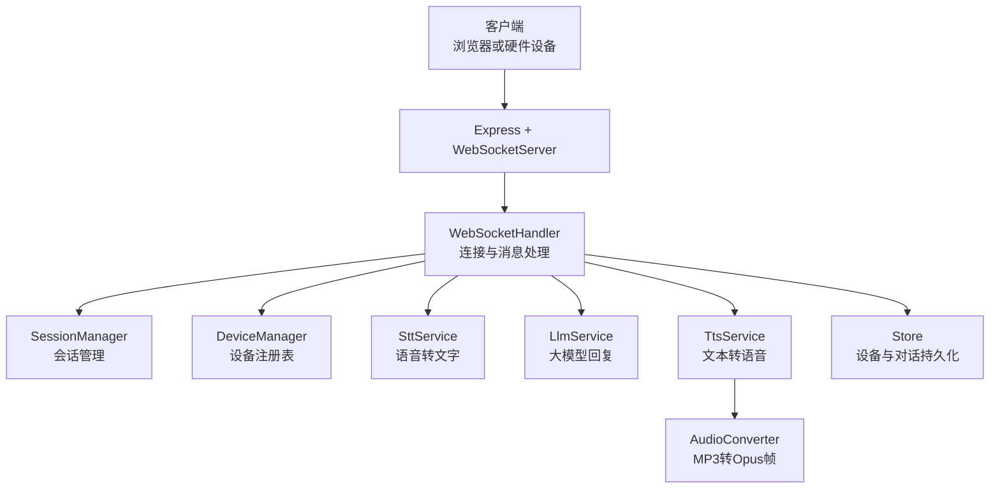
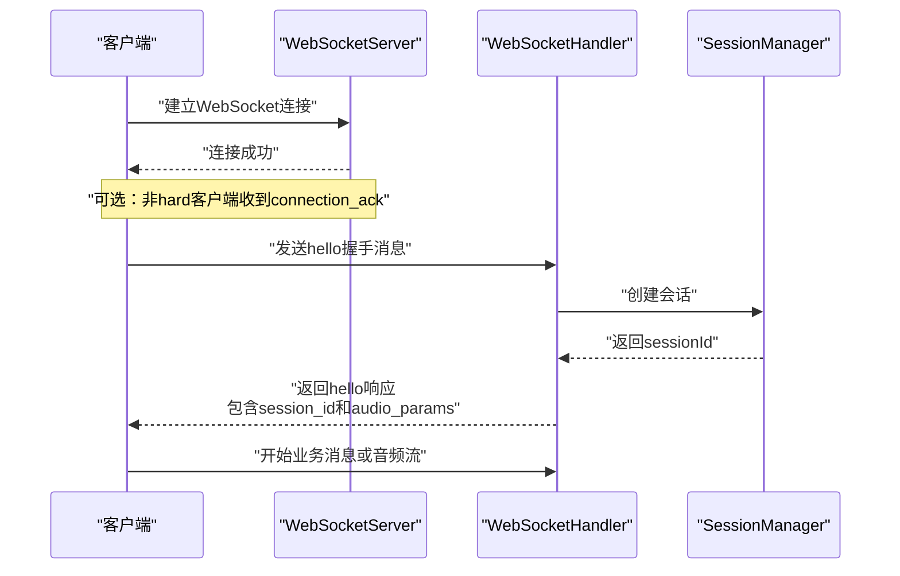
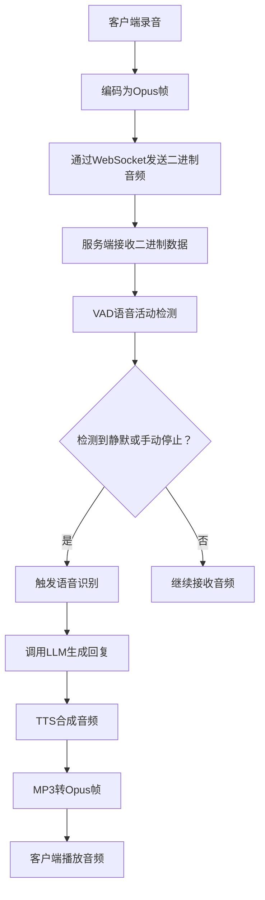
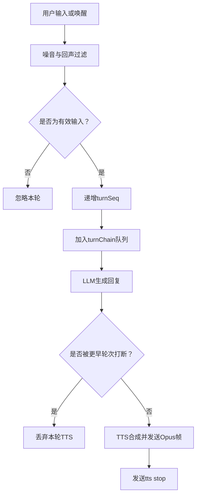
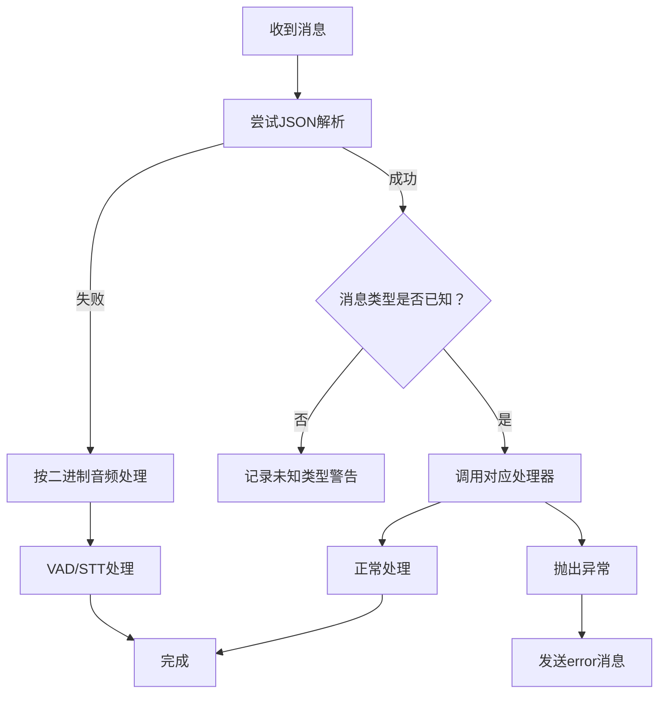
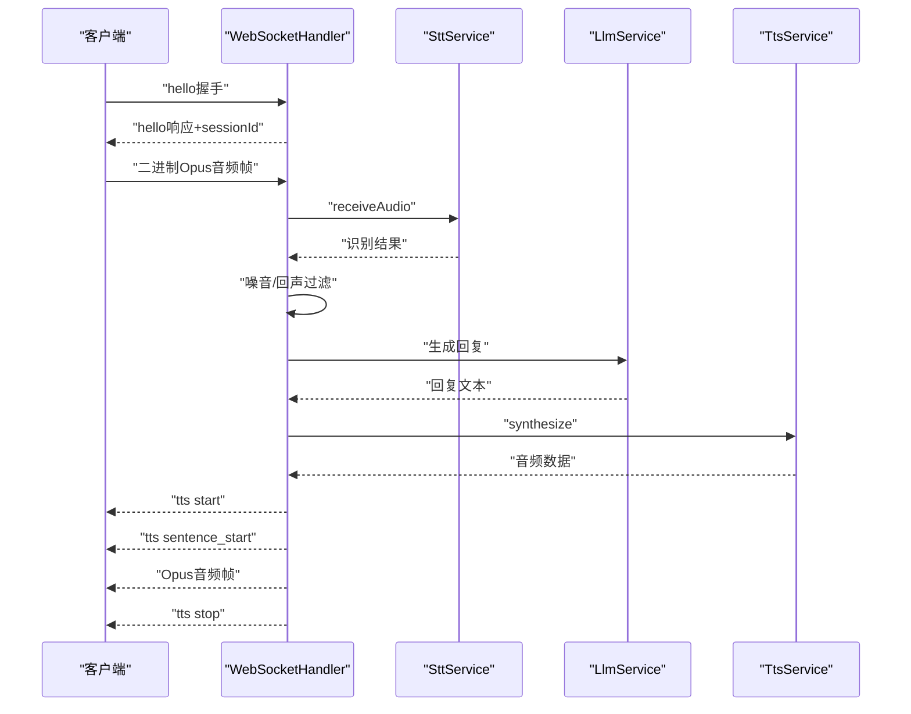
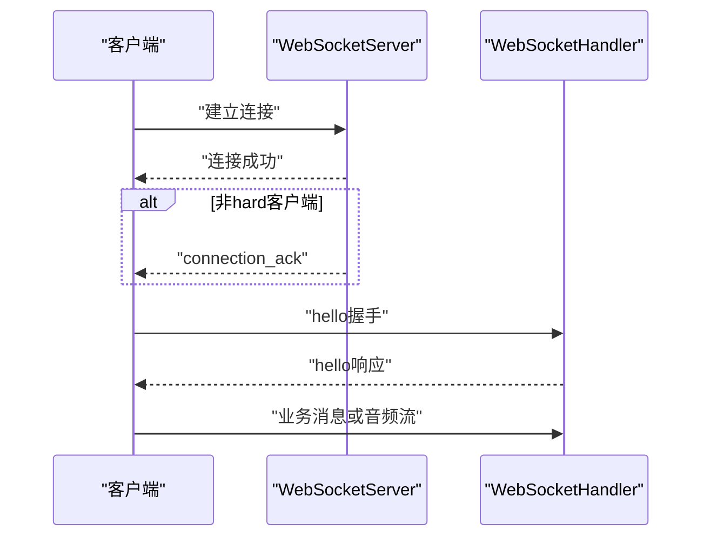

# WebSocket协议规范

<cite>
**本文引用的文件**   
- [index.js](file://index.js)
- [websocket.js（服务端）](file://core/handlers/websocket.js)
- [messageTypes.js](file://core/constants/messageTypes.js)
- [websocket.js（客户端）](file://public/chat/js/core/network/websocket.js)
- [stt.js](file://core/services/stt.js)
- [tts.js](file://core/services/tts.js)
</cite>

## 目录

1. [文档目标与适用范围](#文档目标与适用范围)
2. [系统架构总览](#系统架构总览)
3. [连接建立流程](#连接建立流程)
4. [认证机制与设备元信息](#认证机制与设备元信息)
5. [消息格式总表](#消息格式总表)
6. [文本消息规范](#文本消息规范)
7. [音频数据传输规范](#音频数据传输规范)
8. [控制消息规范](#控制消息规范)
9. [会话、轮次与打断语义](#会话轮次与打断语义)
10. [心跳与保活机制](#心跳与保活机制)
11. [断线重连策略建议](#断线重连策略建议)
12. [错误处理方案](#错误处理方案)
13. [性能优化建议](#性能优化建议)
14. [调试工具与排障清单](#调试工具与排障清单)
15. [附录：关键流程图与序列图](#附录关键流程图与序列图)

## 文档目标与适用范围

本文档面向接入小智语音交互服务的客户端开发者，定义基于 WebSocket 的实时通信协议。内容覆盖：

- 连接建立、握手、会话创建
- 认证字段与设备元信息
- 文本消息、音频数据、控制消息的完整结构
- STT 识别、LLM 回复、TTS 播放的端到端流程
- 心跳、断线重连、错误处理
- 性能优化与调试建议

本规范以服务端实现为依据，同时结合前端 Web 测试客户端的连接行为进行说明。

**章节来源**
- [index.js:254-281](file://index.js#L254-L281)
- [websocket.js（服务端）:67-169](file://core/handlers/websocket.js#L67-L169)
- [websocket.js（客户端）:356-412](file://public/chat/js/core/network/websocket.js#L356-L412)

## 系统架构总览

小智 WebSocket 服务由 Express HTTP 服务器承载，WebSocket 升级后进入统一的连接处理器。核心职责划分如下：

| 组件 | 职责 |
|---|---|
| `XiaozhiChannel` | 启动 HTTP/WS 服务、注册路由、初始化服务实例 |
| `WebSocketHandler` | 连接管理、消息分发、STT/TTS/LLM 调度、设备广播 |
| `SttService` | Opus 解码、VAD、语音转文字、多提供商适配 |
| `TtsService` | 文本转语音、音频时长估算、输出格式封装 |
| `SessionManager / DeviceManager` | 会话生命周期、在线设备注册表 |
| 前端 `WebSocketHandler` | 连接、握手、录音、播放、UI 状态同步 |

**图表来源**
- [index.js:44-81](file://index.js#L44-L81)
- [index.js:235-281](file://index.js#L235-L281)
- [websocket.js（服务端）:22-60](file://core/handlers/websocket.js#L22-L60)

**章节来源**
- [index.js:44-81](file://index.js#L44-L81)
- [index.js:235-281](file://index.js#L235-L281)
- [websocket.js（服务端）:22-60](file://core/handlers/websocket.js#L22-L60)

## 连接建立流程

### 连接入口

服务端通过 `/xiaozhi/v1/` 暴露 WebSocket 端点。客户端应使用以下地址之一：

- `ws://{host}:{port}/xiaozhi/v1/`
- `wss://{host}:{port}/xiaozhi/v1/`

服务端在 `index.js` 中创建 Express 应用和 `WebSocketServer`，并将所有连接交给 `handleWebSocketConnection`。

### 连接建立步骤

1. 客户端建立 WebSocket 连接。
2. 服务端解析请求头与 URL 参数，生成或复用 `clientId`、`deviceId`。
3. 非硬件客户端会收到 `connection_ack` 连接确认消息。
4. 客户端发送 `hello` 握手消息。
5. 服务端校验协议版本、保存设备元信息、创建会话。
6. 服务端返回 `hello` 响应，包含 `session_id` 和协商后的 `audio_params`。
7. 客户端进入业务消息阶段，可开始录音或发送文本。

**图表来源**
- [index.js:254-281](file://index.js#L254-L281)
- [websocket.js（服务端）:67-169](file://core/handlers/websocket.js#L67-L169)
- [websocket.js（服务端）:450-513](file://core/handlers/websocket.js#L450-L513)
- [websocket.js（客户端）:23-71](file://public/chat/js/core/network/websocket.js#L23-L71)

**章节来源**
- [index.js:254-281](file://index.js#L254-L281)
- [websocket.js（服务端）:67-169](file://core/handlers/websocket.js#L67-L169)
- [websocket.js（服务端）:450-513](file://core/handlers/websocket.js#L450-L513)
- [websocket.js（客户端）:23-71](file://public/chat/js/core/network/websocket.js#L23-L71)

## 认证机制与设备元信息

### 握手字段

客户端 `hello` 消息支持以下字段：

| 字段 | 类型 | 方向 | 含义 | 是否必填 |
|---|---|---|---|---|
| `type` | string | 客户端→服务端 | 固定为 `hello` | 是 |
| `device_id` | string | 客户端→服务端 | 设备唯一标识 | 推荐 |
| `device_name` | string | 客户端→服务端 | 设备名称 | 否 |
| `device_mac` | string | 客户端→服务端 | 设备MAC地址 | 否 |
| `token` | string | 客户端→服务端 | 认证令牌 | 推荐 |
| `features` | object | 客户端→服务端 | 能力声明，例如 `{ mcp: true }` | 否 |
| `version` | number | 客户端→服务端 | 协议版本；当前要求为 `1` | 硬件设备需满足 |
| `transport` | string | 客户端→服务端 | 传输方式；当前要求为 `websocket` | 硬件设备需满足 |
| `audio_params` | object | 客户端→服务端 | 音频参数，如格式、采样率、声道、帧时长 | 否 |

服务端对硬件设备会校验 `version === 1` 且 `transport === 'websocket'`；Web 客户端走兼容分支。

### 握手响应

服务端 `hello` 响应包含：

| 字段 | 类型 | 方向 | 含义 |
|---|---|---|---|
| `type` | string | 服务端→客户端 | 固定为 `hello` |
| `transport` | string | 服务端→客户端 | 固定为 `websocket` |
| `session_id` | string | 服务端→客户端 | 本次会话ID |
| `audio_params` | object | 服务端→客户端 | 协商后的音频参数 |

### 认证说明

当前实现中，`token` 字段随握手消息携带，但服务端未在此处执行强校验逻辑。若需要严格认证，应在接入层或网关层增加鉴权，或在服务端扩展握手校验逻辑。

**章节来源**
- [websocket.js（服务端）:450-513](file://core/handlers/websocket.js#L450-L513)
- [websocket.js（客户端）:23-71](file://public/chat/js/core/network/websocket.js#L23-L71)
- [messageTypes.js:6-24](file://core/constants/messageTypes.js#L6-L24)

## 消息格式总表

### 客户端发送的消息类型

| 消息类型 | 值 | 用途 | 主要字段 |
|---|---|---|---|
| `hello` | `hello` | 握手 | `device_id`, `device_name`, `device_mac`, `token`, `features`, `version`, `transport`, `audio_params` |
| `listen` | `listen` | 监听控制 | `state`, `mode`, `text` |
| `abort` | `abort` | 中断正在播放的语音 | `reason` |
| `chat` | `chat` | 直接提交完整聊天文本 | `text`, `state`, `questId`, `closeQuest` |
| `mcp` | `mcp` | MCP 工具协议消息 | `payload` |
| `start_recognition` | `start_recognition` | 通知开始语音识别 | 无强制字段 |
| `audio_data` | `audio_data` | JSON 音频数据上传 | `audioData`, `sessionId` |
| `wake_word_detected` | `wake_word_detected` | 唤醒词检测通知 | `keyword`, `confidence`, `timestamp` |
| `friend` | `friend` | 客户端间消息 | `clientid`, `data` |

### 服务端发送的消息类型

| 消息类型 | 值 | 用途 | 主要字段 |
|---|---|---|---|
| `connection_ack` | `connection_ack` | 连接确认 | `clientId`, `timestamp` |
| `error` | `error` | 错误通知 | `message`, 可选 `session_id` |
| `hello` | `hello` | 握手响应 | `transport`, `session_id`, `audio_params` |
| `recognition_started` | `recognition_started` | 识别已启动确认 | `sessionId`, `message` |
| `stt` | `stt` | 语音识别结果 | `session_id`, `text`, `timestamp` |
| `llm` | `llm` | 大模型回复 | `session_id`, `text`, `emotion`, `timestamp` |
| `tts` | `tts` | TTS 播放状态 | `session_id`, `state`, 可选 `text` |
| `tts_fallback` | `tts_fallback` | TTS 失败时的文本降级 | `session_id`, `text`, `error`, `timestamp` |
| `tts_disabled` | `tts_disabled` | TTS 未启用 | `session_id`, `text`, `timestamp` |
| `sleep` | `sleep` | 设备休眠指令 | `session_id`, `timestamp` |
| `audio_received` | `audio_received` | 音频接收确认 | `sessionId`, `timestamp` |
| `wake_word_acknowledged` | `wake_word_acknowledged` | 唤醒词确认 | `keyword`, `confidence`, `timestamp`, `message` |
| `mcp` | `mcp` | MCP 工具协议消息 | `payload` |

**章节来源**
- [messageTypes.js:6-60](file://core/constants/messageTypes.js#L6-L60)
- [websocket.js（服务端）:228-283](file://core/handlers/websocket.js#L228-L283)

## 文本消息规范

### `stt` 消息

- **方向**：服务端→客户端
- **触发时机**：语音识别出有效文本时
- **关键字段**：
  - `session_id`：会话ID
  - `text`：识别出的文本
  - `timestamp`：时间戳

客户端收到 `stt` 后可用于显示用户输入、绑定提示、摄像头状态变更等。

### `llm` 消息

- **方向**：服务端→客户端
- **触发时机**：LLM 生成回复后
- **关键字段**：
  - `session_id`：会话ID
  - `text`：LLM 回复文本
  - `emotion`：情感标签，如 `happy`、`sad`、`neutral`
  - `timestamp`：时间戳

### `chat` 消息

- **方向**：客户端→服务端
- **触发时机**：客户端直接提交完整文本，跳过录音识别流程
- **关键字段**：
  - `type`：固定为 `chat`
  - `text`：用户文本
  - `state`：通常为 `complete`
  - `questId`：可选，指定对话上下文
  - `closeQuest`：可选，关闭当前 Quest 并创建新对话

**章节来源**
- [websocket.js（服务端）:615-638](file://core/handlers/websocket.js#L615-L638)
- [websocket.js（服务端）:992-1015](file://core/handlers/websocket.js#L992-L1015)
- [websocket.js（客户端）:480-513](file://public/chat/js/core/network/websocket.js#L480-L513)

## 音频数据传输规范

### 传输方式

项目支持两种音频传输方式：

1. **二进制流**：客户端直接发送二进制音频帧，服务端按 `handleBinaryData` 处理。
2. **JSON 音频消息**：通过 `audio_data` 消息携带 Base64 编码的音频数据。

### 二进制音频帧

- **编码格式**：Opus
- **采样率**：默认 16000 Hz
- **声道**：单声道
- **帧时长**：默认 60 ms
- **传输方向**：客户端→服务端
- **处理逻辑**：
  - 空帧表示录音结束
  - 服务端进行 VAD 检测
  - 根据静默阈值或手动停止触发 STT 识别
  - 识别成功后进入 LLM+TTS 流程

### JSON 音频消息

- **消息类型**：`audio_data`
- **关键字段**：
  - `audioData`：Base64 编码的音频数据
  - `sessionId`：可选，会话ID
- **服务端响应**：`audio_received`

### 音频播放

服务端将 TTS 合成的 MP3 转换为 Opus 帧，按固定帧时长逐帧发送。客户端收到二进制音频后入队播放。

**图表来源**
- [websocket.js（服务端）:289-446](file://core/handlers/websocket.js#L289-L446)
- [websocket.js（服务端）:1025-1189](file://core/handlers/websocket.js#L1025-L1189)
- [websocket.js（客户端）:334-354](file://public/chat/js/core/network/websocket.js#L334-L354)

**章节来源**
- [websocket.js（服务端）:289-446](file://core/handlers/websocket.js#L289-L446)
- [websocket.js（服务端）:1025-1189](file://core/handlers/websocket.js#L1025-L1189)
- [websocket.js（服务端）:1218-1265](file://core/handlers/websocket.js#L1218-L1265)
- [websocket.js（客户端）:334-354](file://public/chat/js/core/network/websocket.js#L334-L354)
- [stt.js:348-383](file://core/services/stt.js#L348-L383)
- [tts.js:62-104](file://core/services/tts.js#L62-L104)

## 控制消息规范

### `listen` 消息

- **方向**：客户端→服务端
- **用途**：控制监听状态
- **关键字段**：
  - `state`：`start`、`stop`、`detect`
  - `mode`：监听模式，如 `auto`、`manual`
  - `text`：当 `state === detect` 时，可直接传入文本

处理逻辑：

| state | 行为 |
|---|---|
| `start` | 清除上一轮音频缓冲，准备新一轮采集 |
| `stop` | 设置语音停止标志，触发 STT 识别 |
| `detect` | 不缓存音频，直接处理文本 |

### `abort` 消息

- **方向**：客户端→服务端
- **用途**：主动打断正在播放的语音
- **关键字段**：`reason`

服务端会根据轮次归属中止旧轮音频流，避免误杀后续新轮。

### `wake_word_detected` 消息

- **方向**：客户端→服务端
- **用途**：通知服务端已检测到唤醒词
- **关键字段**：`keyword`, `confidence`, `timestamp`
- **服务端响应**：`wake_word_acknowledged`

### `start_recognition` 消息

- **方向**：客户端→服务端
- **用途**：通知开始连续语音识别
- **服务端响应**：`recognition_started`

**章节来源**
- [websocket.js（服务端）:515-643](file://core/handlers/websocket.js#L515-L643)
- [websocket.js（服务端）:1267-1293](file://core/handlers/websocket.js#L1267-L1293)
- [messageTypes.js:6-24](file://core/constants/messageTypes.js#L6-L24)

## 会话、轮次与打断语义

### 会话

- 每个连接可关联一个 `sessionId`
- 首次收到业务消息或握手时会创建会话
- 会话用于 STT 缓冲区、TTS 播放状态、对话记录

### 轮次

- 每次有效用户输入会递增 `turnSeq`
- 同一连接的应答流程通过 `turnChain` 串行化，防止 Opus 帧交错
- 每轮有超时保护，避免 LLM 或 TTS 挂死导致队列永久阻塞

### 打断

- 客户端发送 `abort` 或服务端检测到新一轮输入时，会设置 `abortUpTo`
- 音频发送循环检查 `abortUpTo`，中止旧轮剩余帧
- 放送、固定播报、对话应答共用同一轮次语义，保证插话后能听到新回答

**图表来源**
- [websocket.js（服务端）:651-694](file://core/handlers/websocket.js#L651-L694)
- [websocket.js（服务端）:1025-1189](file://core/handlers/websocket.js#L1025-L1189)
- [websocket.js（服务端）:1654-1689](file://core/handlers/websocket.js#L1654-L1689)

**章节来源**
- [websocket.js（服务端）:651-694](file://core/handlers/websocket.js#L651-L694)
- [websocket.js（服务端）:1025-1189](file://core/handlers/websocket.js#L1025-L1189)
- [websocket.js（服务端）:1654-1689](file://core/handlers/websocket.js#L1654-L1689)

## 心跳与保活机制

当前服务端实现中：

- 连接建立后会监听 `pong` 事件，更新 `isAlive` 标志
- 心跳检测方法 `startHeartbeat` 和 `stopHeartbeat` 存在但未实现具体逻辑
- 实际保活依赖底层 WebSocket 协议或上层业务消息

因此，当前协议**不建议完全依赖服务端自动心跳断开空闲连接**。生产环境建议：

- 客户端定期发送轻量业务消息作为保活
- 或使用标准 WebSocket Ping/Pong，并在服务端实现定时探测
- 在网络不稳定场景下配合断线重连策略

**章节来源**
- [websocket.js（服务端）:165-169](file://core/handlers/websocket.js#L165-L169)
- [websocket.js（服务端）:1523-1537](file://core/handlers/websocket.js#L1523-L1537)

## 断线重连策略建议

虽然代码未提供统一的重连管理器，但客户端应自行实现健壮的重连逻辑。建议策略如下：

| 场景 | 行为 |
|---|---|
| 连接失败 | 指数退避重试，最大间隔不超过固定上限 |
| 连接正常但握手超时 | 重新建立连接并重发 `hello` |
| 连接断开 | 清理录音、播放、摄像头等资源后重连 |
| 业务异常 | 保留 `sessionId` 或重建会话，视业务需求而定 |
| 频繁断线 | 上报错误日志，提示网络或服务器问题 |

前端客户端示例中，连接成功后会发送 `hello`，并在收到 `hello` 响应后认为握手成功。断线后会触发 `onclose`，清理录音器和摄像头状态。

**章节来源**
- [websocket.js（客户端）:23-71](file://public/chat/js/core/network/websocket.js#L23-L71)
- [websocket.js（客户端）:414-458](file://public/chat/js/core/network/websocket.js#L414-L458)

## 错误处理方案

### 通用错误

服务端通过 `sendError` 发送 `error` 消息，包含错误信息和可选 `session_id`。常见触发点：

- 消息解析失败
- 缺少必要字段
- 目标设备不存在或不在线
- STT/TTS 调用失败
- 设备注册失败

### 音频相关错误

- STT 服务未初始化：跳过音频处理
- Opus 解码失败：记录警告并跳过该帧
- TTS 合成失败：发送 `tts_fallback` 文本降级
- TTS 未启用：发送 `tts_disabled`

### 连接相关错误

- 设备注册失败：断开连接并返回错误
- 未知消息类型：记录警告
- 好友消息目标不在线：返回错误

**图表来源**
- [websocket.js（服务端）:228-283](file://core/handlers/websocket.js#L228-L283)
- [websocket.js（服务端）:1507-1521](file://core/handlers/websocket.js#L1507-L1521)

**章节来源**
- [websocket.js（服务端）:228-283](file://core/handlers/websocket.js#L228-L283)
- [websocket.js（服务端）:1507-1521](file://core/handlers/websocket.js#L1507-L1521)
- [websocket.js（服务端）:1218-1265](file://core/handlers/websocket.js#L1218-L1265)
- [websocket.js（服务端）:1104-1126](file://core/handlers/websocket.js#L1104-L1126)

## 性能优化建议

### 音频传输

- 使用二进制 Opus 帧而非 Base64 JSON，减少序列化开销
- 保持帧时长稳定，避免客户端播放抖动
- 在无AEC设备上启用广播静音闸门，防止麦克风拾取自身喇叭声音

### 识别与合成

- 合理配置 VAD 静默阈值，避免底噪误触发
- 使用 `maxUtteranceMs` 兜底，防止长语音无限“倾听中”
- LLM 调用设置超时保护，避免单轮挂死
- TTS 合成失败时回退文本，提升用户体验

### 并发与队列

- 使用 `turnChain` 串行化同一连接的音频发送
- 广播和固定播报也复用轮次语义，避免多条流交错
- 会话级 STT 缓冲区限制大小，防止内存膨胀

### 资源清理

- 连接断开时移除设备、标记离线、清理会话
- TTS 播放结束后重置说话状态
- 录音器、摄像头、Live2D 动画在断线时清理

**章节来源**
- [websocket.js（服务端）:289-446](file://core/handlers/websocket.js#L289-L446)
- [websocket.js（服务端）:651-694](file://core/handlers/websocket.js#L651-L694)
- [websocket.js（服务端）:1025-1189](file://core/handlers/websocket.js#L1025-L1189)
- [websocket.js（服务端）:1654-1689](file://core/handlers/websocket.js#L1654-L1689)
- [stt.js:348-383](file://core/services/stt.js#L348-L383)
- [tts.js:163-202](file://core/services/tts.js#L163-L202)

## 调试工具与排障清单

### 常用排查项

| 问题 | 检查点 |
|---|---|
| 无法连接 | 检查 WS/WSS 地址、端口、HTTPS 配置 |
| 握手失败 | 检查 `hello` 字段、协议版本、transport |
| 没有识别结果 | 检查录音是否正常、Opus 帧是否到达、VAD 阈值 |
| 语音卡顿 | 检查帧时长、客户端播放队列、网络延迟 |
| 反复打断 | 检查 echo 判定、broadcastActive、abortUpTo |
| TTS 无声 | 检查 TTS 服务是否启用、合成是否成功、Opus 转换 |
| 设备离线 | 检查设备注册表、连接状态、store 离线标记 |

### 调试建议

- 开启服务端日志，观察消息类型和处理路径
- 使用浏览器开发者工具查看 WebSocket 消息
- 录制首包 Opus 数据进行 PCM 诊断
- 调整 `/api/settings/audio` 中的振幅阈值和静默阈值
- 使用 `/health`、`/api/devices`、`/api/conversations` 等 API 辅助定位

**章节来源**
- [index.js:287-443](file://index.js#L287-L443)
- [websocket.js（服务端）:289-446](file://core/handlers/websocket.js#L289-L446)
- [websocket.js（客户端）:444-458](file://public/chat/js/core/network/websocket.js#L444-L458)

## 附录：关键流程图与序列图

### 完整语音对话序列

**图表来源**
- [websocket.js（服务端）:450-513](file://core/handlers/websocket.js#L450-L513)
- [websocket.js（服务端）:289-446](file://core/handlers/websocket.js#L289-L446)
- [websocket.js（服务端）:651-818](file://core/handlers/websocket.js#L651-L818)
- [websocket.js（服务端）:1025-1189](file://core/handlers/websocket.js#L1025-L1189)
- [stt.js:348-383](file://core/services/stt.js#L348-L383)
- [tts.js:62-104](file://core/services/tts.js#L62-L104)

### 连接与握手序列

**图表来源**
- [index.js:254-281](file://index.js#L254-L281)
- [websocket.js（服务端）:67-169](file://core/handlers/websocket.js#L67-L169)
- [websocket.js（服务端）:450-513](file://core/handlers/websocket.js#L450-L513)
- [websocket.js（客户端）:23-71](file://public/chat/js/core/network/websocket.js#L23-L71)