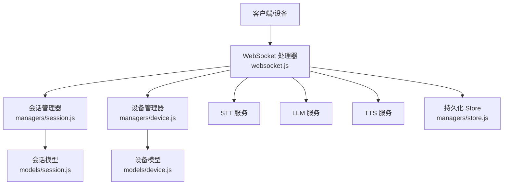
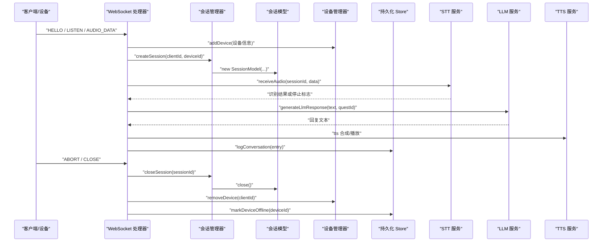
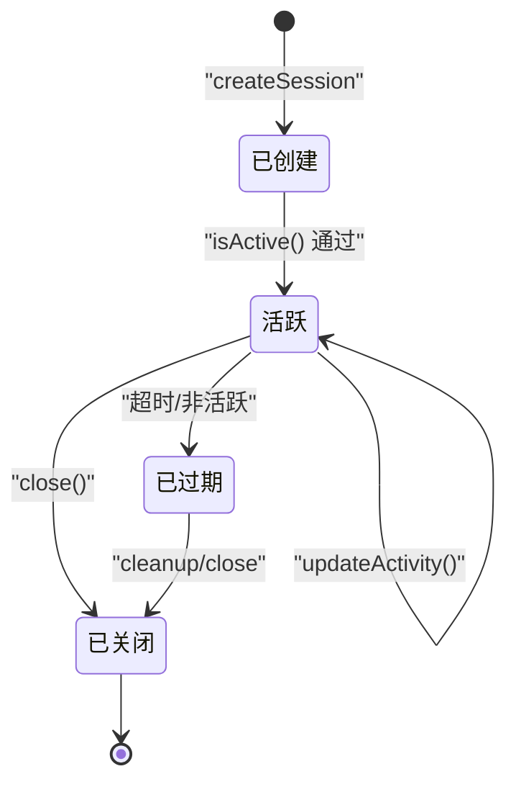
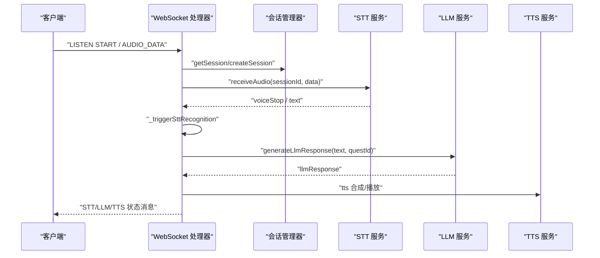

# 会话生命周期管理

<cite>
**本文引用的文件**   
- [index.js](file://index.js)
- [websocket.js](file://core/handlers/websocket.js)
- [session.js](file://core/managers/session.js)
- [session.js](file://core/models/session.js)
- [device.js](file://core/managers/device.js)
- [device.js](file://core/models/device.js)
- [store.js](file://core/managers/store.js)
- [messageTypes.js](file://core/constants/messageTypes.js)
</cite>

## 目录
1. [引言](#引言)
2. [项目结构与定位](#项目结构与定位)
3. [核心组件与职责](#核心组件与职责)
4. [系统架构总览](#系统架构总览)
5. [会话生命周期详解](#会话生命周期详解)
6. [状态转换与时序流程](#状态转换与时序流程)
7. [多轮对话上下文保持](#多轮对话上下文保持)
8. [会话数据持久化方案](#会话数据持久化方案)
9. [并发与会话隔离](#并发与会话隔离)
10. [会话监控接口与状态查询](#会话监控接口与状态查询)
11. [设备绑定、隔离与同步](#设备绑定隔离与同步)
12. [超时处理与故障恢复](#超时处理与故障恢复)
13. [性能特征与优化建议](#性能特征与优化建议)
14. [排障指南](#排障指南)
15. [结论](#结论)

## 引言
本文围绕小智语音交互服务中的“会话”展开，系统性说明会话的创建、状态维护、销毁机制，以及会话状态转换、超时处理、资源清理。同时覆盖多轮对话上下文保持、会话数据持久化、并发会话管理、会话监控接口、状态查询方法、故障恢复策略，并解释会话与设备的绑定关系、会话隔离机制和数据同步方案。目标是让具备不同技术背景的读者都能理解并正确使用该系统的会话能力。

## 项目结构与定位
本仓库采用按领域分层组织：入口层负责服务启动与路由；核心层包含处理器、管理器、模型、服务和常量；工具层提供日志等通用能力。会话生命周期相关代码主要分布在以下位置：
- 入口与服务装配：[index.js](file://index.js)
- WebSocket 连接与消息处理（会话创建/销毁触发点）：[websocket.js](file://core/handlers/websocket.js)
- 会话管理器（内存级会话集合与生命周期控制）：[session.js](file://core/managers/session.js)
- 会话模型（会话数据结构与状态判断）：[session.js](file://core/models/session.js)
- 设备管理器与设备模型（设备在线状态、注册表）：[device.js](file://core/managers/device.js)、[device.js](file://core/models/device.js)
- 持久化存储（设备登记与对话记录）：[store.js](file://core/managers/store.js)
- 消息类型常量（客户端/服务端消息协议）：[messageTypes.js](file://core/constants/messageTypes.js)

图表来源
- [index.js:180-249](file://index.js#L180-L249)
- [websocket.js:22-60](file://core/handlers/websocket.js#L22-L60)
- [session.js:4-10](file://core/managers/session.js#L4-L10)
- [store.js:29-83](file://core/managers/store.js#L29-L83)

章节来源
- [index.js:180-249](file://index.js#L180-L249)
- [websocket.js:22-60](file://core/handlers/websocket.js#L22-L60)

## 核心组件与职责
- WebSocket 处理器：负责连接建立、设备注册、消息分发、音频流处理、会话自动创建与关闭、轮次串行化与超时保护。
- 会话管理器：维护内存中的会话集合、会话映射、活动检测、上下文存取、批量关闭与统计。
- 会话模型：定义会话字段、生成会话ID、活跃性判定、活动时间更新、关闭与上下文操作、基础校验。
- 设备管理器：维护设备注册表、在线状态、离线清理、搜索与统计。
- 持久化 Store：SQLite 实现设备登记与对话记录写入/查询，失败降级为 no-op，不影响主流程。
- 消息类型常量：统一客户端与服务端消息类型、监听状态、聊天状态、TTS 子状态等。

章节来源
- [websocket.js:22-60](file://core/handlers/websocket.js#L22-L60)
- [session.js:4-10](file://core/managers/session.js#L4-L10)
- [session.js:3-16](file://core/models/session.js#L3-L16)
- [device.js:4-9](file://core/managers/device.js#L4-L9)
- [store.js:29-83](file://core/managers/store.js#L29-L83)
- [messageTypes.js:7-109](file://core/constants/messageTypes.js#L7-L109)

## 系统架构总览
下图展示从客户端连接到会话创建、音频识别、LLM/TTS 处理、到会话关闭的整体链路，以及与设备和持久化的交互。

图表来源
- [websocket.js:67-169](file://core/handlers/websocket.js#L67-L169)
- [websocket.js:450-643](file://core/handlers/websocket.js#L450-L643)
- [websocket.js:651-694](file://core/handlers/websocket.js#L651-L694)
- [session.js:13-45](file://core/managers/session.js#L13-L45)
- [session.js:81-99](file://core/managers/session.js#L81-L99)
- [store.js:158-175](file://core/managers/store.js#L158-L175)

## 会话生命周期详解
### 1. 会话创建
- 触发时机：
  - HELLO 握手成功后立即创建会话，并将 sessionId 回传给客户端。
  - 收到 AUDIO_DATA 且当前 ws.sessionId 为空时，自动创建会话。
  - LISTEN STOP 手动停止时若未创建会话，也会自动创建。
- 创建过程：
  - 调用会话管理器的 createSession，传入 clientId 与 deviceId。
  - 会话管理器校验数据、检查最大会话数限制，必要时先清理过期会话。
  - 实例化会话模型，加入内存 Map，并维护 clientId -> sessionIds 的映射。
- 关键路径参考：
  - HELLO 后创建：[websocket.js:493-503](file://core/handlers/websocket.js#L493-L503)
  - 音频数据自动创建：[websocket.js:352-361](file://core/handlers/websocket.js#L352-L361)
  - 手动停止自动创建：[websocket.js:555-563](file://core/handlers/websocket.js#L555-L563)
  - 会话创建逻辑：[session.js:13-45](file://core/managers/session.js#L13-L45)

### 2. 状态维护
- 会话状态：active、inactive、closed。
- 活跃性判定：
  - 会话模型 isActive() 基于 status 与 lastActivity 时间差（默认 5 分钟）。
  - 每次获取会话会更新 lastActivity，延长存活时间。
- 上下文维护：
  - addContext(key, value) 与 getContext(key) 用于保存多轮对话上下文。
- 关键路径参考：
  - 活跃性判定与更新时间：[session.js:38-46](file://core/models/session.js#L38-L46)
  - 上下文存取：[session.js:54-61](file://core/models/session.js#L54-L61)
  - 获取会话并更新活动：[session.js:48-55](file://core/managers/session.js#L48-L55)

### 3. 会话销毁
- 触发时机：
  - ABORT 消息：主动中断并关闭会话。
  - 连接断开：handleDisconnect 中清理设备与持久化标记。
  - 定时清理：cleanupSessions 根据超时阈值关闭过期会话。
- 销毁过程：
  - closeSession 将会话状态置为 closed，设置 endTime，并从客户端会话映射移除。
  - 设备管理器 removeDevice 清理在线设备。
  - 持久化 Store markDeviceOffline 标记设备离线。
- 关键路径参考：
  - ABORT 关闭会话：[websocket.js:592-608](file://core/handlers/websocket.js#L592-L608)
  - 连接断开清理：[websocket.js:174-193](file://core/handlers/websocket.js#L174-L193)
  - 定时清理过期会话：[session.js:118-138](file://core/managers/session.js#L118-L138)
  - 关闭会话逻辑：[session.js:81-99](file://core/managers/session.js#L81-L99)

章节来源
- [websocket.js:352-361](file://core/handlers/websocket.js#L352-L361)
- [websocket.js:493-503](file://core/handlers/websocket.js#L493-L503)
- [websocket.js:555-563](file://core/handlers/websocket.js#L555-L563)
- [websocket.js:592-608](file://core/handlers/websocket.js#L592-L608)
- [websocket.js:174-193](file://core/handlers/websocket.js#L174-L193)
- [session.js:13-45](file://core/managers/session.js#L13-L45)
- [session.js:48-55](file://core/managers/session.js#L48-L55)
- [session.js:81-99](file://core/managers/session.js#L81-L99)
- [session.js:118-138](file://core/managers/session.js#L118-L138)
- [session.js:38-46](file://core/models/session.js#L38-L46)
- [session.js:54-61](file://core/models/session.js#L54-L61)

## 状态转换与时序流程
### 会话状态机

图表来源
- [session.js:38-52](file://core/models/session.js#L38-L52)
- [session.js:81-99](file://core/managers/session.js#L81-L99)
- [session.js:118-138](file://core/managers/session.js#L118-L138)

### 单轮对话时序

图表来源
- [websocket.js:326-446](file://core/handlers/websocket.js#L326-L446)
- [websocket.js:651-694](file://core/handlers/websocket.js#L651-L694)

章节来源
- [session.js:38-52](file://core/models/session.js#L38-L52)
- [websocket.js:326-446](file://core/handlers/websocket.js#L326-L446)
- [websocket.js:651-694](file://core/handlers/websocket.js#L651-L694)

## 多轮对话上下文保持
- 会话上下文：
  - 每个会话拥有独立的 context 对象，支持 addContext 与 getContext。
  - 适用于保存用户偏好、历史摘要、任务参数等跨轮次共享的数据。
- 轮次串行化：
  - 同一连接同一时刻只有一条应答流程在发送音频，避免 Opus 帧交错。
  - 使用 turnSeq 与 abortUpTo 实现轮次归属与打断控制。
- Quest 管理：
  - 每轮对话可关联一个 Quest，用于管理对话历史与消息计数。
- 关键路径参考：
  - 上下文存取：[session.js:54-61](file://core/models/session.js#L54-L61)
  - 轮次串行化与超时保护：[websocket.js:672-694](file://core/handlers/websocket.js#L672-L694)
  - Quest 获取/创建与消息计数：[websocket.js:745-770](file://core/handlers/websocket.js#L745-L770)

章节来源
- [session.js:54-61](file://core/models/session.js#L54-L61)
- [websocket.js:672-694](file://core/handlers/websocket.js#L672-L694)
- [websocket.js:745-770](file://core/handlers/websocket.js#L745-L770)

## 会话数据持久化方案
- 持久化范围：
  - 设备登记：记录已知设备、在线状态、首次/最后出现时间、连接次数等。
  - 对话记录：每条 user/bot 输入与回复均落库，附带 session_id、device_id、quest_id、role、text、emotion、provider、created_at。
- 设计约束：
  - 写失败不阻断主流程，内部捕获异常并降级为 no-op。
  - 数据库不可用时禁用持久化，服务仍可运行。
- 关键路径参考：
  - 初始化与表结构：[store.js:37-83](file://core/managers/store.js#L37-L83)
  - 设备登记与离线标记：[store.js:91-135](file://core/managers/store.js#L91-L135)
  - 对话记录写入与查询：[store.js:158-202](file://core/managers/store.js#L158-L202)
  - 统计接口：[store.js:206-226](file://core/managers/store.js#L206-L226)

章节来源
- [store.js:37-83](file://core/managers/store.js#L37-L83)
- [store.js:91-135](file://core/managers/store.js#L91-L135)
- [store.js:158-202](file://core/managers/store.js#L158-L202)
- [store.js:206-226](file://core/managers/store.js#L206-L226)

## 并发与会话隔离
- 会话隔离：
  - 每个会话独立 sessionId，上下文互不干扰。
  - 客户端到会话映射 clientSessions 保证按客户端维度管理多个会话。
- 并发安全：
  - 单轮对话串行化：turnChain 确保同一连接同一时刻仅一条应答流程。
  - 轮次序号与中止标志：turnSeq 与 abortUpTo 防止旧轮与新轮互相影响。
- 资源清理：
  - 批量关闭会话 batchCloseSessionIds 提供容错式批量关闭。
  - 清理过期会话 cleanupSessions 与按客户端清理 cleanupClientSessions。
- 关键路径参考：
  - 会话映射与获取：[session.js:6-10](file://core/managers/session.js#L6-L10)
  - 轮次串行化：[websocket.js:672-694](file://core/handlers/websocket.js#L672-L694)
  - 批量关闭：[session.js:170-187](file://core/managers/session.js#L170-L187)
  - 清理过期会话：[session.js:118-138](file://core/managers/session.js#L118-L138)

章节来源
- [session.js:6-10](file://core/managers/session.js#L6-L10)
- [session.js:118-138](file://core/managers/session.js#L118-L138)
- [session.js:170-187](file://core/managers/session.js#L170-L187)
- [websocket.js:672-694](file://core/handlers/websocket.js#L672-L694)

## 会话监控接口与状态查询
- 健康检查：
  - GET /health：返回频道状态、设备数量、运行时长。
- 设备与对话统计：
  - GET /api/devices/stats：返回 live（在线设备统计）与 registered（持久化统计）。
- 设备列表：
  - GET /api/devices：返回当前在线设备列表。
  - GET /api/devices/known：返回持久化设备注册表（含离线）。
- 对话记录：
  - GET /api/conversations：支持按 deviceId、role、limit、offset 过滤。
- 会话管理：
  - GET /api/sessions：返回内存中的会话 Map（便于调试）。
- 广播与断开：
  - POST /api/disconnect：断开指定在线设备。
  - POST /api/broadcast：向目标设备推送语音放送。
- 关键路径参考：
  - 健康检查与路由：[index.js:287-344](file://index.js#L287-L344)
  - 设备与对话统计：[index.js:357-395](file://index.js#L357-L395)
  - 会话管理接口：[index.js:397-404](file://index.js#L397-L404)
  - 广播与断开：[index.js:406-425](file://index.js#L406-L425)

章节来源
- [index.js:287-344](file://index.js#L287-L344)
- [index.js:357-395](file://index.js#L357-L395)
- [index.js:397-404](file://index.js#L397-L404)
- [index.js:406-425](file://index.js#L406-L425)

## 设备绑定、隔离与同步
- 设备绑定：
  - 连接建立时解析 client-id、device-id，并在设备管理器中注册设备。
  - HELLO 携带 device_id、device_name、device_mac、token、features 等元信息，补全设备注册表。
  - 会话创建时携带 deviceId，形成“会话-设备”绑定。
- 设备隔离：
  - 设备管理器以 clientId 与 deviceId 双索引维护设备，避免冲突。
  - 设备在线状态由 isOnline() 判定，结合 lastActivity 与状态位。
- 数据同步：
  - WebSocket 断开时调用 store.markDeviceOffline 标记离线。
  - OTA 上报与 WS 接入共用 recordDevice 进行设备登记。
- 关键路径参考：
  - 连接建立与设备注册：[websocket.js:67-142](file://core/handlers/websocket.js#L67-L142)
  - HELLO 元信息补登：[websocket.js:453-513](file://core/handlers/websocket.js#L453-L513)
  - 会话创建携带 deviceId：[websocket.js:493-503](file://core/handlers/websocket.js#L493-L503)
  - 断开标记离线：[websocket.js:174-193](file://core/handlers/websocket.js#L174-L193)
  - 设备模型在线判定：[device.js:44-47](file://core/models/device.js#L44-L47)
  - 设备管理器在线清理：[device.js:100-116](file://core/managers/device.js#L100-L116)

章节来源
- [websocket.js:67-142](file://core/handlers/websocket.js#L67-L142)
- [websocket.js:453-513](file://core/handlers/websocket.js#L453-L513)
- [websocket.js:493-503](file://core/handlers/websocket.js#L493-L503)
- [websocket.js:174-193](file://core/handlers/websocket.js#L174-L193)
- [device.js:44-47](file://core/models/device.js#L44-L47)
- [device.js:100-116](file://core/managers/device.js#L100-L116)

## 超时处理与故障恢复
- 会话超时：
  - 会话模型 isActive() 基于 lastActivity 与 5 分钟阈值判定。
  - 会话管理器 cleanupSessions 定期扫描并关闭过期会话。
- 轮次超时：
  - 单轮对话 _runChatTurn 使用 Promise.race 与 TURN_TIMEOUT_MS 配置，防止 LLM 无响应导致队列永久阻塞。
- 空闲检测：
  - 音频处理路径中 _checkIdleTimeout 用于长时间空闲检测，辅助 say goodbye 等策略。
- 故障恢复：
  - 持久化 Store 写失败降级为 no-op，不影响主流程。
  - 设备注册失败仅断开当前连接，不拖垮整个服务进程。
- 关键路径参考：
  - 会话活跃性判定：[session.js:38-46](file://core/models/session.js#L38-L46)
  - 会话清理：[session.js:118-138](file://core/managers/session.js#L118-L138)
  - 轮次超时保护：[websocket.js:672-694](file://core/handlers/websocket.js#L672-L694)
  - 空闲检测：[websocket.js:347-349](file://core/handlers/websocket.js#L347-L349)
  - Store 降级：[store.js:77-83](file://core/managers/store.js#L77-L83)
  - 设备注册失败处理：[websocket.js:135-142](file://core/handlers/websocket.js#L135-L142)

章节来源
- [session.js:38-46](file://core/models/session.js#L38-L46)
- [session.js:118-138](file://core/managers/session.js#L118-L138)
- [websocket.js:347-349](file://core/handlers/websocket.js#L347-L349)
- [websocket.js:672-694](file://core/handlers/websocket.js#L672-L694)
- [store.js:77-83](file://core/managers/store.js#L77-L83)
- [websocket.js:135-142](file://core/handlers/websocket.js#L135-L142)

## 性能特征与优化建议
- 内存结构：
  - 会话与设备均以 Map 存储，O(1) 查找，适合高并发场景。
- I/O 分离：
  - 持久化写失败不阻塞主流程，降低抖动。
- 音频处理：
  - VAD 窗口与静默阈值可配置，减少误触发与无效识别。
- 建议：
  - 合理配置会话超时与轮次超时，平衡用户体验与资源占用。
  - 对高频查询的设备/对话记录增加缓存层，减轻 SQLite 压力。
  - 针对大流量场景，考虑会话与设备分片存储，提升扩展性。

[本节为通用性能讨论，不直接分析具体文件]

## 排障指南
- 常见问题：
  - 会话未创建：检查 HELLO 是否成功、ws.sessionId 是否为空、AUDIO_DATA 是否到达。
  - 会话未关闭：检查 ABORT 是否发送、连接是否断开、cleanupSessions 是否执行。
  - 设备离线未标记：检查 handleDisconnect 是否调用 markDeviceOffline。
  - 对话记录缺失：检查 Store 是否启用、logConversation 是否被调用。
- 诊断步骤：
  - 查看 /api/sessions 与 /api/devices/stats 确认内存状态。
  - 查看 /api/devices/known 与 /api/conversations 确认持久化状态。
  - 检查日志中“设备注册失败”“对话记录写入失败”等降级警告。
- 关键路径参考：
  - 会话创建与关闭：[websocket.js:352-361](file://core/handlers/websocket.js#L352-L361)、[websocket.js:592-608](file://core/handlers/websocket.js#L592-L608)
  - 设备离线标记：[websocket.js:174-193](file://core/handlers/websocket.js#L174-L193)
  - 对话记录写入：[store.js:158-175](file://core/managers/store.js#L158-L175)

章节来源
- [websocket.js:352-361](file://core/handlers/websocket.js#L352-L361)
- [websocket.js:592-608](file://core/handlers/websocket.js#L592-L608)
- [websocket.js:174-193](file://core/handlers/websocket.js#L174-L193)
- [store.js:158-175](file://core/managers/store.js#L158-L175)

## 结论
本系统通过 WebSocket 处理器、会话管理器、会话模型、设备管理器与持久化 Store 的协同，实现了完整的会话生命周期管理。会话在连接建立与音频数据到达时自动创建，在 ABORT、连接断开或超时时销毁；状态维护依赖 lastActivity 与 status 字段；多轮对话通过上下文与轮次串行化保障一致性；持久化层保证设备与对话记录的可靠落盘，同时具备降级能力；API 暴露了丰富的监控与查询接口，便于运维与排障。整体设计兼顾性能、可扩展性与鲁棒性，适合物联网语音交互场景。