# 消息协议规范

<cite>
**本文引用的文件**   
- [core/constants/messageTypes.js](file://core/constants/messageTypes.js)
- [core/handlers/websocket.js](file://core/handlers/websocket.js)
- [public/chat/js/core/network/websocket.js](file://public/chat/js/core/network/websocket.js)
- [core/services/stt.js](file://core/services/stt.js)
- [core/services/tts.js](file://core/services/tts.js)
- [core/services/llm.js](file://core/services/llm.js)
</cite>

## 目录
1. [引言](#引言)
2. [项目结构](#项目结构)
3. [核心组件](#核心组件)
4. [架构总览](#架构总览)
5. [详细组件分析](#详细组件分析)
6. [依赖关系分析](#依赖关系分析)
7. [性能与实时性](#性能与实时性)
8. [故障排查指南](#故障排查指南)
9. [结论](#结论)
10. [附录：消息定义与错误码](#附录消息定义与错误码)

## 引言
本文件面向开发者与设备集成方，完整描述 WebSocket 消息协议。内容覆盖：
- 客户端到服务器的消息：HELLO、LISTEN、AUDIO_DATA、CHAT、ABORT、MCP、WAKE_WORD_DETECTED、FRIEND 等
- 服务器到客户端的消息：STT、LLM、TTS（含子状态）、TTS_FALLBACK、TTS_DISABLED、RECOGNITION_STARTED、AUDIO_RECEIVED、WAKE_WORD_ACKNOWLEDGED、ERROR、STATUS、MESSAGE、USER/BOT/SYSTEM、FRIEND/FRIEND_ACK、MCP 等
- 消息格式：JSON 控制面 + 二进制音频面（Opus）
- 传输方向、字段含义、处理逻辑、路由机制、异常处理
- 关键流程的序列图、状态转换图与流程图

## 项目结构
本项目采用“处理器 + 服务”的分层组织：
- core/handlers/websocket.js：WebSocket 连接与消息路由、会话管理、对话轮次串行化、TTS 音频流发送
- core/constants/messageTypes.js：集中声明所有消息类型常量与枚举
- core/services/{stt,tts,llm}.js：语音识别、文本转语音、大模型回复三大服务
- public/chat/js/core/network/websocket.js：Web 端客户端实现，负责握手、消息收发、音频播放与 MCP 交互

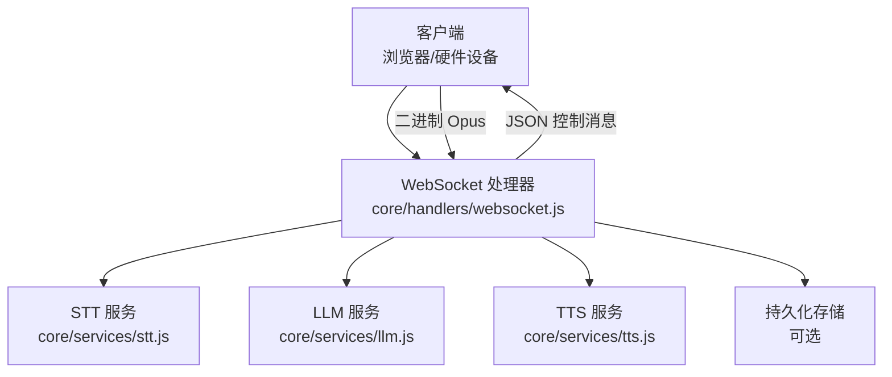

**图表来源**
- [core/handlers/websocket.js:22-60](file://core/handlers/websocket.js#L22-L60)
- [core/services/stt.js:39-87](file://core/services/stt.js#L39-L87)
- [core/services/tts.js:3-21](file://core/services/tts.js#L3-L21)
- [core/services/llm.js:16-24](file://core/services/llm.js#L16-L24)

**章节来源**
- [core/handlers/websocket.js:22-60](file://core/handlers/websocket.js#L22-L60)
- [core/constants/messageTypes.js:1-144](file://core/constants/messageTypes.js#L1-L144)

## 核心组件
- WebSocket 处理器：负责连接生命周期、消息分发、会话与设备注册、VAD 与静音检测、对话轮次串行化、TTS 音频帧定时发送、错误上报
- STT 服务：接收音频（Opus/PCM），按提供商接入语音识别，支持流式与批量模式，触发结果回调
- TTS 服务：将文本合成音频（默认 Edge TTS），返回音频 Buffer 与时长估算
- LLM 服务：调用 OpenAI 兼容端点或 DS H Bridge，维护对话历史并返回文本回复

**章节来源**
- [core/handlers/websocket.js:22-60](file://core/handlers/websocket.js#L22-L60)
- [core/services/stt.js:39-87](file://core/services/stt.js#L39-L87)
- [core/services/tts.js:3-21](file://core/services/tts.js#L3-L21)
- [core/services/llm.js:16-24](file://core/services/llm.js#L16-L24)

## 架构总览
下图展示一次典型语音对话从客户端说话到服务端生成回复并播放音频的全链路。

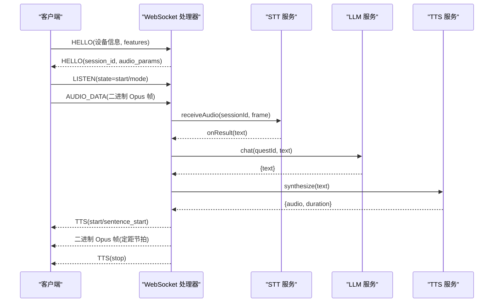

**图表来源**
- [core/handlers/websocket.js:450-513](file://core/handlers/websocket.js#L450-L513)
- [core/handlers/websocket.js:1025-1130](file://core/handlers/websocket.js#L1025-L1130)
- [core/services/stt.js:348-383](file://core/services/stt.js#L348-L383)
- [core/services/llm.js:75-104](file://core/services/llm.js#L75-L104)
- [core/services/tts.js:62-104](file://core/services/tts.js#L62-L104)

## 详细组件分析

### 消息类型与枚举
- 客户端消息类型：hello、listen、abort、iot、chat、mcp、start_recognition、audio_data、wake_word_detected、friend、echo
- 服务端消息类型：connection_ack、error、hello、recognition_started、stt、llm、tts、tts_fallback、tts_disabled、mcp、sleep、audio_received、wake_word_acknowledged、friend、friend_ack、status、message、user、bot、system
- TTS 子状态：start、sentence_start、playing、stop
- 监听状态：start、stop、detect
- 聊天状态：complete、processing、completed
- MCP 消息类型：initialize、call_tool、result、error
- 好友消息类型：text、command、data

上述类型由统一常量模块导出，并提供校验与反向查找工具函数。

**章节来源**
- [core/constants/messageTypes.js:6-109](file://core/constants/messageTypes.js#L6-L109)
- [core/constants/messageTypes.js:111-144](file://core/constants/messageTypes.js#L111-L144)

### 连接与握手
- 客户端连接后，非硬设备会收到 connection_ack
- 客户端发送 hello（支持 Web 与硬设备两种格式），携带 device_id/device_name/device_mac/token/features/audio_params
- 服务端校验版本与传输方式，保存设备元信息，创建 session_id，回发 hello 响应，并在设备支持 MCP 时延迟发送初始化消息

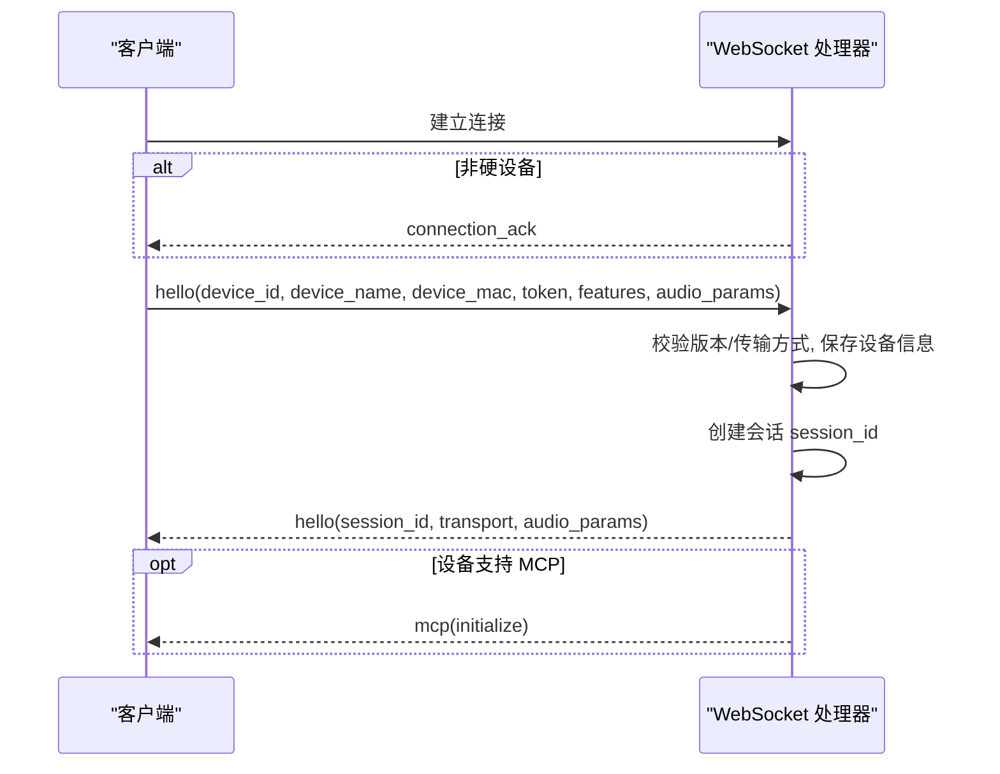

**图表来源**
- [core/handlers/websocket.js:67-169](file://core/handlers/websocket.js#L67-L169)
- [core/handlers/websocket.js:450-513](file://core/handlers/websocket.js#L450-L513)

**章节来源**
- [core/handlers/websocket.js:67-169](file://core/handlers/websocket.js#L67-L169)
- [core/handlers/websocket.js:450-513](file://core/handlers/websocket.js#L450-L513)

### 监听控制 LISTEN
- state=start：清除上一轮音频缓冲，重置 VAD 状态，准备新一轮采集
- state=stop：手动停止，设置 voiceStop 标志，触发识别
- state=detect：检测模式，若携带 listenText 则直接走聊天流程

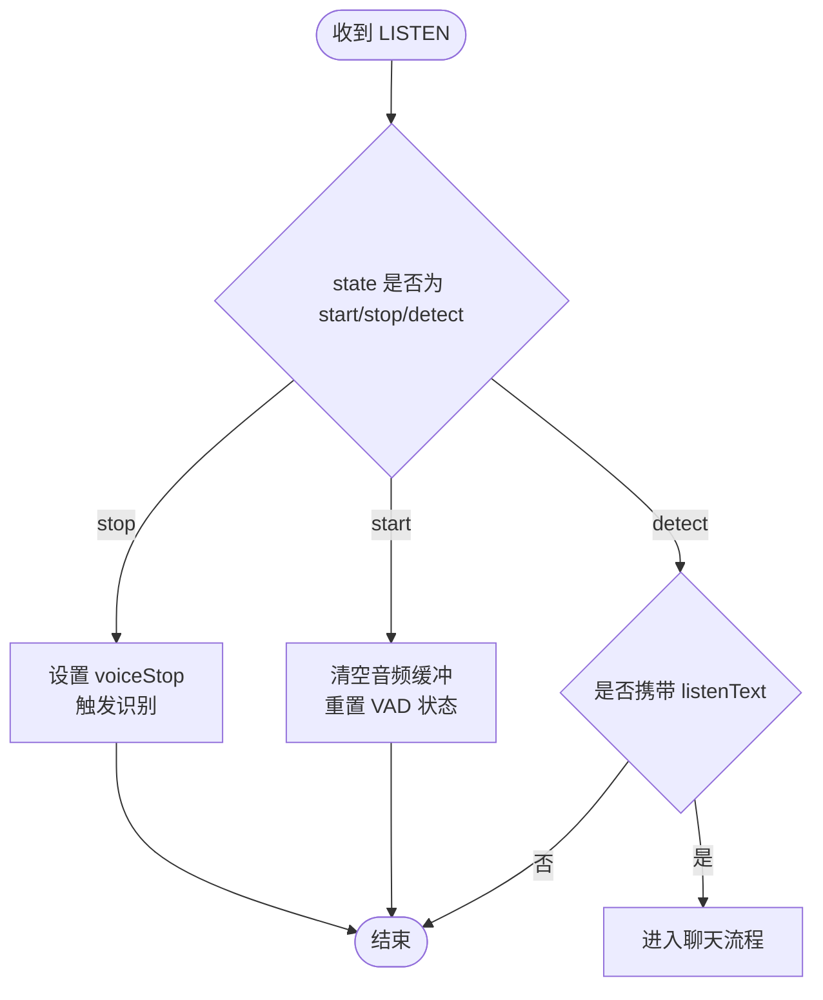

**图表来源**
- [core/handlers/websocket.js:515-590](file://core/handlers/websocket.js#L515-L590)

**章节来源**
- [core/handlers/websocket.js:515-590](file://core/handlers/websocket.js#L515-L590)

### 音频数据 AUDIO_DATA 与二进制帧
- JSON 路径：客户端发送 type=audio_data，payload.audioData 为 Base64，服务端解码后送入 STT，并回发 AUDIO_RECEIVED
- 二进制路径：客户端直接发送二进制 Opus 帧，服务端进行 VAD 检测、静默判定、最长语音兜底，到达停止条件后触发 STT 识别

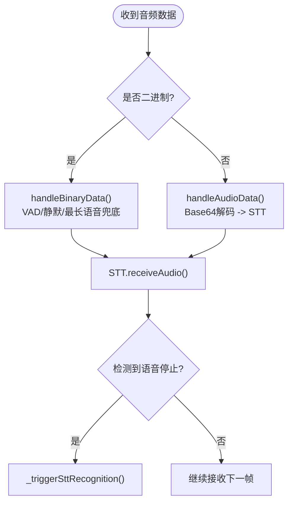

**图表来源**
- [core/handlers/websocket.js:289-446](file://core/handlers/websocket.js#L289-L446)
- [core/handlers/websocket.js:1218-1265](file://core/handlers/websocket.js#L1218-L1265)

**章节来源**
- [core/handlers/websocket.js:289-446](file://core/handlers/websocket.js#L289-L446)
- [core/handlers/websocket.js:1218-1265](file://core/handlers/websocket.js#L1218-L1265)

### 语音识别 STT
- STT 服务根据 provider 选择不同后端（doubao/funasr/aibridge/xunfei/aliyun）
- 支持流式与批量识别；自动模式下在检测到语音停止且缓冲区足够时触发识别
- 识别结果通过回调返回给 WebSocket 处理器，处理器再转发 STT 消息给客户端

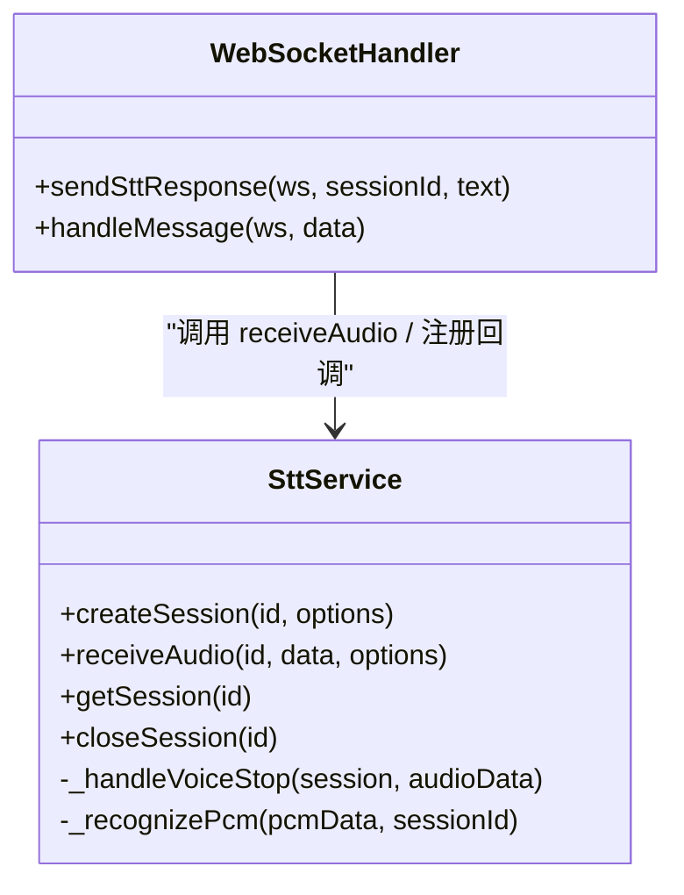

**图表来源**
- [core/services/stt.js:293-383](file://core/services/stt.js#L293-L383)
- [core/services/stt.js:515-583](file://core/services/stt.js#L515-L583)
- [core/handlers/websocket.js:992-999](file://core/handlers/websocket.js#L992-L999)

**章节来源**
- [core/services/stt.js:293-383](file://core/services/stt.js#L293-L383)
- [core/services/stt.js:515-583](file://core/services/stt.js#L515-L583)
- [core/handlers/websocket.js:992-999](file://core/handlers/websocket.js#L992-L999)

### 大模型回复 LLM
- LLM 服务支持 openai（OpenAI 兼容端点）与 dsh（DSH Bridge）两种 provider
- 维护每连接/Quest 的对话历史，构建 messages 列表调用外部接口
- 超时保护：若后端无响应，快速降级返回友好提示

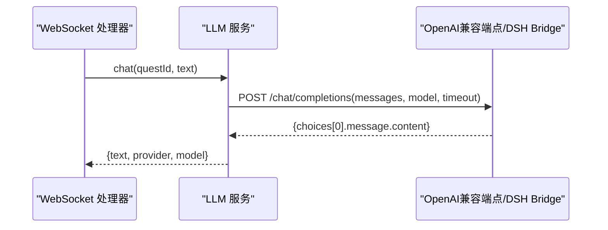

**图表来源**
- [core/services/llm.js:75-104](file://core/services/llm.js#L75-L104)
- [core/services/llm.js:121-160](file://core/services/llm.js#L121-L160)
- [core/services/llm.js:166-203](file://core/services/llm.js#L166-L203)

**章节来源**
- [core/services/llm.js:75-104](file://core/services/llm.js#L75-L104)
- [core/services/llm.js:121-160](file://core/services/llm.js#L121-L160)
- [core/services/llm.js:166-203](file://core/services/llm.js#L166-L203)

### 文本转语音 TTS
- TTS 服务默认使用 Edge TTS，返回音频 Buffer 与估算时长
- WebSocket 处理器负责：
  - 发送 TTS 状态：start、sentence_start、stop
  - 将 MP3 转换为 Opus 帧并按固定帧时长（默认 60ms）逐帧发送二进制音频
  - 用户打断时丢弃旧轮音频，保证新轮不被误杀

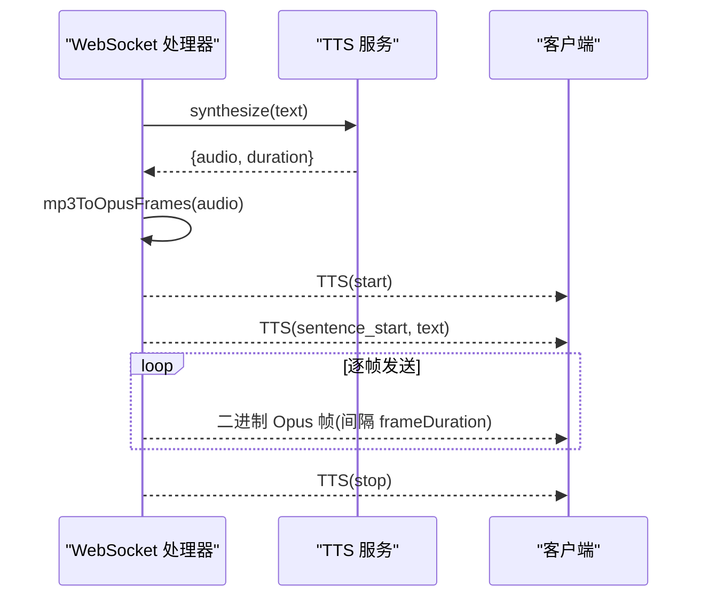

**图表来源**
- [core/services/tts.js:62-104](file://core/services/tts.js#L62-L104)
- [core/handlers/websocket.js:1025-1130](file://core/handlers/websocket.js#L1025-L1130)
- [core/handlers/websocket.js:1139-1189](file://core/handlers/websocket.js#L1139-L1189)

**章节来源**
- [core/services/tts.js:62-104](file://core/services/tts.js#L62-L104)
- [core/handlers/websocket.js:1025-1130](file://core/handlers/websocket.js#L1025-L1130)
- [core/handlers/websocket.js:1139-1189](file://core/handlers/websocket.js#L1139-L1189)

### 聊天流程 CHAT
- 客户端可发送 type=chat，state=complete，携带 text 与 questId
- 服务端先过滤噪音与回声，必要时中止正在播放的旧音频，然后进入单轮对话串行队列
- 单轮内依次：记录日志、调用 LLM、发送 LLM 消息、调用 TTS 并发送音频

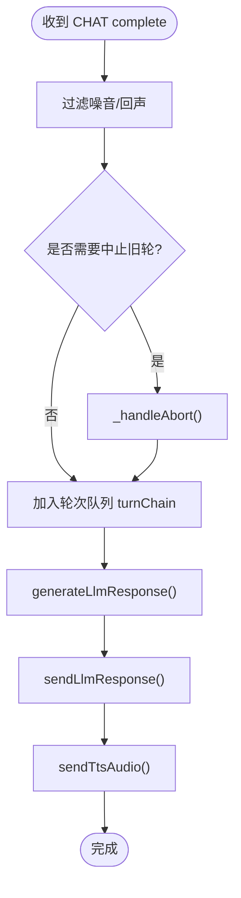

**图表来源**
- [core/handlers/websocket.js:615-638](file://core/handlers/websocket.js#L615-L638)
- [core/handlers/websocket.js:651-694](file://core/handlers/websocket.js#L651-L694)
- [core/handlers/websocket.js:731-818](file://core/handlers/websocket.js#L731-L818)

**章节来源**
- [core/handlers/websocket.js:615-638](file://core/handlers/websocket.js#L615-L638)
- [core/handlers/websocket.js:651-694](file://core/handlers/websocket.js#L651-L694)
- [core/handlers/websocket.js:731-818](file://core/handlers/websocket.js#L731-L818)

### 中断 ABORT
- 客户端发送 abort，服务端中止当前轮次的音频发送（仅旧轮），清理会话相关状态
- 同时用于新一轮采集开始时主动中止仍在发送的旧音频流

**章节来源**
- [core/handlers/websocket.js:592-608](file://core/handlers/websocket.js#L592-L608)

### 唤醒词 WAKE_WORD_DETECTED
- 客户端通知已检测到唤醒词，服务端回发 wake_word_acknowledged 确认

**章节来源**
- [core/handlers/websocket.js:1267-1280](file://core/handlers/websocket.js#L1267-L1280)

### 好友消息 FRIEND
- 客户端间消息转发，支持 text/command/data 三种类型
- 服务端校验目标设备在线状态，按类型执行 TTS/STT/设备配置/MCP 工具调用等

**章节来源**
- [core/handlers/websocket.js:1295-1458](file://core/handlers/websocket.js#L1295-L1458)

### MCP 消息
- 客户端与服务端之间基于 jsonrpc 的工具调用协议
- 服务端在设备支持 MCP 时发送 initialize，客户端可请求 tools/list 与 tools/call

**章节来源**
- [core/handlers/websocket.js:196-223](file://core/handlers/websocket.js#L196-L223)
- [public/chat/js/core/network/websocket.js:229-332](file://public/chat/js/core/network/websocket.js#L229-L332)

## 依赖关系分析
- WebSocket 处理器依赖：
  - messageTypes：消息类型常量
  - DeviceManager/DeviceModel：设备注册与持久化
  - SessionManager：会话管理
  - STT/TTS/LLM/VAD 服务：语音识别、文本转语音、大模型回复、语音活动检测
  - McpService：MCP 工具桥接
  - Store：可选持久化（设备表、对话记录）

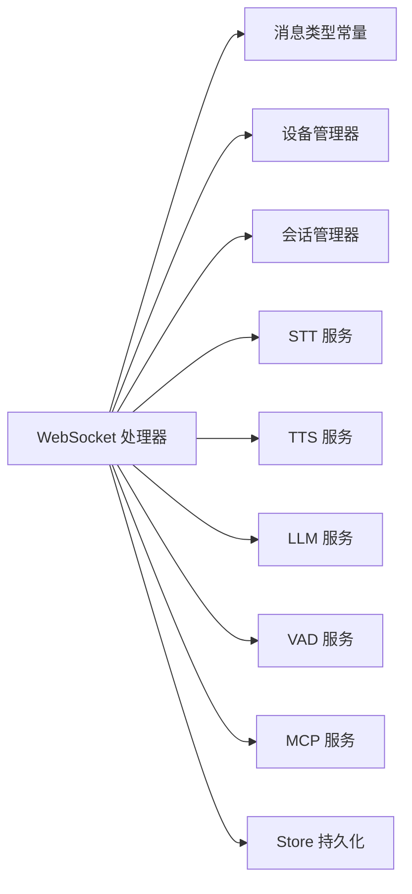

**图表来源**
- [core/handlers/websocket.js:22-60](file://core/handlers/websocket.js#L22-L60)

**章节来源**
- [core/handlers/websocket.js:22-60](file://core/handlers/websocket.js#L22-L60)

## 性能与实时性
- 音频帧定距发送：默认 60ms/帧，避免设备缓冲溢出导致颤音
- 轮次串行化：同一连接同一时刻只有一条应答流程，防止 Opus 帧交错
- 看门狗超时：单轮处理超时释放队列，避免阻塞后续轮次
- LLM 超时保护：后端无响应时快速兜底，不挂死整个轮次队列
- VAD 与静默阈值：可配置 silenceThresholdMs 与 maxUtteranceMs，平衡灵敏度与稳定性

[本节为通用指导，不直接分析具体文件]

## 故障排查指南
- 连接阶段
  - 未收到 connection_ack：检查 client_type 与 URL 参数
  - hello 握手失败：检查 version/transport 与设备元信息
- 音频阶段
  - 无识别结果：检查二进制帧是否到达、VAD 窗口与静默阈值、STT 会话是否存在
  - 音频卡顿：检查 frameDuration 与网络抖动，确认服务端按帧时长发送
- 对话阶段
  - 重复显示或错序：检查轮次序号 turnSeq 与 abortUpTo 是否正确
  - LLM 超时：查看 llmTimeoutSeconds 配置与后端连通性
- 错误消息
  - 服务端统一通过 error 消息返回错误信息，包含可选 session_id

**章节来源**
- [core/handlers/websocket.js:1507-1521](file://core/handlers/websocket.js#L1507-L1521)

## 结论
本协议以 JSON 控制面与二进制音频面分离的方式，实现了稳定可靠的实时语音对话链路。通过统一的类型常量、严格的轮次串行化、可配置的 VAD 与帧节拍，以及完善的错误与降级策略，系统能够在多种设备与网络环境下提供一致的交互体验。

[本节为总结性内容，不直接分析具体文件]

## 附录：消息定义与错误码

### 客户端到服务器（CS）消息
- HELLO
  - 方向：CS
  - 字段：version、transport、audio_params、device_id、device_name、device_mac、token、features
  - 行为：建立认证与会话，返回 HELLO 响应
- LISTEN
  - 方向：CS
  - 字段：state、mode、text
  - 行为：开始/停止/检测监听，可能触发识别或聊天
- AUDIO_DATA
  - 方向：CS
  - 字段：audioData(Base64) 或二进制 Opus 帧
  - 行为：送入 STT，可能触发识别
- CHAT
  - 方向：CS
  - 字段：text、state、questId、closeQuest
  - 行为：进入完整对话流程
- ABORT
  - 方向：CS
  - 字段：reason
  - 行为：中止旧轮音频，清理会话
- START_RECOGNITION
  - 方向：CS
  - 字段：sessionId
  - 行为：返回 recognition_started
- WAKE_WORD_DETECTED
  - 方向：CS
  - 字段：keyword、confidence、timestamp
  - 行为：返回 wake_word_acknowledged
- IOT
  - 方向：CS
  - 字段：descriptors、states
  - 行为：设备控制（占位）
- MCP
  - 方向：CS
  - 字段：payload(jsonrpc)
  - 行为：工具调用与初始化
- FRIEND
  - 方向：CS
  - 字段：clientid、data(type/content/...)
  - 行为：客户端间消息转发
- ECHO
  - 方向：CS
  - 字段：任意
  - 行为：回显测试

**章节来源**
- [core/constants/messageTypes.js:6-24](file://core/constants/messageTypes.js#L6-L24)
- [core/handlers/websocket.js:248-283](file://core/handlers/websocket.js#L248-L283)

### 服务器到客户端（SC）消息
- CONNECTION_ACK
  - 方向：SC
  - 字段：clientId、timestamp
  - 行为：连接确认
- HELLO
  - 方向：SC
  - 字段：transport、session_id、audio_params
  - 行为：握手成功
- RECOGNITION_STARTED
  - 方向：SC
  - 字段：sessionId、message
  - 行为：识别启动确认
- STT
  - 方向：SC
  - 字段：session_id、text、timestamp
  - 行为：识别结果
- LLM
  - 方向：SC
  - 字段：session_id、text、emotion、timestamp
  - 行为：大模型回复
- TTS
  - 方向：SC
  - 字段：session_id、state、text、timestamp
  - 行为：TTS 状态（start/sentence_start/playing/stop）
- TTS_FALLBACK
  - 方向：SC
  - 字段：session_id、text、error、timestamp
  - 行为：TTS 失败时的文本备选
- TTS_DISABLED
  - 方向：SC
  - 字段：session_id、text、timestamp
  - 行为：TTS 未启用
- AUDIO_RECEIVED
  - 方向：SC
  - 字段：sessionId、timestamp
  - 行为：音频接收确认
- WAKE_WORD_ACKNOWLEDGED
  - 方向：SC
  - 字段：keyword、confidence、timestamp、message
  - 行为：唤醒词确认
- ERROR
  - 方向：SC
  - 字段：message、session_id(可选)
  - 行为：错误上报
- STATUS/MESSAGE/USER/BOT/SYSTEM
  - 方向：SC
  - 字段：视用途而定
  - 行为：状态更新、通知、界面显示
- FRIEND/FRIEND_ACK
  - 方向：SC
  - 字段：同 FRIEND 结构
  - 行为：好友消息转发与确认
- MCP
  - 方向：SC
  - 字段：payload(jsonrpc)
  - 行为：工具初始化与结果

**章节来源**
- [core/constants/messageTypes.js:26-60](file://core/constants/messageTypes.js#L26-L60)
- [core/handlers/websocket.js:992-1015](file://core/handlers/websocket.js#L992-L1015)
- [core/handlers/websocket.js:1054-1125](file://core/handlers/websocket.js#L1054-L1125)
- [core/handlers/websocket.js:1507-1521](file://core/handlers/websocket.js#L1507-L1521)

### 二进制音频格式
- 编码：Opus
- 帧时长：默认 60ms（可由 audio_params.frame_duration/frameDuration 指定）
- 采样率：默认 16kHz（由 audio_params.sampleRate 指定）
- 通道数：默认 1（由 audio_params.channels 指定）
- 传输：WebSocket 二进制帧，按帧时长定距发送

**章节来源**
- [core/handlers/websocket.js:486-491](file://core/handlers/websocket.js#L486-L491)
- [core/handlers/websocket.js:1149-1156](file://core/handlers/websocket.js#L1149-L1156)

### 状态转换图（会话与播放）
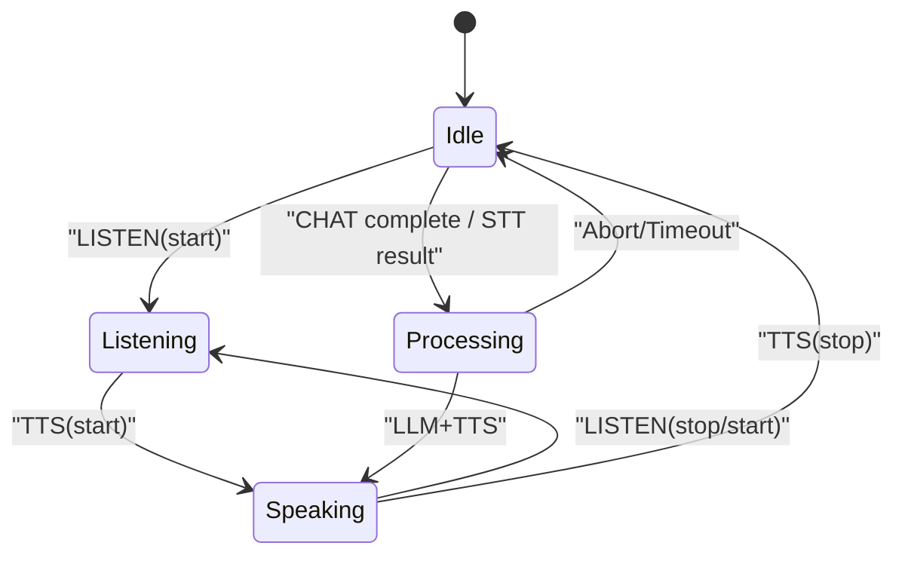

**图表来源**
- [core/handlers/websocket.js:515-590](file://core/handlers/websocket.js#L515-L590)
- [core/handlers/websocket.js:1025-1130](file://core/handlers/websocket.js#L1025-L1130)