# 连接管理

<cite>
**本文引用的文件**   
- [index.js](file://index.js)
- [websocket.js（服务器处理器）](file://core/handlers/websocket.js)
- [device.js（设备管理器）](file://core/managers/device.js)
- [device.js（设备模型）](file://core/models/device.js)
- [session.js（会话管理器）](file://core/managers/session.js)
- [base.js（基础模型）](file://core/models/base.js)
- [constants.js（常量与消息类型）](file://config/constants.js)
- [websocket.js（前端客户端）](file://public/chat/js/core/network/websocket.js)
- [ota-connector.js（前端OTA连接）](file://public/chat/js/core/network/ota-connector.js)
</cite>

## 目录
1. [引言](#引言)
2. [项目结构](#项目结构)
3. [核心组件](#核心组件)
4. [架构总览](#架构总览)
5. [详细组件分析](#详细组件分析)
6. [依赖关系分析](#依赖关系分析)
7. [性能与稳定性](#性能与稳定性)
8. [故障排查指南](#故障排查指南)
9. [结论](#结论)
10. [附录：协议与参数说明](#附录协议与参数说明)

## 引言
本文面向小智语音交互频道的WebSocket连接管理，覆盖连接建立、握手认证、设备注册、心跳检测、断线重连、连接池与会话生命周期、错误处理与性能优化等主题。文档同时给出服务端与前端关键流程的可视化图示，帮助读者快速理解从浏览器或硬件设备接入到语音对话的全链路。

## 项目结构
本项目采用“频道入口 + WebSocket处理器 + 管理器 + 服务”的分层组织方式：
- 频道入口负责启动Express/HTTP/WebSocket服务，装配核心服务并挂载路由。
- WebSocket处理器负责连接生命周期、消息路由、音频流与对话轮次调度。
- 管理器负责设备与会话的内存状态维护。
- 服务层封装LLM、TTS、STT、VAD、MCP等能力。
- 前端提供Web测试页，通过OTA协商后建立WebSocket连接，完成握手与音视频收发。

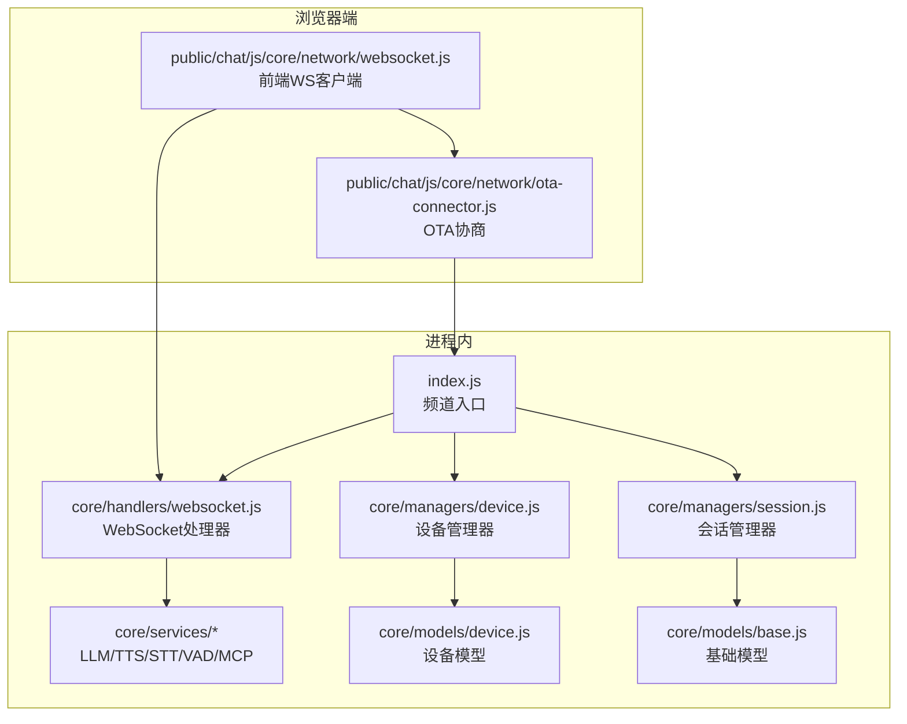

**图表来源**
- [index.js:86-125](file://index.js#L86-L125)
- [websocket.js（服务器处理器）:22-60](file://core/handlers/websocket.js#L22-L60)
- [device.js（设备管理器）:4-10](file://core/managers/device.js#L4-L10)
- [session.js（会话管理器）:4-10](file://core/managers/session.js#L4-L10)
- [ota-connector.js:4-71](file://public/chat/js/core/network/ota-connector.js#L4-L71)

**章节来源**
- [index.js:86-125](file://index.js#L86-L125)
- [websocket.js（服务器处理器）:22-60](file://core/handlers/websocket.js#L22-L60)

## 核心组件
- 频道入口 XiaozhiChannel：初始化服务、创建Express/HTTP/WSS、注册WebSocket连接回调、暴露健康检查与设备/会话API。
- WebSocket处理器 WebSocketHandler：连接建立、设备注册、消息分发、音频流处理、对话轮次串行化、TTS播放控制、回声抑制、广播与MCP支持。
- 设备管理器 DeviceManager：在线设备Map、按deviceId反向查找、统计与清理。
- 设备模型 DeviceModel：设备属性、校验、在线判定、状态更新。
- 会话管理器 SessionManager：会话创建/关闭、过期清理、按clientId索引。
- 前端客户端：OTA协商获取WS地址、携带client-id/device-id/client_type/timestamp等参数建立连接，发送hello握手，处理tts/stt/llm/mcp等消息。

**章节来源**
- [index.js:44-81](file://index.js#L44-L81)
- [websocket.js（服务器处理器）:22-60](file://core/handlers/websocket.js#L22-L60)
- [device.js（设备管理器）:4-10](file://core/managers/device.js#L4-L10)
- [device.js（设备模型）:3-22](file://core/models/device.js#L3-L22)
- [session.js（会话管理器）:4-10](file://core/managers/session.js#L4-L10)
- [websocket.js（前端客户端）:11-21](file://public/chat/js/core/network/websocket.js#L11-L21)

## 架构总览
下图展示一次完整连接的生命周期：前端通过OTA协商得到WS地址，建立连接后发送hello握手；服务端解析请求头与URL参数，登记设备信息，分配会话ID，随后进入消息路由与音频流处理阶段。

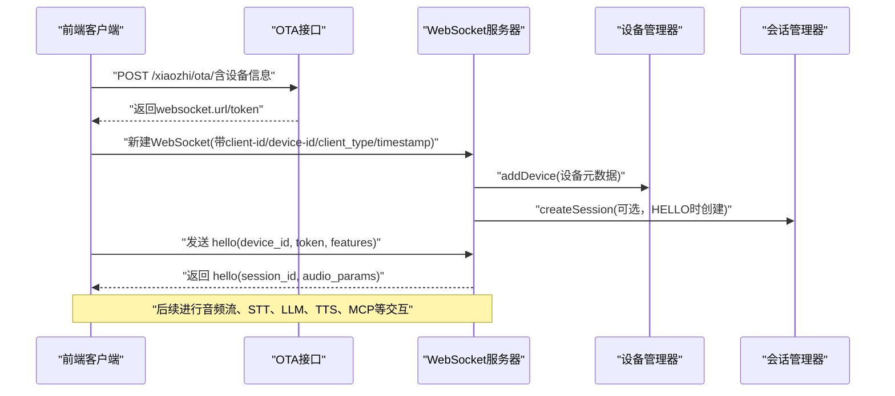

**图表来源**
- [ota-connector.js:4-71](file://public/chat/js/core/network/ota-connector.js#L4-L71)
- [websocket.js（服务器处理器）:67-142](file://core/handlers/websocket.js#L67-L142)
- [websocket.js（服务器处理器）:450-513](file://core/handlers/websocket.js#L450-L513)

## 详细组件分析

### 连接建立与握手流程
- 连接参数
  - 请求头：client-id、device-id（缺失则服务端生成UUID）。
  - URL参数：client_type（默认hard）、timestamp。
  - 非硬设备（client_type !== hard）在连接建立后立即收到connection_ack。
- 握手协议
  - 客户端发送hello，包含device_id、device_name、device_mac、token、features（如mcp）。
  - 服务端校验版本与传输方式（仅对非Web客户端），保存设备元信息，设置audio_params，分配sessionId，返回hello响应。
  - 若设备声明支持MCP，延迟发送MCP初始化消息。

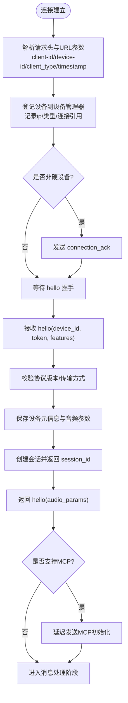

**图表来源**
- [websocket.js（服务器处理器）:67-142](file://core/handlers/websocket.js#L67-L142)
- [websocket.js（服务器处理器）:450-513](file://core/handlers/websocket.js#L450-L513)

**章节来源**
- [websocket.js（服务器处理器）:67-142](file://core/handlers/websocket.js#L67-L142)
- [websocket.js（服务器处理器）:450-513](file://core/handlers/websocket.js#L450-L513)
- [constants.js:44-70](file://config/constants.js#L44-L70)

### 客户端认证机制
- 认证字段
  - hello消息中的token用于服务端鉴权（当前实现中主要作为设备元信息保存，具体鉴权逻辑由上层服务扩展）。
  - 前端通过OTA接口获得authorization令牌，并在URL中追加authorization参数。
- 认证流程
  - 前端先调用OTA接口，成功后将authorization附加到WS URL。
  - 服务端在连接建立时读取client-id/device-id，并在hello中接收token。

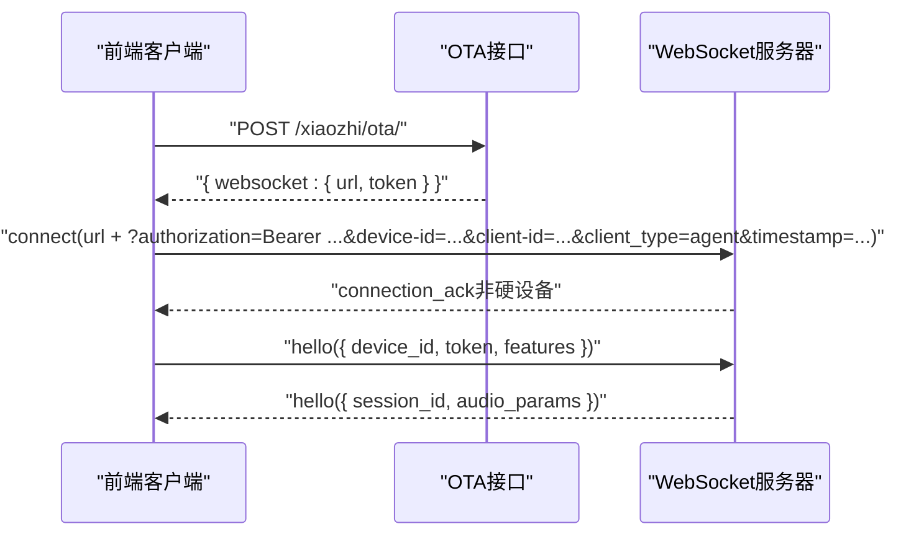

**图表来源**
- [ota-connector.js:4-71](file://public/chat/js/core/network/ota-connector.js#L4-L71)
- [websocket.js（服务器处理器）:67-142](file://core/handlers/websocket.js#L67-L142)
- [websocket.js（服务器处理器）:450-513](file://core/handlers/websocket.js#L450-L513)

**章节来源**
- [ota-connector.js:4-71](file://public/chat/js/core/network/ota-connector.js#L4-L71)
- [websocket.js（服务器处理器）:67-142](file://core/handlers/websocket.js#L67-L142)

### 设备注册过程
- 注册时机
  - 连接建立时即尝试登记设备；若store存在且携带device-id，会持久化设备表。
  - HELLO握手时补充name/mac等信息，再次写入设备表。
- 设备类型识别
  - client_type白名单：sensor/agent/hard/manager/unknown；非法值归一化为unknown。
- 设备信息
  - 包括id、clientId、deviceId、type、ip、connection、connectedAt、lastActivity、status、connectionInfo等。

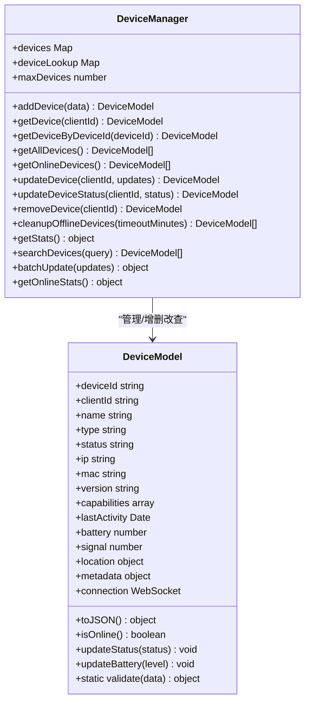

**图表来源**
- [device.js（设备管理器）:4-10](file://core/managers/device.js#L4-L10)
- [device.js（设备模型）:3-22](file://core/models/device.js#L3-L22)

**章节来源**
- [websocket.js（服务器处理器）:96-142](file://core/handlers/websocket.js#L96-L142)
- [websocket.js（服务器处理器）:473-484](file://core/handlers/websocket.js#L473-L484)
- [device.js（设备管理器）:11-41](file://core/managers/device.js#L11-L41)
- [device.js（设备模型）:61-93](file://core/models/device.js#L61-L93)

### 心跳检测机制
- 当前实现
  - 服务端在ws.on('pong')时标记连接为活跃。
  - startHeartbeat/stopHeartbeat方法已预留但未实现具体定时任务。
- 建议实现
  - 使用定时器周期性ping所有连接，超过阈值未pong的连接视为断线，触发清理与离线标记。
  - 结合设备管理器与持久化store，统一下线流程。

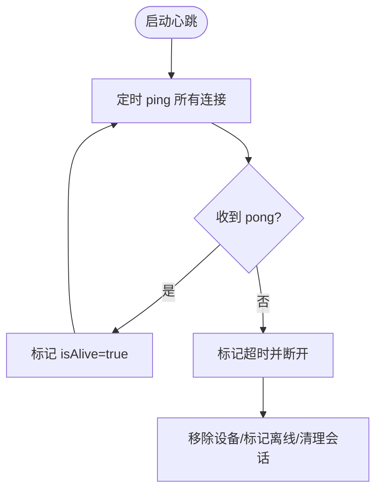

**图表来源**
- [websocket.js（服务器处理器）:165-168](file://core/handlers/websocket.js#L165-L168)
- [websocket.js（服务器处理器）:1523-1537](file://core/handlers/websocket.js#L1523-L1537)

**章节来源**
- [websocket.js（服务器处理器）:165-168](file://core/handlers/websocket.js#L165-L168)
- [websocket.js（服务器处理器）:1523-1537](file://core/handlers/websocket.js#L1523-L1537)

### 断线重连策略
- 前端行为
  - onclose事件触发后停止录音、关闭摄像头、清理UI状态。
  - 可通过外层重试逻辑实现指数退避重连（仓库未内置自动重连）。
- 服务端行为
  - close事件触发后移除设备、标记离线、清理MCP关联。
  - 若存在sessionId，记录会话结束日志。

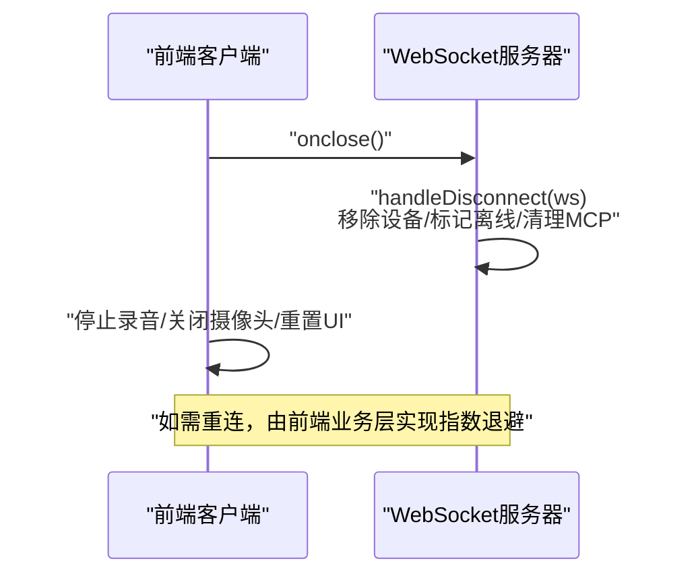

**图表来源**
- [websocket.js（服务器处理器）:174-193](file://core/handlers/websocket.js#L174-L193)
- [websocket.js（前端客户端）:414-434](file://public/chat/js/core/network/websocket.js#L414-L434)

**章节来源**
- [websocket.js（服务器处理器）:174-193](file://core/handlers/websocket.js#L174-L193)
- [websocket.js（前端客户端）:414-434](file://public/chat/js/core/network/websocket.js#L414-L434)

### 连接池管理与资源清理
- 连接池
  - 设备管理器以Map存储在线设备，支持按clientId与deviceId查询。
  - 最大设备数限制与离线清理策略。
- 资源清理
  - 频道stop时关闭WSS与HTTP服务器，清理会话与设备管理器，关闭store。
  - 设备断开时清理MCP关联。

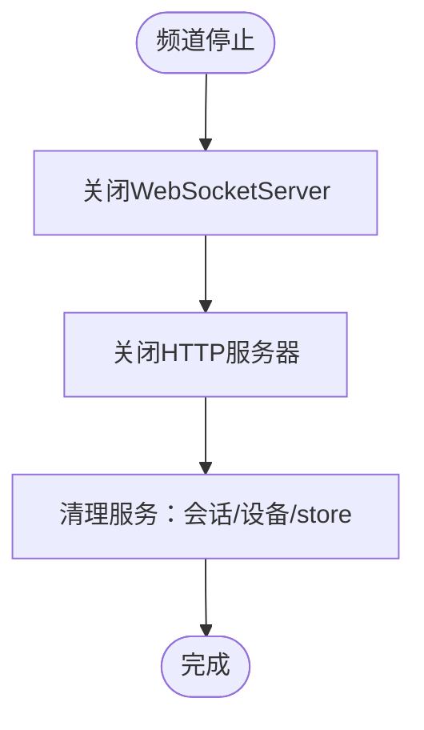

**图表来源**
- [index.js:130-165](file://index.js#L130-L165)
- [index.js:563-580](file://index.js#L563-L580)

**章节来源**
- [index.js:130-165](file://index.js#L130-L165)
- [index.js:563-580](file://index.js#L563-L580)
- [device.js（设备管理器）:100-116](file://core/managers/device.js#L100-L116)

### 连接状态管理与会话生命周期
- 连接状态
  - ws.isAlive、ws.isAuthenticated、ws.sessionId、ws.clientIsSpeaking、ws.turnSeq、ws.abortUpTo等。
- 会话生命周期
  - 首次音频数据或HELLO时创建会话；ABORT时关闭会话；空闲与超时清理由会话管理器负责。

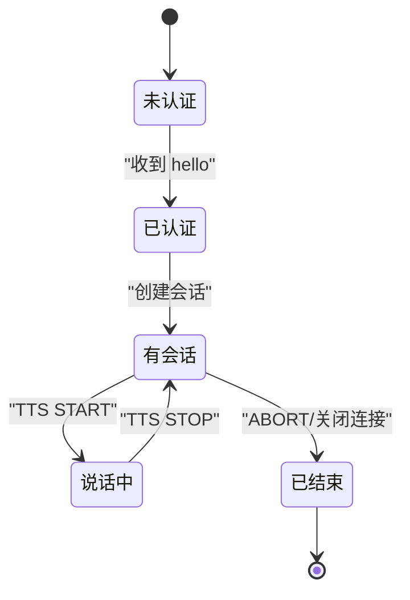

**图表来源**
- [websocket.js（服务器处理器）:493-503](file://core/handlers/websocket.js#L493-L503)
- [websocket.js（服务器处理器）:592-608](file://core/handlers/websocket.js#L592-L608)
- [session.js（会话管理器）:80-99](file://core/managers/session.js#L80-L99)

**章节来源**
- [websocket.js（服务器处理器）:493-503](file://core/handlers/websocket.js#L493-L503)
- [websocket.js（服务器处理器）:592-608](file://core/handlers/websocket.js#L592-L608)
- [session.js（会话管理器）:80-99](file://core/managers/session.js#L80-L99)

### 音频流与对话轮次串行化
- 音频流
  - 二进制Opus帧按固定帧时长（默认60ms）发送，避免设备缓冲溢出导致颤音。
  - 支持手动停止listen与空帧结束录音两种触发识别路径。
- 轮次串行化
  - 同一连接同一时刻只有一条应答流程在发送音频，防止Opus帧交错。
  - 每轮带turnSeq编号，abortUpTo精准中止旧轮，新轮不受影响。
  - 单轮超时保护（默认90s）防止队列挂死。

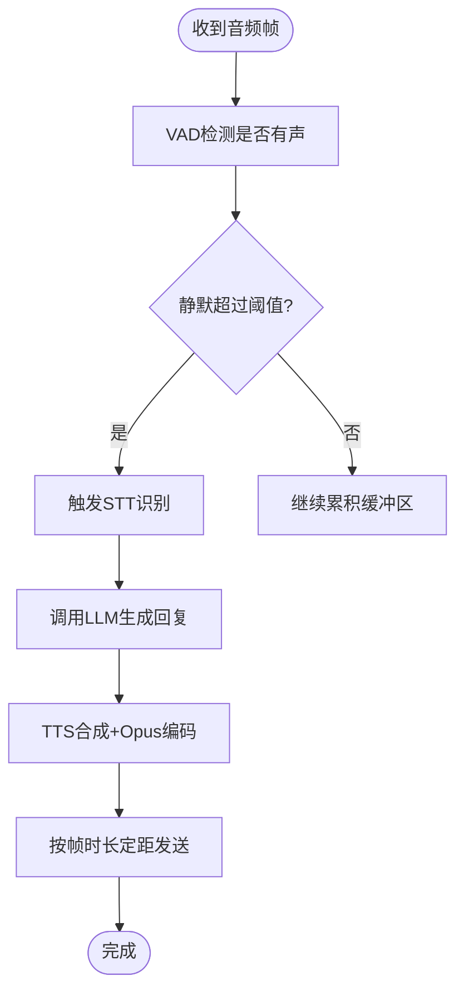

**图表来源**
- [websocket.js（服务器处理器）:289-446](file://core/handlers/websocket.js#L289-L446)
- [websocket.js（服务器处理器）:651-694](file://core/handlers/websocket.js#L651-L694)
- [websocket.js（服务器处理器）:1025-1189](file://core/handlers/websocket.js#L1025-L1189)

**章节来源**
- [websocket.js（服务器处理器）:289-446](file://core/handlers/websocket.js#L289-L446)
- [websocket.js（服务器处理器）:651-694](file://core/handlers/websocket.js#L651-L694)
- [websocket.js（服务器处理器）:1025-1189](file://core/handlers/websocket.js#L1025-L1189)

### 回声抑制与噪音过滤
- 回声判定
  - 比较近期正在/刚播放的TTS文本与识别结果，子串或字符重合率>60%判定为回声，忽略且不中断当前播放。
- 噪音过滤
  - 去标点后的过短输入或语气词直接丢弃，避免误触发挤掉真实回复。

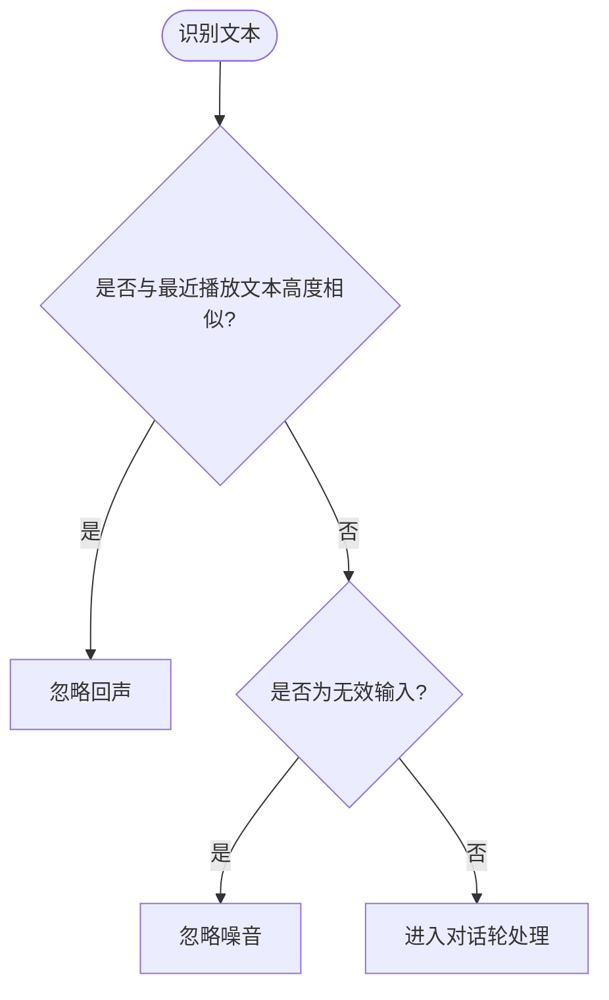

**图表来源**
- [websocket.js（服务器处理器）:697-722](file://core/handlers/websocket.js#L697-L722)

**章节来源**
- [websocket.js（服务器处理器）:697-722](file://core/handlers/websocket.js#L697-L722)

### 广播与MCP支持
- 广播
  - 通过API向在线设备推送语音，后端异步合成并推流。
- MCP
  - 设备声明features.mcp后，服务端延迟发送MCP初始化消息；前端可调用工具列表与工具执行。

**章节来源**
- [index.js:406-425](file://index.js#L406-L425)
- [websocket.js（服务器处理器）:506-512](file://core/handlers/websocket.js#L506-L512)
- [websocket.js（前端客户端）:229-332](file://public/chat/js/core/network/websocket.js#L229-L332)

## 依赖关系分析
- 模块耦合
  - index.js依赖WebSocket处理器、设备/会话管理器与各服务。
  - WebSocket处理器依赖设备管理器、会话管理器、STT/TTS/LLM/VAD/MCP服务。
  - 前端客户端依赖OTA连接器与服务端WS接口。
- 外部依赖
  - Express、http、ws、uuid等。

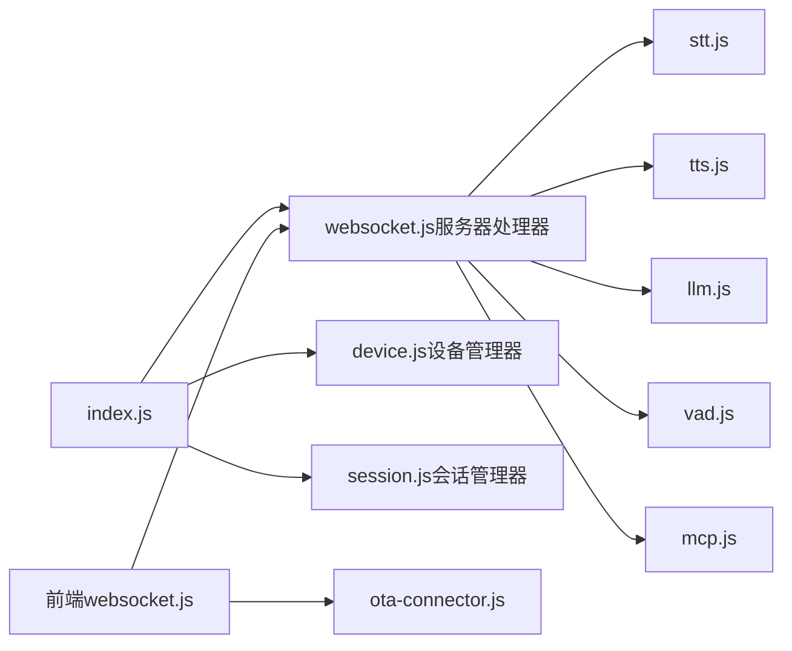

**图表来源**
- [index.js:16-27](file://index.js#L16-L27)
- [websocket.js（服务器处理器）:1-15](file://core/handlers/websocket.js#L1-L15)
- [websocket.js（前端客户端）:1-9](file://public/chat/js/core/network/websocket.js#L1-L9)
- [ota-connector.js:1-9](file://public/chat/js/core/network/ota-connector.js#L1-L9)

**章节来源**
- [index.js:16-27](file://index.js#L16-L27)
- [websocket.js（服务器处理器）:1-15](file://core/handlers/websocket.js#L1-L15)

## 性能与稳定性
- 音频发送节拍
  - 基于audioParams.frameDuration或audioConverter.frameDuration（默认60ms）定距发送，避免设备缓冲溢出。
- 轮次串行化与看门狗
  - turnChain保证同连接单轮并发安全；TURN_TIMEOUT_MS防止单轮挂死阻塞后续轮次。
- LLM超时保护
  - llmTimeoutSeconds兜底，避免后端无响应拖垮整个轮次队列。
- 回声与噪音
  - 减少误触发导致的频繁打断与无效对话轮。
- 设备上限与清理
  - maxDevices限制与cleanupOfflineDevices定期清理，降低内存占用。

[本节为通用指导，不直接分析具体代码文件]

## 故障排查指南
- 连接失败
  - 检查OTA接口是否返回websocket.url与token。
  - 确认浏览器协议与WS协议匹配（https→wss，http→ws）。
  - 校验client-id/device-id是否传入。
- 握手失败
  - 确认hello消息包含device_id与token。
  - 检查服务端是否返回hello响应与session_id。
- 音频异常
  - 检查frameDuration配置是否正确。
  - 观察是否出现回声拾取被忽略的日志。
- 设备不在线
  - 查看设备管理器统计与持久化设备表。
  - 确认心跳检测是否实现并正常工作。

**章节来源**
- [ota-connector.js:4-71](file://public/chat/js/core/network/ota-connector.js#L4-L71)
- [websocket.js（服务器处理器）:67-142](file://core/handlers/websocket.js#L67-L142)
- [websocket.js（服务器处理器）:450-513](file://core/handlers/websocket.js#L450-L513)
- [websocket.js（服务器处理器）:1025-1189](file://core/handlers/websocket.js#L1025-L1189)

## 结论
本项目的WebSocket连接管理围绕“连接建立—设备注册—握手认证—音频流与对话轮次—资源清理”形成闭环。通过设备管理器与会话管理器维护在线状态，通过轮次串行化与超时保护提升稳定性，通过回声抑制与噪音过滤改善用户体验。未来可在心跳检测、断线重连与连接池监控方面进一步增强健壮性与可观测性。

[本节为总结性内容，不直接分析具体代码文件]

## 附录：协议与参数说明

### 连接参数
- 请求头
  - client-id：客户端标识，缺失则服务端生成。
  - device-id：设备标识，缺失则服务端生成。
- URL参数
  - client_type：设备类型（sensor/agent/hard/manager/unknown），默认hard。
  - timestamp：连接时间戳。
  - authorization：来自OTA的令牌（Bearer前缀可自动补齐）。

**章节来源**
- [websocket.js（服务器处理器）:67-77](file://core/handlers/websocket.js#L67-L77)
- [ota-connector.js:46-61](file://public/chat/js/core/network/ota-connector.js#L46-L61)

### 握手协议
- 客户端hello
  - 字段：device_id、device_name、device_mac、token、features（如mcp）。
- 服务端hello
  - 字段：transport、session_id、audio_params（format、sampleRate、channels、frameDuration）。

**章节来源**
- [websocket.js（服务器处理器）:450-513](file://core/handlers/websocket.js#L450-L513)
- [websocket.js（前端客户端）:23-71](file://public/chat/js/core/network/websocket.js#L23-L71)

### 消息类型
- 客户端消息：hello、listen、abort、iot、chat、mcp、audio_data、wake_word_detected、start_recognition、friend。
- 服务端消息：connection_ack、hello、stt、llm、tts、error、recognition_started、wake_word_acknowledged、audio_received、message。

**章节来源**
- [constants.js:44-70](file://config/constants.js#L44-L70)

### 示例代码路径
- 前端连接与握手
  - [websocket.js（前端客户端）:356-412](file://public/chat/js/core/network/websocket.js#L356-L412)
  - [websocket.js（前端客户端）:23-71](file://public/chat/js/core/network/websocket.js#L23-L71)
- 服务端连接与握手
  - [websocket.js（服务器处理器）:67-142](file://core/handlers/websocket.js#L67-L142)
  - [websocket.js（服务器处理器）:450-513](file://core/handlers/websocket.js#L450-L513)
- 设备注册与管理
  - [device.js（设备管理器）:11-41](file://core/managers/device.js#L11-L41)
  - [device.js（设备模型）:61-93](file://core/models/device.js#L61-L93)
- 会话管理
  - [session.js（会话管理器）:12-45](file://core/managers/session.js#L12-L45)
  - [session.js（会话管理器）:80-99](file://core/managers/session.js#L80-L99)