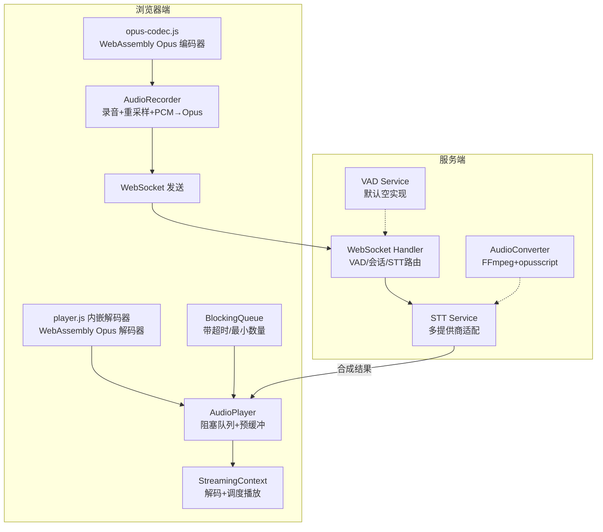
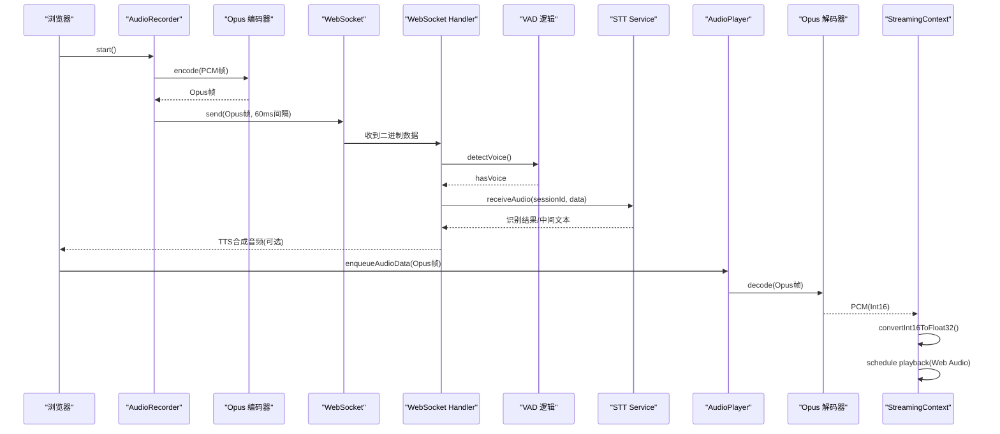
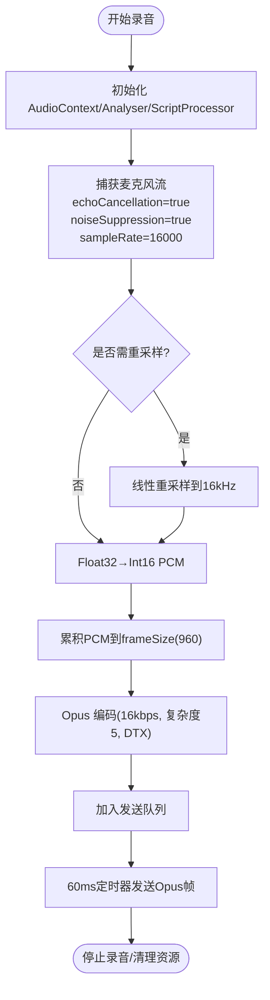
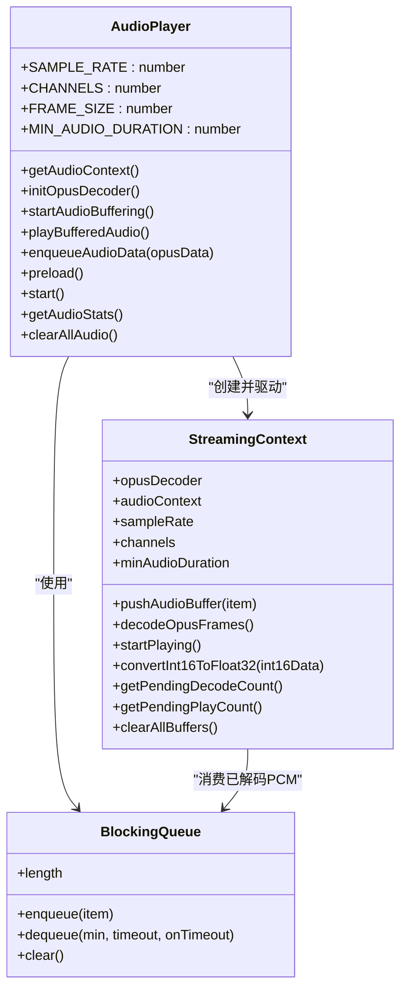
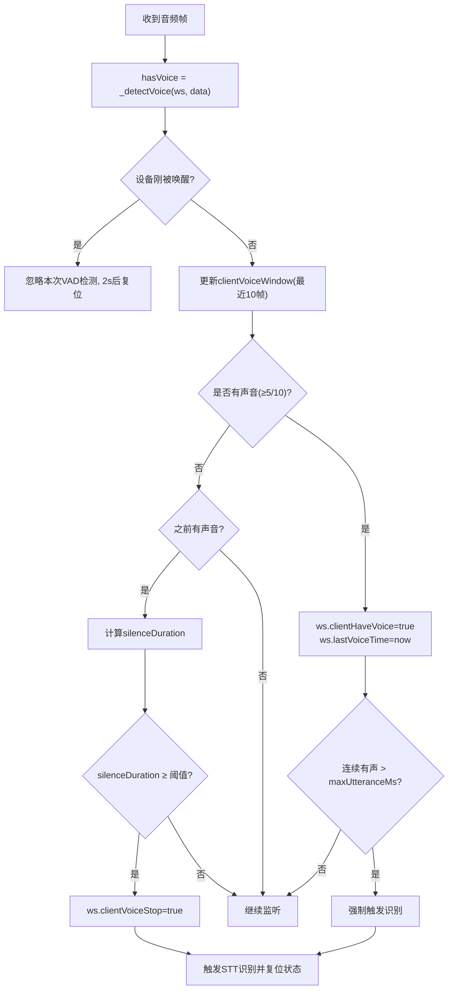
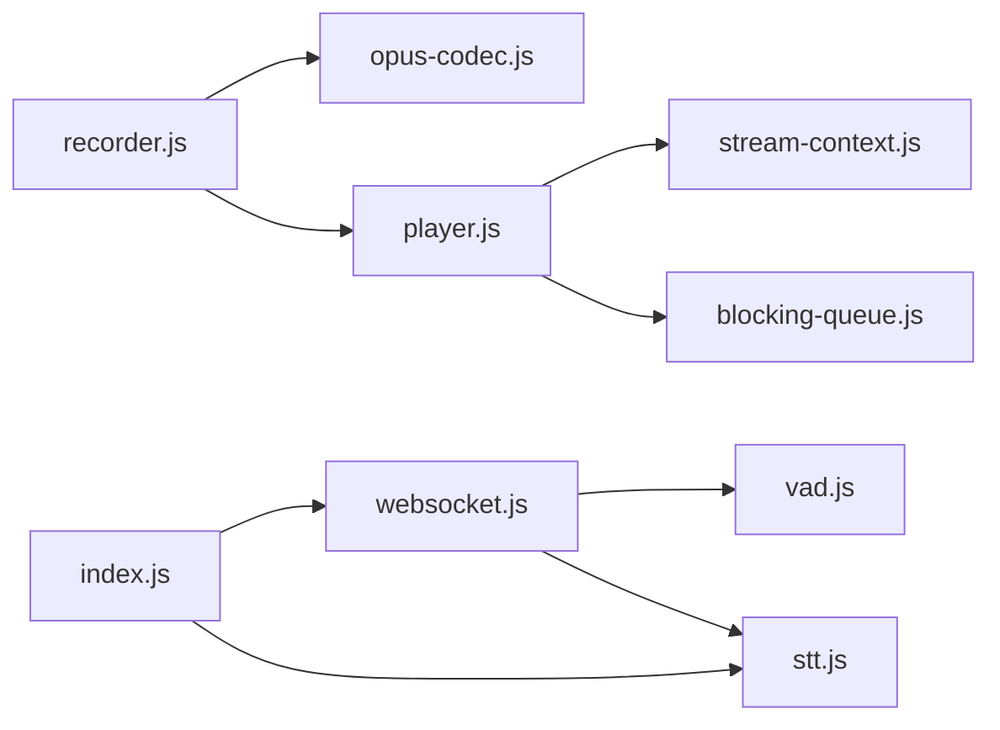

# 音频流处理

<cite>
**本文引用的文件**   
- [core/services/vad.js](file://core/services/vad.js)
- [core/handlers/websocket.js](file://core/handlers/websocket.js)
- [core/services/stt.js](file://core/services/stt.js)
- [index.js](file://index.js)
- [public/chat/js/core/audio/recorder.js](file://public/chat/js/core/audio/recorder.js)
- [public/chat/js/core/audio/player.js](file://public/chat/js/core/audio/player.js)
- [public/chat/js/core/audio/opus-codec.js](file://public/chat/js/core/audio/opus-codec.js)
- [public/chat/js/core/audio/stream-context.js](file://public/chat/js/core/audio/stream-context.js)
- [public/chat/js/utils/blocking-queue.js](file://public/chat/js/utils/blocking-queue.js)
- [core/utils/audioConverter.js](file://core/utils/audioConverter.js)
</cite>

## 目录
1. [引言](#引言)
2. [项目结构](#项目结构)
3. [核心组件](#核心组件)
4. [架构总览](#架构总览)
5. [详细组件分析](#详细组件分析)
6. [依赖关系分析](#依赖关系分析)
7. [性能与调优](#性能与调优)
8. [故障排查指南](#故障排查指南)
9. [结论](#结论)

## 引言
本文件面向“小智”项目的音频流处理子系统，系统性说明从浏览器端录音、Opus 编码、WebSocket 传输到服务端 VAD 语音活动检测、静音边界识别、STT 接入，以及播放端解码、缓冲与播放的完整链路。文档重点覆盖：
- 音频数据传输格式（Opus）、采样率配置、帧大小设置
- VAD 语音活动检测机制、静音检测算法、语音边界识别
- 音频缓冲区管理、实时流处理、音频质量优化
- 编解码实现细节、性能调优参数与调试工具使用方法
- 回声消除、噪声抑制与音频增强技术的使用位置与建议

## 项目结构
本项目在前后端均实现了完整的音频流处理链路：
- 前端（浏览器）
  - 录音与编码：AudioRecorder + Opus 编码器封装
  - 播放与解码：AudioPlayer + StreamingContext + BlockingQueue
- 后端（Node.js）
  - WebSocket 协议处理与 VAD 逻辑
  - STT 服务集成与多提供商适配
  - 音频转换工具（FFmpeg + opusscript）

图表来源
- [public/chat/js/core/audio/recorder.js:28-31](file://public/chat/js/core/audio/recorder.js#L28-L31)
- [public/chat/js/core/audio/opus-codec.js:57-66](file://public/chat/js/core/audio/opus-codec.js#L57-L66)
- [public/chat/js/core/audio/player.js:9-13](file://public/chat/js/core/audio/player.js#L9-L13)
- [public/chat/js/core/audio/stream-context.js:6-20](file://public/chat/js/core/audio/stream-context.js#L6-L20)
- [public/chat/js/utils/blocking-queue.js:1-103](file://public/chat/js/utils/blocking-queue.js#L1-L103)
- [core/handlers/websocket.js:332-445](file://core/handlers/websocket.js#L332-L445)
- [core/services/stt.js:64-67](file://core/services/stt.js#L64-L67)
- [core/utils/audioConverter.js:11-18](file://core/utils/audioConverter.js#L11-L18)

章节来源
- [public/chat/js/core/audio/recorder.js:1-646](file://public/chat/js/core/audio/recorder.js#L1-L646)
- [public/chat/js/core/audio/player.js:1-318](file://public/chat/js/core/audio/player.js#L1-L318)
- [core/handlers/websocket.js:320-519](file://core/handlers/websocket.js#L320-L519)
- [core/services/stt.js:60-259](file://core/services/stt.js#L60-L259)
- [core/utils/audioConverter.js:1-235](file://core/utils/audioConverter.js#L1-L235)

## 核心组件
- 浏览器端录音与编码
  - AudioRecorder：采集麦克风、重采样至 16kHz、Float32→Int16 PCM、按 60ms 切帧并调用 WebAssembly Opus 编码器，定时通过 WebSocket 发送。
  - opus-codec.js：封装 WebAssembly ModuleInstance，初始化 Opus 编码器，设置码率、复杂度、DTX 等参数。
- 浏览器端播放与解码
  - AudioPlayer：创建 AudioContext，预加载 Opus 解码器，维护阻塞队列，启动缓冲与播放流程。
  - StreamingContext：将 Opus 帧解码为 PCM，转换为 Float32，使用 Web Audio API 精确调度播放，提供分析器节点供可视化或联动 UI。
  - BlockingQueue：线程安全的异步队列，支持最小数量唤醒与超时回调。
- 服务端 VAD 与 STT
  - WebSocket Handler：对每帧音频进行 VAD 判断，维护滑动窗口与静默阈值，触发 STT 识别；同时负责会话管理与协议消息。
  - STT Service：统一接入多种 ASR 提供商，内部可初始化 Opus 解码器，接收二进制音频流。
  - VAD Service：默认返回 null，表示由调用方（如浏览器本地或设备侧）执行 VAD。
- 音频转换工具
  - AudioConverter：基于 FFmpeg 将任意音频转成 16kHz 单声道 s16le PCM，再用 opusscript 编码为 Opus 帧，用于离线或批量场景。

章节来源
- [public/chat/js/core/audio/recorder.js:28-31](file://public/chat/js/core/audio/recorder.js#L28-L31)
- [public/chat/js/core/audio/opus-codec.js:57-103](file://public/chat/js/core/audio/opus-codec.js#L57-L103)
- [public/chat/js/core/audio/player.js:9-13](file://public/chat/js/core/audio/player.js#L9-L13)
- [public/chat/js/core/audio/stream-context.js:6-20](file://public/chat/js/core/audio/stream-context.js#L6-L20)
- [public/chat/js/utils/blocking-queue.js:1-103](file://public/chat/js/utils/blocking-queue.js#L1-L103)
- [core/handlers/websocket.js:332-445](file://core/handlers/websocket.js#L332-L445)
- [core/services/stt.js:64-67](file://core/services/stt.js#L64-L67)
- [core/services/vad.js:1-30](file://core/services/vad.js#L1-L30)
- [core/utils/audioConverter.js:11-18](file://core/utils/audioConverter.js#L11-L18)

## 架构总览
下图展示端到端的音频流处理时序：浏览器录音→编码→WS 传输→服务端 VAD→STT→合成→播放端解码→调度播放。

图表来源
- [public/chat/js/core/audio/recorder.js:138-232](file://public/chat/js/core/audio/recorder.js#L138-L232)
- [public/chat/js/core/audio/opus-codec.js:116-165](file://public/chat/js/core/audio/opus-codec.js#L116-L165)
- [core/handlers/websocket.js:332-445](file://core/handlers/websocket.js#L332-L445)
- [core/services/stt.js:89-121](file://core/services/stt.js#L89-L121)
- [public/chat/js/core/audio/player.js:243-253](file://public/chat/js/core/audio/player.js#L243-L253)
- [public/chat/js/core/audio/stream-context.js:120-215](file://public/chat/js/core/audio/stream-context.js#L120-L215)

## 详细组件分析

### 音频数据格式与参数
- 采样率
  - 浏览器端录音与播放统一采用 16000Hz。
  - 服务端握手时协商 audio_params，包含 format、sampleRate、channels、frameDuration。
- 帧大小与时长
  - 帧时长固定为 60ms，对应 16kHz 下每帧 960 个样本。
- 通道数
  - 单声道（channelCount=1）。
- 编码格式
  - 传输层使用 Opus 二进制帧。
- 关键参数位置
  - 浏览器录音：采样率、帧大小、帧时长定义与使用。
  - 浏览器播放：采样率、通道数、帧大小常量。
  - 服务端握手：audio_params 默认值。
  - 服务端转换：默认采样率、通道数、帧时长计算。

章节来源
- [public/chat/js/core/audio/recorder.js:28-31](file://public/chat/js/core/audio/recorder.js#L28-L31)
- [public/chat/js/core/audio/player.js:9-13](file://public/chat/js/core/audio/player.js#L9-L13)
- [core/handlers/websocket.js:486-491](file://core/handlers/websocket.js#L486-L491)
- [core/utils/audioConverter.js:11-18](file://core/utils/audioConverter.js#L11-L18)

### 浏览器端录音与编码（AudioRecorder + opus-codec.js）
- 数据采集与重采样
  - 通过 getUserMedia 获取麦克风流，强制 echoCancellation、noiseSuppression，目标采样率 16kHz。
  - 若实际采样率非 16kHz，则进行简单线性重采样。
- PCM 转换
  - Float32 → Int16 PCM，范围映射到 [-32768, 32767]。
- 分帧与编码
  - 累积 PCM 至 frameSize（960），调用 WebAssembly Opus 编码器生成 Opus 帧。
  - 编码器参数：码率 16kbps、复杂度 5、启用 DTX（不传静音帧）。
- 发送策略
  - 使用 setInterval 以 60ms 间隔从发送队列取出 Opus 帧并通过 WebSocket 发送。
  - 停止时清空队列并发送结束信号（空帧）。

图表来源
- [public/chat/js/core/audio/recorder.js:90-116](file://public/chat/js/core/audio/recorder.js#L90-L116)
- [public/chat/js/core/audio/recorder.js:138-232](file://public/chat/js/core/audio/recorder.js#L138-L232)
- [public/chat/js/core/audio/opus-codec.js:94-103](file://public/chat/js/core/audio/opus-codec.js#L94-L103)

章节来源
- [public/chat/js/core/audio/recorder.js:90-232](file://public/chat/js/core/audio/recorder.js#L90-L232)
- [public/chat/js/core/audio/opus-codec.js:42-182](file://public/chat/js/core/audio/opus-codec.js#L42-L182)

### 浏览器端播放与解码（AudioPlayer + StreamingContext）
- 解码器初始化
  - 通过全局 ModuleInstance 访问 WebAssembly Opus 解码器，分配内存并初始化。
- 缓冲与播放
  - BlockingQueue 收集 Opus 帧，StreamingContext 解码为 PCM，再转为 Float32。
  - 使用 Web Audio API 的 BufferSource 精确调度播放，避免卡顿。
- 统计与可视
  - 提供待解码/待播放包数统计，暴露 Analyser 节点给 UI 或 Live2D。

图表来源
- [public/chat/js/core/audio/player.js:7-317](file://public/chat/js/core/audio/player.js#L7-L317)
- [public/chat/js/core/audio/stream-context.js:5-221](file://public/chat/js/core/audio/stream-context.js#L5-L221)
- [public/chat/js/utils/blocking-queue.js:1-103](file://public/chat/js/utils/blocking-queue.js#L1-L103)

章节来源
- [public/chat/js/core/audio/player.js:55-168](file://public/chat/js/core/audio/player.js#L55-L168)
- [public/chat/js/core/audio/stream-context.js:120-215](file://public/chat/js/core/audio/stream-context.js#L120-L215)
- [public/chat/js/utils/blocking-queue.js:31-59](file://public/chat/js/utils/blocking-queue.js#L31-L59)

### 服务端 VAD 与静音检测、语音边界识别
- VAD 默认实现
  - VadService.detect 默认返回 null，表示未启用服务端引擎，交由调用方决定。
- 滑动窗口与静默阈值
  - 维护最近 10 帧的 hasVoice 状态，超过一半判定为有声音。
  - 当从“有声音”变为“无声音”，且静默持续时间超过 silenceThresholdMs（默认 1500ms），标记一句话结束。
- 最长语音兜底
  - 连续有声超过 maxUtteranceMs（默认 8000ms）强制触发一次识别，防止无限“倾听中”。
- 热更新阈值
  - 通过 /api/settings/audio 接口读取与热更新 minMaxAmplitude、minAvgAmplitude、silenceThresholdMs，并持久化到 config.json。

图表来源
- [core/handlers/websocket.js:332-445](file://core/handlers/websocket.js#L332-L445)
- [index.js:298-344](file://index.js#L298-L344)

章节来源
- [core/services/vad.js:1-30](file://core/services/vad.js#L1-L30)
- [core/handlers/websocket.js:332-445](file://core/handlers/websocket.js#L332-L445)
- [index.js:298-344](file://index.js#L298-L344)

### STT 服务与 Opus 解码
- STT 初始化
  - 根据 provider 选择不同 ASR 后端（doubao/funasr/aibridge/xunfei/aliyun）。
  - 初始化 Opus 解码器实例，用于后续二进制音频流处理。
- 工作流
  - 默认 workflow 包含 resample、partition、vad、fe、decode、itn、nlu_punctuate 等阶段。
- 输入格式
  - 通过 WebSocket Handler 传入 sessionId 与二进制音频数据，format 通常为 opus。

章节来源
- [core/services/stt.js:64-67](file://core/services/stt.js#L64-L67)
- [core/services/stt.js:89-121](file://core/services/stt.js#L89-L121)
- [core/services/stt.js:123-153](file://core/services/stt.js#L123-L153)

### 音频转换工具（离线/批量）
- 功能
  - 将任意音频（如 MP3）通过 FFmpeg 转成 16kHz 单声道 s16le PCM，再使用 opusscript 编码为 Opus 帧。
- 适用场景
  - 离线合成、批量处理、测试数据准备。
- 错误处理
  - 捕获 FFmpeg 进程错误与编码异常，记录日志。

章节来源
- [core/utils/audioConverter.js:20-106](file://core/utils/audioConverter.js#L20-L106)
- [core/utils/audioConverter.js:114-194](file://core/utils/audioConverter.js#L114-L194)
- [core/utils/audioConverter.js:201-228](file://core/utils/audioConverter.js#L201-L228)

## 依赖关系分析
- 浏览器端
  - recorder.js 依赖 opus-codec.js（WebAssembly 编码器）与 player.js（共享 AudioContext）。
  - player.js 依赖 stream-context.js（解码与播放调度）与 blocking-queue.js（异步队列）。
- 服务端
  - websocket.js 依赖 vad.js（默认空实现）与 stt.js（多提供商 STT）。
  - index.js 提供音频阈值配置接口，并注入到 handler 与 STT。

图表来源
- [public/chat/js/core/audio/recorder.js:1-646](file://public/chat/js/core/audio/recorder.js#L1-L646)
- [public/chat/js/core/audio/opus-codec.js:1-182](file://public/chat/js/core/audio/opus-codec.js#L1-L182)
- [public/chat/js/core/audio/player.js:1-318](file://public/chat/js/core/audio/player.js#L1-L318)
- [public/chat/js/core/audio/stream-context.js:1-221](file://public/chat/js/core/audio/stream-context.js#L1-L221)
- [public/chat/js/utils/blocking-queue.js:1-103](file://public/chat/js/utils/blocking-queue.js#L1-L103)
- [core/handlers/websocket.js:1-519](file://core/handlers/websocket.js#L1-L519)
- [core/services/vad.js:1-30](file://core/services/vad.js#L1-L30)
- [core/services/stt.js:1-259](file://core/services/stt.js#L1-L259)
- [index.js:290-344](file://index.js#L290-L344)

## 性能与调优
- 编码器参数（浏览器端）
  - 码率：16kbps（平衡音质与带宽）
  - 复杂度：5（中等复杂度，兼顾 CPU 与质量）
  - DTX：开启（减少静音帧传输）
- 帧大小与延迟
  - 帧时长 60ms，对应 960 样本（16kHz），在网络与解码侧形成稳定节奏。
- 播放缓冲
  - 初始缓冲时间约 0.12s × 2，随后每次调度 120ms 播放块，降低首开延迟与卡顿。
- 队列与超时
  - BlockingQueue 支持最小数量唤醒与超时回调，避免长时间阻塞。
- 服务端阈值
  - silenceThresholdMs 默认 1500ms，可通过 /api/settings/audio 热更新（300~5000ms）。
  - maxUtteranceMs 默认 8000ms，防止长语音无法停顿导致无限“倾听中”。
- 音频质量优化建议
  - 保持 echoCancellation、noiseSuppression 开启（浏览器端）。
  - 合理调整 minMaxAmplitude、minAvgAmplitude 以过滤底噪。
  - 在网络不稳定时适当增大初始缓冲与播放块长度。

章节来源
- [public/chat/js/core/audio/opus-codec.js:94-103](file://public/chat/js/core/audio/opus-codec.js#L94-L103)
- [public/chat/js/core/audio/recorder.js:138-232](file://public/chat/js/core/audio/recorder.js#L138-L232)
- [public/chat/js/core/audio/player.js:170-201](file://public/chat/js/core/audio/player.js#L170-L201)
- [public/chat/js/core/audio/stream-context.js:161-215](file://public/chat/js/core/audio/stream-context.js#L161-L215)
- [core/handlers/websocket.js:373-413](file://core/handlers/websocket.js#L373-L413)
- [index.js:298-344](file://index.js#L298-L344)

## 故障排查指南
- 浏览器端
  - 麦克风不可用：检查 HTTPS 与非 localhost 限制；确认 getUserMedia 权限。
  - Opus 库未加载：检查 libopus.js 是否正确引入，ModuleInstance 是否存在。
  - 播放无声：确认 AudioContext 已恢复（iOS Safari 需要用户交互），解码器初始化成功。
  - 卡顿或延迟：检查 BlockingQueue 超时与 StreamingContext 调度逻辑，适当增大缓冲。
- 服务端
  - VAD 误判：调整 silenceThresholdMs、maxUtteranceMs；检查 clientVoiceWindow 窗口长度与阈值。
  - STT 无结果：确认 STT 提供商配置与连通性（FunASR 探活失败会拒绝启动）。
  - 音频格式不一致：确保握手 audio_params 与客户端一致（opus、16kHz、单声道、60ms）。
- 调试工具
  - 浏览器控制台查看日志（logger.js），关注 Opus 编码/解码错误与队列状态。
  - 使用 /api/settings/audio 动态调整阈值并观察行为变化。
  - 使用 AudioRecorder.getFormattedStats() 查看压缩比、帧大小分布与 FPS。

章节来源
- [public/chat/js/core/audio/recorder.js:605-622](file://public/chat/js/core/audio/recorder.js#L605-L622)
- [public/chat/js/core/audio/opus-codec.js:4-39](file://public/chat/js/core/audio/opus-codec.js#L4-L39)
- [public/chat/js/core/audio/player.js:24-53](file://public/chat/js/core/audio/player.js#L24-L53)
- [core/handlers/websocket.js:332-445](file://core/handlers/websocket.js#L332-L445)
- [core/services/stt.js:181-201](file://core/services/stt.js#L181-L201)
- [index.js:298-344](file://index.js#L298-L344)

## 结论
本项目在前端与后端分别实现了稳定高效的音频流处理链路：浏览器端通过 WebAssembly Opus 完成低延迟编码与解码，结合精确的 Web Audio 调度保证播放流畅；服务端通过滑动窗口与静默阈值实现稳健的 VAD 与语音边界识别，并提供热更新的阈值配置能力。整体方案在音质、延迟与鲁棒性之间取得良好平衡，适用于实时语音交互场景。