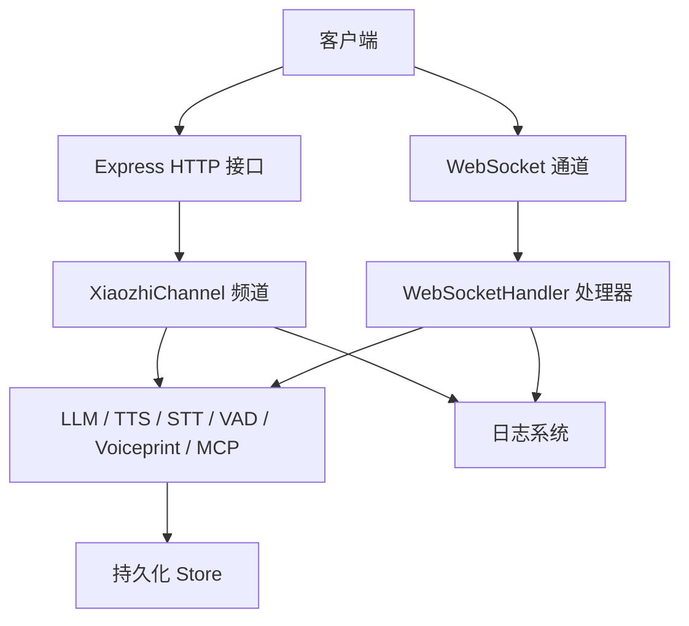
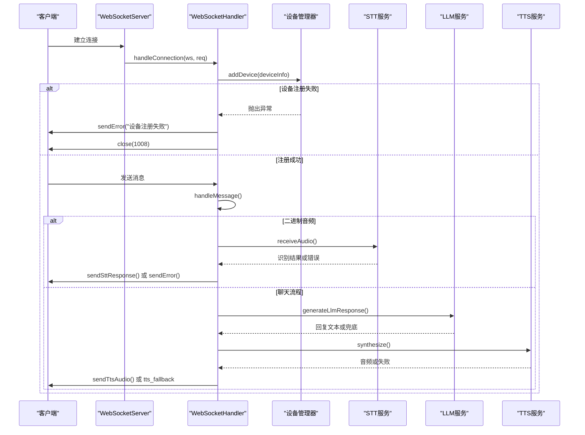
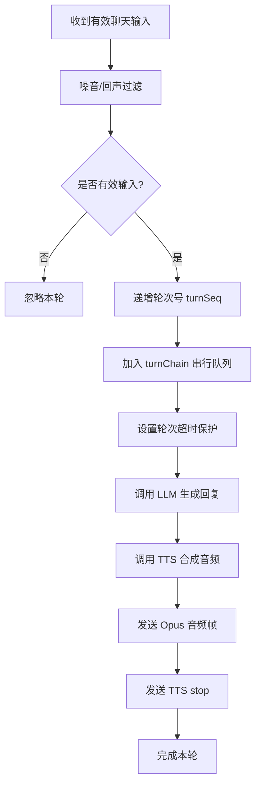

# 错误处理与状态码

<cite>
**本文引用的文件**   
- [index.js](file://index.js)
- [websocket.js](file://core/handlers/websocket.js)
- [messageTypes.js](file://core/constants/messageTypes.js)
- [constants.js](file://config/constants.js)
- [logger.js](file://utils/logger.js)
</cite>

## 目录
1. [引言](#引言)
2. [项目结构与错误处理边界](#项目结构与错误处理边界)
3. [HTTP 状态码使用规范](#http-状态码使用规范)
4. [WebSocket 错误消息格式](#websocket-错误消息格式)
5. [业务错误分类与错误码映射](#业务错误分类与错误码映射)
6. [核心错误处理流程](#核心错误处理流程)
7. [日志记录规范](#日志记录规范)
8. [异常恢复机制](#异常恢复机制)
9. [客户端错误处理最佳实践](#客户端错误处理最佳实践)
10. [调试技巧与故障排查指南](#调试技巧与故障排查指南)
11. [性能与稳定性注意事项](#性能与稳定性注意事项)
12. [结论](#结论)

## 引言
本文面向小智语音交互频道的服务端与客户端开发者，统一说明 HTTP 接口、WebSocket 协议、业务处理链路的错误处理方式。文档重点包括：
- HTTP 状态码在健康检查、配置更新、设备管理、OTA 等接口中的使用规范。
- WebSocket 连接建立、握手、音频流、对话轮次、广播等场景的错误消息格式。
- 业务错误分类体系、错误码映射表、错误响应标准结构。
- 常见错误场景的处理方式、日志记录规范、异常恢复机制。
- 客户端重试策略、降级方案、调试技巧与故障排查方法。

## 项目结构与错误处理边界
本项目的错误处理主要分布在以下位置：
- 应用入口与服务启动：频道初始化、服务启动失败、端口占用、服务器监听错误。
- Express 路由层：参数校验失败、资源未初始化、目标设备不存在、OTA 请求失败。
- WebSocket 处理器：连接注册失败、消息解析失败、STT/TTS/LLM 调用失败、音频帧发送异常。
- 日志系统：结构化日志输出、模块生命周期日志、错误堆栈记录。

**图示来源**
- [index.js:44-125](file://index.js#L44-L125)
- [index.js:254-488](file://index.js#L254-L488)
- [websocket.js:22-60](file://core/handlers/websocket.js#L22-L60)
- [websocket.js:67-169](file://core/handlers/websocket.js#L67-L169)
- [logger.js:36-51](file://utils/logger.js#L36-L51)

**章节来源**
- [index.js:44-125](file://index.js#L44-L125)
- [index.js:254-488](file://index.js#L254-L488)
- [websocket.js:22-60](file://core/handlers/websocket.js#L22-L60)
- [websocket.js:67-169](file://core/handlers/websocket.js#L67-L169)
- [logger.js:36-51](file://utils/logger.js#L36-L51)

## HTTP 状态码使用规范
当前项目中 HTTP 接口主要用于健康检查、配置热更新、设备查询、会话统计、广播下发、WebSocket URL 获取以及 OTA 固件下载。错误处理以“明确语义 + 可操作提示”为原则：

| 接口或行为 | 成功状态码 | 典型错误状态码 | 错误响应特征 | 说明 |
|---|---:|---:|---|---|
| 健康检查 `/health` | `200` | 无 | `{ status, channel, devices, uptime }` | 用于存活探测；若内部组件未初始化，应返回 `500` 并带错误字段。 |
| 读取音频阈值 `/api/settings/audio` GET | `200` | 无 | `{ ok, thresholds }` | 正常返回默认或已持久化阈值。 |
| 更新音频阈值 `/api/settings/audio` POST | `200` | `400` | `{ ok: false, error }` | 参数越界或非整数时返回 `400`，提示取值范围。 |
| 断开设备连接 `/api/disconnect` POST | `200` | `400` | `{ success, error? }` | 缺少 `clientId` 时返回 `400`；设备不在线时返回 `success: false`。 |
| 查询在线设备 `/api/devices` GET | `200` | `500` | `{ error }` | 设备管理器未初始化时返回 `500`。 |
| 已知设备列表 `/api/devices/known` GET | `200` | 无 | 分页设备列表 | 通过 Store 查询，参数非法时由上层过滤。 |
| 设备统计 `/api/devices/stats` GET | `200` | 无 | `{ live, registered }` | 未初始化时返回空值。 |
| 对话记录 `/api/conversations` GET | `200` | 无 | 分页对话记录 | 支持按设备、角色过滤。 |
| 会话列表 `/api/sessions` GET | `200` | `500` | `{ error }` | 会话管理器未初始化时返回 `500`。 |
| 语音放送 `/api/broadcast` POST | `200` | `400`、`404`、`500` | `{ success, error?, accepted, devices }` | 文本为空返回 `400`；无线上设备返回 `404`；广播器未初始化返回 `500`。 |
| WebSocket URL 信息 `/api/websocket/urls` GET | `200` | 无 | `{ urls, current, use_https, port, host }` | 提供 ws/wss 地址。 |
| OTA 查询 `/xiaozhi/ota/` GET | `200` | `500` | `{ error }` | OTA handler 未初始化时返回 `500`。 |
| OTA 升级 `/xiaozhi/ota/` POST | `200` | `500` | `{ success, message }` | 请求处理异常时返回 `500`。 |
| OTA 固件下载 `/xiaozhi/ota/download/:filename` GET | `200` | `500` | `{ error }` | 下载失败时返回 `500`。 |

### 参数校验错误
- 当请求体字段缺失、类型错误或取值超出允许范围时，优先使用 `400 Bad Request`。
- 错误响应应包含可读的 `error` 或 `message` 字段，便于客户端展示或自动化告警。

### 资源不可用错误
- 当依赖组件（如设备管理器、会话管理器、OTA handler、WebSocket handler）未初始化时，返回 `500 Internal Server Error`。
- 对于“目标不存在”的场景（如无线上设备），使用 `404 Not Found` 更贴近 REST 语义。

### 异步广播语义
- `/api/broadcast` 采用“先验设备再异步发送”的策略：立即返回 `accepted: true`，实际推送结果通过日志或后续审计记录体现。
- 若需要强一致反馈，应在广播任务完成后回调或写入可查询状态。

**章节来源**
- [index.js:287-488](file://index.js#L287-L488)

## WebSocket 错误消息格式
WebSocket 错误消息通过统一的 `type: 'error'` 结构返回，可选携带 `session_id` 以便客户端关联具体对话会话。

### 标准错误消息结构
| 字段 | 类型 | 必填 | 含义 |
|---|---|---:|---|
| `type` | string | 是 | 固定为 `error` |
| `message` | string | 是 | 人类可读的错误描述 |
| `session_id` | string | 否 | 关联的会话 ID |

该结构由 WebSocket 处理器的 `sendError` 方法构造，并通过 `SERVER_MESSAGE_TYPES.ERROR` 标识。

### 常见错误触发点
| 场景 | 触发位置 | 错误内容示例 | 建议客户端行为 |
|---|---|---|---|
| 设备注册失败 | 连接建立后设备管理器注册失败 | “设备注册失败” | 关闭连接，提示重新连接或检查设备元信息。 |
| 消息处理异常 | WebSocket 消息解析或分发异常 | “消息处理失败” | 丢弃当前消息，保留连接，等待下一条。 |
| 协议版本不支持 | HELLO 握手校验失败 | “不支持的协议版本或传输方式” | 升级客户端协议或调整连接参数。 |
| 缺少监听状态 | LISTEN 消息缺少 `state` | “缺少监听状态” | 补全 `listen.state` 后重试。 |
| 好友消息缺少目标 | FRIEND 消息缺少 `clientid` | “缺少目标客户端ID” | 修正目标设备 ID 后重试。 |
| 目标设备不存在或不在线 | FRIEND 转发失败 | “目标客户端不存在/不在线” | 改用离线队列或提示用户目标离线。 |
| 音频数据缺失 | JSON 音频消息缺少 `audioData` | “缺少音频数据” | 检查录音采集与 Base64 编码逻辑。 |
| 没有活动会话 | 音频处理时未创建会话 | “没有活动会话” | 先发起 HELLO 或创建会话后再上传音频。 |
| 语音识别失败 | STT 调用异常 | “语音识别失败: ...” | 重试一次；若持续失败则降级为文本输入。 |
| LLM 调用失败 | LLM 超时或异常 | 默认回复或兜底文本 | 记录日志，必要时提示用户稍后再试。 |
| TTS 合成失败 | TTS 服务异常 | 回退为 `tts_fallback` 文本 | 客户端显示文本，避免卡死在播放状态。 |
| 音频帧发送失败 | Opus 帧发送异常 | 停止剩余帧发送 | 检查连接状态与设备解码能力。 |

### WebSocket 消息类型参考
- 客户端消息类型：`hello`、`listen`、`abort`、`iot`、`chat`、`mcp`、`start_recognition`、`audio_data`、`wake_word_detected`、`friend`。
- 服务端消息类型：`connection_ack`、`hello`、`stt`、`llm`、`tts`、`error`、`recognition_started`、`wake_word_acknowledged`、`audio_received`、`message`、`tts_fallback`、`tts_disabled`、`sleep`。

**章节来源**
- [websocket.js:135-163](file://core/handlers/websocket.js#L135-L163)
- [websocket.js:228-283](file://core/handlers/websocket.js#L228-L283)
- [websocket.js:450-643](file://core/handlers/websocket.js#L450-L643)
- [websocket.js:1221-1265](file://core/handlers/websocket.js#L1221-L1265)
- [websocket.js:1300-1458](file://core/handlers/websocket.js#L1300-L1458)
- [websocket.js:1510-1521](file://core/handlers/websocket.js#L1510-L1521)
- [messageTypes.js:7-60](file://core/constants/messageTypes.js#L7-L60)

## 业务错误分类与错误码映射
当前代码未定义全局数字业务错误码枚举，而是以字符串消息和 HTTP/WebSocket 语义区分错误。为便于前端统一处理，可将现有行为归纳为如下分类映射：

| 分类 | 推荐错误码 | 对应场景 | 当前实现表现 | 建议扩展 |
|---|---:|---|---|---|
| 参数错误 | `40001` | 缺少字段、类型错误、取值越界 | HTTP `400` + `error` 字段 | 增加 `code`、`field`、`range`。 |
| 认证授权错误 | `40002` | 协议版本不支持、token 无效 | HELLO 校验失败、未来可扩展鉴权 | 增加 `reason`、`allowed_versions`。 |
| 资源不存在 | `40003` | 目标设备不存在、无线上设备 | HTTP `404`、WebSocket 好友消息错误 | 增加 `targetId`、`resourceType`。 |
| 服务未初始化 | `50001` | 设备管理器/会话管理器/OTA handler 未初始化 | HTTP `500` + `error` | 增加 `component`、`recoverable`。 |
| 上游服务异常 | `50002` | LLM/TTS/STT/VAD/MCP 调用失败 | 兜底回复、`tts_fallback`、`error` 消息 | 增加 `provider`、`retry_after`。 |
| 音频处理异常 | `50003` | 音频数据无效、Opus 解码失败、帧发送失败 | 日志警告、跳过识别、停止发送 | 增加 `format`、`frameIndex`。 |
| 会话状态异常 | `50004` | 会话不存在、重复处理、轮次被接管 | 静默忽略或日志警告 | 增加 `sessionId`、`turnSeq`。 |
| 网络中断 | `50005` | WebSocket 关闭、连接断开 | `close` 事件清理资源 | 增加 `code`、`reason`。 |

### 错误响应标准格式
建议所有错误响应遵循统一结构：

| 字段 | 类型 | 必填 | 含义 |
|---|---|---:|---|
| `ok` | boolean | 否 | 通用成功标志（HTTP JSON 常用） |
| `success` | boolean | 否 | 通用成功标志（部分接口使用） |
| `code` | number/string | 否 | 业务错误码 |
| `message` | string | 是 | 人类可读错误描述 |
| `error` | string | 否 | 兼容旧接口的错误字段 |
| `session_id` | string | 否 | 关联会话 |
| `device_id` | string | 否 | 关联设备 |
| `retry_after` | number | 否 | 建议重试间隔（秒） |
| `details` | object | 否 | 详细错误上下文 |

注意：当前仓库中不同接口对成功标志命名不一致，既有 `ok`，也有 `success`。客户端应同时兼容两种字段。

**章节来源**
- [index.js:312-344](file://index.js#L312-L344)
- [index.js:347-355](file://index.js#L347-L355)
- [index.js:357-364](file://index.js#L357-L364)
- [index.js:397-404](file://index.js#L397-L404)
- [index.js:406-425](file://index.js#L406-L425)
- [websocket.js:1510-1521](file://core/handlers/websocket.js#L1510-L1521)

## 核心错误处理流程
### WebSocket 连接与消息处理主流程

**图示来源**
- [websocket.js:67-169](file://core/handlers/websocket.js#L67-L169)
- [websocket.js:228-283](file://core/handlers/websocket.js#L228-L283)
- [websocket.js:289-446](file://core/handlers/websocket.js#L289-L446)
- [websocket.js:933-971](file://core/handlers/websocket.js#L933-L971)
- [websocket.js:1025-1130](file://core/handlers/websocket.js#L1025-L1130)

### 单轮对话串行化与超时保护

**图示来源**
- [websocket.js:651-694](file://core/handlers/websocket.js#L651-L694)
- [websocket.js:731-818](file://core/handlers/websocket.js#L731-L818)
- [websocket.js:1025-1130](file://core/handlers/websocket.js#L1025-L1130)
- [websocket.js:1139-1189](file://core/handlers/websocket.js#L1139-L1189)

**章节来源**
- [websocket.js:67-169](file://core/handlers/websocket.js#L67-L169)
- [websocket.js:228-283](file://core/handlers/websocket.js#L228-L283)
- [websocket.js:651-818](file://core/handlers/websocket.js#L651-L818)
- [websocket.js:1025-1189](file://core/handlers/websocket.js#L1025-L1189)

## 日志记录规范
日志系统提供两类接口：
- `logger`：基础日志方法 `verbose/debug/info/warn/error`。
- `channelLogger`：频道级生命周期日志，包括模块初始化、启动、停止、操作、错误。

### 日志级别与环境变量
| 环境变量 | 默认值 | 含义 |
|---|---|---|
| `XZ_LOG_LEVEL` | `info` | 最低输出级别 |
| `XZ_LOG_DIR` | `./logs` | 日志目录 |
| `XZ_LOG_TO_FILE` | `1` | 是否写入文件 |

### 日志输出格式
每条日志包含 ISO 时间戳、级别、消息，以及可选的元数据对象。错误日志会额外输出堆栈信息。

### 关键日志点
- 频道启动与停止：记录端口、主机、运行状态。
- WebSocket 连接：记录客户端 ID、IP、设备类型、连接时间。
- 设备注册：记录设备 ID、类型、在线状态。
- 音频处理：记录二进制数据长度、VAD 检测结果、振幅分析。
- 识别结果：记录置信度、Provider、是否触发对话。
- LLM/TTS 调用：记录超时、兜底回复、音频时长、帧数。
- 错误路径：记录异常消息、堆栈、受影响设备与会话。

**章节来源**
- [logger.js:1-54](file://utils/logger.js#L1-L54)
- [index.js:52-57](file://index.js#L52-L57)
- [index.js:93-124](file://index.js#L93-L124)
- [websocket.js:77-163](file://core/handlers/websocket.js#L77-L163)
- [websocket.js:1896-1902](file://core/handlers/websocket.js#L1896-L1902)
- [websocket.js:933-971](file://core/handlers/websocket.js#L933-L971)
- [websocket.js:1025-1130](file://core/handlers/websocket.js#L1025-L1130)

## 异常恢复机制
### 设备注册失败
- 设备注册失败时，仅断开当前连接，不向上冒泡到 WebSocket upgrade 回调，避免拖垮整个服务进程。
- 客户端应捕获 `close` 事件，根据原因决定是否重连。

### 消息处理异常
- WebSocket 消息处理包裹 try/catch，解析失败或处理异常时发送 `error` 消息。
- 客户端不应因单条消息错误而断开连接，应继续接收后续消息。

### LLM 超时与兜底
- LLM 调用设置超时保护，超时后返回默认回复，避免轮次队列挂死。
- 若 LLM 完全不可用，客户端可提示用户切换输入方式或稍后重试。

### TTS 降级
- TTS 合成失败时，服务端发送 `tts_fallback` 文本消息，确保客户端不会卡在“说话中”状态。
- 若 TTS 未启用，服务端发送 `tts_disabled` 文本消息。

### 音频帧发送异常
- 发送 Opus 帧时检查连接状态和用户打断信号，异常时停止剩余帧发送。
- 客户端应处理断帧、乱码、播放卡顿，必要时重新请求下一轮。

### 广播静音闸门
- 语音放送期间暂停麦克风输入，防止回声自打断。
- 放送结束后设置宽限期，避免设备刚播完就误判为回声。

**章节来源**
- [websocket.js:135-141](file://core/handlers/websocket.js#L135-L141)
- [websocket.js:145-152](file://core/handlers/websocket.js#L145-L152)
- [websocket.js:933-971](file://core/handlers/websocket.js#L933-L971)
- [websocket.js:1104-1126](file://core/handlers/websocket.js#L1104-L1126)
- [websocket.js:1158-1189](file://core/handlers/websocket.js#L1158-L1189)
- [websocket.js:1654-1689](file://core/handlers/websocket.js#L1654-L1689)

## 客户端错误处理最佳实践
### 连接层
- 捕获 WebSocket `error` 与 `close` 事件，区分网络中断与服务端主动关闭。
- 对 `close code 1008` 进行特殊处理，通常表示设备注册或协议问题。
- 使用指数退避重试，避免雪崩式重连。

### 协议层
- 收到 `error` 消息时，记录 `session_id` 与 `message`，展示给用户或上报监控。
- 对未知消息类型保持向前兼容，忽略而非崩溃。
- 对 `tts_fallback` 与 `tts_disabled` 做 UI 降级：显示文本而非尝试播放。

### 音频层
- 收到 `audio_received` 确认后可优化丢包检测与缓冲策略。
- 遇到 Opus 解码失败时，丢弃坏帧并继续播放，避免整体卡顿。
- 检测到长时间无声但仍在“倾听中”时，主动发送 `listen.stop` 或重置状态。

### 重试与降级
| 错误类型 | 重试策略 | 降级方案 |
|---|---|---|
| 网络抖动 | 指数退避，最多 3 次 | 切换到弱网模式，降低音频码率 |
| LLM 超时 | 不重试，直接兜底 | 提示用户稍后再试 |
| TTS 失败 | 不重试，直接 fallback | 显示文本回复 |
| STT 失败 | 重试 1 次 | 提示用户重新说话 |
| 设备离线 | 不重试，标记离线 | 使用离线消息队列 |
| 参数错误 | 不重试，修正后重试 | 提示用户修正输入 |

**章节来源**
- [websocket.js:1025-1130](file://core/handlers/websocket.js#L1025-L1130)
- [websocket.js:1158-1189](file://core/handlers/websocket.js#L1158-L1189)
- [websocket.js:1896-1902](file://core/handlers/websocket.js#L1896-L1902)

## 调试技巧与故障排查指南
### 常见问题定位
| 现象 | 可能原因 | 排查步骤 | 解决建议 |
|---|---|---|---|
| 设备无法注册 | client_type 不在白名单、设备管理器异常 | 查看连接日志与设备注册日志 | 修正 client_type，检查设备管理器初始化 |
| 音频无识别结果 | VAD 阈值过高、音频帧不足、静音过滤 | 查看 VAD 窗口、振幅分析、空帧处理日志 | 调整 `vad.threshold`、`silenceThresholdMs` |
| 语音卡顿或颤音 | Opus 帧发送过快、设备缓冲溢出 | 查看帧发送日志与设备端播放日志 | 使用固定帧时长，避免估算节拍 |
| LLM 无响应 | 上游服务超时、Provider 不可用 | 查看 LLM 调用日志与超时保护 | 检查 Provider 配置，适当提高超时 |
| TTS 无声 | TTS 服务未启用、合成失败 | 查看 TTS 合成日志与 fallback 消息 | 启用 TTS，检查音频格式转换 |
| 广播无效 | 无线上设备、设备连接关闭 | 查看广播目标筛选日志 | 检查设备在线状态与连接状态 |

### 日志分析方法
1. 通过 `XZ_LOG_LEVEL=debug` 开启详细日志，定位音频解码、VAD、STT、LLM、TTS 关键路径。
2. 关注 `[ERROR]` 与 `stack` 字段，快速定位异常堆栈。
3. 结合 `component`、`sessionId`、`deviceId`、`turnSeq` 等元数据关联多段日志。
4. 对音频问题，优先查看 `mic diag` 日志，确认首包长度、RMS 能量、峰值采样。

### 故障排查清单
- [ ] 端口是否被占用？查看服务器启动日志。
- [ ] WebSocket URL 是否正确？调用 `/api/websocket/urls` 验证。
- [ ] 设备是否在线？调用 `/api/devices` 或 `/api/devices/stats`。
- [ ] 音频阈值是否合理？调用 `/api/settings/audio` 查看并调整。
- [ ] LLM/TTS/STT 是否配置正确？检查服务初始化日志。
- [ ] 是否出现回声自打断？检查广播静音闸门与回声判定日志。
- [ ] 是否发生轮次超时？查看 `turnChain` 与超时保护日志。

**章节来源**
- [websocket.js:2274-2399](file://core/handlers/websocket.js#L2274-L2399)
- [index.js:427-443](file://index.js#L427-L443)
- [index.js:357-381](file://index.js#L357-L381)
- [index.js:298-344](file://index.js#L298-L344)

## 性能与稳定性注意事项
- 单轮对话使用 `turnChain` 串行化，避免多条应答流交错导致 Opus 帧混乱。
- 轮次超时保护防止 LLM 或 TTS 挂死阻塞后续请求。
- 广播复用同一串行机制，保证同一设备同时只有一条音频流。
- VAD 使用滑动窗口与双阈值判断，减少噪声误触发。
- 心跳检测目前为 TODO，建议补充 ping/pong 机制以检测僵尸连接。

**章节来源**
- [websocket.js:677-694](file://core/handlers/websocket.js#L677-L694)
- [websocket.js:1025-1130](file://core/handlers/websocket.js#L1025-L1130)
- [websocket.js:1654-1689](file://core/handlers/websocket.js#L1654-L1689)
- [websocket.js:2274-2399](file://core/handlers/websocket.js#L2274-L2399)

## 结论
本项目错误处理以“清晰语义、可观测、可恢复”为核心原则：
- HTTP 层使用标准状态码表达参数错误、资源不存在、服务未初始化等问题。
- WebSocket 层通过统一 `error` 消息传递业务异常，并结合会话 ID 提升可追踪性。
- 业务错误虽未集中定义为数字码，但可通过分类映射表统一前端处理。
- 日志系统覆盖模块生命周期、连接、音频、识别、合成、错误等关键路径。
- 异常恢复机制涵盖设备注册、消息处理、LLM/TTS/STT 调用、音频帧发送、广播静音等场景。
- 客户端应实现连接重试、协议降级、音频容错、UI 友好提示，形成完整错误闭环。

建议在后续迭代中：
- 引入统一业务错误码枚举与错误响应结构。
- 完善心跳检测与连接保活机制。
- 增加错误指标上报与告警规则。
- 对高频错误路径增加熔断与限流保护。