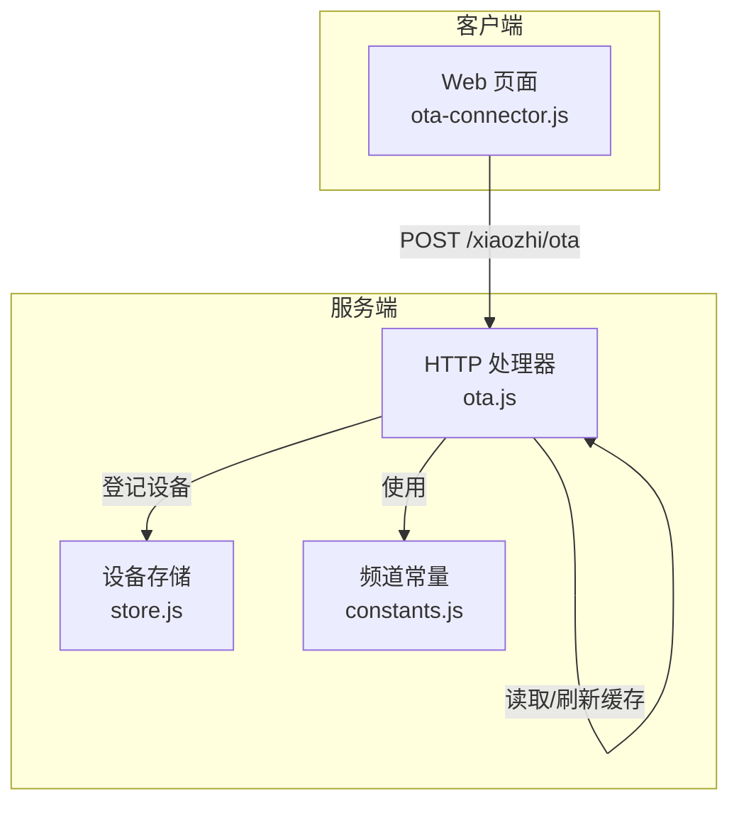
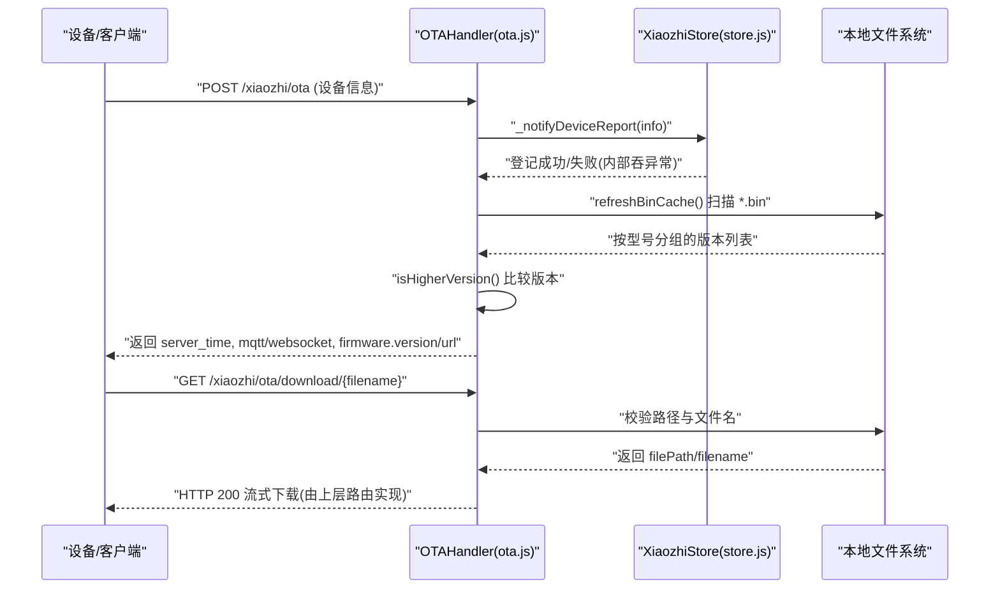
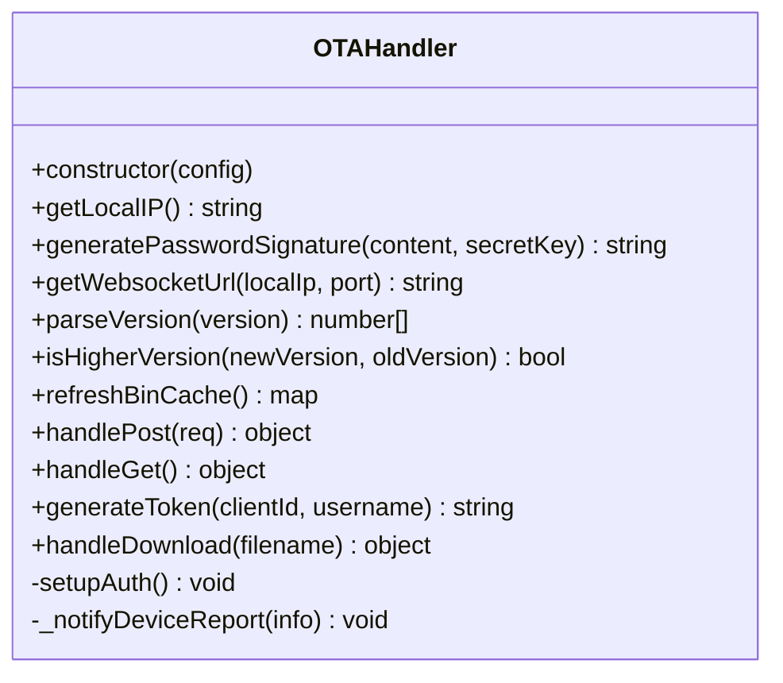
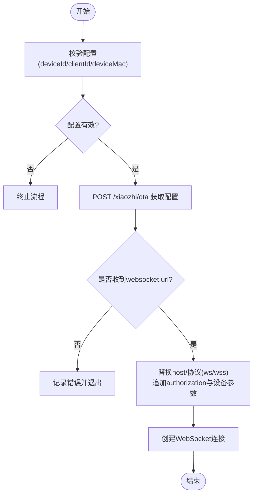
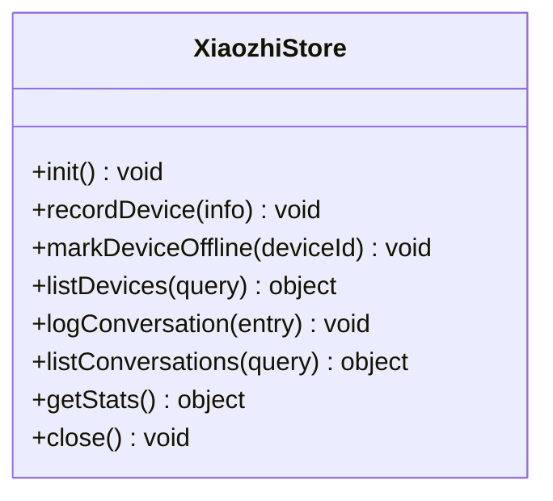
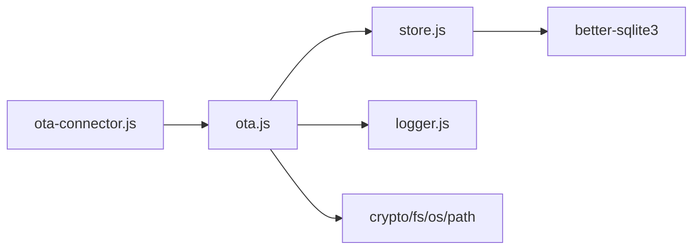

# OTA固件升级

<cite>
**本文引用的文件**   
- [core/handlers/ota.js](file://core/handlers/ota.js)
- [public/chat/js/core/network/ota-connector.js](file://public/chat/js/core/network/ota-connector.js)
- [core/managers/store.js](file://core/managers/store.js)
- [config/constants.js](file://config/constants.js)
</cite>

## 目录
1. [简介](#简介)
2. [项目结构](#项目结构)
3. [核心组件](#核心组件)
4. [架构总览](#架构总览)
5. [详细组件分析](#详细组件分析)
6. [依赖关系分析](#依赖关系分析)
7. [性能与可靠性](#性能与可靠性)
8. [故障排查指南](#故障排查指南)
9. [结论](#结论)
10. [附录：协议规范与集成示例](#附录协议规范与集成示例)

## 简介
本仓库实现了基于 HTTP + WebSocket 的 OTA（Over-The-Air）固件升级能力，覆盖设备上报、版本对比、固件下载分发、认证鉴权、设备注册持久化等关键环节。客户端通过 OTA 接口查询可升级目标，并在需要时建立 WebSocket 通道进行后续交互；服务端负责扫描本地固件目录、生成安全令牌、返回 MQTT/WebSocket 连接信息，并记录设备元数据。

## 项目结构
OTA 相关代码主要分布在以下位置：
- 服务端处理逻辑：core/handlers/ota.js
- 客户端 OTA 连接器：public/chat/js/core/network/ota-connector.js
- 设备注册与持久化：core/managers/store.js
- 频道常量与配置加载：config/constants.js

图表来源
- [core/handlers/ota.js:1-394](file://core/handlers/ota.js#L1-L394)
- [public/chat/js/core/network/ota-connector.js:1-132](file://public/chat/js/core/network/ota-connector.js#L1-L132)
- [core/managers/store.js:1-237](file://core/managers/store.js#L1-L237)
- [config/constants.js:1-104](file://config/constants.js#L1-L104)

章节来源
- [core/handlers/ota.js:1-394](file://core/handlers/ota.js#L1-L394)
- [public/chat/js/core/network/ota-connector.js:1-132](file://public/chat/js/core/network/ota-connector.js#L1-L132)
- [core/managers/store.js:1-237](file://core/managers/store.js#L1-L237)
- [config/constants.js:1-104](file://config/constants.js#L1-L104)

## 核心组件
- OTAHandler（服务端）
  - 解析设备上报请求，返回服务器时间、MQTT/WebSocket 配置、固件下载地址与目标版本。
  - 管理本地固件缓存，按型号分组并按版本号降序排序。
  - 提供 Token 生成、MQTT 密码签名、WebSocket URL 构造等工具方法。
  - 提供固件下载路径校验与安全检查。
- Web OTA Connector（客户端）
  - 发起 OTA POST 请求，根据响应构建 WebSocket URL，自动适配 ws/wss 协议，附加认证参数。
- XiaozhiStore（持久化）
  - 维护设备注册表，支持 OTA 上报与 WebSocket 接入的设备登记、在线状态更新、离线标记与列表查询。
- 频道常量
  - 定义消息类型、设备类型、音频格式等枚举常量，供上层模块统一使用。

章节来源
- [core/handlers/ota.js:7-394](file://core/handlers/ota.js#L7-L394)
- [public/chat/js/core/network/ota-connector.js:1-132](file://public/chat/js/core/network/ota-connector.js#L1-L132)
- [core/managers/store.js:29-237](file://core/managers/store.js#L29-L237)
- [config/constants.js:44-104](file://config/constants.js#L44-L104)

## 架构总览
OTA 升级流程由“设备上报 → 服务端决策 → 下发连接信息/固件地址 → 客户端连接”构成。

图表来源
- [core/handlers/ota.js:162-311](file://core/handlers/ota.js#L162-L311)
- [core/handlers/ota.js:358-391](file://core/handlers/ota.js#L358-L391)
- [core/managers/store.js:87-123](file://core/managers/store.js#L87-L123)

## 详细组件分析

### OTAHandler（服务端）
职责
- 设备身份识别与上报回调
- 固件缓存刷新与版本选择
- 认证与鉴权（Token/MQTT 签名）
- 固件下载安全检查

关键方法与行为
- parseVersion/isHigherVersion：解析语义化版本号并进行逐段比较，用于决定是否需要升级。
- refreshBinCache：扫描 data/bin 目录，匹配 {model}_{version}.bin 命名规则，按型号分组并降序排序。
- handlePost：解析多大小写请求头，提取设备标识、型号、版本、MAC 等信息；若配置了 MQTT 网关则返回 MQTT 连接信息，否则返回 WebSocket URL 与可选 token；同时计算并返回可升级的固件版本与下载地址。
- generateToken：基于 HMAC-SHA256 生成带过期时间的 token，拼接 clientId、username、timestamp。
- generatePasswordSignature：为 MQTT 用户名生成签名密码。
- getWebsocketUrl：根据 use_https 与自定义 websocket 配置动态生成 ws/wss URL。
- handleDownload：对传入文件名做 basename 过滤与正则校验，严格限制在 binDir 下，防止路径穿越。

错误处理
- 所有 IO 与外部调用均包裹 try/catch，记录日志并返回降级结果，避免影响主流程。

图表来源
- [core/handlers/ota.js:7-394](file://core/handlers/ota.js#L7-L394)

章节来源
- [core/handlers/ota.js:88-110](file://core/handlers/ota.js#L88-L110)
- [core/handlers/ota.js:115-156](file://core/handlers/ota.js#L115-L156)
- [core/handlers/ota.js:162-311](file://core/handlers/ota.js#L162-L311)
- [core/handlers/ota.js:338-353](file://core/handlers/ota.js#L338-L353)
- [core/handlers/ota.js:358-391](file://core/handlers/ota.js#L358-L391)

### Web OTA Connector（客户端）
职责
- 校验必要配置（deviceId/clientId/deviceMac）。
- 发送 OTA POST 请求，携带设备基本信息与应用/板卡信息。
- 从响应中提取 websocket.url 与 token，替换 host 与协议（ws/wss），追加 authorization 与设备参数后建立 WebSocket 连接。

关键点
- 自动将 OTA 返回的 WebSocket 主机替换为当前页面 host，确保证书匹配。
- 根据页面协议自动选择 wss/ws。
- 兼容 Bearer 前缀，自动补齐或去除。

图表来源
- [public/chat/js/core/network/ota-connector.js:4-72](file://public/chat/js/core/network/ota-connector.js#L4-L72)
- [public/chat/js/core/network/ota-connector.js:88-132](file://public/chat/js/core/network/ota-connector.js#L88-L132)

章节来源
- [public/chat/js/core/network/ota-connector.js:1-132](file://public/chat/js/core/network/ota-connector.js#L1-L132)

### XiaozhiStore（设备注册与持久化）
职责
- 初始化 SQLite 数据库，创建设备与对话记录表。
- 登记/更新设备信息（OTA 上报与 WebSocket 接入共用）。
- 标记设备离线、查询设备列表、统计信息。

与 OTA 的关系
- OTAHandler 通过 onDeviceReport 回调将设备上报信息写入 store，确保设备元数据（型号、固件版本、MAC、IP、来源等）持久化。

图表来源
- [core/managers/store.js:29-237](file://core/managers/store.js#L29-L237)

章节来源
- [core/managers/store.js:29-83](file://core/managers/store.js#L29-L83)
- [core/managers/store.js:87-150](file://core/managers/store.js#L87-L150)
- [core/managers/store.js:152-237](file://core/managers/store.js#L152-L237)

### 频道常量（constants.js）
职责
- 集中定义消息类型、设备类型、音频格式等枚举，便于跨模块一致使用。

章节来源
- [config/constants.js:44-104](file://config/constants.js#L44-L104)

## 依赖关系分析
- OTAHandler 依赖 Node 内置 crypto/fs/os/path 模块，以及 utils/logger。
- OTAHandler 通过 onDeviceReport 回调与上层（如频道层）解耦，将设备上报事件交给 store 持久化。
- Web OTA Connector 依赖浏览器 fetch 与 WebSocket API。
- XiaozhiStore 依赖 better-sqlite3 与 fs/path。

图表来源
- [core/handlers/ota.js:1-5](file://core/handlers/ota.js#L1-L5)
- [public/chat/js/core/network/ota-connector.js:1-2](file://public/chat/js/core/network/ota-connector.js#L1-L2)
- [core/managers/store.js:12-16](file://core/managers/store.js#L12-L16)

章节来源
- [core/handlers/ota.js:1-5](file://core/handlers/ota.js#L1-L5)
- [public/chat/js/core/network/ota-connector.js:1-2](file://public/chat/js/core/network/ota-connector.js#L1-L2)
- [core/managers/store.js:12-16](file://core/managers/store.js#L12-L16)

## 性能与可靠性
- 固件缓存刷新
  - 每次 OTA 请求都会扫描 data/bin 目录并重建按型号分组的版本索引，适合中小规模固件集；若固件数量较大，建议引入内存缓存与增量刷新策略。
- 版本比较
  - 采用逐段数字比较，时间复杂度 O(n)，空间复杂度 O(1)，满足常规语义化版本比较需求。
- 下载安全
  - 仅允许 basename 且正则校验 .bin 后缀，并通过 path.resolve 校验路径位于 binDir 内，防止路径穿越。
- 健壮性
  - 多处 try/catch 捕获异常并记录日志，避免单点失败影响整体服务。
- 断点续传
  - 当前实现未包含 Range 头处理与断点续传逻辑；如需支持大固件分片下载，可在上层路由中扩展 Range 支持并在 OTAHandler 中增加分片元数据接口。

[本节为通用指导，不直接分析具体文件]

## 故障排查指南
常见问题与定位要点
- 无法获取 WebSocket 地址
  - 检查 OTA POST 响应是否包含 websocket.url；确认服务端 use_https 与自定义 websocket 配置是否正确。
- 证书不匹配导致连接失败
  - 客户端会将 OTA 返回的 host 替换为当前页面 host，请确保域名与证书一致。
- 鉴权失败
  - 若启用 auth，确认 allowed_devices 是否包含 deviceId，或是否允许白名单为空时放行；检查 token 生成密钥与过期时间。
- 固件未出现可升级项
  - 确认 data/bin 目录下存在符合 {model}_{version}.bin 命名的固件文件，且版本号高于设备上报版本。
- 下载失败
  - 检查 handleDownload 的路径校验与文件名正则；确认 binDir 权限与文件存在。

章节来源
- [core/handlers/ota.js:31-39](file://core/handlers/ota.js#L31-L39)
- [core/handlers/ota.js:73-85](file://core/handlers/ota.js#L73-L85)
- [core/handlers/ota.js:338-353](file://core/handlers/ota.js#L338-L353)
- [core/handlers/ota.js:358-391](file://core/handlers/ota.js#L358-L391)

## 结论
该实现以简洁可靠的 HTTP + WebSocket 模式完成 OTA 升级的核心链路：设备上报、版本对比、连接信息下发与固件下载。通过严格的文件名与路径校验保障下载安全，结合 store 持久化设备元数据，便于运维与排障。未来可扩展断点续传、分片校验、灰度发布与回滚机制，以满足更大规模与更高可靠性的生产场景。

[本节为总结性内容，不直接分析具体文件]

## 附录：协议规范与集成示例

### OTA 协议规范（HTTP）
- 端点
  - POST /xiaozhi/ota：设备上报与升级决策
  - GET /xiaozhi/ota：健康检查与 WebSocket URL 提示
  - GET /xiaozhi/ota/download/{filename}：固件下载（由上层路由配合）
- 请求头（POST）
  - device-id / Device-Id / device_id：设备唯一标识
  - client-id / Client-Id / client_id：客户端标识
  - device-model / Device-Model / device_model：设备型号
  - device-version / Device-Version / device_version：设备当前固件版本
  - mac-address / Mac-Address / mac_address / mac：设备 MAC
- 请求体（POST）
  - application.name/version/compile_time/idf_version/elf_sha256
  - ota.label
  - board.type/ssid/rssi/channel/ip/mac
  - flash_size / minimum_free_heap_size / chip_model_name / chip_info / partition_table
- 响应体（POST）
  - server_time.timestamp/timezone_offset
  - mqtt.endpoint/client_id/username/password/publish_topic/subscribe_topic（当配置了 MQTT 网关）
  - websocket.url/token（未配置 MQTT 时）
  - firmware.version/url（当存在更高版本时）

章节来源
- [core/handlers/ota.js:162-311](file://core/handlers/ota.js#L162-L311)
- [core/handlers/ota.js:316-333](file://core/handlers/ota.js#L316-L333)
- [core/handlers/ota.js:358-391](file://core/handlers/ota.js#L358-L391)

### 客户端集成示例（Web）
- 调用 webSocketConnect(otaUrl, config)
  - config 需包含 deviceId、clientId、deviceMac、deviceName 等字段。
- 客户端会自动：
  - 发起 OTA POST 请求并解析响应
  - 替换 host 与协议（ws/wss）
  - 追加 authorization 与设备参数
  - 建立 WebSocket 连接

章节来源
- [public/chat/js/core/network/ota-connector.js:4-72](file://public/chat/js/core/network/ota-connector.js#L4-L72)
- [public/chat/js/core/network/ota-connector.js:88-132](file://public/chat/js/core/network/ota-connector.js#L88-L132)

### 服务器端配置要点
- 端口与协议
  - http_port/port：HTTP 与 WebSocket 共用端口
  - use_https：决定是否返回 wss
  - websocket：可自定义 WebSocket URL
- 认证
  - auth.enabled/auth_key/auth.expire_seconds
  - auth.allowed_devices：设备白名单（留空表示放行）
- MQTT 网关
  - mqtt_gateway/mqtt_signature_key：启用后返回 MQTT 连接信息
- 固件目录
  - data/bin：存放 {model}_{version}.bin 文件

章节来源
- [core/handlers/ota.js:31-39](file://core/handlers/ota.js#L31-L39)
- [core/handlers/ota.js:73-85](file://core/handlers/ota.js#L73-L85)
- [core/handlers/ota.js:115-156](file://core/handlers/ota.js#L115-L156)
- [core/handlers/ota.js:206-275](file://core/handlers/ota.js#L206-L275)

### 版本管理与对比
- 命名规范
  - 文件名格式：{model}_{version}.bin
- 版本解析与比较
  - 解析出数字段并逐段比较，返回是否需要升级
- 候选选择
  - 按型号分组后降序排序，取第一个高于设备版本的固件作为升级目标

章节来源
- [core/handlers/ota.js:88-110](file://core/handlers/ota.js#L88-L110)
- [core/handlers/ota.js:115-156](file://core/handlers/ota.js#L115-L156)
- [core/handlers/ota.js:277-304](file://core/handlers/ota.js#L277-L304)

### 安全验证
- Token 生成
  - 基于 HMAC-SHA256，包含 clientId、username、timestamp，附带过期时间
- MQTT 密码签名
  - 对 client_id|username 生成 base64 签名，增强 MQTT 接入安全性
- 下载安全
  - 仅允许 .bin 后缀，basename 过滤，路径必须位于 binDir 下

章节来源
- [core/handlers/ota.js:338-353](file://core/handlers/ota.js#L338-L353)
- [core/handlers/ota.js:59-68](file://core/handlers/ota.js#L59-L68)
- [core/handlers/ota.js:358-391](file://core/handlers/ota.js#L358-L391)

### 升级失败回滚与异常恢复
- 当前实现未内置回滚逻辑。建议在设备侧实现：
  - 升级前保存旧固件备份
  - 升级成功后执行完整性校验（如 SHA256）
  - 校验失败或启动失败则切换回旧分区/镜像
- 服务端侧可通过 store 记录设备 last_seen 与 online 状态，辅助判断升级后设备是否上线。

章节来源
- [core/managers/store.js:87-150](file://core/managers/store.js#L87-L150)