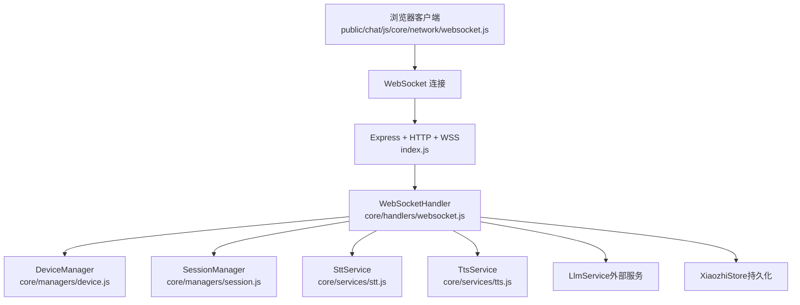
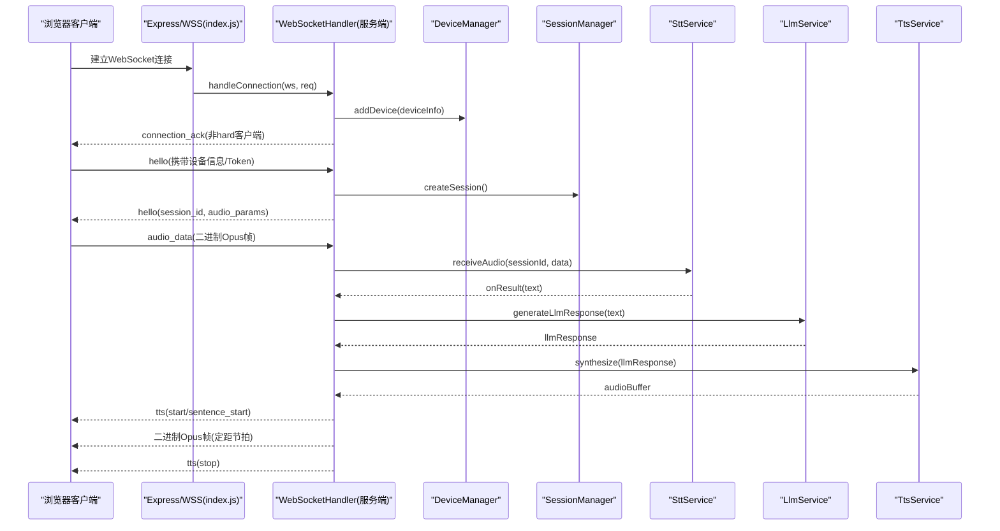
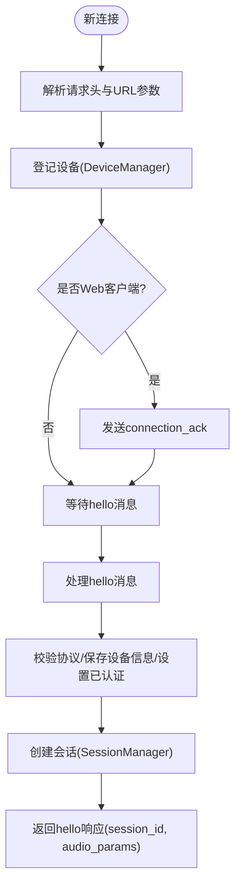
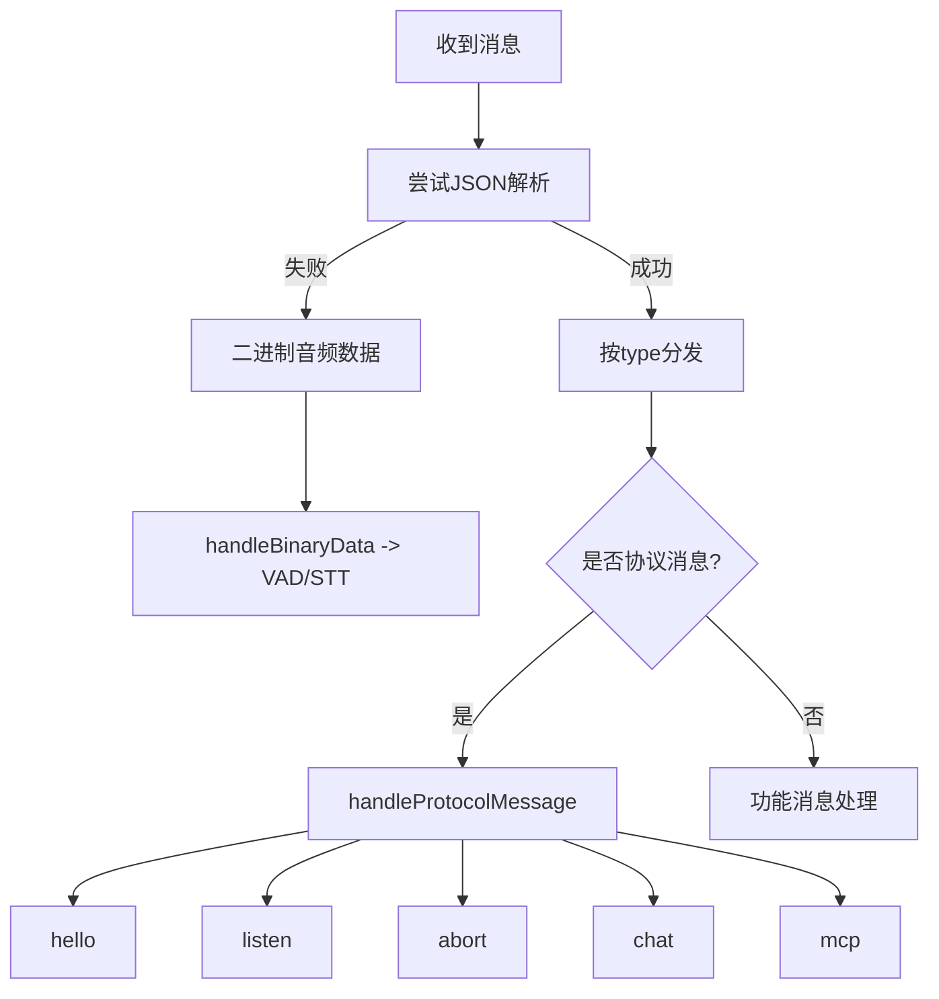
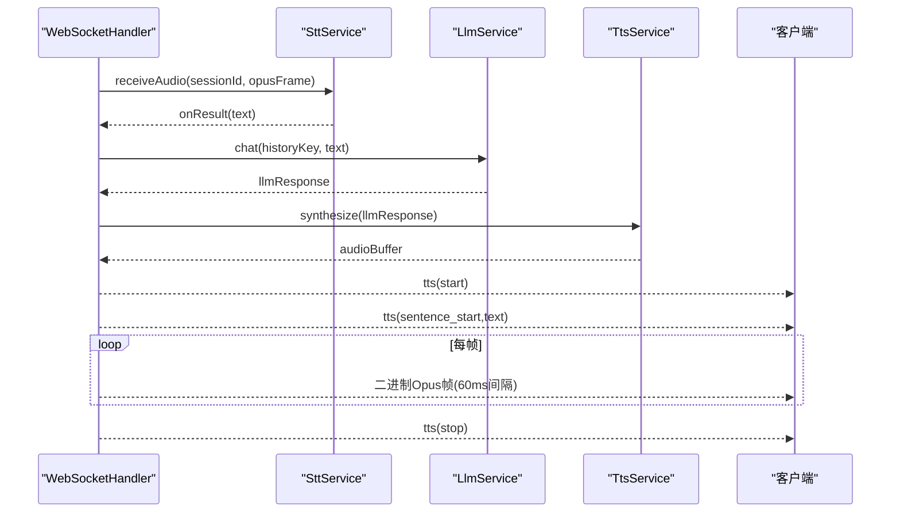
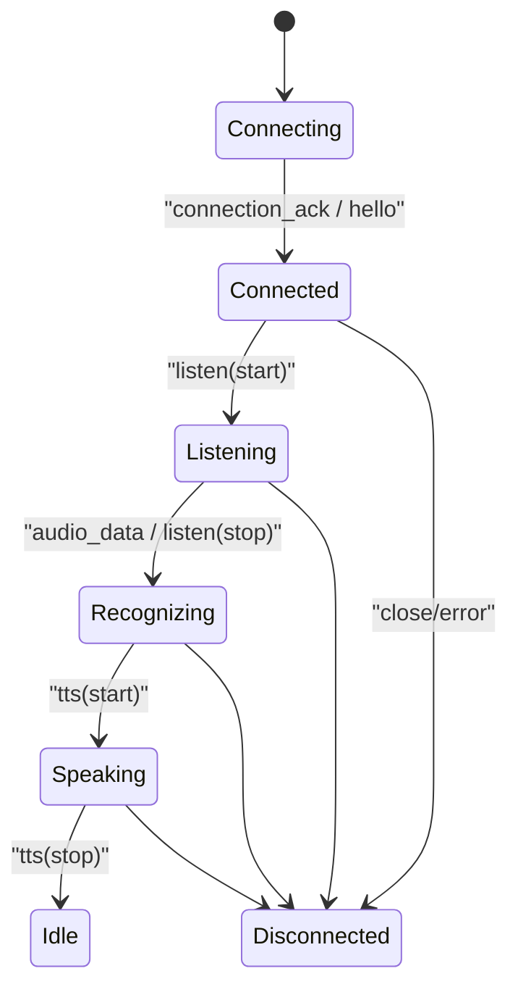
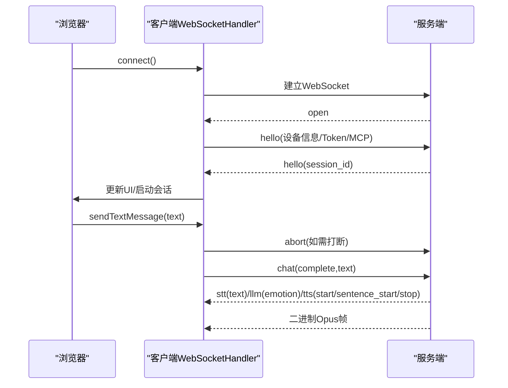
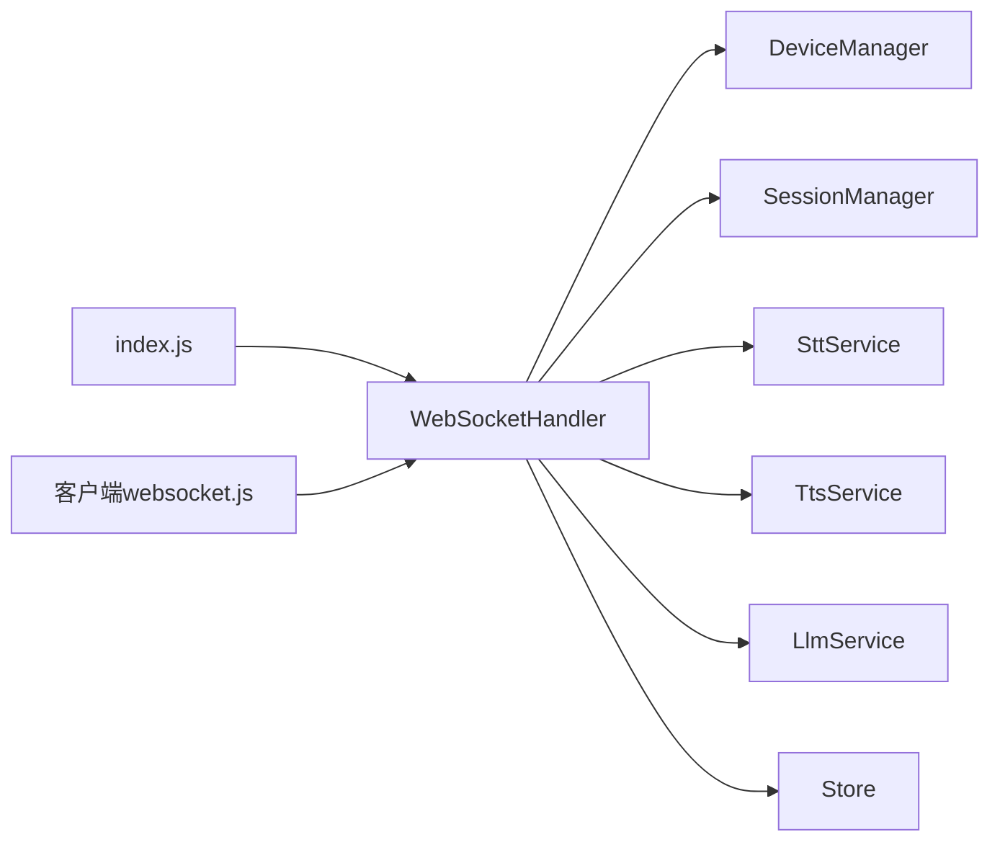

# WebSocket通信系统

<cite>
**本文引用的文件**   
- [index.js](file://index.js)
- [websocket.js（服务端）](file://core/handlers/websocket.js)
- [messageTypes.js](file://core/constants/messageTypes.js)
- [constants.js（频道常量）](file://config/constants.js)
- [websocket.js（客户端）](file://public/chat/js/core/network/websocket.js)
- [device.js（设备管理器）](file://core/managers/device.js)
- [session.js（会话管理器）](file://core/managers/session.js)
- [stt.js（语音转文字服务）](file://core/services/stt.js)
- [tts.js（文字转语音服务）](file://core/services/tts.js)
</cite>

## 目录
1. [引言](#引言)
2. [项目结构](#项目结构)
3. [核心组件](#核心组件)
4. [架构总览](#架构总览)
5. [详细组件分析](#详细组件分析)
6. [依赖关系分析](#依赖关系分析)
7. [性能与优化](#性能与优化)
8. [故障排查指南](#故障排查指南)
9. [结论](#结论)
10. [附录：协议与扩展](#附录协议与扩展)

## 引言
本文件面向“小智”WebSocket 语音交互系统的实现文档，覆盖连接建立、认证机制、消息路由、消息类型定义、事件处理、连接生命周期管理、错误处理与重连策略、客户端集成示例与最佳实践，以及自定义消息类型的扩展方式。系统由 Node.js 服务端与浏览器端组成，通过 WebSocket 传输控制消息与 Opus 音频帧，结合 STT/TTS/LLM 等服务完成语音对话闭环。

## 项目结构
本项目采用分层组织：
- 入口与通道：`index.js` 负责 Express + HTTP + WebSocket 服务器启动、路由、服务装配与插件导出。
- 核心处理器：`core/handlers/websocket.js` 实现连接管理、消息解析、协议处理、音频流处理、会话与设备管理、TTS 播放流程等。
- 常量定义：`core/constants/messageTypes.js` 集中定义客户端与服务端消息类型、状态枚举。
- 频道常量：`config/constants.js` 提供频道、服务默认配置与消息类型别名。
- 管理器：`core/managers/device.js`、`core/managers/session.js` 分别维护在线设备与会话。
- 服务层：`core/services/stt.js`、`core/services/tts.js` 封装语音识别与合成能力。
- 客户端：`public/chat/js/core/network/websocket.js` 提供浏览器端连接、握手、消息分发、音频播放与 MCP 工具调用。

**图示来源**
- [index.js:254-281](file://index.js#L254-L281)
- [websocket.js（服务端）:22-60](file://core/handlers/websocket.js#L22-L60)
- [device.js:4-10](file://core/managers/device.js#L4-L10)
- [session.js:4-10](file://core/managers/session.js#L4-L10)
- [stt.js:39-87](file://core/services/stt.js#L39-L87)
- [tts.js:3-21](file://core/services/tts.js#L3-L21)

**章节来源**
- [index.js:44-81](file://index.js#L44-L81)
- [index.js:254-281](file://index.js#L254-L281)
- [websocket.js（服务端）:22-60](file://core/handlers/websocket.js#L22-L60)

## 核心组件
- XiaozhiChannel（频道）：负责初始化服务、装配 WebSocket 处理器、注册路由、启动/停止服务器。
- WebSocketHandler（服务端）：负责连接生命周期、消息路由、协议处理、音频流处理、TTS 播放、会话与设备管理、广播与 OTA 兼容接口。
- DeviceManager：维护在线设备 Map、设备查询与统计。
- SessionManager：维护会话 Map、超时清理、上下文存取。
- SttService：多提供商 STT 接入、Opus 解码、VAD 与流式识别、结果回调。
- TtsService：多提供商 TTS 接入、文本分段、音频时长估算、输出保存。
- 客户端 WebSocketHandler：浏览器端连接、握手、消息分发、音频播放、MCP 工具调用。

**章节来源**
- [index.js:44-81](file://index.js#L44-L81)
- [websocket.js（服务端）:22-60](file://core/handlers/websocket.js#L22-L60)
- [device.js:4-10](file://core/managers/device.js#L4-L10)
- [session.js:4-10](file://core/managers/session.js#L4-L10)
- [stt.js:39-87](file://core/services/stt.js#L39-L87)
- [tts.js:3-21](file://core/services/tts.js#L3-L21)
- [websocket.js（客户端）:11-21](file://public/chat/js/core/network/websocket.js#L11-L21)

## 架构总览
下图展示从客户端到服务端的完整交互链路，包括握手、STT、LLM、TTS 与音频帧发送。

**图示来源**
- [index.js:268-281](file://index.js#L268-L281)
- [websocket.js（服务端）:67-169](file://core/handlers/websocket.js#L67-L169)
- [websocket.js（服务端）:450-513](file://core/handlers/websocket.js#L450-L513)
- [websocket.js（服务端）:289-446](file://core/handlers/websocket.js#L289-L446)
- [websocket.js（服务端）:933-971](file://core/handlers/websocket.js#L933-L971)
- [websocket.js（服务端）:1025-1130](file://core/handlers/websocket.js#L1025-L1130)
- [stt.js:348-383](file://core/services/stt.js#L348-L383)
- [tts.js:62-104](file://core/services/tts.js#L62-L104)

## 详细组件分析

### 连接建立与认证机制
- 连接建立：
  - 服务端在 `index.js` 中创建 Express + HTTP + WebSocketServer，并在 `wss.on('connection')` 中调用 `handleWebSocketConnection`。
  - 服务端 `WebSocketHandler.handleConnection` 解析请求头与 URL 参数，分配 clientId/deviceId，登记设备，并可选发送 `connection_ack`。
- 认证机制：
  - 客户端在握手 `hello` 消息中携带 `token`、`device_id`、`device_name`、`device_mac`、`features` 等字段。
  - 服务端在 `handleProtocolMessage` 的 `HELLO` 分支中校验协议版本/传输方式，保存设备元信息，设置 `ws.isAuthenticated = true`，并创建会话返回 `session_id` 与 `audio_params`。
  - 若为 Web 客户端（无 version/transport），则走兼容路径。

**图示来源**
- [index.js:268-281](file://index.js#L268-L281)
- [websocket.js（服务端）:67-169](file://core/handlers/websocket.js#L67-L169)
- [websocket.js（服务端）:450-513](file://core/handlers/websocket.js#L450-L513)

**章节来源**
- [index.js:254-281](file://index.js#L254-L281)
- [websocket.js（服务端）:67-169](file://core/handlers/websocket.js#L67-L169)
- [websocket.js（服务端）:450-513](file://core/handlers/websocket.js#L450-L513)

### 消息路由与事件处理
- 消息类型定义集中在 `core/constants/messageTypes.js`，包含客户端/服务端消息类型、监听状态、聊天状态、TTS 子状态、MCP 与好友消息类型。
- 服务端 `handleMessage` 根据 `type` 分派：
  - 协议消息：`hello/listen/abort/iot/chat/mcp`
  - 功能消息：`start_recognition/audio_data/wake_word_detected/friend`
  - 其他：未知类型告警
- 协议消息进一步进入 `handleProtocolMessage`，按类型处理：
  - `hello`：握手、认证、会话创建、MCP 初始化（若支持）。
  - `listen`：开始/停止监听或检测模式；停止时触发 STT 识别。
  - `abort`：中止当前轮次音频流，清理会话。
  - `chat`：完整聊天消息，转发 STT 文本给客户端显示，必要时关闭 Quest 并进入完整对话流程。
  - `mcp`：交由 MCP 服务处理。

**图示来源**
- [websocket.js（服务端）:228-283](file://core/handlers/websocket.js#L228-L283)
- [websocket.js（服务端）:450-643](file://core/handlers/websocket.js#L450-L643)
- [messageTypes.js:7-109](file://core/constants/messageTypes.js#L7-L109)

**章节来源**
- [websocket.js（服务端）:228-283](file://core/handlers/websocket.js#L228-L283)
- [websocket.js（服务端）:450-643](file://core/handlers/websocket.js#L450-L643)
- [messageTypes.js:7-109](file://core/constants/messageTypes.js#L7-L109)

### 音频流与语音识别/合成
- 音频输入：
  - 客户端以二进制 Opus 帧发送；服务端 `handleBinaryData` 进行 VAD 窗口判断、静默阈值判定、最长语音兜底，确保不会无限“倾听中”。
  - 空帧表示录音结束，触发 STT 识别（要求缓冲帧数达到阈值）。
- STT 处理：
  - `SttService.receiveAudio` 缓存音频帧，自动模式下检测到语音停止后触发 `_handleVoiceStop`，将 PCM 数据送入对应提供商识别，并通过回调返回文本。
- LLM 回复：
  - `generateLlmResponse` 调用 LLM 服务，带超时保护；若返回特定状态则关闭 Quest。
- TTS 播放：
  - `sendTtsAudio` 先合成音频，再发送 `tts(start)`、`tts(sentence_start)`，随后按固定帧时长（默认 60ms）逐帧发送二进制 Opus 帧，最后发送 `tts(stop)`。
  - 支持用户打断（`abortUpTo` 轮次归属）与回声拾取过滤（避免无 AEC 设备自播声误识别）。

**图示来源**
- [websocket.js（服务端）:289-446](file://core/handlers/websocket.js#L289-L446)
- [websocket.js（服务端）:933-971](file://core/handlers/websocket.js#L933-L971)
- [websocket.js（服务端）:1025-1130](file://core/handlers/websocket.js#L1025-L1130)
- [stt.js:348-383](file://core/services/stt.js#L348-L383)
- [tts.js:62-104](file://core/services/tts.js#L62-L104)

**章节来源**
- [websocket.js（服务端）:289-446](file://core/handlers/websocket.js#L289-L446)
- [websocket.js（服务端）:933-971](file://core/handlers/websocket.js#L933-L971)
- [websocket.js（服务端）:1025-1130](file://core/handlers/websocket.js#L1025-L1130)
- [stt.js:348-383](file://core/services/stt.js#L348-L383)
- [tts.js:62-104](file://core/services/tts.js#L62-L104)

### 连接生命周期管理与错误处理
- 连接生命周期：
  - 新建连接：登记设备、设置心跳、绑定 message/close/error 事件。
  - 断开连接：移除设备、标记离线、清理 MCP 客户端、记录会话结束。
- 错误处理：
  - JSON 解析失败视为二进制音频数据。
  - 业务异常捕获后发送 `error` 消息。
  - TTS 合成失败回退为文本消息 `tts_fallback` 或 `tts_disabled`。
  - LLM 调用失败使用默认回复，避免阻塞主流程。
- 心跳检测：
  - 预留 `startHeartbeat`/`stopHeartbeat` 方法，当前未启用。

**图示来源**
- [websocket.js（服务端）:67-169](file://core/handlers/websocket.js#L67-L169)
- [websocket.js（服务端）:174-193](file://core/handlers/websocket.js#L174-L193)
- [websocket.js（服务端）:1507-1521](file://core/handlers/websocket.js#L1507-L1521)
- [websocket.js（服务端）:1025-1130](file://core/handlers/websocket.js#L1025-L1130)

**章节来源**
- [websocket.js（服务端）:67-169](file://core/handlers/websocket.js#L67-L169)
- [websocket.js（服务端）:174-193](file://core/handlers/websocket.js#L174-L193)
- [websocket.js（服务端）:1507-1521](file://core/handlers/websocket.js#L1507-L1521)
- [websocket.js（服务端）:1025-1130](file://core/handlers/websocket.js#L1025-L1130)

### 客户端集成示例与最佳实践
- 连接与握手：
  - 客户端通过 `connect()` 建立 WebSocket，设置 `binaryType='arraybuffer'`，初始化录音器与 MCP 模块。
  - 连接成功后调用 `sendHelloMessage()`，携带 `device_id`、`device_name`、`device_mac`、`token`、`features.mcp`。
  - 等待服务端 `hello` 响应，获取 `session_id`。
- 消息处理：
  - `connection_ack`：仅日志，不显示。
  - `hello`：启用摄像头、更新 UI、启动 AI 会话。
  - `tts`：根据 state 控制播放与动画。
  - `stt`：显示识别文本，必要时触发摄像头状态变更。
  - `llm`：情绪动作触发，但文本显示由 `tts(sentence_start)` 承担。
  - `mcp`：工具列表与工具调用。
- 断线处理：
  - `onclose`：重置 UI、停止录音、关闭摄像头。
  - `onerror`：记录错误并通知 UI。
- 最佳实践：
  - 使用 `abort` 打断正在播放的远端语音，再发送新的 `chat` 消息。
  - 合理设置 `features.mcp=true` 以启用工具能力。
  - 保持 `binaryType=arraybuffer` 以确保音频正确播放。

**图示来源**
- [websocket.js（客户端）:24-71](file://public/chat/js/core/network/websocket.js#L24-L71)
- [websocket.js（客户端）:74-130](file://public/chat/js/core/network/websocket.js#L74-L130)
- [websocket.js（客户端）:480-513](file://public/chat/js/core/network/websocket.js#L480-L513)

**章节来源**
- [websocket.js（客户端）:24-71](file://public/chat/js/core/network/websocket.js#L24-L71)
- [websocket.js（客户端）:74-130](file://public/chat/js/core/network/websocket.js#L74-L130)
- [websocket.js（客户端）:480-513](file://public/chat/js/core/network/websocket.js#L480-L513)

### 扩展自定义消息类型与处理逻辑
- 在服务端：
  - 在 `core/constants/messageTypes.js` 中添加新的客户端或服务端消息类型。
  - 在 `handleMessage` 或 `handleProtocolMessage` 中增加对应分支，实现业务逻辑。
  - 如需新增二进制协议，可在 `handleBinaryData` 中扩展解析逻辑。
- 在客户端：
  - 在 `handleTextMessage` 中增加对新消息类型的处理分支。
  - 在 `sendTextMessage` 或专用发送方法中构造新消息格式。
- 注意事项：
  - 保持向后兼容：对未知类型进行安全降级与日志记录。
  - 对结构化消息进行必要字段校验，避免下游服务异常。
  - 对于音频相关扩展，注意帧时长与编码格式一致性。

**章节来源**
- [messageTypes.js:7-109](file://core/constants/messageTypes.js#L7-L109)
- [websocket.js（服务端）:228-283](file://core/handlers/websocket.js#L228-L283)
- [websocket.js（服务端）:450-643](file://core/handlers/websocket.js#L450-L643)
- [websocket.js（客户端）:74-130](file://public/chat/js/core/network/websocket.js#L74-L130)

## 依赖关系分析
- 组件耦合：
  - `index.js` 装配所有服务并注入 `WebSocketHandler`，形成松耦合的服务总线。
  - `WebSocketHandler` 依赖 `DeviceManager`、`SessionManager`、`SttService`、`TtsService`、`LlmService`、`Store`。
  - `SttService` 与 `TtsService` 各自封装第三方服务，降低上层复杂度。
- 直接依赖：
  - 服务端 WebSocket 处理器直接调用 STT/TTS 服务。
  - 客户端 WebSocket 处理器直接操作 DOM 与媒体 API。
- 潜在循环依赖：
  - 当前未发现循环依赖；服务间通过回调与事件解耦。
- 外部依赖：
  - STT 支持多种提供商（doubao/funasr/aibridge/xunfei/aliyun）。
  - TTS 支持 edge/xunfei/aliyun。
  - LLM 通过桥接或外部服务调用。

**图示来源**
- [index.js:17-27](file://index.js#L17-L27)
- [websocket.js（服务端）:22-60](file://core/handlers/websocket.js#L22-L60)
- [websocket.js（客户端）:11-21](file://public/chat/js/core/network/websocket.js#L11-L21)

**章节来源**
- [index.js:17-27](file://index.js#L17-L27)
- [websocket.js（服务端）:22-60](file://core/handlers/websocket.js#L22-L60)
- [websocket.js（客户端）:11-21](file://public/chat/js/core/network/websocket.js#L11-L21)

## 性能与优化
- 音频帧发送节拍：
  - 使用固定帧时长（默认 60ms）发送 Opus 帧，避免估算偏差导致设备缓冲溢出。
- 轮次串行化与超时：
  - 同一连接同一时刻只有一条应答流程，防止音频帧交错；单轮超时释放队列，避免挂死。
- LLM 超时保护：
  - 后端无响应时快速兜底，避免阻塞整个轮次队列。
- VAD 与静默阈值：
  - 可热更新静默阈值，减少误触发与长句切碎。
- 回声拾取过滤：
  - 对无 AEC 设备，识别文本与近期播放内容相似度较高时忽略，避免自播声误识别。
- 建议：
  - 调整 `frameDuration` 与设备匹配，确保播放流畅。
  - 合理设置 `maxUtteranceMs` 与 `silenceThresholdMs`，平衡实时性与准确性。
  - 监控 LLM/TTS 服务延迟，必要时引入缓存或降级策略。

[本节为通用指导，无需具体文件引用]

## 故障排查指南
- 连接问题：
  - 检查 `/api/websocket/urls` 返回的 ws/wss 地址与环境变量 `USE_HTTPS`。
  - 确认客户端 `binaryType=arraybuffer` 且网络可达。
- 握手失败：
  - 检查 `hello` 消息是否携带 `token`、`device_id` 等必需字段。
  - 查看服务端日志中的协议版本与传输方式校验。
- 音频无声或卡顿：
  - 检查 Opus 帧时长与设备一致。
  - 观察 `tts(start/sentence_start/stop)` 状态是否成对出现。
  - 检查 VAD 窗口与静默阈值是否合理。
- 识别不准确：
  - 检查 STT 提供商配置与连通性（FunASR 探活）。
  - 确认音频格式与采样率配置正确。
- 对话中断：
  - 检查 `abort` 消息是否正确设置 `session_id`。
  - 查看轮次序号 `turnSeq` 与 `abortUpTo` 是否被新一轮接管。

**章节来源**
- [index.js:427-443](file://index.js#L427-L443)
- [websocket.js（服务端）:450-513](file://core/handlers/websocket.js#L450-L513)
- [websocket.js（服务端）:1025-1130](file://core/handlers/websocket.js#L1025-L1130)
- [stt.js:185-201](file://core/services/stt.js#L185-L201)

## 结论
本 WebSocket 通信系统通过清晰的分层与模块化设计，实现了稳定的连接管理、完善的消息路由、高效的音频流处理与可扩展的服务集成。服务端与客户端均具备健壮的错误处理与状态管理，适合在 IoT 语音交互场景中使用。通过合理的参数调优与扩展点设计，可灵活适配不同设备与服务提供商。

[本节为总结，无需具体文件引用]

## 附录：协议与扩展

### 消息类型定义
- 客户端消息类型：`hello`、`listen`、`abort`、`iot`、`chat`、`mcp`、`start_recognition`、`audio_data`、`wake_word_detected`、`friend`、`echo`。
- 服务端消息类型：`connection_ack`、`error`、`hello`、`recognition_started`、`stt`、`llm`、`tts`、`tts_fallback`、`tts_disabled`、`mcp`、`sleep`、`audio_received`、`wake_word_acknowledged`、`friend`、`friend_ack`、`status`、`message`、`user`、`bot`、`system`。
- 状态枚举：`TTS_STATES`、`LISTEN_STATES`、`CHAT_STATES`、`MCP_MESSAGE_TYPES`、`FRIEND_MESSAGE_TYPES`。

**章节来源**
- [messageTypes.js:7-109](file://core/constants/messageTypes.js#L7-L109)

### 客户端集成步骤
- 初始化连接：
  - 调用 `connect()`，设置 `binaryType=arraybuffer`。
  - 连接成功后调用 `sendHelloMessage()`。
- 处理消息：
  - 监听 `connection_ack`、`hello`、`tts`、`stt`、`llm`、`mcp` 等消息。
  - 根据 `tts.state` 控制播放与动画。
- 发送消息：
  - 使用 `sendTextMessage(text)` 发送聊天消息，必要时先发送 `abort` 打断。
- 断线处理：
  - 在 `onclose` 与 `onerror` 中重置 UI 与资源。

**章节来源**
- [websocket.js（客户端）:24-71](file://public/chat/js/core/network/websocket.js#L24-L71)
- [websocket.js（客户端）:74-130](file://public/chat/js/core/network/websocket.js#L74-L130)
- [websocket.js（客户端）:480-513](file://public/chat/js/core/network/websocket.js#L480-L513)