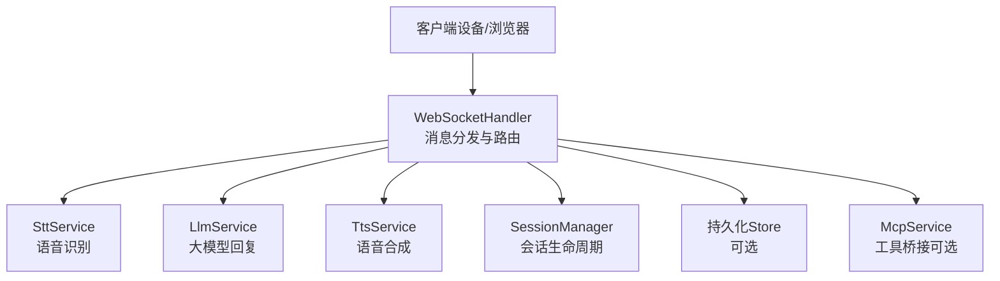
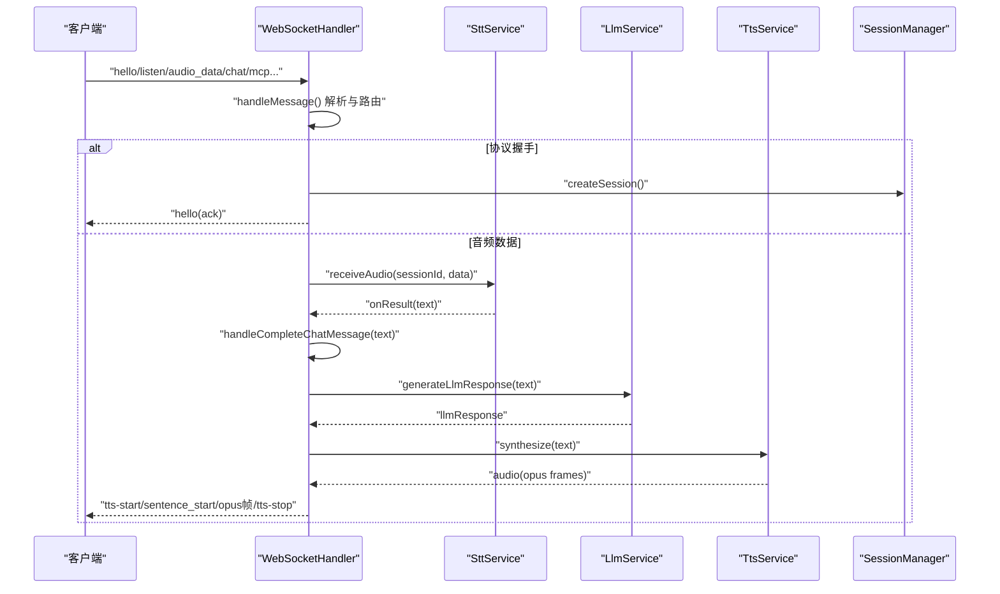
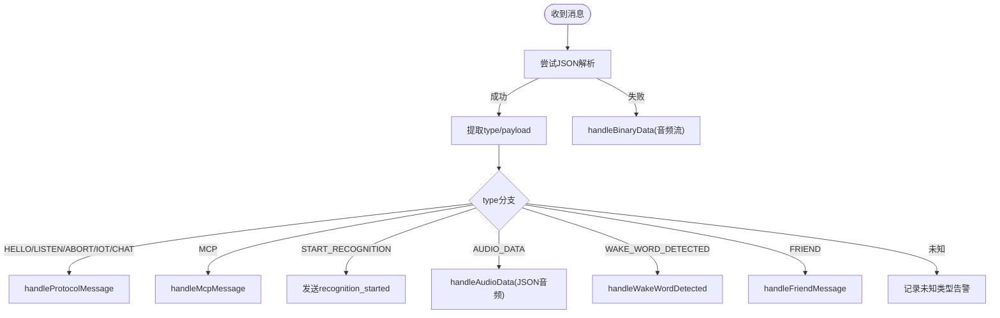
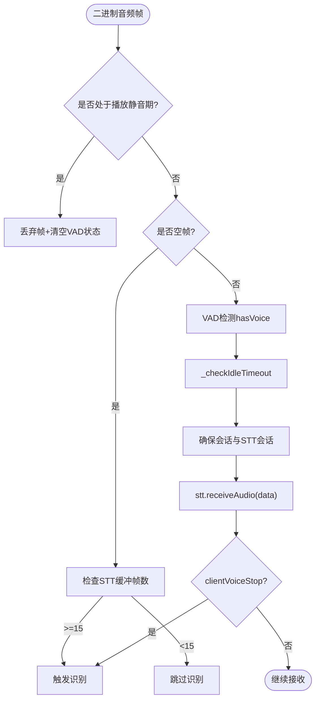
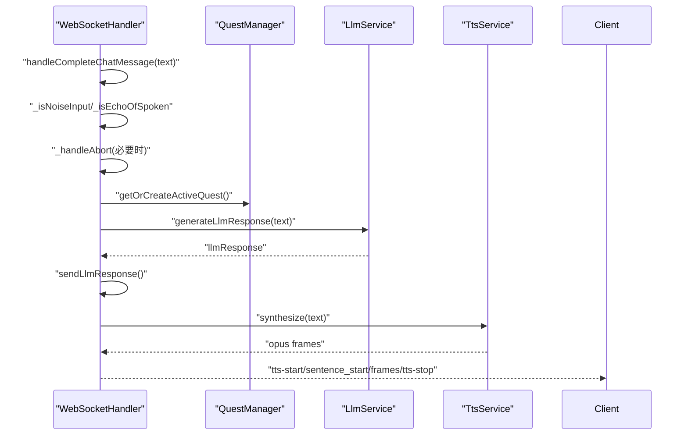
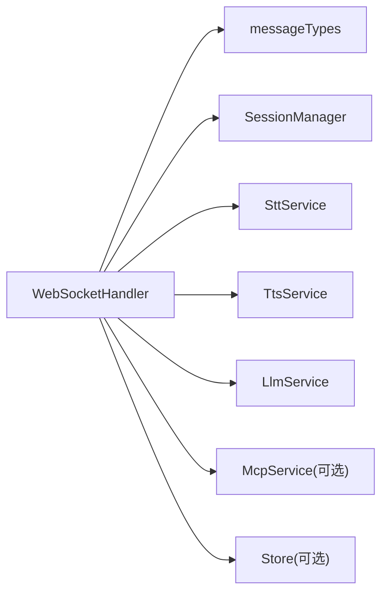

# 事件处理机制

<cite>
**本文引用的文件**   
- [websocket.js](file://core/handlers/websocket.js)
- [messageTypes.js](file://core/constants/messageTypes.js)
- [session.js](file://core/managers/session.js)
- [stt.js](file://core/services/stt.js)
- [tts.js](file://core/services/tts.js)
- [llm.js](file://core/services/llm.js)
</cite>

## 目录
1. [引言](#引言)
2. [项目结构](#项目结构)
3. [核心组件](#核心组件)
4. [架构总览](#架构总览)
5. [详细组件分析](#详细组件分析)
6. [依赖关系分析](#依赖关系分析)
7. [性能与并发特性](#性能与并发特性)
8. [故障排查指南](#故障排查指南)
9. [结论](#结论)
10. [附录：扩展与自定义事件处理器](#附录扩展与自定义事件处理器)

## 引言
本文聚焦 WebSocket 事件处理机制，重点说明 handleMessage 的消息分发与路由逻辑、不同消息类型的处理流程与业务调用链，覆盖音频数据处理、语音识别触发、会话管理与对话流程的事件流转。同时解释异步处理模式、错误捕获与异常恢复策略，并给出事件监听器扩展方法与自定义事件处理器的实现指南。

## 项目结构
围绕事件处理的核心代码分布在以下模块：
- 协议与消息类型定义：core/constants/messageTypes.js
- WebSocket 连接与消息处理：core/handlers/websocket.js
- 会话管理：core/managers/session.js
- 语音转文本服务：core/services/stt.js
- 文本转语音服务：core/services/tts.js
- 大语言模型服务：core/services/llm.js

图表来源
- [websocket.js:22-60](file://core/handlers/websocket.js#L22-L60)
- [messageTypes.js:7-60](file://core/constants/messageTypes.js#L7-L60)

章节来源
- [websocket.js:22-60](file://core/handlers/websocket.js#L22-L60)
- [messageTypes.js:7-60](file://core/constants/messageTypes.js#L7-L60)

## 核心组件
- WebSocketHandler：负责连接建立、消息解析、二进制音频流处理、协议消息分发、对话轮次串行化、TTS 播放控制、中断与回声抑制等。
- SttService：封装多种 STT 提供商（FunASR、豆包、aibridge、阿里云 Qwen-ASR、讯飞），提供会话级音频缓冲、VAD 集成、流式识别与结果回调。
- TtsService：封装 Edge/讯飞/阿里云 TTS，支持分段合成、时长估算、音频输出与可选落盘。
- LlmService：standalone 版仅支持 openai/dsh provider，维护对话历史，具备超时保护与降级回复。
- SessionManager：基于 Map 的会话容器，提供创建、查询、关闭、清理与统计能力。

章节来源
- [websocket.js:22-60](file://core/handlers/websocket.js#L22-L60)
- [stt.js:39-87](file://core/services/stt.js#L39-L87)
- [tts.js:3-21](file://core/services/tts.js#L3-L21)
- [llm.js:16-24](file://core/services/llm.js#L16-L24)
- [session.js:4-10](file://core/managers/session.js#L4-L10)

## 架构总览
下图展示从客户端到服务端各组件的交互路径，包括握手、音频流、STT、LLM、TTS 以及会话管理。

图表来源
- [websocket.js:228-283](file://core/handlers/websocket.js#L228-L283)
- [websocket.js:289-446](file://core/handlers/websocket.js#L289-L446)
- [websocket.js:651-818](file://core/handlers/websocket.js#L651-L818)
- [websocket.js:1025-1189](file://core/handlers/websocket.js#L1025-L1189)
- [stt.js:348-383](file://core/services/stt.js#L348-L383)
- [llm.js:75-104](file://core/services/llm.js#L75-L104)
- [tts.js:62-104](file://core/services/tts.js#L62-L104)

## 详细组件分析

### WebSocket 消息分发与路由（handleMessage）
- 入口：handleMessage(ws, data)
  - 尝试 JSON 解析；失败则走 handleBinaryData 处理二进制音频。
  - 根据 type 分派：
    - 协议类：HELLO/LISTEN/ABORT/IOT/CHAT → handleProtocolMessage
    - MCP：handleMcpMessage
    - START_RECOGNITION：返回 recognition_started
    - AUDIO_DATA：handleAudioData（JSON 包裹的音频）
    - WAKE_WORD_DETECTED：handleWakeWordDetected
    - FRIEND：handleFriendMessage
- 关键设计点：
  - 会话ID更新：若消息携带 sessionId，优先更新 ws.sessionId。
  - 二进制音频：handleBinaryData 内完成 VAD 检测、静默判定、自动/手动停止识别、空帧结束录音、强制最长语音兜底等。
  - 协议消息：handleProtocolMessage 中 HELLO 建立会话与音频参数；LISTEN 控制监听状态；ABORT 中止旧轮音频流；CHAT 完整文本进入对话主流程。

图表来源
- [websocket.js:228-283](file://core/handlers/websocket.js#L228-L283)
- [websocket.js:289-446](file://core/handlers/websocket.js#L289-L446)
- [websocket.js:450-643](file://core/handlers/websocket.js#L450-L643)

章节来源
- [websocket.js:228-283](file://core/handlers/websocket.js#L228-L283)
- [websocket.js:289-446](file://core/handlers/websocket.js#L289-L446)
- [websocket.js:450-643](file://core/handlers/websocket.js#L450-L643)

### 音频数据处理与语音识别触发
- 二进制音频路径（handleBinaryData）：
  - 广播期间静音：当 ws.broadcastActive 或时间窗口未到时丢弃音频帧，避免回声自杀式打断。
  - 空帧结束录音：若缓冲区帧数足够，触发 _triggerSttRecognition。
  - VAD 与静默阈值：维护 clientVoiceWindow 滑动窗口，超过一半有声音即判“有声”；连续无声超阈值或超长语音强制触发识别。
  - 会话与STT会话：若无会话则自动创建；确保 STT 会话存在后 receiveAudio。
  - 语音停止标志：clientVoiceStop 为真且非 manual 模式时触发识别。
- JSON 音频路径（handleAudioData）：
  - Base64 解码为 Buffer，确保会话与 STT 会话，调用 receiveAudio，并返回 audio_received 确认。

图表来源
- [websocket.js:289-446](file://core/handlers/websocket.js#L289-L446)

章节来源
- [websocket.js:289-446](file://core/handlers/websocket.js#L289-L446)
- [websocket.js:1218-1265](file://core/handlers/websocket.js#L1218-L1265)

### 对话主流程（handleCompleteChatMessage 与 _runChatTurn）
- 输入过滤：
  - 噪音输入过滤：短文本、纯语气词可被忽略。
  - 回声判定：近期正在播放的TTS文本与识别文本高度相似则忽略，不中止当前播放。
- 打断与轮次：
  - 若当前正在说话且非 manual 模式，先中止旧轮音频流。
  - 递增 turnSeq，使用 turnChain 串行化本轮处理，防止 Opus 帧交错。
  - 每轮设置超时（turnTimeoutSeconds），避免单轮挂死阻塞后续轮次。
- 业务调用链：
  - Quest 管理：获取或创建活跃 Quest，增加消息计数。
  - LLM：generateLlmResponse 调用 LlmService.chat，带超时保护；若返回“已完成”状态则关闭 Quest。
  - TTS：sendTtsAudio 合成音频、发送 tts-start/sentence_start、Opus 帧、tts-stop；失败回退为文本。
  - 日志：_logConversation 记录用户与机器人对话。

图表来源
- [websocket.js:651-818](file://core/handlers/websocket.js#L651-L818)
- [websocket.js:933-971](file://core/services/llm.js#L933-L971)
- [websocket.js:1025-1189](file://core/handlers/websocket.js#L1025-L1189)

章节来源
- [websocket.js:651-818](file://core/handlers/websocket.js#L651-L818)
- [websocket.js:933-971](file://core/handlers/websocket.js#L933-L971)
- [websocket.js:1025-1189](file://core/handlers/websocket.js#L1025-L1189)

### 会话管理（SessionManager）
- 功能：
  - createSession：校验、数量上限、创建并注册到 clientId→[sessionIds] 映射。
  - getSession/getClientSessions/getActiveSessions：按 ID 或客户端维度查询活跃会话。
  - closeSession/cleanupSessions/cleanupClientSessions：关闭与清理过期会话。
  - addContext/getContext：会话上下文存取。
  - getStats/batchCloseSessionIds：统计与批量操作。
- 与 WebSocketHandler 的关系：
  - 在 HELLO 或首次音频数据时自动创建会话，并将 sessionId 绑定到 ws。

章节来源
- [session.js:12-45](file://core/managers/session.js#L12-L45)
- [session.js:47-99](file://core/managers/session.js#L47-L99)
- [session.js:101-154](file://core/managers/session.js#L101-L154)
- [session.js:156-187](file://core/managers/session.js#L156-L187)

### STT 服务（SttService）
- 多提供商支持：doubao/funasr/aibridge/xunfei/aliyun，初始化时探活或模拟模式。
- 会话级音频缓冲：receiveAudio 累积帧，自动模式检测到 voiceStop 后触发识别。
- 流式识别：对 doubao 等通过独立 WebSocket 流式传输 PCM 数据。
- 结果回调：setResultCallback/onError 将识别结果与错误上报给上层（WebSocketHandler）。
- 工具方法：clearAudioBuffer/setVoiceStop/setListenMode 等供 WebSocketHandler 控制识别行为。

章节来源
- [stt.js:39-87](file://core/services/stt.js#L39-L87)
- [stt.js:293-383](file://core/services/stt.js#L293-L383)
- [stt.js:391-412](file://core/services/stt.js#L391-L412)
- [stt.js:515-583](file://core/services/stt.js#L515-L583)
- [stt.js:1293-1320](file://core/services/stt.js#L1293-L1320)

### TTS 服务（TtsService）
- 提供商：edge/xunfei/aliyun，默认 edge。
- 合成接口：synthesize 返回音频 Buffer 与元信息（格式、采样率、时长估算）。
- 流式分段：synthesizeStream 按标点分割文本，逐段合成并通过回调推送。
- 辅助：_estimateDuration 估算时长，_cleanMarkdown 清理 Markdown。

章节来源
- [tts.js:3-21](file://core/services/tts.js#L3-L21)
- [tts.js:62-104](file://core/services/tts.js#L62-L104)
- [tts.js:106-147](file://core/services/tts.js#L106-L147)
- [tts.js:163-202](file://core/services/tts.js#L163-L202)
- [tts.js:209-267](file://core/services/tts.js#L209-L267)

### LLM 服务（LlmService）
- Provider：openai（直连兼容端点）或 dsh（DeepSeek Harness 桥接）。
- 对话历史：buildMessages 组装 system + 最近 N 轮 + 新消息；addToHistory 维护历史长度。
- 超时与降级：chatViaOpenai/chatViaDsh 均带超时信号；失败时 fallbackBaseUrl 回退或返回降级回复。

章节来源
- [llm.js:16-24](file://core/services/llm.js#L16-L24)
- [llm.js:75-104](file://core/services/llm.js#L75-L104)
- [llm.js:121-160](file://core/services/llm.js#L121-L160)
- [llm.js:166-203](file://core/services/llm.js#L166-L203)
- [llm.js:211-252](file://core/services/llm.js#L211-L252)

## 依赖关系分析
- WebSocketHandler 依赖：
  - messageTypes：消息类型常量
  - sessionManager：会话生命周期
  - sttService：语音识别与会话音频缓冲
  - ttsService：语音合成
  - llmService：大模型回复
  - mcpService：工具桥接（可选）
  - store：持久化（可选）
- 外部依赖：
  - STT/TTS/LLM 可能依赖第三方 SDK 或远程服务（FunASR、Edge TTS、OpenAI 兼容端点、aibridge、阿里云 DashScope）。

图表来源
- [websocket.js:22-60](file://core/handlers/websocket.js#L22-L60)
- [messageTypes.js:7-60](file://core/constants/messageTypes.js#L7-L60)

章节来源
- [websocket.js:22-60](file://core/handlers/websocket.js#L22-L60)
- [messageTypes.js:7-60](file://core/constants/messageTypes.js#L7-L60)

## 性能与并发特性
- 轮次串行化：ws.turnChain 保证同一连接同一时刻只有一条应答流程在发送音频，避免 Opus 帧交错。
- 看门狗超时：
  - 轮次超时：TURN_TIMEOUT_MS 防止单轮挂死导致队列永久阻塞。
  - LLM 超时：llmTimeoutSeconds 快速兜底，避免后端无响应拖垮整轮。
- 音频节拍稳定：sendOpusAudioFrames 使用固定 frameDuration（默认 60ms）定距发送，避免设备缓冲溢出导致颤音。
- 回声抑制：_isEchoOfSpoken 结合 lastSpoken 时间窗与相似度判定，避免无 AEC 设备回放声误触发识别。
- 长语音兜底：maxUtteranceMs 强制触发识别，防止底噪偏高导致无限“倾听中”。

章节来源
- [websocket.js:677-693](file://core/handlers/websocket.js#L677-L693)
- [websocket.js:933-971](file://core/handlers/websocket.js#L933-L971)
- [websocket.js:1139-1189](file://core/handlers/websocket.js#L1139-L1189)
- [websocket.js:699-722](file://core/handlers/websocket.js#L699-L722)
- [websocket.js:401-413](file://core/handlers/websocket.js#L401-L413)

## 故障排查指南
- 常见错误与定位：
  - 消息解析失败：handleMessage 捕获 JSON 解析异常，转为二进制音频处理；若仍失败，上层 on('message') 捕获并 sendError。
  - 设备注册失败：handleConnection 中 dm.addDevice 抛错会断开连接并返回错误消息，避免影响进程。
  - STT 服务不可用：handleBinaryData 中若 sttService 未初始化直接警告并返回。
  - TTS 合成失败：sendTtsAudio 捕获异常，发送 tts_fallback 文本作为备选。
  - LLM 调用失败：generateLlmResponse 捕获异常返回默认回复；LLM 内部 chat 方法也具备 provider 回退与降级回复。
- 建议排查步骤：
  - 检查消息类型是否正确，对照 messageTypes 常量。
  - 确认 STT/TTS/LLM 服务已正确初始化与健康检查通过。
  - 查看 ws.clientIsSpeaking、ws.abortUpTo、ws.turnSeq 等状态，判断是否发生误打断或轮次混乱。
  - 观察 broadcastActive 与 lastSpoken.until，确认回声抑制是否生效。

章节来源
- [websocket.js:145-152](file://core/handlers/websocket.js#L145-L152)
- [websocket.js:120-141](file://core/handlers/websocket.js#L120-L141)
- [websocket.js:326-329](file://core/handlers/websocket.js#L326-L329)
- [websocket.js:1104-1115](file://core/handlers/websocket.js#L1104-L1115)
- [websocket.js:963-970](file://core/handlers/websocket.js#L963-L970)
- [llm.js:80-104](file://core/services/llm.js#L80-L104)

## 结论
WebSocketHandler 以 handleMessage 为核心，将协议消息与二进制音频分流至各自处理路径，并与 STT、LLM、TTS 及会话管理协同工作，形成完整的语音对话闭环。通过轮次串行化、超时保护、回声抑制与长语音兜底等机制，系统在复杂网络与设备环境下仍能保持稳定的交互体验。扩展点集中在消息类型分发与 STT/TTS/LLM 服务替换，便于接入新的提供商或自定义业务逻辑。

## 附录：扩展与自定义事件处理器
- 新增消息类型：
  - 在 messageTypes.js 中添加 CLIENT_MESSAGE_TYPES/SERVER_MESSAGE_TYPES 值。
  - 在 WebSocketHandler.handleMessage 的 switch 分支中增加对应 case，并调用相应处理方法。
- 自定义 STT 提供商：
  - 在 SttService 中新增 _initXxx 与 _recognizeWithXxx 方法，并在 _initialize 中注册。
  - 通过 setResultCallback 将识别结果回调给 WebSocketHandler。
- 自定义 TTS 提供商：
  - 在 TtsService 中新增 _synthesizeWithXxx 方法，并在 synthesize 中路由。
- 自定义 LLM 提供商：
  - 在 LlmService 中新增 chatViaXxx 方法，并在 chat 中路由；注意维护 buildMessages 与 addToHistory。
- 事件监听器扩展：
  - STT 结果回调：sttService.setResultCallback(this._handleSttResult.bind(this))
  - STT 错误回调：sttService.setErrorCallback(this._handleSttError.bind(this))
  - 可在 WebSocketHandler 中注入自定义中间件，对特定消息类型进行拦截或增强。

章节来源
- [messageTypes.js:7-60](file://core/constants/messageTypes.js#L7-L60)
- [websocket.js:228-283](file://core/handlers/websocket.js#L228-L283)
- [stt.js:39-87](file://core/services/stt.js#L39-L87)
- [stt.js:1348-1357](file://core/services/stt.js#L1348-L1357)
- [tts.js:62-104](file://core/services/tts.js#L62-L104)
- [llm.js:75-104](file://core/services/llm.js#L75-L104)