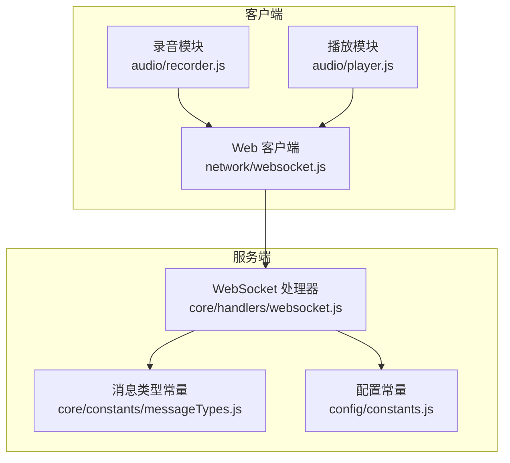
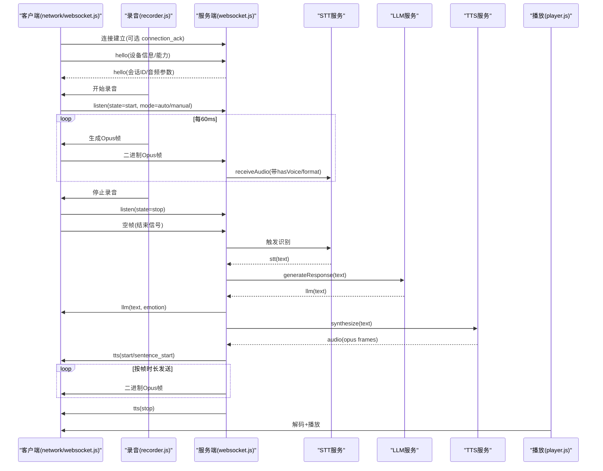
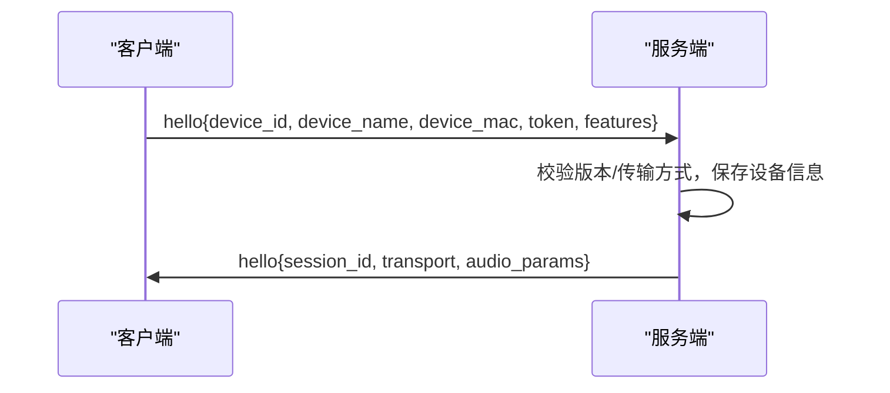
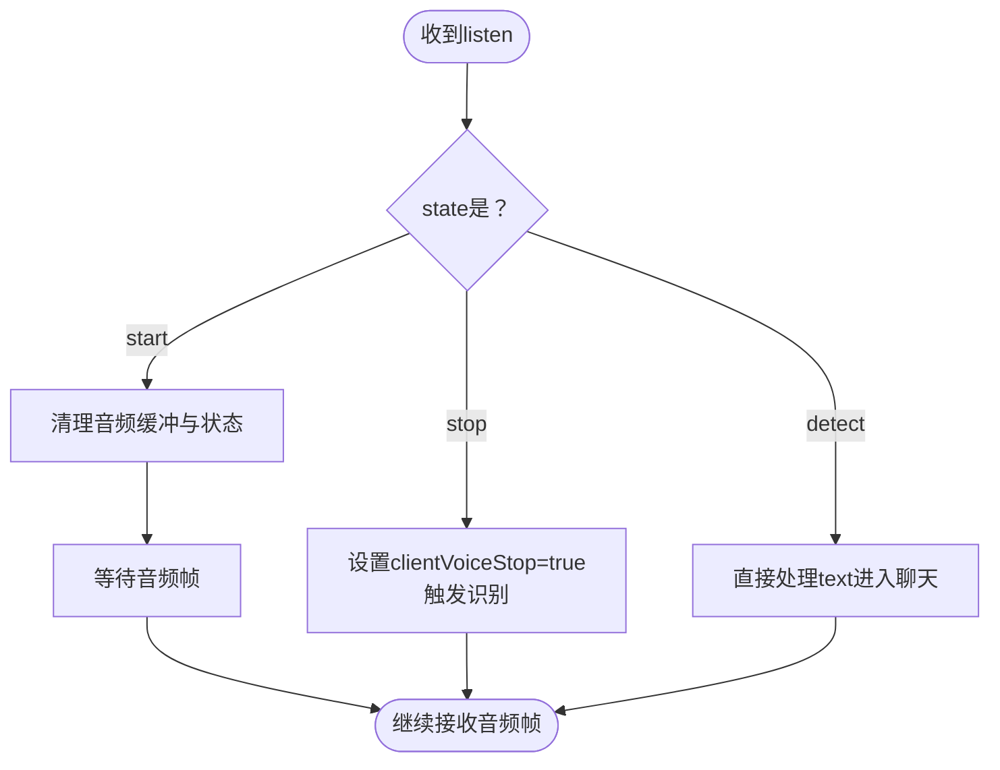
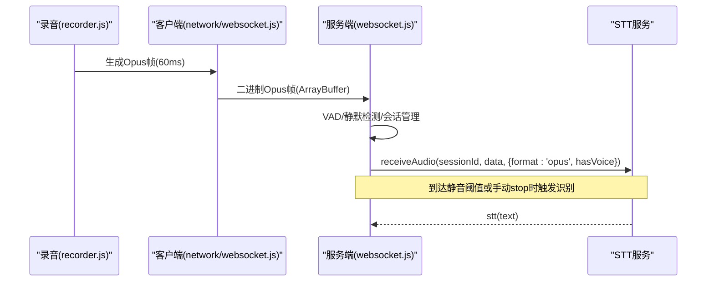
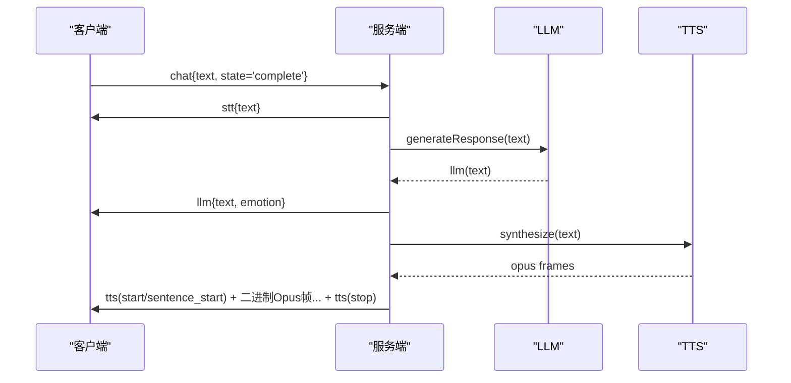
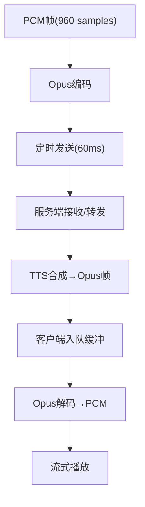
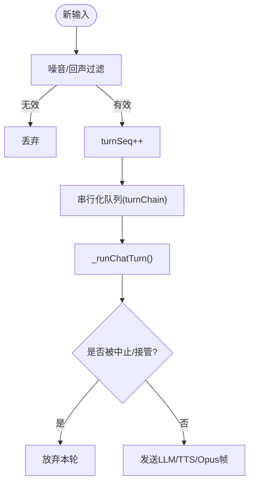
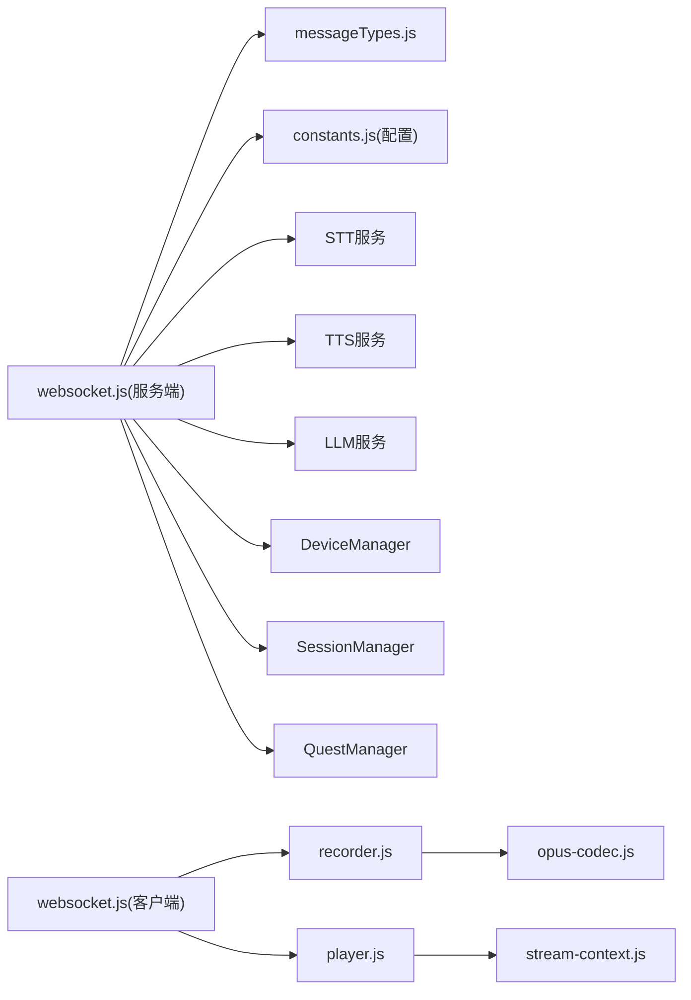

# 消息协议规范

<cite>
**本文引用的文件**   
- [core/constants/messageTypes.js](file://core/constants/messageTypes.js)
- [core/handlers/websocket.js](file://core/handlers/websocket.js)
- [config/constants.js](file://config/constants.js)
- [public/chat/js/core/network/websocket.js](file://public/chat/js/core/network/websocket.js)
- [public/chat/js/core/audio/recorder.js](file://public/chat/js/core/audio/recorder.js)
- [public/chat/js/core/audio/player.js](file://public/chat/js/core/audio/player.js)
</cite>

## 目录
1. [引言](#引言)
2. [项目结构](#项目结构)
3. [核心组件](#核心组件)
4. [架构总览](#架构总览)
5. [详细组件分析](#详细组件分析)
6. [依赖关系分析](#依赖关系分析)
7. [性能与传输特性](#性能与传输特性)
8. [故障排查指南](#故障排查指南)
9. [结论](#结论)

## 引言
本文件面向实现 WebSocket 语音对话系统的客户端与服务端开发者，系统化说明 C2S（客户端到服务器）与 S2C（服务器到客户端）的消息类型、格式与传输协议。重点覆盖：
- CLIENT_MESSAGE_TYPES 与 SERVER_MESSAGE_TYPES 中所有消息类型的用途与字段约定
- HELLO、LISTEN、AUDIO_DATA、CHAT 等核心消息的完整交互流程
- 二进制音频数据传输协议、Opus 编码参数与流式播放机制
- 关键时序图与流程图，帮助快速定位问题与优化方案

## 项目结构
本项目围绕 WebSocket 消息协议，分为以下层次：
- 常量定义层：集中声明消息类型、状态枚举与辅助校验函数
- 服务端处理层：WebSocket 连接管理、消息路由、会话与会话内轮次调度、TTS/STT 集成
- 客户端网络层：连接建立、握手、文本消息收发、二进制音频帧收发
- 客户端音频层：录音采集、Opus 编码、定时发送；播放侧解码、缓冲与流式播放

**图表来源**
- [core/handlers/websocket.js:1-10](file://core/handlers/websocket.js#L1-L10)
- [core/constants/messageTypes.js:1-10](file://core/constants/messageTypes.js#L1-L10)
- [config/constants.js:44-70](file://config/constants.js#L44-L70)
- [public/chat/js/core/network/websocket.js:1-20](file://public/chat/js/core/network/websocket.js#L1-L20)
- [public/chat/js/core/audio/recorder.js:1-45](file://public/chat/js/core/audio/recorder.js#L1-L45)
- [public/chat/js/core/audio/player.js:1-21](file://public/chat/js/core/audio/player.js#L1-L21)

**章节来源**
- [core/constants/messageTypes.js:1-144](file://core/constants/messageTypes.js#L1-L144)
- [core/handlers/websocket.js:1-170](file://core/handlers/websocket.js#L1-L170)
- [config/constants.js:44-104](file://config/constants.js#L44-L104)
- [public/chat/js/core/network/websocket.js:1-130](file://public/chat/js/core/network/websocket.js#L1-L130)
- [public/chat/js/core/audio/recorder.js:1-275](file://public/chat/js/core/audio/recorder.js#L1-L275)
- [public/chat/js/core/audio/player.js:1-170](file://public/chat/js/core/audio/player.js#L1-L170)

## 核心组件
- 消息类型常量：统一维护 C2S/S2C 消息类型、监听/TTS/聊天/MCP/好友消息等子状态枚举，并提供类型校验工具
- WebSocket 处理器：负责连接生命周期、消息分发、会话与轮次串行化、VAD/STT/TTS 协作、二进制音频流控制
- 客户端网络层：封装连接、握手、文本消息、MCP 工具调用、二进制音频帧接收
- 客户端录音/播放：录音侧 PCM→Opus 编码并定时发送；播放侧 Opus 解码、缓冲队列与流式播放

**章节来源**
- [core/constants/messageTypes.js:6-109](file://core/constants/messageTypes.js#L6-L109)
- [core/handlers/websocket.js:22-60](file://core/handlers/websocket.js#L22-L60)
- [public/chat/js/core/network/websocket.js:11-21](file://public/chat/js/core/network/websocket.js#L11-L21)
- [public/chat/js/core/audio/recorder.js:7-45](file://public/chat/js/core/audio/recorder.js#L7-L45)
- [public/chat/js/core/audio/player.js:7-21](file://public/chat/js/core/audio/player.js#L7-L21)

## 架构总览
下图展示一次完整的“说话→识别→大模型回复→TTS→播放”端到端流程，以及中断、停止、空帧结束等边界情况。

**图表来源**
- [public/chat/js/core/network/websocket.js:23-71](file://public/chat/js/core/network/websocket.js#L23-L71)
- [public/chat/js/core/network/websocket.js:73-130](file://public/chat/js/core/network/websocket.js#L73-L130)
- [public/chat/js/core/audio/recorder.js:237-275](file://public/chat/js/core/audio/recorder.js#L237-L275)
- [public/chat/js/core/audio/recorder.js:389-401](file://public/chat/js/core/audio/recorder.js#L389-L401)
- [core/handlers/websocket.js:448-643](file://core/handlers/websocket.js#L448-L643)
- [core/handlers/websocket.js:651-818](file://core/handlers/websocket.js#L651-L818)
- [core/handlers/websocket.js:1025-1189](file://core/handlers/websocket.js#L1025-L1189)
- [public/chat/js/core/audio/player.js:170-241](file://public/chat/js/core/audio/player.js#L170-L241)

## 详细组件分析

### 消息类型与状态枚举
- C2S 消息类型（客户端发送）
  - HELLO：设备握手，携带设备标识、名称、MAC、Token、功能特性等
  - LISTEN：监听控制，包含 state(mode/start/stop/detect) 与可选 text
  - ABORT：主动打断，终止当前正在播放的旧轮音频流
  - IOT：IoT 设备控制
  - CHAT：聊天消息，state=complete 时携带完整文本进入对话轮
  - MCP：MCP 协议消息
  - START_RECOGNITION：请求启动连续识别
  - AUDIO_DATA：JSON 格式的音频数据（Base64），用于兼容场景
  - WAKE_WORD_DETECTED：唤醒词检测通知
  - FRIEND：好友消息（客户端间通信）
  - ECHO：回显测试
- S2C 消息类型（服务端返回）
  - CONNECTION_ACK：连接确认（非 hard 客户端）
  - ERROR：错误消息
  - HELLO：握手响应，含 session_id、transport、audio_params
  - RECOGNITION_STARTED：识别已启动
  - STT：语音识别结果
  - LLM：大模型回复文本及情感标签
  - TTS：TTS 状态（start/sentence_start/playing/stop）
  - TTS_FALLBACK：TTS 降级文本
  - TTS_DISABLED：TTS 未启用
  - MCP：MCP 协议消息
  - SLEEP：设备休眠指令
  - AUDIO_RECEIVED：音频接收确认
  - WAKE_WORD_ACKNOWLEDGED：唤醒词确认
  - FRIEND/FRIEND_ACK：好友消息转发与确认
  - STATUS/MESSAGE：管理与界面消息
  - USER/BOT/SYSTEM：用户界面显示消息

上述类型与状态均集中在常量文件中，并提供 isValidMessageType、isClientMessageType、isServerMessageType 等校验工具。

**章节来源**
- [core/constants/messageTypes.js:6-109](file://core/constants/messageTypes.js#L6-L109)
- [core/constants/messageTypes.js:111-144](file://core/constants/messageTypes.js#L111-L144)
- [config/constants.js:44-104](file://config/constants.js#L44-L104)

### HELLO 握手流程
- 客户端发送 hello，包含 device_id/device_name/device_mac/token/features 等
- 服务端校验版本与传输方式，保存设备元信息，创建会话，返回 hello(session_id/transport/audio_params)
- Web 客户端在收到 hello 后初始化 UI 与 AI 会话

**图表来源**
- [core/handlers/websocket.js:448-513](file://core/handlers/websocket.js#L448-L513)
- [public/chat/js/core/network/websocket.js:23-71](file://public/chat/js/core/network/websocket.js#L23-L71)

**章节来源**
- [core/handlers/websocket.js:448-513](file://core/handlers/websocket.js#L448-L513)
- [public/chat/js/core/network/websocket.js:23-71](file://public/chat/js/core/network/websocket.js#L23-L71)

### LISTEN 监听控制
- state=start：开始监听，清理音频缓冲区与状态，准备新一轮采集
- state=stop：手动停止，设置语音停止标志并触发识别
- state=detect：检测模式，可直接传入文本走聊天流程
- 支持 mode=auto/manual 切换自动停顿检测或手动停止

**图表来源**
- [core/handlers/websocket.js:515-590](file://core/handlers/websocket.js#L515-L590)

**章节来源**
- [core/handlers/websocket.js:515-590](file://core/handlers/websocket.js#L515-L590)

### AUDIO_DATA 与二进制音频流
- JSON 音频数据（兼容路径）
  - type: audio_data
  - payload: { audioData: Base64字符串, sessionId?: string }
  - 服务端解码 Base64 后送入 STT，并返回 AUDIO_RECEIVED 确认
- 二进制音频流（推荐路径）
  - 客户端以 ArrayBuffer/Uint8Array 发送 Opus 帧
  - 采样率 16kHz，单声道，帧长 60ms（960 samples）
  - 录音侧按 frameDuration 定时发送；播放侧按帧时长定距播放
  - 空帧表示录音结束，服务端据此触发最终识别

**图表来源**
- [public/chat/js/core/audio/recorder.js:179-232](file://public/chat/js/core/audio/recorder.js#L179-L232)
- [public/chat/js/core/audio/recorder.js:389-401](file://public/chat/js/core/audio/recorder.js#L389-L401)
- [core/handlers/websocket.js:285-446](file://core/handlers/websocket.js#L285-L446)
- [core/handlers/websocket.js:1218-1265](file://core/handlers/websocket.js#L1218-L1265)

**章节来源**
- [public/chat/js/core/audio/recorder.js:179-232](file://public/chat/js/core/audio/recorder.js#L179-L232)
- [public/chat/js/core/audio/recorder.js:389-401](file://public/chat/js/core/audio/recorder.js#L389-L401)
- [core/handlers/websocket.js:285-446](file://core/handlers/websocket.js#L285-L446)
- [core/handlers/websocket.js:1218-1265](file://core/handlers/websocket.js#L1218-L1265)

### CHAT 聊天消息
- 客户端发送 chat，state=complete 且携带 text 时进入完整对话轮
- 服务端先回显 STT(text)，再调用 LLM 生成回复，随后通过 TTS 下发音频流
- 若开启 Quest 管理，可指定 questId/closeQuest 控制对话上下文

**图表来源**
- [core/handlers/websocket.js:615-638](file://core/handlers/websocket.js#L615-L638)
- [core/handlers/websocket.js:651-818](file://core/handlers/websocket.js#L651-L818)
- [core/handlers/websocket.js:1025-1189](file://core/handlers/websocket.js#L1025-L1189)

**章节来源**
- [core/handlers/websocket.js:615-638](file://core/handlers/websocket.js#L615-L638)
- [core/handlers/websocket.js:651-818](file://core/handlers/websocket.js#L651-L818)
- [core/handlers/websocket.js:1025-1189](file://core/handlers/websocket.js#L1025-L1189)

### 二进制音频传输与Opus编码
- 客户端录音
  - 使用 AudioContext 获取麦克风流，重采样至 16kHz
  - 将 Float32 转为 Int16 PCM，按 960 samples 切帧
  - 使用 Opus 编码器编码为 Opus 帧，加入发送队列
  - 定时器按 60ms 间隔发送 ArrayBuffer 到服务端
- 服务端发送
  - 将 MP3 音频转换为 Opus 帧数组
  - 按 ws.audioParams.frame_duration 或默认 60ms 定距发送二进制帧
  - 支持轮次归属的 abortUpTo 中止机制，避免新旧轮音频交错
- 客户端播放
  - 接收二进制帧入队，预缓冲若干包后开始播放
  - 使用 Opus 解码器解码为 PCM，经流式上下文输出到扬声器
  - 空帧作为结束标志，清空缓冲并停止播放

**图表来源**
- [public/chat/js/core/audio/recorder.js:141-232](file://public/chat/js/core/audio/recorder.js#L141-L232)
- [core/handlers/websocket.js:1086-1189](file://core/handlers/websocket.js#L1086-L1189)
- [public/chat/js/core/audio/player.js:170-241](file://public/chat/js/core/audio/player.js#L170-L241)

**章节来源**
- [public/chat/js/core/audio/recorder.js:141-232](file://public/chat/js/core/audio/recorder.js#L141-L232)
- [core/handlers/websocket.js:1086-1189](file://core/handlers/websocket.js#L1086-L1189)
- [public/chat/js/core/audio/player.js:170-241](file://public/chat/js/core/audio/player.js#L170-L241)

### 会话与轮次串行化
- 每个连接维护 sessionId，并在首次收到有效音频或HELLO时创建
- 同一连接同一时刻只有一条应答流程在发送音频，避免 Opus 帧交错
- 通过 turnSeq/abortUpTo 区分轮次，支持用户打断与新一轮接管
- 超时保护防止单轮挂死阻塞后续轮次

**图表来源**
- [core/handlers/websocket.js:651-694](file://core/handlers/websocket.js#L651-L694)
- [core/handlers/websocket.js:731-818](file://core/handlers/websocket.js#L731-L818)
- [core/handlers/websocket.js:1025-1189](file://core/handlers/websocket.js#L1025-L1189)

**章节来源**
- [core/handlers/websocket.js:651-694](file://core/handlers/websocket.js#L651-L694)
- [core/handlers/websocket.js:731-818](file://core/handlers/websocket.js#L731-L818)
- [core/handlers/websocket.js:1025-1189](file://core/handlers/websocket.js#L1025-L1189)

### 其他重要消息
- ABORT：设备主动打断，设置 abortUpTo 中止旧轮音频流
- WAKE_WORD_DETECTED：唤醒词检测通知，服务端返回 WAKE_WORD_ACKNOWLEDGED
- START_RECOGNITION：请求启动连续识别，服务端返回 RECOGNITION_STARTED
- FRIEND：客户端间消息，支持 text/command/data 等类型，服务端根据目标设备类型选择 STT/TTS 转发
- MCP：工具调用与结果，遵循 JSON-RPC 风格 payload

**章节来源**
- [core/handlers/websocket.js:592-643](file://core/handlers/websocket.js#L592-L643)
- [core/handlers/websocket.js:1267-1293](file://core/handlers/websocket.js#L1267-L1293)
- [core/handlers/websocket.js:1295-1458](file://core/handlers/websocket.js#L1295-L1458)
- [public/chat/js/core/network/websocket.js:229-332](file://public/chat/js/core/network/websocket.js#L229-L332)

## 依赖关系分析
- 服务端 WebSocket 处理器依赖：
  - 消息类型常量（messageTypes.js）
  - 配置常量（config/constants.js）
  - 设备/会话/Quest 管理器
  - STT/TTS/LLM/VAD/MCP 等服务
- 客户端网络层依赖：
  - 配置管理、UI控制器、日志
  - 录音/播放模块
  - OTA连接器（用于连接复用）
- 音频模块依赖：
  - Opus 编解码库（WebAssembly/全局Module）
  - 阻塞队列与流式上下文

**图表来源**
- [core/handlers/websocket.js:1-16](file://core/handlers/websocket.js#L1-L16)
- [core/constants/messageTypes.js:1-10](file://core/constants/messageTypes.js#L1-L10)
- [config/constants.js:1-13](file://config/constants.js#L1-L13)
- [public/chat/js/core/network/websocket.js:1-9](file://public/chat/js/core/network/websocket.js#L1-L9)
- [public/chat/js/core/audio/recorder.js:1-4](file://public/chat/js/core/audio/recorder.js#L1-L4)
- [public/chat/js/core/audio/player.js:1-4](file://public/chat/js/core/audio/player.js#L1-L4)

**章节来源**
- [core/handlers/websocket.js:1-16](file://core/handlers/websocket.js#L1-L16)
- [core/constants/messageTypes.js:1-10](file://core/constants/messageTypes.js#L1-L10)
- [config/constants.js:1-13](file://config/constants.js#L1-L13)
- [public/chat/js/core/network/websocket.js:1-9](file://public/chat/js/core/network/websocket.js#L1-L9)
- [public/chat/js/core/audio/recorder.js:1-4](file://public/chat/js/core/audio/recorder.js#L1-L4)
- [public/chat/js/core/audio/player.js:1-4](file://public/chat/js/core/audio/player.js#L1-L4)

## 性能与传输特性
- 音频参数
  - 采样率：16kHz
  - 通道数：单声道
  - 帧长：60ms（960 samples）
  - 编码：Opus
- 传输节奏
  - 客户端按 60ms 间隔发送二进制 Opus 帧
  - 服务端按 ws.audioParams.frame_duration 或默认 60ms 定距发送
- 缓冲与延迟
  - 播放侧预缓冲若干包后开始播放，降低首包延迟
  - 流式上下文持续解码与播放，保证低延迟
- 稳定性
  - 轮次串行化与超时保护，避免单轮异常导致整体阻塞
  - 回声判定与噪音过滤，减少误触发
  - 断连与空闲检测，及时释放资源

[本节为通用性能讨论，不直接分析具体文件]

## 故障排查指南
- 无法握手
  - 检查客户端 hello 是否包含必要字段，服务端是否返回 hello(session_id)
  - 参考：[core/handlers/websocket.js:448-513](file://core/handlers/websocket.js#L448-L513)、[public/chat/js/core/network/websocket.js:23-71](file://public/chat/js/core/network/websocket.js#L23-L71)
- 无声音或卡顿
  - 确认客户端 Opus 帧按 60ms 发送，服务端按帧时长定距发送
  - 检查播放侧缓冲与解码是否正常
  - 参考：[public/chat/js/core/audio/recorder.js:179-232](file://public/chat/js/core/audio/recorder.js#L179-L232)、[core/handlers/websocket.js:1139-1189](file://core/handlers/websocket.js#L1139-L1189)、[public/chat/js/core/audio/player.js:170-241](file://public/chat/js/core/audio/player.js#L170-L241)
- 识别不到或频繁中断
  - 检查 LISTEN state 与 mode 是否正确，空帧是否发送
  - 查看 VAD 静默阈值与最长语音兜底逻辑
  - 参考：[core/handlers/websocket.js:285-446](file://core/handlers/websocket.js#L285-L446)、[public/chat/js/core/audio/recorder.js:389-401](file://public/chat/js/core/audio/recorder.js#L389-L401)
- 回声干扰
  - 服务端具备回声判定与播放期间忽略麦克风输入逻辑
  - 参考：[core/handlers/websocket.js:697-722](file://core/handlers/websocket.js#L697-L722)、[core/handlers/websocket.js:289-306](file://core/handlers/websocket.js#L289-L306)
- 消息类型未知
  - 使用 isValidMessageType/isClientMessageType/isServerMessageType 校验
  - 参考：[core/constants/messageTypes.js:111-144](file://core/constants/messageTypes.js#L111-L144)

**章节来源**
- [core/handlers/websocket.js:285-446](file://core/handlers/websocket.js#L285-L446)
- [core/handlers/websocket.js:697-722](file://core/handlers/websocket.js#L697-L722)
- [core/handlers/websocket.js:1139-1189](file://core/handlers/websocket.js#L1139-L1189)
- [public/chat/js/core/audio/recorder.js:179-232](file://public/chat/js/core/audio/recorder.js#L179-L232)
- [public/chat/js/core/audio/player.js:170-241](file://public/chat/js/core/audio/player.js#L170-L241)
- [core/constants/messageTypes.js:111-144](file://core/constants/messageTypes.js#L111-L144)

## 结论
本规范明确了 WebSocket 消息协议的 C2S/S2C 类型、字段与传输细节，覆盖了从握手、监听、音频流、聊天到播放的全链路。通过统一的常量定义、严格的轮次串行化与稳定的 Opus 流式传输，系统能够在复杂环境下保持低延迟与高鲁棒性。建议实现方严格遵循音频参数与帧节奏，并结合 VAD/回声/噪音策略进行调优，以获得最佳用户体验。