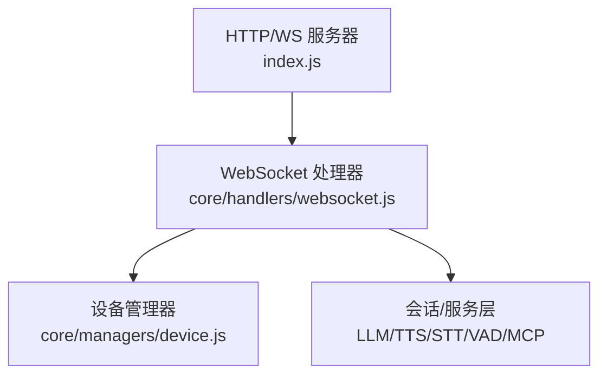
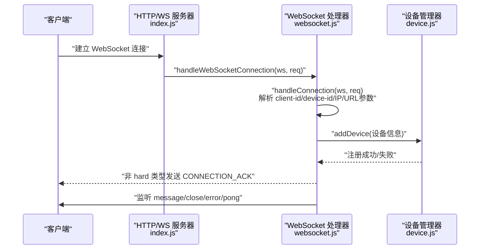
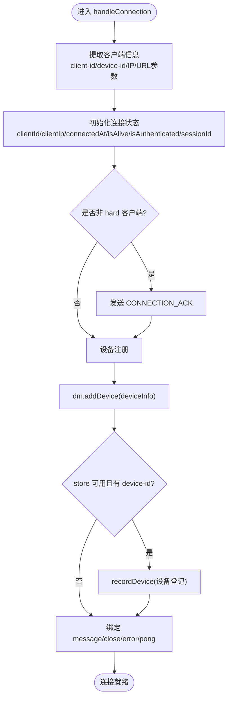
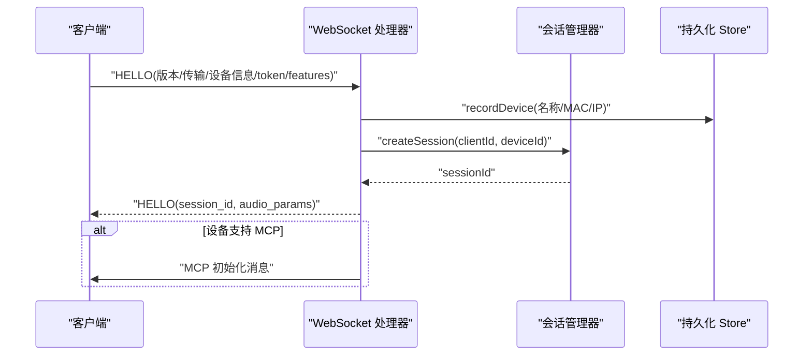
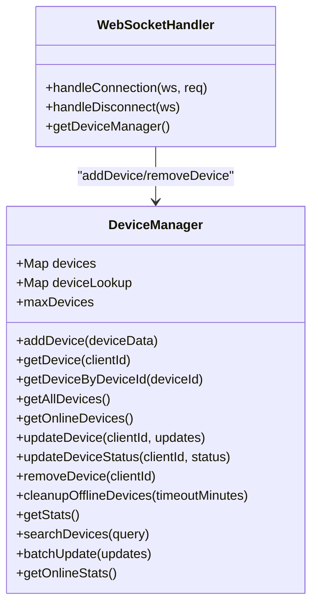
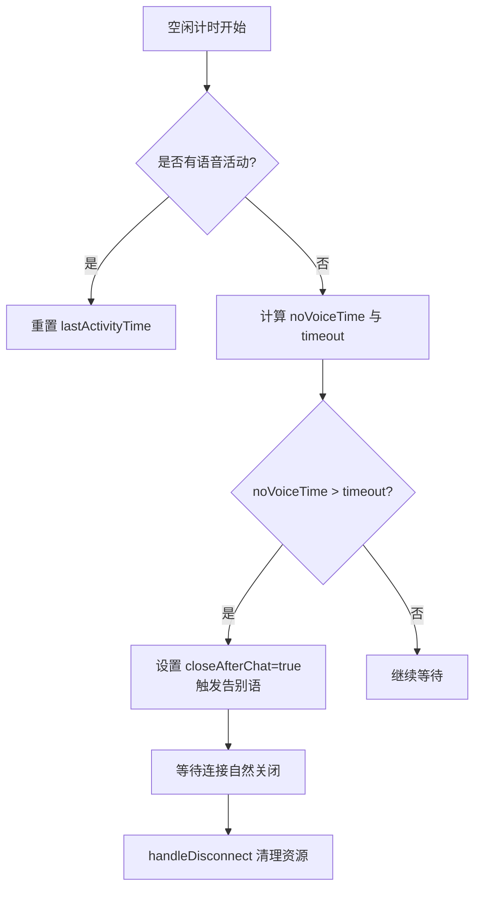
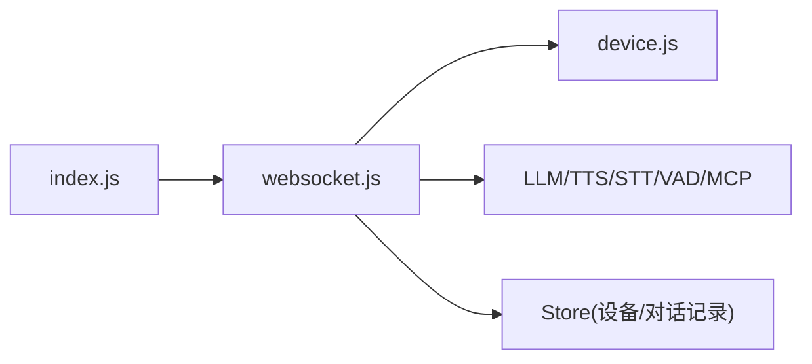

# 连接管理

<cite>
**本文引用的文件**   
- [index.js](file://index.js)
- [websocket.js](file://core/handlers/websocket.js)
- [device.js](file://core/managers/device.js)
</cite>

## 目录
1. [引言](#引言)
2. [项目结构](#项目结构)
3. [核心组件](#核心组件)
4. [架构总览](#架构总览)
5. [详细组件分析](#详细组件分析)
6. [依赖关系分析](#依赖关系分析)
7. [性能与稳定性](#性能与稳定性)
8. [故障排查指南](#故障排查指南)
9. [结论](#结论)

## 引言
本文围绕 WebSocket 连接管理展开，重点说明：
- 连接建立流程、客户端认证机制与设备注册过程
- handleConnection 的实现原理：客户端信息提取、设备管理器集成、连接状态初始化
- 心跳检测机制、连接超时处理与断开清理逻辑
- 连接生命周期最佳实践与错误处理策略
- 连接监控与调试技巧

本说明基于仓库中的 WebSocket 处理器、设备管理器以及频道启动入口进行系统化梳理。

## 项目结构
与连接管理直接相关的代码主要位于以下位置：
- 频道启动与 HTTP/WS 服务器装配：index.js
- WebSocket 协议与连接生命周期：core/handlers/websocket.js
- 在线设备注册表与统计：core/managers/device.js

**图表来源**
- [index.js:254-281](file://index.js#L254-L281)
- [websocket.js:23-60](file://core/handlers/websocket.js#L23-L60)
- [device.js:4-9](file://core/managers/device.js#L4-L9)

**章节来源**
- [index.js:254-281](file://index.js#L254-L281)
- [websocket.js:23-60](file://core/handlers/websocket.js#L23-L60)
- [device.js:4-9](file://core/managers/device.js#L4-L9)

## 核心组件
- WebSocketHandler：负责连接建立、消息路由、音频流处理、对话轮次调度、广播与设备控制等。
- DeviceManager：维护在线设备 Map、按 clientId/deviceId 查询、离线清理与统计。
- XiaozhiChannel（index.js）：组装 Express + ws，注入服务并绑定 WS 连接回调。

关键职责划分：
- index.js：创建 HTTP/WS 服务器，将 wss.connection 事件委托给 WebSocket 处理器。
- websocket.js：实现 handleConnection、handleMessage、handleBinaryData、VAD、TTS 播放、空闲超时、断开清理等。
- device.js：提供 addDevice/removeDevice/getAllDevices 等能力，供处理器在连接生命周期中调用。

**章节来源**
- [websocket.js:22-60](file://core/handlers/websocket.js#L22-L60)
- [device.js:4-9](file://core/managers/device.js#L4-L9)
- [index.js:235-281](file://index.js#L235-L281)

## 架构总览
从客户端到服务器的连接路径如下：

**图表来源**
- [index.js:267-281](file://index.js#L267-L281)
- [websocket.js:67-169](file://core/handlers/websocket.js#L67-L169)
- [device.js:11-41](file://core/managers/device.js#L11-L41)

## 详细组件分析

### 连接建立与 handleConnection 实现
handleConnection 是连接管理的核心入口，完成以下工作：
- 客户端信息提取
  - 从请求头获取 client-id、device-id、remoteAddress（clientIp）。
  - 解析 URL 参数 client_type、timestamp，用于设备类型归一化与连接时间记录。
- 连接状态初始化
  - 设置 ws.clientId、ws.clientIp、connectedAt、isAlive、isAuthenticated、sessionId 等字段。
  - 对非 hard 客户端发送 CONNECTION_ACK 确认。
- 设备注册
  - 通过 getDeviceManager() 获取设备管理器实例，校验 client_type 白名单，未知类型降级为 unknown。
  - 构造 deviceInfo（含 connection 引用、connectionInfo 元数据），调用 dm.addDevice。
  - 若 store 存在且携带 device-id，持久化设备登记记录。
  - 注册失败时仅关闭当前连接，不向上抛出异常影响进程。
- 事件监听绑定
  - message：统一进入 handleMessage。
  - close：触发 handleDisconnect 清理。
  - error：记录日志。
  - pong：标记 isAlive=true，配合心跳使用。

**图表来源**
- [websocket.js:67-169](file://core/handlers/websocket.js#L67-L169)
- [websocket.js:2608-2624](file://core/handlers/websocket.js#L2608-L2624)

**章节来源**
- [websocket.js:67-169](file://core/handlers/websocket.js#L67-L169)
- [websocket.js:2608-2624](file://core/handlers/websocket.js#L2608-L2624)

### 客户端认证机制
- 握手阶段（HELLO）
  - 支持两种格式：硬设备协议（version/transport）与 Web 客户端格式（无 version/transport，但含 device_id/device_name）。
  - 保存设备元信息（device_id/name/mac/token/features），补登持久化设备表。
  - 设置 ws.audioParams（默认 opus/16kHz/单声道/60ms 帧长）。
  - 设置 ws.isAuthenticated = true，并创建会话（sessionManager.createSession）。
  - 返回 HELLO 响应，包含 session_id 与 audio_params。
  - 若设备声明支持 MCP，延迟发送 MCP 初始化消息。
- 令牌校验
  - 当前实现未对 token 做服务端鉴权校验，token 仅作为设备元信息保存；如需接入鉴权，可在 HELLO 分支增加校验逻辑。

**图表来源**
- [websocket.js:450-513](file://core/handlers/websocket.js#L450-L513)

**章节来源**
- [websocket.js:450-513](file://core/handlers/websocket.js#L450-L513)

### 设备注册与设备管理器集成
- 注册时机
  - 新连接建立时立即注册到设备管理器，确保后续广播、好友消息、统计等能力可用。
- 设备类型白名单
  - sensor/agent/hard/manager/unknown，未知类型自动降级为 unknown，避免注册失败。
- 设备信息
  - 包含 id/clientId/deviceId/type/ip/connection/connectedAt/lastActivity/status/connectionInfo 等。
- 持久化登记
  - 当 store 存在且携带 device-id 时，写入设备登记表，便于离线后恢复与审计。
- 移除与清理
  - 连接断开时调用 removeDevice，并在 store 中标记离线。

**图表来源**
- [device.js:4-199](file://core/managers/device.js#L4-L199)
- [websocket.js:96-142](file://core/handlers/websocket.js#L96-L142)
- [websocket.js:174-193](file://core/handlers/websocket.js#L174-L193)

**章节来源**
- [device.js:11-41](file://core/managers/device.js#L11-L41)
- [device.js:88-116](file://core/managers/device.js#L88-L116)
- [websocket.js:96-142](file://core/handlers/websocket.js#L96-L142)
- [websocket.js:174-193](file://core/handlers/websocket.js#L174-L193)

### 心跳检测、连接超时与断开清理
- 心跳检测
  - 处理器预留 startHeartbeat/stopHeartbeat 方法，当前未启用全局心跳定时器。
  - 已绑定 ws.on('pong')，收到 pong 时将 ws.isAlive 置为 true。
  - 建议：在服务端启动一个周期性任务，遍历所有连接发送 ping，超过阈值未 pong 的连接视为断线。
- 连接超时
  - 空闲超时检查 _checkIdleTimeout：在无语音活动超过配置阈值（close_connection_no_voice_time，默认 120s）时，标记 closeAfterChat=true，并触发一段告别语，随后等待自然断开。
  - 该机制用于长时间无交互场景的优雅退出。
- 断开清理
  - handleDisconnect：移除设备管理器中的设备、持久化标记离线、通知 MCP 服务、记录会话结束。
  - 连接错误与异常均被捕获并记录日志，避免影响进程稳定。

**图表来源**
- [websocket.js:2445-2474](file://core/handlers/websocket.js#L2445-L2474)
- [websocket.js:154-169](file://core/handlers/websocket.js#L154-L169)
- [websocket.js:174-193](file://core/handlers/websocket.js#L174-L193)

**章节来源**
- [websocket.js:154-169](file://core/handlers/websocket.js#L154-L169)
- [websocket.js:2445-2474](file://core/handlers/websocket.js#L2445-L2474)
- [websocket.js:174-193](file://core/handlers/websocket.js#L174-L193)

### 连接生命周期管理与最佳实践
- 生命周期阶段
  - 建立：handleConnection → 设备注册 → 事件监听绑定。
  - 认证：HELLO → 设置 isAuthenticated、audioParams、sessionId。
  - 业务：消息分发（协议消息/二进制音频/MCP/好友消息等）。
  - 保活：pong 更新 isAlive；空闲超时触发告别语。
  - 断开：handleDisconnect 清理设备、会话、MCP 关联。
- 最佳实践
  - 设备类型白名单与降级：避免未知类型导致注册失败。
  - 连接级状态隔离：clientId/deviceId/sessionId/audioParams/turnSeq/abortUpTo 等字段清晰分离。
  - 轮次串行化：通过 turnChain 与 turnSeq 保证同一连接只有一条应答流，避免 Opus 帧交错。
  - 错误隔离：注册失败仅关闭当前连接，不抛异常影响进程。
  - 可观测性：关键节点均有日志输出，便于定位问题。

**章节来源**
- [websocket.js:67-169](file://core/handlers/websocket.js#L67-L169)
- [websocket.js:450-513](file://core/handlers/websocket.js#L450-L513)
- [websocket.js:2445-2474](file://core/handlers/websocket.js#L2445-L2474)
- [websocket.js:174-193](file://core/handlers/websocket.js#L174-L193)

### 错误处理策略
- 设备注册失败：记录错误、向客户端发送错误消息、主动关闭连接。
- 消息解析失败：JSON 解析失败时按二进制音频处理；否则记录错误并返回通用错误消息。
- STT/TTS 异常：分别捕获并回退文本或错误消息，确保设备状态不被卡死。
- 连接错误：error 事件仅记录日志，避免中断其他连接。
- 空闲超时：触发告别语后等待自然断开，避免强制关闭造成状态不一致。

**章节来源**
- [websocket.js:120-142](file://core/handlers/websocket.js#L120-L142)
- [websocket.js:228-283](file://core/handlers/websocket.js#L228-L283)
- [websocket.js:1025-1130](file://core/handlers/websocket.js#L1025-L1130)
- [websocket.js:1853-1970](file://core/handlers/websocket.js#L1853-L1970)

## 依赖关系分析
- 外部依赖
  - ws：WebSocket 服务器与连接对象。
  - express/http：HTTP 服务器与中间件。
  - uuid：生成客户端 ID。
- 内部依赖
  - DeviceManager：设备注册表。
  - SessionManager：会话管理。
  - LLM/TTS/STT/VAD/MCP 等服务：对话与音频链路。
  - Store：设备登记与对话记录持久化。

**图表来源**
- [index.js:17-27](file://index.js#L17-L27)
- [websocket.js:1-15](file://core/handlers/websocket.js#L1-L15)
- [device.js:1-3](file://core/managers/device.js#L1-L3)

**章节来源**
- [index.js:17-27](file://index.js#L17-L27)
- [websocket.js:1-15](file://core/handlers/websocket.js#L1-L15)
- [device.js:1-3](file://core/managers/device.js#L1-L3)

## 性能与稳定性
- 音频帧定距发送：根据 frameDuration（默认 60ms）逐帧延时发送，避免设备缓冲溢出导致颤音。
- 轮次串行化：turnChain 保证同一连接同时只有一条音频流，杜绝帧交错。
- 回声抑制：通过 lastSpoken 与相似度判定忽略回声拾取，避免误打断。
- 噪音过滤：振幅有效性检测与语气词过滤，减少无效输入进入对话轮。
- 空闲超时：长时间无语音自动触发告别语，释放设备侧资源。
- 可扩展性：设备类型白名单与未知类型降级，增强兼容性。

[本节为通用指导，不直接分析具体文件]

## 故障排查指南
- 连接无法建立
  - 检查 index.js 中 wss.connection 是否正确绑定 handleWebSocketConnection。
  - 查看浏览器控制台与服务端日志，确认 CONNECTION_ACK 是否下发。
- 设备未出现在在线列表
  - 检查 handleConnection 中 dm.addDevice 是否成功，关注设备类型是否落入白名单。
  - 查看 /api/devices 接口返回。
- 音频无声或卡顿
  - 检查 VAD 阈值与静默阈值（/api/settings/audio），必要时热更新。
  - 观察 sendOpusAudioFrames 的帧数与延时是否符合预期。
- 长时间无交互未断开
  - 确认 close_connection_no_voice_time 配置是否生效。
  - 检查 _checkIdleTimeout 是否被调用，lastActivityTime 是否正常更新。
- 心跳未生效
  - 当前未启用全局心跳定时器，需自行实现周期性 ping/pong 检测。
  - 参考 ws.on('pong') 行为，结合服务端定时任务实现。

**章节来源**
- [index.js:267-281](file://index.js#L267-L281)
- [websocket.js:67-169](file://core/handlers/websocket.js#L67-L169)
- [websocket.js:1139-1189](file://core/handlers/websocket.js#L1139-L1189)
- [websocket.js:2445-2474](file://core/handlers/websocket.js#L2445-L2474)

## 结论
本项目的 WebSocket 连接管理以 WebSocketHandler 为核心，围绕连接建立、设备注册、认证握手、音频流处理、空闲超时与断开清理形成完整闭环。通过设备管理器集中维护在线设备，结合会话与多服务协作，实现了高内聚、低耦合的连接生命周期管理。建议在现有基础上补充服务端心跳检测，完善 token 鉴权，并结合 API 暴露更丰富的连接监控指标，以提升系统的可观测性与安全性。