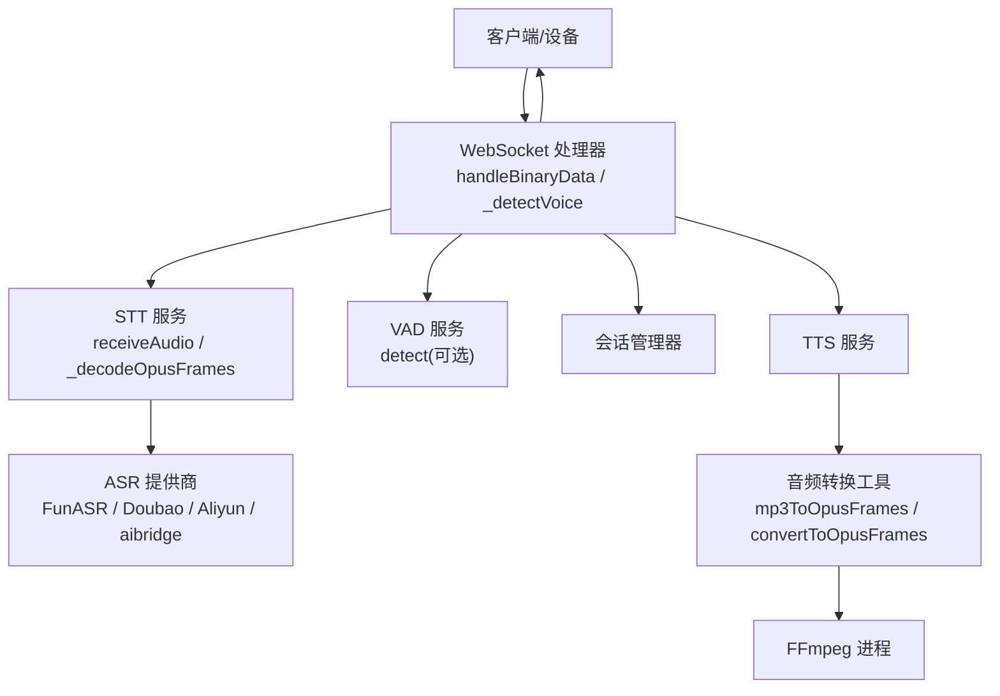
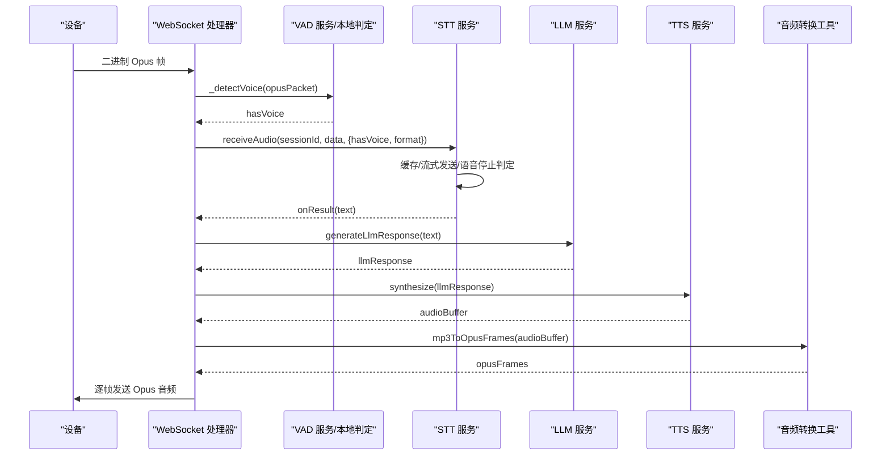
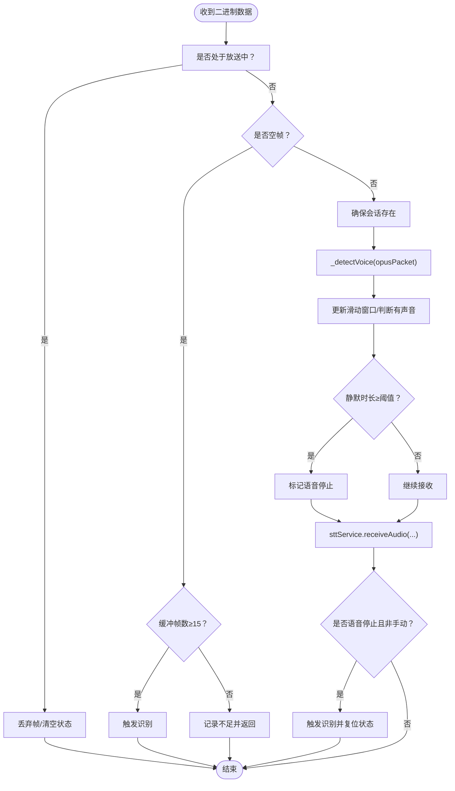
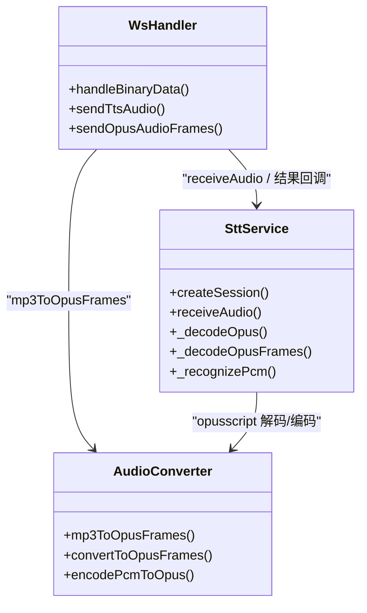
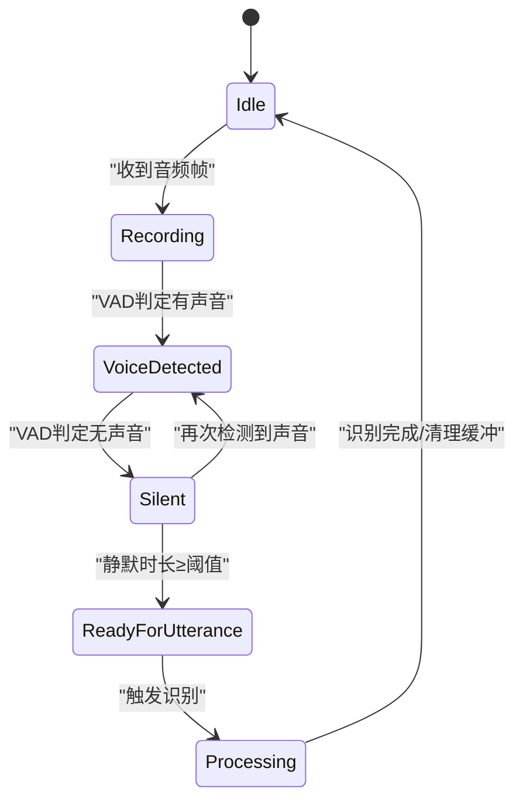
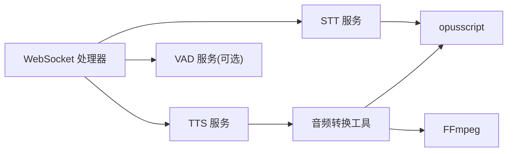
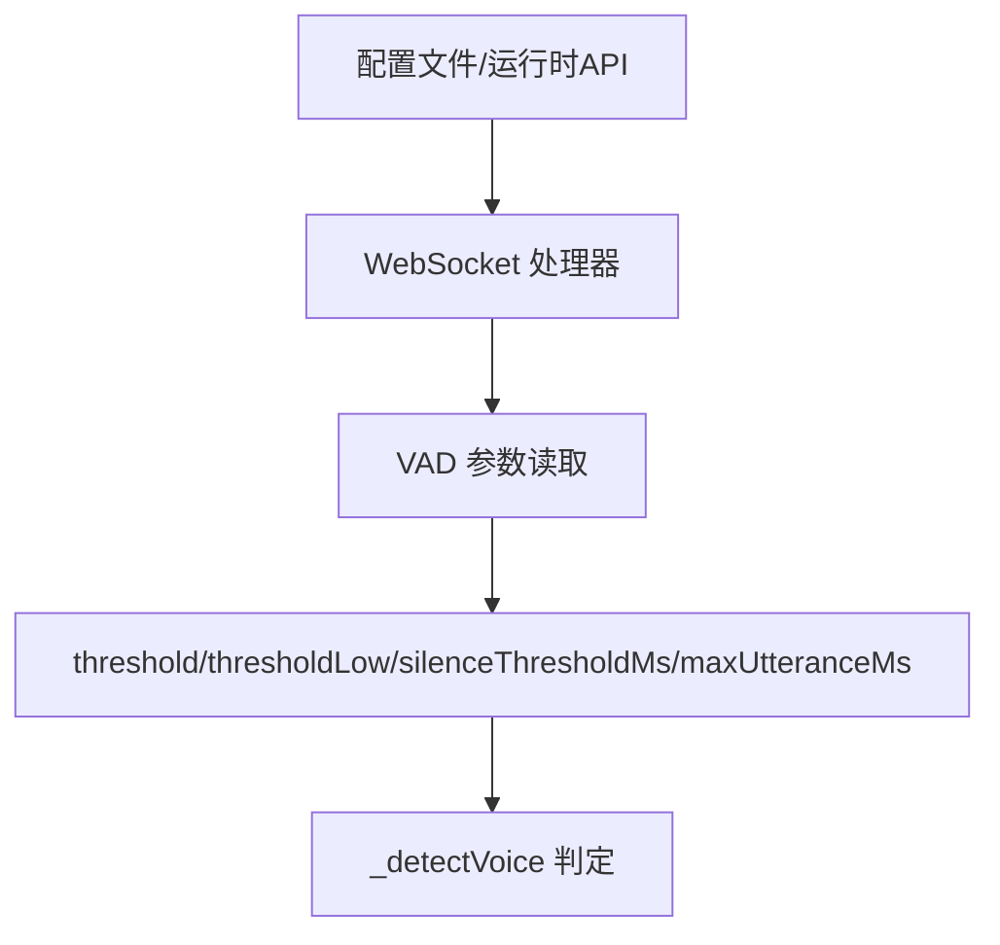

# 音频流处理

<cite>
**本文引用的文件**   
- [core/handlers/websocket.js](file://core/handlers/websocket.js)
- [core/services/stt.js](file://core/services/stt.js)
- [core/utils/audioConverter.js](file://core/utils/audioConverter.js)
- [core/services/vad.js](file://core/services/vad.js)
- [index.js](file://index.js)
</cite>

## 目录
1. [引言](#引言)
2. [项目结构](#项目结构)
3. [核心组件](#核心组件)
4. [架构总览](#架构总览)
5. [详细组件分析](#详细组件分析)
6. [依赖关系分析](#依赖关系分析)
7. [性能与内存优化](#性能与内存优化)
8. [音频质量配置选项](#音频质量配置选项)
9. [网络传输优化建议](#网络传输优化建议)
10. [故障排查指南](#故障排查指南)
11. [结论](#结论)

## 引言
本文聚焦 WebSocket 音频流处理链路，重点说明二进制音频数据接收、VAD（语音活动检测）、静音检测与一句话分割逻辑，并给出 Opus 编解码、采样率转换、实时缓冲管理、内存优化与性能调优策略。同时提供音频质量配置项和网络传输优化建议，帮助在真实设备（可能无 AEC）环境下获得稳定、低延迟的语音交互体验。

## 项目结构
本项目采用“处理器 + 服务 + 工具”的分层组织：
- WebSocket 处理器负责连接、协议解析、音频流入口与对话调度。
- STT 服务负责会话管理、Opus 解码、多提供商识别与结果回调。
- 音频转换工具负责将 PCM/MP3 等格式转换为 Opus 帧，用于 TTS 播放。
- VAD 服务提供可扩展的语音活动检测接口，默认回退到本地能量阈值实现。



**图表来源**
- [core/handlers/websocket.js:289-446](file://core/handlers/websocket.js#L289-L446)
- [core/services/stt.js:348-383](file://core/services/stt.js#L348-L383)
- [core/utils/audioConverter.js:25-106](file://core/utils/audioConverter.js#L25-L106)

**章节来源**
- [core/handlers/websocket.js:22-60](file://core/handlers/websocket.js#L22-L60)
- [core/services/stt.js:39-87](file://core/services/stt.js#L39-L87)
- [core/utils/audioConverter.js:11-18](file://core/utils/audioConverter.js#L11-L18)

## 核心组件
- WebSocket 处理器：统一接入点，负责二进制音频分发、VAD 判定、会话与 STT 集成、TTS 播放控制。
- STT 服务：维护每路会话的音频缓冲、Opus 解码、流式发送与语音停止触发识别。
- 音频转换工具：基于 opusscript 与 FFmpeg 完成 PCM/MP3 → Opus 的编码流水线。
- VAD 服务：可插拔接口；未启用具体引擎时回退到本地 RMS 能量双阈值判定。

**章节来源**
- [core/handlers/websocket.js:289-446](file://core/handlers/websocket.js#L289-L446)
- [core/services/stt.js:348-383](file://core/services/stt.js#L348-L383)
- [core/utils/audioConverter.js:11-18](file://core/utils/audioConverter.js#L11-L18)
- [core/services/vad.js:3-26](file://core/services/vad.js#L3-L26)

## 架构总览
下图展示从设备端 Opus 音频帧进入，到 STT 识别、LLM 回复、TTS 合成与 Opus 帧回放的关键路径。



**图表来源**
- [core/handlers/websocket.js:289-446](file://core/handlers/websocket.js#L289-L446)
- [core/handlers/websocket.js:933-971](file://core/handlers/websocket.js#L933-L971)
- [core/handlers/websocket.js:1025-1130](file://core/handlers/websocket.js#L1025-L1130)
- [core/utils/audioConverter.js:25-106](file://core/utils/audioConverter.js#L25-L106)
- [core/services/stt.js:348-383](file://core/services/stt.js#L348-L383)

## 详细组件分析

### handleBinaryData：二进制音频接收与处理流程
- 广播期间丢弃麦克风输入，避免回声自打断。
- 空帧视为录音结束信号，若缓冲帧数足够则触发识别。
- 确保会话存在，必要时自动创建；根据设备上报参数设置 STT 会话格式。
- 调用 VAD 检测是否有声，结合滑动窗口与静默时长判定一句话结束。
- 将音频帧交给 STT 服务缓存或流式发送；当检测到语音停止且非手动模式时触发识别。



**图表来源**
- [core/handlers/websocket.js:289-446](file://core/handlers/websocket.js#L289-L446)

**章节来源**
- [core/handlers/websocket.js:289-446](file://core/handlers/websocket.js#L289-L446)

### VAD 算法与静音检测、语音片段分割
- 支持外部 VAD 服务；未启用时回退到本地能量检测。
- 使用双阈值（高/低）+ 滞后状态保持，减少抖动。
- 以固定长度（512 采样点）切分 PCM 计算 RMS 能量，归一化后比较阈值。
- 维护连接级滑动窗口（最多 10 帧），超过阈值数量才判为“有声音”。
- 从“有声音”转为“无声音”时，若静默时长超过阈值，则标记语音停止。
- 最长语音兜底：连续有声超过最大时长强制触发一次识别，防止无限“倾听中”。

```mermaid
flowchart TD
In(["_detectVoice(opusPacket)"]) --> Decode["Opus→PCM(60ms/16kHz)"]
Decode --> Buffer["追加到连接级缓冲区"]
Buffer --> Loop{"缓冲区≥512采样点？"}
Loop --> |是| Chunk["取512采样点"]
Chunk --> RMS["计算RMS并归一化"]
RMS --> Threshold{"双阈值判定"}
Threshold --> |高于高阈| IsVoice=true
Threshold --> |低于低阈| IsVoice=false
Threshold --> |中间| IsVoice=lastIsVoice
IsVoice --> Window["加入滑动窗口(≤10)"]
Window --> Count{"窗口内true数≥3？"}
Count --> |是| HaveVoice=true
Count --> |否| HaveVoice=false
HaveVoice --> UpdateState["更新haveVoice/lastActivityTime"]
UpdateState --> StopCheck{"由有→无 且 静默≥阈值？"}
StopCheck --> |是| MarkStop["voiceStop=true"]
StopCheck --> |否| Next["下一帧"]
Loop --> |否| Return["返回当前帧是否有声"]
```

**图表来源**
- [core/handlers/websocket.js:2274-2423](file://core/handlers/websocket.js#L2274-L2423)

**章节来源**
- [core/handlers/websocket.js:2274-2423](file://core/handlers/websocket.js#L2274-L2423)
- [core/services/vad.js:3-26](file://core/services/vad.js#L3-L26)

### Opus 编解码、采样率转换与音频格式处理
- 上行（设备→服务端）：设备端通常直接发送 Opus 帧；STT 服务通过 opusscript 解码为 PCM（16kHz，单声道，60ms 帧）。
- 下行（服务端→设备）：TTS 输出 MP3 等格式，经音频转换工具转成 Opus 帧，按固定帧间隔（默认 60ms）逐帧发送。
- 采样率与通道：统一为 16kHz、单声道；编码器/解码器初始化时指定。
- 帧大小：60ms × 16kHz = 960 个采样点；解码时传入 frameSize 保证正确切片。



**图表来源**
- [core/services/stt.js:348-383](file://core/services/stt.js#L348-L383)
- [core/services/stt.js:419-477](file://core/services/stt.js#L419-L477)
- [core/utils/audioConverter.js:25-106](file://core/utils/audioConverter.js#L25-L106)
- [core/handlers/websocket.js:1025-1130](file://core/handlers/websocket.js#L1025-L1130)

**章节来源**
- [core/services/stt.js:39-87](file://core/services/stt.js#L39-L87)
- [core/services/stt.js:419-477](file://core/services/stt.js#L419-L477)
- [core/utils/audioConverter.js:11-18](file://core/utils/audioConverter.js#L11-L18)
- [core/handlers/websocket.js:1139-1189](file://core/handlers/websocket.js#L1139-L1189)

### 实时音频流的缓冲管理与会话控制
- STT 会话维护 audioBuffer，限制最大长度，避免内存膨胀。
- 自动模式下，当 voiceStop 标志置位且不在处理中，会取出缓冲进行识别，然后清空缓冲。
- 手动模式下，所有音频帧均缓存，直到用户主动停止或达到最小帧数阈值。
- 连接级 VAD 状态维护 PCM 缓冲、滑动窗口与活动时间戳，支撑静音检测与一句话分割。



**图表来源**
- [core/services/stt.js:348-383](file://core/services/stt.js#L348-L383)
- [core/handlers/websocket.js:2274-2423](file://core/handlers/websocket.js#L2274-L2423)

**章节来源**
- [core/services/stt.js:293-340](file://core/services/stt.js#L293-L340)
- [core/services/stt.js:348-383](file://core/services/stt.js#L348-L383)
- [core/handlers/websocket.js:2274-2423](file://core/handlers/websocket.js#L2274-L2423)

## 依赖关系分析
- WebSocket 处理器依赖 STT 服务进行音频缓冲与识别，依赖 TTS 服务生成回复音频，依赖音频转换工具将 TTS 输出编码为 Opus。
- STT 服务依赖 opusscript 进行 Opus 解码，并可选择对接多种 ASR 提供商。
- 音频转换工具依赖 opusscript 与 FFmpeg 子进程完成格式转换。
- VAD 服务作为可选扩展，未启用时由 WebSocket 处理器本地实现。



**图表来源**
- [core/handlers/websocket.js:289-446](file://core/handlers/websocket.js#L289-L446)
- [core/services/stt.js:39-87](file://core/services/stt.js#L39-L87)
- [core/utils/audioConverter.js:1-4](file://core/utils/audioConverter.js#L1-L4)

**章节来源**
- [core/handlers/websocket.js:289-446](file://core/handlers/websocket.js#L289-L446)
- [core/services/stt.js:39-87](file://core/services/stt.js#L39-L87)
- [core/utils/audioConverter.js:1-4](file://core/utils/audioConverter.js#L1-L4)

## 性能与内存优化
- 帧定长定时发送：TTS 播放按 60ms 帧间隔发送，避免设备缓冲溢出导致颤音。
- 轮次串行化：同一连接同一时刻只有一条应答流程在发送音频，杜绝 Opus 帧交错混杂。
- 缓冲上限：STT 会话 audioBuffer 限制最大长度，避免长时间积累导致内存增长。
- 空闲超时：长时间无语音自动收尾提示，避免连接长期占用。
- 解码容错：Opus 解码失败不中断整体识别，仅记录警告并跳过该帧。
- 最长语音兜底：连续有声超过阈值强制触发识别，防止“永远在听”的状态卡死。

**章节来源**
- [core/handlers/websocket.js:1139-1189](file://core/handlers/websocket.js#L1139-L1189)
- [core/handlers/websocket.js:677-693](file://core/handlers/websocket.js#L677-L693)
- [core/services/stt.js:348-383](file://core/services/stt.js#L348-L383)
- [core/services/stt.js:419-477](file://core/services/stt.js#L419-L477)
- [core/handlers/websocket.js:401-413](file://core/handlers/websocket.js#L401-L413)

## 音频质量配置选项
- 静默阈值：config.vad.silenceThresholdMs，默认 1500ms，用于一句话结束判定。
- 能量阈值：config.vad.threshold 与 config.vad.thresholdLow，默认分别为 0.0025 与 0.0015，用于双阈值判定。
- 最长语音时长：config.vad.maxUtteranceMs，默认 8000ms，用于连续有声兜底。
- 设备音频参数：audio_params.format、sampleRate、channels、frameDuration，握手时协商。
- 服务器默认阈值热更新：updateAudioThresholds 支持运行时调整 minMaxAmplitude、minAvgAmplitude、silenceThresholdMs。



**图表来源**
- [core/handlers/websocket.js:375-403](file://core/handlers/websocket.js#L375-L403)
- [core/handlers/websocket.js:2331-2337](file://core/handlers/websocket.js#L2331-L2337)
- [core/handlers/websocket.js:2481-2493](file://core/handlers/websocket.js#L2481-L2493)
- [index.js:307-341](file://index.js#L307-L341)

**章节来源**
- [core/handlers/websocket.js:375-403](file://core/handlers/websocket.js#L375-L403)
- [core/handlers/websocket.js:2331-2337](file://core/handlers/websocket.js#L2331-L2337)
- [core/handlers/websocket.js:2481-2493](file://core/handlers/websocket.js#L2481-L2493)
- [index.js:307-341](file://index.js#L307-L341)

## 网络传输优化建议
- 设备端优先发送 Opus 帧，降低带宽与解码开销。
- 服务端按 60ms 帧间隔发送 TTS 音频，匹配设备播放器缓冲节奏。
- 使用会话级断线重连与错误重试，提升稳定性。
- 对 ASR 提供商连接做探活与超时保护，避免阻塞主流程。
- 在无 AEC 设备上，通过放送期间丢弃麦克风输入与回声文本相似度过滤，避免自打断。

**章节来源**
- [core/handlers/websocket.js:1139-1189](file://core/handlers/websocket.js#L1139-L1189)
- [core/services/stt.js:208-241](file://core/services/stt.js#L208-L241)
- [core/handlers/websocket.js:697-711](file://core/handlers/websocket.js#L697-L711)

## 故障排查指南
- 无法加载 Opus 解码器：检查是否安装 opusscript，并在 STT 初始化时确认解码器实例化成功。
- 音频无声或断续：检查设备端 Opus 帧时长与采样率是否与服务器一致（16kHz，60ms）。
- 误触发识别：调大 silenceThresholdMs 或提高 threshold，减少底噪影响。
- 播放颤音：确认 sendOpusAudioFrames 的帧间隔与设备播放器一致，避免过快发送。
- 回声自打断：确认放送期间麦克风输入被丢弃，并检查回声文本相似度过滤是否生效。

**章节来源**
- [core/services/stt.js:14-25](file://core/services/stt.js#L14-L25)
- [core/handlers/websocket.js:1139-1189](file://core/handlers/websocket.js#L1139-L1189)
- [core/handlers/websocket.js:292-306](file://core/handlers/websocket.js#L292-L306)
- [core/handlers/websocket.js:697-711](file://core/handlers/websocket.js#L697-L711)

## 结论
本项目的音频流处理以 WebSocket 为入口，结合 VAD 能量阈值与滑动窗口实现稳定的静音检测与一句话分割；STT 服务负责 Opus 解码与会话缓冲，TTS 侧通过音频转换工具输出 Opus 帧并按固定节拍发送。通过会话串行化、缓冲上限、空闲超时与回声过滤等机制，系统在真实设备（可能无 AEC）环境下具备较好的鲁棒性与可配置性。建议在生产环境中依据环境底噪与设备特性微调 VAD 阈值与静默时长，并确保网络与编解码参数的一致性以获得最佳体验。