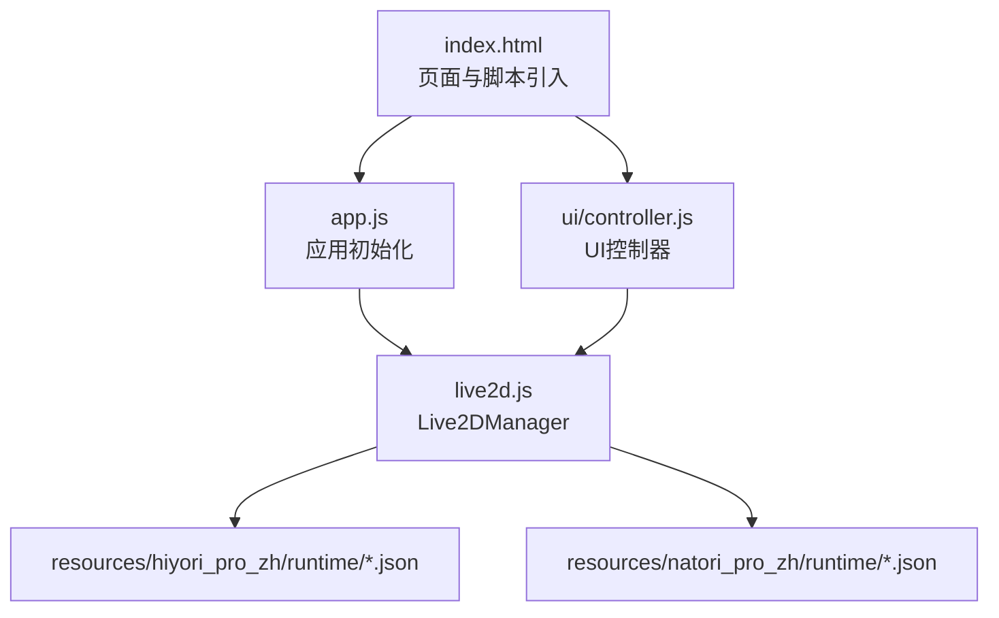
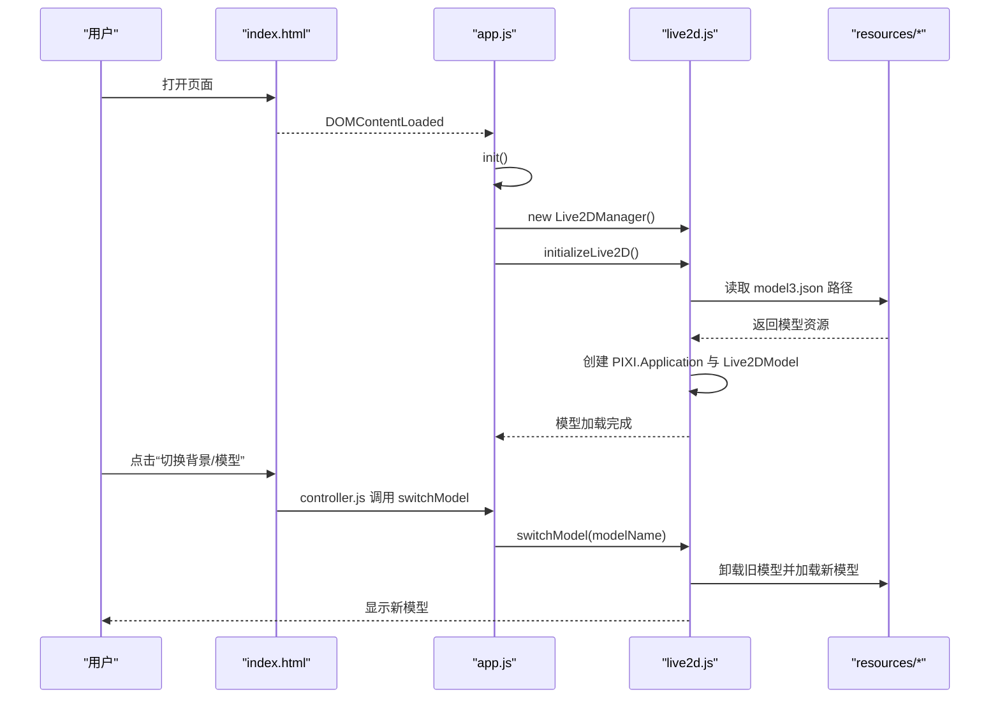
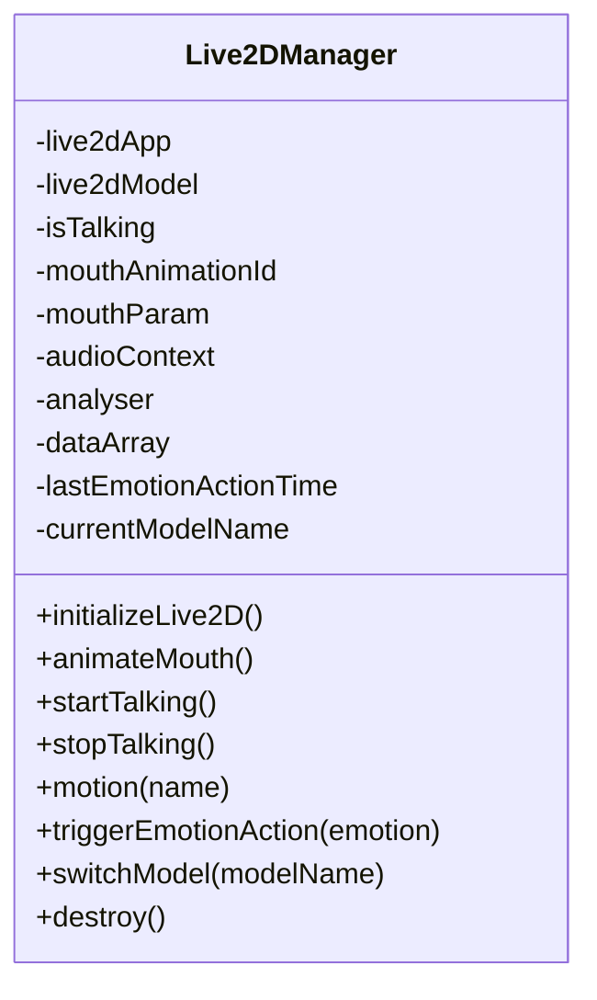
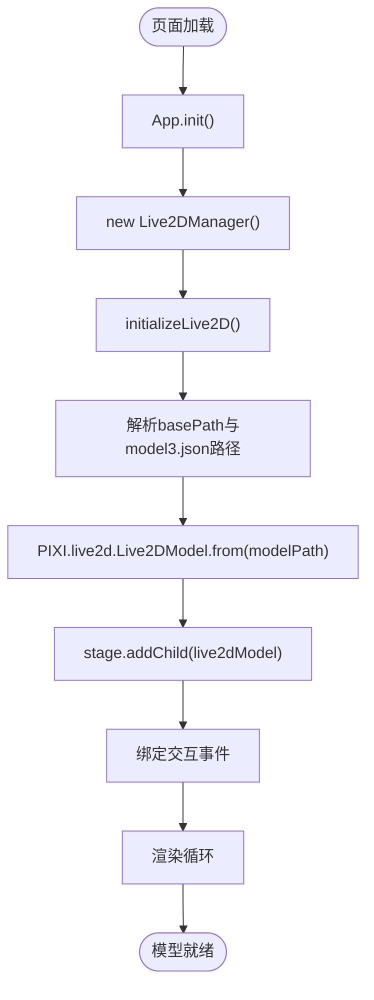
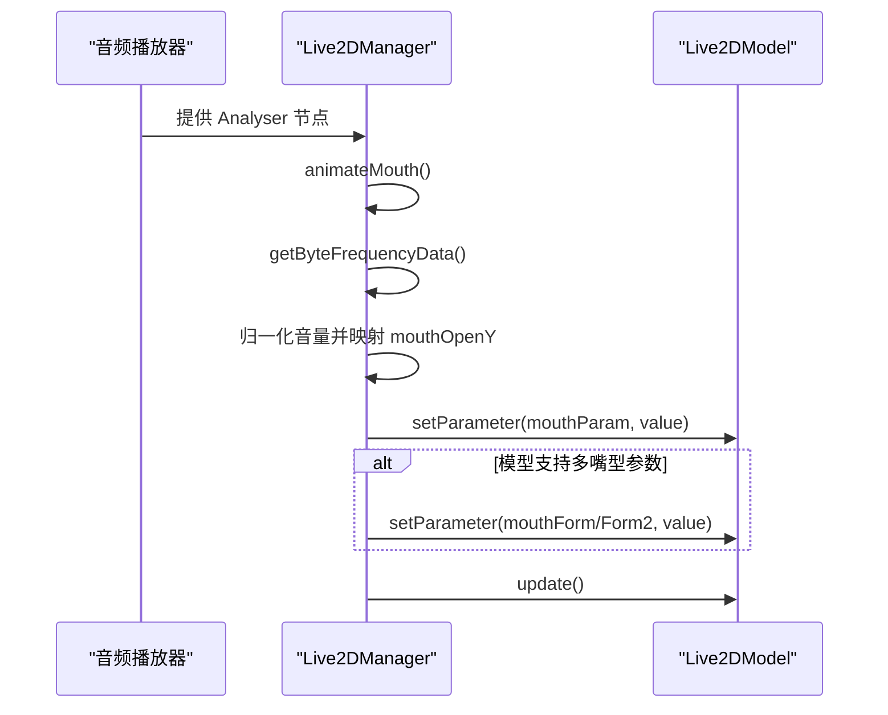
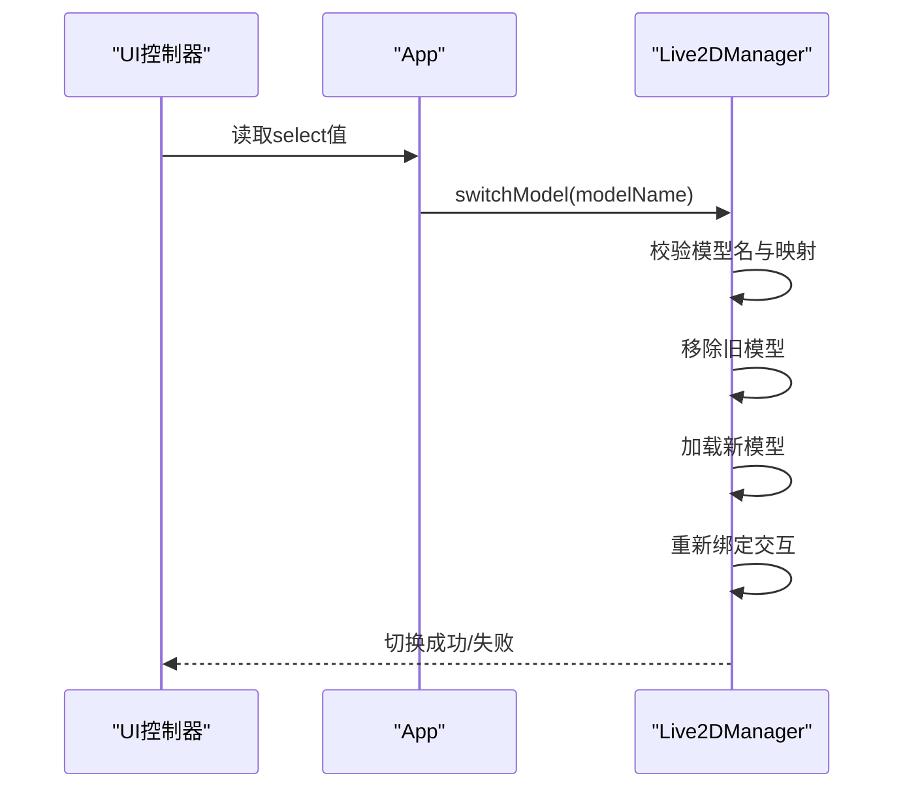
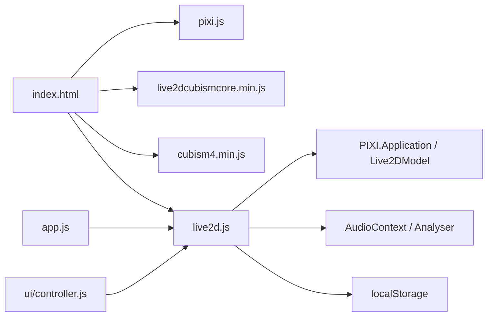

# Live2D角色集成

<cite>
**本文引用的文件**   
- [public/chat/js/live2d/live2d.js](file://public/chat/js/live2d/live2d.js)
- [public/chat/index.html](file://public/chat/index.html)
- [public/chat/js/app.js](file://public/chat/js/app.js)
- [public/chat/js/ui/controller.js](file://public/chat/js/ui/controller.js)
- [public/chat/resources/hiyori_pro_zh/runtime/hiyori_pro_t11.model3.json](file://public/chat/resources/hiyori_pro_zh/runtime/hiyori_pro_t11.model3.json)
- [public/chat/resources/natori_pro_zh/runtime/natori_pro_t06.model3.json](file://public/chat/resources/natori_pro_zh/runtime/natori_pro_t06.model3.json)
</cite>

## 目录
1. [简介](#简介)
2. [项目结构](#项目结构)
3. [核心组件](#核心组件)
4. [架构总览](#架构总览)
5. [详细组件分析](#详细组件分析)
6. [依赖关系分析](#依赖关系分析)
7. [性能与内存优化](#性能与内存优化)
8. [故障排查指南](#故障排查指南)
9. [结论](#结论)
10. [附录：自定义模型接入指南](#附录自定义模型接入指南)

## 简介
本文件面向开发者，系统性说明如何在当前项目中集成并运行 Live2D Cubism SDK，完成角色模型的加载、渲染、交互、动画控制、表情切换、动作触发以及语音同步。文档覆盖两种内置角色（春日 hiyori、名取 natori）的配置差异与使用方式，并提供资源管理、性能优化、内存控制策略，以及扩展新角色的开发指南。

## 项目结构
Live2D 相关的前端实现集中在 public/chat 目录下：
- 入口页面 index.html 负责引入 PIXI、Cubism Core、Cubism 适配器与 Live2D 管理器脚本，并提供 Canvas 容器与设置面板。
- app.js 作为应用主入口，初始化音频、摄像头、UI 控制器，并启动 Live2D。
- live2d.js 封装 Live2DManager，负责模型加载、渲染、交互、嘴部动画、动作触发、情绪映射与模型切换。
- ui/controller.js 提供 UI 行为，包括“数字人皮肤”页的模型选择下拉框与切换逻辑。
- resources 下包含两个角色的运行时资源（model3.json、cdi3.json、physics3.json、pose3.json、motions/exp 等）。

图表来源
- [public/chat/index.html:355-363](file://public/chat/index.html#L355-L363)
- [public/chat/js/app.js:32-63](file://public/chat/js/app.js#L32-L63)
- [public/chat/js/live2d/live2d.js:83-116](file://public/chat/js/live2d/live2d.js#L83-L116)
- [public/chat/js/ui/controller.js:630-650](file://public/chat/js/ui/controller.js#L630-L650)

章节来源
- [public/chat/index.html:355-363](file://public/chat/index.html#L355-L363)
- [public/chat/js/app.js:32-63](file://public/chat/js/app.js#L32-L63)

## 核心组件
- Live2DManager（live2d.js）
  - 生命周期：initializeLive2D、switchModel、destroy
  - 渲染：PIXI.Application + PIXI.live2d.Live2DModel.from(modelPath)
  - 交互：单/双击、滑动、命中区域判定（Head/Face/Body）
  - 动画：基于音频分析的嘴部开合与嘴型参数驱动
  - 动作：motion(name) 支持按模型映射到具体动作分组
  - 情绪：emotionToActionMap 将情绪映射为动作，带冷却时间
  - 配置：modelConfig 针对 hiyori 与 natori 的参数差异（嘴部参数、阈值、幅度、动作映射）
- App（app.js）
  - 初始化顺序：UI、Opus、AudioPlayer、MCP、麦克风权限、摄像头、Live2D
  - 暴露全局 window.chatApp，供 Live2DManager 访问音频播放器上下文
- UI Controller（ui/controller.js）
  - “数字人皮肤”标签页中的模型选择下拉框，调用 app.live2dManager.switchModel(selectedModel)

章节来源
- [public/chat/js/live2d/live2d.js:5-78](file://public/chat/js/live2d/live2d.js#L5-L78)
- [public/chat/js/live2d/live2d.js:83-116](file://public/chat/js/live2d/live2d.js#L83-L116)
- [public/chat/js/live2d/live2d.js:418-510](file://public/chat/js/live2d/live2d.js#L418-L510)
- [public/chat/js/live2d/live2d.js:586-601](file://public/chat/js/live2d/live2d.js#L586-L601)
- [public/chat/js/live2d/live2d.js:739-800](file://public/chat/js/live2d/live2d.js#L739-L800)
- [public/chat/js/app.js:32-63](file://public/chat/js/app.js#L32-L63)
- [public/chat/js/ui/controller.js:630-650](file://public/chat/js/ui/controller.js#L630-L650)

## 架构总览
前端以 HTML 页面为入口，通过 script 标签引入 PIXI、Cubism Core、Cubism 适配器和 live2d.js；应用主类 App 在初始化阶段创建 Live2DManager 并调用 initializeLive2D 完成模型加载与渲染。用户通过 UI 控制器切换模型时，controller.js 调用 switchModel 完成动态替换。

图表来源
- [public/chat/index.html:355-363](file://public/chat/index.html#L355-L363)
- [public/chat/js/app.js:32-63](file://public/chat/js/app.js#L32-L63)
- [public/chat/js/live2d/live2d.js:83-116](file://public/chat/js/live2d/live2d.js#L83-L116)
- [public/chat/js/ui/controller.js:630-650](file://public/chat/js/ui/controller.js#L630-L650)

## 详细组件分析

### Live2DManager 类
职责：
- 初始化 PIXI 应用与 Live2D 模型
- 根据 localStorage 中保存的模型名称加载对应 model3.json
- 绑定交互事件（单/双击、滑动），并将命中区域映射到动作
- 基于音频分析器驱动嘴部开合与嘴型参数
- 情绪到动作映射，带冷却时间
- 模型切换与资源清理

关键方法与流程：
- initializeLive2D：创建 PIXI.Application，计算基础路径，从 localStorage 获取模型名，映射 model3.json 文件名，加载模型并设置缩放、位置，绑定交互事件，监听窗口 resize。
- animateMouth：每帧读取音频频率数据，归一化音量后映射到 mouthOpenY，并根据模型配置调整幅度与阈值；对支持多嘴型参数的模型（如 natori）同时更新 Form/Form2 参数。
- startTalking/stopTalking：控制动画循环与音频分析器的连接状态。
- motion：根据当前模型配置的动作映射表，将通用动作名转换为实际动作分组名并播放。
- triggerEmotionAction：根据情绪查找动作，带 5 秒冷却。
- switchModel：卸载旧模型，加载新模型，重新绑定交互，更新 mouthParam 与 localStorage。
- destroy：关闭音频上下文、销毁 PIXI 应用与模型实例。

图表来源
- [public/chat/js/live2d/live2d.js:5-78](file://public/chat/js/live2d/live2d.js#L5-L78)
- [public/chat/js/live2d/live2d.js:83-116](file://public/chat/js/live2d/live2d.js#L83-L116)
- [public/chat/js/live2d/live2d.js:418-510](file://public/chat/js/live2d/live2d.js#L418-L510)
- [public/chat/js/live2d/live2d.js:586-601](file://public/chat/js/live2d/live2d.js#L586-L601)
- [public/chat/js/live2d/live2d.js:739-800](file://public/chat/js/live2d/live2d.js#L739-L800)

章节来源
- [public/chat/js/live2d/live2d.js:5-78](file://public/chat/js/live2d/live2d.js#L5-L78)
- [public/chat/js/live2d/live2d.js:83-116](file://public/chat/js/live2d/live2d.js#L83-L116)
- [public/chat/js/live2d/live2d.js:418-510](file://public/chat/js/live2d/live2d.js#L418-L510)
- [public/chat/js/live2d/live2d.js:586-601](file://public/chat/js/live2d/live2d.js#L586-L601)
- [public/chat/js/live2d/live2d.js:739-800](file://public/chat/js/live2d/live2d.js#L739-L800)

### 模型加载机制与渲染流程
- 入口：index.html 引入 pixi.js、live2dcubismcore.min.js、cubism4.min.js 与 live2d.js。
- 初始化：App.init 调用 live2dManager.initializeLive2D。
- 路径解析：根据当前页面 URL 计算 basePath，拼接 resources/{modelName}/runtime/{modelFileName}。
- 模型加载：PIXI.live2d.Live2DModel.from(modelPath) 异步加载 model3.json 及其关联资源（纹理、物理、姿态等）。
- 渲染：将模型加入 PIXI.Application.stage，设置 scale、x/y 居中显示。
- 交互：启用 interactive，绑定 singlehit/doublehit/swipe 事件，并在 pointerdown/move/up 中实现自定义命中区域判定与单击/双击/滑动区分。

图表来源
- [public/chat/index.html:355-363](file://public/chat/index.html#L355-L363)
- [public/chat/js/app.js:32-63](file://public/chat/js/app.js#L32-L63)
- [public/chat/js/live2d/live2d.js:83-116](file://public/chat/js/live2d/live2d.js#L83-L116)

章节来源
- [public/chat/index.html:355-363](file://public/chat/index.html#L355-L363)
- [public/chat/js/app.js:32-63](file://public/chat/js/app.js#L32-L63)
- [public/chat/js/live2d/live2d.js:83-116](file://public/chat/js/live2d/live2d.js#L83-L116)

### 角色模型配置与使用方法（春日、名取）
- 模型选择：UI 设置面板“数字人皮肤”标签页提供下拉框，选项值为 hiyori_pro_zh 与 natori_pro_zh。
- 默认模型：若 localStorage 无记录，默认加载 hiyori_pro_zh。
- 模型映射：
  - hiyori_pro_zh -> hiyori_pro_t11.model3.json
  - natori_pro_zh -> natori_pro_t06.model3.json
- 模型特定配置（modelConfig）：
  - 嘴部参数 mouthParam：两者均使用 ParamMouthOpenY
  - 阈值与幅度：不同模型有不同的 mouthThresholds.low/high 与 mouthAmplitude
  - 额外嘴型参数：natori 支持 mouthFormParam 与 mouthForm2Param，用于更丰富的口型变化
  - 动作映射：不同模型对同一通用动作名映射到不同的动作分组（例如 FlickUp/Tap/Flick@Body 等）

章节来源
- [public/chat/index.html:216-226](file://public/chat/index.html#L216-L226)
- [public/chat/js/live2d/live2d.js:19-50](file://public/chat/js/live2d/live2d.js#L19-L50)
- [public/chat/js/live2d/live2d.js:107-113](file://public/chat/js/live2d/live2d.js#L107-L113)
- [public/chat/js/live2d/live2d.js:739-747](file://public/chat/js/live2d/live2d.js#L739-L747)

### 动画控制、表情切换、动作触发与语音同步
- 动画控制
  - 动作触发：motion(name) 根据当前模型的动作映射表播放对应动作分组。
  - 情绪触发：triggerEmotionAction(emotion) 将情绪映射为动作，带 5 秒冷却避免频繁触发。
- 表情切换
  - 当前代码未直接暴露“表情切换”API；可通过 emotionToActionMap 间接触发动作表达情绪。
  - 若需精确表情控制，可在模型配置中添加表情参数映射，并在 animateMouth 或新增方法中设置表情参数。
- 动作触发
  - 交互事件：singlehit/doublehit/swipe 分别触发 Tap/Flick/FlickUp/FlickDown 等动作。
  - 命中区域：Head/Face/Body 决定不同动作分支。
- 语音同步
  - 音频分析器：通过 AudioContext.createAnalyser 或复用音频播放器的分析器节点，读取频率数据。
  - 嘴部动画：每帧 normalize 音量，映射到 mouthOpenY，并对 natori 额外设置 mouthForm/Form2。
  - 开始/停止：startTalking/stopTalking 控制动画循环与参数重置。

图表来源
- [public/chat/js/live2d/live2d.js:355-413](file://public/chat/js/live2d/live2d.js#L355-L413)
- [public/chat/js/live2d/live2d.js:418-510](file://public/chat/js/live2d/live2d.js#L418-L510)

章节来源
- [public/chat/js/live2d/live2d.js:355-413](file://public/chat/js/live2d/live2d.js#L355-L413)
- [public/chat/js/live2d/live2d.js:418-510](file://public/chat/js/live2d/live2d.js#L418-L510)
- [public/chat/js/live2d/live2d.js:586-601](file://public/chat/js/live2d/live2d.js#L586-L601)
- [public/chat/js/live2d/live2d.js:563-578](file://public/chat/js/live2d/live2d.js#L563-L578)

### 模型切换流程
- 用户操作：在设置面板中选择模型。
- UI 控制器：controller.js 读取 select.value，调用 app.live2dManager.switchModel(selectedModel)。
- Live2DManager：
  - 校验模型名与映射表
  - 移除旧模型并从 stage 删除
  - 加载新模型并加入 stage
  - 重新绑定交互事件
  - 更新 currentModelName 与 mouthParam
  - 写入 localStorage 以便下次默认加载

图表来源
- [public/chat/js/ui/controller.js:630-650](file://public/chat/js/ui/controller.js#L630-L650)
- [public/chat/js/live2d/live2d.js:739-800](file://public/chat/js/live2d/live2d.js#L739-L800)

章节来源
- [public/chat/js/ui/controller.js:630-650](file://public/chat/js/ui/controller.js#L630-L650)
- [public/chat/js/live2d/live2d.js:739-800](file://public/chat/js/live2d/live2d.js#L739-L800)

## 依赖关系分析
- 外部库依赖
  - PIXI.js：2D 渲染引擎
  - Live2D Cubism Core：Cubism 运行时核心
  - cubism4.min.js：Cubism 4.x 适配器（PIXI 插件）
- 内部模块依赖
  - app.js 依赖 audio player、recorder、mcp tools、ui controller
  - live2d.js 依赖 PIXI、PIXI.live2d、AudioContext、localStorage
  - ui/controller.js 依赖 DOM 元素与 app.live2dManager

图表来源
- [public/chat/index.html:355-363](file://public/chat/index.html#L355-L363)
- [public/chat/js/live2d/live2d.js:83-116](file://public/chat/js/live2d/live2d.js#L83-L116)
- [public/chat/js/app.js:32-63](file://public/chat/js/app.js#L32-L63)
- [public/chat/js/ui/controller.js:630-650](file://public/chat/js/ui/controller.js#L630-L650)

章节来源
- [public/chat/index.html:355-363](file://public/chat/index.html#L355-L363)
- [public/chat/js/live2d/live2d.js:83-116](file://public/chat/js/live2d/live2d.js#L83-L116)
- [public/chat/js/app.js:32-63](file://public/chat/js/app.js#L32-L63)
- [public/chat/js/ui/controller.js:630-650](file://public/chat/js/ui/controller.js#L630-L650)

## 性能与内存优化
- 渲染与分辨率
  - 使用 devicePixelRatio 与 autoDensity 提升清晰度，但会增加 GPU 压力；在高 DPI 设备上建议评估 resolution 设置。
- 模型缩放与布局
  - 统一设置 scale=0.33，避免过大模型导致过度绘制。
- 音频分析开销
  - Analyser.fftSize=256，降低 FFT 尺寸可减少 CPU 占用；可根据设备性能调优。
- 动画循环
  - requestAnimationFrame 驱动 animateMouth，确保与屏幕刷新同步；在 stopTalking 中取消动画帧。
- 资源管理
  - switchModel 会 removeChild 并 destroy 旧模型，避免内存泄漏。
  - destroy 方法关闭 AudioContext、销毁 PIXI.Application 与模型实例。
- 交互节流
  - 情绪动作触发带 5 秒冷却，避免频繁动作造成渲染抖动。
- 模型资源体积
  - 合理拆分 motions/exp 资源，按需加载；避免一次性加载过多大纹理。

[本节为通用指导，不直接分析具体文件]

## 故障排查指南
- 页面以 file:// 协议打开
  - index.html 内检测 file:// 协议并提示使用 HTTP 服务器；Live2D 与音频 API 在 file:// 下可能受限。
- 模型加载失败
  - 检查 basePath 与 resources 路径是否正确；确认 model3.json 存在且可被浏览器请求。
  - 控制台错误日志会输出“加载 Live2D 模型失败”。
- 音频分析器不可用
  - 若无法获取 AudioContext 或 Analyser，将回退到模拟动画；检查浏览器是否允许音频上下文与跨域策略。
- 交互无响应
  - 检查 interactive 是否启用；确认命中区域判定逻辑与事件绑定是否生效。
- 模型切换失败
  - 检查模型名是否在映射表中；确认 resources/{modelName}/runtime/model3.json 存在。
- 唇形不同步
  - 检查 mouthParam 是否与模型一致；natori 需要额外设置 mouthForm/Form2；确认音频流已连接到 Analyser。

章节来源
- [public/chat/index.html:13-39](file://public/chat/index.html#L13-L39)
- [public/chat/js/live2d/live2d.js:347-349](file://public/chat/js/live2d/live2d.js#L347-L349)
- [public/chat/js/live2d/live2d.js:355-413](file://public/chat/js/live2d/live2d.js#L355-L413)
- [public/chat/js/live2d/live2d.js:739-753](file://public/chat/js/live2d/live2d.js#L739-L753)

## 结论
本项目通过 PIXI 与 Cubism 适配器实现了 Live2D 模型的加载与渲染，Live2DManager 封装了模型生命周期、交互、动画与语音同步逻辑。春日与名取两个角色通过 modelConfig 差异化配置，支持不同的嘴部参数、阈值与动作映射。UI 控制器提供模型切换能力，结合 localStorage 持久化选择。整体架构清晰，易于扩展新角色与功能。

[本节为总结性内容，不直接分析具体文件]

## 附录：自定义模型接入指南
目标：添加一个新的 Live2D 角色模型（例如 chitose）。

步骤：
1. 准备模型资源
   - 在 resources 下新建目录，例如 resources/chitose/runtime/
   - 放入 model3.json、cdi3.json、physics3.json、pose3.json 及必要的 textures、motions、exp 等资源。
2. 注册模型映射
   - 在 Live2DManager 的 modelFileMap 中添加 chitose -> chitose.model3.json。
   - 在 modelConfig 中添加 chitose 的配置项，包括 mouthParam、mouthThresholds、mouthAmplitude、可选 mouthFormParam/mouthForm2Param 与 motionMap。
3. 更新 UI 选择项
   - 在 index.html 的设置面板中添加新的 option 值（例如 chitose）。
4. 测试与调试
   - 打开页面，选择新模型，验证加载、交互、动作与唇形同步。
   - 若唇形不同步，检查 mouthParam 与模型参数是否匹配；必要时调整 mouthThresholds 与幅度。
5. 性能与内存
   - 观察模型纹理大小与动画数量，必要时拆分资源或减少不必要的 motions/exp。
   - 在高频切换场景下，确保 destroy 正确释放旧模型资源。

章节来源
- [public/chat/js/live2d/live2d.js:739-747](file://public/chat/js/live2d/live2d.js#L739-L747)
- [public/chat/js/live2d/live2d.js:19-50](file://public/chat/js/live2d/live2d.js#L19-L50)
- [public/chat/index.html:216-226](file://public/chat/index.html#L216-L226)