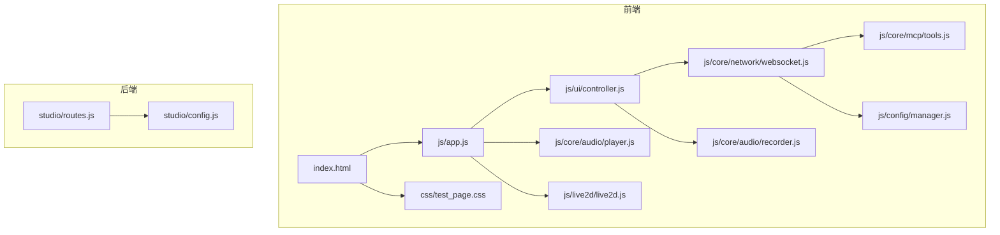
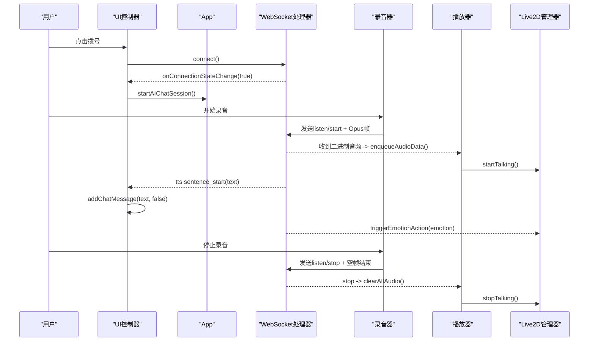
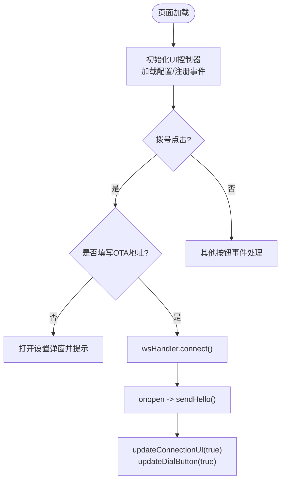
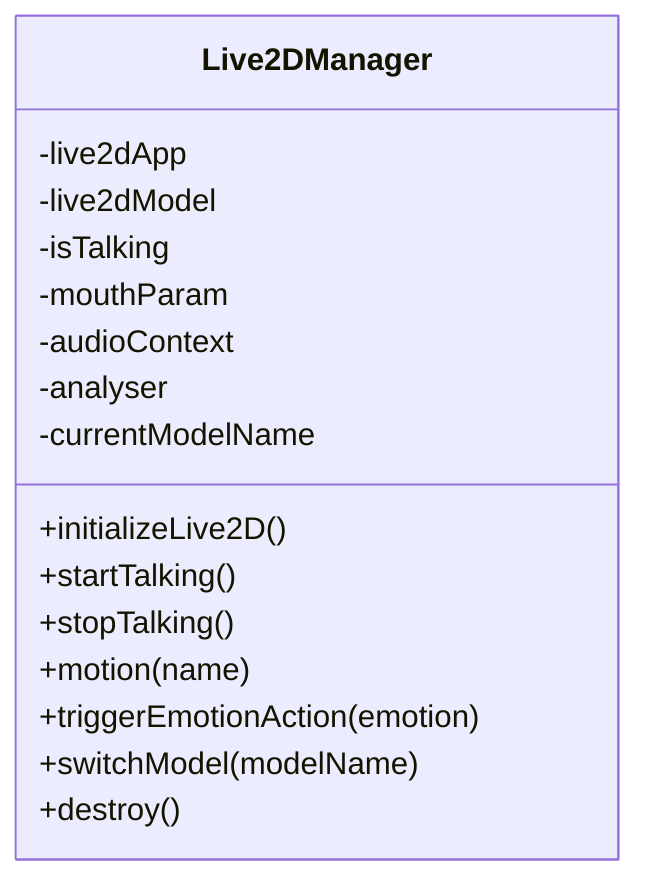
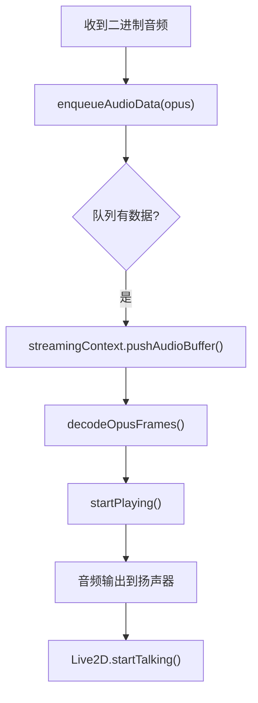
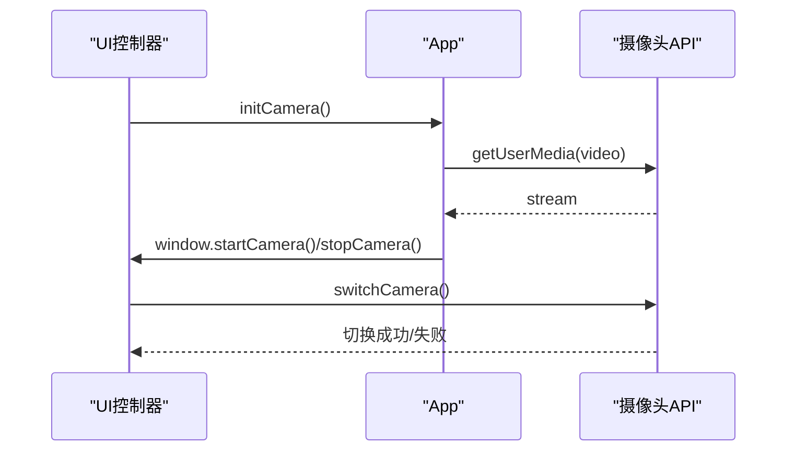
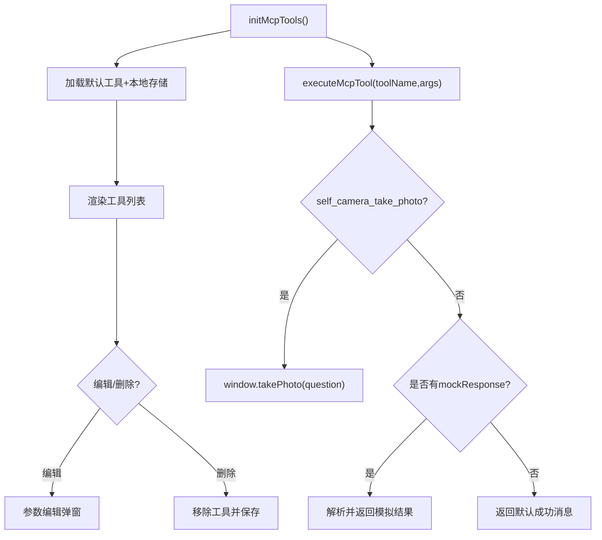
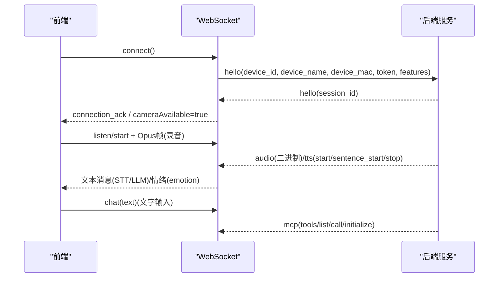
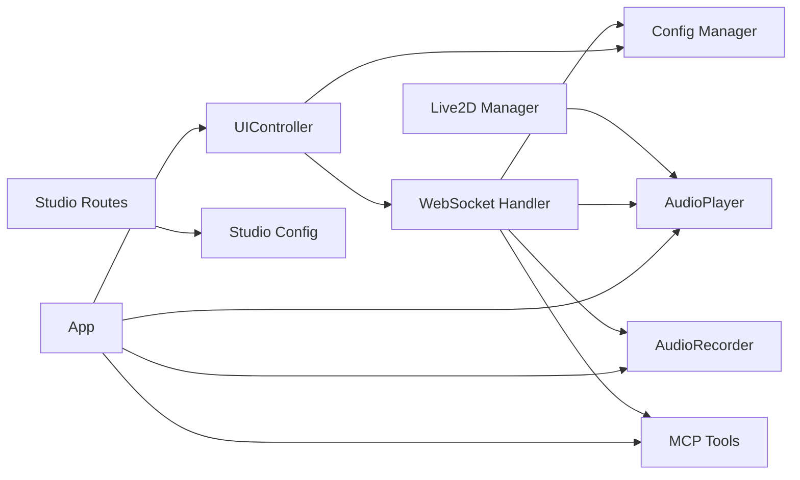

# Web管理界面

<cite>
**本文引用的文件**   
- [index.html](file://public/chat/index.html)
- [app.js](file://public/chat/js/app.js)
- [live2d.js](file://public/chat/js/live2d/live2d.js)
- [player.js](file://public/chat/js/core/audio/player.js)
- [recorder.js](file://public/chat/js/core/audio/recorder.js)
- [websocket.js](file://public/chat/js/core/network/websocket.js)
- [controller.js](file://public/chat/js/ui/controller.js)
- [tools.js](file://public/chat/js/core/mcp/tools.js)
- [manager.js](file://public/chat/js/config/manager.js)
- [test_page.css](file://public/chat/css/test_page.css)
- [config.js](file://studio/config.js)
- [routes.js](file://studio/routes.js)
</cite>

## 目录
1. [简介](#简介)
2. [项目结构](#项目结构)
3. [核心组件](#核心组件)
4. [架构总览](#架构总览)
5. [详细组件分析](#详细组件分析)
6. [依赖关系分析](#依赖关系分析)
7. [性能与实时性](#性能与实时性)
8. [故障排查指南](#故障排查指南)
9. [扩展与二次开发指南](#扩展与二次开发指南)
10. [结论](#结论)

## 简介
本仓库的 Web 管理界面包含两部分：
- 前端聊天与管理后台：提供 Live2D 数字人、语音对话、摄像头预览、MCP 工具配置、设备连接与状态展示等能力。
- 后端 Studio 管理路由：为固件构建、设备检测、OTA 管理等提供 API，并暴露事件流接口供前端使用。

该文档面向开发者与产品实施人员，既解释整体架构，也深入到音频播放、Live2D 动画、WebSocket 通信、MCP 工具调用等关键实现细节，并提供样式定制、主题配置和扩展开发建议。

## 项目结构
前端聊天界面位于 public/chat，采用模块化 JS（ES Module）组织，按职责划分为 UI 控制器、网络通信、音频编解码、Live2D 渲染、MCP 工具管理、配置持久化等模块；样式集中在 CSS 文件中，便于统一主题与皮肤切换。Studio 管理路由位于 studio 目录，提供固件工作台的 REST/SSE 接口。

**图表来源**
- [index.html:1-387](file://public/chat/index.html#L1-L387)
- [app.js:1-427](file://public/chat/js/app.js#L1-L427)
- [controller.js:1-800](file://public/chat/js/ui/controller.js#L1-L800)
- [websocket.js:1-553](file://public/chat/js/core/network/websocket.js#L1-L553)
- [player.js:1-318](file://public/chat/js/core/audio/player.js#L1-L318)
- [recorder.js:1-646](file://public/chat/js/core/audio/recorder.js#L1-L646)
- [live2d.js:1-825](file://public/chat/js/live2d/live2d.js#L1-L825)
- [tools.js:1-433](file://public/chat/js/core/mcp/tools.js#L1-L433)
- [manager.js:1-81](file://public/chat/js/config/manager.js#L1-L81)
- [test_page.css:1-800](file://public/chat/css/test_page.css#L1-L800)
- [config.js:1-47](file://studio/config.js#L1-L47)
- [routes.js:1-69](file://studio/routes.js#L1-L69)

**章节来源**
- [index.html:1-387](file://public/chat/index.html#L1-L387)
- [test_page.css:1-800](file://public/chat/css/test_page.css#L1-L800)

## 核心组件
- 应用入口 App：负责初始化 UI、音频播放器、Opus 编解码、麦克风权限、摄像头、Live2D 模型加载与交互。
- UI 控制器：集中处理按钮事件、模态框、标签页、背景切换、拨号连接流程、消息显示、录音/摄像头状态同步。
- WebSocket 处理器：封装握手、文本/二进制消息分发、TTS 控制、LLM 情绪联动、MCP 工具协议处理、断线清理。
- 音频播放器：基于 AudioContext + Opus 解码，缓冲队列、流式播放、统计信息、清空缓冲。
- 音频录制器：AudioContext + ScriptProcessorNode 采集 PCM，Opus 编码，定时发送，测试模式统计与回放。
- Live2D 管理器：PIXI + Cubism 模型加载、嘴部动画、情绪动作映射、点击/双击/滑动交互、模型切换。
- MCP 工具管理：默认工具加载、参数编辑、模拟返回、拍照工具集成、工具列表上报与执行。
- 配置管理：设备标识、客户端 ID、OTA 地址等本地存储与读取。

**章节来源**
- [app.js:1-427](file://public/chat/js/app.js#L1-L427)
- [controller.js:1-800](file://public/chat/js/ui/controller.js#L1-L800)
- [websocket.js:1-553](file://public/chat/js/core/network/websocket.js#L1-L553)
- [player.js:1-318](file://public/chat/js/core/audio/player.js#L1-L318)
- [recorder.js:1-646](file://public/chat/js/core/audio/recorder.js#L1-L646)
- [live2d.js:1-825](file://public/chat/js/live2d/live2d.js#L1-L825)
- [tools.js:1-433](file://public/chat/js/core/mcp/tools.js#L1-L433)
- [manager.js:1-81](file://public/chat/js/config/manager.js#L1-L81)

## 架构总览
前端以 App 为入口，依次初始化 UI 控制器、音频系统、摄像头、Live2D 模型；UI 控制器协调用户操作，WebSocket 处理器负责与服务端建立连接、收发 JSON 与二进制数据；音频录制器将语音编码后通过 WebSocket 发送；服务端返回 TTS 音频帧与文本消息，播放器解码并输出，同时触发 Live2D 嘴部动画与情绪动作。

**图表来源**
- [controller.js:240-278](file://public/chat/js/ui/controller.js#L240-L278)
- [controller.js:688-716](file://public/chat/js/ui/controller.js#L688-L716)
- [websocket.js:23-71](file://public/chat/js/core/network/websocket.js#L23-L71)
- [websocket.js:132-182](file://public/chat/js/core/network/websocket.js#L132-L182)
- [websocket.js:334-354](file://public/chat/js/core/network/websocket.js#L334-L354)
- [player.js:170-271](file://public/chat/js/core/audio/player.js#L170-L271)
- [live2d.js:515-557](file://public/chat/js/live2d/live2d.js#L515-L557)

## 详细组件分析

### 前端聊天界面与 UI 控制器
- 页面结构：包含背景容器、摄像头区域、连接状态指示、Live2D Canvas、弹幕式聊天流、底部输入与控制栏、设置弹窗、MCP 工具编辑弹窗等。
- 交互逻辑：
  - 拨号按钮：未连接时校验 OTA 地址，进入连接流程；已连接则断开。
  - 摄像头按钮：打开/关闭摄像头，支持前后摄像头切换与拖动定位。
  - 录音按钮：正常模式与测试模式分离，测试模式可本地统计与回放。
  - 设置弹窗：设备配置、MCP 工具、数字人皮肤三个标签页。
  - 背景切换：循环切换预设背景图，持久化选择索引。
- 状态同步：根据 WebSocket 连接状态、麦克风可用性、摄像头可用状态更新按钮禁用/启用与提示文案。

**图表来源**
- [controller.js:210-278](file://public/chat/js/ui/controller.js#L210-L278)
- [controller.js:472-559](file://public/chat/js/ui/controller.js#L472-L559)
- [controller.js:688-716](file://public/chat/js/ui/controller.js#L688-L716)

**章节来源**
- [index.html:43-387](file://public/chat/index.html#L43-L387)
- [controller.js:1-800](file://public/chat/js/ui/controller.js#L1-L800)

### Live2D 角色集成与交互
- 模型加载：根据 localStorage 中保存的模型名动态拼接资源路径，加载 model3.json，设置缩放与位置，绑定交互事件。
- 交互事件：单击、双击、滑动分别映射到不同动作组；命中区域判定头部/面部/身体，并通过 dataChannel 或 WebSocket 上报事件。
- 嘴部动画：连接音频播放器分析器节点，根据音量阈值映射 ParamMouthOpenY 与可选的嘴型参数，驱动模型口型变化。
- 情绪动作：根据 LLM 返回的情绪字段触发预定义动作，带冷却时间避免频繁触发。
- 模型切换：销毁旧模型，加载新模型，重新绑定交互，更新 mouthParam 配置并持久化选择。

**图表来源**
- [live2d.js:5-78](file://public/chat/js/live2d/live2d.js#L5-L78)
- [live2d.js:83-350](file://public/chat/js/live2d/live2d.js#L83-L350)
- [live2d.js:352-557](file://public/chat/js/live2d/live2d.js#L352-L557)
- [live2d.js:739-800](file://public/chat/js/live2d/live2d.js#L739-L800)

**章节来源**
- [live2d.js:1-825](file://public/chat/js/live2d/live2d.js#L1-L825)

### 音频播放控制与实时流
- 播放器：创建 AudioContext，懒加载 Opus 解码器，阻塞队列缓冲音频包，流式解码并播放；提供统计信息与清空缓冲方法。
- 录制器：采集 PCM，重采样至 16kHz，Opus 编码，定时发送；支持测试模式收集统计、生成 WAV 并回放下载。
- 与 Live2D 联动：在 TTS 开始/句子开始时启动嘴部动画，结束时延迟停止，确保多句连贯。

**图表来源**
- [player.js:170-271](file://public/chat/js/core/audio/player.js#L170-L271)
- [websocket.js:334-354](file://public/chat/js/core/network/websocket.js#L334-L354)
- [websocket.js:132-182](file://public/chat/js/core/network/websocket.js#L132-L182)

**章节来源**
- [player.js:1-318](file://public/chat/js/core/audio/player.js#L1-L318)
- [recorder.js:1-646](file://public/chat/js/core/audio/recorder.js#L1-L646)
- [websocket.js:132-182](file://public/chat/js/core/network/websocket.js#L132-L182)

### 用户交互逻辑与摄像头
- 摄像头权限与启停：通过 getUserMedia 获取视频流，支持前后摄像头切换；连接成功后自动尝试开启摄像头，失败则提示。
- 拖拽定位：鼠标/触摸事件计算偏移量，实时更新 transform。
- 拍照与视觉分析：Canvas 截图转 Base64，上传至配置的视觉分析接口，返回结果回传至 LLM/TTS 流程。

**图表来源**
- [app.js:186-415](file://public/chat/js/app.js#L186-L415)
- [controller.js:280-326](file://public/chat/js/ui/controller.js#L280-L326)

**章节来源**
- [app.js:186-415](file://public/chat/js/app.js#L186-L415)
- [controller.js:280-326](file://public/chat/js/ui/controller.js#L280-L326)

### MCP 工具管理与调用
- 工具列表：从默认 JSON 与本地存储合并加载，支持删除与参数编辑。
- 参数编辑：支持字符串/整数/数字/布尔/数组/对象类型，数值类型支持最小/最大值范围。
- 工具执行：优先匹配拍照工具，其次使用模拟返回或默认成功响应；通过 WebSocket 与服务器进行 tools/list 与 tools/call 协议交互。

**图表来源**
- [tools.js:24-49](file://public/chat/js/core/mcp/tools.js#L24-L49)
- [tools.js:379-429](file://public/chat/js/core/mcp/tools.js#L379-L429)
- [websocket.js:229-332](file://public/chat/js/core/network/websocket.js#L229-L332)

**章节来源**
- [tools.js:1-433](file://public/chat/js/core/mcp/tools.js#L1-L433)
- [websocket.js:229-332](file://public/chat/js/core/network/websocket.js#L229-L332)

### 前后端数据交互与实时通信
- 握手流程：连接成功后发送 hello 消息，携带设备标识与特性；服务端返回 session_id 确认。
- 文本消息：用户输入通过 chat 类型消息发送；STT 识别结果与 LLM 回复通过相应类型消息回调 UI。
- 音频流：二进制 Opus 帧由 WebSocket 传输，播放器解码并输出；TTS 控制消息驱动会话状态与 Live2D 动画。
- MCP 协议：tools/list 返回工具清单，tools/call 执行工具并返回结果；initialize 阶段下发视觉分析服务配置。

**图表来源**
- [websocket.js:23-71](file://public/chat/js/core/network/websocket.js#L23-L71)
- [websocket.js:73-130](file://public/chat/js/core/network/websocket.js#L73-L130)
- [websocket.js:334-354](file://public/chat/js/core/network/websocket.js#L334-L354)
- [websocket.js:229-332](file://public/chat/js/core/network/websocket.js#L229-L332)

**章节来源**
- [websocket.js:1-553](file://public/chat/js/core/network/websocket.js#L1-L553)

## 依赖关系分析
- App 依赖 UI 控制器、音频播放器、录音器、MCP 工具、日志工具。
- UI 控制器依赖配置管理、音频播放器、录音器、WebSocket 处理器。
- WebSocket 处理器依赖配置管理、UI 控制器、音频播放器、录音器、MCP 工具、OTA 连接器。
- Live2D 管理器依赖 PIXI/Cubism SDK，并与音频播放器共享 AudioContext 与分析器节点。
- Studio 路由依赖配置与环境探测、构建与安装库。

**图表来源**
- [app.js:1-427](file://public/chat/js/app.js#L1-L427)
- [controller.js:1-800](file://public/chat/js/ui/controller.js#L1-L800)
- [websocket.js:1-553](file://public/chat/js/core/network/websocket.js#L1-L553)
- [player.js:1-318](file://public/chat/js/core/audio/player.js#L1-L318)
- [recorder.js:1-646](file://public/chat/js/core/audio/recorder.js#L1-L646)
- [live2d.js:1-825](file://public/chat/js/live2d/live2d.js#L1-L825)
- [tools.js:1-433](file://public/chat/js/core/mcp/tools.js#L1-L433)
- [manager.js:1-81](file://public/chat/js/config/manager.js#L1-L81)
- [config.js:1-47](file://studio/config.js#L1-L47)
- [routes.js:1-69](file://studio/routes.js#L1-L69)

**章节来源**
- [app.js:1-427](file://public/chat/js/app.js#L1-L427)
- [controller.js:1-800](file://public/chat/js/ui/controller.js#L1-L800)
- [websocket.js:1-553](file://public/chat/js/core/network/websocket.js#L1-L553)

## 性能与实时性
- 音频链路：采用 16kHz 单声道 PCM 经 Opus 编码，60ms 一帧发送，降低带宽与延迟；播放器侧使用阻塞队列与流式解码，减少卡顿。
- 动画与音频同步：Live2D 通过 AnalyserNode 实时分析音量，映射到嘴部参数，保证口型与声音一致。
- 摄像头与交互：Canvas 截图与视觉分析接口异步调用，不阻塞主线程；拖拽定位使用 transform 提升渲染性能。
- 资源管理：Opus 解码器懒加载与复用，AudioContext 在移动端需用户交互恢复；Live2D 模型切换时销毁旧实例释放内存。

[本节为通用性能讨论，不直接分析具体文件]

## 故障排查指南
- 麦克风不可用：
  - 检查浏览器是否支持 getUserMedia，以及是否在 HTTPS 或 localhost/内网 HTTP 下访问。
  - 查看 UI 控制器对麦克风可用性的判断与按钮禁用逻辑。
- 无法录音：
  - 确认录音器是否正确初始化 Opus 编码器，并在非测试模式下发送 listen/start 与空帧结束信号。
- 无声音播放：
  - 检查播放器是否成功初始化 AudioContext 与 Opus 解码器；确认二进制消息被正确入队与解码。
- Live2D 无动画：
  - 确认 Live2D 管理器已初始化 AnalyserNode 并连接到音频播放器；检查 isTalking 状态与 animateMouth 循环。
- MCP 工具无效：
  - 检查工具名称是否存在，模拟返回是否有效；确认 WebSocket 已连接且 tools/call 能正确执行。

**章节来源**
- [recorder.js:605-645](file://public/chat/js/core/audio/recorder.js#L605-L645)
- [player.js:55-168](file://public/chat/js/core/audio/player.js#L55-L168)
- [live2d.js:352-557](file://public/chat/js/live2d/live2d.js#L352-L557)
- [tools.js:379-429](file://public/chat/js/core/mcp/tools.js#L379-L429)

## 扩展与二次开发指南
- 新增 Live2D 模型：
  - 在 live2d.js 的模型文件映射中添加新模型名与 model3.json 文件名；在 resources 目录下放置对应 runtime 资源。
  - 如需自定义嘴部参数与动作映射，扩展 modelConfig 中的 mouthParam、motionMap 等字段。
- 自定义背景与主题：
  - 在 controller.js 的 backgroundImages 数组中添加图片文件名；在 test_page.css 中调整颜色、阴影、字体等样式。
- 扩展 MCP 工具：
  - 在 default-mcp-tools.json 中新增工具定义，包含 name、description、inputSchema、mockResponse；或通过 UI 编辑参数。
  - 如需对接真实后端，可在 executeMcpTool 中替换模拟返回为 fetch 调用。
- 接入视觉分析服务：
  - 在 initialize 阶段保存 vision.url 与 vision.token；在 takePhoto 中携带 Device-Id、Client-Id、Authorization 头发起请求。
- 后端 Studio 扩展：
  - 在 routes.js 中新增 REST/SSE 接口；在 config.js 中调整环境变量与依赖服务探活目标。

**章节来源**
- [live2d.js:100-125](file://public/chat/js/live2d/live2d.js#L100-L125)
- [live2d.js:739-800](file://public/chat/js/live2d/live2d.js#L739-L800)
- [controller.js:614-651](file://public/chat/js/ui/controller.js#L614-L651)
- [test_page.css:1-800](file://public/chat/css/test_page.css#L1-L800)
- [tools.js:24-49](file://public/chat/js/core/mcp/tools.js#L24-L49)
- [tools.js:379-429](file://public/chat/js/core/mcp/tools.js#L379-L429)
- [config.js:29-46](file://studio/config.js#L29-L46)
- [routes.js:29-67](file://studio/routes.js#L29-L67)

## 结论
Web 管理界面通过模块化前端架构实现了 Live2D 数字人、语音对话、摄像头预览与 MCP 工具管理的完整体验。音频链路采用 Opus 编码与流式播放保障低延迟与稳定性；Live2D 与音频分析器联动带来自然的口型与情绪表现；WebSocket 协议贯穿文本、音频与 MCP 工具调用，形成端到端的实时交互闭环。样式与主题可通过 CSS 与 UI 控制器灵活定制，Studio 后端提供固件开发与设备管理能力。开发者可在此基础上扩展模型、工具与接口，快速构建个性化智能终端管理界面。