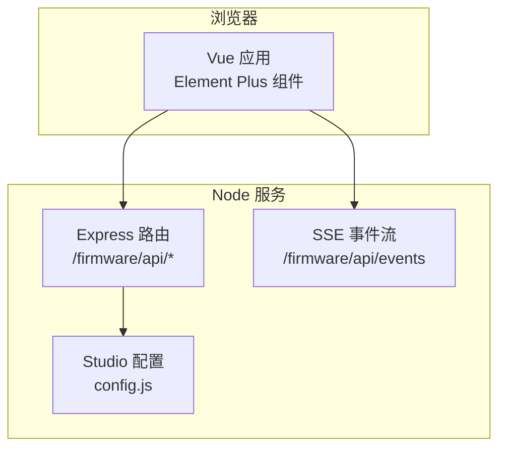
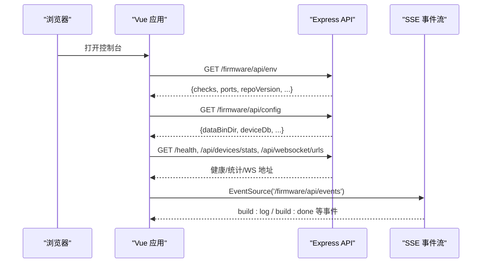
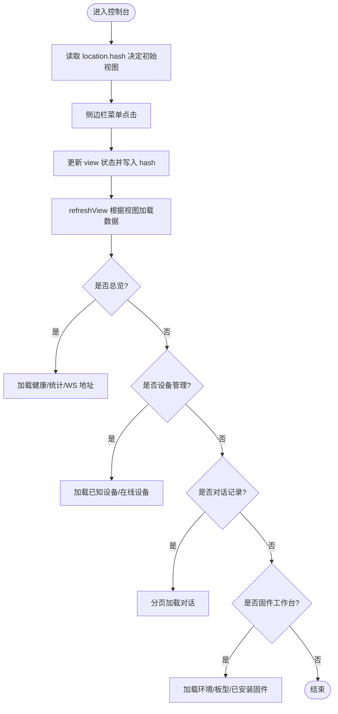
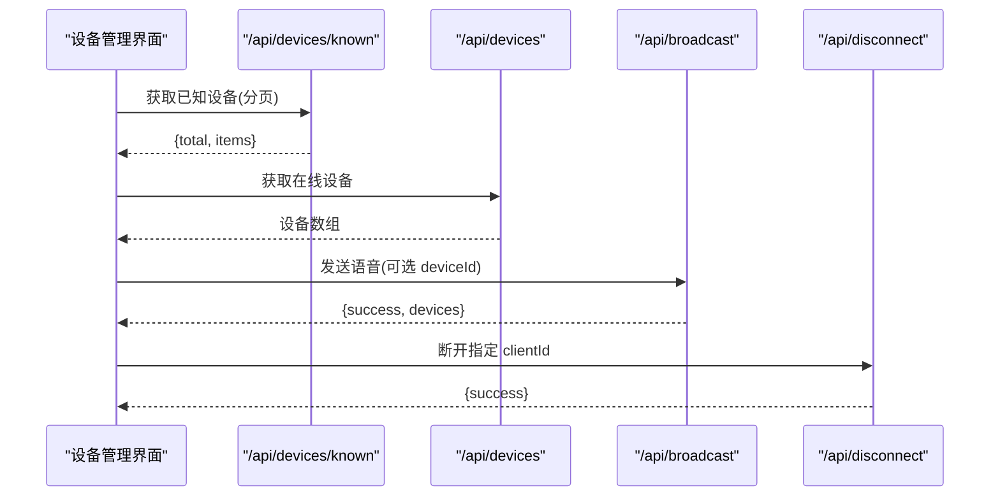
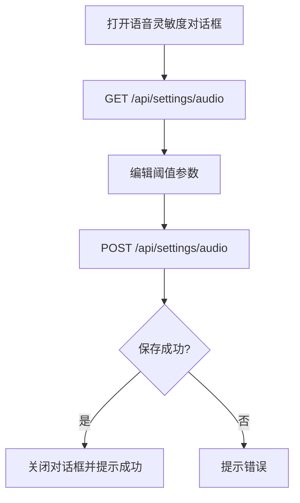
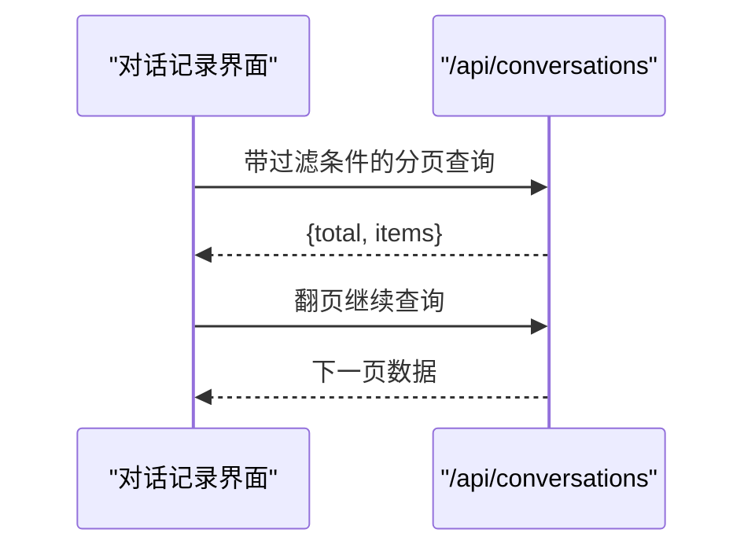
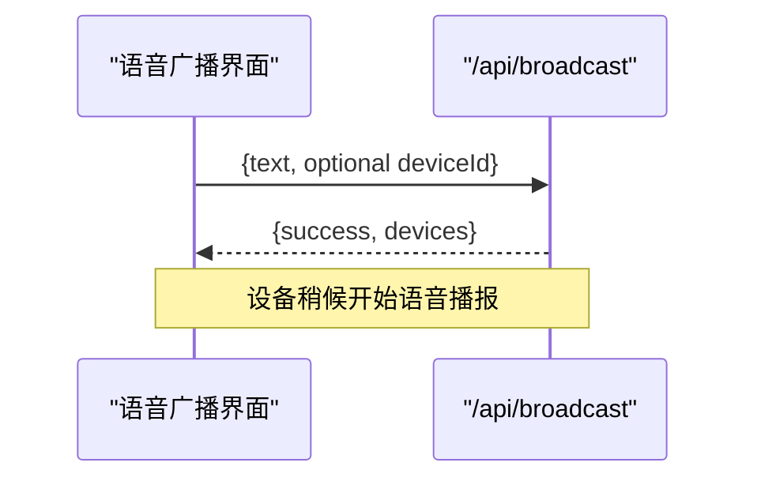
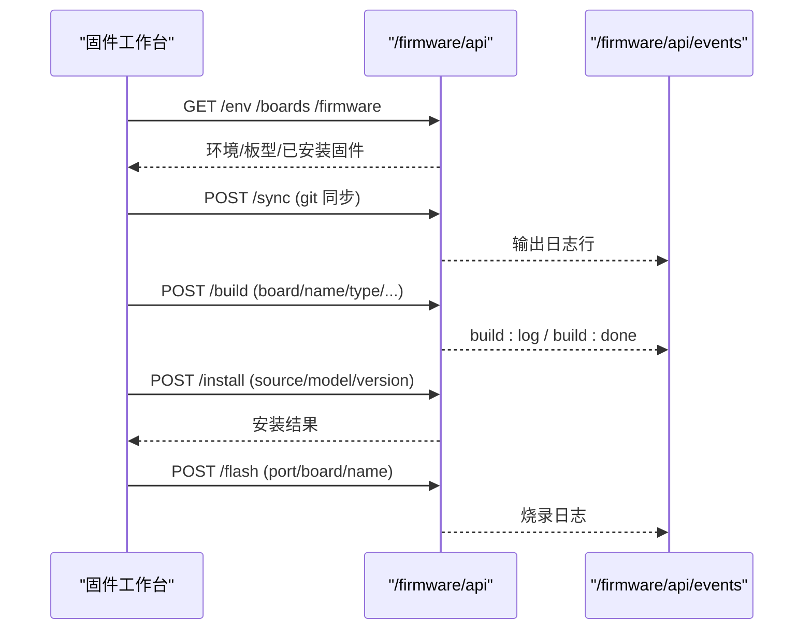
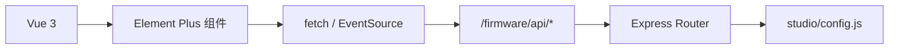

# 管理后台界面

<cite>
**本文引用的文件**   
- [package.json](file://package.json)
- [studio/public/index.html](file://studio/public/index.html)
- [studio/config.js](file://studio/config.js)
- [studio/routes.js](file://studio/routes.js)
</cite>

## 目录
1. [简介](#简介)
2. [项目结构](#项目结构)
3. [核心组件](#核心组件)
4. [架构总览](#架构总览)
5. [详细组件分析](#详细组件分析)
6. [依赖关系分析](#依赖关系分析)
7. [性能与体验优化](#性能与体验优化)
8. [故障排查指南](#故障排查指南)
9. [扩展与二次开发指南](#扩展与二次开发指南)
10. [结论](#结论)

## 简介
本文件面向“小智服务器”的 Web 管理后台，聚焦 Vue.js 单页管理界面的架构设计、路由配置、设备监控面板、配置管理与对话记录查看功能的实现方式。文档同时说明前后端数据交互模式（REST + SSE）、状态管理机制、界面布局与组件复用策略，并提供扩展开发与自定义界面构建指南，帮助读者在不深入源码的情况下也能理解并扩展该管理后台。

## 项目结构
管理后台以“单 HTML + 内嵌 Vue 3 + Element Plus”的方式提供，后端通过 Express 暴露 REST API 与 SSE 事件流，前端通过 fetch/EventSource 进行数据拉取与实时日志推送。固件工作台相关能力由 studio 子模块提供，包括环境探测、板型枚举、编译任务、安装与烧录等接口。

图表来源
- [studio/public/index.html:489-830](file://studio/public/index.html#L489-L830)
- [studio/routes.js:29-67](file://studio/routes.js#L29-L67)
- [studio/config.js:29-46](file://studio/config.js#L29-L46)

章节来源
- [package.json:1-29](file://package.json#L1-L29)
- [studio/public/index.html:1-834](file://studio/public/index.html#L1-L834)
- [studio/routes.js:1-69](file://studio/routes.js#L1-L69)
- [studio/config.js:1-47](file://studio/config.js#L1-L47)

## 核心组件
- 视图与路由
  - 使用 location.hash 作为简单路由，切换 overview/devices/convs/broadcast/firmware 五个页面。
  - 侧边栏菜单驱动 view 状态，点击后更新 hash 并刷新对应视图。
- 全局状态
  - env：运行环境与依赖检查项（仓库、ESP-IDF、Python、OTA 地址等）。
  - health/stats/wsUrls：服务健康、设备统计、WebSocket 地址。
  - known/liveDevices：持久化设备列表与当前在线设备。
  - convs：分页对话记录。
  - boards/fwList/portSel/logLines/flashLines：固件工作台相关状态。
- 工具函数
  - apiGet/apiPost：统一封装 fetch 请求。
  - readStream：解析后端 SSE 文本流，按 data: JSON 行分发对象。
  - cmpVer/mb/fmtTs/fmtUptime/cell：版本比较、单位换算、时间格式化、空值处理等。

章节来源
- [studio/public/index.html:492-579](file://studio/public/index.html#L492-L579)
- [studio/public/index.html:580-679](file://studio/public/index.html#L580-L679)

## 架构总览
管理后台采用“前端单页 + 后端 REST/SSE”的轻量架构：
- 前端：Vue 3 + Element Plus，无独立构建流程，直接加载 vendor 资源。
- 后端：Express 提供 /health、/api/* 业务接口；/firmware/api/* 提供固件工作区能力；/firmware/api/events 提供 SSE 事件流。
- 数据流：页面初始化时拉取环境与配置；各功能模块按需拉取数据；长耗时操作（同步源码、编译、烧录）通过 SSE 推送进度。

图表来源
- [studio/public/index.html:676-688](file://studio/public/index.html#L676-L688)
- [studio/public/index.html:792-813](file://studio/public/index.html#L792-L813)
- [studio/routes.js:55-59](file://studio/routes.js#L55-L59)

## 详细组件分析

### 视图与路由
- 路由机制
  - 使用 location.hash 维护当前视图，如 #/overview、#/devices 等。
  - 切换视图时调用 refreshView 触发对应数据加载。
- 视图划分
  - 总览：展示注册设备数、在线设备数、对话总数、服务运行时长、服务状态、OTA 地址、WebSocket 地址、固件目录、设备库路径、固件仓库信息等。
  - 设备管理：分“注册设备（持久化）”和“当前在线（WS）”两个标签页，支持搜索过滤、分页、语音灵敏度设置、向单台设备发语音、查看详情、断开连接。
  - 对话记录：按设备ID与角色过滤，分页展示。
  - 语音广播：选择目标设备或全部在线设备，输入文字后异步合成并推流播报。
  - 固件工作台：自动识别设备/板型、选择板型与核对版本、同步源码、编译、安装到 OTA 目录、USB 烧录。

图表来源
- [studio/public/index.html:515-588](file://studio/public/index.html#L515-L588)

章节来源
- [studio/public/index.html:132-486](file://studio/public/index.html#L132-L486)
- [studio/public/index.html:515-588](file://studio/public/index.html#L515-L588)

### 设备监控面板
- 数据来源
  - 已知设备：GET /api/devices/known?limit=50&offset=...
  - 在线设备：GET /api/devices
- 功能点
  - 搜索过滤：对 MAC/型号/IP/设备ID 等字段进行本地过滤。
  - 分页：已知设备分页显示。
  - 语音灵敏度（VAD 振幅阈值）：打开对话框读取当前阈值，保存后即时生效并可持久化。
  - 向单台设备发语音：复用广播接口定向发送。
  - 设备详情：弹窗展示完整设备信息。
  - 断开连接：确认后调用断开接口，刷新在线与已知设备列表。

图表来源
- [studio/public/index.html:600-673](file://studio/public/index.html#L600-L673)

章节来源
- [studio/public/index.html:205-291](file://studio/public/index.html#L205-L291)
- [studio/public/index.html:600-673](file://studio/public/index.html#L600-L673)

### 配置管理界面（语音灵敏度与 VAD 阈值）
- 入口：设备管理页面的“语音灵敏度”按钮。
- 读取：GET /api/settings/audio，返回阈值对象。
- 保存：POST /api/settings/audio，提交 minMaxAmplitude/minAvgAmplitude/silenceThresholdMs。
- 行为：保存成功后提示成功并关闭对话框；若未持久化则提示仅热更新。

图表来源
- [studio/public/index.html:634-648](file://studio/public/index.html#L634-L648)

章节来源
- [studio/public/index.html:256-275](file://studio/public/index.html#L256-L275)
- [studio/public/index.html:634-648](file://studio/public/index.html#L634-L648)

### 对话记录查看功能
- 查询条件：设备ID、角色（user/bot），分页 size=50。
- 数据源：GET /api/conversations?limit=50&offset=...
- 展示：表格列包含时间、设备、角色、内容、表情、来源。

图表来源
- [studio/public/index.html:610-618](file://studio/public/index.html#L610-L618)

章节来源
- [studio/public/index.html:293-316](file://studio/public/index.html#L293-L316)
- [studio/public/index.html:610-618](file://studio/public/index.html#L610-L618)

### 语音广播
- 目标：全部在线设备或指定设备。
- 交互：输入文字后调用 POST /api/broadcast，服务端异步合成并推流。
- 反馈：成功提示播报设备数量，失败提示错误信息。

图表来源
- [studio/public/index.html:620-632](file://studio/public/index.html#L620-L632)

章节来源
- [studio/public/index.html:318-339](file://studio/public/index.html#L318-L339)
- [studio/public/index.html:620-632](file://studio/public/index.html#L620-L632)

### 固件工作台
- 自动识别设备/板型
  - 调用 /firmware/api/detect 与 /firmware/api/devices，尝试匹配最近连接设备并预选板型。
- 选择板型与核对版本
  - 列出可用板型，支持关键字过滤；选择后自动比对官方最新版本，提示本地落后情况。
- 同步源码
  - 支持 git pull 或 checkout 指定 tag，通过 SSE 推送执行日志。
- 编译
  - 提交 board/name/type/otaUrl/otaUrlFallback/flashSize/wakeWord，启动后台构建任务；通过 SSE 接收 build:log/build:done。
- 安装到 OTA 目录
  - 将产物复制到 data/bin，供设备 OTA 升级。
- USB 烧录
  - 选择串口后执行 flash，SSE 推送烧录日志。

图表来源
- [studio/public/index.html:675-790](file://studio/public/index.html#L675-L790)
- [studio/routes.js:33-65](file://studio/routes.js#L33-L65)

章节来源
- [studio/public/index.html:341-482](file://studio/public/index.html#L341-L482)
- [studio/public/index.html:675-790](file://studio/public/index.html#L675-L790)
- [studio/routes.js:33-65](file://studio/routes.js#L33-L65)

## 依赖关系分析
- 前端依赖
  - Vue 3：响应式状态、组合式 API。
  - Element Plus：UI 组件库（菜单、表格、表单、对话框、消息等）。
  - 中文语言包：Element Plus 中文本地化。
- 后端依赖
  - Express：HTTP 路由与中间件。
  - SSE：用于构建过程与烧录过程的实时日志推送。
  - Studio 配置：从 config.json 派生固件工作区路径、设备库路径、服务探活目标等。

图表来源
- [package.json:11-22](file://package.json#L11-L22)
- [studio/public/index.html:489-494](file://studio/public/index.html#L489-L494)
- [studio/routes.js:7-11](file://studio/routes.js#L7-L11)
- [studio/config.js:29-46](file://studio/config.js#L29-L46)

章节来源
- [package.json:1-29](file://package.json#L1-L29)
- [studio/public/index.html:489-494](file://studio/public/index.html#L489-L494)
- [studio/routes.js:7-11](file://studio/routes.js#L7-L11)
- [studio/config.js:29-46](file://studio/config.js#L29-L46)

## 性能与体验优化
- 数据加载
  - 总览页定时轮询（每 15 秒）刷新健康与统计，避免频繁全量刷新。
  - 分页加载已知设备与对话记录，减少单次数据量。
- 实时日志
  - 使用 SSE 推送构建与烧录日志，避免轮询开销。
  - 日志行数限制（保留最近 3000 条），防止内存增长。
- 交互体验
  - 搜索过滤在客户端完成，提升响应速度。
  - 关键操作（删除固件、烧录、覆盖安装）均弹出确认框，降低误操作风险。
- 状态管理
  - 使用 reactive/ref 管理局部状态，避免全局状态膨胀。
  - 计算属性（computed）用于动态列、过滤列表、版本比较等。

[本节为通用指导，不直接分析具体文件]

## 故障排查指南
- 环境检查失败
  - 现象：顶部红叉提示缺失依赖（仓库、ESP-IDF、Python、安装目录、设备库、LLM/STT 服务等）。
  - 处理：根据 checkNames 提示定位缺失项，修正 studio/config.js 中配置的目录或环境变量。
- 编译失败
  - 现象：SSE 事件 build:done 返回 error。
  - 处理：检查板型选择、Flash 容量、唤醒词配置、OTA 地址是否正确；查看日志行定位错误原因。
- 无法识别设备
  - 现象：自动检测未匹配到设备。
  - 处理：确认设备已连接且可被系统枚举；检查端口列表 env.ports 是否包含目标串口。
- 广播无响应
  - 现象：POST /api/broadcast 返回 success 但设备未播报。
  - 处理：确认目标设备在线；检查 TTS/语音通道是否正常；查看服务端日志。
- 会话断开
  - 现象：设备管理页“断开”后设备仍显示在线。
  - 处理：等待 WebSocket 心跳超时；必要时重启服务或清理残留连接。

章节来源
- [studio/public/index.html:150-158](file://studio/public/index.html#L150-L158)
- [studio/public/index.html:792-813](file://studio/public/index.html#L792-L813)
- [studio/public/index.html:663-673](file://studio/public/index.html#L663-L673)

## 扩展与二次开发指南
- 新增管理页面
  - 在 index.html 中添加新的 el-menu-item 与模板区块，并在 go/refreshView 中增加对应逻辑。
  - 如需新路由，可在现有 hash 路由基础上扩展，或在后续重构时引入 vue-router。
- 新增 API 接口
  - 在 studio/routes.js 中新增路由，遵循现有风格：GET/POST 返回 JSON；长耗时操作使用 SSE 推送。
  - 如需共享配置，从 studio/config.js 导出 studioConfig 并在路由中使用。
- 复用组件
  - 表格、对话框、表单等 Element Plus 组件可直接复用；建议封装常用表格列与筛选逻辑为局部函数。
- 状态管理
  - 对于复杂页面，可将状态抽取为独立的 reactive 对象，并通过 computed 派生过滤与排序结果。
- 主题与国际化
  - 当前使用 Element Plus 暗黑主题与中文语言包；可按需扩展多语言或切换主题。
- 构建与部署
  - 前端资源通过 /firmware/vendor/* 静态资源提供；确保构建脚本生成这些文件。
  - 后端通过 run-server.js 挂载 /firmware/api 路由；修改 routes.js 后无需重启即可观察效果（配合 node --watch）。

章节来源
- [studio/public/index.html:132-486](file://studio/public/index.html#L132-L486)
- [studio/routes.js:29-67](file://studio/routes.js#L29-L67)
- [studio/config.js:29-46](file://studio/config.js#L29-L46)

## 结论
该管理后台以轻量、直观的 Vue 3 + Element Plus 单页应用为核心，结合 Express 提供的 REST 与 SSE 能力，实现了设备监控、配置管理、对话记录查看与固件工作台等关键功能。其架构清晰、职责分明，便于扩展与维护。通过合理的数据加载策略、实时日志推送与用户交互确认，整体体验良好。未来可在路由与状态管理上进行进一步重构，以提升可维护性与可扩展性。