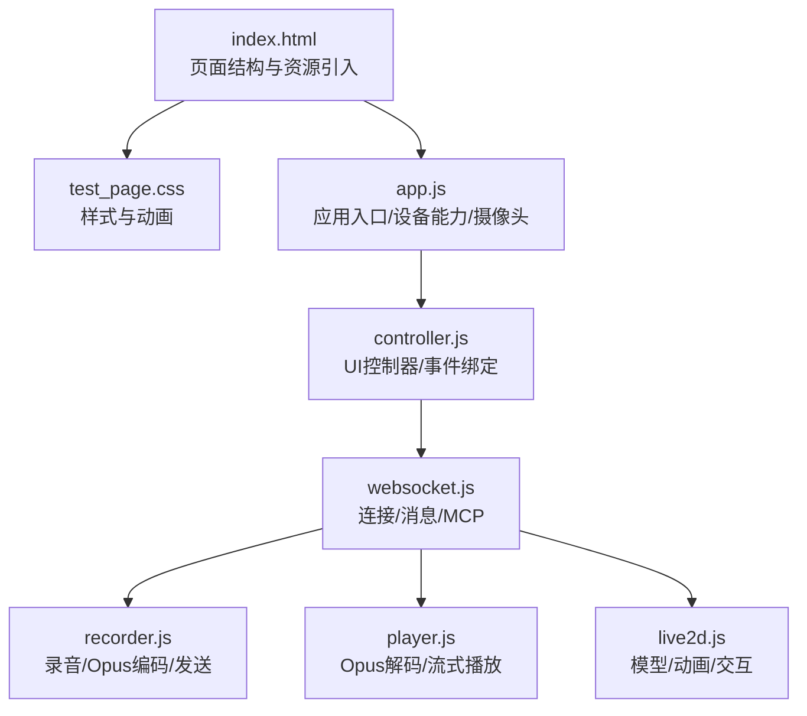
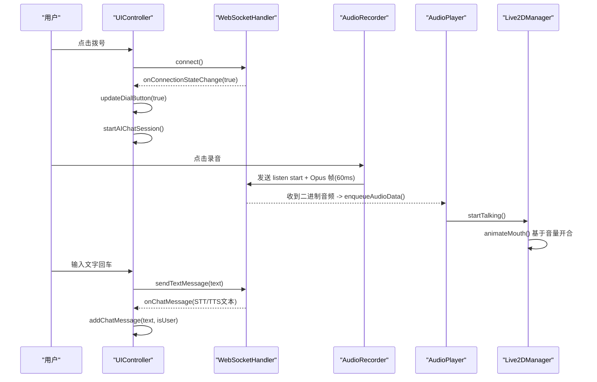
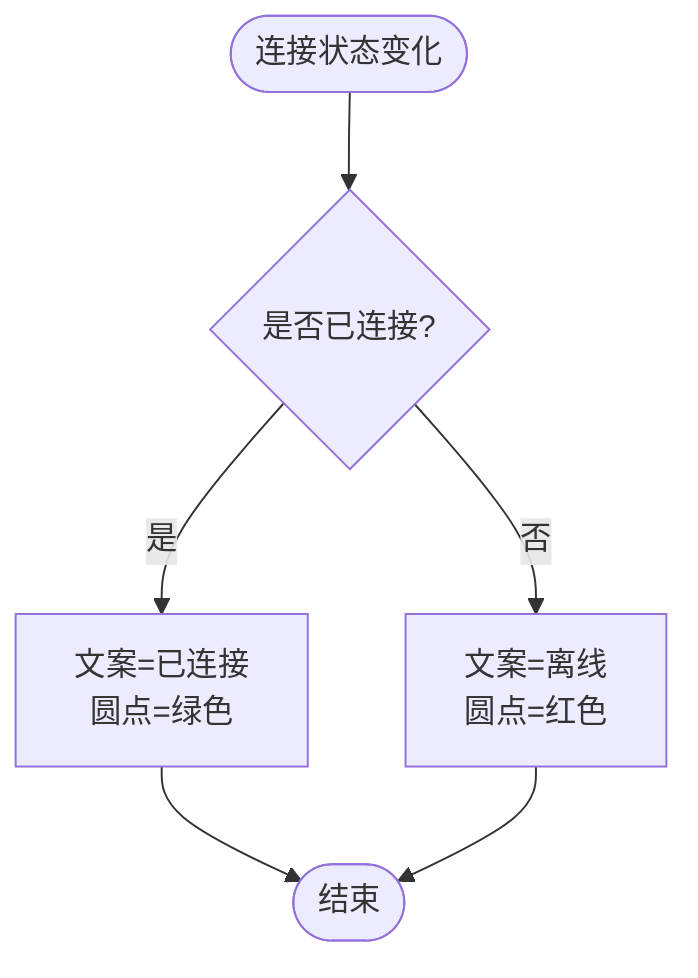
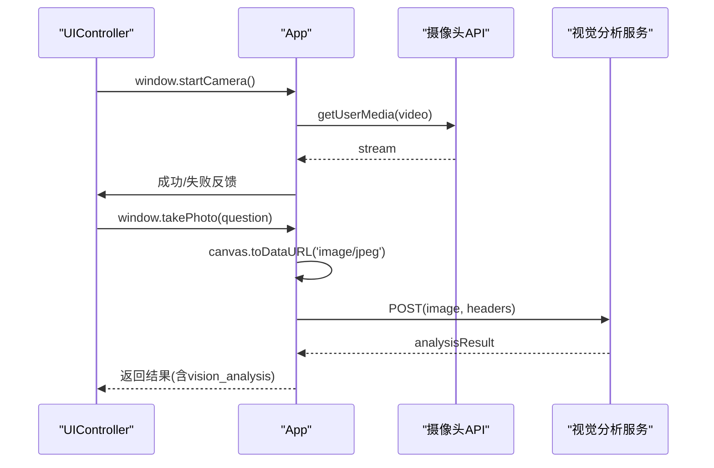
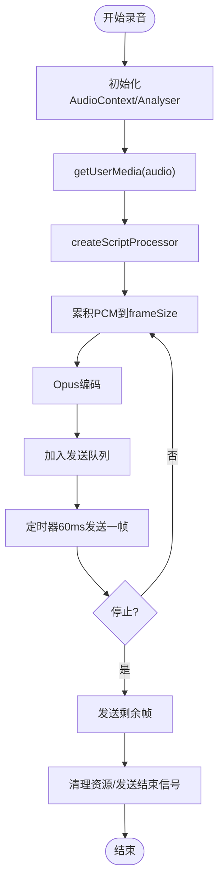
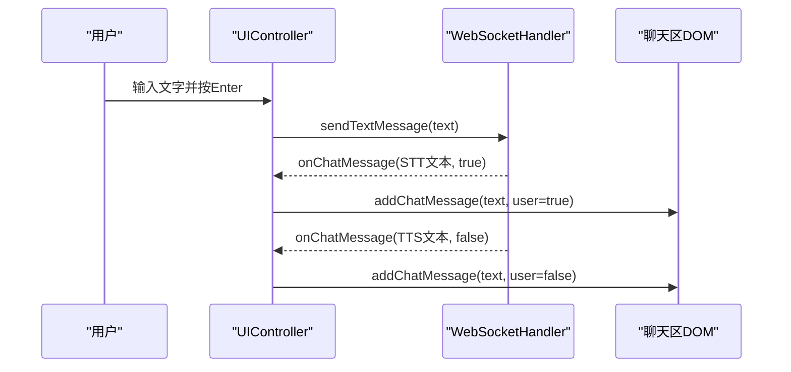
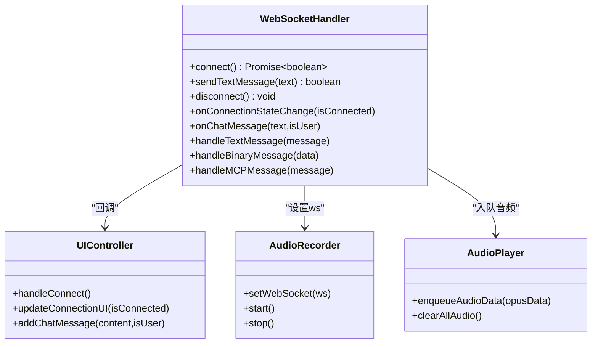
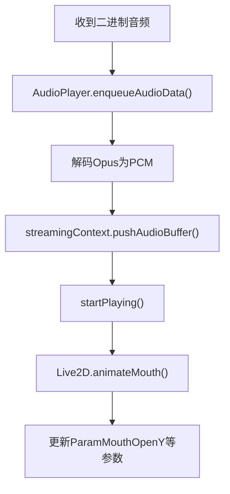
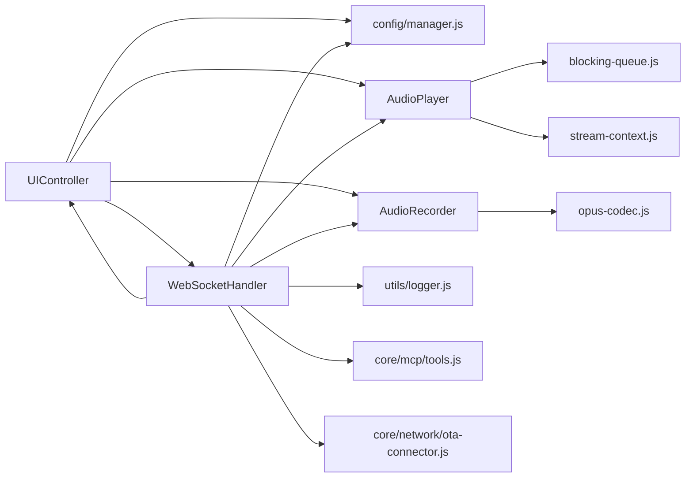

# 聊天界面实现

<cite>
**本文引用的文件**   
- [index.html](file://public/chat/index.html)
- [test_page.css](file://public/chat/css/test_page.css)
- [app.js](file://public/chat/js/app.js)
- [controller.js](file://public/chat/js/ui/controller.js)
- [websocket.js](file://public/chat/js/core/network/websocket.js)
- [recorder.js](file://public/chat/js/core/audio/recorder.js)
- [player.js](file://public/chat/js/core/audio/player.js)
- [live2d.js](file://public/chat/js/live2d/live2d.js)
</cite>

## 目录
1. [简介](#简介)
2. [项目结构](#项目结构)
3. [核心组件](#核心组件)
4. [架构总览](#架构总览)
5. [详细组件分析](#详细组件分析)
6. [依赖关系分析](#依赖关系分析)
7. [性能与兼容性](#性能与兼容性)
8. [故障排查指南](#故障排查指南)
9. [界面定制与主题扩展指南](#界面定制与主题扩展指南)
10. [结论](#结论)

## 简介
本文件面向前端开发者，系统化说明聊天界面的 HTML 结构、CSS 样式与 JavaScript 交互逻辑。重点覆盖以下能力：
- 连接状态指示器、摄像头控制、录音按钮、消息输入框等 UI 组件的实现与联动
- WebSocket 连接管理、实时消息显示、音频播放控制、用户权限处理机制
- 响应式布局、移动端适配与浏览器兼容性策略
- 界面定制与主题扩展的开发指南

## 项目结构
聊天界面位于 public/chat 目录下，采用“页面 + 样式 + 模块”的清晰分层：
- index.html：页面骨架、资源引入、全局错误处理
- css/test_page.css：全局样式、组件样式、动画与响应式规则
- js/app.js：应用入口、设备能力检测、Live2D 初始化、摄像头控制
- js/ui/controller.js：UI 控制器，负责事件绑定、状态同步、弹窗与设置面板
- js/core/network/websocket.js：WebSocket 连接、握手、消息分发、MCP 工具协议
- js/core/audio/recorder.js：麦克风采集、Opus 编码、定时发送、统计与测试模式
- js/core/audio/player.js：Opus 解码、流式播放、缓冲队列、音频上下文管理
- js/live2d/live2d.js：Live2D 模型加载、嘴部动画、情绪动作、交互事件

图表来源
- [index.html:1-387](file://public/chat/index.html#L1-L387)
- [test_page.css:1-800](file://public/chat/css/test_page.css#L1-L800)
- [app.js:1-427](file://public/chat/js/app.js#L1-L427)
- [controller.js:1-800](file://public/chat/js/ui/controller.js#L1-L800)
- [websocket.js:1-553](file://public/chat/js/core/network/websocket.js#L1-L553)
- [recorder.js:1-646](file://public/chat/js/core/audio/recorder.js#L1-L646)
- [player.js:1-318](file://public/chat/js/core/audio/player.js#L1-L318)
- [live2d.js:1-800](file://public/chat/js/live2d/live2d.js#L1-L800)

章节来源
- [index.html:1-387](file://public/chat/index.html#L1-L387)
- [test_page.css:1-800](file://public/chat/css/test_page.css#L1-L800)

## 核心组件
- 连接状态指示器：顶部居中显示“离线/已连接”，带脉冲点动画，随 WebSocket 状态切换
- 摄像头控制：可拖拽悬浮窗口，支持前后摄像头切换、拍照并调用视觉分析接口
- 录音按钮：开始/停止录音，录制 Opus 帧并通过 WebSocket 发送；提供本地测试录音与统计
- 消息输入框：Enter 发送文本消息，触发 LLM-TTS 流程，并在聊天区展示 STT/TTS 文本
- Live2D 数字人：根据语音音量驱动嘴部动画，支持情绪动作与点击/滑动交互
- 设置面板：设备配置（OTA/WebSocket/视觉地址）、MCP 工具管理、数字人皮肤选择与背景切换

章节来源
- [index.html:43-387](file://public/chat/index.html#L43-L387)
- [controller.js:210-470](file://public/chat/js/ui/controller.js#L210-L470)
- [websocket.js:74-130](file://public/chat/js/core/network/websocket.js#L74-L130)
- [recorder.js:59-275](file://public/chat/js/core/audio/recorder.js#L59-L275)
- [player.js:23-53](file://public/chat/js/core/audio/player.js#L23-L53)
- [live2d.js:80-150](file://public/chat/js/live2d/live2d.js#L80-L150)

## 架构总览
聊天界面以 UIController 为中枢，协调 WebSocketHandler、AudioRecorder、AudioPlayer 与 Live2DManager。整体数据流如下：
- 用户操作（拨号/录音/发消息）由 UIController 捕获
- UIController 调用 WebSocketHandler 建立连接、发送/接收消息
- 录音端通过 AudioRecorder 采集 PCM、编码为 Opus，按 60ms 间隔发送
- 服务端返回 TTS 音频流，AudioPlayer 解码并流式播放
- 聊天文本在 websocket.js 中分发到 UIController.addChatMessage
- Live2D 根据音频分析结果驱动嘴部动画，并根据情绪触发动作

图表来源
- [controller.js:241-278](file://public/chat/js/ui/controller.js#L241-L278)
- [websocket.js:356-412](file://public/chat/js/core/network/websocket.js#L356-L412)
- [recorder.js:211-269](file://public/chat/js/core/audio/recorder.js#L211-L269)
- [player.js:243-271](file://public/chat/js/core/audio/player.js#L243-L271)
- [live2d.js:515-536](file://public/chat/js/live2d/live2d.js#L515-L536)

## 详细组件分析

### 连接状态指示器
- 位置与样式：顶部居中，使用 .connection-status-top 与 .status-indicator，包含状态点与文案
- 状态切换：UIController.updateConnectionUI 根据 isConnected 更新文案与圆点颜色
- 联动：WebSocketHandler.onopen/onclose 回调触发 UI 状态更新

图表来源
- [controller.js:472-490](file://public/chat/js/ui/controller.js#L472-L490)
- [websocket.js:394-412](file://public/chat/js/core/network/websocket.js#L394-L412)

章节来源
- [index.html:72-78](file://public/chat/index.html#L72-L78)
- [test_page.css:187-235](file://public/chat/css/test_page.css#L187-L235)
- [controller.js:472-490](file://public/chat/js/ui/controller.js#L472-L490)
- [websocket.js:394-412](file://public/chat/js/core/network/websocket.js#L394-L412)

### 摄像头控制
- 功能要点：
  - 启动/关闭摄像头：window.startCamera / window.stopCamera
  - 前后摄像头切换：window.switchCamera，支持镜像翻转
  - 拖拽移动：鼠标与触摸事件统一处理
  - 拍照与视觉分析：canvas 截图后 POST 到配置的视觉接口
- 权限与可用性：
  - 连接成功后启用摄像头按钮
  - 若服务器提示需要绑定设备，则禁用摄像头并提示

图表来源
- [app.js:187-415](file://public/chat/js/app.js#L187-L415)
- [controller.js:280-326](file://public/chat/js/ui/controller.js#L280-L326)
- [websocket.js:84-106](file://public/chat/js/core/network/websocket.js#L84-L106)

章节来源
- [index.html:59-70](file://public/chat/index.html#L59-L70)
- [app.js:187-415](file://public/chat/js/app.js#L187-L415)
- [controller.js:280-326](file://public/chat/js/ui/controller.js#L280-L326)
- [websocket.js:84-106](file://public/chat/js/core/network/websocket.js#L84-L106)

### 录音按钮与音频采集
- 录音流程：
  - 点击录音按钮，UIController 切换按钮状态并调用 AudioRecorder.start()
  - AudioRecorder 请求麦克风、创建 AudioContext、ScriptProcessorNode 获取 PCM
  - 将 PCM 转换为 Int16，按 frameSize 分帧，使用 Opus 编码器编码
  - 每 60ms 从发送队列取出一帧通过 WebSocket 发送
  - 停止时清空队列、发送结束信号（空帧），清理资源
- 测试模式：
  - 不发送到服务器，仅本地保存 PCM/Opus 帧，支持回放与下载 WAV

图表来源
- [recorder.js:59-275](file://public/chat/js/core/audio/recorder.js#L59-L275)
- [recorder.js:290-427](file://public/chat/js/core/audio/recorder.js#L290-L427)
- [controller.js:328-357](file://public/chat/js/ui/controller.js#L328-L357)

章节来源
- [index.html:120-137](file://public/chat/index.html#L120-L137)
- [controller.js:328-405](file://public/chat/js/ui/controller.js#L328-L405)
- [recorder.js:59-427](file://public/chat/js/core/audio/recorder.js#L59-L427)

### 消息输入框与实时消息显示
- 输入发送：
  - 监听 messageInput 的 Enter 键，调用 WebSocketHandler.sendTextMessage
  - 发送 chat 类型消息，触发服务端 LLM-TTS 流程
- 消息显示：
  - websocket.js 对 STT 与 TTS sentence_start 文本调用 onChatMessage
  - UIController.addChatMessage 动态插入气泡并滚动到底部

图表来源
- [controller.js:407-420](file://public/chat/js/ui/controller.js#L407-L420)
- [websocket.js:74-130](file://public/chat/js/core/network/websocket.js#L74-L130)

章节来源
- [index.html:104-108](file://public/chat/index.html#L104-L108)
- [controller.js:407-420](file://public/chat/js/ui/controller.js#L407-L420)
- [websocket.js:74-130](file://public/chat/js/core/network/websocket.js#L74-L130)

### WebSocket 连接管理与 MCP 工具
- 连接流程：
  - UIController.handleConnect 校验 OTA 地址，调用 WebSocketHandler.connect
  - WebSocketHandler 通过 ota-connector 建立连接，设置 binaryType 为 ArrayBuffer
  - 连接成功后发送 hello 握手，等待 session_id 响应
- 消息分发：
  - connection_ack/hello/tts/audio/stt/llm/mcp 等类型分别处理
  - STT 文本与 TTS sentence_start 文本通过 onChatMessage 回调显示
  - MCP tools/list/tools/call/initialize 与前端工具列表和调用逻辑对接
- 断开与清理：
  - onclose/disconnect 停止录音、关闭摄像头、隐藏摄像头容器

图表来源
- [websocket.js:11-21](file://public/chat/js/core/network/websocket.js#L11-L21)
- [websocket.js:356-412](file://public/chat/js/core/network/websocket.js#L356-L412)
- [websocket.js:480-513](file://public/chat/js/core/network/websocket.js#L480-L513)
- [controller.js:718-800](file://public/chat/js/ui/controller.js#L718-L800)

章节来源
- [websocket.js:11-553](file://public/chat/js/core/network/websocket.js#L11-L553)
- [controller.js:718-800](file://public/chat/js/ui/controller.js#L718-L800)

### 音频播放控制与 Live2D 动画
- 音频播放：
  - AudioPlayer 维护阻塞队列与流式上下文，预加载 Opus 解码器
  - 收到二进制音频后入队，解码为 PCM 并播放
  - 支持清空缓冲、统计待解码/待播放包数
- Live2D 动画：
  - 根据音频分析器的频率数据计算平均音量，映射到 ParamMouthOpenY 等参数
  - 支持不同模型的嘴部参数与幅度配置
  - 情绪动作映射：happy/sad/angry 等触发对应 motion

图表来源
- [player.js:243-271](file://public/chat/js/core/audio/player.js#L243-L271)
- [live2d.js:418-510](file://public/chat/js/live2d/live2d.js#L418-L510)
- [websocket.js:334-354](file://public/chat/js/core/network/websocket.js#L334-L354)

章节来源
- [player.js:1-318](file://public/chat/js/core/audio/player.js#L1-L318)
- [live2d.js:352-510](file://public/chat/js/live2d/live2d.js#L352-L510)
- [websocket.js:334-354](file://public/chat/js/core/network/websocket.js#L334-L354)

## 依赖关系分析
- UIController 依赖：
  - config/manager.js：加载/保存配置
  - core/audio/player.js：获取音频播放器实例
  - core/audio/recorder.js：获取录音器实例
  - core/network/websocket.js：获取 WebSocket 处理器
- WebSocketHandler 依赖：
  - config/manager.js：读取设备信息、保存连接URL
  - ui/controller.js：回调更新UI状态
  - utils/logger.js：日志输出
  - core/audio/player.js：音频入队
  - core/audio/recorder.js：设置录音器 ws
  - core/mcp/tools.js：MCP 工具执行与列表
  - core/network/ota-connector.js：OTA 连接封装
- Recorder/Player 依赖：
  - utils/blocking-queue.js：阻塞队列
  - core/audio/stream-context.js：流式播放上下文
  - core/audio/opus-codec.js：Opus 编解码

图表来源
- [controller.js:1-6](file://public/chat/js/ui/controller.js#L1-L6)
- [websocket.js:1-9](file://public/chat/js/core/network/websocket.js#L1-L9)
- [recorder.js:1-4](file://public/chat/js/core/audio/recorder.js#L1-L4)
- [player.js:1-4](file://public/chat/js/core/audio/player.js#L1-L4)

章节来源
- [controller.js:1-6](file://public/chat/js/ui/controller.js#L1-L6)
- [websocket.js:1-9](file://public/chat/js/core/network/websocket.js#L1-L9)
- [recorder.js:1-4](file://public/chat/js/core/audio/recorder.js#L1-L4)
- [player.js:1-4](file://public/chat/js/core/audio/player.js#L1-L4)

## 性能与兼容性
- 性能优化
  - 录音端按 60ms 固定间隔发送 Opus 帧，避免频繁 I/O
  - 播放端使用阻塞队列与流式上下文，减少卡顿
  - Live2D 嘴部动画基于音频分析器频率数据，按需更新参数
- 移动端适配
  - 检测移动设备并提示用户在拨号时授权麦克风和音频
  - iOS Safari 需用户交互恢复 AudioContext，已在多处添加 resume 逻辑
- 浏览器兼容
  - 检测 getUserMedia 与 MediaDevices API 可用性
  - 非 HTTPS 或 localhost 限制下，录音按钮禁用并给出提示
  - file:// 协议打开时显示警告并引导使用 HTTP 服务

章节来源
- [app.js:65-116](file://public/chat/js/app.js#L65-L116)
- [recorder.js:605-645](file://public/chat/js/core/audio/recorder.js#L605-L645)
- [player.js:23-53](file://public/chat/js/core/audio/player.js#L23-L53)
- [index.html:13-40](file://public/chat/index.html#L13-L40)

## 故障排查指南
- 无法录音
  - 检查是否为非 localhost 的 HTTP 访问，此时浏览器会拒绝麦克风
  - 确认已授予麦克风权限，且未在后台被其他程序占用
  - 查看录音按钮标题提示与控制台日志
- 摄像头不可用
  - 连接成功后才启用摄像头按钮
  - 若服务器返回绑定提示，则禁用摄像头并提示先绑定设备
- 无声音或延迟大
  - 检查 AudioContext 是否被挂起，必要时触发用户交互恢复
  - 查看 AudioPlayer 统计 pendingDecode/pendingPlay 是否堆积
- Live2D 无动画
  - 确认音频分析器已初始化并连接到播放器输出
  - 检查模型名称与参数配置是否正确

章节来源
- [controller.js:582-598](file://public/chat/js/ui/controller.js#L582-L598)
- [websocket.js:84-106](file://public/chat/js/core/network/websocket.js#L84-L106)
- [player.js:273-291](file://public/chat/js/core/audio/player.js#L273-L291)
- [live2d.js:352-413](file://public/chat/js/live2d/live2d.js#L352-L413)

## 界面定制与主题扩展指南
- 背景与主题
  - 修改 background-container 的背景图片路径与过渡效果
  - 调整 .chat-input-bar、.control-btn 等控件的颜色与阴影
- 组件布局
  - 调整 .chat-container 的位置与尺寸，适配不同屏幕比例
  - 调整 .bottom-controls 的宽度与间距，适配移动端
- 模型与表情
  - 在 live2d.js 的 modelConfig 中添加新模型参数映射
  - 在 emotionToActionMap 中扩展情绪到动作的映射
- MCP 工具
  - 在 settings 面板的 MCP 标签页中管理工具定义
  - 通过 websocket.js 的 handleMCPMessage 扩展工具调用逻辑

章节来源
- [test_page.css:17-55](file://public/chat/css/test_page.css#L17-L55)
- [test_page.css:422-559](file://public/chat/css/test_page.css#L422-L559)
- [live2d.js:18-50](file://public/chat/js/live2d/live2d.js#L18-L50)
- [websocket.js:229-332](file://public/chat/js/core/network/websocket.js#L229-L332)

## 结论
该聊天界面以清晰的模块化设计实现了音视频实时交互、摄像头控制与数字人表现。通过 UIController 协调各子系统，结合 WebSocket 的消息分发与音频流的编解码，提供了稳定流畅的用户体验。同时，代码中对移动端权限、浏览器兼容性与性能瓶颈做了充分考量，便于二次开发与主题定制。