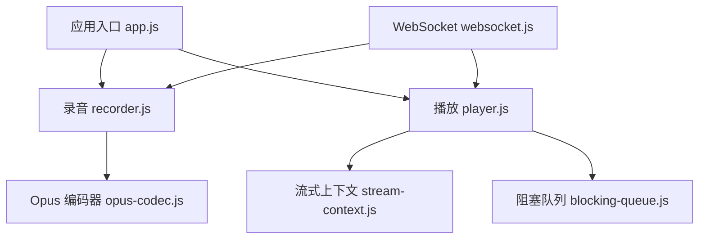
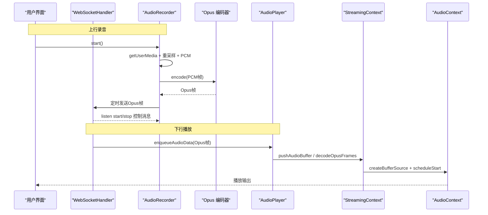
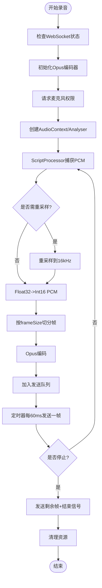
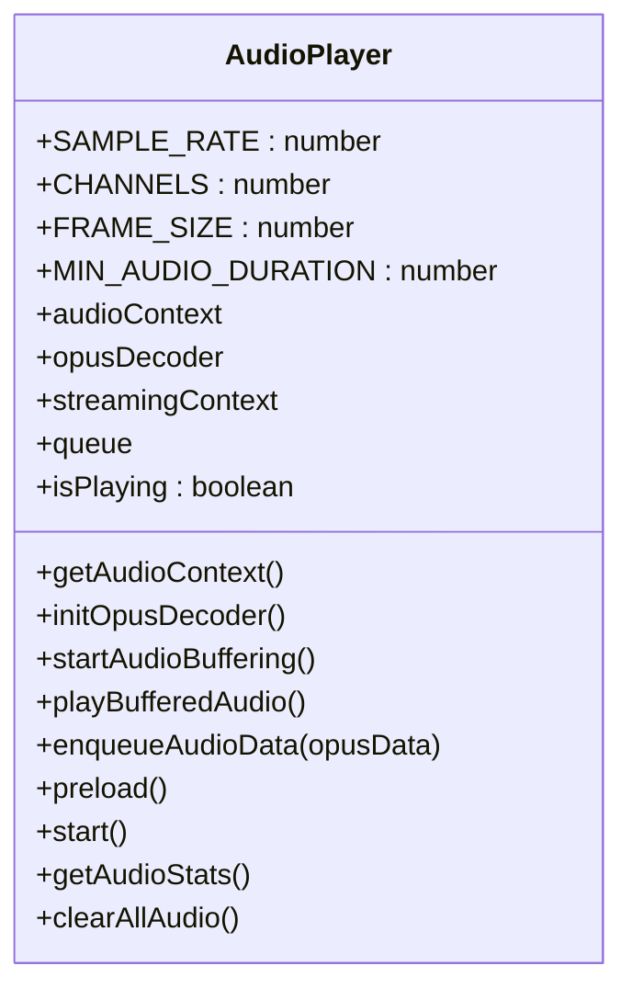
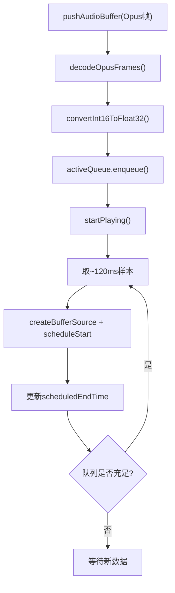
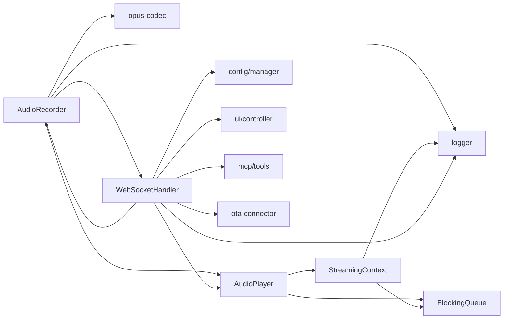

# 音频处理界面

<cite>
**本文引用的文件**   
- [recorder.js](file://public/chat/js/core/audio/recorder.js)
- [player.js](file://public/chat/js/core/audio/player.js)
- [opus-codec.js](file://public/chat/js/core/audio/opus-codec.js)
- [stream-context.js](file://public/chat/js/core/audio/stream-context.js)
- [blocking-queue.js](file://public/chat/js/utils/blocking-queue.js)
- [websocket.js](file://public/chat/js/core/network/websocket.js)
- [app.js](file://public/chat/js/app.js)
</cite>

## 目录
1. [简介](#简介)
2. [项目结构](#项目结构)
3. [核心组件](#核心组件)
4. [架构总览](#架构总览)
5. [详细组件分析](#详细组件分析)
6. [依赖关系分析](#依赖关系分析)
7. [性能与延迟优化](#性能与延迟优化)
8. [错误处理与排障](#错误处理与排障)
9. [扩展与调试指南](#扩展与调试指南)
10. [结论](#结论)

## 简介
本文件面向“音频处理界面”的前端实现，系统性说明录音、编码、传输、解码、缓冲与播放的完整链路，覆盖以下目标：
- 录音功能：麦克风权限获取、音频流捕获、采样率转换、PCM 到 Opus 编码、定时发送与结束信号。
- 播放功能：Opus 解码、缓冲管理、精确调度播放、播放控制与清空。
- 上下文与会话：AudioContext 生命周期、设备音频会话（移动端恢复）、WebSocket 消息路由。
- 质量与延迟：采样率、帧长、码率、复杂度、DTX、缓冲时长等配置项。
- 错误处理：权限拒绝、浏览器限制、解码失败、网络异常等。
- 扩展与调试：测试模式、统计报告、可视化、日志定位。

## 项目结构
前端音频相关代码集中在 public/chat/js 下，关键路径如下：
- 录音模块：core/audio/recorder.js
- 播放模块：core/audio/player.js
- Opus 编解码封装：core/audio/opus-codec.js
- 流式播放上下文：core/audio/stream-context.js
- 阻塞队列工具：utils/blocking-queue.js
- WebSocket 消息路由：core/network/websocket.js
- 应用入口与初始化：app.js

图表来源
- [app.js:32-63](file://public/chat/js/app.js#L32-L63)
- [recorder.js:7-45](file://public/chat/js/core/audio/recorder.js#L7-L45)
- [player.js:7-21](file://public/chat/js/core/audio/player.js#L7-L21)
- [stream-context.js:5-30](file://public/chat/js/core/audio/stream-context.js#L5-L30)
- [blocking-queue.js:1-103](file://public/chat/js/utils/blocking-queue.js#L1-L103)
- [websocket.js:11-21](file://public/chat/js/core/network/websocket.js#L11-L21)

章节来源
- [app.js:32-63](file://public/chat/js/app.js#L32-L63)

## 核心组件
- AudioRecorder：负责麦克风权限、媒体流捕获、重采样、PCM 转 Int16、Opus 编码、定时发送、录制统计与本地回放。
- AudioPlayer：负责 Opus 解码器初始化、音频包入队、流式上下文创建与启动、播放控制与缓冲清理。
- StreamingContext：负责待解码/待播放队列、Int16 到 Float32 转换、Web Audio 精确调度与可视化的 AnalyserNode。
- Opus 编解码封装：检查并加载 libopus，提供编码器/解码器对象及内存分配/释放。
- BlockingQueue：支持最小数量或超时唤醒的异步队列，用于解耦生产消费。
- WebSocketHandler：负责连接、握手、文本/二进制消息分发，将音频数据交给播放器，将录音数据交给录音器。
- App：统一初始化流程，包括权限请求、设备检测、UI 联动。

章节来源
- [recorder.js:7-45](file://public/chat/js/core/audio/recorder.js#L7-L45)
- [player.js:7-21](file://public/chat/js/core/audio/player.js#L7-L21)
- [stream-context.js:5-30](file://public/chat/js/core/audio/stream-context.js#L5-L30)
- [opus-codec.js:4-39](file://public/chat/js/core/audio/opus-codec.js#L4-L39)
- [blocking-queue.js:1-103](file://public/chat/js/utils/blocking-queue.js#L1-L103)
- [websocket.js:11-21](file://public/chat/js/core/network/websocket.js#L11-L21)
- [app.js:32-63](file://public/chat/js/app.js#L32-L63)

## 架构总览
整体数据流分为两条主线：上行录音与下行播放。

图表来源
- [recorder.js:59-274](file://public/chat/js/core/audio/recorder.js#L59-L274)
- [opus-codec.js:44-182](file://public/chat/js/core/audio/opus-codec.js#L44-L182)
- [websocket.js:334-354](file://public/chat/js/core/network/websocket.js#L334-L354)
- [player.js:170-271](file://public/chat/js/core/audio/player.js#L170-L271)
- [stream-context.js:120-215](file://public/chat/js/core/audio/stream-context.js#L120-L215)

## 详细组件分析

### 录音模块（AudioRecorder）
职责与流程
- 权限与设备：通过 navigator.mediaDevices.getUserMedia 请求麦克风权限，启用回声消除、降噪、单声道、16kHz 采样率。
- 音频流捕获：使用 AudioContext.createMediaStreamSource 接入媒体流，并通过 ScriptProcessorNode 回调获取 PCM 数据。
- 采样率与格式：若实际采样率非 16kHz，进行简单重采样；将 Float32 转为 Int16 PCM。
- 编码与发送：按 frameSize=960（60ms@16kHz）切分 PCM，调用 Opus 编码器生成帧，放入发送队列，定时器每 60ms 发送一帧。
- 控制消息：开始录音时发送 {type:'listen', state:'start'}，结束时发送 stop 与空帧作为结束信号。
- 可视化与分析：通过 AnalyserNode 提供频率数据，供 UI 可视化。
- 统计与测试：支持测试模式（不发送服务器），记录帧数、字节数、压缩比等统计信息，并提供 WAV 导出与本地回放。

关键参数
- sampleRate=16000，frameSize=960，frameDuration=60ms。
- 编码参数：码率 16kbps，复杂度 5，启用 DTX。

错误处理
- 未连接 WebSocket 时无法发送开始消息。
- 编码失败返回 null，跳过该帧。
- 停止时清理所有节点、轨道、定时器，确保无泄漏。

图表来源
- [recorder.js:59-274](file://public/chat/js/core/audio/recorder.js#L59-L274)
- [recorder.js:290-427](file://public/chat/js/core/audio/recorder.js#L290-L427)

章节来源
- [recorder.js:59-274](file://public/chat/js/core/audio/recorder.js#L59-L274)
- [recorder.js:290-427](file://public/chat/js/core/audio/recorder.js#L290-L427)
- [recorder.js:470-588](file://public/chat/js/core/audio/recorder.js#L470-L588)

### 播放模块（AudioPlayer）
职责与流程
- 解码器初始化：懒加载并初始化 Opus 解码器，分配内存、设置通道与采样率。
- 缓冲与队列：接收 Opus 帧入队，预取若干包后启动流式播放。
- 流式上下文：创建 StreamingContext，负责解码、缓冲、调度播放。
- 播放控制：start() 预加载解码器并启动缓冲与播放；enqueueAudioData() 入队；clearAllAudio() 清空缓冲并重置状态。

关键参数
- SAMPLE_RATE=16000，CHANNELS=1，FRAME_SIZE=960，MIN_AUDIO_DURATION=0.12s。

错误处理
- 解码器初始化失败时抛出错误并记录日志。
- 收到空帧视为结束标志，触发流结束。

图表来源
- [player.js:7-21](file://public/chat/js/core/audio/player.js#L7-L21)
- [player.js:23-53](file://public/chat/js/core/audio/player.js#L23-L53)
- [player.js:55-168](file://public/chat/js/core/audio/player.js#L55-L168)
- [player.js:170-307](file://public/chat/js/core/audio/player.js#L170-L307)

章节来源
- [player.js:23-53](file://public/chat/js/core/audio/player.js#L23-L53)
- [player.js:55-168](file://public/chat/js/core/audio/player.js#L55-L168)
- [player.js:170-307](file://public/chat/js/core/audio/player.js#L170-L307)

### 流式播放上下文（StreamingContext）
职责与流程
- 双队列模型：audioBufferQueue（待解码）与 activeQueue（已解码待播放），以及正在播放的 queue。
- 解码循环：从 pendingAudioBufferQueue 取出 Opus 帧，解码为 Int16，转换为 Float32，并入 activeQueue。
- 播放调度：每次取约 120ms 样本，创建 BufferSource，精确计算 startTime 并调度播放，更新 scheduledEndTime。
- 分析与可视化：暴露 AnalyserNode 给 Live2D 或其他可视化模块。

关键参数
- minAudioDuration 控制初始缓冲时长，默认 0.12s。

图表来源
- [stream-context.js:32-52](file://public/chat/js/core/audio/stream-context.js#L32-L52)
- [stream-context.js:54-62](file://public/chat/js/core/audio/stream-context.js#L54-L62)
- [stream-context.js:120-159](file://public/chat/js/core/audio/stream-context.js#L120-L159)
- [stream-context.js:161-215](file://public/chat/js/core/audio/stream-context.js#L161-L215)

章节来源
- [stream-context.js:32-52](file://public/chat/js/core/audio/stream-context.js#L32-L52)
- [stream-context.js:120-215](file://public/chat/js/core/audio/stream-context.js#L120-L215)

### Opus 编解码封装
职责
- checkOpusLoaded：检测全局 Module 或 Module.instance，确保 libopus 已加载。
- initOpusEncoder：创建编码器对象，设置采样率、通道、码率、复杂度、DTX，提供 encode 方法。
- 解码器由 AudioPlayer 内部直接调用底层函数，完成解码与内存管理。

关键点
- 编码器与解码器均通过 _malloc/_free 管理 WASM 内存。
- 编码失败或解码失败会记录错误日志并返回空结果。

章节来源
- [opus-codec.js:4-39](file://public/chat/js/core/audio/opus-codec.js#L4-L39)
- [opus-codec.js:44-182](file://public/chat/js/core/audio/opus-codec.js#L44-L182)
- [player.js:55-168](file://public/chat/js/core/audio/player.js#L55-L168)

### WebSocket 消息路由
职责
- 连接与握手：建立连接、发送 hello、处理 hello 响应。
- 文本消息：处理 connection_ack、hello、tts、stt、llm、mcp 等类型。
- 二进制消息：将收到的 Opus 帧交给 AudioPlayer.enqueueAudioData。
- 事件绑定：onopen/onclose/onerror/onmessage，并在断开/关闭时清理录音与摄像头。

章节来源
- [websocket.js:23-71](file://public/chat/js/core/network/websocket.js#L23-L71)
- [websocket.js:73-130](file://public/chat/js/core/network/websocket.js#L73-L130)
- [websocket.js:132-182](file://public/chat/js/core/network/websocket.js#L132-L182)
- [websocket.js:334-354](file://public/chat/js/core/network/websocket.js#L334-L354)
- [websocket.js:356-458](file://public/chat/js/core/network/websocket.js#L356-L458)

### 应用入口与初始化
职责
- 初始化顺序：UI 控制器、Opus 库检查与编码器初始化、播放器启动、MCP 工具、麦克风权限请求、可用性检查、Live2D 与摄像头初始化。
- 移动端提示：检测移动设备并显示权限提示。
- 摄像头能力：提供开关前后置摄像头、拍照、视觉分析接口调用等。

章节来源
- [app.js:32-63](file://public/chat/js/app.js#L32-L63)
- [app.js:69-97](file://public/chat/js/app.js#L69-L97)
- [app.js:102-116](file://public/chat/js/app.js#L102-L116)
- [app.js:157-178](file://public/chat/js/app.js#L157-L178)
- [app.js:186-415](file://public/chat/js/app.js#L186-L415)

## 依赖关系分析
- AudioRecorder 依赖：
  - logger：日志输出
  - opus-codec：检查与初始化编码器
  - player：复用 getAudioPlayer().getAudioContext()
  - network/websocket：动态导入以获取当前 WebSocketHandler 实例
- AudioPlayer 依赖：
  - blocking-queue：阻塞队列
  - logger：日志
  - stream-context：流式播放上下文
- StreamingContext 依赖：
  - blocking-queue：阻塞队列
  - logger：日志
- WebSocketHandler 依赖：
  - config/manager：配置读取
  - ui/controller：UI 状态更新
  - logger：日志
  - audio/player：播放器
  - audio/recorder：录音器
  - mcp/tools：MCP 工具执行
  - ota-connector：OTA 连接

图表来源
- [recorder.js:1-4](file://public/chat/js/core/audio/recorder.js#L1-L4)
- [player.js:1-4](file://public/chat/js/core/audio/player.js#L1-L4)
- [stream-context.js:1-3](file://public/chat/js/core/audio/stream-context.js#L1-L3)
- [websocket.js:1-9](file://public/chat/js/core/network/websocket.js#L1-L9)

章节来源
- [recorder.js:1-4](file://public/chat/js/core/audio/recorder.js#L1-L4)
- [player.js:1-4](file://public/chat/js/core/audio/player.js#L1-L4)
- [stream-context.js:1-3](file://public/chat/js/core/audio/stream-context.js#L1-L3)
- [websocket.js:1-9](file://public/chat/js/core/network/websocket.js#L1-L9)

## 性能与延迟优化
- 采样率与帧长
  - 统一 16kHz、单声道，frameSize=960（60ms），保证与后端一致，减少重采样开销。
- 编码参数
  - 码率 16kbps，复杂度 5，启用 DTX（静音不传），降低带宽与 CPU。
- 缓冲策略
  - 播放初始缓冲 0.12s，每次播放 120ms 块，平衡首开延迟与稳定性。
- 队列与调度
  - BlockingQueue 支持最小数量或超时唤醒，避免长时间阻塞；Web Audio 精确调度 startTime，减少抖动。
- 移动端兼容
  - iOS Safari 需要用户交互恢复 AudioContext，已在播放器与录音器中处理。

建议
- 在网络不稳定时适当增大 MIN_AUDIO_DURATION 以提升稳定性。
- 在低性能设备上可降低复杂度或码率，但会影响音质。
- 监控 getAudioStats 中的 pendingDecode/pendingPlay，评估缓冲压力。

[本节为通用指导，不直接分析具体文件]

## 错误处理与排障
常见问题与对策
- 麦克风权限被拒绝
  - 现象：getUserMedia 抛出 NotAllowedError。
  - 处理：App 层捕获并记录日志，UI 更新不可用状态；在非 HTTPS 且非 localhost 环境下浏览器可能禁止访问。
- 浏览器不支持 getUserMedia
  - 现象：navigator.mediaDevices 不存在。
  - 处理：记录警告并降级 UI。
- Opus 库未加载
  - 现象：Module 或 Module.instance 不存在。
  - 处理：checkOpusLoaded 抛出错误并记录日志；播放器/录音器初始化失败。
- 解码失败
  - 现象：_opus_decode 返回负值。
  - 处理：记录错误日志，返回空 PCM，不影响后续播放。
- WebSocket 断开
  - 现象：onclose 触发。
  - 处理：停止录音、关闭摄像头、隐藏摄像头区域。
- 发送失败
  - 现象：send 抛出异常。
  - 处理：记录错误日志，继续处理其他帧。

定位方法
- 查看控制台日志，关注“录音启动错误”“Opus 解码错误”“WebSocket错误”等关键字。
- 使用录音器的 getFormattedStats 查看压缩比、帧大小分布、每秒帧数。
- 使用播放器的 getAudioStats 查看待解码/待播放包数，判断是否缓冲不足。

章节来源
- [app.js:69-97](file://public/chat/js/app.js#L69-L97)
- [app.js:157-178](file://public/chat/js/app.js#L157-L178)
- [recorder.js:270-274](file://public/chat/js/core/audio/recorder.js#L270-L274)
- [recorder.js:423-427](file://public/chat/js/core/audio/recorder.js#L423-L427)
- [opus-codec.js:35-38](file://public/chat/js/core/audio/opus-codec.js#L35-L38)
- [player.js:163-167](file://public/chat/js/core/audio/player.js#L163-L167)
- [websocket.js:414-458](file://public/chat/js/core/network/websocket.js#L414-L458)

## 扩展与调试指南
扩展点
- 自定义编码器/解码器
  - 替换 opus-codec.js 中的初始化逻辑，或注入新的 ModuleInstance。
- 调整缓冲与延迟
  - 修改 AudioPlayer.MIN_AUDIO_DURATION 与 StreamingContext 的 playDuration。
- 新增可视化
  - 使用 StreamingContext.getAnalyser() 或 Recorder.getAnalyser() 接入频谱/波形展示。
- 自定义统计
  - 扩展 getFormattedStats 或 getAudioStats，增加丢包率、抖动等指标。

调试方法
- 开启录音器测试模式：setTestMode(true)，仅本地收集 PCM/Opus，便于离线验证。
- 导出录音：downloadRecording('recording.wav') 下载 WAV 文件，便于离线分析。
- 查看统计：getFormattedStats 与 getAudioStats，观察帧大小、压缩比、缓冲压力。
- 日志级别：通过 logger 统一输出，结合浏览器控制台过滤关键词。

章节来源
- [recorder.js:439-468](file://public/chat/js/core/audio/recorder.js#L439-L468)
- [recorder.js:508-588](file://public/chat/js/core/audio/recorder.js#L508-L588)
- [player.js:273-307](file://public/chat/js/core/audio/player.js#L273-L307)
- [stream-context.js:115-118](file://public/chat/js/core/audio/stream-context.js#L115-L118)

## 结论
本音频处理界面以 Web Audio API 为核心，结合 Opus 编解码与 WebSocket 实时通信，实现了低延迟、高稳定性的语音交互链路。通过合理的采样率与帧长、精细的缓冲与调度策略、完善的错误处理与调试手段，能够在多平台与多网络条件下提供一致的体验。未来可进一步引入自适应码率、丢包恢复、更复杂的重采样算法与更丰富的可视化能力，以满足更高品质的语音交互需求。