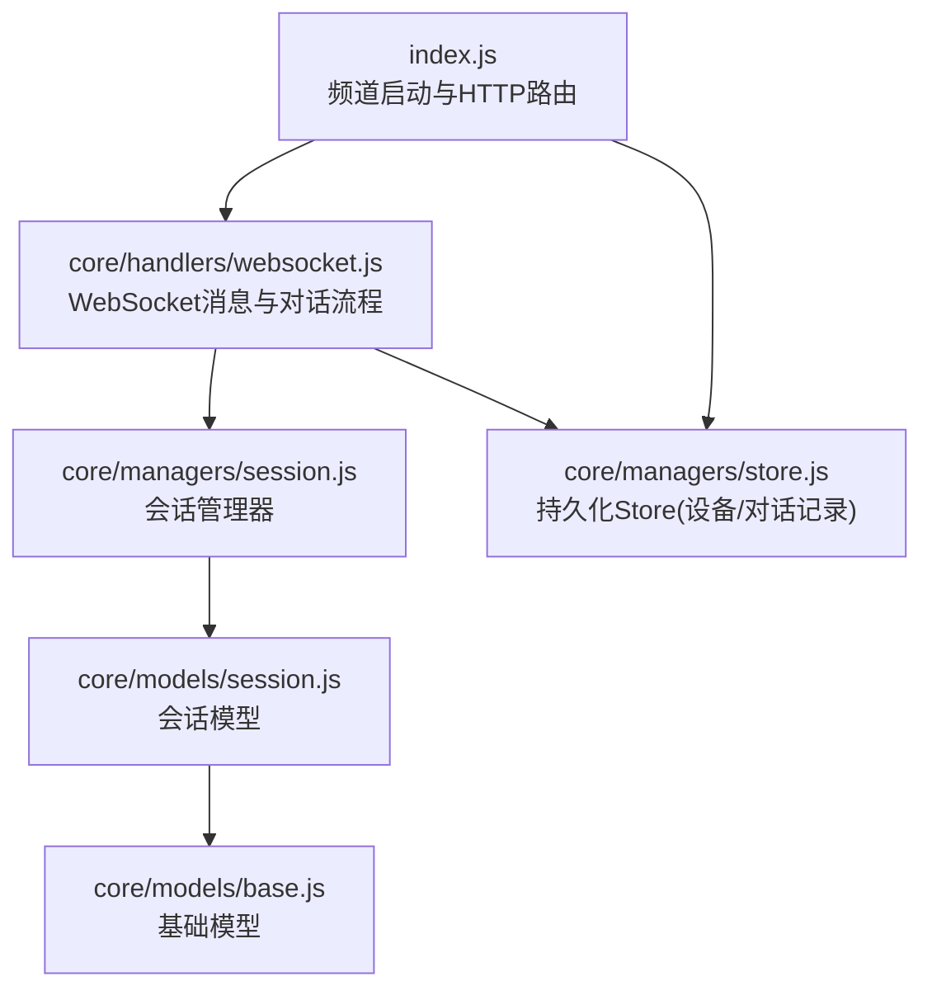
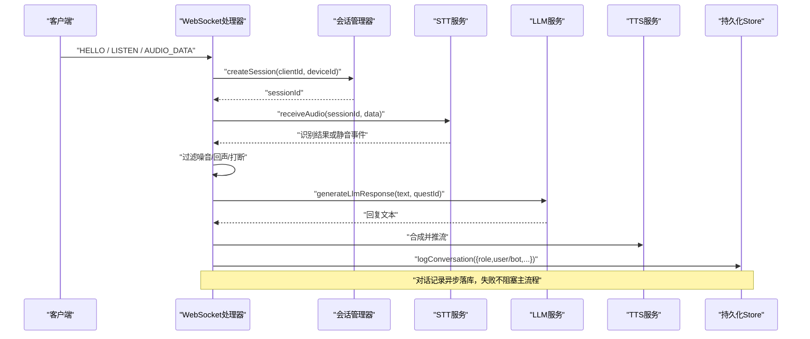
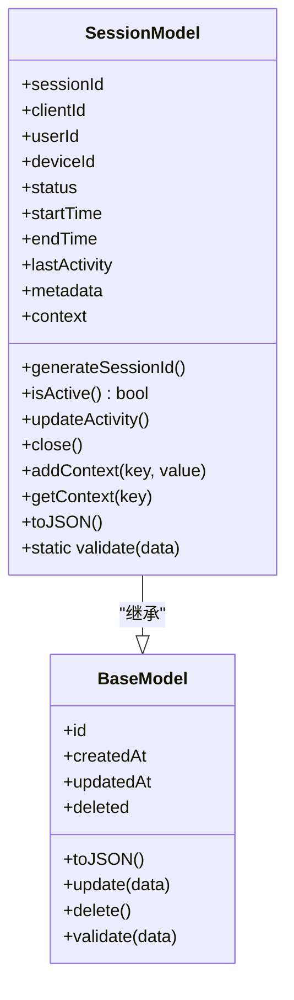
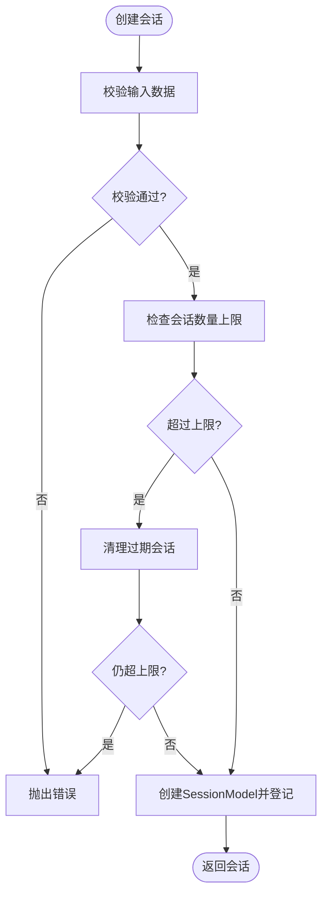
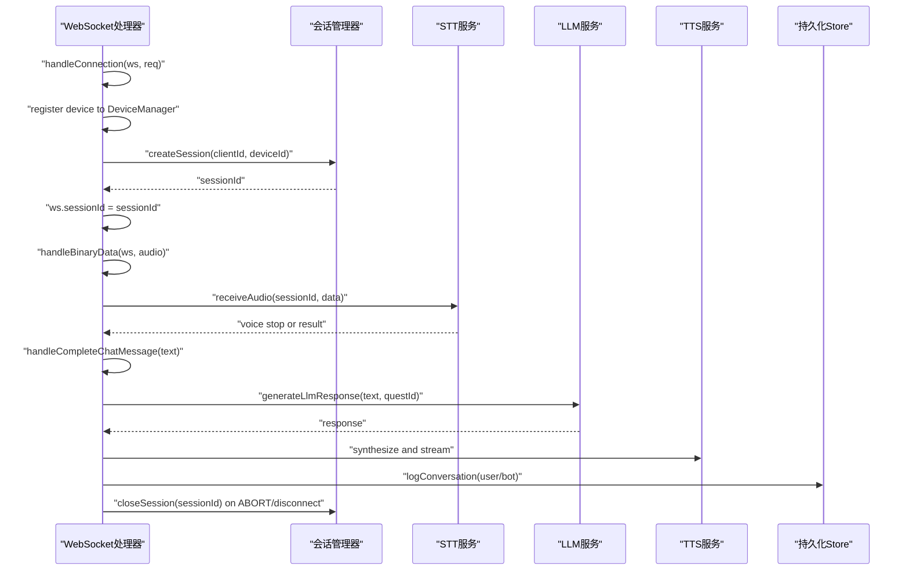
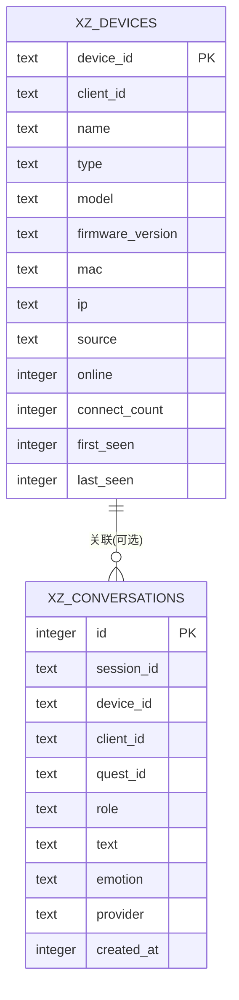
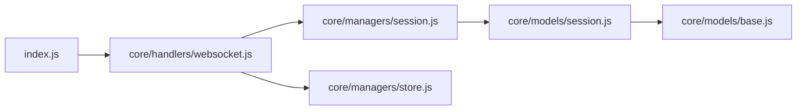

# 会话管理系统

<cite>
**本文引用的文件**   
- [core/managers/session.js](file://core/managers/session.js)
- [core/models/session.js](file://core/models/session.js)
- [core/models/base.js](file://core/models/base.js)
- [core/handlers/websocket.js](file://core/handlers/websocket.js)
- [index.js](file://index.js)
- [core/managers/store.js](file://core/managers/store.js)
</cite>

## 目录
1. [引言](#引言)
2. [项目结构](#项目结构)
3. [核心组件](#核心组件)
4. [架构总览](#架构总览)
5. [详细组件分析](#详细组件分析)
6. [依赖关系分析](#依赖关系分析)
7. [性能与内存管理](#性能与内存管理)
8. [API 与使用示例](#api-与使用示例)
9. [多设备并发与会话同步](#多设备并发与会话同步)
10. [故障排查](#故障排查)
11. [结论](#结论)

## 引言
本文件面向“小智”语音交互系统的会话管理能力，系统性说明以下主题：
- 会话状态维护、对话历史管理与上下文保持机制
- 会话生命周期、内存管理与持久化策略
- 会话数据模型定义、查询接口与性能优化方案
- 会话管理的 API 使用示例与最佳实践
- 多设备并发会话处理与会话数据同步建议

该文档严格基于仓库源码进行分析与归纳，不引入未实现的能力。

## 项目结构
与“会话管理”直接相关的代码主要分布在以下模块：
- 会话管理器：负责会话的创建、查找、关闭、清理与统计
- 会话模型：定义会话数据结构、状态与上下文
- WebSocket 处理器：在连接、握手、音频流与聊天流程中驱动会话生命周期
- 应用入口：初始化服务、暴露会话相关 HTTP API
- 持久化存储：记录设备注册信息与对话历史（非实时会话状态）

图示来源
- [index.js:180-249](file://index.js#L180-L249)
- [core/handlers/websocket.js:22-60](file://core/handlers/websocket.js#L22-L60)
- [core/managers/session.js:4-10](file://core/managers/session.js#L4-L10)
- [core/models/session.js:3-16](file://core/models/session.js#L3-L16)
- [core/models/base.js:2-8](file://core/models/base.js#L2-L8)
- [core/managers/store.js:29-83](file://core/managers/store.js#L29-L83)

章节来源
- [index.js:180-249](file://index.js#L180-L249)
- [core/handlers/websocket.js:22-60](file://core/handlers/websocket.js#L22-L60)

## 核心组件
- 会话管理器 SessionManager
  - 职责：会话创建、获取、关闭、上下文读写、过期清理、统计与批量关闭
  - 关键能力：按客户端映射会话、活动超时判定、最大会话数限制
- 会话模型 SessionModel
  - 职责：会话字段定义、状态判断、活动时间更新、上下文存取、数据校验
- WebSocket 处理器
  - 职责：连接建立、握手、音频流处理、识别触发、完整聊天消息处理；在合适时机创建/关闭会话
- 持久化 Store XiaozhiStore
  - 职责：设备注册表与对话记录的 SQLite 持久化；写入失败降级为 no-op，不影响主流程
- 基础模型 BaseModel
  - 职责：通用 id、时间戳、软删除等基础能力

章节来源
- [core/managers/session.js:4-10](file://core/managers/session.js#L4-L10)
- [core/models/session.js:3-16](file://core/models/session.js#L3-L16)
- [core/handlers/websocket.js:22-60](file://core/handlers/websocket.js#L22-L60)
- [core/managers/store.js:29-83](file://core/managers/store.js#L29-L83)
- [core/models/base.js:2-8](file://core/models/base.js#L2-L8)

## 架构总览
下图展示从客户端连接到对话轮次处理的端到端流程，以及会话在其中的作用点。

图示来源
- [core/handlers/websocket.js:493-503](file://core/handlers/websocket.js#L493-L503)
- [core/handlers/websocket.js:350-371](file://core/handlers/websocket.js#L350-L371)
- [core/handlers/websocket.js:651-694](file://core/handlers/websocket.js#L651-L694)
- [core/managers/session.js:12-45](file://core/managers/session.js#L12-L45)
- [core/managers/store.js:158-175](file://core/managers/store.js#L158-L175)

## 详细组件分析

### 会话模型 SessionModel
- 字段与行为
  - sessionId/clientId/deviceId/status/startTime/endTime/lastActivity/metadata/context
  - isActive()：状态为 active 且 lastActivity 在 5 分钟内
  - updateActivity()/close()：更新时间戳与结束时间
  - addContext()/getContext()：键值型上下文存取
  - validate(data)：校验 clientId 必填与 status 枚举
- 复杂度
  - 上下文存取 O(1)
  - 活跃判定 O(1)
- 设计要点
  - 通过 BaseModel 继承统一 id/时间戳/软删除能力
  - 会话状态机简单清晰：active/inactive/closed

图示来源
- [core/models/base.js:2-40](file://core/models/base.js#L2-L40)
- [core/models/session.js:3-79](file://core/models/session.js#L3-L79)

章节来源
- [core/models/session.js:3-79](file://core/models/session.js#L3-L79)
- [core/models/base.js:2-40](file://core/models/base.js#L2-L40)

### 会话管理器 SessionManager
- 内存结构
  - sessions: Map<sessionId, SessionModel>
  - clientSessions: Map<clientId, sessionId[]>
  - maxSessions: 最大会话数上限
  - sessionTimeout: 会话超时阈值（默认 5 分钟）
- 核心方法
  - createSession(sessionData)：校验→容量检查→创建→登记到 clients 映射
  - getSession(sessionId)：返回活跃会话并更新时间
  - getClientSessions(clientId)：返回客户端所有活跃会话
  - getActiveSessions()：返回全部活跃会话
  - closeSession(sessionId)：关闭并从客户端映射移除
  - addContext/getContext：上下文读写
  - cleanupSessions/cleanupClientSessions：按超时清理
  - getStats：统计总数、活跃数、客户端数、上限
  - batchCloseSessionIds：批量关闭并汇总成功/失败计数
- 复杂度
  - 创建/查找/关闭均为 O(1)
  - 清理遍历 sessions，O(n)
- 并发与一致性
  - 单进程内 Map 操作无锁；跨进程需外部协调（见后文“多设备并发与会话同步”）

图示来源
- [core/managers/session.js:12-45](file://core/managers/session.js#L12-L45)

章节来源
- [core/managers/session.js:12-187](file://core/managers/session.js#L12-L187)

### WebSocket 处理器中的会话生命周期
- 连接建立
  - 解析 clientId/deviceId/ip 等元信息，注册设备
  - HELLO 握手时创建会话，并将 sessionId 绑定到 ws
- 音频流与识别
  - 若无会话则自动创建
  - VAD 检测与静默阈值控制，触发 STT 识别
- 完整聊天消息
  - 过滤噪音与回声，串行化处理每轮对话
  - 调用 LLM 生成回复，TTS 合成并推流
  - 记录 user/bot 对话到持久化 Store
- 断开与中止
  - 连接断开时标记设备离线
  - ABORT 时关闭当前会话并清理相关资源

图示来源
- [core/handlers/websocket.js:67-169](file://core/handlers/websocket.js#L67-L169)
- [core/handlers/websocket.js:493-503](file://core/handlers/websocket.js#L493-L503)
- [core/handlers/websocket.js:350-371](file://core/handlers/websocket.js#L350-L371)
- [core/handlers/websocket.js:651-694](file://core/handlers/websocket.js#L651-L694)
- [core/handlers/websocket.js:592-608](file://core/handlers/websocket.js#L592-L608)

章节来源
- [core/handlers/websocket.js:67-169](file://core/handlers/websocket.js#L67-L169)
- [core/handlers/websocket.js:493-503](file://core/handlers/websocket.js#L493-L503)
- [core/handlers/websocket.js:350-371](file://core/handlers/websocket.js#L350-L371)
- [core/handlers/websocket.js:651-694](file://core/handlers/websocket.js#L651-L694)
- [core/handlers/websocket.js:592-608](file://core/handlers/websocket.js#L592-L608)

### 持久化策略：设备与对话记录
- 存储后端
  - SQLite（better-sqlite3），WAL 模式，独立数据库文件
  - 表：xz_devices（设备注册表）、xz_conversations（对话记录）
- 写入策略
  - 所有写操作捕获异常并降级为 no-op，确保语音主流程不受影响
  - 设备上线/离线、OTA 上报、WebSocket 接入均会登记设备
  - 对话记录在用户输入与机器人回复后异步落库
- 查询与统计
  - listDevices/listConversations：分页查询，支持按设备/角色过滤
  - getStats：在线设备数、总对话数、今日对话数

图示来源
- [core/managers/store.js:44-75](file://core/managers/store.js#L44-L75)

章节来源
- [core/managers/store.js:29-83](file://core/managers/store.js#L29-L83)
- [core/managers/store.js:85-150](file://core/managers/store.js#L85-L150)
- [core/managers/store.js:152-202](file://core/managers/store.js#L152-L202)
- [core/managers/store.js:204-233](file://core/managers/store.js#L204-L233)

## 依赖关系分析
- 组件耦合
  - WebSocket 处理器依赖 SessionManager 进行会话生命周期管理
  - SessionManager 依赖 SessionModel 进行数据建模与校验
  - WebSocket 处理器依赖 Store 进行对话记录持久化
  - 应用入口 index.js 装配所有服务并暴露 HTTP API
- 外部依赖
  - better-sqlite3：SQLite 本地存储
  - express/ws：HTTP 与 WebSocket 通信
- 循环依赖
  - 未发现明显循环依赖；模块间单向依赖清晰

图示来源
- [index.js:180-249](file://index.js#L180-L249)
- [core/handlers/websocket.js:22-60](file://core/handlers/websocket.js#L22-L60)
- [core/managers/session.js:4-10](file://core/managers/session.js#L4-L10)
- [core/models/session.js:3-16](file://core/models/session.js#L3-L16)
- [core/models/base.js:2-8](file://core/models/base.js#L2-L8)
- [core/managers/store.js:29-83](file://core/managers/store.js#L29-L83)

章节来源
- [index.js:180-249](file://index.js#L180-L249)
- [core/handlers/websocket.js:22-60](file://core/handlers/websocket.js#L22-L60)

## 性能与内存管理
- 内存占用
  - SessionManager 使用两个 Map 维护会话与客户端映射，空间复杂度 O(n)
  - 会话上下文 context 为对象键值对，单次存取 O(1)
- 超时与清理
  - 会话活跃度由 lastActivity 与 isActive() 判定，默认 5 分钟超时
  - cleanupSessions 定期扫描并关闭过期会话，避免内存泄漏
- 容量控制
  - maxSessions 限制最大会话数，达到上限时先尝试清理过期会话
- 并发与串行化
  - 同一连接的对话轮次通过 turnChain 串行化，避免音频帧交错
  - 轮次超时保护防止单轮挂死导致后续请求永久排队
- 持久化 I/O
  - Store 写入失败降级为 no-op，避免阻塞主流程
  - SQLite WAL 提升并发读性能

章节来源
- [core/managers/session.js:117-154](file://core/managers/session.js#L117-L154)
- [core/handlers/websocket.js:677-694](file://core/handlers/websocket.js#L677-L694)
- [core/managers/store.js:77-83](file://core/managers/store.js#L77-L83)

## API 与使用示例
本节列出与“会话管理”直接相关的 HTTP API，并提供使用建议。

- GET /health
  - 用途：健康检查，包含 channel、devices、uptime
  - 响应：包含状态与服务信息
- GET /api/sessions
  - 用途：获取当前会话集合（来自 SessionManager.sessions）
  - 注意：返回的是内部 Map 序列化后的对象集合
- GET /api/devices
  - 用途：获取在线设备列表
- GET /api/devices/known
  - 用途：获取已知设备（含离线），分页
- GET /api/devices/stats
  - 用途：在线设备与已注册设备统计
- GET /api/conversations
  - 用途：查询对话记录，支持按 deviceId/role 过滤，分页
- POST /api/broadcast
  - 用途：向设备推送语音广播（与会话无关，但涉及设备在线状态）
- GET /api/websocket/urls
  - 用途：获取 WebSocket 连接地址（ws/wss）

使用建议
- 监控会话规模：通过 /api/sessions 与 SessionManager.getStats() 结合观察
- 审计对话历史：通过 /api/conversations 拉取 user/bot 对话，前端自行反转时间顺序
- 设备管理：结合 /api/devices 与 /api/devices/known 区分在线与历史设备

章节来源
- [index.js:287-443](file://index.js#L287-L443)
- [core/managers/session.js:156-167](file://core/managers/session.js#L156-L167)

## 多设备并发与会话同步
- 现状
  - 会话状态保存在进程内 Map，不具备跨进程共享能力
  - 对话记录通过 Store 持久化，可用于跨进程/重启后的历史回溯
- 多设备并发
  - 同一设备的多个连接可各自拥有独立会话（clientSessions 映射）
  - 同一连接上的对话轮次串行化，避免音频流冲突
- 会话数据同步建议
  - 若需要跨进程共享会话状态，可在 SessionManager 之上增加分布式缓存层（如 Redis），将 sessionId → SessionModel 序列化后缓存
  - 对于“上下文保持”，可将关键上下文字段（如用户偏好、最近意图）纳入持久化 Store 的扩展字段，以便跨进程恢复
  - 对于“对话历史”，当前已实现 logConversation，可直接用于跨进程展示与回放

[本节为概念性建议，不直接分析具体文件]

## 故障排查
- 会话无法创建
  - 检查 SessionModel.validate 是否通过（clientId 必填、status 合法）
  - 检查是否达到 maxSessions 上限，必要时调整阈值或等待清理
- 会话过早关闭
  - 检查 lastActivity 更新频率，确认业务逻辑是否频繁访问会话以刷新活动时间
  - 检查 sessionTimeout 配置是否过短
- 对话记录缺失
  - 检查 Store 初始化是否成功（WAL 模式、数据库路径权限）
  - 查看日志中是否有“对话记录写入失败（忽略）”警告
- 音频流异常
  - 检查 VAD 阈值与静默阈值配置
  - 关注“连续语音超过阈值强制触发识别”的日志，确认是否被误判

章节来源
- [core/models/session.js:63-79](file://core/models/session.js#L63-L79)
- [core/managers/session.js:117-154](file://core/managers/session.js#L117-L154)
- [core/managers/store.js:77-83](file://core/managers/store.js#L77-L83)
- [core/handlers/websocket.js:373-446](file://core/handlers/websocket.js#L373-L446)

## 结论
本项目的会话管理系统以 SessionManager 为核心，配合 SessionModel 完成会话状态与上下文管理，并在 WebSocket 处理器中贯穿连接、音频流与对话轮次的生命周期。持久化层 Store 提供设备注册与对话记录能力，保证主流程的高可用与容错。针对多设备并发与跨进程同步，当前实现聚焦于单进程内存态会话与异步持久化历史；如需跨进程共享会话状态，可在现有基础上扩展分布式缓存与上下文持久化策略。