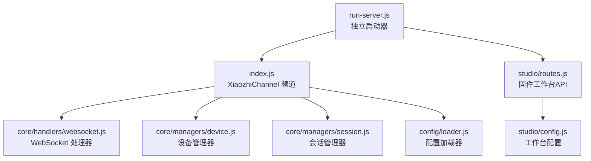
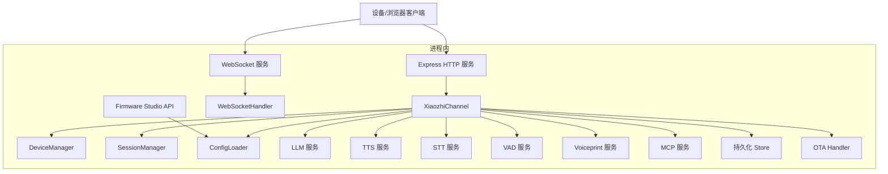
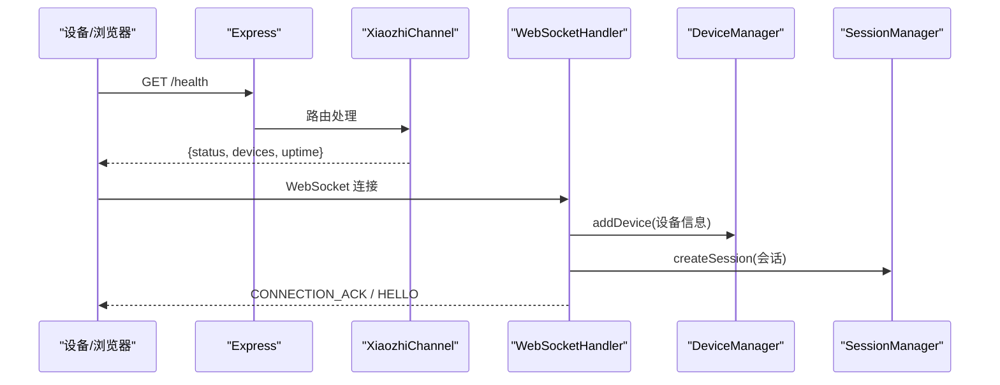
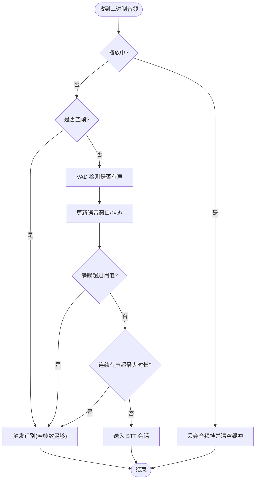
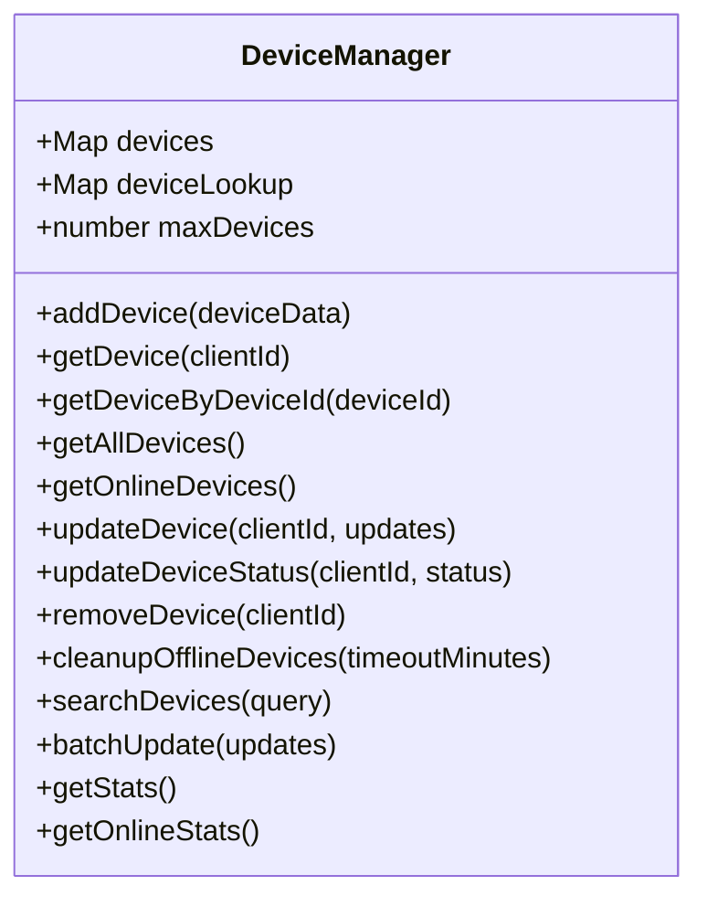
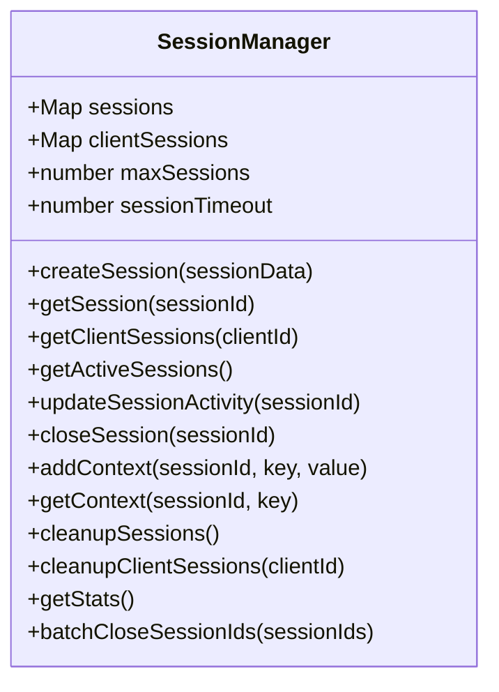
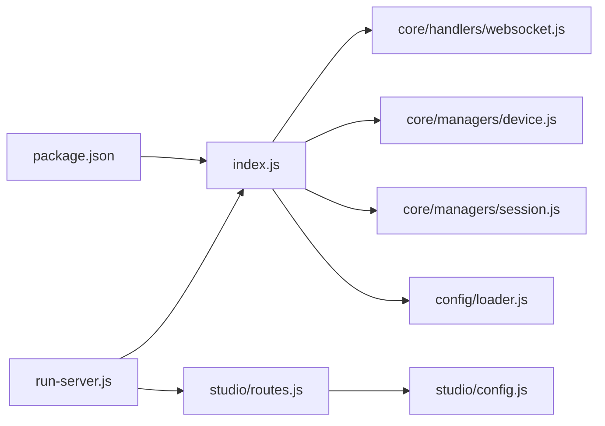

# 开发者指南

<cite>
**本文引用的文件**   
- [package.json](file://package.json)
- [index.js](file://index.js)
- [run-server.js](file://run-server.js)
- [config/loader.js](file://config/loader.js)
- [core/handlers/websocket.js](file://core/handlers/websocket.js)
- [core/managers/device.js](file://core/managers/device.js)
- [core/managers/session.js](file://core/managers/session.js)
- [studio/config.js](file://studio/config.js)
- [studio/routes.js](file://studio/routes.js)
</cite>

## 目录
1. [引言](#引言)
2. [项目结构](#项目结构)
3. [核心组件](#核心组件)
4. [架构总览](#架构总览)
5. [详细组件分析](#详细组件分析)
6. [依赖关系分析](#依赖关系分析)
7. [性能与稳定性](#性能与稳定性)
8. [开发环境与代码规范](#开发环境与代码规范)
9. [测试策略](#测试策略)
10. [Git 工作流与代码审查](#git-工作流与代码审查)
11. [新功能开发流程与最佳实践](#新功能开发流程与最佳实践)
12. [发布与版本管理](#发布与版本管理)
13. [故障排查](#故障排查)
14. [社区贡献指南](#社区贡献指南)
15. [结论](#结论)

## 引言
本指南面向希望参与小智语音交互服务器（xiaozhi-server）开发的贡献者。文档从系统架构、核心模块、数据流、错误处理、性能特征出发，逐步深入到代码级实现；同时给出开发环境搭建、代码规范、测试策略、Git 工作流、代码审查标准、文档编写规范、新功能开发流程、社区贡献与版本发布的完整说明。目标是让不同背景的开发者都能快速上手并高质量地参与项目。

## 项目结构
项目采用“频道 + 服务 + 管理器 + 处理器”的分层组织方式：
- 入口与运行脚本：独立启动器与频道主类
- 配置加载：统一读取 config.json 与环境变量覆盖
- WebSocket 协议处理：连接、消息路由、音频流、会话与设备状态
- 管理器：设备与会话生命周期
- 服务：LLM、TTS、STT、VAD、Voiceprint、MCP 等能力
- Studio：固件工作台（构建/刷写/OTA），与主服务共享端口

图表来源
- [run-server.js:25-55](file://run-server.js#L25-L55)
- [index.js:44-125](file://index.js#L44-L125)
- [core/handlers/websocket.js:22-60](file://core/handlers/websocket.js#L22-L60)
- [core/managers/device.js:4-10](file://core/managers/device.js#L4-L10)
- [core/managers/session.js:4-10](file://core/managers/session.js#L4-L10)
- [config/loader.js:13-44](file://config/loader.js#L13-L44)
- [studio/routes.js:29-67](file://studio/routes.js#L29-L67)
- [studio/config.js:29-46](file://studio/config.js#L29-L46)

章节来源
- [package.json:1-29](file://package.json#L1-L29)
- [run-server.js:1-75](file://run-server.js#L1-L75)
- [index.js:1-706](file://index.js#L1-L706)

## 核心组件
- XiaozhiChannel（频道）
  - 负责初始化服务、注册 Express/HTTP/WebSocket、暴露 REST API、管理与外部总线集成。
  - 关键职责：服务装配、路由定义、健康检查、设置热更新、广播、OTA、设备/会话统计。
- WebSocketHandler（协议处理器）
  - 负责连接建立、心跳、消息分发、音频流处理、VAD 静默检测、STT/TTS/LLM 协作、回声抑制、轮次串行化与超时保护。
- DeviceManager（设备管理器）
  - 维护在线设备 Map、设备查找表、增删改查、离线清理、统计与搜索。
- SessionManager（会话管理器）
  - 维护会话 Map、客户端会话映射、创建/关闭/查询、过期清理、上下文存取。
- ConfigLoader（配置加载器）
  - 单例加载 config.json，应用环境变量覆盖，提供便捷 getter 与校验。
- Studio Router（固件工作台）
  - 提供构建、刷写、同步、设备探测、环境探测等 API，通过 SSE 推送日志。

章节来源
- [index.js:44-125](file://index.js#L44-L125)
- [core/handlers/websocket.js:22-60](file://core/handlers/websocket.js#L22-L60)
- [core/managers/device.js:4-10](file://core/managers/device.js#L4-L10)
- [core/managers/session.js:4-10](file://core/managers/session.js#L4-L10)
- [config/loader.js:13-44](file://config/loader.js#L13-L44)
- [studio/routes.js:29-67](file://studio/routes.js#L29-L67)

## 架构总览
整体为“Express + WebSocket + 多服务”的单体架构，支持 OTA 升级与固件工作台。

图表来源
- [index.js:254-488](file://index.js#L254-L488)
- [core/handlers/websocket.js:22-60](file://core/handlers/websocket.js#L22-L60)
- [studio/routes.js:29-67](file://studio/routes.js#L29-L67)

## 详细组件分析

### XiaozhiChannel（频道）
- 启动流程
  - 初始化服务（会话/设备/OTA/Store/LLM/TTS/STT/VAD/Voiceprint/MCP）
  - 初始化 WebSocket 处理器
  - 创建 Express/HTTP/WebSocket 服务
  - 启动监听并注册到消息总线（standalone 为空实现）
- 停止流程
  - 注销总线、关闭 WebSocket、关闭 HTTP、清理服务资源
- 关键 API
  - /health：健康检查
  - /api/settings/audio：读取/热更新音频阈值并持久化
  - /api/disconnect：断开指定设备
  - /api/devices、/api/devices/known、/api/devices/stats：设备列表与统计
  - /api/conversations：对话记录查询
  - /api/sessions：会话列表
  - /api/broadcast：语音放送
  - /api/websocket/urls：WS/WSS 地址信息
  - /xiaozhi/ota/*：OTA 获取/POST/下载
- 错误处理
  - 启动失败抛出异常；停止过程捕获异常并输出日志；服务清理对可选方法做安全判断

图表来源
- [index.js:287-488](file://index.js#L287-L488)
- [core/handlers/websocket.js:67-169](file://core/handlers/websocket.js#L67-L169)

章节来源
- [index.js:86-125](file://index.js#L86-L125)
- [index.js:130-165](file://index.js#L130-L165)
- [index.js:254-488](file://index.js#L254-L488)

### WebSocketHandler（协议处理器）
- 连接管理
  - 解析 client-id/device-id/client_type/timestamp
  - 注册设备、登记持久化设备表、设置心跳
- 消息处理
  - JSON 消息按类型分发（HELLO/LISTEN/ABORT/IOT/CHAT/MCP/AUDIO_DATA/WAKE_WORD_DETECTED/FRIEND）
  - 二进制数据走音频路径
- 音频流与 VAD
  - 空帧触发识别；VAD 窗口判定说话/静默；静默阈值可配置；最长语音兜底强制触发识别
  - 播放期间静音麦克风输入，避免回声干扰
- 对话轮次
  - 噪声/语气词过滤、回声判定、轮次序号与串行队列、超时保护
  - 调用 LLM -> TTS 流式播放，支持打断与轮次归属

图表来源
- [core/handlers/websocket.js:289-446](file://core/handlers/websocket.js#L289-L446)

章节来源
- [core/handlers/websocket.js:67-169](file://core/handlers/websocket.js#L67-L169)
- [core/handlers/websocket.js:228-283](file://core/handlers/websocket.js#L228-L283)
- [core/handlers/websocket.js:289-446](file://core/handlers/websocket.js#L289-L446)
- [core/handlers/websocket.js:651-694](file://core/handlers/websocket.js#L651-L694)

### DeviceManager（设备管理器）
- 数据结构
  - devices: Map<clientId, DeviceModel>
  - deviceLookup: Map<deviceId, clientId>
- 主要操作
  - addDevice/getDevice/getDeviceByDeviceId/getAllDevices/getOnlineDevices
  - updateDevice/updateDeviceStatus/removeDevice
  - cleanupOfflineDevices/searchDevices/batchUpdate/getStats/getOnlineStats
- 复杂度
  - 增删查均为 O(1)，统计/搜索为 O(n)

图表来源
- [core/managers/device.js:4-199](file://core/managers/device.js#L4-L199)

章节来源
- [core/managers/device.js:4-199](file://core/managers/device.js#L4-L199)

### SessionManager（会话管理器）
- 数据结构
  - sessions: Map<sessionId, SessionModel>
  - clientSessions: Map<clientId, sessionId[]>
- 主要操作
  - createSession/getSession/getClientSessions/getActiveSessions
  - updateSessionActivity/closeSession/addContext/getContext
  - cleanupSessions/cleanupClientSessions/getStats/batchCloseSessionIds
- 复杂度
  - 增删查均为 O(1)，批量操作为 O(k)

图表来源
- [core/managers/session.js:4-187](file://core/managers/session.js#L4-L187)

章节来源
- [core/managers/session.js:4-187](file://core/managers/session.js#L4-L187)

### ConfigLoader（配置加载器）
- 功能
  - 加载 config.json，应用环境变量覆盖（端口/主机/STT/TTS/FunASR）
  - 提供便捷 getter：server/stt/tts/funasr/llm/channelInfo
  - 校验必填字段并抛出错误
  - 支持运行时 reload
- 关键点
  - 单例模式，避免重复 IO
  - 环境变量优先级高于配置文件

章节来源
- [config/loader.js:13-44](file://config/loader.js#L13-L44)
- [config/loader.js:49-74](file://config/loader.js#L49-L74)
- [config/loader.js:79-166](file://config/loader.js#L79-L166)
- [config/loader.js:171-209](file://config/loader.js#L171-L209)
- [config/loader.js:213-225](file://config/loader.js#L213-L225)

### Studio（固件工作台）
- 配置
  - 从 config.json 的 firmware 段派生仓库、工具链、数据目录、数据库路径、串口匹配、OTA URL、构建超时与服务探测
- 路由
  - 环境探测、板卡/设备列表、构建任务、安装/删除固件、同步源码、烧录、SSE 事件流

章节来源
- [studio/config.js:29-46](file://studio/config.js#L29-L46)
- [studio/routes.js:29-67](file://studio/routes.js#L29-L67)

## 依赖关系分析
- 运行时依赖
  - express、ws、better-sqlite3、dotenv、node-edge-tts、node-lame、opusscript、uuid、vue、element-plus 等
- 模块耦合
  - index.js 聚合所有服务与管理器，并通过 initializeWebSocketHandler 注入依赖
  - websocket.js 依赖 logger、设备/会话管理器、STT/TTS/LLM/VAD/Voiceprint/MCP、Store
  - studio 与主服务共享 config.json，保持固件工作台与语音服务配置一致

图表来源
- [package.json:11-23](file://package.json#L11-L23)
- [index.js:16-27](file://index.js#L16-L27)
- [run-server.js:7-15](file://run-server.js#L7-L15)
- [studio/routes.js:1-11](file://studio/routes.js#L1-L11)
- [studio/config.js:10-23](file://studio/config.js#L10-L23)

章节来源
- [package.json:1-29](file://package.json#L1-L29)
- [index.js:16-27](file://index.js#L16-L27)
- [run-server.js:7-15](file://run-server.js#L7-L15)

## 性能与稳定性
- 音频流与 VAD
  - 使用滑动窗口判定声音/静默，避免短停顿误判；超长语音兜底强制触发识别，防止无限“倾听中”
  - 播放期间屏蔽麦克风输入，减少回声导致的误识别
- 对话轮次串行化
  - 同一连接同一时刻只有一条应答流程发送音频，避免 Opus 帧交错
  - 轮次带序号与超时保护，防止单轮挂死阻塞后续请求
- 设备与会话上限
  - 设备/会话数量限制与过期清理，避免内存泄漏
- 配置热更新
  - 音频阈值可通过 API 热更新并持久化，无需重启

章节来源
- [core/handlers/websocket.js:373-446](file://core/handlers/websocket.js#L373-L446)
- [core/handlers/websocket.js:651-694](file://core/handlers/websocket.js#L651-L694)
- [core/managers/device.js:100-116](file://core/managers/device.js#L100-L116)
- [core/managers/session.js:117-138](file://core/managers/session.js#L117-L138)
- [index.js:298-344](file://index.js#L298-L344)

## 开发环境与代码规范
- Node 版本
  - 要求 Node >= 18（ESM 模块）
- 安装与启动
  - 安装依赖：npm install
  - 启动服务：npm start 或 node run-server.js
  - 开发模式：npm run dev（使用 --watch）
- 环境变量
  - XIAOZHI_PORT / PORT：服务端口
  - XIAOZHI_HOST / HOST：监听地址
  - USE_HTTPS：是否启用 wss
  - STT_PROVIDER / STT_LANGUAGE：STT 提供商与语言
  - TTS_PROVIDER / TTS_VOICE：TTS 提供商与音色
  - FUNASR_HOST / FUNASR_PORT / FUNASR_MODE：FunASR 配置
  - XZ_CONFIG / XZ_DB_PATH / XZ_DATA_BIN：Studio 相关路径
- 代码风格
  - 使用 ES Module（type: module）
  - 统一使用 import/export
  - 日志通过 utils/logger.js 输出
  - 配置集中由 config/loader.js 管理，避免散落的硬编码
  - 对外 API 返回结构化 JSON，包含 ok/success/status/error 等字段
- 命名约定
  - 类名使用 PascalCase，方法与属性使用 camelCase
  - 常量使用 UPPER_SNAKE_CASE
  - 文件以小写+分隔符命名（如 core/handlers/websocket.js）

章节来源
- [package.json:1-29](file://package.json#L1-L29)
- [run-server.js:25-35](file://run-server.js#L25-L35)
- [config/loader.js:49-74](file://config/loader.js#L49-L74)
- [studio/config.js:29-46](file://studio/config.js#L29-L46)

## 测试策略
当前仓库未引入自动化测试框架（如 Jest/Mocha/Vitest）。建议采用分层测试策略：

- 单元测试
  - 目标：纯函数、工具方法、模型验证、配置校验
  - 建议：为 ConfigLoader.validateConfig、DeviceManager.addDevice 校验逻辑、SessionManager.createSession 校验逻辑编写用例
  - 断言：输入边界值、非法参数、默认值回退
- 集成测试
  - 目标：Express 路由、WebSocket 握手与消息路由、STT/TTS/LLM 服务对接
  - 建议：使用 supertest 测试 /health、/api/settings/audio、/api/devices 等接口；使用 ws 库模拟设备连接与消息收发
- 端到端测试
  - 目标：设备端（ESP32）或 Web 客户端与服务的完整语音对话流程
  - 建议：录制音频片段，回放至服务端，校验 STT->LLM->TTS 链路输出
- 性能测试
  - 目标：高并发连接、音频流吞吐、长轮次稳定性
  - 建议：使用 autocannon/wrk 压测 HTTP API；使用 ws 并发连接模拟设备；监控 CPU/内存/延迟
- 回归与冒烟
  - 每次变更至少跑通 /health、/api/websocket/urls、基础 WebSocket 握手与 HELLO 流程

[本节为通用指导，不直接分析具体文件]

## Git 工作流与代码审查
- 分支策略
  - main：稳定分支
  - develop：集成分支
  - feature/*：功能分支
  - hotfix/*：紧急修复分支
- 提交规范
  - 使用语义化提交：feat/fix/docs/style/refactor/perf/test/build/ci/chore/revert
  - 提交信息简明扼要，必要时附加影响范围与动机
- 代码审查标准
  - 可读性：命名清晰、注释必要且不过度、函数职责单一
  - 健壮性：参数校验、错误处理、边界条件、资源释放
  - 性能：避免阻塞 I/O、合理批处理、控制内存占用
  - 安全性：输入校验、敏感信息不落盘、权限最小化
  - 可测试性：可注入依赖、可替换实现、便于 Mock
- 合并前检查
  - 本地启动通过、关键 API 可用、WebSocket 握手正常
  - 无新增 console.log 污染生产日志（应使用 logger）
  - 配置项有默认值与环境变量覆盖

[本节为通用指导，不直接分析具体文件]

## 新功能开发流程与最佳实践
- 需求分析与设计
  - 明确输入/输出、依赖服务、配置项、错误码、日志级别
  - 评估对现有 WebSocket 协议的影响（是否需要新消息类型）
- 实现步骤
  - 在对应层级添加模块（services/handlers/managers/utils）
  - 通过 index.js 的 initializeServices 装配服务
  - 如需 API，添加到 setupRoutes；如需 WS 消息，添加到 handleMessage 分发
  - 增加配置项并在 ConfigLoader 中提供 getter
- 测试与验证
  - 编写单元/集成测试
  - 手动验证 WebSocket 握手与消息流转
  - 压测音频流与并发连接
- 文档与发布
  - 更新 README/CHANGELOG
  - 配置 schema 与默认值保持一致
  - 进行代码审查与合并

[本节为通用指导，不直接分析具体文件]

## 发布与版本管理
- 版本号
  - 遵循语义化版本：major.minor.patch
- 发布清单
  - 更新 package.json 的版本号
  - 更新 CHANGELOG（如有）
  - 确认依赖与 Node 版本要求
  - 运行冒烟测试与健康检查
- 部署
  - 独立运行：node run-server.js
  - 环境变量与 config.json 准备就绪
  - 防火墙/反向代理配置（如需 HTTPS/WSS）

章节来源
- [package.json:1-10](file://package.json#L1-L10)
- [run-server.js:1-10](file://run-server.js#L1-L10)

## 故障排查
- 无法启动
  - 检查端口占用与 host 配置
  - 查看启动日志中的错误堆栈
- WebSocket 连接失败
  - 检查 /api/websocket/urls 返回的 ws/wss 地址
  - 确认 USE_HTTPS 与证书配置
- 音频无声或误识别
  - 调整 /api/settings/audio 的阈值并持久化
  - 检查 VAD 静默阈值与最长语音兜底
- 设备离线或会话堆积
  - 检查 DeviceManager.cleanupOfflineDevices 与 SessionManager.cleanupSessions
- OTA 升级失败
  - 检查 /xiaozhi/ota/ 与 /xiaozhi/ota/download/:filename 路由
  - 确认 data/bin 目录与固件文件名匹配

章节来源
- [index.js:493-510](file://index.js#L493-L510)
- [index.js:427-443](file://index.js#L427-L443)
- [index.js:298-344](file://index.js#L298-L344)
- [core/managers/device.js:100-116](file://core/managers/device.js#L100-L116)
- [core/managers/session.js:117-138](file://core/managers/session.js#L117-L138)
- [index.js:445-487](file://index.js#L445-L487)

## 社区贡献指南
- 贡献渠道
  - 提交 Issue 描述问题或需求
  - Fork 仓库后提交 Pull Request
- 贡献要求
  - 遵循代码规范与提交规范
  - 附带必要的测试与文档更新
  - 确保本地可编译、可运行、可测试
- 行为准则
  - 尊重他人、理性讨论、聚焦问题本身

[本节为通用指导，不直接分析具体文件]

## 结论
本指南梳理了小智语音交互服务器的架构、核心组件、数据流与关键实现要点，并提供了开发环境、代码规范、测试策略、Git 工作流、新功能开发流程、发布流程与故障排查的系统化说明。贡献者可据此快速上手并高质量地参与项目开发。