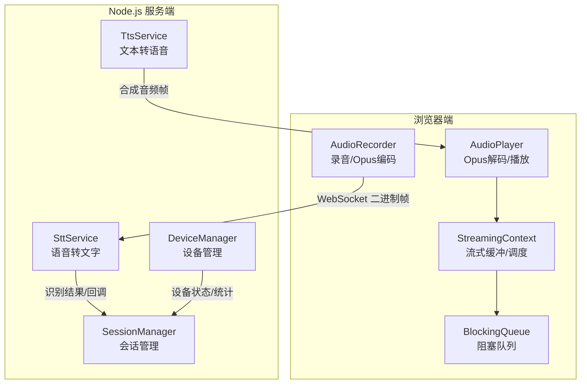
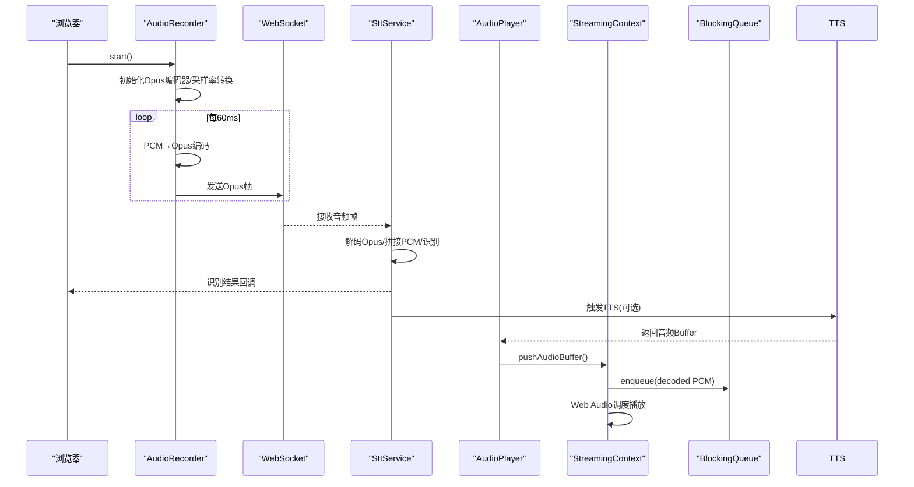
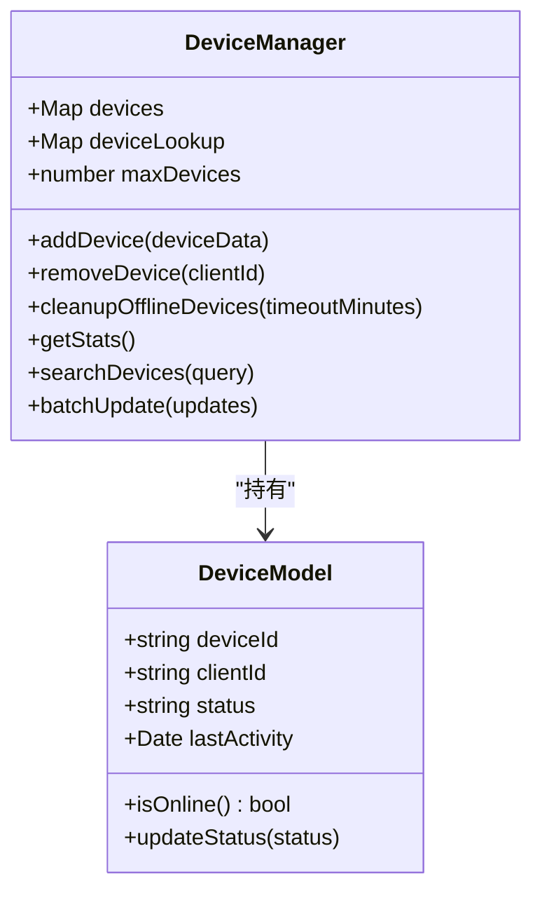
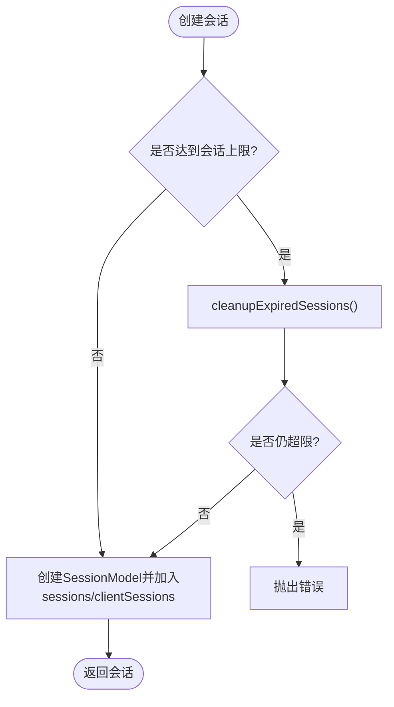
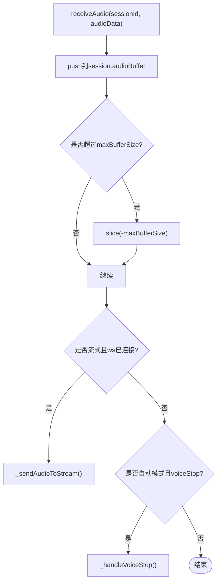
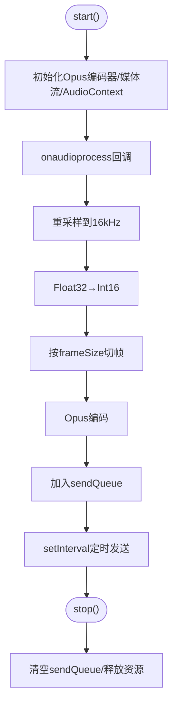
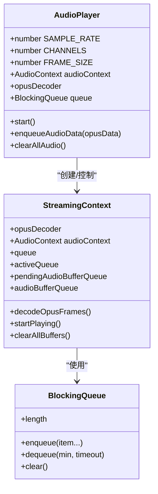
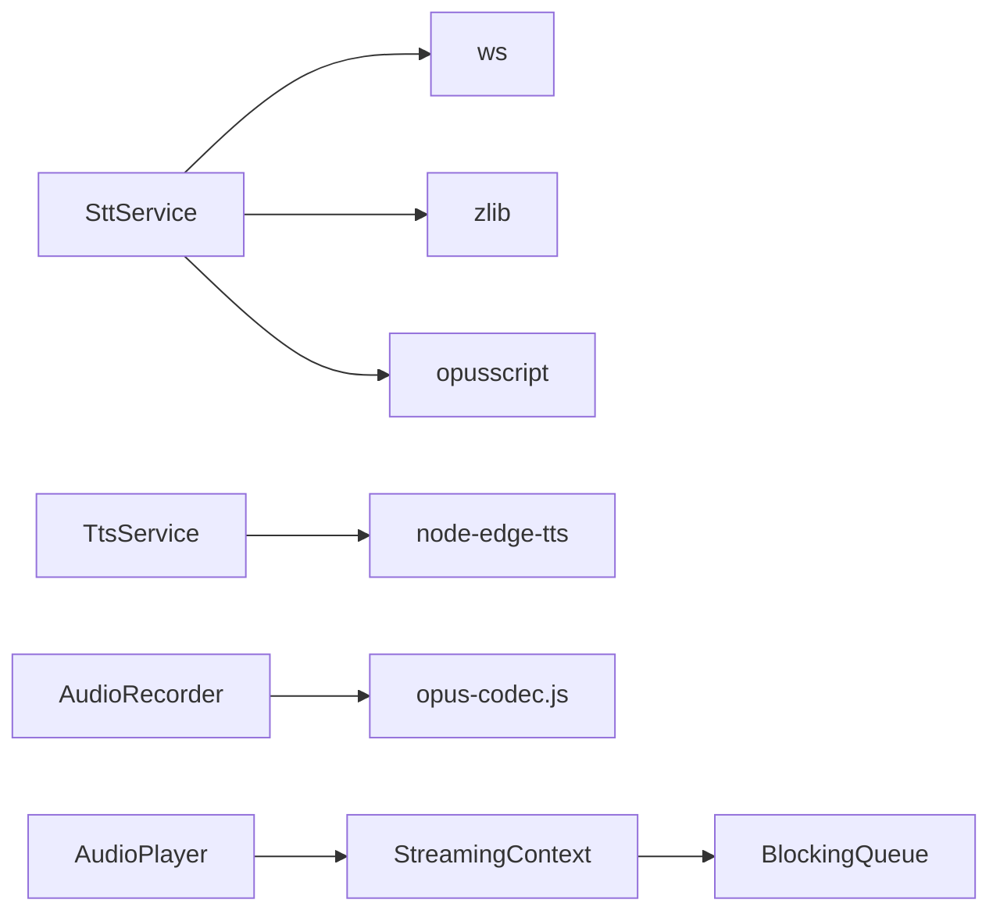

# 内存优化策略

<cite>
**本文引用的文件**   
- [core/managers/device.js](file://core/managers/device.js)
- [core/models/device.js](file://core/models/device.js)
- [core/managers/session.js](file://core/managers/session.js)
- [core/models/session.js](file://core/models/session.js)
- [core/services/stt.js](file://core/services/stt.js)
- [core/services/tts.js](file://core/services/tts.js)
- [public/chat/js/core/audio/recorder.js](file://public/chat/js/core/audio/recorder.js)
- [public/chat/js/core/audio/player.js](file://public/chat/js/core/audio/player.js)
- [public/chat/js/core/audio/stream-context.js](file://public/chat/js/core/audio/stream-context.js)
- [public/chat/js/utils/blocking-queue.js](file://public/chat/js/utils/blocking-queue.js)
- [package.json](file://package.json)
</cite>

## 目录
1. [引言](#引言)
2. [项目结构](#项目结构)
3. [核心组件](#核心组件)
4. [架构总览](#架构总览)
5. [详细组件分析](#详细组件分析)
6. [依赖关系分析](#依赖关系分析)
7. [性能与内存考量](#性能与内存考量)
8. [故障排查指南](#故障排查指南)
9. [结论](#结论)
10. [附录：工具与最佳实践清单](#附录工具与最佳实践清单)

## 引言
本指南聚焦语音交互应用中的内存优化，覆盖以下关键主题：
- 设备管理器中的内存泄漏防护
- 会话管理器的资源清理机制
- 音频处理（录音、解码、播放）的缓冲区优化
- Node.js 垃圾回收在语音应用中的影响与优化方法
- 大对象池化、流式数据处理与内存监控的最佳实践
- 内存使用分析工具与调试技巧
- 常见内存泄漏问题的识别与修复路径

目标是帮助开发者在保证低延迟、高吞吐的同时，稳定控制进程内存增长，避免长期运行下的内存泄漏。

## 项目结构
本项目采用前后端分离的结构：
- 后端 Node.js 服务负责设备与会话管理、语音转文字（STT）、文本转语音（TTS）等能力
- 前端浏览器端负责录音、Opus 编码、WebSocket 传输、Opus 解码与流式播放

图表来源
- [public/chat/js/core/audio/recorder.js:1-275](file://public/chat/js/core/audio/recorder.js#L1-L275)
- [public/chat/js/core/audio/player.js:1-318](file://public/chat/js/core/audio/player.js#L1-L318)
- [public/chat/js/core/audio/stream-context.js:1-221](file://public/chat/js/core/audio/stream-context.js#L1-L221)
- [public/chat/js/utils/blocking-queue.js:1-103](file://public/chat/js/utils/blocking-queue.js#L1-L103)
- [core/managers/device.js:1-201](file://core/managers/device.js#L1-L201)
- [core/managers/session.js:1-190](file://core/managers/session.js#L1-L190)
- [core/services/stt.js:1-800](file://core/services/stt.js#L1-L800)
- [core/services/tts.js:1-438](file://core/services/tts.js#L1-L438)

章节来源
- [package.json:1-29](file://package.json#L1-L29)

## 核心组件
本节从内存视角梳理关键组件的职责与风险点：
- DeviceManager：维护设备 Map 与反向查找表，提供上限限制、离线清理、批量操作
- SessionManager：维护会话 Map 与客户端映射，提供超时清理、上下文管理、批量关闭
- SttService：管理 STT 会话、音频缓冲区、Opus 解码器、外部 WebSocket 连接
- TtsService：管理 TTS 提供商、临时文件、输出目录与音频保存
- AudioRecorder：浏览器端录音、PCM→Opus 编码、定时发送、统计收集
- AudioPlayer + StreamingContext：浏览器端 Opus 解码、多队列缓冲、Web Audio 精确调度
- BlockingQueue：线程安全的阻塞队列，用于解耦生产消费并控制批大小

章节来源
- [core/managers/device.js:1-201](file://core/managers/device.js#L1-L201)
- [core/managers/session.js:1-190](file://core/managers/session.js#L1-L190)
- [core/services/stt.js:1-800](file://core/services/stt.js#L1-L800)
- [core/services/tts.js:1-438](file://core/services/tts.js#L1-L438)
- [public/chat/js/core/audio/recorder.js:1-646](file://public/chat/js/core/audio/recorder.js#L1-L646)
- [public/chat/js/core/audio/player.js:1-318](file://public/chat/js/core/audio/player.js#L1-L318)
- [public/chat/js/core/audio/stream-context.js:1-221](file://public/chat/js/core/audio/stream-context.js#L1-L221)
- [public/chat/js/utils/blocking-queue.js:1-103](file://public/chat/js/utils/blocking-queue.js#L1-L103)

## 架构总览
下图展示端到端的音频数据流与内存关键点：

图表来源
- [public/chat/js/core/audio/recorder.js:138-232](file://public/chat/js/core/audio/recorder.js#L138-L232)
- [core/services/stt.js:348-477](file://core/services/stt.js#L348-L477)
- [public/chat/js/core/audio/player.js:170-241](file://public/chat/js/core/audio/player.js#L170-L241)
- [public/chat/js/core/audio/stream-context.js:120-215](file://public/chat/js/core/audio/stream-context.js#L120-L215)
- [public/chat/js/utils/blocking-queue.js:10-59](file://public/chat/js/utils/blocking-queue.js#L10-L59)

## 详细组件分析

### 设备管理器（DeviceManager）内存防护
- 设计要点
  - 使用 Map 存储设备实例，并提供 deviceId → clientId 的反向查找表，降低遍历成本
  - 设置最大设备数上限，防止无限增长
  - 提供离线设备清理接口，按 lastActivity 时间戳剔除长时间无活动的设备
  - 批量更新与查询时注意中间数组的创建与释放

- 内存风险与优化建议
  - 风险点
    - 若 removeDevice 未同步清理 deviceLookup，将导致“悬挂引用”
    - getOnlineDevices/getAllDevices 频繁创建新数组，可能增加 GC 压力
    - 大量设备下 searchDevices/filter 链式调用会产生中间数组
  - 优化建议
    - 确保 removeDevice 同时删除双向映射
    - 对高频统计接口提供增量缓存或分页
    - 对搜索接口支持游标/索引，减少全量过滤

图表来源
- [core/managers/device.js:4-116](file://core/managers/device.js#L4-L116)
- [core/models/device.js:3-53](file://core/models/device.js#L3-L53)

章节来源
- [core/managers/device.js:12-116](file://core/managers/device.js#L12-L116)
- [core/models/device.js:44-53](file://core/models/device.js#L44-L53)

### 会话管理器（SessionManager）资源清理
- 设计要点
  - 维护 sessionId → SessionModel 与 clientId → sessionIds[] 的双层映射
  - 创建会话前检查上限，必要时先清理过期会话
  - closeSession 会关闭会话并从客户端映射中移除
  - cleanupSessions/cleanupClientSessions 基于 lastActivity 与超时阈值清理

- 内存风险与优化建议
  - 风险点
    - clientSessions 是数组，splice 删除为 O(n)，在高并发场景有开销
    - 若 closeSession 未正确清理上下文 context，可能导致大对象滞留
    - 批量关闭时异常捕获后继续执行，需保证失败项不影响整体
  - 优化建议
    - 将 clientSessions 改为 Set 或 Map<clientId, Set<sessionId>>，提升删除效率
    - 在 closeSession 中显式清空 context 与大字段
    - 批量关闭时记录失败明细，便于定位问题

图表来源
- [core/managers/session.js:12-45](file://core/managers/session.js#L12-L45)
- [core/managers/session.js:117-154](file://core/managers/session.js#L117-L154)

章节来源
- [core/managers/session.js:12-154](file://core/managers/session.js#L12-L154)
- [core/models/session.js:3-57](file://core/models/session.js#L3-L57)

### STT 服务（SttService）音频缓冲区与解码优化
- 设计要点
  - 每个 STT 会话维护 audioBuffer 数组，限制最大长度，避免无限增长
  - 流式模式下通过 WebSocket 实时发送音频帧
  - 使用 opusscript 进行 Opus→PCM 解码，并对无效帧做容错处理
  - 语音停止时合并 PCM 帧并调用识别接口

- 内存风险与优化建议
  - 风险点
    - _decodeOpusFrames 循环中累积 pcmFrames 数组，长语音易造成峰值内存
    - Buffer.concat 一次性拼接大 Buffer，可能引发堆抖动
    - 会话关闭时需确保 ws 连接关闭、decoder 引用置空
  - 优化建议
    - 引入分片合并策略，分批 concat 并逐步释放中间 Buffer
    - 对大 Buffer 使用固定大小的环形缓冲，减少拷贝
    - 在 closeSession 中统一释放 ws、decoder、audioBuffer

图表来源
- [core/services/stt.js:348-383](file://core/services/stt.js#L348-L383)
- [core/services/stt.js:391-477](file://core/services/stt.js#L391-L477)
- [core/services/stt.js:515-583](file://core/services/stt.js#L515-L583)

章节来源
- [core/services/stt.js:39-87](file://core/services/stt.js#L39-L87)
- [core/services/stt.js:293-340](file://core/services/stt.js#L293-L340)
- [core/services/stt.js:348-477](file://core/services/stt.js#L348-L477)
- [core/services/stt.js:515-583](file://core/services/stt.js#L515-L583)

### TTS 服务（TtsService）临时文件与输出目录
- 设计要点
  - Edge TTS 生成临时 mp3 文件，读取后删除
  - 可选择保存音频文件到 outputDir，并列出/删除已保存文件
  - 提供时长估算与文本分段逻辑

- 内存风险与优化建议
  - 风险点
    - readFileSync 将完整音频加载到内存，大文件会导致峰值内存
    - 文件列表与 stat 同步调用可能阻塞事件循环
    - 保存文件时未做容量/保留策略，磁盘与内存都可能增长
  - 优化建议
    - 使用流式写入/读取，避免一次性加载大 Buffer
    - 对文件列表接口实现分页与缓存
    - 增加 TTL 或配额策略，定期清理旧文件

章节来源
- [core/services/tts.js:62-147](file://core/services/tts.js#L62-L147)
- [core/services/tts.js:163-202](file://core/services/tts.js#L163-L202)
- [core/services/tts.js:328-434](file://core/services/tts.js#L328-L434)

### 浏览器端录音（AudioRecorder）缓冲区与发送策略
- 设计要点
  - 使用 ScriptProcessorNode 获取 PCM，按需重采样至 16kHz
  - 将 Float32→Int16，按 frameSize=960 切分为帧，Opus 编码后入队
  - 定时器按 frameDuration=60ms 间隔发送，stop 时清空队列并发送结束信号

- 内存风险与优化建议
  - 风险点
    - pcmBuffer 与 sendQueue 持续增长，若 stop 未彻底清理，将导致泄漏
    - testMode 下 savedPcmData/savedOpusFrames 长期驻留
    - 可视化 requestAnimationFrame 未取消将持续占用
  - 优化建议
    - stop 中确保 clearInterval、disconnect、track.stop、cancelAnimationFrame
    - 测试模式结束后主动清空 saved* 数组
    - 对 sendQueue 使用固定容量环形缓冲，避免无限增长

图表来源
- [public/chat/js/core/audio/recorder.js:60-275](file://public/chat/js/core/audio/recorder.js#L60-L275)
- [public/chat/js/core/audio/recorder.js:290-427](file://public/chat/js/core/audio/recorder.js#L290-L427)

章节来源
- [public/chat/js/core/audio/recorder.js:60-275](file://public/chat/js/core/audio/recorder.js#L60-L275)
- [public/chat/js/core/audio/recorder.js:290-427](file://public/chat/js/core/audio/recorder.js#L290-L427)

### 浏览器端播放（AudioPlayer + StreamingContext）流式缓冲与调度
- 设计要点
  - AudioPlayer 预加载 Opus 解码器，启动缓冲与播放流程
  - StreamingContext 维护多个队列：待解码、待播放、正在播放
  - 使用 BlockingQueue 解耦生产消费，按最小样本数触发播放
  - Web Audio 精确调度，避免卡顿与爆音

- 内存风险与优化建议
  - 风险点
    - decodeOpusFrames 中 decodedSamples 数组不断 push，可能增长过大
    - activeQueue.enqueue 逐样本入队，开销较大
    - clearAllBuffers 需确保 source.stop/disconnect 与队列清空
  - 优化建议
    - 对 decodedSamples 使用 TypedArray 或固定大小缓冲，减少 GC
    - 批量入队而非逐样本入队
    - 在 clearAllBuffers 中重置 scheduledEndTime 与 totalSamples

图表来源
- [public/chat/js/core/audio/player.js:7-318](file://public/chat/js/core/audio/player.js#L7-L318)
- [public/chat/js/core/audio/stream-context.js:5-221](file://public/chat/js/core/audio/stream-context.js#L5-L221)
- [public/chat/js/utils/blocking-queue.js:1-103](file://public/chat/js/utils/blocking-queue.js#L1-L103)

章节来源
- [public/chat/js/core/audio/player.js:170-306](file://public/chat/js/core/audio/player.js#L170-L306)
- [public/chat/js/core/audio/stream-context.js:120-215](file://public/chat/js/core/audio/stream-context.js#L120-L215)
- [public/chat/js/utils/blocking-queue.js:10-59](file://public/chat/js/utils/blocking-queue.js#L10-L59)

## 依赖关系分析
- 模块耦合
  - STT 依赖 ws、zlib、opusscript；TTS 依赖 node-edge-tts
  - 浏览器端 recorder/player 依赖 opus-codec 与 stream-context
  - BlockingQueue 被 player 与 stream-context 共用，降低耦合度

- 潜在循环依赖
  - 当前未见明显循环导入，但需注意动态 import 的使用位置，避免启动期阻塞

- 外部依赖
  - package.json 声明了 ws、opusscript、node-edge-tts 等关键库

图表来源
- [package.json:11-22](file://package.json#L11-L22)
- [core/services/stt.js:1-6](file://core/services/stt.js#L1-L6)
- [core/services/tts.js:1-5](file://core/services/tts.js#L1-L5)
- [public/chat/js/core/audio/recorder.js:1-4](file://public/chat/js/core/audio/recorder.js#L1-L4)
- [public/chat/js/core/audio/player.js:1-4](file://public/chat/js/core/audio/player.js#L1-L4)
- [public/chat/js/core/audio/stream-context.js:1-2](file://public/chat/js/core/audio/stream-context.js#L1-L2)
- [public/chat/js/utils/blocking-queue.js:1-1](file://public/chat/js/utils/blocking-queue.js#L1-L1)

章节来源
- [package.json:11-22](file://package.json#L11-L22)

## 性能与内存考量
- Node.js 垃圾回收的影响
  - V8 的 Mark-Sweep/Generational GC 对短生命周期对象友好，但对大 Buffer 与长生命周期 Map 敏感
  - 语音应用中，频繁的 Buffer.concat、数组 push、字符串拼接会触发多次 GC，影响延迟
  - 建议：
    - 使用 TypedArray 与固定大小缓冲，减少分配
    - 避免在热路径中进行正则替换与 JSON 序列化
    - 对大对象使用对象池或复用实例

- 大对象池化
  - 为音频帧、解码缓冲、消息头构建池，减少分配与碎片
  - 对 STT/TTS 的 Provider 配置对象进行复用

- 流式数据处理
  - 前端：按 60ms 帧发送，后端按帧解码与识别，避免整段音频驻留
  - 后端：对 PCM 拼接采用分片合并，及时释放中间 Buffer
  - 前端：StreamingContext 使用多队列与最小样本阈值，平衡延迟与稳定性

- 内存监控
  - 服务端：启用 --inspect，使用 Chrome DevTools 或 clinic.js 分析堆快照
  - 浏览器端：Performance 面板 Memory 子面板，观察 Heap Size、Detached DOM Tree、JS 堆增长
  - 指标：
    - 进程 RSS/HeapUsed 趋势
    - GC 频率与停顿时间
    - 音频队列长度与解码/播放积压

[本节为通用指导，不直接分析具体文件]

## 故障排查指南
- 常见问题与定位
  - 设备/会话未清理
    - 现象：进程内存缓慢增长，Map 条目增多
    - 定位：检查 removeDevice/closeSession 是否成对调用，清理反向映射与上下文
  - STT 会话泄漏
    - 现象：WebSocket 连接未关闭，decoder 未释放
    - 定位：检查 closeSession 中对 ws.close() 与 decoder=null 的执行路径
  - 前端录音未释放
    - 现象：麦克风占用、定时器未停、requestAnimationFrame 持续运行
    - 定位：检查 stop 中 clearInterval、disconnect、track.stop、cancelAnimationFrame
  - 播放缓冲堆积
    - 现象：卡顿、延迟增大
    - 定位：检查 StreamingContext 的 activeQueue 与 queue 长度，确认最小样本阈值与调度逻辑

- 调试技巧
  - 服务端
    - 使用 process.memoryUsage() 打印 RSS/heapTotal/heapUsed
    - 使用 --heapsnapshot-on-signal 触发堆快照
    - 对关键路径添加耗时与对象计数日志
  - 浏览器端
    - Performance 面板录制，查看 Allocation Timeline
    - 使用 Memory 面板比较两次快照，定位增长对象
    - 对 AudioRecorder/AudioPlayer 暴露统计接口，观察帧数、字节数、队列长度

章节来源
- [core/managers/device.js:88-116](file://core/managers/device.js#L88-L116)
- [core/managers/session.js:80-154](file://core/managers/session.js#L80-L154)
- [core/services/stt.js:326-340](file://core/services/stt.js#L326-L340)
- [public/chat/js/core/audio/recorder.js:290-427](file://public/chat/js/core/audio/recorder.js#L290-L427)
- [public/chat/js/core/audio/stream-context.js:86-113](file://public/chat/js/core/audio/stream-context.js#L86-L113)

## 结论
通过合理的设备与会话生命周期管理、音频流的帧级处理与缓冲控制、以及严格的资源释放策略，可以在语音交互应用中显著降低内存泄漏风险并提升稳定性。结合 Node.js 与浏览器的内存分析工具，建立常态化的监控与回归测试，是保障长期运行质量的关键。

[本节为总结性内容，不直接分析具体文件]

## 附录：工具与最佳实践清单
- 工具
  - Node.js：--inspect、clinic.js、heapdump、process.memoryUsage
  - 浏览器：Chrome DevTools Performance/Memory、Lighthouse
- 最佳实践
  - 所有异步资源（WebSocket、MediaStream、AudioContext、定时器、动画帧）必须显式释放
  - 对大 Buffer 使用分片与复用，避免一次性拼接
  - 对 Map/Set 定期清理过期条目，设置上限与 TTL
  - 对高频统计接口提供增量缓存，避免全量扫描
  - 在前端与后端均暴露内存与队列指标，纳入告警体系

[本节为通用指导，不直接分析具体文件]