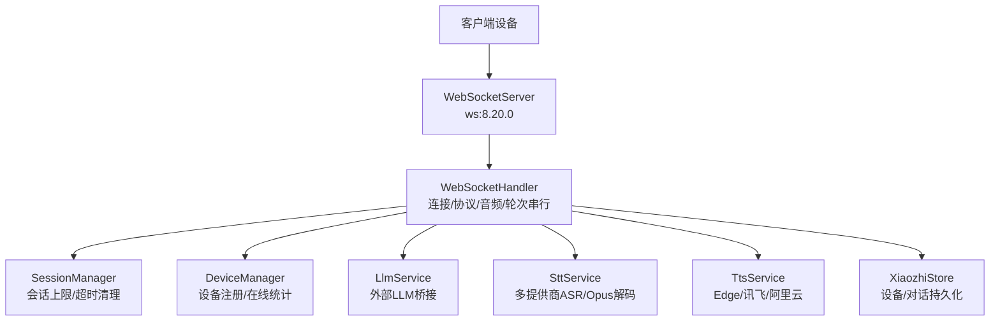
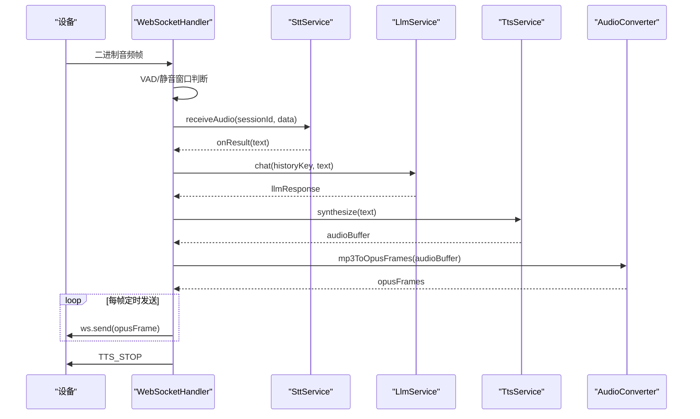
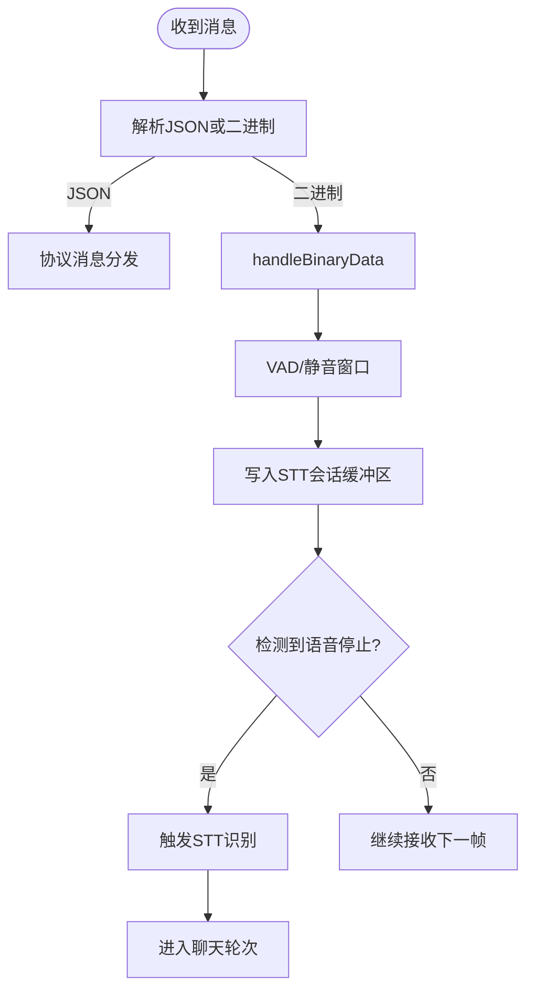
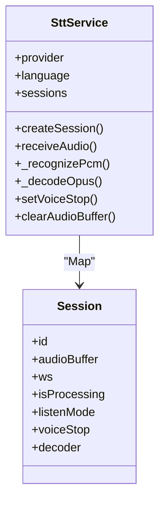
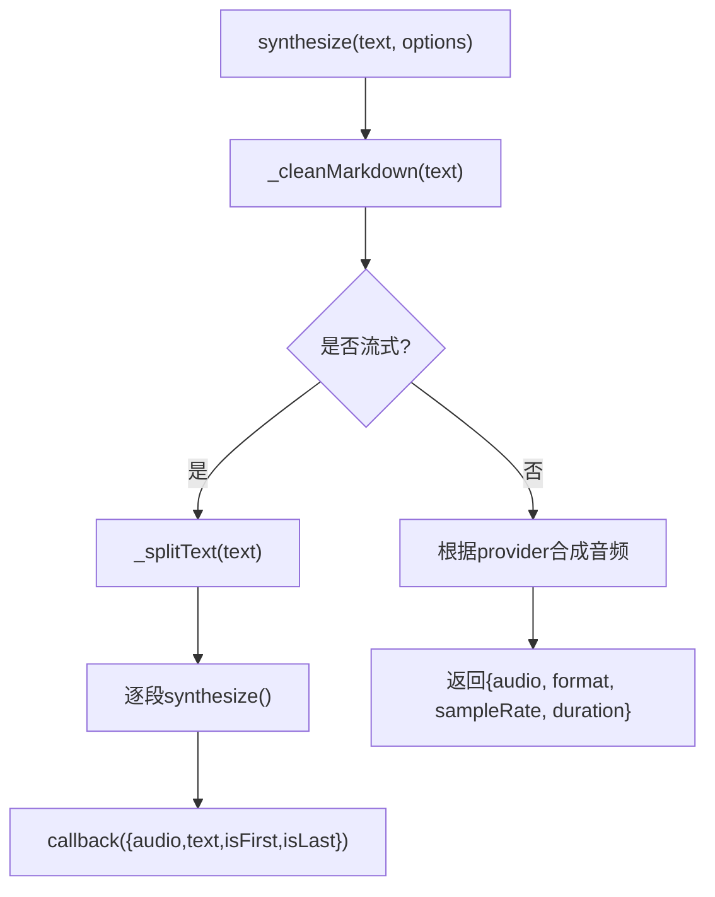
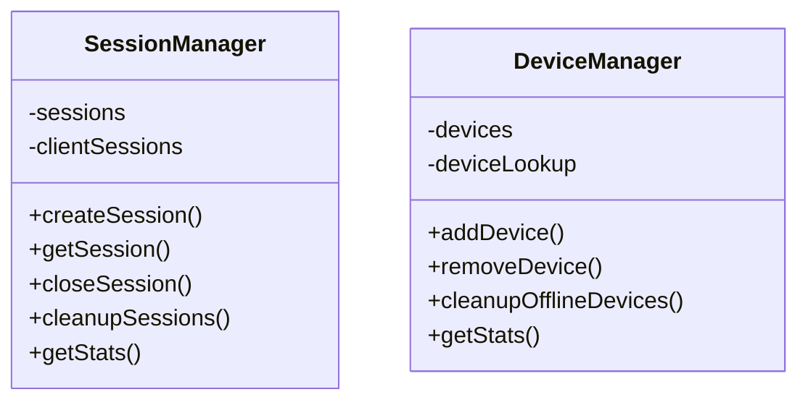
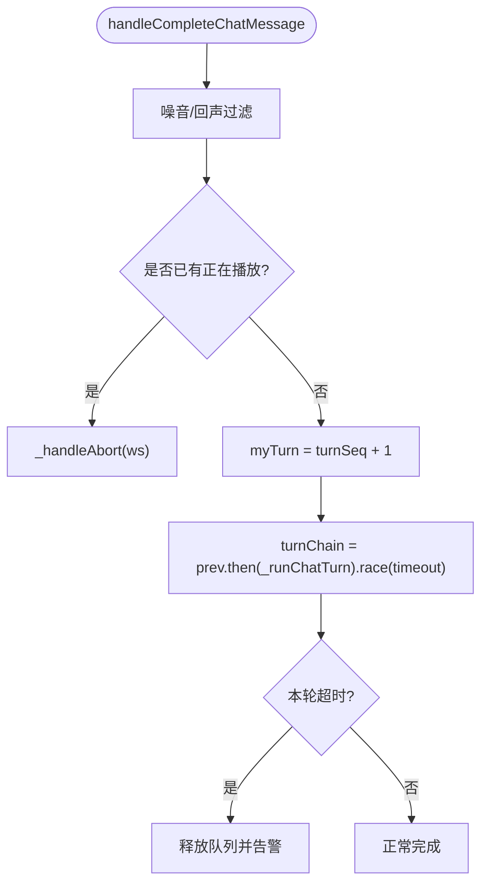
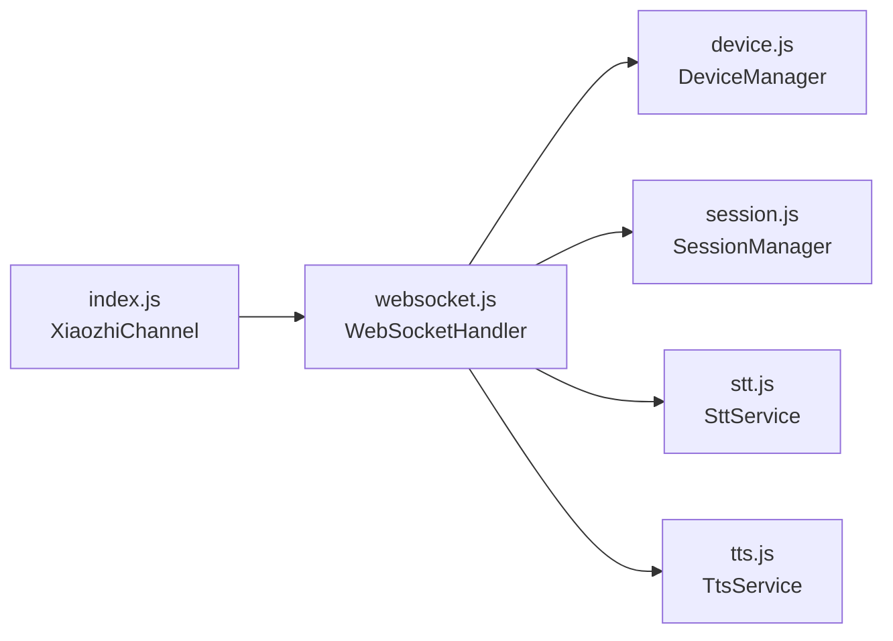

# 并发处理优化

<cite>
**本文引用的文件**   
- [index.js](file://index.js)
- [websocket.js](file://core/handlers/websocket.js)
- [stt.js](file://core/services/stt.js)
- [tts.js](file://core/services/tts.js)
- [session.js](file://core/managers/session.js)
- [device.js](file://core/managers/device.js)
- [package.json](file://package.json)
</cite>

## 目录
1. [引言](#引言)
2. [项目结构](#项目结构)
3. [核心组件](#核心组件)
4. [架构总览](#架构总览)
5. [详细组件分析](#详细组件分析)
6. [依赖关系分析](#依赖关系分析)
7. [性能与并发调优](#性能与并发调优)
8. [故障排查指南](#故障排查指南)
9. [结论](#结论)
10. [附录：关键配置项](#附录关键配置项)

## 引言
本文面向高并发、低延迟的语音交互场景，围绕 WebSocket 连接管理、消息队列与异步任务调度、STT/TTS 并发控制、线程池与资源限制、高负载下的性能调优、负载均衡与故障转移、突发流量与背压处理，以及并发编程最佳实践和监控指标进行系统化说明。文档基于仓库中的实际代码实现进行分析，并给出可落地的优化建议。

## 项目结构
本项目采用“频道 + 处理器 + 服务 + 管理器”的分层组织方式：
- 频道入口负责启动 HTTP/WS 服务器、初始化服务、注册路由与广播接口
- WebSocket 处理器负责连接生命周期、协议解析、会话与会话状态、音频流处理、LLM/TTS 编排
- STT/TTS 服务封装不同提供商的实现，提供会话级缓冲、解码、识别与合成能力
- 设备与会话管理器维护在线设备映射与对话会话的生命周期

图表来源
- [index.js:254-281](file://index.js#L254-L281)
- [websocket.js:22-60](file://core/handlers/websocket.js#L22-L60)
- [session.js:4-10](file://core/managers/session.js#L4-L10)
- [device.js:4-9](file://core/managers/device.js#L4-L9)
- [stt.js:39-87](file://core/services/stt.js#L39-L87)
- [tts.js:3-21](file://core/services/tts.js#L3-L21)

章节来源
- [index.js:86-125](file://index.js#L86-L125)
- [index.js:254-281](file://index.js#L254-L281)
- [package.json:11-23](file://package.json#L11-L23)

## 核心组件
- XiaozhiChannel（频道）：统一装配 Express、HTTP、WebSocket、服务与路由；暴露健康检查、设置热更新、广播等 API
- WebSocketHandler：连接管理、消息分发、VAD/静音检测、音频帧发送、LLM+TTS 编排、轮次串行化与打断
- SttService：多提供商 ASR（豆包/FunASR/aibridge/讯飞/阿里云），Opus 解码、会话缓冲、语音停止判定、结果回调
- TtsService：多提供商 TTS（Edge/讯飞/阿里云），文本分段、音频时长估算、可选文件落盘
- SessionManager：会话创建/查询/关闭、按客户端索引、过期清理、统计
- DeviceManager：设备注册/查找/批量更新、离线清理、在线统计

章节来源
- [index.js:44-81](file://index.js#L44-L81)
- [websocket.js:22-60](file://core/handlers/websocket.js#L22-L60)
- [stt.js:39-87](file://core/services/stt.js#L39-L87)
- [tts.js:3-21](file://core/services/tts.js#L3-L21)
- [session.js:4-10](file://core/managers/session.js#L4-L10)
- [device.js:4-9](file://core/managers/device.js#L4-L9)

## 架构总览
下图展示一次完整语音对话从音频输入到语音输出的并发路径，包括 VAD 停顿检测、STT 识别、LLM 生成、TTS 合成与 Opus 帧定距播放，以及轮次串行化与打断机制。

图表来源
- [websocket.js:289-446](file://core/handlers/websocket.js#L289-L446)
- [websocket.js:933-971](file://core/handlers/websocket.js#L933-L971)
- [websocket.js:1025-1189](file://core/handlers/websocket.js#L1025-L1189)
- [stt.js:348-383](file://core/services/stt.js#L348-L383)
- [tts.js:62-104](file://core/services/tts.js#L62-L104)

## 详细组件分析

### WebSocket 连接管理与消息队列
- 连接建立：解析 client-id/device-id/clientType，注册到 DeviceManager，必要时登记持久化 Store
- 消息分发：JSON 走协议分支，二进制走音频分支；支持 HELLO/LISTEN/ABORT/IOT/CHAT/MCP/AUDIO_DATA/WAKE_WORD_DETECTED
- 音频处理：VAD 滑动窗口、静默阈值、最长语音兜底、录音结束空帧触发识别
- 消息队列：广播接口先验设备再异步发送，避免阻塞 HTTP 响应；音频帧按固定帧时长延时发送，保证节拍稳定

图表来源
- [websocket.js:228-283](file://core/handlers/websocket.js#L228-L283)
- [websocket.js:289-446](file://core/handlers/websocket.js#L289-L446)

章节来源
- [websocket.js:67-169](file://core/handlers/websocket.js#L67-L169)
- [websocket.js:228-283](file://core/handlers/websocket.js#L228-L283)
- [websocket.js:289-446](file://core/handlers/websocket.js#L289-L446)
- [index.js:408-425](file://index.js#L408-L425)

### STT 服务并发控制与资源限制
- 会话模型：每个 sessionId 对应一个会话对象，包含音频缓冲、WebSocket 连接、解码器、监听模式、语音停止标志
- 缓冲与限长：receiveAudio 将音频帧推入 session.audioBuffer，并按 maxBufferSize 截断，防止内存无限增长
- 流式识别：对需要流式的提供商（如豆包）在 isProcessing 时通过 session.ws 发送音频帧
- 解码与识别：Opus 解码为 PCM，按提供商路由到具体识别方法；FunASR 使用独立 WebSocket 请求，带超时保护
- 错误与回退：解码异常单帧丢弃不影响整体；识别失败记录日志并通过 onError 回调上报

图表来源
- [stt.js:39-87](file://core/services/stt.js#L39-L87)
- [stt.js:293-340](file://core/services/stt.js#L293-L340)
- [stt.js:348-383](file://core/services/stt.js#L348-L383)
- [stt.js:419-477](file://core/services/stt.js#L419-L477)
- [stt.js:591-606](file://core/services/stt.js#L591-L606)

章节来源
- [stt.js:39-87](file://core/services/stt.js#L39-L87)
- [stt.js:293-340](file://core/services/stt.js#L293-L340)
- [stt.js:348-383](file://core/services/stt.js#L348-L383)
- [stt.js:419-477](file://core/services/stt.js#L419-L477)
- [stt.js:591-606](file://core/services/stt.js#L591-L606)
- [stt.js:846-959](file://core/services/stt.js#L846-L959)

### TTS 服务并发控制与资源限制
- 提供商选择：Edge/讯飞/阿里云，默认 Edge
- 文本预处理：清理 Markdown、按标点分段
- 合成流程：synthesize 返回音频 Buffer、格式、采样率、时长估算
- 流式合成：synthesizeStream 分段调用 synthesize 并回调片段信息
- 输出与存储：可选保存音频文件到 outputDir，便于审计与回放

图表来源
- [tts.js:62-104](file://core/services/tts.js#L62-L104)
- [tts.js:209-237](file://core/services/tts.js#L209-L237)
- [tts.js:244-267](file://core/services/tts.js#L244-L267)

章节来源
- [tts.js:3-21](file://core/services/tts.js#L3-L21)
- [tts.js:62-104](file://core/services/tts.js#L62-L104)
- [tts.js:209-237](file://core/services/tts.js#L209-L237)
- [tts.js:244-267](file://core/services/tts.js#L244-L267)

### 会话与设备管理
- SessionManager：维护 Map<sessionId, SessionModel> 与 clientId -> [sessionIds] 索引；创建前校验数据、达到上限后清理过期会话；支持批量关闭与统计
- DeviceManager：维护 Map<clientId, DeviceModel> 与 deviceId -> clientId 反向索引；添加/更新/移除设备；离线清理与在线统计

图表来源
- [session.js:4-10](file://core/managers/session.js#L4-L10)
- [session.js:12-45](file://core/managers/session.js#L12-L45)
- [session.js:117-138](file://core/managers/session.js#L117-L138)
- [device.js:4-9](file://core/managers/device.js#L4-L9)
- [device.js:12-41](file://core/managers/device.js#L12-L41)
- [device.js:100-116](file://core/managers/device.js#L100-L116)

章节来源
- [session.js:4-10](file://core/managers/session.js#L4-L10)
- [session.js:12-45](file://core/managers/session.js#L12-L45)
- [session.js:117-138](file://core/managers/session.js#L117-L138)
- [device.js:4-9](file://core/managers/device.js#L4-L9)
- [device.js:12-41](file://core/managers/device.js#L12-L41)
- [device.js:100-116](file://core/managers/device.js#L100-L116)

### 异步任务调度与轮次串行化
- 轮次串行化：同一连接同一时刻只有一条应答流程在发送音频，杜绝 Opus 帧交错混杂；通过 turnChain 串行执行 _runChatTurn
- 看门狗超时：单轮处理超时释放队列，防止 LLM 无响应导致后续轮次永久排队
- 打断机制：abortUpTo 针对旧轮次中止，新轮次不受残留信号影响；turnSeq 递增确保新一轮接管
- LLM 超时保护：Promise.race 包裹 LLM 调用，快速兜底避免挂死整个轮次队列

图表来源
- [websocket.js:651-694](file://core/handlers/websocket.js#L651-L694)
- [websocket.js:731-818](file://core/handlers/websocket.js#L731-L818)
- [websocket.js:933-971](file://core/handlers/websocket.js#L933-L971)

章节来源
- [websocket.js:651-694](file://core/handlers/websocket.js#L651-L694)
- [websocket.js:731-818](file://core/handlers/websocket.js#L731-L818)
- [websocket.js:933-971](file://core/handlers/websocket.js#L933-L971)

## 依赖关系分析
- 外部依赖：express、ws、better-sqlite3、node-edge-tts、opusscript、uuid 等
- 内部依赖：WebSocketHandler 依赖 DeviceManager、SessionManager、SttService、TtsService、LlmService、McpService、Store
- 耦合点：
  - WebSocketHandler 直接持有各服务实例，形成强耦合；适合集中编排但需关注服务间错误隔离
  - STT/TTS 服务各自维护会话/连接，需关注资源泄漏与超时释放
  - 广播接口通过 handler.getBroadcastTargets 获取目标设备，避免同步阻塞

图表来源
- [index.js:17-27](file://index.js#L17-L27)
- [index.js:235-249](file://index.js#L235-L249)
- [websocket.js:22-60](file://core/handlers/websocket.js#L22-L60)

章节来源
- [package.json:11-23](file://package.json#L11-L23)
- [index.js:17-27](file://index.js#L17-L27)
- [index.js:235-249](file://index.js#L235-L249)

## 性能与并发调优

### WebSocket 连接池管理
- 现状：ws 库原生连接管理，未显式连接池；通过 DeviceManager 维护在线设备映射
- 风险：大量连接下内存占用与句柄数上升；心跳检测尚未完全实现
- 建议：
  - 引入连接池与空闲回收策略，限制单进程最大连接数
  - 实现 Ping/Pong 心跳检测，定期清理不活跃连接
  - 对连接错误进行指数退避重连，避免雪崩

### 消息队列优化
- 现状：广播接口异步发送，音频帧按固定帧时长延时发送；轮次串行化避免帧交错
- 风险：突发流量下广播队列可能积压；音频发送循环中 setTimeout 精度受事件循环影响
- 建议：
  - 引入优先级队列，区分控制消息与媒体消息
  - 对广播目标进行分片并行发送，限制并发度
  - 使用高精度定时器或 Web Worker 提升帧发送稳定性

### STT/TTS 并发控制策略
- STT：
  - 会话级缓冲与 maxBufferSize 限长，防止内存膨胀
  - 流式识别时按 provider 特性复用 WebSocket 连接
  - FunASR 单次识别使用独立 WebSocket，带超时保护
- TTS：
  - 文本分段减少单次合成压力
  - 可选文件落盘便于审计与回放
- 建议：
  - 为 STT/TTS 引入任务队列与并发限制（如 p-limit），避免外部 API 过载
  - 对第三方服务增加熔断与降级策略（模拟模式/文本回退）
  - 对 Opus 解码与 MP3 转 Opus 进行批处理与缓存

### 线程池配置与资源限制
- Node.js 单线程事件循环，CPU 密集任务（如音频编解码）应使用 worker_threads 或子进程
- 建议：
  - 将 Opus 解码/编码放入 worker_threads，限制并发数
  - 对 I/O 密集型任务（网络请求、文件读写）保持非阻塞
  - 设置内存上限与 GC 参数，监控堆大小与频繁 GC

### 高负载场景下的性能调优
- 调整 VAD 参数：silenceThresholdMs、maxUtteranceMs 以平衡误判与延迟
- 降低 LLM 超时时间，快速回退到默认回复，避免阻塞轮次队列
- 对 TTS 合成启用分段与并行，限制并发度
- 对音频帧发送使用固定帧时长，避免设备缓冲溢出

### 负载均衡策略
- 多进程部署：使用 PM2 或 systemd 多实例，配合 Nginx/HAProxy 做负载均衡
- 会话亲和：按 deviceId 或 clientId 做一致性哈希，减少跨进程状态迁移
- 服务拆分：将 STT/TTS 作为独立微服务，水平扩展

### 故障转移机制
- STT/TTS 多提供商切换：当主提供商不可达时自动切换到备用提供商或模拟模式
- LLM 超时保护：Promise.race 兜底默认回复
- 连接重试：对 WS 连接失败进行指数退避，避免雪崩

### 突发流量与背压处理
- 背压信号：ws.send 返回 false 表示写缓冲已满，应暂停发送并等待 'drain' 事件
- 队列限流：对广播与音频发送队列设置容量上限，超限时拒绝或丢弃低优先级消息
- 自适应速率：根据设备端反馈动态调整帧发送速率

### 并发编程最佳实践
- 避免阻塞事件循环：I/O 操作使用 Promise/async-await
- 明确超时与取消：所有外部调用设置超时，支持 AbortSignal
- 错误隔离：每个服务捕获异常，避免污染其他流程
- 资源清理：连接关闭时释放解码器、WebSocket、定时器

### 性能监控指标
- 连接指标：在线设备数、连接建立/断开速率、平均连接时长
- 音频指标：VAD 有声音比例、静音阈值命中率、音频帧丢失率
- 识别指标：STT 成功率、平均识别耗时、提供商分布
- 合成指标：TTS 成功率、平均合成耗时、分段数量
- 系统指标：CPU/内存/GC、事件循环延迟、队列长度

## 故障排查指南
- 连接问题：检查 ws 连接状态、心跳检测、设备注册是否成功
- 音频问题：确认 Opus 解码是否正常、帧时长是否正确、设备端缓冲是否溢出
- 识别问题：核对提供商配置、探活连通性、超时与错误回调
- 合成问题：检查 TTS 提供商可用性、文本分段逻辑、输出目录权限
- 队列问题：监控广播队列长度、音频发送速率、背压信号处理

章节来源
- [websocket.js:145-163](file://core/handlers/websocket.js#L145-L163)
- [websocket.js:289-446](file://core/handlers/websocket.js#L289-L446)
- [stt.js:846-959](file://core/services/stt.js#L846-L959)
- [tts.js:62-104](file://core/services/tts.js#L62-L104)

## 结论
本项目的并发处理以 WebSocket 为核心，结合会话与设备管理、STT/TTS 服务编排，实现了较为完整的语音交互链路。当前实现已具备轮次串行化、超时保护、VAD 静音检测、音频帧定距发送等关键能力。在高负载场景下，建议引入连接池、任务队列、worker_threads、熔断降级与背压处理，以提升稳定性与吞吐。同时，完善心跳检测与监控指标，有助于在生产环境中持续优化与排障。

## 附录：关键配置项
- 服务器端口与主机：index.js 中 port/host 配置
- VAD 阈值：/api/settings/audio 热更新 silenceThresholdMs、minMaxAmplitude、minAvgAmplitude
- STT 提供商：stt.provider（doubao/funasr/aibridge/xunfei/aliyun）
- TTS 提供商：tts.provider（edge/xunfei/aliyun）
- LLM 超时：config.llmTimeoutSeconds
- 轮次超时：config.turnTimeoutSeconds
- 音频帧时长：ws.audioParams.frameDuration / frame_duration

章节来源
- [index.js:289-344](file://index.js#L289-L344)
- [websocket.js:679-689](file://core/handlers/websocket.js#L679-L689)
- [websocket.js:1152-1154](file://core/handlers/websocket.js#L1152-L1154)
- [stt.js:100-118](file://core/services/stt.js#L100-L118)
- [tts.js:23-38](file://core/services/tts.js#L23-L38)