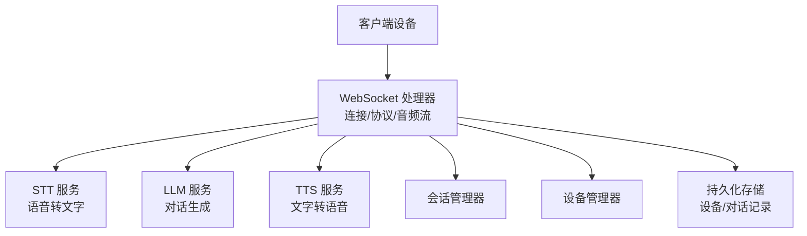
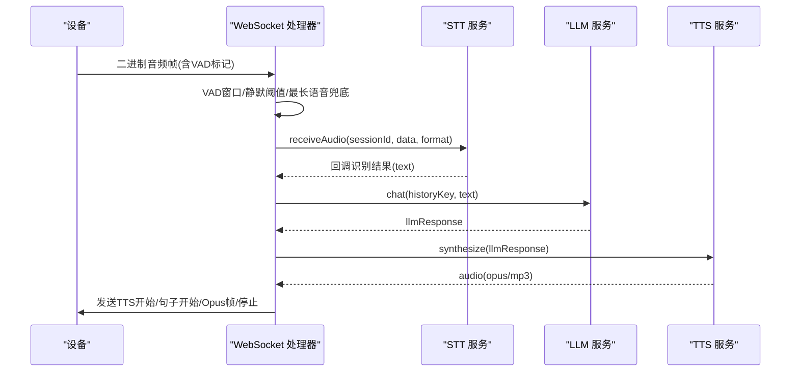
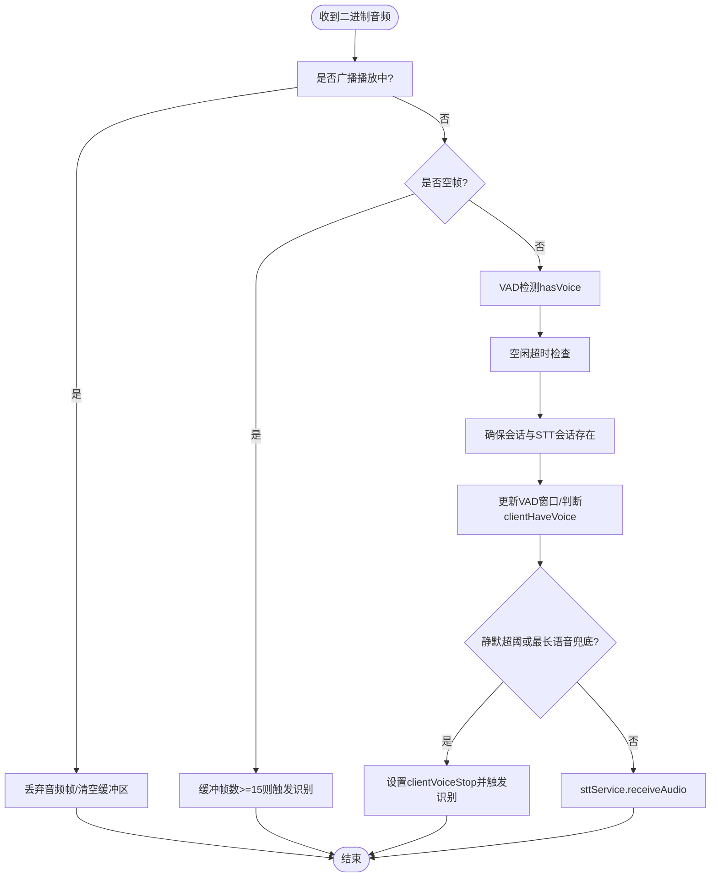
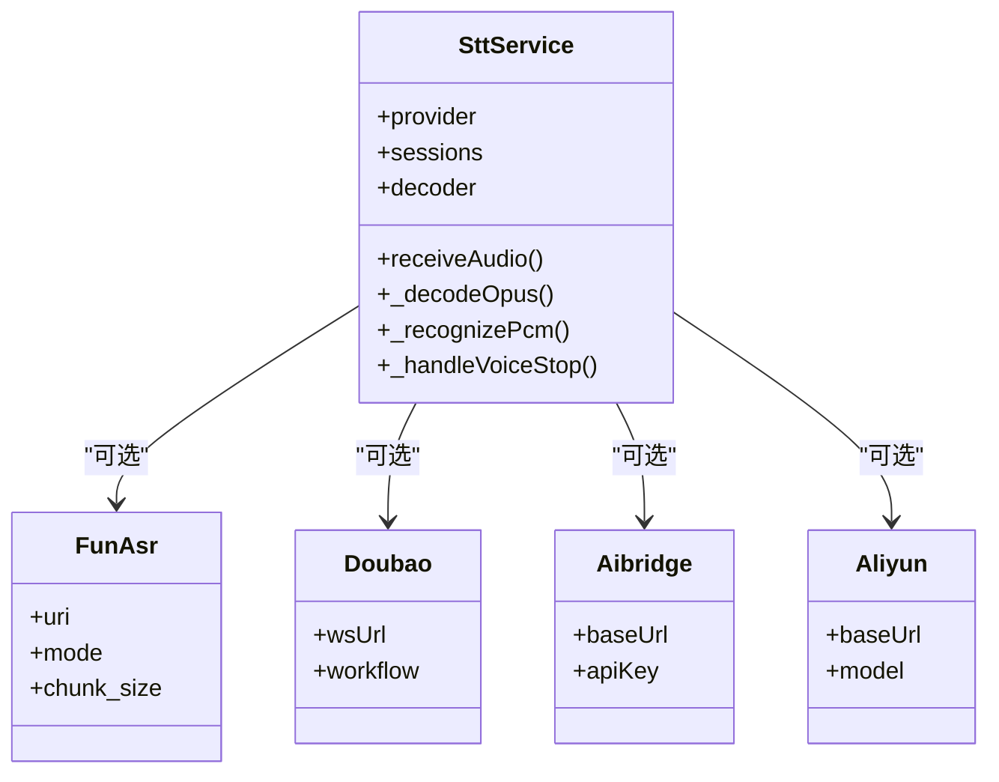
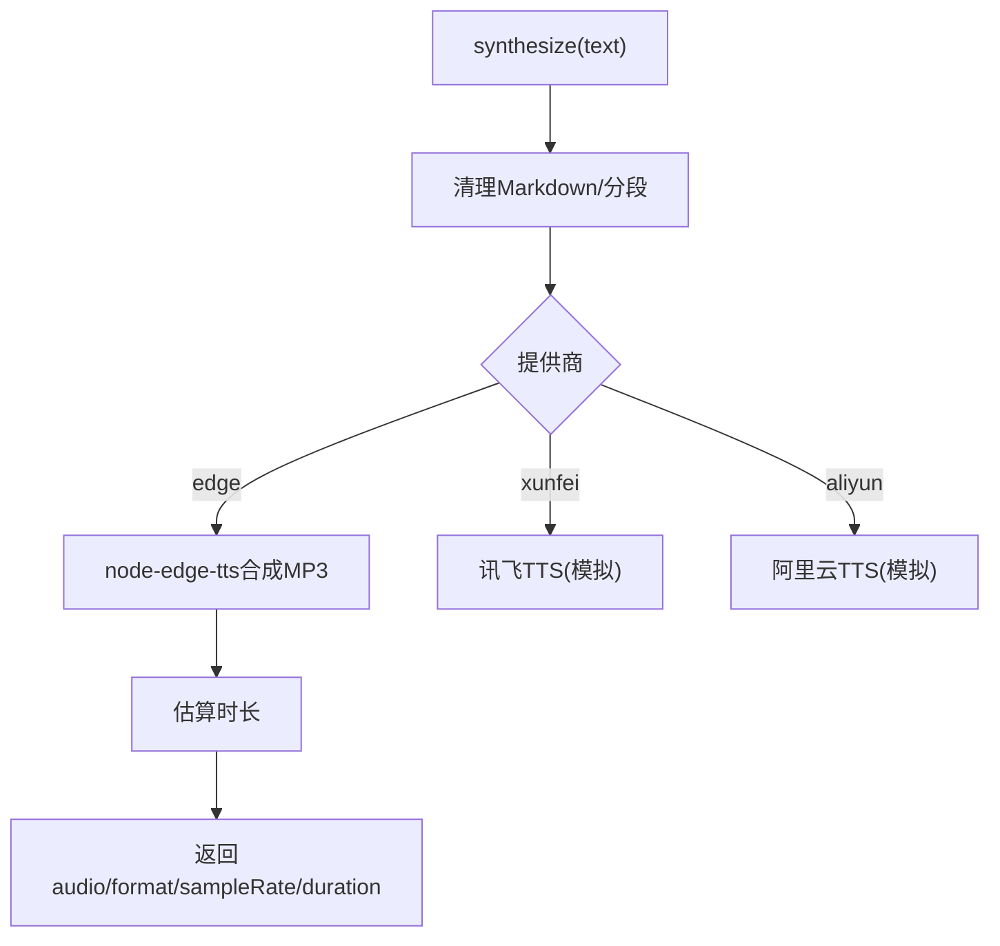
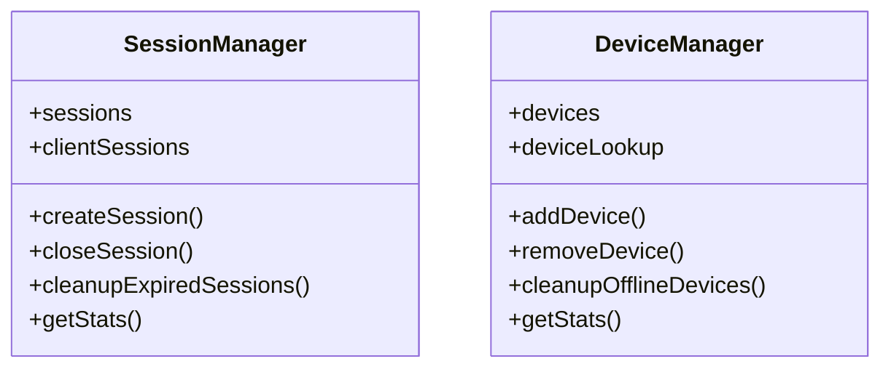
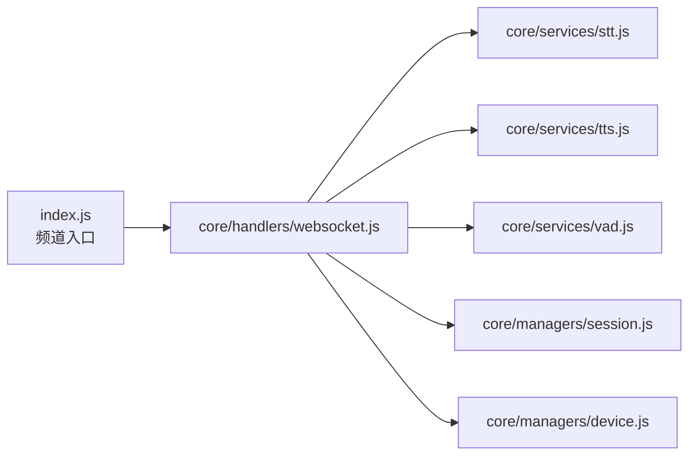

# 性能优化

<cite>
**本文引用的文件**   
- [index.js](file://index.js)
- [package.json](file://package.json)
- [core/handlers/websocket.js](file://core/handlers/websocket.js)
- [core/services/stt.js](file://core/services/stt.js)
- [core/services/tts.js](file://core/services/tts.js)
- [core/services/vad.js](file://core/services/vad.js)
- [core/managers/session.js](file://core/managers/session.js)
- [core/managers/device.js](file://core/managers/device.js)
</cite>

## 目录
1. [引言](#引言)
2. [项目结构](#项目结构)
3. [核心组件](#核心组件)
4. [架构总览](#架构总览)
5. [详细组件分析](#详细组件分析)
6. [依赖关系分析](#依赖关系分析)
7. [性能考量与调优建议](#性能考量与调优建议)
8. [故障排查指南](#故障排查指南)
9. [结论](#结论)

## 引言
本指南聚焦小智语音交互服务器的性能优化，覆盖音频处理、内存使用、并发调度、WebSocket 连接管理、消息队列与资源调度，并给出监控指标、瓶颈分析方法、不同负载场景下的基准测试思路与优化案例。文档基于仓库中 WebSocket 处理器、STT/TTS/VAD 服务、会话与设备管理器实现进行技术拆解，帮助读者在真实代码基础上制定可落地的优化策略。

## 项目结构
系统采用“频道 + 服务 + 管理器”的分层组织：
- 频道入口负责启动 Express/HTTP/WebSocket 服务器，装配各服务与处理器。
- WebSocket 处理器承担连接生命周期、协议解析、VAD 判定、LLM/TTS 编排与音频帧发送。
- STT/TTS/VAD 服务提供语音识别、语音合成与语音活动检测能力。
- 会话与设备管理器维护在线状态、上下文与统计信息。

**图表来源**
- [index.js:17-27](file://index.js#L17-L27)
- [index.js:235-281](file://index.js#L235-L281)
- [core/handlers/websocket.js:22-60](file://core/handlers/websocket.js#L22-L60)

**章节来源**
- [index.js:44-281](file://index.js#L44-L281)
- [package.json:1-29](file://package.json#L1-L29)

## 核心组件
- WebSocket 处理器：连接注册、心跳、协议分发、VAD 窗口、轮次串行化、TTS 播放节拍控制、回声与噪音过滤。
- STT 服务：Opus 解码、多提供商接入（FunASR、豆包、aibridge、阿里云等）、会话缓冲与自动识别触发。
- TTS 服务：文本分段、Edge TTS 合成、MP3→Opus 帧转换与定长帧播放。
- VAD 服务：默认返回 null，由调用方本地逻辑判定。
- 会话管理器：会话创建、过期清理、统计。
- 设备管理器：设备注册、在线状态、批量操作与统计。

**章节来源**
- [core/handlers/websocket.js:22-60](file://core/handlers/websocket.js#L22-L60)
- [core/services/stt.js:39-87](file://core/services/stt.js#L39-L87)
- [core/services/tts.js:3-21](file://core/services/tts.js#L3-L21)
- [core/services/vad.js:3-26](file://core/services/vad.js#L3-L26)
- [core/managers/session.js:4-10](file://core/managers/session.js#L4-L10)
- [core/managers/device.js:4-9](file://core/managers/device.js#L4-L9)

## 架构总览
下图展示一次完整语音对话的关键路径：设备通过 WebSocket 推送 Opus 音频帧，服务端经 VAD 判定后进入 STT 识别；识别结果进入 LLM 生成回复，再由 TTS 合成并分帧推送到设备端播放。

**图表来源**
- [core/handlers/websocket.js:289-446](file://core/handlers/websocket.js#L289-L446)
- [core/handlers/websocket.js:933-971](file://core/handlers/websocket.js#L933-L971)
- [core/handlers/websocket.js:1025-1130](file://core/handlers/websocket.js#L1025-L1130)
- [core/services/stt.js:348-383](file://core/services/stt.js#L348-L383)
- [core/services/tts.js:62-104](file://core/services/tts.js#L62-L104)

## 详细组件分析

### WebSocket 处理器：并发与音频流调度
- 连接与设备注册：新连接时解析 client-id/device-id，归一化设备类型，注册到设备管理器，必要时登记持久化设备表。
- 消息路由：JSON 消息走协议分支；非 JSON 视为二进制音频数据，进入 handleBinaryData。
- VAD 与静音判定：维护最近 10 帧的有声音窗口，超过一半帧有声即认为当前有声音；从有声音到无声音且静默时长超过阈值则触发识别；同时设置最长语音兜底时间，防止无限“倾听中”。
- 轮次串行化：同一连接同一时刻只有一条应答流程在发送音频，避免 Opus 帧交错；每轮带超时保护，防止单轮挂死阻塞后续请求。
- 打断与回声：支持 abortUpTo 轮次归属的中断机制；对近期正在播放的 TTS 文本做回声相似度判断，避免无 AEC 设备的自激反馈。
- 音频帧发送：按固定 frameDuration（默认 60ms）逐帧延时发送，确保设备端播放节拍稳定。

**图表来源**
- [core/handlers/websocket.js:289-446](file://core/handlers/websocket.js#L289-L446)

**章节来源**
- [core/handlers/websocket.js:67-169](file://core/handlers/websocket.js#L67-L169)
- [core/handlers/websocket.js:289-446](file://core/handlers/websocket.js#L289-L446)
- [core/handlers/websocket.js:651-694](file://core/handlers/websocket.js#L651-L694)
- [core/handlers/websocket.js:1025-1189](file://core/handlers/websocket.js#L1025-L1189)

### STT 服务：音频解码与识别流水线
- Opus 解码：延迟加载 opusscript，按 frameSize 解码为 PCM；对异常帧容错跳过，保证整体识别不中断。
- 会话缓冲：每个会话维护 audioBuffer，限制最大长度；自动模式下检测到 voiceStop 且缓冲足够大时触发识别。
- 提供商适配：FunASR（本地/远程 WebSocket）、豆包（自定义协议+GZIP压缩）、aibridge（HTTP POST base64 WAV）、阿里云 Qwen-ASR（OpenAI 兼容）。
- 连通性探活：FunASR 启动时尝试建立 WebSocket 连接，不可达则拒绝启动（可通过环境变量跳过）；aibridge 启动时探测 whoami。
- 性能日志：记录解码耗时、识别耗时与总耗时，便于定位瓶颈。

**图表来源**
- [core/services/stt.js:39-87](file://core/services/stt.js#L39-L87)
- [core/services/stt.js:155-202](file://core/services/stt.js#L155-L202)
- [core/services/stt.js:243-285](file://core/services/stt.js#L243-L285)
- [core/services/stt.js:348-383](file://core/services/stt.js#L348-L383)
- [core/services/stt.js:419-477](file://core/services/stt.js#L419-L477)
- [core/services/stt.js:515-583](file://core/services/stt.js#L515-L583)

**章节来源**
- [core/services/stt.js:89-121](file://core/services/stt.js#L89-L121)
- [core/services/stt.js:208-241](file://core/services/stt.js#L208-L241)
- [core/services/stt.js:348-383](file://core/services/stt.js#L348-L383)
- [core/services/stt.js:419-477](file://core/services/stt.js#L419-L477)
- [core/services/stt.js:515-583](file://core/services/stt.js#L515-L583)
- [core/services/stt.js:846-959](file://core/services/stt.js#L846-L959)
- [core/services/stt.js:1016-1103](file://core/services/stt.js#L1016-L1103)
- [core/services/stt.js:1122-1185](file://core/services/stt.js#L1122-L1185)

### TTS 服务：文本分段与音频帧输出
- 文本预处理：清理 Markdown、按标点分段，估算音频时长。
- Edge TTS：动态导入 node-edge-tts，生成临时 MP3 文件，读取 Buffer 后删除临时文件；可选择保存音频文件。
- 流式合成：按段依次合成并通过回调输出，便于上层组装播放。
- 健康检查：合成测试文本验证服务可用性。

**图表来源**
- [core/services/tts.js:62-104](file://core/services/tts.js#L62-L104)
- [core/services/tts.js:106-147](file://core/services/tts.js#L106-L147)
- [core/services/tts.js:163-202](file://core/services/tts.js#L163-L202)
- [core/services/tts.js:209-237](file://core/services/tts.js#L209-L237)

**章节来源**
- [core/services/tts.js:3-21](file://core/services/tts.js#L3-L21)
- [core/services/tts.js:62-104](file://core/services/tts.js#L62-L104)
- [core/services/tts.js:106-147](file://core/services/tts.js#L106-L147)
- [core/services/tts.js:163-202](file://core/services/tts.js#L163-L202)
- [core/services/tts.js:209-237](file://core/services/tts.js#L209-L237)

### VAD 服务：默认本地判定
- 默认 detect 返回 null，表示未配置具体引擎，交由调用方（WebSocket 处理器）使用本地 VAD 逻辑。
- 该设计降低耦合，允许在不同部署环境下灵活替换或扩展 VAD 引擎。

**章节来源**
- [core/services/vad.js:3-26](file://core/services/vad.js#L3-L26)

### 会话与设备管理器：资源上限与清理
- 会话管理器：维护 Map<sessionId, session> 与 clientId→sessionIds 映射；支持过期清理、批量关闭、统计。
- 设备管理器：维护 Map<clientId, device> 与 deviceId→clientId 查找表；支持离线清理、搜索、批量更新、统计。

**图表来源**
- [core/managers/session.js:4-10](file://core/managers/session.js#L4-L10)
- [core/managers/session.js:12-45](file://core/managers/session.js#L12-L45)
- [core/managers/session.js:117-138](file://core/managers/session.js#L117-L138)
- [core/managers/device.js:4-9](file://core/managers/device.js#L4-L9)
- [core/managers/device.js:100-116](file://core/managers/device.js#L100-L116)

**章节来源**
- [core/managers/session.js:4-167](file://core/managers/session.js#L4-L167)
- [core/managers/device.js:4-136](file://core/managers/device.js#L4-L136)

## 依赖关系分析
- index.js 作为频道入口，初始化并注入所有服务到 WebSocket 处理器，同时暴露 HTTP API（健康检查、设备/会话查询、广播、OTA、WebSocket URL 信息等）。
- WebSocket 处理器依赖 STT/TTS/VAD/LLM/MCP 服务以及会话与设备管理器，形成高内聚的业务编排中心。
- STT/TTS 服务各自独立，通过 BaseService 统一生命周期管理（initialize/destroy/healthCheck）。

**图表来源**
- [index.js:17-27](file://index.js#L17-L27)
- [index.js:235-281](file://index.js#L235-L281)
- [core/handlers/websocket.js:22-60](file://core/handlers/websocket.js#L22-L60)

**章节来源**
- [index.js:44-281](file://index.js#L44-L281)
- [core/handlers/websocket.js:22-60](file://core/handlers/websocket.js#L22-L60)

## 性能考量与调优建议

### 音频处理优化
- 合理设置 VAD 参数：
  - 静默阈值 vad.silenceThresholdMs：避免短句被切碎或长句被误判结束。
  - 最长语音 maxUtteranceMs：防止底噪偏高导致“倾听中”卡死。
  - 振幅阈值 minMaxAmplitude/minAvgAmplitude：抑制环境噪声导致的误触发。
- 音频帧发送节拍：
  - 使用固定 frameDuration（默认 60ms）逐帧延时发送，避免设备端缓冲溢出造成颤音。
- Opus 解码容错：
  - 单帧解码失败不影响整体识别；对异常帧跳过并记录警告，提升鲁棒性。
- TTS 合成与编码：
  - 先合成再发 TTS START，避免设备卡在“说话中”；合成失败回退文本消息。
  - MP3→Opus 帧转换需关注 CPU 占用，可在高并发下考虑预编码或硬件加速。

**章节来源**
- [core/handlers/websocket.js:373-446](file://core/handlers/websocket.js#L373-L446)
- [core/handlers/websocket.js:1139-1189](file://core/handlers/websocket.js#L1139-L1189)
- [core/services/stt.js:419-477](file://core/services/stt.js#L419-L477)
- [core/handlers/websocket.js:1025-1130](file://core/handlers/websocket.js#L1025-L1130)

### 内存使用优化
- 会话与设备上限：
  - SessionManager.maxSessions 与 DeviceManager.maxDevices 防止内存无限增长；达到上限后触发过期清理。
- 音频缓冲限制：
  - STT 会话 audioBuffer 限制最大长度，避免长时间录音累积导致 OOM。
- 临时文件清理：
  - TTS 合成 MP3 临时文件及时删除，避免磁盘与内存压力。
- 会话与解码器释放：
  - STT closeSession 释放外部 WebSocket 与解码器引用，减少内存泄漏风险。

**章节来源**
- [core/managers/session.js:20-27](file://core/managers/session.js#L20-L27)
- [core/managers/device.js:19-22](file://core/managers/device.js#L19-L22)
- [core/services/stt.js:348-383](file://core/services/stt.js#L348-L383)
- [core/services/tts.js:120-141](file://core/services/tts.js#L120-L141)
- [core/services/stt.js:326-340](file://core/services/stt.js#L326-L340)

### 并发处理策略
- 轮次串行化：
  - 同一连接同一时刻只有一条应答流程在发送音频，避免 Opus 帧交错；每轮带超时保护，防止单轮挂死阻塞后续请求。
- LLM 超时保护：
  - 后端无响应时快速兜底，避免挂死整个轮次队列；默认超时可配置。
- 广播异步化：
  - /api/broadcast 先验设备再异步发送，避免同步合成+推流阻塞 HTTP 响应。

**章节来源**
- [core/handlers/websocket.js:677-694](file://core/handlers/websocket.js#L677-L694)
- [core/handlers/websocket.js:933-971](file://core/handlers/websocket.js#L933-L971)
- [index.js:406-425](file://index.js#L406-L425)

### WebSocket 连接池管理
- 连接生命周期：
  - 新连接注册设备、设置心跳、错误与关闭事件监听；断开时清理设备与 MCP 状态。
- 心跳检测：
  - 当前实现预留 startHeartbeat/stopHeartbeat，可扩展为周期性 ping/pong 检测，剔除僵尸连接。
- 广播目标选择：
  - 根据 deviceId 筛选在线设备，避免无效推送。

**章节来源**
- [core/handlers/websocket.js:67-169](file://core/handlers/websocket.js#L67-L169)
- [core/handlers/websocket.js:1523-1537](file://core/handlers/websocket.js#L1523-L1537)
- [index.js:406-425](file://index.js#L406-L425)

### 消息队列优化
- 现有实现以 Promise 链与 setTimeout 实现简单队列与节拍控制，适合低延迟实时音频。
- 在高并发场景可引入优先级队列（如按设备等级或业务优先级），并结合背压控制（限流/丢弃低优先级帧）避免雪崩。

[本节为概念性说明，不直接分析具体文件]

### 资源调度机制
- 服务初始化顺序：
  - 先初始化管理器与会话/设备，再初始化 STT/TTS/VAD/LLM/MCP，最后启动 HTTP/WebSocket 服务器。
- 健康检查与探活：
  - STT 对 FunASR/aibridge 启动时探活，不可达则拒绝启动；TTS 健康检查合成测试文本。
- 清理与销毁：
  - 频道 stop 时关闭 WSS/HTTP 服务并清理各服务资源；STT/TTS 提供 destroy/closeSession 释放资源。

**章节来源**
- [index.js:180-216](file://index.js#L180-L216)
- [index.js:130-165](file://index.js#L130-L165)
- [core/services/stt.js:208-241](file://core/services/stt.js#L208-L241)
- [core/services/tts.js:288-302](file://core/services/tts.js#L288-L302)

### 性能监控指标
- 关键指标建议采集：
  - 端到端延迟：从设备发送音频帧到设备收到 TTS 停止消息的时间。
  - STT 解码/识别耗时：_handleVoiceStop 中的解码与识别阶段耗时。
  - LLM 响应耗时：generateLlmResponse 的 Promise.race 超时与成功耗时。
  - TTS 合成耗时：synthesize 与 mp3ToOpusFrames 耗时。
  - 音频帧发送速率：实际每秒发送帧数与预期 frameDuration 偏差。
  - 连接与设备统计：在线设备数、会话数、广播目标数。
- 采集位置参考：
  - STT 性能日志：[core/services/stt.js:547-549](file://core/services/stt.js#L547-L549)
  - LLM 超时保护：[core/handlers/websocket.js:942-951](file://core/handlers/websocket.js#L942-L951)
  - TTS 合成与帧发送：[core/handlers/websocket.js:1043-1130](file://core/handlers/websocket.js#L1043-L1130)
  - 设备/会话统计接口：[index.js:357-404](file://index.js#L357-L404)

**章节来源**
- [core/services/stt.js:547-549](file://core/services/stt.js#L547-L549)
- [core/handlers/websocket.js:942-951](file://core/handlers/websocket.js#L942-L951)
- [core/handlers/websocket.js:1043-1130](file://core/handlers/websocket.js#L1043-L1130)
- [index.js:357-404](file://index.js#L357-L404)

### 瓶颈分析与调优建议
- 常见瓶颈：
  - STT 提供商网络延迟或模型推理慢：优先优化 FunASR/aibridge/阿里云配置与网络；必要时切换提供商或启用缓存。
  - TTS 合成 CPU 占用高：考虑并行合成短文本片段、预编码常用短语、或使用更高效的 TTS 后端。
  - 音频帧发送过快导致设备缓冲溢出：严格使用 frameDuration 控制节拍，避免估算时长导致的超速。
  - 会话/设备内存增长：调整 maxSessions/maxDevices，定期清理过期/离线资源。
- 调优建议：
  - 调整 VAD 阈值与最长语音兜底时间，平衡灵敏度与稳定性。
  - 开启 STT 提供商的连通性探活，失败快速失败，避免长时间等待。
  - 对高频重复文本进行 TTS 缓存，减少合成开销。
  - 在广播场景下，先校验在线设备数量，避免大规模无效合成与推送。

**章节来源**
- [core/handlers/websocket.js:373-446](file://core/handlers/websocket.js#L373-L446)
- [core/handlers/websocket.js:1139-1189](file://core/handlers/websocket.js#L1139-L1189)
- [core/services/stt.js:208-241](file://core/services/stt.js#L208-L241)
- [core/services/tts.js:106-147](file://core/services/tts.js#L106-L147)
- [core/managers/session.js:20-27](file://core/managers/session.js#L20-L27)
- [core/managers/device.js:19-22](file://core/managers/device.js#L19-L22)

### 不同负载场景下的基准测试与优化案例
- 低负载（单设备连续对话）：
  - 重点观察 STT 解码与识别耗时、LLM 响应延迟、TTS 合成与帧发送抖动。
  - 优化点：VAD 静默阈值微调，确保一句话边界准确；TTS 合成失败回退文本。
- 中负载（多设备并发）：
  - 关注 CPU 使用率（Opus 解码/编码）、内存增长（会话缓冲）、网络带宽（音频帧推送）。
  - 优化点：限制最大会话/设备数，启用 STT 提供商探活，TTS 合成并行化。
- 高负载（大量广播）：
  - 关注 /api/broadcast 的异步化处理，避免同步合成阻塞；统计在线设备数，分批推送。
  - 优化点：广播任务队列化，按设备优先级与网络状况限速。

[本节为概念性说明，不直接分析具体文件]

## 故障排查指南
- 常见问题定位：
  - 设备无法识别：检查 STT 提供商连通性（FunASR/aibridge/阿里云），查看探活日志与错误信息。
  - 音频卡顿或颤音：检查 TTS 帧发送节拍是否与 frameDuration 一致，确认设备端缓冲策略。
  - 会话/设备内存泄漏：检查会话与设备清理逻辑，确认 closeSession/removeDevice 是否被调用。
  - 广播失败：确认在线设备列表与目标 deviceId 是否正确，查看广播异步任务日志。
- 日志与监控：
  - 使用 channelLogger/logger 输出模块初始化、错误与操作日志。
  - 结合健康检查接口 /health 与 /api/devices/stats 获取运行状态。

**章节来源**
- [core/services/stt.js:208-241](file://core/services/stt.js#L208-L241)
- [core/handlers/websocket.js:1139-1189](file://core/handlers/websocket.js#L1139-L1189)
- [core/managers/session.js:117-138](file://core/managers/session.js#L117-L138)
- [core/managers/device.js:100-116](file://core/managers/device.js#L100-L116)
- [index.js:288-296](file://index.js#L288-L296)
- [index.js:374-381](file://index.js#L374-L381)

## 结论
本指南基于仓库实现，系统梳理了音频处理、内存管理、并发调度、WebSocket 连接管理与资源调度的关键优化点。通过合理配置 VAD 参数、严格控制音频帧发送节拍、限制会话与设备上限、启用 STT 提供商探活与 TTS 合成失败回退，可在不同负载场景下显著提升系统稳定性与性能。建议结合监控指标持续观测端到端延迟、解码/识别耗时、LLM/TTS 耗时与连接/设备统计，针对性调优以达到最佳用户体验。