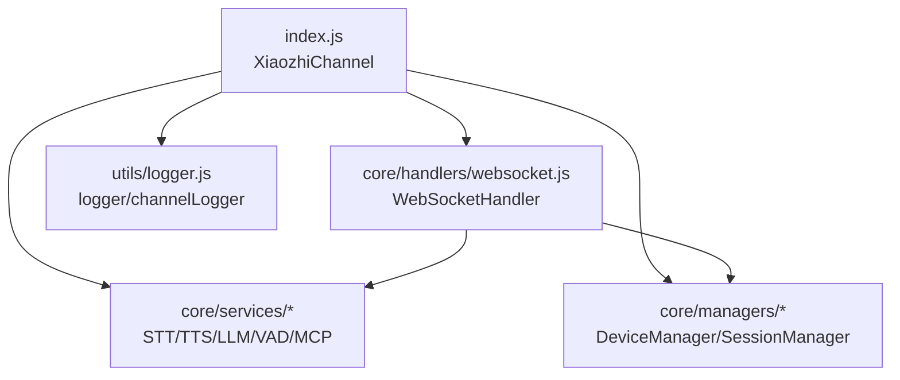
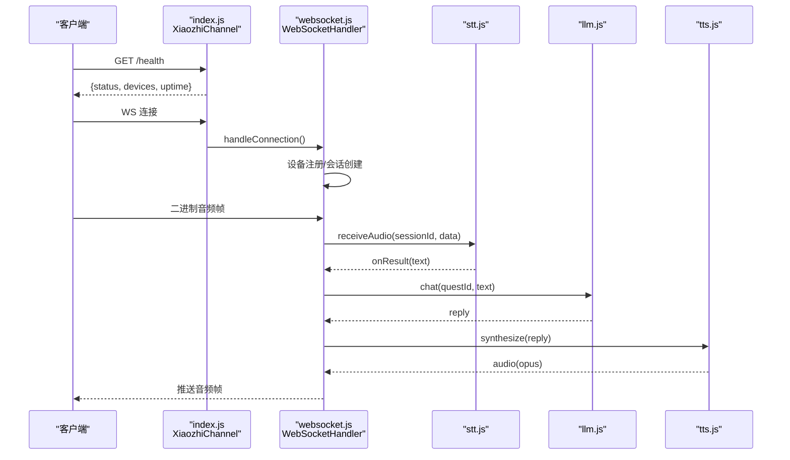
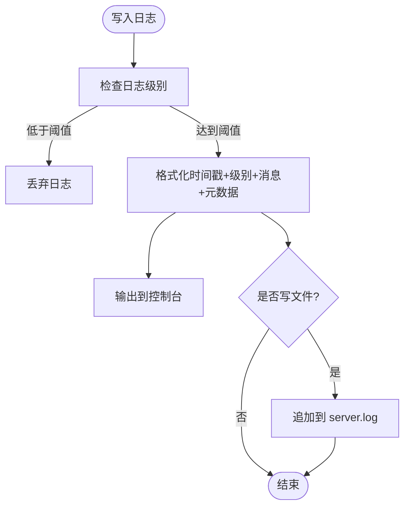
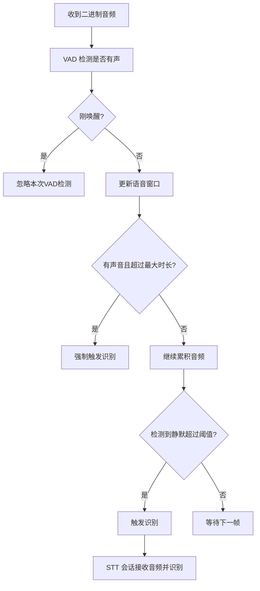
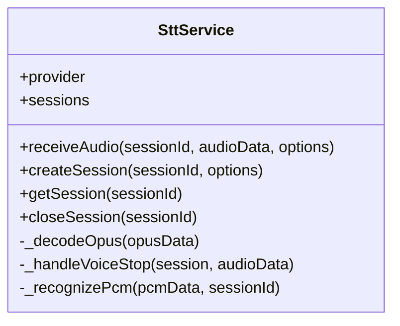
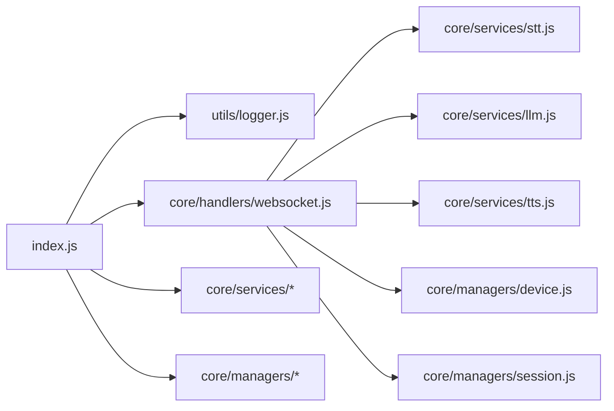

# 性能监控与分析

<cite>
**本文引用的文件**   
- [index.js](file://index.js)
- [utils/logger.js](file://utils/logger.js)
- [core/handlers/websocket.js](file://core/handlers/websocket.js)
- [core/services/base.js](file://core/services/base.js)
- [core/services/stt.js](file://core/services/stt.js)
- [core/services/tts.js](file://core/services/tts.js)
- [core/services/llm.js](file://core/services/llm.js)
- [core/managers/device.js](file://core/managers/device.js)
- [core/managers/session.js](file://core/managers/session.js)
- [package.json](file://package.json)
</cite>

## 目录
1. [引言](#引言)
2. [项目结构](#项目结构)
3. [核心组件](#核心组件)
4. [架构总览](#架构总览)
5. [详细组件分析](#详细组件分析)
6. [依赖关系分析](#依赖关系分析)
7. [性能指标与采集方案](#性能指标与采集方案)
8. [日志记录策略](#日志记录策略)
9. [性能瓶颈定位技术](#性能瓶颈定位技术)
10. [基准测试与压力测试](#基准测试与压力测试)
11. [性能回归检测](#性能回归检测)
12. [性能分析报告解读与优化建议](#性能分析报告解读与优化建议)
13. [持续性能监控体系](#持续性能监控体系)
14. [故障排查指南](#故障排查指南)
15. [结论](#结论)

## 引言
本指南面向小智语音交互服务器（xiaozhi-server）的性能监控与分析，目标是建立一套可落地的性能观测、瓶颈定位、基准压测与回归检测体系。文档基于仓库现有代码，重点围绕以下方面展开：
- 系统性能指标的收集方法
- 日志记录策略与内置 logger 的使用
- 关键路径性能测量与异常检测
- 基准测试构建、压力测试场景设计与回归检测
- 性能分析报告解读与优化建议生成
- 持续性能监控体系的搭建

## 项目结构
本项目采用“频道 + 服务 + 管理器”的分层组织方式：
- 入口与频道：index.js 暴露 XiaozhiChannel，负责 HTTP/Express、WebSocket、路由、服务初始化与生命周期管理。
- 处理器：core/handlers/websocket.js 实现 WebSocket 连接、消息分发、音频流处理、对话轮次串行化与超时保护。
- 服务层：core/services/* 提供 STT/TTS/LLM/VAD/MCP 等能力，统一继承 BaseService 的生命周期与健康检查。
- 管理器：core/managers/* 管理设备与会话状态，提供统计与清理能力。
- 工具：utils/logger.js 提供结构化日志输出与通道日志封装。

**图表来源**
- [index.js:44-125](file://index.js#L44-L125)
- [core/handlers/websocket.js:22-60](file://core/handlers/websocket.js#L22-L60)
- [core/services/base.js:2-84](file://core/services/base.js#L2-L84)
- [utils/logger.js:36-51](file://utils/logger.js#L36-L51)

**章节来源**
- [index.js:44-125](file://index.js#L44-L125)
- [package.json:1-29](file://package.json#L1-L29)

## 核心组件
- XiaozhiChannel（index.js）
  - 负责 Express/HTTP/WebSocket 启动、路由注册、服务初始化、健康检查接口 /health、设置热更新接口、广播接口、设备与会话统计接口。
  - 通过 channelLogger 记录模块初始化、启动成功与错误。
- WebSocketHandler（core/handlers/websocket.js）
  - 连接管理、协议消息分发、二进制音频处理、VAD 静默检测、会话创建、STT 触发、对话轮次串行化与超时保护。
  - 使用 logger 记录连接、设备注册、消息类型、音频数据、识别触发等关键事件。
- BaseService（core/services/base.js）
  - 统一的 initialize/destroy/healthCheck 生命周期，子类扩展具体实现。
- STT/TTS/LLM 服务
  - STT：多提供商接入（FunASR、豆包、讯飞、阿里云），Opus 解码、流式识别、会话缓冲与结果回调。
  - TTS：Edge/讯飞/阿里云，文本分段、时长估算、可选文件保存。
  - LLM：OpenAI 兼容端点直连或 dsh 桥接，支持降级回复与健康检查。
- DeviceManager/SessionManager
  - 设备在线/离线、数量上限、统计；会话创建/关闭/过期清理、客户端会话映射。

**章节来源**
- [index.js:44-125](file://index.js#L44-L125)
- [core/handlers/websocket.js:22-60](file://core/handlers/websocket.js#L22-L60)
- [core/services/base.js:2-84](file://core/services/base.js#L2-L84)
- [core/services/stt.js:39-121](file://core/services/stt.js#L39-L121)
- [core/services/tts.js:3-38](file://core/services/tts.js#L3-L38)
- [core/services/llm.js:16-65](file://core/services/llm.js#L16-L65)
- [core/managers/device.js:4-41](file://core/managers/device.js#L4-L41)
- [core/managers/session.js:4-45](file://core/managers/session.js#L4-L45)

## 架构总览
下图展示从 HTTP 请求到 WebSocket 消息处理的端到端流程，以及各服务之间的调用关系。

**图表来源**
- [index.js:287-487](file://index.js#L287-L487)
- [core/handlers/websocket.js:67-169](file://core/handlers/websocket.js#L67-L169)
- [core/handlers/websocket.js:289-446](file://core/handlers/websocket.js#L289-L446)
- [core/handlers/websocket.js:651-694](file://core/handlers/websocket.js#L651-L694)
- [core/services/stt.js:348-383](file://core/services/stt.js#L348-L383)
- [core/services/llm.js:75-104](file://core/services/llm.js#L75-L104)
- [core/services/tts.js:62-104](file://core/services/tts.js#L62-L104)

## 详细组件分析

### 日志与性能追踪基础：utils/logger.js
- 提供结构化日志级别：verbose/debug/info/warn/error，默认 info。
- 支持环境变量控制：
  - XZ_LOG_LEVEL：日志级别阈值
  - XZ_LOG_DIR：日志目录
  - XZ_LOG_TO_FILE：是否写入文件
- 提供 channelLogger 封装，用于模块初始化、启动、停止、操作与错误记录。

**图表来源**
- [utils/logger.js:17-34](file://utils/logger.js#L17-L34)

**章节来源**
- [utils/logger.js:1-54](file://utils/logger.js#L1-L54)

### WebSocket 关键路径：core/handlers/websocket.js
- 连接建立：解析 client-id/device-id/client-type，注册设备，持久化设备表。
- 消息分发：HELLO/LISTEN/ABORT/IOT/CHAT/MCP/AUDIO_DATA/WAKE_WORD_DETECTED/FRIEND。
- 音频处理：VAD 窗口判断、静默阈值、最长语音兜底、STT 会话缓冲与识别触发。
- 对话轮次串行化：turnChain 保证同一连接同时刻只有一条应答流程，TURN_TIMEOUT_MS 防止单轮挂死。
- 回声与噪音过滤：_isEchoOfSpoken/_isNoiseInput 避免误触发。

**图表来源**
- [core/handlers/websocket.js:289-446](file://core/handlers/websocket.js#L289-L446)

**章节来源**
- [core/handlers/websocket.js:67-169](file://core/handlers/websocket.js#L67-L169)
- [core/handlers/websocket.js:228-283](file://core/handlers/websocket.js#L228-L283)
- [core/handlers/websocket.js:651-694](file://core/handlers/websocket.js#L651-L694)

### 服务基类：core/services/base.js
- 提供 initialize/destroy/healthCheck 标准生命周期。
- healthCheck 返回统一的健康状态对象，便于上层聚合监控。

**章节来源**
- [core/services/base.js:2-84](file://core/services/base.js#L2-L84)

### STT 服务：core/services/stt.js
- 多提供商适配：doubao/funasr/aibridge/xunfei/aliyun。
- Opus 解码：延迟加载 opusscript，按 frameSize 正确提取有效样本。
- 会话管理：createSession/getSession/closeSession，维护音频缓冲与流式识别。
- 性能统计：在 _handleVoiceStop 中记录解码与识别耗时（调试级别）。

**图表来源**
- [core/services/stt.js:39-121](file://core/services/stt.js#L39-L121)
- [core/services/stt.js:293-383](file://core/services/stt.js#L293-L383)
- [core/services/stt.js:515-583](file://core/services/stt.js#L515-L583)

**章节来源**
- [core/services/stt.js:39-121](file://core/services/stt.js#L39-L121)
- [core/services/stt.js:293-383](file://core/services/stt.js#L293-L383)
- [core/services/stt.js:515-583](file://core/services/stt.js#L515-L583)

### TTS 服务：core/services/tts.js
- 文本清理与分段：去除 Markdown、按标点分割。
- 合成与时长估算：Edge/讯飞/阿里云，估算中文/英文/标点发音时长。
- 可选文件保存：临时文件清理与输出目录管理。

**章节来源**
- [core/services/tts.js:3-38](file://core/services/tts.js#L3-L38)
- [core/services/tts.js:62-104](file://core/services/tts.js#L62-L104)
- [core/services/tts.js:163-202](file://core/services/tts.js#L163-L202)

### LLM 服务：core/services/llm.js
- provider 模式：openai（直连 OpenAI 兼容端点）、dsh（经桥接）。
- 健康检查与降级回复：不可用时返回友好提示，不阻断主流程。
- 对话历史维护：限制长度，构建 messages 列表。

**章节来源**
- [core/services/llm.js:16-65](file://core/services/llm.js#L16-L65)
- [core/services/llm.js:75-104](file://core/services/llm.js#L75-L104)
- [core/services/llm.js:121-160](file://core/services/llm.js#L121-L160)
- [core/services/llm.js:166-203](file://core/services/llm.js#L166-L203)
- [core/services/llm.js:211-252](file://core/services/llm.js#L211-L252)

### 设备与会话管理：core/managers/device.js & session.js
- DeviceManager：设备添加/更新/移除、在线统计、批量操作、离线清理。
- SessionManager：会话创建/关闭/活动更新、过期清理、客户端会话映射、批量关闭。

**章节来源**
- [core/managers/device.js:4-41](file://core/managers/device.js#L4-L41)
- [core/managers/device.js:118-136](file://core/managers/device.js#L118-L136)
- [core/managers/session.js:4-45](file://core/managers/session.js#L4-L45)
- [core/managers/session.js:117-138](file://core/managers/session.js#L117-L138)

## 依赖关系分析
- index.js 作为频道入口，依赖：
  - utils/logger.js：channelLogger 记录生命周期与错误。
  - core/handlers/websocket.js：WebSocket 连接与消息处理。
  - core/services/*：STT/TTS/LLM/VAD/MCP 服务初始化与调用。
  - core/managers/*：设备与会话管理。
- websocket.js 依赖：
  - utils/logger.js：关键路径日志。
  - core/services/stt.js：音频接收与识别。
  - core/services/llm.js：对话生成。
  - core/services/tts.js：语音合成。
  - core/managers/device.js/session.js：设备与会话状态。

**图表来源**
- [index.js:13-27](file://index.js#L13-L27)
- [core/handlers/websocket.js:1-15](file://core/handlers/websocket.js#L1-L15)

**章节来源**
- [index.js:13-27](file://index.js#L13-L27)
- [core/handlers/websocket.js:1-15](file://core/handlers/websocket.js#L1-L15)

## 性能指标与采集方案
结合现有代码，建议采集以下指标：
- 系统级
  - 进程运行时长：/health 接口返回 uptime。
  - 设备在线数：deviceManager.getStats().online。
  - 会话活跃数：sessionManager.getActiveSessions().length。
- 网络与连接
  - WebSocket 连接数：deviceManager.getAllDevices().length。
  - 连接建立耗时：在 handleConnection 中记录 ws.connectedAt 与首次消息到达时间差。
- 音频处理
  - VAD 窗口大小与有声音比例：ws.clientVoiceWindow 长度与计数。
  - 静默阈值命中次数：每次触发识别时记录。
  - 最长语音兜底触发次数：MAX_UTTERANCE_MS 分支命中计数。
- STT
  - 解码耗时：_decodeOpusFrames 与 _handleVoiceStop 中的计时。
  - 识别耗时：_recognizePcm 的响应时间。
  - 缓冲区大小：session.audioBuffer.length。
- LLM
  - 调用耗时：chat/chatViaOpenai/chatViaDsh 的请求/响应时间。
  - 失败率：非 2xx 响应与空回复占比。
- TTS
  - 合成耗时：synthesize 的起止时间。
  - 时长估算误差：估算时长与实际播放时长对比（需前端配合）。
- 业务关键路径
  - 一轮对话总耗时：从用户输入到音频首帧发送的时间。
  - 轮次串行化队列长度：turnChain 链深度（可通过 Promise 链长度近似）。
  - 超时次数：TURN_TIMEOUT_MS 触发次数。

采集建议：
- 在关键函数入口/出口使用 channelLogger.logOperation 记录耗时与上下文（sessionId、deviceId、provider、model）。
- 对高频路径（如音频帧处理）使用 debug 级别日志，避免生产环境 IO 开销过大。
- 将关键指标汇总到 /api/metrics（可扩展）供 Prometheus/Grafana 抓取。

**章节来源**
- [index.js:287-300](file://index.js#L287-L300)
- [core/handlers/websocket.js:289-446](file://core/handlers/websocket.js#L289-L446)
- [core/services/stt.js:515-583](file://core/services/stt.js#L515-L583)
- [core/services/llm.js:121-160](file://core/services/llm.js#L121-L160)
- [core/services/tts.js:62-104](file://core/services/tts.js#L62-L104)

## 日志记录策略
- 日志级别
  - verbose：仅开发调试，生产禁用。
  - debug：关键路径细节（如 VAD 窗口、Opus 解码警告）。
  - info：模块初始化、启动、设备注册、会话创建、识别触发。
  - warn：配置缺失、阈值越界、降级行为。
  - error：异常堆栈、外部服务不可达、内部错误。
- 结构化元数据
  - 所有日志附带 sessionId、deviceId、clientId、provider、model 等上下文。
  - 使用 channelLogger.logModuleInit/logModuleStart/logModuleStop/logOperation/logModuleError 统一格式。
- 文件输出
  - 通过 XZ_LOG_DIR 与 XZ_LOG_TO_FILE 控制日志落盘，便于离线分析与审计。
- 敏感信息脱敏
  - 避免在日志中输出 apiKey、token、完整音频数据。

**章节来源**
- [utils/logger.js:17-51](file://utils/logger.js#L17-L51)
- [index.js:52-57](file://index.js#L52-L57)
- [core/handlers/websocket.js:77-163](file://core/handlers/websocket.js#L77-L163)

## 性能瓶颈定位技术
- 热点路径识别
  - 音频帧处理：VAD 检测、Opus 解码、STT 识别、LLM 调用、TTS 合成。
  - 会话与设备管理：Map 操作、统计计算、过期清理。
- 耗时分解
  - 使用 channelLogger.logOperation 在关键步骤前后打点，计算阶段耗时。
  - 对 STT 的解码与识别分别计时，区分 CPU 密集与网络 IO。
- 外部依赖
  - FunASR/豆包/讯飞/阿里云/LLM 端点的连通性与延迟。
  - 通过健康检查与探活逻辑（如 STT 的 _probeFunAsrConnection、LLM 的 fetch models/health）快速定位外部问题。
- 资源泄漏
  - 检查 WebSocket 连接未关闭、STT 会话未释放、TTS 临时文件未清理。
- 并发与阻塞
  - turnChain 串行化避免音频帧交错，但过长队列会导致延迟上升。
  - TURN_TIMEOUT_MS 防止单轮挂死，需关注超时频率。

**章节来源**
- [core/handlers/websocket.js:651-694](file://core/handlers/websocket.js#L651-L694)
- [core/services/stt.js:208-241](file://core/services/stt.js#L208-L241)
- [core/services/llm.js:30-65](file://core/services/llm.js#L30-L65)

## 基准测试与压力测试
- 基准测试（单路）
  - 目标：测量一轮对话的端到端耗时（用户输入→LLM→TTS→首帧）。
  - 方法：构造固定文本，重复 N 次，统计 P50/P90/P99 耗时。
  - 指标：STT 解码/识别耗时、LLM 调用耗时、TTS 合成耗时。
- 压力测试（多路）
  - 目标：模拟 M 个设备同时连接，持续发送音频帧。
  - 方法：使用脚本或工具（如 autocannon、wrk、自定义 Node 脚本）并发建立 WebSocket 连接，循环发送 HELLO/AUDIO_DATA/LISTEN。
  - 指标：QPS、连接数、内存占用、CPU 使用率、错误率、超时次数。
- 回归检测
  - 在 CI 中执行基准测试，对比历史基线，若 P95 耗时增长超过阈值则告警。
  - 记录每次压测的环境（Node 版本、硬件、提供商模型），确保可比性。

[本节为通用指导，不直接分析具体文件]

## 性能回归检测
- 基线定义
  - 以稳定版本的基准测试结果作为基线，记录关键指标（P50/P90/P99、错误率、资源使用）。
- 自动化对比
  - 在每次提交或发布前执行基准测试，自动对比基线，差异超阈则标记为回归。
- 报告输出
  - 生成 JSON/CSV 报告，包含测试环境、指标、差异百分比、趋势图。
- 告警与回滚
  - 集成 CI/CD，回归时阻断合并或发布，通知团队进行根因分析。

[本节为通用指导，不直接分析具体文件]

## 性能分析报告解读与优化建议
- 报告解读
  - 关注长尾延迟（P95/P99）而非仅平均值。
  - 区分 CPU 密集（Opus 解码、文本处理）与网络 IO（STT/LLM/TTS 调用）。
  - 观察外部依赖的错误率与超时率。
- 优化建议
  - STT：优化 Opus 解码参数，减少无效帧；调整 VAD 阈值降低误触发。
  - LLM：缓存常见回复、缩短历史长度、选择更快模型或本地推理。
  - TTS：预取常用语音、并行合成片段、减少文件 IO。
  - 连接管理：及时清理离线设备与会话，避免 Map 膨胀。
  - 日志：生产环境降低日志级别，避免频繁 IO。

[本节为通用指导，不直接分析具体文件]

## 持续性能监控体系
- 指标采集
  - 在 /health 与 /api/devices/stats 等接口暴露关键指标，供监控系统抓取。
  - 扩展 /api/metrics 输出 Prometheus 格式指标。
- 可视化
  - 使用 Grafana 展示 QPS、延迟分布、错误率、资源使用。
- 告警
  - 设置阈值告警：错误率、超时率、内存/CPU 使用率、连接数。
- 日志聚合
  - 使用 ELK/ Loki 聚合日志，关联 sessionId/deviceId 进行链路追踪。
- 容量规划
  - 根据压测结果评估单机承载能力，横向扩展节点。

[本节为通用指导，不直接分析具体文件]

## 故障排查指南
- 常见问题
  - FunASR 不可达：检查 FUNASR_HOST/FUNASR_PORT，或使用 FUNASR_SKIP_STARTUP_CHECK 跳过校验。
  - LLM 端点不可用：检查 AIBRIDGE_API_KEY 与 baseUrl，启用 fallbackBaseUrl。
  - TTS 合成失败：检查 node-edge-tts 安装与权限。
  - 音频解码异常：检查 Opus 帧大小与采样率匹配。
- 排查步骤
  - 查看 channelLogger 日志，定位模块初始化与错误堆栈。
  - 检查 /health 与 /api/devices/stats 接口返回。
  - 开启 debug 日志，观察 VAD 窗口与识别触发。
  - 使用浏览器开发者工具或抓包工具分析 WebSocket 消息。

**章节来源**
- [core/services/stt.js:185-201](file://core/services/stt.js#L185-L201)
- [core/services/llm.js:30-65](file://core/services/llm.js#L30-L65)
- [core/services/tts.js:40-49](file://core/services/tts.js#L40-L49)
- [core/services/stt.js:419-477](file://core/services/stt.js#L419-L477)

## 结论
通过系统化采集性能指标、规范日志记录、定位关键路径瓶颈、构建基准与压力测试、实施回归检测与持续监控，可以显著提升小智语音交互服务器的稳定性与性能表现。建议在生产环境中逐步落地上述方案，并结合业务特性持续优化。