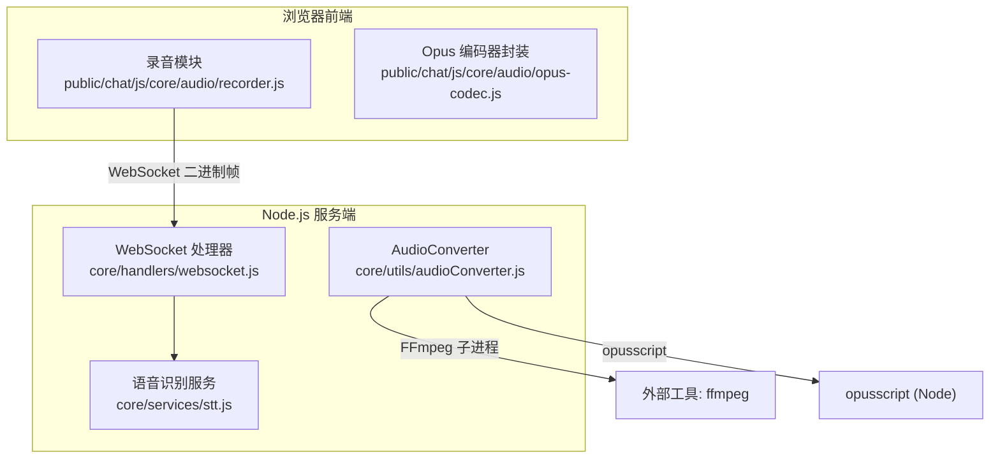
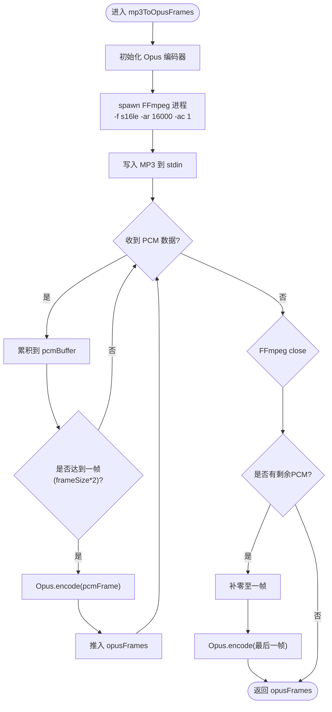
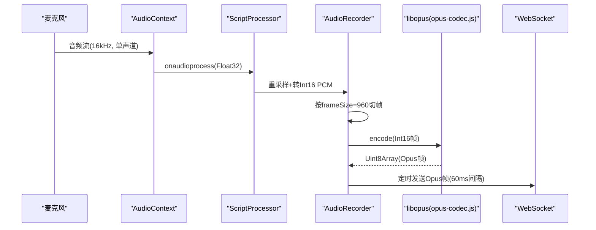
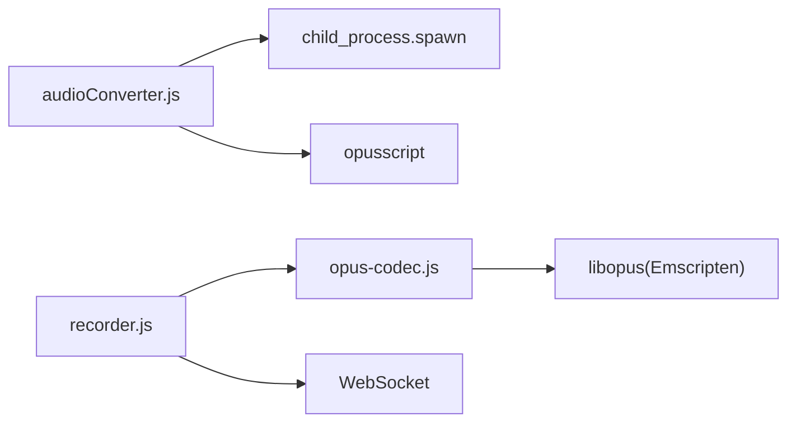

# 音频处理优化

<cite>
**本文引用的文件**   
- [core/utils/audioConverter.js](file://core/utils/audioConverter.js)
- [public/chat/js/core/audio/opus-codec.js](file://public/chat/js/core/audio/opus-codec.js)
- [public/chat/js/core/audio/recorder.js](file://public/chat/js/core/audio/recorder.js)
- [core/handlers/websocket.js](file://core/handlers/websocket.js)
- [core/services/stt.js](file://core/services/stt.js)
</cite>

## 目录
1. [引言](#引言)
2. [项目结构](#项目结构)
3. [核心组件](#核心组件)
4. [架构总览](#架构总览)
5. [详细组件分析](#详细组件分析)
6. [依赖关系分析](#依赖关系分析)
7. [性能与内存优化](#性能与内存优化)
8. [故障排查指南](#故障排查指南)
9. [结论](#结论)
10. [附录：参数与最佳实践](#附录参数与最佳实践)

## 引言
本文件聚焦于服务端与前端协作的音频处理链路，重点解析 AudioConverter 类的实现原理、MP3 到 Opus 的转换流程、FFmpeg 进程管理、Opus 编码器配置、音频帧处理策略、缓冲区管理与内存优化技术。同时给出不同音频格式的性能调优建议、编码质量与压缩率的平衡策略，以及大文件与流式音频处理的优化方案。

## 项目结构
本项目在 Node.js 后端通过 FFmpeg 子进程完成任意音频格式到 PCM 的转码，再使用 opusscript 将 PCM 编码为 Opus 帧；在前端浏览器侧，通过 WebAudio + libopus（Emscripten）进行实时录音与编码，并通过 WebSocket 传输。



图示来源
- [core/utils/audioConverter.js:11-106](file://core/utils/audioConverter.js#L11-L106)
- [core/handlers/websocket.js:1890-1895](file://core/handlers/websocket.js#L1890-L1895)
- [core/services/stt.js:533-535](file://core/services/stt.js#L533-L535)
- [public/chat/js/core/audio/recorder.js:138-204](file://public/chat/js/core/audio/recorder.js#L138-L204)
- [public/chat/js/core/audio/opus-codec.js:44-103](file://public/chat/js/core/audio/opus-codec.js#L44-L103)

章节来源
- [core/utils/audioConverter.js:11-235](file://core/utils/audioConverter.js#L11-L235)
- [public/chat/js/core/audio/recorder.js:1-646](file://public/chat/js/core/audio/recorder.js#L1-L646)
- [public/chat/js/core/audio/opus-codec.js:1-182](file://public/chat/js/core/audio/opus-codec.js#L1-L182)
- [core/handlers/websocket.js:1890-1895](file://core/handlers/websocket.js#L1890-L1895)
- [core/services/stt.js:533-535](file://core/services/stt.js#L533-L535)

## 核心组件
- AudioConverter（Node 端）
  - 负责将 MP3 或其他音频格式通过 FFmpeg 转为 s16le PCM，再以固定帧长（默认 60ms，16kHz 单声道）用 opusscript 编码为 Opus 帧数组。
  - 提供 mp3ToOpusFrames 与 convertToOpusFrames 两个对外方法，支持可配置的采样率、声道数与帧时长。
- 前端录音与编码
  - recorder.js 基于 AudioContext 采集麦克风数据，按 16kHz 单声道重采样并转换为 Int16 PCM，以 60ms 帧长切分后调用 opus-codec.js 中的 libopus 编码器生成 Opus 帧，定时通过 WebSocket 发送。
  - opus-codec.js 封装了 Emscripten 编译的 libopus，设置比特率、复杂度、DTX 等参数，并在 HEAP 上分配/释放内存。

章节来源
- [core/utils/audioConverter.js:11-235](file://core/utils/audioConverter.js#L11-L235)
- [public/chat/js/core/audio/recorder.js:28-45](file://public/chat/js/core/audio/recorder.js#L28-L45)
- [public/chat/js/core/audio/opus-codec.js:44-103](file://public/chat/js/core/audio/opus-codec.js#L44-L103)

## 架构总览
下图展示从 MP3 到 Opus 的端到端转换流程，包括 FFmpeg 子进程、PCM 缓冲、Opus 编码与错误处理。

```mermaid
sequenceDiagram
participant Caller as "调用方"
participant AC as "AudioConverter"
participant FF as "FFmpeg 进程"
participant ENC as "Opus 编码器(opusscript)"
Caller->>AC : mp3ToOpusFrames(mp3Buffer)
AC->>ENC : 创建编码器(16kHz, 单声道)
AC->>FF : spawn('ffmpeg', ['-i pipe : 0','-f s16le','-ar 16000','-ac 1','pipe : 1'])
AC->>FF : stdin.write(mp3Buffer); stdin.end()
FF-->>AC : stdout.data(PCM块)
AC->>AC : 累积PCM至frameSize*2字节
AC->>ENC : encode(pcmFrame, frameSize)
ENC-->>AC : Opus帧
FF-->>AC : close(code)
AC->>AC : 处理尾部不足一帧的数据(补零)
AC-->>Caller : 返回Opus帧数组
```

图示来源
- [core/utils/audioConverter.js:25-106](file://core/utils/audioConverter.js#L25-L106)

## 详细组件分析

### AudioConverter 类
- 设计要点
  - 固定参数：采样率 16000Hz、单声道、帧时长 60ms（对应每帧 960 个样本）。
  - 两种入口：
    - mp3ToOpusFrames：专用于 MP3 输入，内部统一走 FFmpeg -> PCM -> Opus。
    - convertToOpusFrames：通用音频输入，支持自定义采样率、声道数与帧时长。
  - 内部还暴露 encodePcmToOpus，直接对已有 PCM Buffer 做批量编码。
- 关键流程
  - 启动 FFmpeg 子进程，指定输出为 s16le、16kHz、单声道，从 stdin 读取输入，stdout 输出 PCM。
  - 在 stdout.data 回调中累积 PCM，按 frameSize*2 字节切分，逐帧调用 Opus 编码器。
  - 在 close 事件中处理剩余不足一帧的数据（补零），确保最后一帧完整。
  - 错误处理：捕获 FFmpeg 退出码非 0 的情况，记录 stderr 并 reject；捕获 Opus 编码异常并记录日志。
- 性能与内存
  - 使用 Buffer.concat 累积 PCM，避免频繁小对象分配；但需注意在大文件场景下可能产生多次拷贝。
  - 每帧编码后立即 push 到结果数组，便于后续网络发送或落盘。
  - 最后一帧补零保证编码器稳定，避免丢尾。



图示来源
- [core/utils/audioConverter.js:25-106](file://core/utils/audioConverter.js#L25-L106)

章节来源
- [core/utils/audioConverter.js:11-235](file://core/utils/audioConverter.js#L11-L235)

### 前端录音与编码（recorder.js + opus-codec.js）
- 录音管线
  - 通过 getUserMedia 获取 16kHz 单声道音频流，必要时进行重采样。
  - 将 Float32 转换为 Int16 PCM，按 960 样本（60ms）切分为帧。
  - 使用 initOpusEncoder 创建的 libopus 编码器进行编码，得到 Uint8Array 形式的 Opus 帧。
  - 通过 setInterval 每 60ms 从发送队列取出一帧经 WebSocket 发送。
- 编码器配置
  - 采样率 16kHz，单声道，应用类型 VOIP。
  - 比特率 16kbps，复杂度 5，启用 DTX（静音不传）。
  - 在 HEAP 上分配/释放编码器与输入输出缓冲区，避免内存泄漏。



图示来源
- [public/chat/js/core/audio/recorder.js:138-204](file://public/chat/js/core/audio/recorder.js#L138-L204)
- [public/chat/js/core/audio/opus-codec.js:44-103](file://public/chat/js/core/audio/opus-codec.js#L44-L103)

章节来源
- [public/chat/js/core/audio/recorder.js:1-646](file://public/chat/js/core/audio/recorder.js#L1-L646)
- [public/chat/js/core/audio/opus-codec.js:1-182](file://public/chat/js/core/audio/opus-codec.js#L1-L182)

### 服务端 WebSocket 与 STT 集成
- WebSocket 处理器在接收客户端音频帧时，会维护 PCM 缓冲区并进行拼接，随后交给 STT 服务处理。
- STT 服务在需要时将多段 PCM 合并为连续 PCM 供识别引擎使用。

章节来源
- [core/handlers/websocket.js:1890-1895](file://core/handlers/websocket.js#L1890-L1895)
- [core/services/stt.js:533-535](file://core/services/stt.js#L533-L535)

## 依赖关系分析
- Node 端
  - child_process.spawn 调用系统 ffmpeg 可执行文件，需确保环境变量 PATH 包含 ffmpeg。
  - opusscript 提供 C++ 绑定的 Opus 编码器，适合 Node 环境的高性能编码。
- 前端
  - libopus（Emscripten）通过 ModuleInstance 暴露 API，需在页面加载前正确引入并初始化。
  - AudioContext 与 ScriptProcessorNode 用于低延迟音频采集与处理。



图示来源
- [core/utils/audioConverter.js:1-4](file://core/utils/audioConverter.js#L1-L4)
- [public/chat/js/core/audio/recorder.js:1-4](file://public/chat/js/core/audio/recorder.js#L1-L4)
- [public/chat/js/core/audio/opus-codec.js:1-3](file://public/chat/js/core/audio/opus-codec.js#L1-L3)

章节来源
- [core/utils/audioConverter.js:1-4](file://core/utils/audioConverter.js#L1-L4)
- [public/chat/js/core/audio/recorder.js:1-4](file://public/chat/js/core/audio/recorder.js#L1-L4)
- [public/chat/js/core/audio/opus-codec.js:1-3](file://public/chat/js/core/audio/opus-codec.js#L1-L3)

## 性能与内存优化

### FFmpeg 进程管理
- 优点
  - 利用系统级解码器，兼容多种音频格式，减少 Node 端解码复杂度。
- 风险与建议
  - 每次转换都会 spawn 新进程，存在进程开销。对于批量或高频转换，建议复用进程或使用管道化批处理。
  - 严格监听 close 与 error 事件，及时清理资源，避免僵尸进程。
  - 限制并发数量，防止系统负载过高。

章节来源
- [core/utils/audioConverter.js:34-40](file://core/utils/audioConverter.js#L34-L40)
- [core/utils/audioConverter.js:68-96](file://core/utils/audioConverter.js#L68-L96)

### Opus 编码器配置
- 推荐参数
  - 采样率：16kHz；声道：单声道；帧时长：60ms（960 样本）。
  - 比特率：16kbps（兼顾清晰度与带宽）；复杂度：5（平衡 CPU 与质量）；启用 DTX（静音不传）。
- 质量与压缩率平衡
  - 提高比特率可提升音质但增加带宽；降低复杂度可降低 CPU 占用但可能影响音质。
  - 在弱网环境下优先保障稳定性，适当降低比特率并开启 VBR（若库支持）。

章节来源
- [public/chat/js/core/audio/opus-codec.js:57-103](file://public/chat/js/core/audio/opus-codec.js#L57-L103)

### 音频帧处理策略
- 帧大小
  - 60ms 帧在实时交互中延迟较低，且能较好平衡编码效率与网络包大小。
- 尾部帧处理
  - 不足一帧时补零，保证编码器稳定，避免丢尾或播放中断。

章节来源
- [core/utils/audioConverter.js:75-88](file://core/utils/audioConverter.js#L75-L88)
- [public/chat/js/core/audio/recorder.js:324-358](file://public/chat/js/core/audio/recorder.js#L324-L358)

### 缓冲区管理与内存优化
- 当前实现
  - 使用 Buffer.concat 累积 PCM，避免频繁小对象分配；但在大文件场景下会产生多次拷贝。
- 优化建议
  - 使用双缓冲或环形缓冲，减少 concat 次数。
  - 对超大文件采用分片处理，控制单次处理大小，避免峰值内存过高。
  - 及时释放不再使用的 Buffer 引用，避免 GC 压力。

章节来源
- [core/utils/audioConverter.js:42-61](file://core/utils/audioConverter.js#L42-L61)
- [core/utils/audioConverter.js:133-151](file://core/utils/audioConverter.js#L133-L151)

### 大文件与流式音频处理
- 大文件
  - 建议分块读取文件，逐块送入 FFmpeg 管道，避免一次性加载整个文件到内存。
  - 对输出 Opus 帧进行流式落盘或分段上传，降低内存峰值。
- 流式音频
  - 保持 60ms 帧节奏，结合定时器发送，避免堆积。
  - 在网络抖动时启用丢帧策略（丢弃非关键帧）以保证实时性。

章节来源
- [core/utils/audioConverter.js:114-194](file://core/utils/audioConverter.js#L114-L194)
- [public/chat/js/core/audio/recorder.js:211-232](file://public/chat/js/core/audio/recorder.js#L211-L232)

## 故障排查指南
- FFmpeg 未找到或权限问题
  - 现象：spawn 报错或进程立即退出。
  - 排查：确认 PATH 包含 ffmpeg，具备执行权限；检查 stderr 输出。
- FFmpeg 退出码非 0
  - 现象：reject 抛出“FFmpeg进程退出码”错误。
  - 排查：查看 stderrData，常见原因包括输入格式不支持、参数错误。
- Opus 编码失败
  - 现象：日志打印“Opus编码帧失败”。
  - 排查：检查 PCM 帧长度是否为 frameSize*2，数据类型是否为 s16le。
- 前端 Opus 库未加载
  - 现象：initOpusEncoder 报“ModuleInstance不可用”或“Opus库未加载”。
  - 排查：确认 libopus.js 已正确加载，ModuleInstance 可用。

章节来源
- [core/utils/audioConverter.js:64-96](file://core/utils/audioConverter.js#L64-L96)
- [core/utils/audioConverter.js:153-184](file://core/utils/audioConverter.js#L153-L184)
- [public/chat/js/core/audio/opus-codec.js:4-39](file://public/chat/js/core/audio/opus-codec.js#L4-L39)

## 结论
AudioConverter 通过 FFmpeg 与 opusscript 的组合，实现了稳定高效的 MP3 到 Opus 转换。配合前端的实时录音与编码，整体链路在低延迟与高兼容性之间取得良好平衡。针对大文件与流式场景，建议进一步优化进程复用、缓冲策略与内存管理，并根据网络与设备能力动态调整编码参数，以达到质量与性能的更优平衡。

## 附录：参数与最佳实践
- 推荐参数
  - 采样率：16kHz；声道：单声道；帧时长：60ms；比特率：16kbps；复杂度：5；启用 DTX。
- 不同格式优化建议
  - MP3：优先使用 FFmpeg 解码为 PCM，再统一编码为 Opus，保证一致性。
  - WAV/PCM：可直接送入 Opus 编码器，跳过 FFmpeg 阶段以降低延迟。
  - AAC/FLAC：同样通过 FFmpeg 转 PCM，注意容器头解析开销。
- 质量与压缩率平衡
  - 在带宽受限场景优先保稳定，适当降低比特率；在高质量需求场景提升比特率与复杂度。
- 大文件与流式处理
  - 分块处理、双缓冲、限制并发、及时释放引用，避免内存峰值。
  - 网络抖动时启用丢帧策略，保证实时性。

章节来源
- [public/chat/js/core/audio/opus-codec.js:57-103](file://public/chat/js/core/audio/opus-codec.js#L57-L103)
- [core/utils/audioConverter.js:114-194](file://core/utils/audioConverter.js#L114-L194)