# 扩展与定制

<cite>
**本文引用的文件**   
- [index.js](file://index.js)
- [config/loader.js](file://config/loader.js)
- [core/services/base.js](file://core/services/base.js)
- [core/services/stt.js](file://core/services/stt.js)
- [core/services/tts.js](file://core/services/tts.js)
- [core/services/llm.js](file://core/services/llm.js)
- [core/services/vad.js](file://core/services/vad.js)
- [core/services/voiceprint.js](file://core/services/voiceprint.js)
- [core/services/mcp.js](file://core/services/mcp.js)
- [core/handlers/websocket.js](file://core/handlers/websocket.js)
- [package.json](file://package.json)
</cite>

## 目录
1. [引言](#引言)
2. [项目结构与插件化架构总览](#项目结构与插件化架构总览)
3. [核心组件与服务扩展机制](#核心组件与服务扩展机制)
4. [架构总览与数据流](#架构总览与数据流)
5. [详细组件分析与扩展点](#详细组件分析与扩展点)
6. [依赖关系分析](#依赖关系分析)
7. [性能与稳定性考虑](#性能与稳定性考虑)
8. [常见问题与排错指南](#常见问题与排错指南)
9. [结论与最佳实践](#结论与最佳实践)

## 引言
本指南面向需要在小智语音交互服务中进行二次开发与第三方集成的开发者。文档围绕“插件化架构、服务扩展机制、第三方集成方法”展开，说明如何创建自定义 STT/TTS 服务、扩展业务逻辑、接入 MCP 工具，以及如何进行中间件式能力增强。文中所有实现细节均基于仓库现有代码结构进行分析与归纳，帮助你在不破坏系统稳定性的前提下完成功能定制。

## 项目结构与插件化架构总览
小智服务器采用“频道 + 服务 + 处理器”的分层组织方式：
- 频道入口负责启动 HTTP/WS 服务、装配核心服务、暴露管理 API。
- 服务层提供 STT/TTS/LLM/VAD/声纹/MCP 等可插拔能力。
- WebSocket 处理器编排设备连接、音频流、会话、对话轮次与 TTS 播放。
- 配置加载器统一从配置文件与环境变量注入参数。

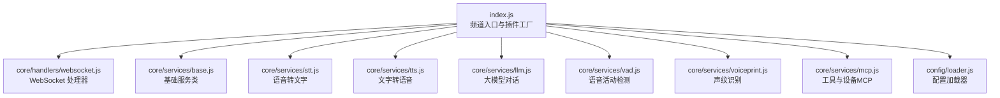

**图表来源**
- [index.js:44-249](file://index.js#L44-L249)
- [core/handlers/websocket.js:22-60](file://core/handlers/websocket.js#L22-L60)
- [core/services/base.js:2-85](file://core/services/base.js#L2-L85)
- [config/loader.js:13-223](file://config/loader.js#L13-L223)

**章节来源**
- [index.js:44-249](file://index.js#L44-L249)
- [config/loader.js:13-223](file://config/loader.js#L13-L223)

## 核心组件与服务扩展机制
### 基础服务抽象
所有核心服务继承自基础服务类，具备统一的初始化、销毁、健康检查与配置更新能力。扩展新服务时，应遵循该基类的生命周期约定：
- 通过构造函数接收配置并设置默认值。
- 在 `_initialize` 中完成外部依赖准备（如网络连通性探测）。
- 在 `_healthCheck` 中返回运行状态。
- 使用 `updateConfig` 支持运行时配置热更新。

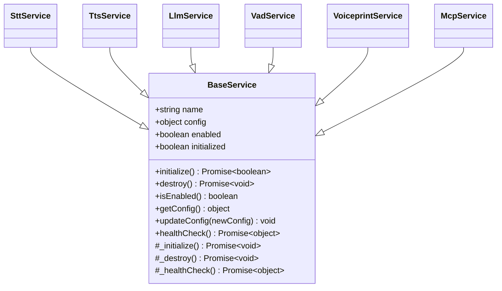

**图表来源**
- [core/services/base.js:2-85](file://core/services/base.js#L2-L85)
- [core/services/stt.js:39-121](file://core/services/stt.js#L39-L121)
- [core/services/tts.js:3-38](file://core/services/tts.js#L3-L38)
- [core/services/llm.js:16-65](file://core/services/llm.js#L16-L65)
- [core/services/vad.js:3-16](file://core/services/vad.js#L3-L16)
- [core/services/voiceprint.js:15-78](file://core/services/voiceprint.js#L15-L78)
- [core/services/mcp.js:149-174](file://core/services/mcp.js#L149-L174)

**章节来源**
- [core/services/base.js:2-85](file://core/services/base.js#L2-L85)

### 插件工厂与元数据
频道入口导出插件元数据、配置 Schema 与工厂函数，便于上层框架或部署工具动态装配：
- `pluginMetadata`：描述插件 ID、名称、类型、分类等。
- `pluginConfigSchema`：定义端口、主机、STT/TTS/LLM 的配置项。
- `createPlugin(config, bus)`：合并配置并返回频道实例。

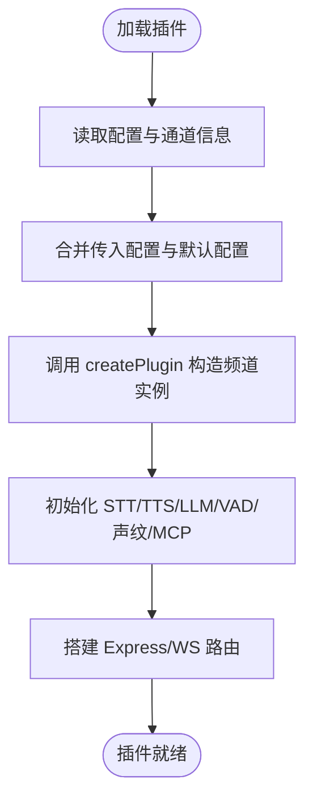

**图表来源**
- [index.js:604-706](file://index.js#L604-L706)
- [index.js:180-249](file://index.js#L180-L249)

**章节来源**
- [index.js:604-706](file://index.js#L604-L706)

## 架构总览与数据流
### 请求处理主流程
设备通过 WebSocket 连接后，服务端进行设备注册、会话创建、VAD 检测、STT 识别、LLM 生成回复、TTS 合成与播放。关键路径如下：

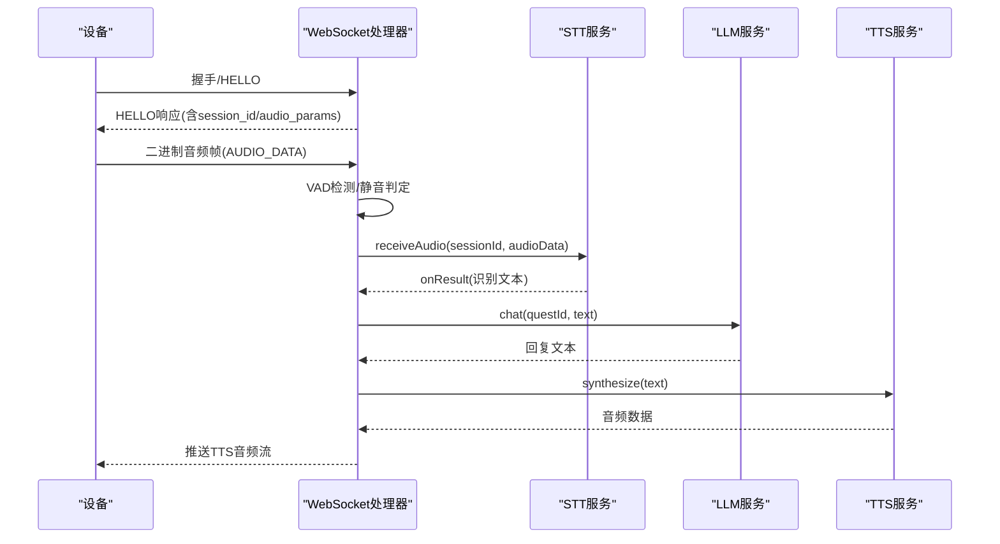

**图表来源**
- [core/handlers/websocket.js:67-169](file://core/handlers/websocket.js#L67-L169)
- [core/handlers/websocket.js:289-446](file://core/handlers/websocket.js#L289-L446)
- [core/handlers/websocket.js:651-793](file://core/handlers/websocket.js#L651-L793)
- [core/services/stt.js:348-583](file://core/services/stt.js#L348-L583)
- [core/services/llm.js:75-160](file://core/services/llm.js#L75-L160)
- [core/services/tts.js:62-104](file://core/services/tts.js#L62-L104)

**章节来源**
- [core/handlers/websocket.js:67-169](file://core/handlers/websocket.js#L67-L169)
- [core/handlers/websocket.js:289-446](file://core/handlers/websocket.js#L289-L446)
- [core/handlers/websocket.js:651-793](file://core/handlers/websocket.js#L651-L793)

## 详细组件分析与扩展点
### STT 服务扩展（语音转文字）
STT 服务支持多种提供商（如 FunASR、豆包、讯飞、阿里云），并通过配置选择具体实现。扩展建议：
- 新增提供商：在初始化分支中添加新的 provider 分支，并在识别分发处增加对应实现。
- 流式识别：保持会话级 WebSocket 管理与音频帧发送逻辑一致。
- 错误降级：当外部服务不可用时，可启用模拟模式或回退策略，避免阻塞整体流程。

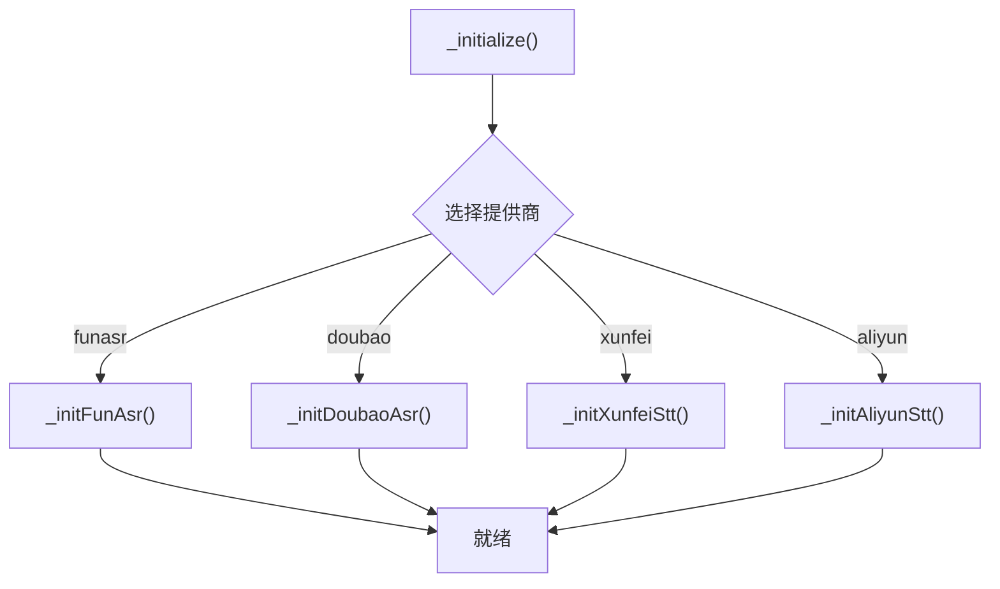

**图表来源**
- [core/services/stt.js:89-121](file://core/services/stt.js#L89-L121)
- [core/services/stt.js:123-285](file://core/services/stt.js#L123-L285)

**章节来源**
- [core/services/stt.js:39-121](file://core/services/stt.js#L39-L121)
- [core/services/stt.js:123-285](file://core/services/stt.js#L123-L285)

### TTS 服务扩展（文字转语音）
TTS 服务以提供商为中心进行切换，当前支持 Edge、讯飞、阿里云。扩展建议：
- 新增提供商：在 `_initialize` 与 `synthesize` 的 switch 分支中添加新实现。
- 流式合成：复用 `synthesizeStream` 的分段与回调机制，按标点切分文本并逐步输出音频。
- 输出控制：可通过 `saveAudioFiles` 与 `outputDir` 控制是否保存音频文件及存储位置。

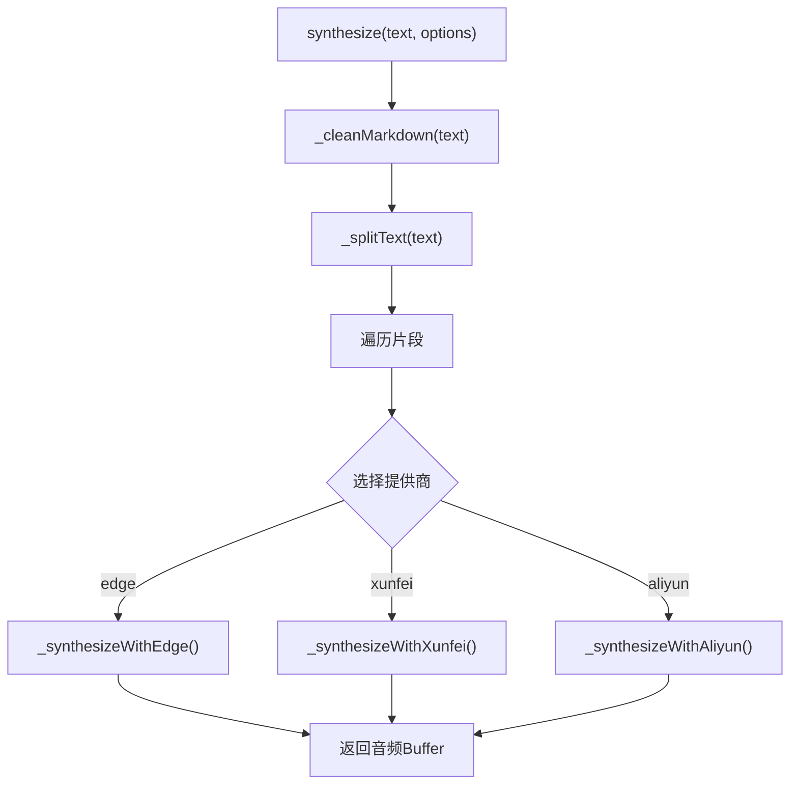

**图表来源**
- [core/services/tts.js:62-104](file://core/services/tts.js#L62-L104)
- [core/services/tts.js:106-161](file://core/services/tts.js#L106-L161)
- [core/services/tts.js:209-267](file://core/services/tts.js#L209-L267)

**章节来源**
- [core/services/tts.js:3-38](file://core/services/tts.js#L3-L38)
- [core/services/tts.js:62-104](file://core/services/tts.js#L62-L104)
- [core/services/tts.js:106-161](file://core/services/tts.js#L106-L161)
- [core/services/tts.js:209-267](file://core/services/tts.js#L209-L267)

### LLM 服务扩展（大模型对话）
LLM 服务在 standalone 模式下仅支持 openai/dsh 两种 provider，并通过上下文历史维护多轮对话。扩展建议：
- 新增 provider：在 `_initialize` 与 `chat` 分支中添加新实现；注意健康检查与超时控制。
- 上下文管理：复用 `buildMessages` 与 `addToHistory`，限制历史长度以避免上下文膨胀。
- 降级策略：当外部端点不可达时，返回友好提示，保证用户体验。

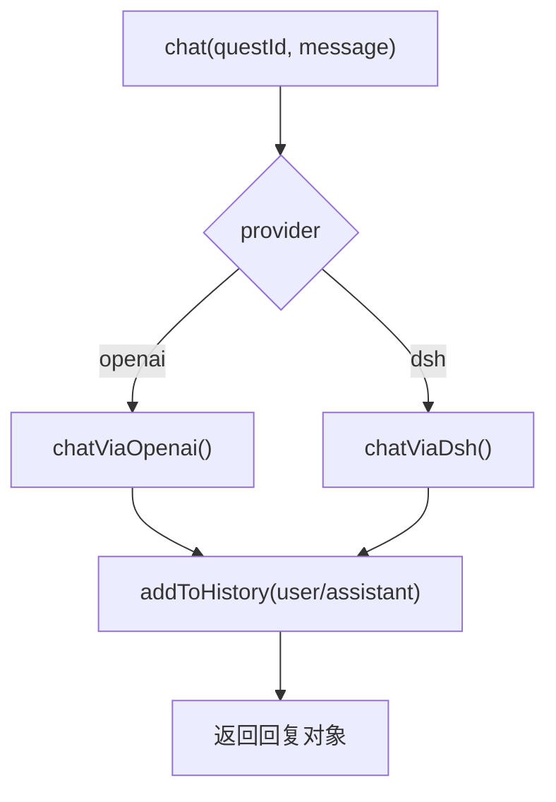

**图表来源**
- [core/services/llm.js:75-160](file://core/services/llm.js#L75-L160)
- [core/services/llm.js:211-252](file://core/services/llm.js#L211-L252)

**章节来源**
- [core/services/llm.js:16-65](file://core/services/llm.js#L16-L65)
- [core/services/llm.js:75-160](file://core/services/llm.js#L75-L160)
- [core/services/llm.js:211-252](file://core/services/llm.js#L211-L252)

### VAD 与声纹服务扩展
- VAD 服务默认返回 null，表示由调用方（WebSocket 处理器）执行本地 VAD 逻辑。如需替换为外部引擎，可在 `detect` 中实现具体判断逻辑。
- 声纹服务通过 URL 与 key 访问外部 API，支持说话人列表与相似度阈值。扩展时可调整健康检查缓存策略与超时时间。

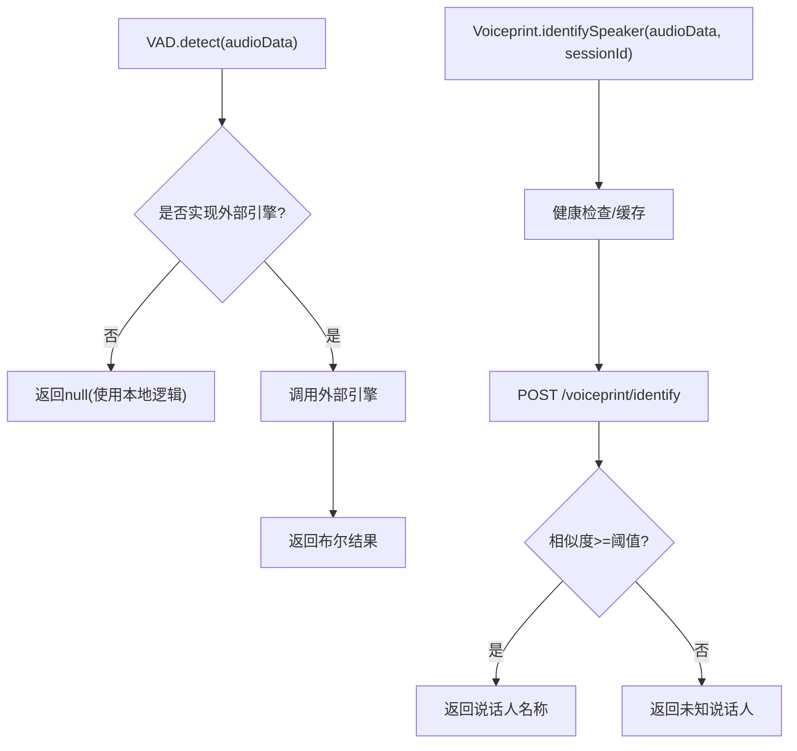

**图表来源**
- [core/services/vad.js:18-26](file://core/services/vad.js#L18-L26)
- [core/services/voiceprint.js:152-206](file://core/services/voiceprint.js#L152-L206)

**章节来源**
- [core/services/vad.js:3-26](file://core/services/vad.js#L3-L26)
- [core/services/voiceprint.js:15-78](file://core/services/voiceprint.js#L15-L78)
- [core/services/voiceprint.js:152-206](file://core/services/voiceprint.js#L152-L206)

### MCP 工具与设备端集成
MCP 服务提供工具注册、发现与执行能力，支持设备端 MCP 工具与端点工具。扩展建议：
- 注册执行器：通过 `registerExecutor(toolType, executor)` 添加新的工具类型与执行逻辑。
- 工具发现：实现 `getTools()` 返回工具定义，供 LLM 调用。
- 设备端工具：通过 `callDeviceMcpTool` 与设备建立 JSON-RPC 调用，支持超时与错误处理。

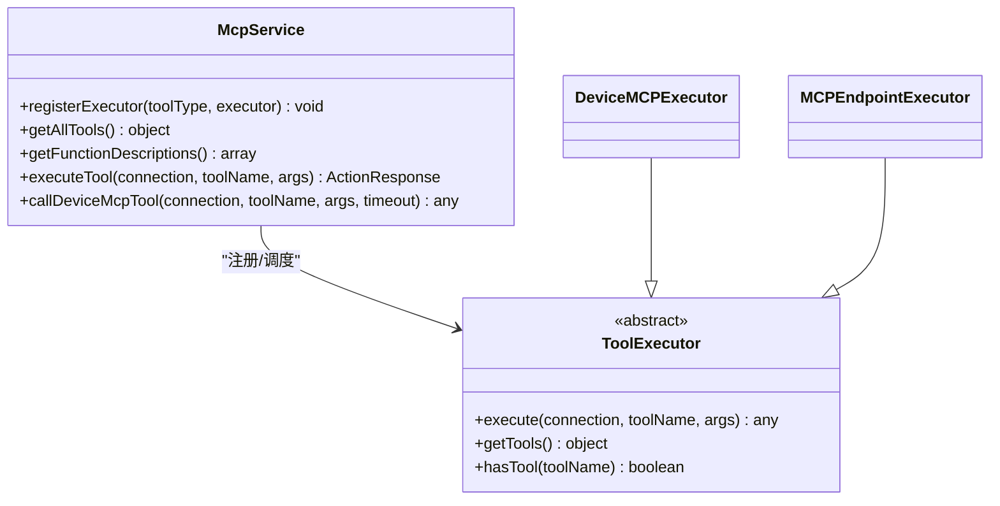

**图表来源**
- [core/services/mcp.js:149-183](file://core/services/mcp.js#L149-L183)
- [core/services/mcp.js:196-287](file://core/services/mcp.js#L196-L287)
- [core/services/mcp.js:519-598](file://core/services/mcp.js#L519-L598)
- [core/services/mcp.js:615-715](file://core/services/mcp.js#L615-L715)

**章节来源**
- [core/services/mcp.js:149-183](file://core/services/mcp.js#L149-L183)
- [core/services/mcp.js:196-287](file://core/services/mcp.js#L196-L287)
- [core/services/mcp.js:519-598](file://core/services/mcp.js#L519-L598)
- [core/services/mcp.js:615-715](file://core/services/mcp.js#L615-L715)

### WebSocket 处理器中的中间件式扩展点
WebSocket 处理器承担消息路由、会话管理、音频流处理与业务编排。可扩展点包括：
- 设备注册与持久化：在连接建立时记录设备信息到 Store。
- 音频有效性检测：通过 VAD 与振幅阈值过滤噪音。
- 对话轮次串行化：确保同一连接同一时刻只有一条应答流程，避免音频交错。
- 回声与噪音过滤：对无效输入与回声拾取进行过滤，避免误触发。

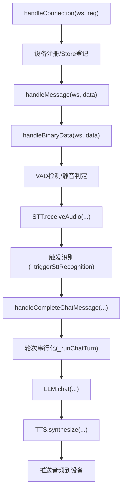

**图表来源**
- [core/handlers/websocket.js:67-169](file://core/handlers/websocket.js#L67-L169)
- [core/handlers/websocket.js:289-446](file://core/handlers/websocket.js#L289-L446)
- [core/handlers/websocket.js:651-793](file://core/handlers/websocket.js#L651-L793)

**章节来源**
- [core/handlers/websocket.js:67-169](file://core/handlers/websocket.js#L67-L169)
- [core/handlers/websocket.js:289-446](file://core/handlers/websocket.js#L289-L446)
- [core/handlers/websocket.js:651-793](file://core/handlers/websocket.js#L651-L793)

## 依赖关系分析
- 频道入口依赖配置加载器获取 STT/TTS/LLM 等服务的默认配置。
- WebSocket 处理器依赖各服务实例进行音频处理与对话编排。
- 服务之间松耦合，通过配置与接口约定进行协作。
- 外部依赖（如 node-edge-tts、opusscript、ws、express）通过 package.json 声明。

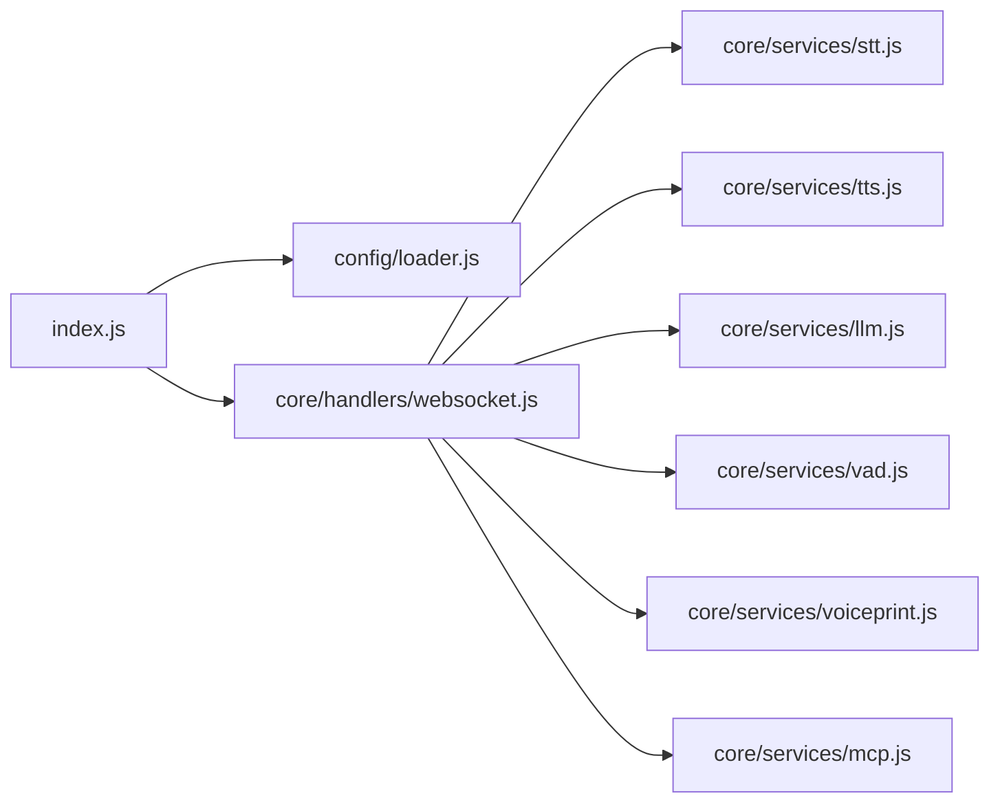

**图表来源**
- [index.js:14-27](file://index.js#L14-L27)
- [index.js:235-281](file://index.js#L235-L281)
- [core/handlers/websocket.js:1-16](file://core/handlers/websocket.js#L1-L16)

**章节来源**
- [index.js:14-27](file://index.js#L14-L27)
- [index.js:235-281](file://index.js#L235-L281)
- [core/handlers/websocket.js:1-16](file://core/handlers/websocket.js#L1-L16)

## 性能与稳定性考虑
- 音频解码与传输：STT 服务中对 Opus 解码进行容错处理，单帧丢失不影响整体识别。
- 会话与会话缓冲：STT 服务按会话管理音频缓冲区，避免内存无限增长。
- 轮次串行化与看门狗：WebSocket 处理器对每轮对话设置超时，防止单轮挂死导致后续排队。
- 健康检查与降级：LLM/TTS/STT 服务均提供健康检查与降级策略，提升可用性。
- 配置热更新：音频阈值等参数可通过 API 热更新，无需重启服务。

[本节为通用指导，不直接分析具体文件]

## 常见问题与排错指南
- STT 服务初始化失败：检查 FunASR 或其他提供商的网络连通性与配置项；必要时设置跳过启动校验环境变量。
- TTS 合成失败：确认 node-edge-tts 已安装且网络可达；检查 voice/rate/volume 参数。
- LLM 调用失败：检查 apiKey 与 baseUrl 配置；若 dsh 桥接不可用，将回退 openai 或返回降级回复。
- WebSocket 连接异常：查看设备注册与 Store 登记日志；确认 client_type 在白名单内。
- 音频无效输入：检查 VAD 阈值与静默时长配置；必要时调整 minMaxAmplitude/minAvgAmplitude/silenceThresholdMs。

**章节来源**
- [core/services/stt.js:185-201](file://core/services/stt.js#L185-L201)
- [core/services/tts.js:40-49](file://core/services/tts.js#L40-L49)
- [core/services/llm.js:30-65](file://core/services/llm.js#L30-L65)
- [core/handlers/websocket.js:96-142](file://core/handlers/websocket.js#L96-L142)

## 结论与最佳实践
- 遵循 BaseService 生命周期：所有扩展服务都应实现 initialize/destroy/healthCheck，确保可观测与可控。
- 通过配置驱动扩展：新增 STT/TTS/LLM 提供商时，优先通过配置开关切换，避免硬编码。
- 利用 MCP 扩展业务能力：注册自定义工具执行器，将设备端能力暴露给 LLM 调用。
- 强化错误与降级：外部服务不可达时应返回友好提示或降级回复，保障用户体验。
- 关注性能与资源：合理管理音频缓冲区、会话与轮次，避免内存泄漏与队列阻塞。
- 使用配置热更新：在不重启服务的前提下调整 VAD 阈值与音频参数，提升运维灵活性。

[本节为总结性内容，不直接分析具体文件]