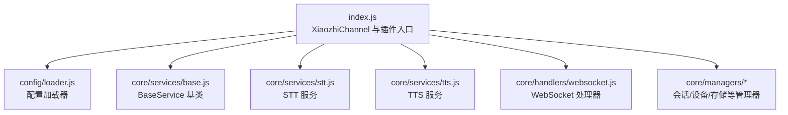
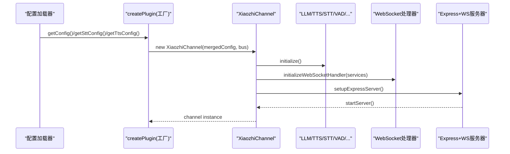
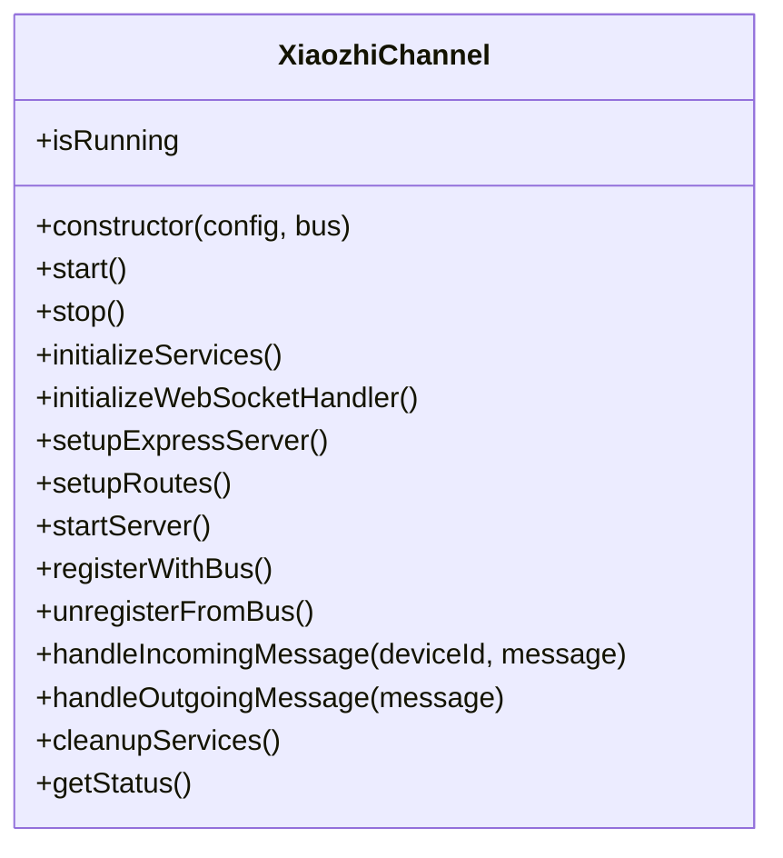
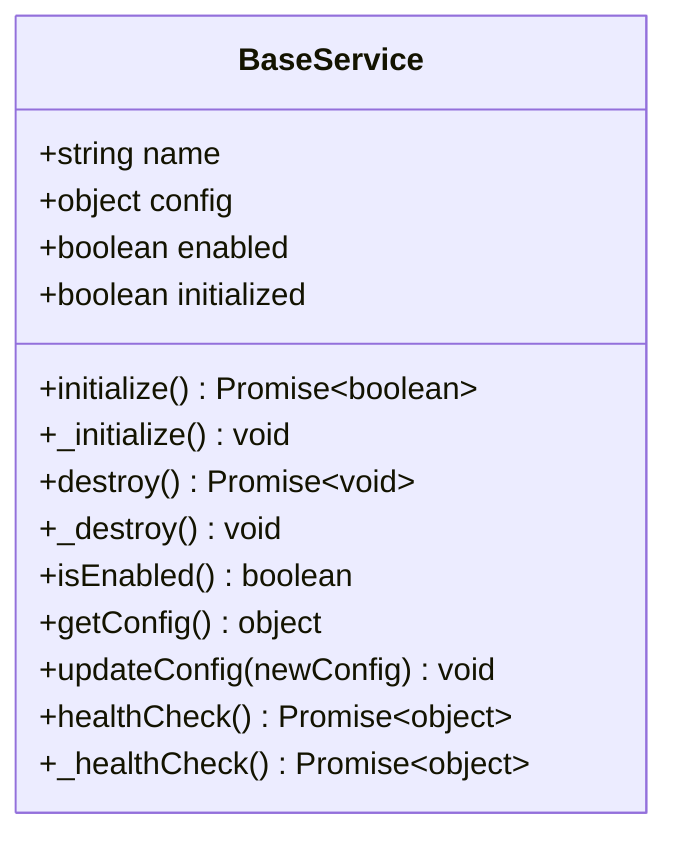
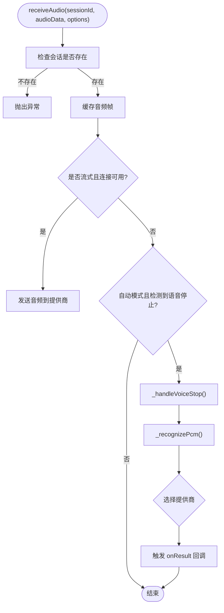
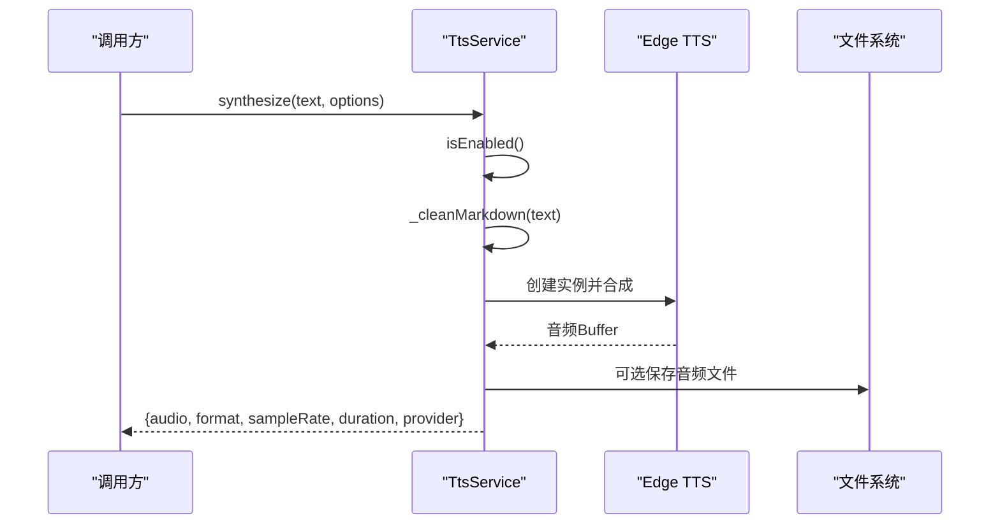
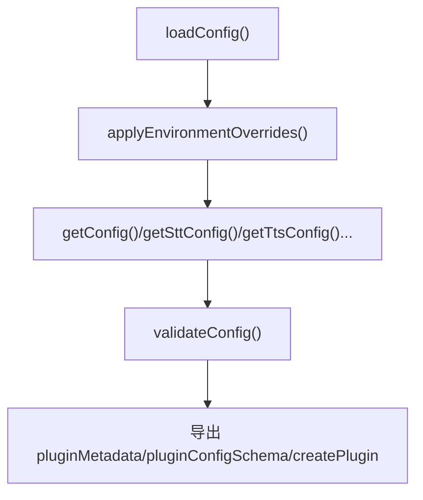
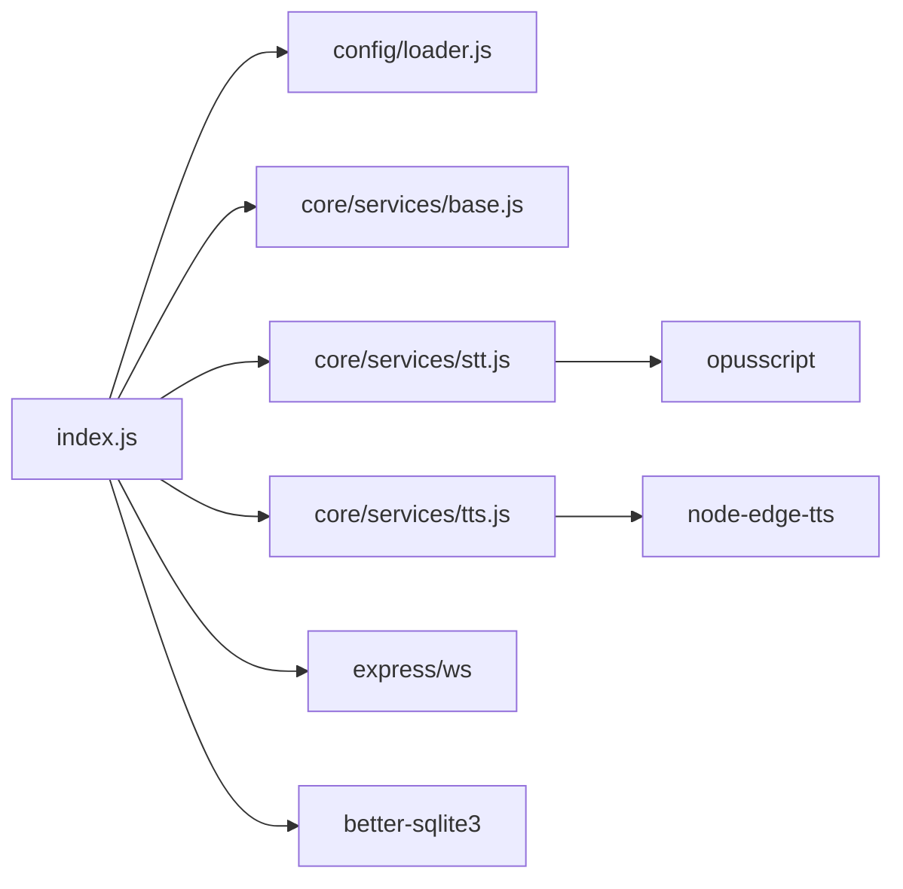

# 插件开发指南

<cite>
**本文引用的文件**   
- [index.js](file://index.js)
- [loader.js](file://config/loader.js)
- [base.js](file://core/services/base.js)
- [stt.js](file://core/services/stt.js)
- [tts.js](file://core/services/tts.js)
- [package.json](file://package.json)
</cite>

## 目录
1. [引言](#引言)
2. [项目结构](#项目结构)
3. [核心组件](#核心组件)
4. [架构总览](#架构总览)
5. [详细组件分析](#详细组件分析)
6. [依赖关系分析](#依赖关系分析)
7. [性能与扩展性](#性能与扩展性)
8. [故障排查与调试](#故障排查与调试)
9. [结论](#结论)
10. [附录：插件开发清单](#附录插件开发清单)

## 引言
本指南面向希望基于 XiaozhiChannel 进行插件化开发的开发者。文档将系统讲解：
- XiaozhiChannel 的架构设计与插件化机制
- 如何继承 BaseService 创建自定义服务
- 插件元数据、配置 Schema、工厂函数的实现要点
- STT/TTS 服务扩展与业务逻辑插件的实际案例
- 插件生命周期管理、错误处理机制与调试方法

## 项目结构
本项目采用“频道 + 服务”的分层组织方式：
- index.js 暴露 XiaozhiChannel 类，负责启动 HTTP/WS 服务器、初始化并编排各服务、注册 API 路由、对外提供插件元数据与工厂函数
- config/loader.js 提供统一的配置加载器，支持从配置文件与环境变量合并配置，并提供获取 STT/TTS/LLM 等配置的便捷方法
- core/services 下为可插拔的服务实现，如 STT、TTS、VAD、LLM、MCP、Voiceprint 等，均继承 BaseService
- core/handlers 与 core/managers 承载 WebSocket 消息处理与会话/设备管理等核心流程

图表来源
- [index.js:44-249](file://index.js#L44-L249)
- [loader.js:13-223](file://config/loader.js#L13-L223)
- [base.js:1-87](file://core/services/base.js#L1-L87)
- [stt.js:39-121](file://core/services/stt.js#L39-L121)
- [tts.js:3-38](file://core/services/tts.js#L3-L38)

章节来源
- [index.js:1-706](file://index.js#L1-L706)
- [loader.js:1-225](file://config/loader.js#L1-L225)

## 核心组件
- XiaozhiChannel：频道主类，负责服务初始化、HTTP/WS 服务器启动、API 路由、事件总线集成、插件元数据与工厂函数导出
- BaseService：所有服务的抽象基类，统一生命周期（initialize/destroy）、健康检查、配置更新、启用状态控制
- SttService/TtsService：语音转文字与文字转语音的具体服务实现，遵循 BaseService 的生命周期与扩展点
- ConfigLoader：集中读取 config.json，应用环境变量覆盖，提供 getSttConfig/getTtsConfig/getLlmConfig 等方法

章节来源
- [index.js:44-249](file://index.js#L44-L249)
- [base.js:1-87](file://core/services/base.js#L1-L87)
- [stt.js:39-121](file://core/services/stt.js#L39-L121)
- [tts.js:3-38](file://core/services/tts.js#L3-L38)
- [loader.js:13-223](file://config/loader.js#L13-L223)

## 架构总览
XiaozhiChannel 作为插件式频道的入口，通过工厂函数 createPlugin 接收外部传入的配置与消息总线实例，返回一个已装配好服务的频道实例。其内部：
- 初始化 SessionManager、DeviceManager、OTAHandler、Store
- 初始化 LLM、TTS、STT、VAD、Voiceprint、MCP 等服务
- 初始化 WebSocket 处理器，注入上述服务
- 启动 Express + WS 服务器，挂载 REST API 与 OTA 路由
- 导出 pluginMetadata、pluginConfigSchema、createPlugin 供上层框架发现与加载

图表来源
- [index.js:44-249](file://index.js#L44-L249)
- [index.js:693-697](file://index.js#L693-L697)
- [loader.js:98-152](file://config/loader.js#L98-L152)

## 详细组件分析

### XiaozhiChannel 类与插件化机制
- 构造与运行
  - 构造函数接收配置与可选的消息总线，设置端口/主机、绑定事件处理器
  - start() 顺序执行：初始化服务 -> 初始化 WS 处理器 -> 搭建 Express/WS 服务器 -> 启动监听 -> 注册到消息总线
  - stop() 顺序执行：注销总线 -> 关闭 WS -> 关闭 HTTP -> 清理服务
- 服务装配
  - initializeServices() 中创建并初始化 LLM/TTS/STT/VAD/Voiceprint/MCP 等服务
  - initializeWebSocketHandler() 将所有服务注入到 WS 处理器
- API 与 OTA
  - setupRoutes() 暴露健康检查、音频阈值配置、设备/会话查询、广播、WS URL 信息、OTA 接口等
- 插件元数据与工厂
  - 导出 pluginMetadata、pluginConfigSchema、createPlugin
  - createPlugin(config, bus) 合并配置并返回 XiaozhiChannel 实例

图表来源
- [index.js:44-249](file://index.js#L44-L249)
- [index.js:254-488](file://index.js#L254-L488)
- [index.js:493-580](file://index.js#L493-L580)
- [index.js:585-601](file://index.js#L585-L601)

章节来源
- [index.js:44-249](file://index.js#L44-L249)
- [index.js:254-488](file://index.js#L254-L488)
- [index.js:493-580](file://index.js#L493-L580)
- [index.js:585-601](file://index.js#L585-L601)

### BaseService 基类与服务生命周期
BaseService 定义了所有服务的通用能力：
- 属性：name、config、enabled、initialized
- 生命周期：
  - initialize()：调用子类 _initialize()，成功后标记 initialized=true
  - destroy()：调用子类 _destroy()，成功后标记 initialized=false
  - healthCheck()：封装 _healthCheck()，返回统一的健康状态对象
- 配置管理：getConfig()、updateConfig(newConfig)
- 启用判断：isEnabled() 返回 enabled && initialized

图表来源
- [base.js:1-87](file://core/services/base.js#L1-L87)

章节来源
- [base.js:1-87](file://core/services/base.js#L1-L87)

### STT 服务（语音转文字）
SttService 继承 BaseService，支持多种提供商（doubao/funasr/aibridge/xunfei/aliyun），具备：
- 流式识别与文件识别两种接口类型
- Opus 解码、VAD 集成、唤醒词检测
- 会话管理（Map 维护多个会话）
- 结果回调 onResult/onError
- 健康检查与提供商探活（FunASR 连通性校验）

图表来源
- [stt.js:348-383](file://core/services/stt.js#L348-L383)
- [stt.js:515-583](file://core/services/stt.js#L515-L583)
- [stt.js:591-606](file://core/services/stt.js#L591-L606)

章节来源
- [stt.js:39-121](file://core/services/stt.js#L39-L121)
- [stt.js:287-340](file://core/services/stt.js#L287-L340)
- [stt.js:348-383](file://core/services/stt.js#L348-L383)
- [stt.js:515-583](file://core/services/stt.js#L515-L583)
- [stt.js:591-606](file://core/services/stt.js#L591-L606)

### TTS 服务（文字转语音）
TtsService 继承 BaseService，支持 edge/xunfei/aliyun 等提供商，具备：
- 文本预处理（清理 Markdown、分段合成）
- 流式合成 synthesizeStream(text, callback)
- 时长估算、输出目录管理、音频文件保存与列表/删除
- 健康检查与健康状态上报

图表来源
- [tts.js:62-104](file://core/services/tts.js#L62-L104)
- [tts.js:106-147](file://core/services/tts.js#L106-L147)
- [tts.js:204-237](file://core/services/tts.js#L204-L237)
- [tts.js:288-302](file://core/services/tts.js#L288-L302)

章节来源
- [tts.js:3-38](file://core/services/tts.js#L3-L38)
- [tts.js:62-104](file://core/services/tts.js#L62-L104)
- [tts.js:106-147](file://core/services/tts.js#L106-L147)
- [tts.js:204-237](file://core/services/tts.js#L204-L237)
- [tts.js:288-302](file://core/services/tts.js#L288-L302)

### 配置加载器与插件配置 Schema
ConfigLoader 负责：
- 从 config.json 读取配置，应用环境变量覆盖
- 提供 getSttConfig/getTtsConfig/getLlmConfig/getChannelInfo 等便捷方法
- 校验配置完整性（必需字段、必填项）

插件侧在 index.js 中导出：
- pluginMetadata：id/name/description/version/author/type/category
- pluginConfigSchema：port/host/llm/tts/stt 等属性的 JSON Schema
- createPlugin(config, bus)：合并配置并返回 XiaozhiChannel 实例

图表来源
- [loader.js:22-74](file://config/loader.js#L22-L74)
- [loader.js:79-152](file://config/loader.js#L79-L152)
- [loader.js:171-209](file://config/loader.js#L171-L209)
- [index.js:607-697](file://index.js#L607-L697)

章节来源
- [loader.js:22-74](file://config/loader.js#L22-L74)
- [loader.js:79-152](file://config/loader.js#L79-L152)
- [loader.js:171-209](file://config/loader.js#L171-L209)
- [index.js:607-697](file://index.js#L607-L697)

## 依赖关系分析
- 模块耦合
  - index.js 强依赖 loader.js 提供的配置方法，以及 core/services 下的具体服务实现
  - STT/TTS 服务依赖第三方库（如 opusscript、node-edge-tts）
- 外部依赖
  - express/ws 用于 HTTP/WS 服务
  - better-sqlite3 用于持久化存储
  - node-edge-tts/opusscript 等用于音视频处理

图表来源
- [index.js:1-28](file://index.js#L1-L28)
- [package.json:11-23](file://package.json#L11-L23)

章节来源
- [index.js:1-28](file://index.js#L1-L28)
- [package.json:1-29](file://package.json#L1-L29)

## 性能与扩展性
- STT 性能
  - 使用 Opus 解码减少传输体积；对单帧解码失败做容错，避免影响整体识别
  - FunASR 启动时进行连通性探活，失败可跳过或报错，提升启动稳定性
- TTS 性能
  - 文本分段合成，降低单次请求压力；时长估算优化播放时序
  - 可选保存音频文件，便于调试与回放
- 扩展性
  - 新增 STT/TTS 提供商只需在对应服务的 switch 分支中添加实现，并保持 BaseService 生命周期一致
  - 通过 pluginConfigSchema 扩展配置项，配合 ConfigLoader 的环境变量覆盖机制，实现多环境部署

[本节为通用指导，不直接分析具体文件]

## 故障排查与调试
- 服务初始化失败
  - BaseService.initialize() 捕获异常并记录日志，建议检查 _initialize() 中的依赖是否就绪（如 FunASR 连通性、Opus 解码器安装）
- STT 问题定位
  - 检查会话是否存在、音频格式是否正确、Opus 解码是否成功
  - 查看提供商探活与连接建立日志（FunASR/豆包等）
- TTS 问题定位
  - 确认 isEnabled() 返回 true，provider 已正确初始化
  - 若启用音频文件保存，检查输出目录权限与磁盘空间
- 配置问题
  - 使用 validateConfig() 校验配置完整性
  - 通过环境变量覆盖关键参数（端口、host、provider、voice、language 等）

章节来源
- [base.js:10-23](file://core/services/base.js#L10-L23)
- [base.js:29-45](file://core/services/base.js#L29-L45)
- [base.js:59-84](file://core/services/base.js#L59-L84)
- [stt.js:187-201](file://core/services/stt.js#L187-L201)
- [tts.js:62-65](file://core/services/tts.js#L62-L65)
- [loader.js:171-209](file://config/loader.js#L171-L209)

## 结论
XiaozhiChannel 提供了清晰的插件化入口与标准化的服务生命周期。通过继承 BaseService，开发者可以以最小成本扩展 STT/TTS 或其他业务服务；借助 ConfigLoader 与 pluginConfigSchema，插件可在不同环境中灵活配置。结合完善的错误处理与调试手段，能够快速构建稳定可靠的语音交互插件。

[本节为总结性内容，不直接分析具体文件]

## 附录：插件开发清单
- 定义插件元数据
  - id/name/description/version/author/type/category
  - 参考路径：[index.js:614-622](file://index.js#L614-L622)
- 设计配置 Schema
  - 包含 port/host/llm/tts/stt 等属性，并为每个属性提供默认值与描述
  - 参考路径：[index.js:625-690](file://index.js#L625-L690)
- 实现工厂函数
  - createPlugin(config, bus) 合并配置并返回 XiaozhiChannel 实例
  - 参考路径：[index.js:693-697](file://index.js#L693-L697)
- 继承 BaseService 创建自定义服务
  - 实现 _initialize/_destroy/_healthCheck
  - 使用 initialize/destroy/healthCheck 统一管理生命周期
  - 参考路径：[base.js:10-84](file://core/services/base.js#L10-L84)
- 扩展 STT/TTS 服务
  - 在对应服务的 switch 分支中添加新提供商实现
  - 保持与现有接口一致（如 receiveAudio/synthesize）
  - 参考路径：[stt.js:99-121](file://core/services/stt.js#L99-L121)、[tts.js:23-38](file://core/services/tts.js#L23-L38)
- 调试与验证
  - 使用 /health 与 /api/websocket/urls 检查服务状态
  - 通过日志与健康检查方法定位问题
  - 参考路径：[index.js:289-296](file://index.js#L289-L296)、[index.js:428-443](file://index.js#L428-L443)