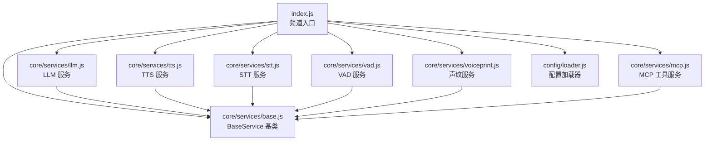
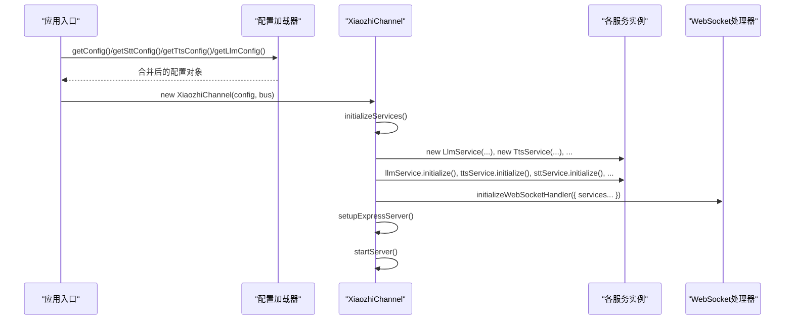
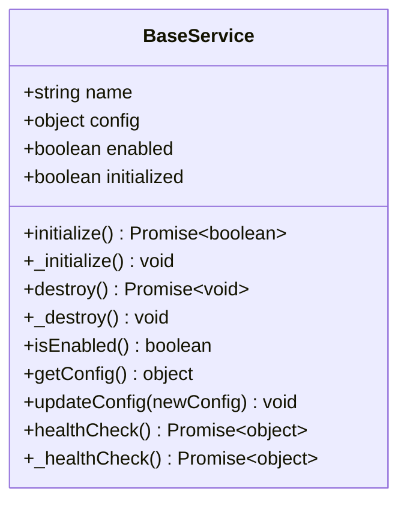
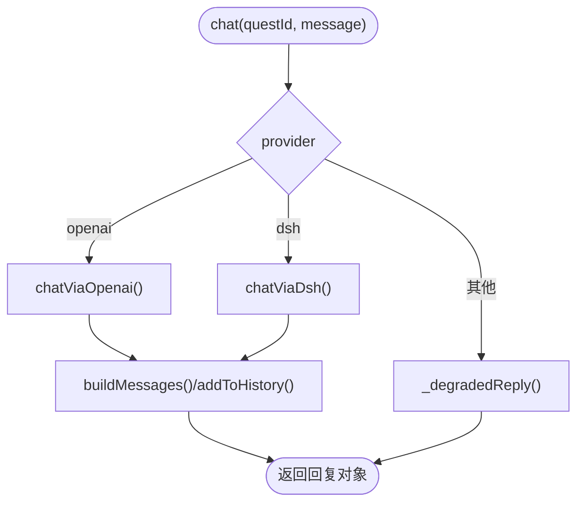
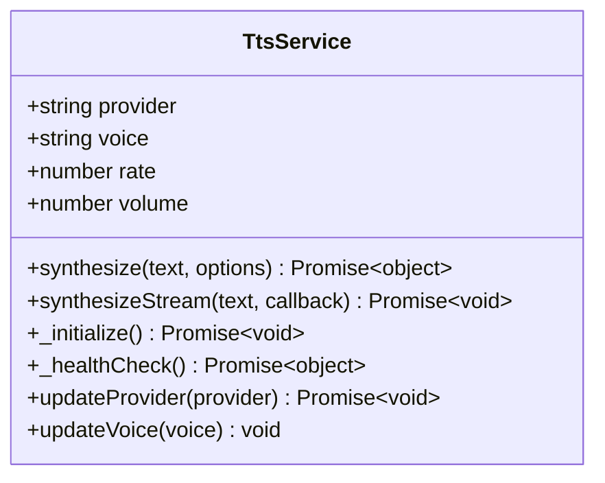
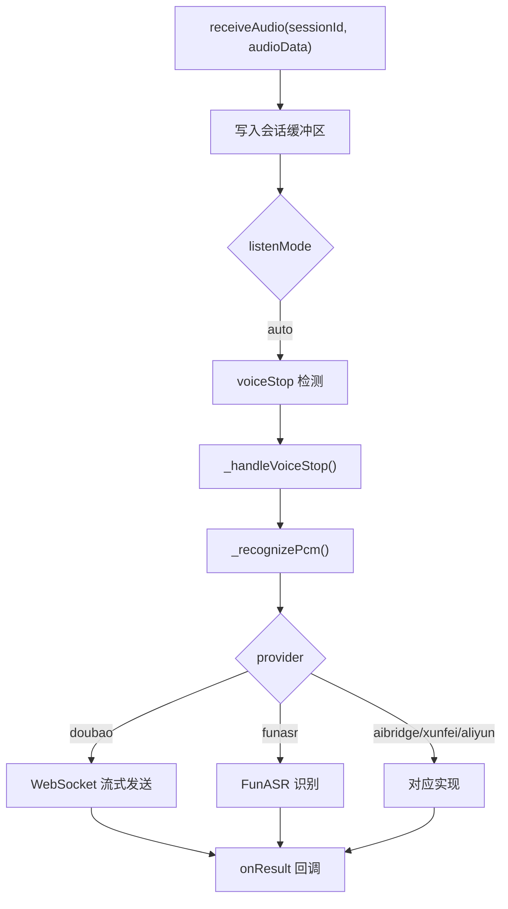
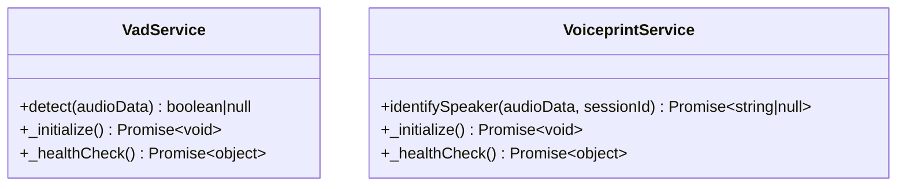
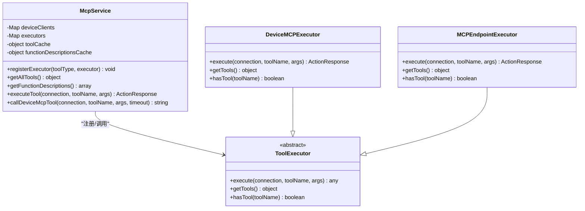
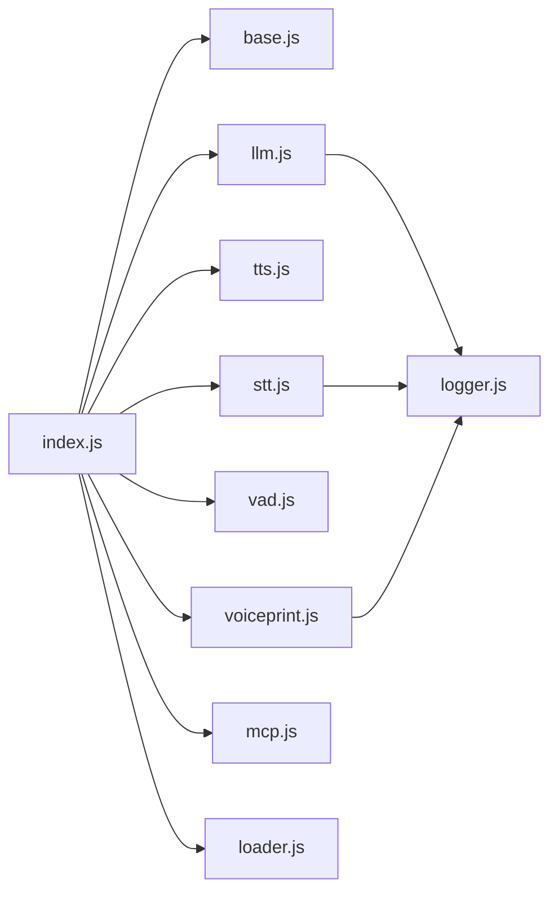

# 服务扩展机制

<cite>
**本文引用的文件**   
- [core/services/base.js](file://core/services/base.js)
- [core/services/llm.js](file://core/services/llm.js)
- [core/services/tts.js](file://core/services/tts.js)
- [core/services/stt.js](file://core/services/stt.js)
- [core/services/vad.js](file://core/services/vad.js)
- [core/services/voiceprint.js](file://core/services/voiceprint.js)
- [core/services/mcp.js](file://core/services/mcp.js)
- [config/loader.js](file://config/loader.js)
- [index.js](file://index.js)
- [utils/logger.js](file://utils/logger.js)
</cite>

## 目录
1. [引言](#引言)
2. [项目结构](#项目结构)
3. [核心组件](#核心组件)
4. [架构总览](#架构总览)
5. [详细组件分析](#详细组件分析)
6. [依赖关系分析](#依赖关系分析)
7. [性能与可靠性](#性能与可靠性)
8. [故障排查指南](#故障排查指南)
9. [结论](#结论)
10. [附录：扩展现有服务与新服务类型流程](#附录扩展现有服务与新服务类型流程)

## 引言
本文面向希望扩展小智语音交互服务的开发者，系统说明服务的扩展机制与架构设计。重点包括：
- BaseService 基类的设计模式与抽象接口
- LLM、TTS、STT 等服务的实现方式与扩展点
- 服务注册、依赖注入与配置管理
- 最佳实践：性能优化、错误处理、日志记录
- 如何扩展现有服务和添加新服务类型的完整流程

## 项目结构
本项目采用“频道 + 服务”的架构：
- index.js 作为频道入口，负责启动 Express/HTTP/WebSocket 服务器，并初始化各类服务
- core/services 下是具体能力服务（LLM/TTS/STT/VAD/声纹/MCP）
- config/loader.js 提供统一配置加载与环境变量覆盖
- utils/logger.js 提供自包含日志模块

**图表来源**
- [index.js:17-27](file://index.js#L17-L27)
- [core/services/base.js:1-87](file://core/services/base.js#L1-L87)
- [core/services/llm.js:1-24](file://core/services/llm.js#L1-L24)
- [core/services/tts.js:1-21](file://core/services/tts.js#L1-L21)
- [core/services/stt.js:1-87](file://core/services/stt.js#L1-L87)
- [core/services/vad.js:1-29](file://core/services/vad.js#L1-L29)
- [core/services/voiceprint.js:1-35](file://core/services/voiceprint.js#L1-L35)
- [core/services/mcp.js:149-166](file://core/services/mcp.js#L149-L166)
- [config/loader.js:13-44](file://config/loader.js#L13-L44)

**章节来源**
- [index.js:44-216](file://index.js#L44-L216)
- [config/loader.js:13-44](file://config/loader.js#L13-L44)

## 核心组件
- BaseService：所有服务的统一基类，提供生命周期管理、健康检查、配置更新、启用状态判断等通用能力
- LlmService：大语言模型服务，支持 openai/dsh provider，维护对话历史、降级回复与健康检查
- TtsService：文本转语音服务，支持 edge/xunfei/aliyun provider，具备流式合成、音频保存、时长估算等能力
- SttService：语音转文字服务，支持 doubao/funasr/aibridge/xunfei/aliyun provider，具备会话管理、Opus 解码、流式识别等能力
- VadService：语音活动检测服务，默认返回 null 交由调用方本地逻辑处理
- VoiceprintService：声纹识别服务，基于外部 API，带健康检查缓存与说话人映射
- McpService：MCP 工具服务，聚合设备端与接入点工具，提供工具发现、执行与缓存

**章节来源**
- [core/services/base.js:1-87](file://core/services/base.js#L1-L87)
- [core/services/llm.js:16-344](file://core/services/llm.js#L16-L344)
- [core/services/tts.js:3-438](file://core/services/tts.js#L3-L438)
- [core/services/stt.js:39-800](file://core/services/stt.js#L39-L800)
- [core/services/vad.js:3-29](file://core/services/vad.js#L3-L29)
- [core/services/voiceprint.js:15-222](file://core/services/voiceprint.js#L15-L222)
- [core/services/mcp.js:149-727](file://core/services/mcp.js#L149-L727)

## 架构总览
频道在启动时完成以下关键步骤：
1. 从配置文件加载全局配置，并通过环境变量覆盖
2. 实例化各服务（LLM/TTS/STT/VAD/声纹/MCP），并调用 initialize() 完成初始化
3. 将服务通过依赖注入的方式传递给 WebSocket 处理器
4. 暴露 HTTP API 与 WebSocket 端点，供设备与前端使用

**图表来源**
- [index.js:180-216](file://index.js#L180-L216)
- [index.js:235-282](file://index.js#L235-L282)
- [config/loader.js:22-44](file://config/loader.js#L22-L44)

**章节来源**
- [index.js:86-125](file://index.js#L86-L125)
- [index.js:180-216](file://index.js#L180-L216)
- [index.js:235-282](file://index.js#L235-L282)

## 详细组件分析

### BaseService 基类与设计模式
BaseService 定义了服务生命周期与通用行为：
- 构造阶段：设置 name、config、enabled、initialized
- 初始化：initialize() 包装 _initialize()，保证幂等与异常捕获
- 销毁：destroy() 包装 _destroy()，清理资源
- 健康检查：healthCheck() 包装 _healthCheck()，返回标准化状态
- 配置管理：getConfig()、updateConfig()
- 启用判断：isEnabled()

**图表来源**
- [core/services/base.js:1-87](file://core/services/base.js#L1-L87)

**章节来源**
- [core/services/base.js:1-87](file://core/services/base.js#L1-L87)

### LLM 服务扩展
LlmService 继承 BaseService，支持多种 provider：
- openai：直连 OpenAI 兼容端点（如 aibridge），可配置 apiKey、model、timeoutMs
- dsh：经桥接服务转发到 DeepSeek Harness，失败时可回退到 fallbackBaseUrl 或返回降级回复

关键扩展点：
- _initialize()：根据 provider 探活不同后端
- chat()：统一入口，按 provider 路由到 chatViaOpenai/chatViaDsh
- buildMessages()/addToHistory()：维护连接级对话历史
- _degradedReply()：无可用后端时的降级策略
- _healthCheck()/isConfigured()：健康检查与配置有效性判断

**图表来源**
- [core/services/llm.js:75-115](file://core/services/llm.js#L75-L115)
- [core/services/llm.js:121-160](file://core/services/llm.js#L121-L160)
- [core/services/llm.js:166-203](file://core/services/llm.js#L166-L203)
- [core/services/llm.js:211-252](file://core/services/llm.js#L211-L252)

**章节来源**
- [core/services/llm.js:16-344](file://core/services/llm.js#L16-L344)

### TTS 服务扩展
TtsService 继承 BaseService，支持多 provider：
- edge：使用 node-edge-tts 生成音频，支持临时文件读写与可选持久化
- xunfei/aliyun：预留扩展点，当前为模拟实现

关键扩展点：
- _initialize()：按 provider 初始化
- synthesize()/synthesizeStream()：同步与流式合成
- _splitText()/_cleanMarkdown()：文本分段与清洗
- _estimateDuration()：音频时长估算
- _healthCheck()：健康检查
- updateProvider()/updateVoice()：运行时切换 provider/voice

**图表来源**
- [core/services/tts.js:3-438](file://core/services/tts.js#L3-L438)

**章节来源**
- [core/services/tts.js:3-438](file://core/services/tts.js#L3-L438)

### STT 服务扩展
SttService 继承 BaseService，支持多 provider：
- doubao：火山引擎豆包 ASR，WebSocket 流式识别
- funasr：FunASR，支持本地/远程部署，含连通性探活
- aibridge/xunfei/aliyun：预留扩展点

关键扩展点：
- _initialize()：按 provider 初始化，必要时进行连通性校验
- createSession()/closeSession()：会话管理
- receiveAudio()：接收音频数据，自动模式触发识别
- _recognizePcm()：按 provider 分发识别逻辑
- _decodeOpus()/_decodeOpusFrames()：Opus 解码为 PCM
- _probeFunAsrConnection()：FunASR 连通性探活

**图表来源**
- [core/services/stt.js:348-383](file://core/services/stt.js#L348-L383)
- [core/services/stt.js:515-583](file://core/services/stt.js#L515-L583)
- [core/services/stt.js:591-606](file://core/services/stt.js#L591-L606)
- [core/services/stt.js:642-677](file://core/services/stt.js#L642-L677)
- [core/services/stt.js:187-201](file://core/services/stt.js#L187-L201)

**章节来源**
- [core/services/stt.js:39-800](file://core/services/stt.js#L39-L800)

### VAD 与声纹服务
- VadService：默认 detect() 返回 null，表示未启用具体引擎，由调用方使用本地 VAD 逻辑
- VoiceprintService：基于外部 API 的声纹识别，支持健康检查缓存、说话人映射、相似度阈值控制

**图表来源**
- [core/services/vad.js:3-29](file://core/services/vad.js#L3-L29)
- [core/services/voiceprint.js:15-222](file://core/services/voiceprint.js#L15-L222)

**章节来源**
- [core/services/vad.js:3-29](file://core/services/vad.js#L3-L29)
- [core/services/voiceprint.js:15-222](file://core/services/voiceprint.js#L15-L222)

### MCP 工具服务
McpService 提供工具发现、执行与缓存，支持设备端 MCP 工具与 MCP 接入点工具：
- registerExecutor()：注册工具执行器
- getAllTools()/getFunctionDescriptions()：获取工具定义与函数描述
- executeTool()：根据工具类型分派执行
- callDeviceMcpTool()：调用设备端 MCP 工具，支持超时与结果解析

**图表来源**
- [core/services/mcp.js:149-321](file://core/services/mcp.js#L149-L321)
- [core/services/mcp.js:615-715](file://core/services/mcp.js#L615-L715)

**章节来源**
- [core/services/mcp.js:149-727](file://core/services/mcp.js#L149-L727)

## 依赖关系分析
- 服务层依赖 BaseService 提供的生命周期与配置管理能力
- 频道入口 index.js 负责实例化服务并将它们注入到 WebSocket 处理器
- 配置加载器 config/loader.js 提供统一的配置读取与环境变量覆盖
- 日志模块 utils/logger.js 被多个服务引用，用于结构化输出

**图表来源**
- [index.js:17-27](file://index.js#L17-L27)
- [core/services/llm.js:1-2](file://core/services/llm.js#L1-L2)
- [core/services/stt.js:1-5](file://core/services/stt.js#L1-L5)
- [core/services/voiceprint.js:1-2](file://core/services/voiceprint.js#L1-L2)
- [config/loader.js:13-44](file://config/loader.js#L13-L44)
- [utils/logger.js:1-54](file://utils/logger.js#L1-L54)

**章节来源**
- [index.js:17-27](file://index.js#L17-L27)
- [config/loader.js:13-44](file://config/loader.js#L13-L44)
- [utils/logger.js:1-54](file://utils/logger.js#L1-L54)

## 性能与可靠性
- 延迟加载与按需初始化
  - STT 的 Opus 解码器通过 getOpusDecoder() 延迟加载，避免启动阻塞
  - TTS 的 Edge TTS 动态 import，减少冷启动开销
- 健康检查与容错
  - BaseService.healthCheck() 统一封装，子类实现 _healthCheck()
  - LLM 支持降级回复；STT 对 FunASR 进行连通性探活，可按环境变量跳过启动校验
- 会话与资源管理
  - STT 使用 Map 管理会话，限制缓冲区大小，避免内存泄漏
  - VoiceprintService 对健康检查结果进行 TTL 缓存，降低重复探测开销
- 日志与可观测性
  - 使用 utils/logger.js 输出结构化日志，支持控制台与文件双写
  - 频道入口 channelLogger 提供模块级生命周期日志

**章节来源**
- [core/services/stt.js:14-25](file://core/services/stt.js#L14-L25)
- [core/services/tts.js:40-50](file://core/services/tts.js#L40-L50)
- [core/services/llm.js:109-115](file://core/services/llm.js#L109-L115)
- [core/services/stt.js:187-201](file://core/services/stt.js#L187-L201)
- [core/services/voiceprint.js:29-34](file://core/services/voiceprint.js#L29-L34)
- [utils/logger.js:1-54](file://utils/logger.js#L1-L54)

## 故障排查指南
- 服务初始化失败
  - 检查 BaseService.initialize() 抛出的异常，确认子类 _initialize() 是否正确实现
  - 查看日志中“服务初始化失败”相关条目
- LLM 不可用
  - 确认 provider 配置与 baseUrl/apiKey 正确
  - 若 dsh 不可用，检查 fallbackBaseUrl 是否配置
- STT 无法识别
  - 检查 FunASR 连通性探活是否通过，必要时设置 FUNASR_SKIP_STARTUP_CHECK=true
  - 确认 Opus 解码器已安装并可加载
- TTS 合成失败
  - 检查 provider 是否受支持，edge 模式下确保 node-edge-tts 可用
  - 如需保存音频文件，确认 outputDir 存在且可写
- 声纹识别禁用
  - 检查 URL 是否包含 key 参数，speakers 配置是否有效
  - 查看健康检查缓存结果与服务端响应状态

**章节来源**
- [core/services/base.js:10-23](file://core/services/base.js#L10-L23)
- [core/services/llm.js:30-65](file://core/services/llm.js#L30-L65)
- [core/services/stt.js:187-201](file://core/services/stt.js#L187-L201)
- [core/services/tts.js:23-38](file://core/services/tts.js#L23-L38)
- [core/services/voiceprint.js:37-78](file://core/services/voiceprint.js#L37-L78)

## 结论
本项目的服务扩展机制以 BaseService 为核心，结合配置加载器与频道入口的依赖注入，形成清晰的服务分层与扩展点。LLM/TTS/STT 等服务均遵循统一的初始化、健康检查与配置管理模式，便于替换提供商、增加新能力与进行性能优化。通过合理的会话管理、延迟加载与健康检查缓存，系统在可扩展性与稳定性之间取得平衡。

## 附录：扩展现有服务与新服务类型流程

### 扩展现有服务（例如新增 TTS provider）
- 在 TtsService._initialize() 中添加新的 provider 分支，实现初始化逻辑
- 在 TtsService.synthesize() 中新增对应分支，实现 _synthesizeWithXxx()
- 如需持久化音频，完善 _saveAudioFile() 与 _ensureOutputDir()
- 更新 _healthCheck() 以验证新 provider 可用性

**章节来源**
- [core/services/tts.js:23-38](file://core/services/tts.js#L23-L38)
- [core/services/tts.js:62-104](file://core/services/tts.js#L62-L104)
- [core/services/tts.js:328-374](file://core/services/tts.js#L328-L374)
- [core/services/tts.js:288-302](file://core/services/tts.js#L288-L302)

### 新增服务类型（例如新增 OCR 服务）
- 新建 core/services/ocr.js，继承 BaseService，实现 _initialize()/_healthCheck()
- 在 index.js 中引入并实例化 OcrService，加入 initializeServices() 与依赖注入
- 在 config/loader.js 中新增 getOcrConfig() 与相应环境变量覆盖
- 在 WebSocket 处理器中注入 OcrService，供业务逻辑调用

**章节来源**
- [core/services/base.js:1-87](file://core/services/base.js#L1-L87)
- [index.js:180-216](file://index.js#L180-L216)
- [index.js:235-282](file://index.js#L235-L282)
- [config/loader.js:141-152](file://config/loader.js#L141-L152)