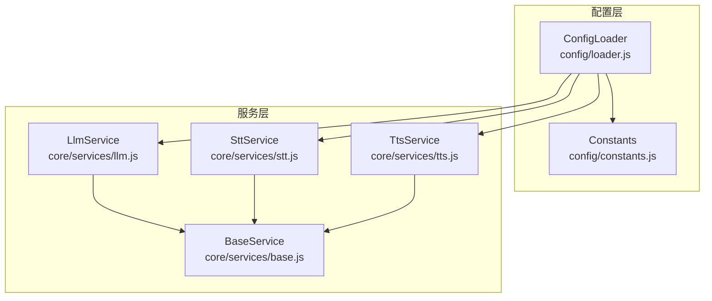
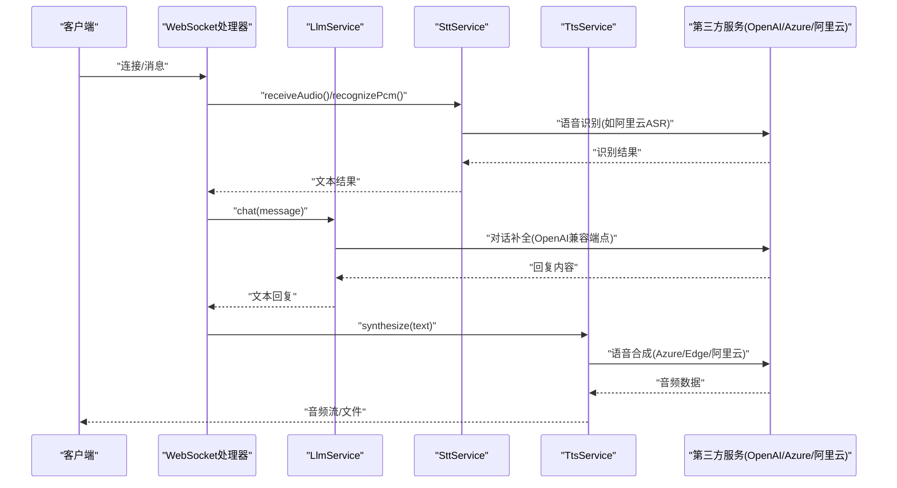
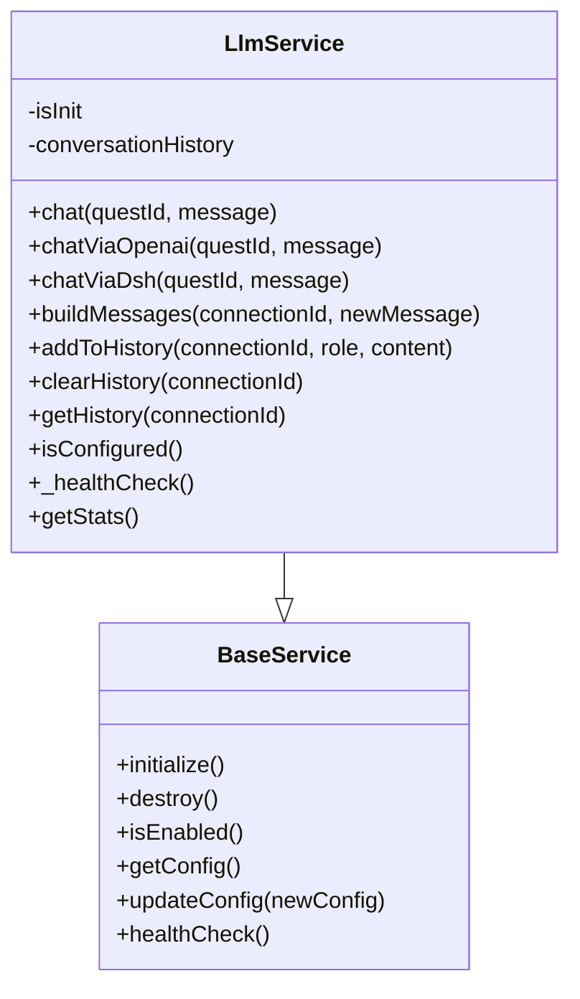
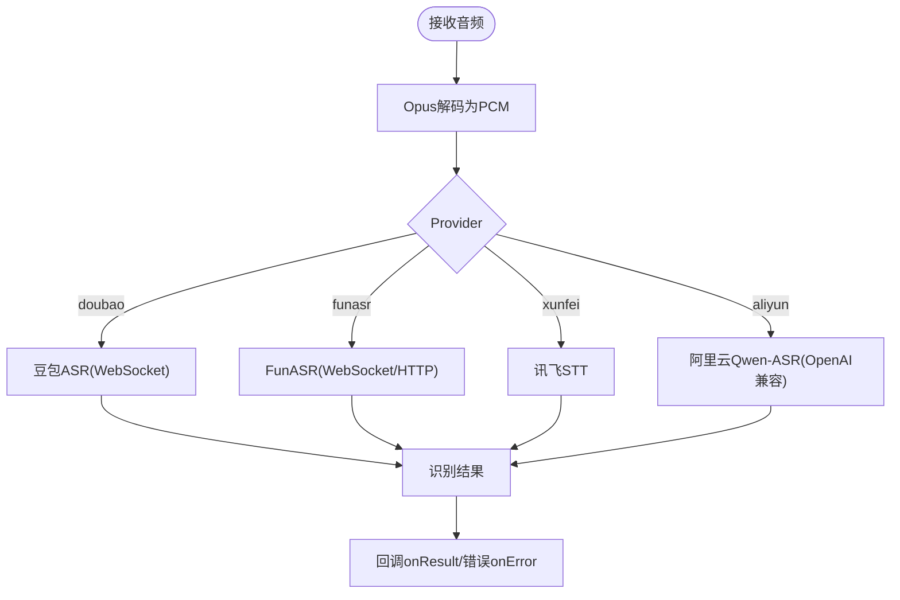
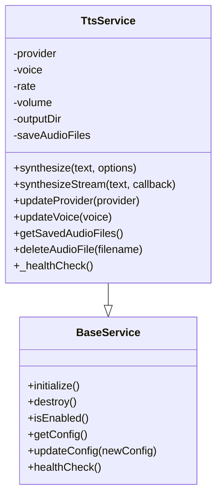
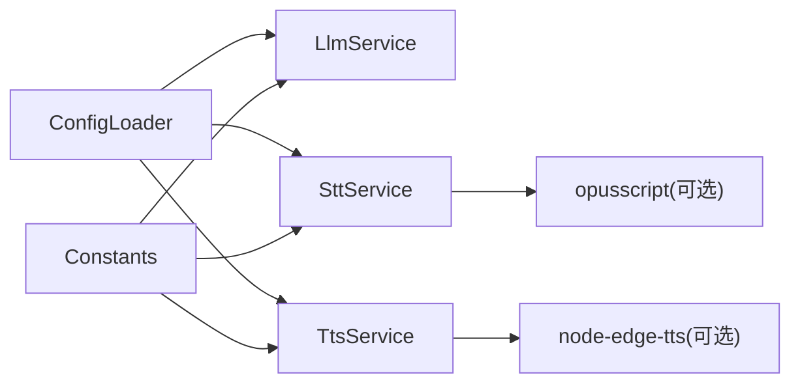

# 第三方集成示例

<cite>
**本文引用的文件**   
- [core/services/base.js](file://core/services/base.js)
- [core/services/llm.js](file://core/services/llm.js)
- [core/services/stt.js](file://core/services/stt.js)
- [core/services/tts.js](file://core/services/tts.js)
- [config/loader.js](file://config/loader.js)
- [config/constants.js](file://config/constants.js)
</cite>

## 目录
1. [引言](#引言)
2. [项目结构](#项目结构)
3. [核心组件](#核心组件)
4. [架构总览](#架构总览)
5. [详细组件分析](#详细组件分析)
6. [依赖关系分析](#依赖关系分析)
7. [性能与可靠性](#性能与可靠性)
8. [故障排查指南](#故障排查指南)
9. [结论](#结论)
10. [附录：配置模板与最佳实践清单](#附录配置模板与最佳实践清单)

## 引言
本文面向需要在小智服务端集成主流第三方服务的开发者，聚焦以下目标：
- 如何集成 OpenAI、Azure TTS、阿里云 STT 等第三方服务
- API 密钥管理、请求封装、错误重试、限流处理等关键技术点
- 服务切换、负载均衡与故障转移策略
- 常见集成问题与性能调优建议
- 提供可直接落地的配置模板与代码级参考路径

本仓库已内置 LLM、STT、TTS 三类服务抽象，并通过统一配置加载器注入 provider、模型、端点、超时等参数。LLM 当前支持 openai/dsh 两种模式；STT 支持 doubao/funasr/aibridge/xunfei/aliyun；TTS 支持 edge/xunfei/aliyun（其中 xunfei/aliyun 为占位实现）。

## 项目结构
围绕第三方集成的关键目录与文件如下：
- core/services：服务实现层，包含 LLM、STT、TTS 以及基础服务基类
- config：配置加载与常量定义，负责从配置文件与环境变量中读取 provider、模型、端点、密钥等

图表来源
- [config/loader.js:13-74](file://config/loader.js#L13-L74)
- [config/constants.js:25-42](file://config/constants.js#L25-L42)
- [core/services/base.js:1-87](file://core/services/base.js#L1-L87)
- [core/services/llm.js:16-65](file://core/services/llm.js#L16-L65)
- [core/services/stt.js:39-121](file://core/services/stt.js#L39-L121)
- [core/services/tts.js:3-38](file://core/services/tts.js#L3-L38)

章节来源
- [config/loader.js:13-74](file://config/loader.js#L13-L74)
- [config/constants.js:25-42](file://config/constants.js#L25-L42)

## 核心组件
- BaseService：所有服务的统一基类，提供初始化、销毁、健康检查、配置更新等通用能力
- LlmService：大语言模型服务，支持 openai（直连兼容端点）与 dsh（桥接 DeepSeek Harness），具备 fallback 与降级回复
- SttService：语音转文字服务，支持 doubao/funasr/aibridge/xunfei/aliyun，内置 Opus 解码、会话管理、流式识别流程
- TtsService：文本转语音服务，支持 edge/xunfei/aliyun，提供同步合成、流式分段合成、音频文件保存等能力
- ConfigLoader：统一配置加载器，从 config.json 读取并应用环境变量覆盖，暴露 getSttConfig/getTtsConfig/getLlmConfig 等方法

章节来源
- [core/services/base.js:1-87](file://core/services/base.js#L1-L87)
- [core/services/llm.js:16-65](file://core/services/llm.js#L16-L65)
- [core/services/stt.js:39-121](file://core/services/stt.js#L39-L121)
- [core/services/tts.js:3-38](file://core/services/tts.js#L3-L38)
- [config/loader.js:13-74](file://config/loader.js#L13-L74)

## 架构总览
下图展示“客户端 → WebSocket → 业务处理器 → 服务层（LLM/STT/TTS）→ 第三方服务”的调用链，以及配置加载对 provider 的驱动作用。

图表来源
- [core/services/stt.js:591-606](file://core/services/stt.js#L591-L606)
- [core/services/llm.js:75-104](file://core/services/llm.js#L75-L104)
- [core/services/tts.js:62-104](file://core/services/tts.js#L62-L104)

## 详细组件分析

### LLM 服务（OpenAI 兼容端点与 DS H Bridge）
- Provider 与端点
  - openai：直连 OpenAI 兼容端点，通过 baseUrl + /chat/completions 发起请求，支持 x-api-key 或 Authorization Bearer
  - dsh：经 dsh-xiaozhi-bridge 转发至 DeepSeek Harness，失败时按 fallbackBaseUrl 回退 openai，仍不可用则返回降级回复
- 上下文与会话历史
  - 维护每个连接的对话历史，限制最大轮数，构建 system + history + newMessage 的消息列表
- 健康检查与统计
  - _healthCheck 会尝试一次简单对话；getStats 返回活跃会话与消息计数

图表来源
- [core/services/base.js:1-87](file://core/services/base.js#L1-L87)
- [core/services/llm.js:16-344](file://core/services/llm.js#L16-L344)

章节来源
- [core/services/llm.js:16-65](file://core/services/llm.js#L16-L65)
- [core/services/llm.js:75-104](file://core/services/llm.js#L75-L104)
- [core/services/llm.js:121-160](file://core/services/llm.js#L121-L160)
- [core/services/llm.js:166-203](file://core/services/llm.js#L166-L203)
- [core/services/llm.js:211-252](file://core/services/llm.js#L211-L252)

### STT 服务（阿里云 ASR 与多提供商）
- Provider 支持
  - doubao：火山引擎豆包 ASR，WebSocket 流式识别
  - funasr：本地或远程 FunASR，启动时进行连通性探活
  - aibridge：aibridge 兼容接口
  - xunfei：讯飞 STT
  - aliyun：阿里云百炼 DashScope Qwen3-ASR-Flash，走 OpenAI 兼容 chat/completions，使用 base64 Data URL 同步识别
- 音频处理
  - 延迟加载 opusscript 解码器，将 Opus 帧解码为 PCM，再发送给第三方
- 会话与流式
  - createSession/closeSession 管理会话状态；receiveAudio 在自动模式下检测语音停止后触发识别
- 阿里云 ASR 细节
  - 根据 region/workspaceId 选择默认 baseUrl；apiKey 来自 DASHSCOPE_API_KEY 或 ALIYUN_API_KEY；可开启 ITN 与 languageHint

图表来源
- [core/services/stt.js:39-121](file://core/services/stt.js#L39-L121)
- [core/services/stt.js:254-285](file://core/services/stt.js#L254-L285)
- [core/services/stt.js:348-383](file://core/services/stt.js#L348-L383)
- [core/services/stt.js:591-606](file://core/services/stt.js#L591-L606)

章节来源
- [core/services/stt.js:39-121](file://core/services/stt.js#L39-L121)
- [core/services/stt.js:254-285](file://core/services/stt.js#L254-L285)
- [core/services/stt.js:348-383](file://core/services/stt.js#L348-L383)
- [core/services/stt.js:591-606](file://core/services/stt.js#L591-L606)

### TTS 服务（Edge/讯飞/阿里云）
- Provider 支持
  - edge：基于 node-edge-tts 的 Edge TTS，支持 MP3 输出与临时文件清理
  - xunfei：讯飞 TTS（占位实现）
  - aliyun：阿里云 TTS（占位实现）
- 功能特性
  - 同步 synthesize 与流式 synthesizeStream（按标点分段）
  - 音频时长估算、Markdown 清理、音频文件保存与列表管理
- 运行时
  - updateProvider 可动态切换 provider 并重新初始化

图表来源
- [core/services/base.js:1-87](file://core/services/base.js#L1-L87)
- [core/services/tts.js:3-38](file://core/services/tts.js#L3-L38)
- [core/services/tts.js:62-104](file://core/services/tts.js#L62-L104)
- [core/services/tts.js:209-237](file://core/services/tts.js#L209-L237)
- [core/services/tts.js:317-322](file://core/services/tts.js#L317-L322)

章节来源
- [core/services/tts.js:3-38](file://core/services/tts.js#L3-L38)
- [core/services/tts.js:62-104](file://core/services/tts.js#L62-L104)
- [core/services/tts.js:209-237](file://core/services/tts.js#L209-L237)
- [core/services/tts.js:317-322](file://core/services/tts.js#L317-L322)

## 依赖关系分析
- 配置到服务
  - ConfigLoader 提供 getSttConfig/getTtsConfig/getLlmConfig，供服务层读取 provider、模型、端点、超时等
  - Constants 聚合 DEFAULT_SERVICES，便于上层模块快速访问默认服务配置
- 服务间耦合
  - LLM/STT/TTS 均继承 BaseService，共享生命周期与健康检查能力
  - STT 依赖外部 opusscript 解码器，按需懒加载
  - LLM 依赖 fetch 与 AbortSignal.timeout 控制超时
  - TTS 依赖 node-edge-tts（edge provider）

图表来源
- [config/loader.js:13-74](file://config/loader.js#L13-L74)
- [config/constants.js:25-42](file://config/constants.js#L25-L42)
- [core/services/stt.js:14-25](file://core/services/stt.js#L14-L25)
- [core/services/tts.js:40-50](file://core/services/tts.js#L40-L50)

章节来源
- [config/loader.js:13-74](file://config/loader.js#L13-L74)
- [config/constants.js:25-42](file://config/constants.js#L25-L42)
- [core/services/stt.js:14-25](file://core/services/stt.js#L14-L25)
- [core/services/tts.js:40-50](file://core/services/tts.js#L40-L50)

## 性能与可靠性

### 性能要点
- LLM
  - 合理设置 timeoutMs，避免长尾请求阻塞
  - 控制 maxHistoryLength，减少上下文长度带来的延迟与成本
- STT
  - 使用合适的 frameDuration 与 sampleRate，平衡实时性与带宽
  - Opus 解码失败应跳过单帧而非中断整体识别
- TTS
  - 流式分段合成可降低首包延迟
  - 关闭不必要的音频文件保存以提升吞吐

### 可靠性要点
- LLM
  - dsh 失败时回退 openai；仍不可用时返回降级回复，保证用户体验
- STT
  - FunASR 启动时探活，可通过环境变量跳过校验以允许非关键路径继续启动
  - 各 provider 的错误分支需记录日志并上报 onError
- TTS
  - 切换 provider 时重新初始化，确保新 provider 可用后再对外提供服务

章节来源
- [core/services/llm.js:75-104](file://core/services/llm.js#L75-L104)
- [core/services/stt.js:185-201](file://core/services/stt.js#L185-L201)
- [core/services/tts.js:317-322](file://core/services/tts.js#L317-L322)

## 故障排查指南
- LLM 无法生成回复
  - 检查 provider 是否为 openai/dsh，baseUrl 是否可达，apiKey 是否配置
  - 查看降级回复日志，确认 fallbackBaseUrl 是否生效
- STT 无识别结果
  - 确认 provider 与对应配置项（如阿里云 apiKey、region/workspaceId）
  - 检查 FunASR 连通性探活是否通过，必要时设置跳过启动校验
  - 观察 Opus 解码日志，定位丢帧或格式不匹配问题
- TTS 合成失败
  - 若使用 edge provider，确认 node-edge-tts 安装成功
  - 检查输出目录权限与磁盘空间
  - 切换 provider 后重新初始化服务

章节来源
- [core/services/llm.js:30-65](file://core/services/llm.js#L30-L65)
- [core/services/stt.js:185-201](file://core/services/stt.js#L185-L201)
- [core/services/tts.js:40-50](file://core/services/tts.js#L40-L50)

## 结论
本项目通过 BaseService 抽象与 ConfigLoader 统一配置，实现了 LLM/STT/TTS 的可插拔第三方集成。LLM 支持 OpenAI 兼容端点与 DS H Bridge 双路径；STT 支持多种提供商，包括阿里云 ASR；TTS 支持 Edge 与占位的讯飞/阿里云。结合合理的超时、降级、探活与流式处理，可在生产环境中获得较好的稳定性与性能表现。

## 附录：配置模板与最佳实践清单

### 配置模板（config.json 片段）
以下为可直接使用的配置片段，用于启用 OpenAI、阿里云 ASR、Azure TTS（以 Azure 为例，实际 provider 名称可按需替换）：

- LLM（OpenAI 兼容端点）
  - llm.provider: "openai"
  - llm.baseUrl: "http://your-openai-compatible-endpoint/v1"
  - llm.model: "your-model-name"
  - llm.timeoutMs: 60000
  - llm.temperature: 0.7
  - llm.maxTokens: 500

- STT（阿里云 ASR）
  - stt.provider: "aliyun"
  - stt.language: "zh-CN"
  - stt.sampleRate: 16000
  - stt.channels: 1
  - stt.aliyun.apiKey: "${DASHSCOPE_API_KEY}"
  - stt.aliyun.region: "cn-beijing"
  - stt.aliyun.workspaceId: "${ALIYUN_WORKSPACE_ID}"
  - stt.aliyun.model: "qwen3-asr-flash"
  - stt.aliyun.enableItn: false
  - stt.aliyun.languageHint: true
  - stt.aliyun.timeoutMs: 30000

- TTS（Azure TTS）
  - tts.provider: "azure"
  - tts.voice: "zh-CN-XiaoxiaoNeural"
  - tts.rate: 1.0
  - tts.volume: 1.0
  - tts.azure.subscriptionKey: "${AZURE_TTS_SUBSCRIPTION_KEY}"
  - tts.azure.serviceRegion: "chinaeast2"

说明：
- 上述字段为推荐命名，具体字段名应与实际 provider 实现一致。当前仓库中 TTS 仅实现 edge/xunfei/aliyun 三个分支，Azure 可作为新增 provider 接入。
- 密钥优先从环境变量注入，避免硬编码到配置文件中。

章节来源
- [config/loader.js:49-74](file://config/loader.js#L49-L74)
- [core/services/llm.js:16-65](file://core/services/llm.js#L16-L65)
- [core/services/stt.js:254-285](file://core/services/stt.js#L254-L285)
- [core/services/tts.js:3-38](file://core/services/tts.js#L3-L38)

### 最佳实践清单
- API 密钥管理
  - 使用环境变量注入密钥（如 AIBRIDGE_API_KEY、DASHSCOPE_API_KEY、AZURE_TTS_SUBSCRIPTION_KEY）
  - 不在代码与配置文件中明文存储密钥
- 请求封装
  - 统一使用 fetch 并设置 AbortSignal.timeout，避免长尾请求
  - 对 JSON 响应进行健壮解析，空回复需抛出明确错误
- 错误重试
  - 对瞬时网络错误实施指数退避重试（例如最多 3 次，间隔 1s/2s/4s）
  - 区分可重试与不可重试错误（如 4xx 鉴权错误不应重试）
- 限流处理
  - 针对第三方配额限制，实现令牌桶或滑动窗口限流
  - 在并发场景下对同一 provider 的请求进行排队与限速
- 服务切换
  - 通过 ConfigLoader 的 getSttConfig/getTtsConfig/getLlmConfig 动态切换 provider
  - TTS 支持运行时 updateProvider 并重新初始化
- 负载均衡
  - 对同类型 provider 维护多个端点，按权重或健康状态路由
  - 定期执行健康检查，剔除不可用节点
- 故障转移
  - LLM：dsh 失败回退 openai，仍失败返回降级回复
  - STT：主 provider 失败切换到备用 provider（如 aliyun -> doubao）
  - TTS：主 provider 失败切换到备用 provider（如 edge -> aliyun）

章节来源
- [core/services/llm.js:75-104](file://core/services/llm.js#L75-L104)
- [core/services/tts.js:317-322](file://core/services/tts.js#L317-L322)
- [config/loader.js:49-74](file://config/loader.js#L49-L74)