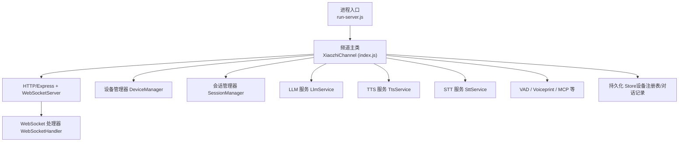
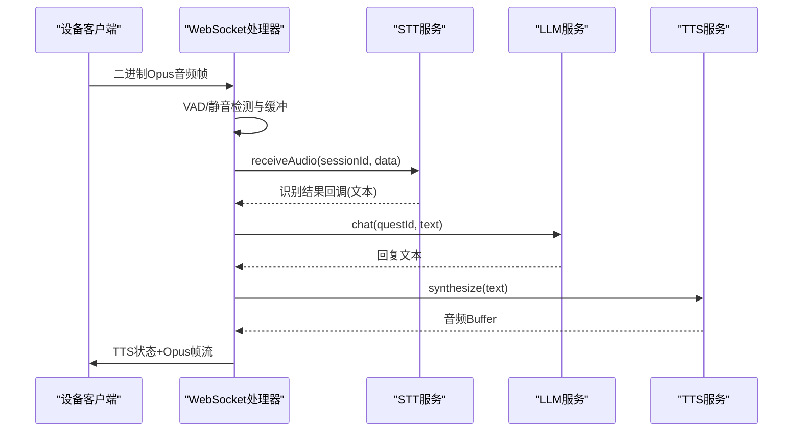
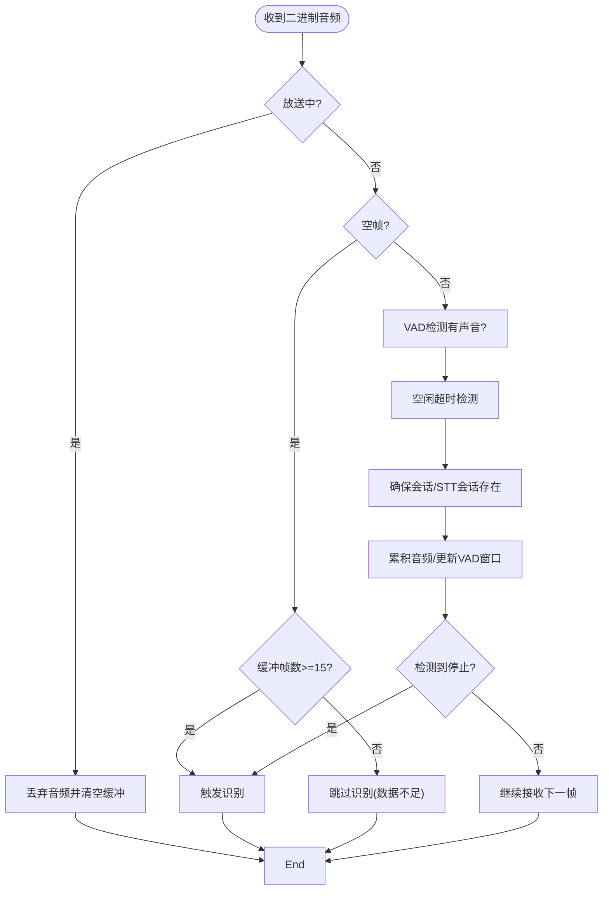
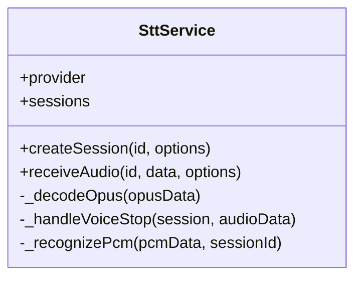
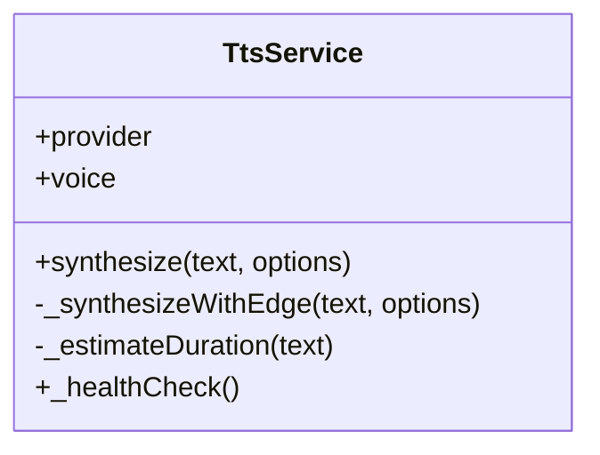
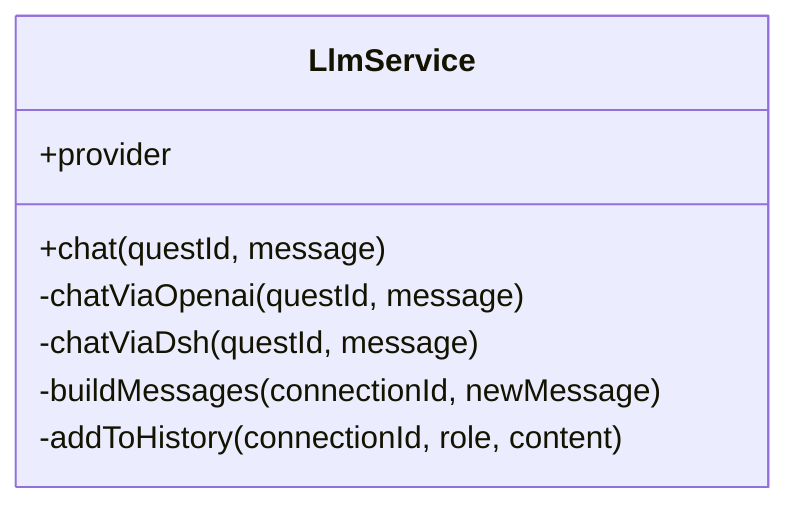
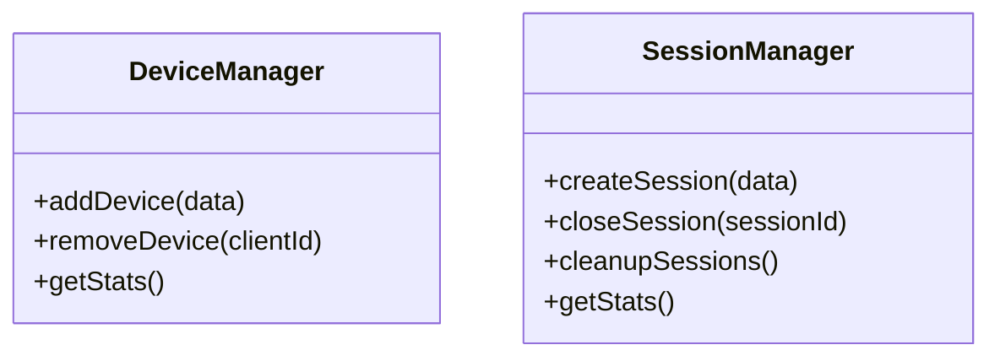
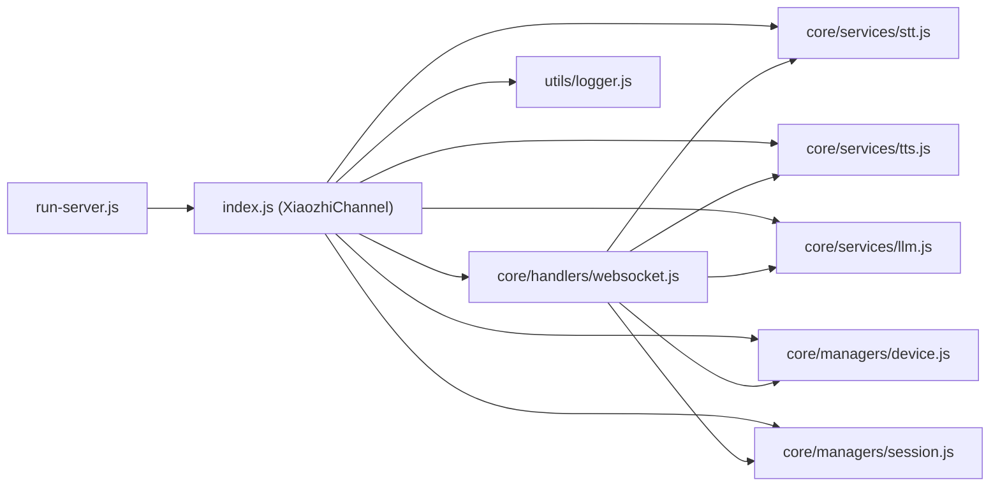

# 故障排除与调试

<cite>
**本文引用的文件**   
- [index.js](file://index.js)
- [run-server.js](file://run-server.js)
- [package.json](file://package.json)
- [logger.js](file://utils/logger.js)
- [websocket.js](file://core/handlers/websocket.js)
- [base.js](file://core/services/base.js)
- [device.js](file://core/managers/device.js)
- [session.js](file://core/managers/session.js)
- [stt.js](file://core/services/stt.js)
- [tts.js](file://core/services/tts.js)
- [llm.js](file://core/services/llm.js)
</cite>

## 目录
1. [简介](#简介)
2. [项目结构](#项目结构)
3. [核心组件](#核心组件)
4. [架构总览](#架构总览)
5. [详细组件分析](#详细组件分析)
6. [依赖关系分析](#依赖关系分析)
7. [性能考量](#性能考量)
8. [故障排除指南](#故障排除指南)
9. [结论](#结论)
10. [附录](#附录)

## 简介
本指南面向运维、开发与测试人员，提供小智语音交互服务器（standalone）的故障排除与调试方法。内容涵盖：
- 常见问题诊断思路与定位步骤
- 日志分析与监控指标采集
- 错误分类、问题定位与解决方案
- 调试工具使用、日志级别配置与监控告警建议
- 典型故障场景处理流程与预防措施
- 远程调试与问题复现方法

## 项目结构
本项目为 Node.js 独立运行服务，核心入口由 run-server.js 启动，内部通过 index.js 暴露 XiaozhiChannel 类，承载 HTTP/Express、WebSocket、设备与会话管理、LLM/TTS/STT/VAD/MCP 等服务集成。

**图表来源**
- [run-server.js:25-74](file://run-server.js#L25-L74)
- [index.js:44-282](file://index.js#L44-L282)
- [websocket.js:22-169](file://core/handlers/websocket.js#L22-L169)

**章节来源**
- [run-server.js:1-74](file://run-server.js#L1-L74)
- [index.js:1-706](file://index.js#L1-L706)

## 核心组件
- 频道与服务器：XiaozhiChannel 负责初始化服务、创建 Express/WS、挂载路由与健康检查。
- WebSocket 处理器：统一连接管理、消息分发、音频流处理、对话轮次串行化与打断控制。
- 设备与会话管理：维护在线设备、会话生命周期与统计。
- 语音链路：STT（多提供商）、TTS（Edge/讯飞/阿里云）、LLM（OpenAI兼容/dsh桥）。
- 日志系统：自包含 logger/channelLogger，支持控制台与文件输出，可配置日志级别。

**章节来源**
- [index.js:44-282](file://index.js#L44-L282)
- [websocket.js:22-169](file://core/handlers/websocket.js#L22-L169)
- [device.js:1-201](file://core/managers/device.js#L1-L201)
- [session.js:1-190](file://core/managers/session.js#L1-L190)
- [stt.js:39-121](file://core/services/stt.js#L39-L121)
- [tts.js:3-104](file://core/services/tts.js#L3-L104)
- [llm.js:16-65](file://core/services/llm.js#L16-L65)
- [logger.js:1-54](file://utils/logger.js#L1-L54)

## 架构总览
下图展示一次完整语音对话从设备到服务端的核心调用链，包括 STT、LLM、TTS 与 Opus 帧发送。

**图表来源**
- [websocket.js:289-446](file://core/handlers/websocket.js#L289-L446)
- [websocket.js:933-971](file://core/handlers/websocket.js#L933-L971)
- [websocket.js:1025-1130](file://core/handlers/websocket.js#L1025-L1130)
- [stt.js:348-383](file://core/services/stt.js#L348-L383)
- [tts.js:62-104](file://core/services/tts.js#L62-L104)

## 详细组件分析

### WebSocket 处理器（连接与消息）
- 连接建立：解析 client-id/device-id/client_type，注册设备，必要时登记持久化设备表。
- 消息分发：协议消息（HELLO/LISTEN/ABORT/IOT/CHAT/MCP）与二进制音频数据分流。
- 音频处理：VAD窗口、静默阈值、最长语音兜底、空帧结束录音、自动/手动模式识别触发。
- 对话轮次：串行化 turnChain，超时保护，回声判定与无效输入过滤，打断 abortUpTo 机制。
- TTS播放：先合成后发状态，Opus定长帧定时发送，异常时回退文本或 fallback 消息。

**图表来源**
- [websocket.js:289-446](file://core/handlers/websocket.js#L289-L446)

**章节来源**
- [websocket.js:67-169](file://core/handlers/websocket.js#L67-L169)
- [websocket.js:228-283](file://core/handlers/websocket.js#L228-L283)
- [websocket.js:289-446](file://core/handlers/websocket.js#L289-L446)
- [websocket.js:651-694](file://core/handlers/websocket.js#L651-L694)
- [websocket.js:1025-1130](file://core/handlers/websocket.js#L1025-L1130)

### STT 服务（语音转文字）
- 多提供商：doubao/funasr/aibridge/xunfei/aliyun，启动时探活 FunASR 或模拟模式。
- 会话管理：每个 sessionId 对应一个会话对象，维护缓冲区、解码器、流式连接。
- 音频处理：Opus 解码为 PCM，按 provider 发送；语音停止时合并帧并识别。
- 错误处理：解码失败跳过单帧，网络错误降级为模拟模式或抛出错误。

**图表来源**
- [stt.js:39-121](file://core/services/stt.js#L39-L121)
- [stt.js:293-383](file://core/services/stt.js#L293-L383)
- [stt.js:419-508](file://core/services/stt.js#L419-L508)
- [stt.js:515-583](file://core/services/stt.js#L515-L583)

**章节来源**
- [stt.js:39-121](file://core/services/stt.js#L39-L121)
- [stt.js:293-383](file://core/services/stt.js#L293-L383)
- [stt.js:419-508](file://core/services/stt.js#L419-L508)
- [stt.js:515-583](file://core/services/stt.js#L515-L583)

### TTS 服务（文字转语音）
- 提供商：edge/xunfei/aliyun，默认 Edge TTS。
- 合成流程：清理Markdown→选择提供商→生成音频→估算时长→返回Buffer。
- 健康检查：synthesize("健康检查测试")验证可用性。

**图表来源**
- [tts.js:3-104](file://core/services/tts.js#L3-L104)
- [tts.js:106-147](file://core/services/tts.js#L106-L147)
- [tts.js:163-202](file://core/services/tts.js#L163-L202)
- [tts.js:288-302](file://core/services/tts.js#L288-L302)

**章节来源**
- [tts.js:3-104](file://core/services/tts.js#L3-L104)
- [tts.js:106-147](file://core/services/tts.js#L106-L147)
- [tts.js:163-202](file://core/services/tts.js#L163-L202)
- [tts.js:288-302](file://core/services/tts.js#L288-L302)

### LLM 服务（对话生成）
- Provider：openai（直连 OpenAI 兼容端点）或 dsh（经 bridge），支持 fallbackBaseUrl。
- 历史上下文：每连接维护最近 N 轮对话，构建 messages 列表。
- 降级策略：不可用时返回友好提示，避免阻塞对话流程。

**图表来源**
- [llm.js:16-65](file://core/services/llm.js#L16-L65)
- [llm.js:75-104](file://core/services/llm.js#L75-L104)
- [llm.js:121-160](file://core/services/llm.js#L121-L160)
- [llm.js:166-203](file://core/services/llm.js#L166-L203)
- [llm.js:211-252](file://core/services/llm.js#L211-L252)

**章节来源**
- [llm.js:16-65](file://core/services/llm.js#L16-L65)
- [llm.js:75-104](file://core/services/llm.js#L75-L104)
- [llm.js:121-160](file://core/services/llm.js#L121-L160)
- [llm.js:166-203](file://core/services/llm.js#L166-L203)
- [llm.js:211-252](file://core/services/llm.js#L211-L252)

### 设备与会话管理
- DeviceManager：设备增删改查、在线状态、统计、批量操作。
- SessionManager：会话创建/关闭、活动更新、过期清理、统计。

**图表来源**
- [device.js:12-41](file://core/managers/device.js#L12-L41)
- [device.js:118-136](file://core/managers/device.js#L118-L136)
- [session.js:13-45](file://core/managers/session.js#L13-L45)
- [session.js:80-99](file://core/managers/session.js#L80-L99)
- [session.js:117-138](file://core/managers/session.js#L117-L138)

**章节来源**
- [device.js:1-201](file://core/managers/device.js#L1-L201)
- [session.js:1-190](file://core/managers/session.js#L1-L190)

## 依赖关系分析
- 进程入口 run-server.js 加载 .env 与 config.json，实例化 XiaozhiChannel 并启动。
- XiaozhiChannel 初始化各服务（LLM/TTS/STT/VAD/MCP），设置 Express 路由与 WebSocket 连接处理。
- WebSocketHandler 依赖 DeviceManager、SessionManager、STT/TTS/LLM 等，完成端到端语音对话。
- 日志模块 utils/logger.js 被多处引用，用于结构化日志输出。

**图表来源**
- [run-server.js:25-74](file://run-server.js#L25-L74)
- [index.js:44-282](file://index.js#L44-L282)
- [websocket.js:22-169](file://core/handlers/websocket.js#L22-L169)
- [logger.js:1-54](file://utils/logger.js#L1-L54)

**章节来源**
- [run-server.js:1-74](file://run-server.js#L1-L74)
- [index.js:1-706](file://index.js#L1-L706)
- [websocket.js:1-800](file://core/handlers/websocket.js#L1-L800)
- [logger.js:1-54](file://utils/logger.js#L1-L54)

## 性能考量
- 音频帧发送节拍：基于 ws.audioParams.frame_duration 或 audioConverter.frameDuration（默认 60ms），避免设备缓冲溢出导致颤音。
- 轮次串行化：turnChain 保证同一连接同一时刻只有一条应答流程，防止 Opus 帧交错。
- 超时保护：LLM 响应与整轮处理均设超时，避免挂死队列。
- 回声与噪音过滤：_isEchoOfSpoken/_isNoiseInput 减少误触发与无效对话。
- 会话与设备上限：DeviceManager/SessionManager 内置上限与清理逻辑，防止内存泄漏。

**章节来源**
- [websocket.js:1139-1189](file://core/handlers/websocket.js#L1139-L1189)
- [websocket.js:677-694](file://core/handlers/websocket.js#L677-L694)
- [websocket.js:933-971](file://core/handlers/websocket.js#L933-L971)
- [websocket.js:697-722](file://core/handlers/websocket.js#L697-L722)
- [device.js:118-136](file://core/managers/device.js#L118-L136)
- [session.js:117-138](file://core/managers/session.js#L117-L138)

## 故障排除指南

### 一、日志分析与监控
- 日志级别与环境变量
  - XZ_LOG_LEVEL：verbose/debug/info/warn/error，默认 info。
  - XZ_LOG_TO_FILE：是否写入文件，默认开启。
  - XZ_LOG_DIR：日志目录，默认 ./logs/server.log。
- 关键日志位置
  - 频道启动/停止：channelLogger.logModuleStart/logModuleStop/logOperation/logModuleError。
  - WebSocket 连接与错误：logger.info/error 在 handleConnection/ws.on('error')。
  - STT/TTS/LLM 初始化与调用：各服务的 initialize/synthesize/chat 日志。
- 健康检查接口
  - GET /health：返回 channel、devices、uptime。
  - GET /api/websocket/urls：返回当前 WS/WSS 地址与 USE_HTTPS 标志。
  - GET /api/settings/audio：读取/POST 热更新音频阈值与静默阈值。

**章节来源**
- [logger.js:1-54](file://utils/logger.js#L1-L54)
- [index.js:287-344](file://index.js#L287-L344)
- [index.js:427-443](file://index.js#L427-L443)
- [websocket.js:67-169](file://core/handlers/websocket.js#L67-L169)
- [stt.js:89-121](file://core/services/stt.js#L89-L121)
- [tts.js:288-302](file://core/services/tts.js#L288-L302)
- [llm.js:30-65](file://core/services/llm.js#L30-L65)

### 二、错误分类与定位
- 连接层错误
  - 现象：WS 连接频繁断开、设备注册失败。
  - 定位：查看 handleConnection 与设备注册异常日志；检查 client-type 白名单与 device-id。
  - 解决：修正 client_type，确保 device-id 上报；检查防火墙/NAT。
- 音频链路错误
  - 现象：无识别结果、识别碎片化、播放颤音。
  - 定位：检查 VAD 窗口与静默阈值；确认 Opus 帧时长与 frame_duration；查看 _decodeOpus 警告。
  - 解决：调整 /api/settings/audio 阈值；校准设备采样率/帧长；检查网络抖动。
- LLM/TTS 错误
  - 现象：LLM 超时、TTS 合成失败、回退文本。
  - 定位：查看 LLM/TTS 初始化与调用日志；检查 provider 配置与密钥；关注 fallbackBaseUrl。
  - 解决：补齐 apiKey/环境变量；校验 baseUrl；启用 FUNASR_SKIP_STARTUP_CHECK 跳过启动校验（谨慎）。
- 设备与会话资源
  - 现象：设备数量达上限、会话未释放。
  - 定位：查看 DeviceManager/SessionManager 统计与清理日志。
  - 解决：合理设置 maxDevices/maxSessions；定期调用 cleanup 接口或重启服务。

**章节来源**
- [websocket.js:67-169](file://core/handlers/websocket.js#L67-L169)
- [websocket.js:289-446](file://core/handlers/websocket.js#L289-L446)
- [websocket.js:1025-1130](file://core/handlers/websocket.js#L1025-L1130)
- [stt.js:419-508](file://core/services/stt.js#L419-L508)
- [llm.js:75-104](file://core/services/llm.js#L75-L104)
- [device.js:12-41](file://core/managers/device.js#L12-L41)
- [session.js:13-45](file://core/managers/session.js#L13-L45)

### 三、调试工具与技巧
- 本地调试
  - 使用 npm start 或 node --watch run-server.js 进行热重载开发。
  - 浏览器开发者工具观察 WS 帧与 JSON 消息；抓包 Wireshark/tcpdump 分析网络。
- 远程调试
  - 通过 /api/websocket/urls 获取当前 WS/WSS 地址；USE_HTTPS=true 切换 wss。
  - 使用 curl 访问 /health、/api/devices、/api/conversations 等接口辅助定位。
- 日志增强
  - 临时提升 XZ_LOG_LEVEL=debug 以捕获更细粒度信息；注意生产环境谨慎使用 verbose。
  - 将日志导出至集中式日志平台（如 ELK/ Loki）以便检索与告警。

**章节来源**
- [package.json:7-10](file://package.json#L7-L10)
- [index.js:427-443](file://index.js#L427-L443)
- [logger.js:1-54](file://utils/logger.js#L1-L54)

### 四、监控告警建议
- 服务健康
  - 监控 /health 返回状态与 uptime；异常则触发告警。
- 设备在线率
  - 定时拉取 /api/devices/stats，监控 live.registered 变化；离线率突增告警。
- 对话质量
  - 监控 /api/conversations 条目增长速率与角色分布；异常波动排查 STT/LLM/TTS。
- 资源水位
  - 监控进程内存/CPU；结合 DeviceManager/SessionManager 统计判断是否接近上限。

**章节来源**
- [index.js:287-344](file://index.js#L287-L344)
- [device.js:118-136](file://core/managers/device.js#L118-L136)
- [session.js:156-167](file://core/managers/session.js#L156-L167)

### 五、典型故障场景与处理流程

#### 场景A：设备无法连接 WebSocket
- 症状：设备反复重连，/api/devices 无在线设备。
- 排查：
  - 检查 /api/websocket/urls 返回的 host/port 与 USE_HTTPS。
  - 查看 WS 连接日志与错误事件。
  - 确认 client_type 在白名单内。
- 处理：
  - 修正 URL 与证书（wss）；校验防火墙与端口映射。
  - 若设备类型未知，改为 sensor/agent/hard/manager/unknown。

**章节来源**
- [index.js:427-443](file://index.js#L427-L443)
- [websocket.js:67-169](file://core/handlers/websocket.js#L67-L169)

#### 场景B：语音识别不触发或碎片化
- 症状：说话后无识别结果，或一句话被切分为多条。
- 排查：
  - 查看 VAD 窗口日志与静默阈值；检查空帧触发条件。
  - 确认 STT 会话与缓冲区帧数。
- 处理：
  - 通过 /api/settings/audio 调整 minMaxAmplitude/minAvgAmplitude/silenceThresholdMs。
  - 校准设备麦克风增益与噪声环境。

**章节来源**
- [websocket.js:289-446](file://core/handlers/websocket.js#L289-L446)
- [index.js:298-344](file://index.js#L298-L344)

#### 场景C：TTS 播放卡顿或颤音
- 症状：播放断断续续、音质差。
- 排查：
  - 检查 Opus 帧发送节拍与 frame_duration。
  - 查看 sendOpusAudioFrames 日志与 ws.readyState。
- 处理：
  - 对齐设备端 frame_duration 与服务端默认值（60ms）。
  - 优化网络带宽与丢包率。

**章节来源**
- [websocket.js:1139-1189](file://core/handlers/websocket.js#L1139-L1189)

#### 场景D：LLM 响应超时或不可用
- 症状：长时间等待后回退默认回复。
- 排查：
  - 查看 LLM 初始化与调用日志；检查 provider 与 baseUrl/apiKey。
  - 若是 dsh 模式，检查桥接服务健康。
- 处理：
  - 配置正确的 baseUrl 与 timeoutMs；必要时启用 fallbackBaseUrl。
  - 对 dsh 模式，检查 /health 端点可达性。

**章节来源**
- [llm.js:30-65](file://core/services/llm.js#L30-L65)
- [llm.js:75-104](file://core/services/llm.js#L75-L104)
- [websocket.js:933-971](file://core/handlers/websocket.js#L933-L971)

#### 场景E：设备数量或会话达到上限
- 症状：新增设备/会话失败，出现“已达上限”错误。
- 排查：
  - 查看 DeviceManager/SessionManager 统计与清理日志。
- 处理：
  - 调整 maxDevices/maxSessions；定期清理离线设备与过期会话。

**章节来源**
- [device.js:12-41](file://core/managers/device.js#L12-L41)
- [session.js:13-45](file://core/managers/session.js#L13-L45)

### 六、预防措施
- 配置校验：启动时对关键外部依赖（FunASR/OpenAI兼容/dsh）进行探活，失败时给出明确错误。
- 阈值调优：在生产环境逐步调优 VAD 与静默阈值，避免误触发与漏触发。
- 资源限额：合理设置设备与会话上限，配合定时清理任务。
- 日志分级：生产默认 info，仅在排查时临时提升至 debug；归档日志便于回溯。
- 健康检查：对外暴露 /health 与 /api/websocket/urls，供监控系统巡检。

**章节来源**
- [stt.js:185-201](file://core/services/stt.js#L185-L201)
- [llm.js:30-65](file://core/services/llm.js#L30-L65)
- [index.js:287-344](file://index.js#L287-L344)
- [logger.js:1-54](file://utils/logger.js#L1-L54)

## 结论
通过对 WebSocket 处理器、STT/TTS/LLM 服务、设备与会话管理的系统化分析，结合日志与监控手段，可以快速定位并解决常见故障。建议在部署前完成依赖探活与阈值调优，运行时保持合理的日志级别与资源限额，并通过健康检查与统计接口实现持续监控与告警。

## 附录
- 常用命令
  - 启动：npm start
  - 开发：node --watch run-server.js
- 关键环境变量
  - XZ_LOG_LEVEL/XZ_LOG_TO_FILE/XZ_LOG_DIR
  - USE_HTTPS/AIBRIDGE_API_KEY/FUNASR_HOST/FUNASR_PORT/FUNASR_SSL/FUNASR_SKIP_STARTUP_CHECK

**章节来源**
- [package.json:7-10](file://package.json#L7-L10)
- [logger.js:1-54](file://utils/logger.js#L1-L54)
- [llm.js:30-65](file://core/services/llm.js#L30-L65)
- [stt.js:185-201](file://core/services/stt.js#L185-L201)