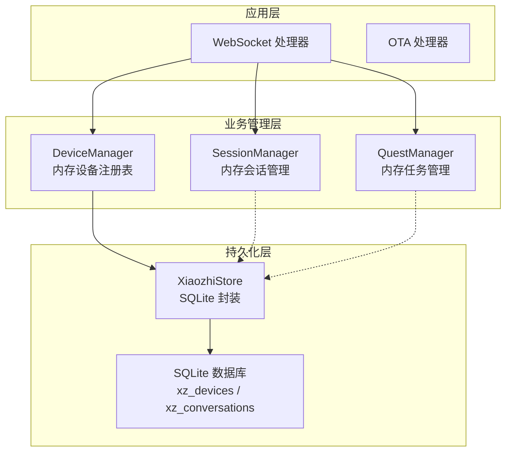
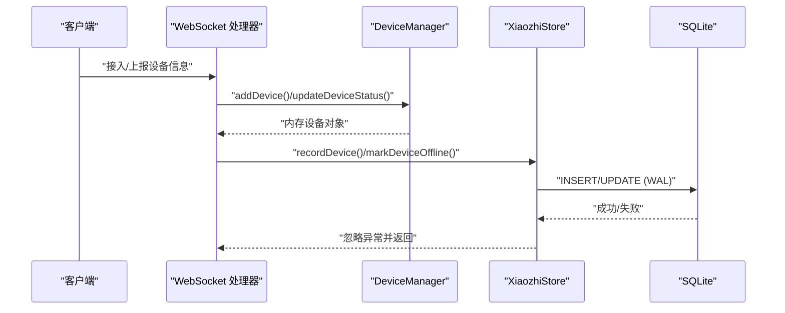
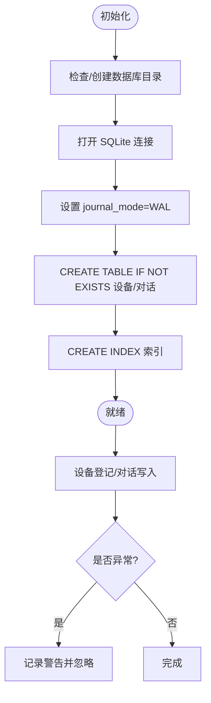
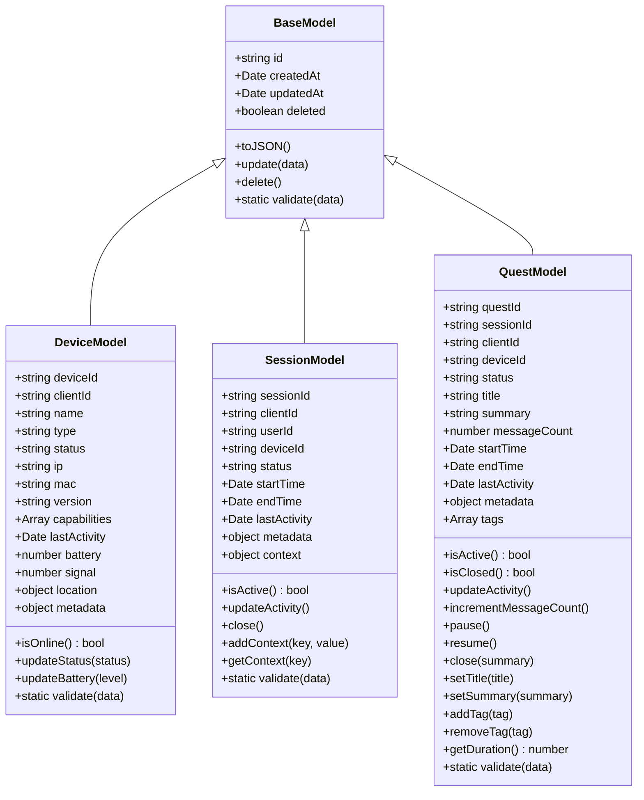
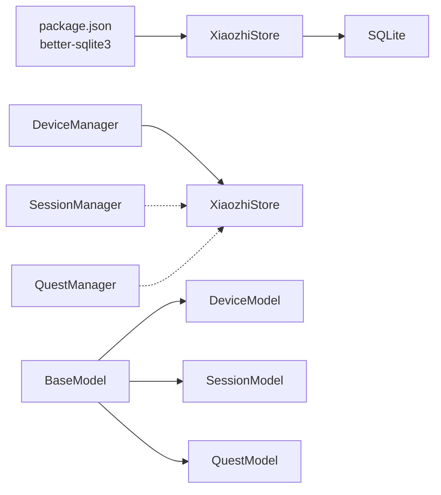

# 数据存储设计

<cite>
**本文引用的文件**   
- [core/managers/store.js](file://core/managers/store.js)
- [package.json](file://package.json)
- [core/models/base.js](file://core/models/base.js)
- [core/models/device.js](file://core/models/device.js)
- [core/models/session.js](file://core/models/session.js)
- [core/models/quest.js](file://core/models/quest.js)
- [core/managers/device.js](file://core/managers/device.js)
- [core/managers/session.js](file://core/managers/session.js)
- [core/managers/quest.js](file://core/managers/quest.js)
</cite>

## 目录
1. [引言](#引言)
2. [项目结构](#项目结构)
3. [核心组件](#核心组件)
4. [架构总览](#架构总览)
5. [详细组件分析](#详细组件分析)
6. [依赖关系分析](#依赖关系分析)
7. [性能与优化](#性能与优化)
8. [数据完整性与约束](#数据完整性与约束)
9. [迁移策略与版本管理](#迁移策略与版本管理)
10. [备份、恢复与容量规划](#备份恢复与容量规划)
11. [扩展指南：新增数据模型与查询接口](#扩展指南新增数据模型与查询接口)
12. [故障排查](#故障排查)
13. [结论](#结论)

## 引言
本文件面向“小智语音交互服务器”的数据存储设计，聚焦基于 SQLite 的持久化层、表结构与数据模型、ORM 抽象、访问模式、索引与查询优化、数据完整性约束、迁移策略、备份恢复与容量规划，以及扩展新数据模型和查询接口的最佳实践。

本项目使用 better-sqlite3 作为 SQLite 驱动，采用单进程同步 API；同时提供内存态管理器（DeviceManager、SessionManager、QuestManager）用于运行时会话与设备状态管理，持久化由 XiaozhiStore 统一封装。

## 项目结构
围绕数据存储的关键目录与文件如下：
- core/managers/store.js：SQLite 初始化、建表、索引、读写封装、统计与关闭
- core/models/*：基础模型与领域模型（设备、会话、任务）
- core/managers/*：内存态管理器（设备、会话、任务），负责生命周期与清理
- package.json：better-sqlite3 依赖声明

图表来源
- [core/managers/store.js:29-83](file://core/managers/store.js#L29-L83)
- [core/managers/device.js:4-10](file://core/managers/device.js#L4-L10)
- [core/managers/session.js:4-10](file://core/managers/session.js#L4-L10)
- [core/managers/quest.js:8-15](file://core/managers/quest.js#L8-L15)

章节来源
- [core/managers/store.js:1-83](file://core/managers/store.js#L1-L83)
- [package.json:11-14](file://package.json#L11-L14)

## 核心组件
- XiaozhiStore：SQLite 连接管理、建库建表、索引创建、设备登记/离线标记、对话记录写入与分页查询、统计信息、优雅降级与关闭
- BaseModel：通用字段（id、createdAt、updatedAt、deleted）、序列化与更新方法
- DeviceModel/SessionModel/QuestModel：领域模型定义与校验逻辑
- DeviceManager/SessionManager/QuestManager：内存态对象管理与生命周期控制（非持久化）

章节来源
- [core/managers/store.js:29-237](file://core/managers/store.js#L29-L237)
- [core/models/base.js:1-43](file://core/models/base.js#L1-L43)
- [core/models/device.js:1-96](file://core/models/device.js#L1-L96)
- [core/models/session.js:1-82](file://core/models/session.js#L1-L82)
- [core/models/quest.js:1-178](file://core/models/quest.js#L1-L178)
- [core/managers/device.js:1-201](file://core/managers/device.js#L1-L201)
- [core/managers/session.js:1-190](file://core/managers/session.js#L1-L190)
- [core/managers/quest.js:1-332](file://core/managers/quest.js#L1-L332)

## 架构总览
整体数据流遵循“业务层 -> 内存管理器 -> 持久化 Store -> SQLite”的分层模式。持久化层对主流程进行隔离：写失败不阻断语音通道，自动降级为 no-op。

图表来源
- [core/managers/store.js:91-135](file://core/managers/store.js#L91-L135)
- [core/managers/device.js:12-86](file://core/managers/device.js#L12-L86)

## 详细组件分析

### SQLite 持久化层：XiaozhiStore
职责
- 数据库路径解析与环境变量覆盖
- WAL 模式启用
- 建表与索引
- 设备登记与离线标记
- 对话记录写入与分页查询
- 统计信息与关闭

关键实现要点
- 数据库路径默认 data/xz.db，可通过环境变量 XZ_DB_PATH 覆盖
- 使用 better-sqlite3 同步 API
- 所有写操作 try/catch 捕获异常并降级，不影响主流程
- 使用参数化语句防止 SQL 注入
- 针对高频查询建立复合索引

图表来源
- [core/managers/store.js:37-83](file://core/managers/store.js#L37-L83)
- [core/managers/store.js:91-175](file://core/managers/store.js#L91-L175)

章节来源
- [core/managers/store.js:19-83](file://core/managers/store.js#L19-L83)
- [core/managers/store.js:85-202](file://core/managers/store.js#L85-L202)
- [core/managers/store.js:206-237](file://core/managers/store.js#L206-L237)

### 数据模型与 ORM 抽象

#### 基础模型 BaseModel
- 提供 id、createdAt、updatedAt、deleted 等通用字段
- toJSON 序列化、update 批量更新、delete 软删除标记
- validate 留给子类实现具体校验

章节来源
- [core/models/base.js:1-43](file://core/models/base.js#L1-L43)

#### 设备模型 DeviceModel
- 字段：deviceId、clientId、name、type、status、ip、mac、version、capabilities、lastActivity、battery、signal、location、metadata、connection
- 行为：isOnline、updateStatus、updateBattery、validate
- 注意：该模型主要用于内存态管理，持久化由 XiaozhiStore 的设备表承载

章节来源
- [core/models/device.js:1-96](file://core/models/device.js#L1-L96)

#### 会话模型 SessionModel
- 字段：sessionId、clientId、userId、deviceId、status、startTime、endTime、lastActivity、metadata、context
- 行为：isActive、updateActivity、close、addContext/getContext、validate

章节来源
- [core/models/session.js:1-82](file://core/models/session.js#L1-L82)

#### 任务模型 QuestModel
- 字段：questId、sessionId、clientId、deviceId、status、title、summary、messageCount、startTime、endTime、lastActivity、metadata、tags
- 行为：isActive/isClosed、updateActivity、incrementMessageCount、pause/resume/close、setTitle/setSummary、addTag/removeTag、getDuration、validate

章节来源
- [core/models/quest.js:1-178](file://core/models/quest.js#L1-L178)

#### 类图（模型层）

图表来源
- [core/models/base.js:1-43](file://core/models/base.js#L1-L43)
- [core/models/device.js:1-96](file://core/models/device.js#L1-L96)
- [core/models/session.js:1-82](file://core/models/session.js#L1-L82)
- [core/models/quest.js:1-178](file://core/models/quest.js#L1-L178)

### 内存态管理器（非持久化）
- DeviceManager：维护 clientId->DeviceModel 与 deviceId->clientId 映射，支持增删改查、在线判定、离线清理、搜索与批量更新
- SessionManager：维护 sessionId->SessionModel 与 clientId->sessionIds 映射，支持创建/获取/关闭、上下文存取、过期清理与统计
- QuestManager：维护 questId->QuestModel 与客户端活跃任务映射，支持创建/获取/关闭/暂停/恢复、消息计数、历史查询、过期清理与统计

章节来源
- [core/managers/device.js:1-201](file://core/managers/device.js#L1-L201)
- [core/managers/session.js:1-190](file://core/managers/session.js#L1-L190)
- [core/managers/quest.js:1-332](file://core/managers/quest.js#L1-L332)

## 依赖关系分析
- 依赖 SQLite 驱动：better-sqlite3（包依赖见 package.json）
- XiaozhiStore 直接依赖 better-sqlite3 与日志模块
- 模型层与管理器层解耦：管理器仅操作内存对象，持久化通过 Store 暴露的接口完成
- 无循环依赖：store.js 不反向引用 managers 或 models

图表来源
- [package.json:11-14](file://package.json#L11-L14)
- [core/managers/store.js:12-16](file://core/managers/store.js#L12-L16)
- [core/models/base.js:1-43](file://core/models/base.js#L1-L43)

章节来源
- [package.json:11-14](file://package.json#L11-L14)
- [core/managers/store.js:12-16](file://core/managers/store.js#L12-L16)

## 性能与优化
- WAL 模式：已启用 journal_mode=WAL，提升并发读性能与减少锁竞争
- 参数化查询：全部使用 prepare().run/all/get，避免 SQL 注入与重复编译开销
- 索引设计：
  - idx_xz_conv_device_time(device_id, created_at)：按设备+时间范围查询对话
  - idx_xz_conv_time(created_at)：全局时间排序与分页
  - idx_xz_dev_last_seen(last_seen)：设备列表按最近活动时间排序
- 分页查询：listDevices/listConversations 均提供 limit/offset，避免全表扫描
- 统计查询：COUNT(*) 配合 WHERE 条件，利用索引加速

建议
- 若对话量增长，可考虑按月份分区或归档到历史库
- 热点设备可引入缓存层（如内存 Map）以减少频繁 IO
- 定期 VACUUM 与 ANALYZE 以维护统计信息

章节来源
- [core/managers/store.js:42-75](file://core/managers/store.js#L42-L75)
- [core/managers/store.js:138-202](file://core/managers/store.js#L138-L202)

## 数据完整性与约束
- 主键约束：
  - xz_devices.device_id TEXT PRIMARY KEY
  - xz_conversations.id INTEGER PRIMARY KEY AUTOINCREMENT
- 非空约束：
  - xz_conversations.role TEXT NOT NULL
  - xz_conversations.text TEXT NOT NULL
  - xz_conversations.created_at INTEGER NOT NULL
- 唯一性：
  - device_id 唯一，重复登记走 ON CONFLICT DO UPDATE 语义
- 外键：
  - 当前未启用外键约束（device_id/session_id/quest_id 为自由文本字段）
  - 建议在需要强一致时开启 PRAGMA foreign_keys=ON 并在应用层保证一致性

章节来源
- [core/managers/store.js:44-75](file://core/managers/store.js#L44-L75)
- [core/managers/store.js:98-119](file://core/managers/store.js#L98-L119)

## 迁移策略与版本管理
现状
- 当前 Schema 在初始化时通过 CREATE TABLE IF NOT EXISTS 与 CREATE INDEX IF NOT EXISTS 构建
- 没有显式的 schema_version 表或迁移脚本

建议方案
- 引入 schema_version 表记录版本号
- 启动时读取版本号，按需执行增量迁移脚本（ALTER TABLE/ADD COLUMN/REINDEX）
- 迁移失败时回滚并记录错误，确保服务可启动但功能降级
- 将迁移逻辑集中到 migration.js，供 store.js 调用

示例步骤（概念性）
- 启动时读取 schema_version
- 对比目标版本，顺序执行迁移脚本
- 成功后更新 schema_version
- 异常处理与日志记录

[本节为概念性说明，不涉及具体代码文件]

## 备份、恢复与容量规划
备份与恢复
- 冷备：停止服务后复制 xz.db 文件
- 热备：WAL 模式下可使用 sqlite3 工具导出快照（需确保一致性）
- 增量：结合文件系统快照或 LVM 快照进行一致性备份
- 恢复：替换 xz.db 并重启服务；或在运行中切换 XZ_DB_PATH 指向新库

容量规划
- 估算单条对话记录大小（text 字段可能较大），结合日增量评估磁盘增长
- 监控 xz_conversations 行数与平均行大小，设定告警阈值
- 定期归档旧数据至历史库或对象存储，保留近期数据于主库

章节来源
- [core/managers/store.js:19-24](file://core/managers/store.js#L19-L24)
- [core/managers/store.js:42-75](file://core/managers/store.js#L42-L75)

## 扩展指南：新增数据模型与查询接口
步骤
1. 定义领域模型
   - 在 core/models/ 下新增 Model 文件，继承 BaseModel，定义字段与校验逻辑
2. 扩展持久化层
   - 在 XiaozhiStore 中添加建表与索引语句（CREATE TABLE IF NOT EXISTS / CREATE INDEX IF NOT EXISTS）
   - 新增 CRUD 方法，使用参数化语句，保持异常捕获与降级
3. 暴露查询接口
   - 在 Store 中增加 list/get/stats 等方法，支持分页与过滤
4. 集成业务层
   - 在对应 Manager 中调用 Store 的新接口
5. 测试与监控
   - 单元测试覆盖正常路径与异常降级
   - 添加统计指标与日志埋点

注意事项
- 保持与现有命名规范一致（xz_ 前缀）
- 所有写操作必须 try/catch 并记录警告，不阻断主流程
- 为新表建立必要索引，尤其是高频过滤与排序字段

章节来源
- [core/managers/store.js:44-75](file://core/managers/store.js#L44-L75)
- [core/managers/store.js:158-202](file://core/managers/store.js#L158-L202)
- [core/models/base.js:1-43](file://core/models/base.js#L1-L43)

## 故障排查
常见问题
- 数据库不可用：初始化失败会禁用持久化，服务继续运行但不再落盘
  - 现象：日志出现“持久化已禁用”，写操作被忽略
  - 排查：检查 XZ_DB_PATH、目录权限、磁盘空间
- 写失败被忽略：设备登记/对话写入失败仅记录警告
  - 现象：日志出现“设备登记失败（忽略）/对话记录写入失败（忽略）”
  - 排查：检查 SQL 参数、字段长度、磁盘 I/O 错误
- 查询为空：当 Store.disabled=true 时，查询返回空结果
  - 现象：listDevices/listConversations 返回 total=0, items=[]
  - 排查：确认持久化是否启用

章节来源
- [core/managers/store.js:77-82](file://core/managers/store.js#L77-L82)
- [core/managers/store.js:120-134](file://core/managers/store.js#L120-L134)
- [core/managers/store.js:158-175](file://core/managers/store.js#L158-L175)
- [core/managers/store.js:138-149](file://core/managers/store.js#L138-L149)
- [core/managers/store.js:181-202](file://core/managers/store.js#L181-L202)

## 结论
本项目采用简洁可靠的 SQLite 持久化方案，结合 WAL 模式与合理索引，满足设备登记与对话记录的高频写入与分页查询需求。持久化层对主流程进行隔离，确保语音通道稳定性。内存态管理器承担会话与设备的短期状态管理，便于快速响应。未来可在迁移机制、外键约束、数据归档与监控方面进一步增强，以支撑更大规模与更高可用性的生产环境。