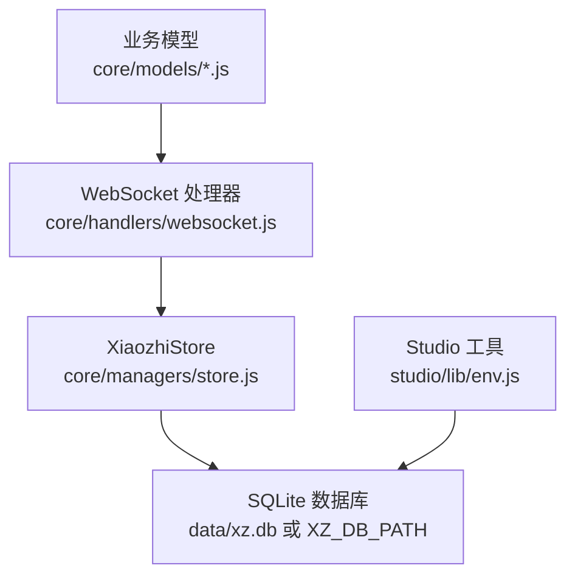
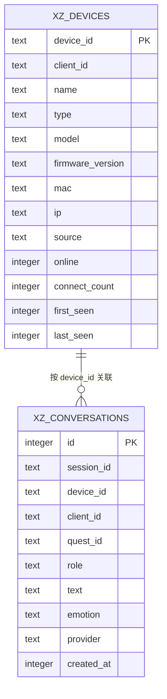
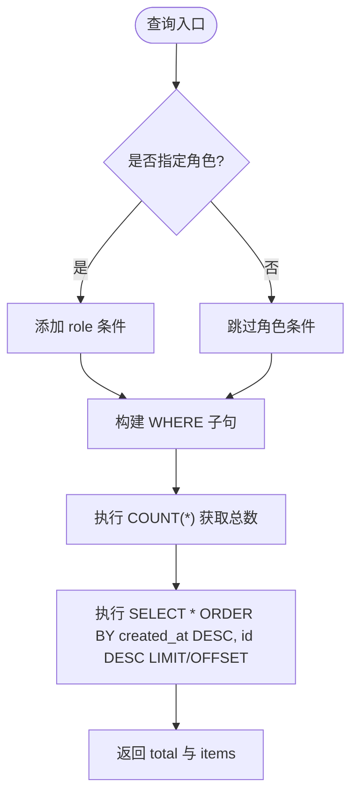
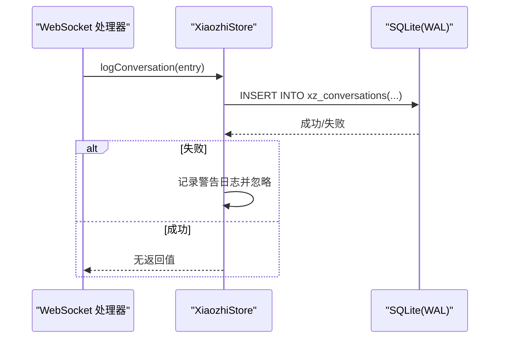
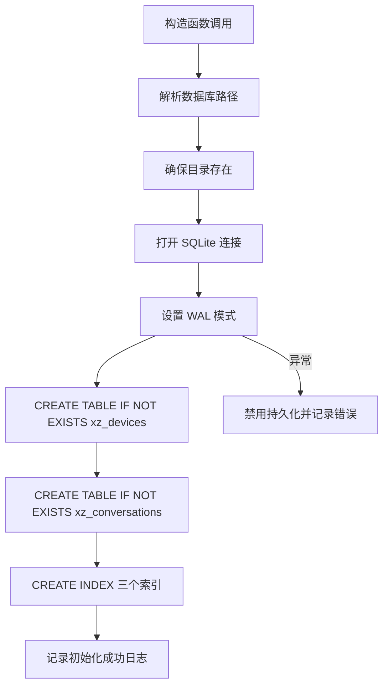
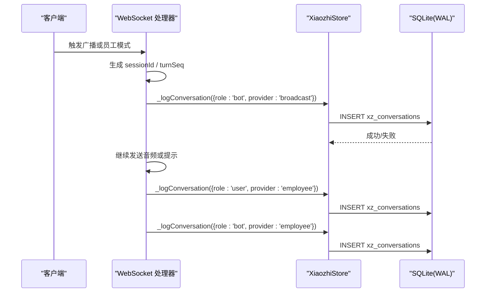
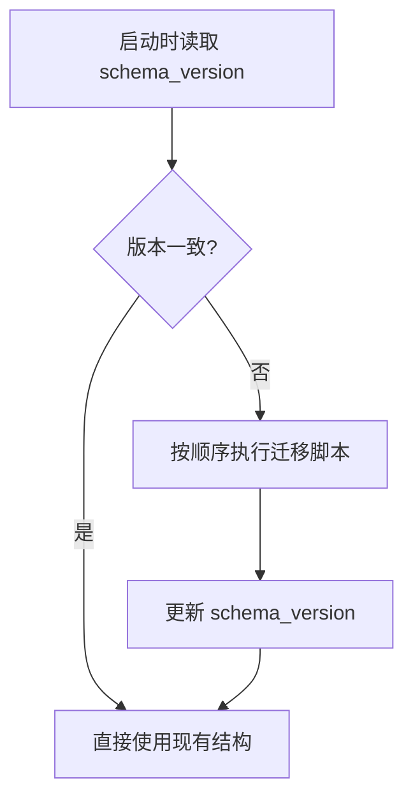

# 数据库设计

<cite>
**本文引用的文件**   
- [core/managers/store.js](file://core/managers/store.js)
- [core/models/base.js](file://core/models/base.js)
- [core/models/device.js](file://core/models/device.js)
- [core/models/session.js](file://core/models/session.js)
- [core/handlers/websocket.js](file://core/handlers/websocket.js)
- [studio/lib/env.js](file://studio/lib/env.js)
- [package.json](file://package.json)
</cite>

## 目录
1. [引言](#引言)
2. [项目结构与数据库定位](#项目结构与数据库定位)
3. [核心表结构与设计原则](#核心表结构与设计原则)
4. [字段定义与约束规范](#字段定义与约束规范)
5. [索引策略与查询优化](#索引策略与查询优化)
6. [WAL 模式、并发访问与数据完整性](#wal-模式并发访问与数据完整性)
7. [数据库初始化流程](#数据库初始化流程)
8. [写入路径与对话审计流程](#写入路径与对话审计流程)
9. [迁移策略与版本演进建议](#迁移策略与版本演进建议)
10. [性能调优参数](#性能调优参数)
11. [备份恢复方案](#备份恢复方案)
12. [容量规划建议](#容量规划建议)
13. [故障排查指南](#故障排查指南)
14. [结论](#结论)

## 引言
本文件面向小智语音交互服务器的 SQLite 数据库设计，重点说明架构选型、核心表 `xz_devices` 与 `xz_conversations` 的业务含义、字段约束、索引策略，以及 WAL 模式配置、数据完整性保证和并发访问优化。文档还覆盖数据库初始化流程、表结构迁移策略、性能调优参数、备份恢复方案和容量规划建议，帮助运维与开发人员在不直接阅读源码的情况下理解并安全扩展数据库层。

## 项目结构与数据库定位
当前仓库使用 Node.js 实现，依赖 `better-sqlite3` 提供 SQLite 客户端能力；持久化逻辑集中在设备注册与对话记录模块中，默认独立数据库文件位于项目内 `data/xz.db`，也可通过环境变量覆盖为共享库路径。Studio 侧工具会直接读取该数据库以展示最近连接的设备信息。

**图表来源**
- [core/handlers/websocket.js:1670-1749](file://core/handlers/websocket.js#L1670-L1749)
- [core/managers/store.js:12-83](file://core/managers/store.js#L12-L83)
- [studio/lib/env.js:97-108](file://studio/lib/env.js#L97-L108)

**章节来源**
- [package.json:11-14](file://package.json#L11-L14)
- [core/managers/store.js:18-24](file://core/managers/store.js#L18-L24)
- [studio/lib/env.js:97-108](file://studio/lib/env.js#L97-L108)

## 核心表结构与设计原则
系统围绕两个核心表组织数据：

- `xz_devices`：设备注册表，用于登记已知设备，包括 OTA 上报与 WebSocket 接入场景，同时保留离线设备历史。主键为 `device_id`，便于按设备维度进行在线状态、最后活跃时间、连接次数等统计。
- `xz_conversations`：对话记录表，每轮用户输入与机器人回复各一条记录，支持按设备、角色、时间范围查询，用于前端展示与审计追踪。

设计原则如下：
- 写失败不阻断主流程：所有写操作均捕获异常并降级为日志警告，确保语音对话链路稳定。
- 时间戳统一使用毫秒级 Unix 时间，便于跨语言与跨平台比较。
- 设备表采用“存在即更新”的 upsert 语义，避免重复插入导致主键冲突。
- 对话表采用自增主键，配合时间倒序查询，满足前端分页展示需求。

**图表来源**
- [core/managers/store.js:44-75](file://core/managers/store.js#L44-L75)

**章节来源**
- [core/managers/store.js:44-75](file://core/managers/store.js#L44-L75)

## 字段定义与约束规范
以下字段定义与约束来自实际建表语句与写入逻辑：

### xz_devices
| 字段 | 类型 | 约束/默认值 | 业务含义 |
| --- | --- | --- | --- |
| `device_id` | TEXT | PRIMARY KEY | 设备唯一标识，作为主键用于去重与关联 |
| `client_id` | TEXT | 可为空 | 客户端会话标识，便于多端或多连接区分 |
| `name` | TEXT | 可为空 | 设备显示名称 |
| `type` | TEXT | 可为空 | 设备类型（如传感器、代理、硬件、管理等） |
| `model` | TEXT | 可为空 | 设备型号，用于板型识别与固件匹配 |
| `firmware_version` | TEXT | 可为空 | 固件版本号 |
| `mac` | TEXT | 可为空 | MAC 地址，常用于 USB 直连设备识别 |
| `ip` | TEXT | 可为空 | 网络 IP 地址 |
| `source` | TEXT | DEFAULT 'ws' | 数据来源，例如 ws、ota 等 |
| `online` | INTEGER | DEFAULT 0 | 在线标记，1 表示在线，0 表示离线 |
| `connect_count` | INTEGER | DEFAULT 0 | 累计连接次数 |
| `first_seen` | INTEGER | NOT NULL | 首次发现时间（毫秒） |
| `last_seen` | INTEGER | NOT NULL | 最后活跃时间（毫秒），用于排序与超时判断 |

### xz_conversations
| 字段 | 类型 | 约束/默认值 | 业务含义 |
| --- | --- | --- | --- |
| `id` | INTEGER | PRIMARY KEY AUTOINCREMENT | 自增主键，保证顺序可回溯 |
| `session_id` | TEXT | 可为空 | 会话标识，用于聚合一轮对话 |
| `device_id` | TEXT | 可为空 | 所属设备，便于按设备维度审计 |
| `client_id` | TEXT | 可为空 | 客户端标识 |
| `quest_id` | TEXT | 可为空 | 任务或请求标识，便于链路追踪 |
| `role` | TEXT | NOT NULL | 角色，user 或 bot |
| `text` | TEXT | NOT NULL | 对话文本内容 |
| `emotion` | TEXT | 可为空 | 情感标签，用于 TTS 或 UI 表现 |
| `provider` | TEXT | 可为空 | 提供方，如 broadcast、employee 等，用于审计分类 |
| `created_at` | INTEGER | NOT NULL | 创建时间（毫秒），用于时间范围查询与排序 |

**章节来源**
- [core/managers/store.js:44-75](file://core/managers/store.js#L44-L75)
- [core/managers/store.js:98-119](file://core/managers/store.js#L98-L119)
- [core/managers/store.js:163-171](file://core/managers/store.js#L163-L171)

## 索引策略与查询优化
现有索引如下：
- `idx_xz_conv_device_time`：`(device_id, created_at)`，优化按设备+时间的对话查询。
- `idx_xz_conv_time`：`(created_at)`，优化全局时间范围查询。
- `idx_xz_dev_last_seen`：`(last_seen)`，优化设备列表按最后活跃时间排序。

查询模式与索引匹配情况：
- 设备列表查询按 `last_seen DESC` 排序，命中 `idx_xz_dev_last_seen`。
- 对话列表查询支持按 `device_id` 与 `role` 过滤，并按 `created_at DESC, id DESC` 排序，命中 `idx_xz_conv_device_time` 与自增主键顺序。
- 统计查询包含 COUNT 与按当天时间过滤，建议结合 `idx_xz_conv_time` 提升性能。

**图表来源**
- [core/managers/store.js:181-201](file://core/managers/store.js#L181-L201)

**章节来源**
- [core/managers/store.js:72-75](file://core/managers/store.js#L72-L75)
- [core/managers/store.js:138-149](file://core/managers/store.js#L138-L149)
- [core/managers/store.js:181-201](file://core/managers/store.js#L181-L201)

## WAL 模式、并发访问与数据完整性
- WAL 模式：初始化时设置 `journal_mode = WAL`，提升读并发与减少锁竞争，适合高并发读取设备与对话记录的负载。
- 事务与原子性：写入方法使用 `prepare().run()` 执行单条 SQL，保证单行写入原子性；未显式开启多语句事务，但 WAL 模式下仍具备较好的并发读性能。
- 错误降级：所有写操作均 try/catch 并记录警告日志，避免数据库不可用影响语音主流程；初始化失败则禁用持久化，转为内存 no-op。
- 时间一致性：统一使用 `Date.now()` 毫秒时间戳，避免时区与格式不一致问题。
- 外键关系：当前未启用外键约束，依赖应用层维护 `device_id` 一致性；建议在后续版本考虑启用外键或增加校验逻辑。

**图表来源**
- [core/handlers/websocket.js:1737-1749](file://core/handlers/websocket.js#L1737-L1749)
- [core/managers/store.js:158-175](file://core/managers/store.js#L158-L175)
- [core/managers/store.js:42-43](file://core/managers/store.js#L42-L43)

**章节来源**
- [core/managers/store.js:42-43](file://core/managers/store.js#L42-L43)
- [core/managers/store.js:77-82](file://core/managers/store.js#L77-L82)
- [core/managers/store.js:120-122](file://core/managers/store.js#L120-L122)
- [core/managers/store.js:172-174](file://core/managers/store.js#L172-L174)

## 数据库初始化流程
初始化过程包括目录创建、数据库连接、WAL 模式设置与建表/建索引：

1. 解析数据库路径：优先使用环境变量 `XZ_DB_PATH`，否则默认 `data/xz.db`。
2. 确保目录存在：不存在则递归创建。
3. 打开数据库连接：使用 `better-sqlite3` 实例。
4. 设置 WAL 模式：`PRAGMA journal_mode = WAL`。
5. 建表与索引：若表不存在则创建 `xz_devices` 与 `xz_conversations`，并创建三个索引。
6. 异常处理：初始化失败则禁用持久化，记录错误日志。

**图表来源**
- [core/managers/store.js:18-83](file://core/managers/store.js#L18-L83)

**章节来源**
- [core/managers/store.js:18-83](file://core/managers/store.js#L18-L83)

## 写入路径与对话审计流程
对话写入主要发生在 WebSocket 处理器中，涉及广播播报与员工模式轮次：

- 广播播报：将 bot 侧回复写入 `xz_conversations`，`provider='broadcast'`，便于审计主动放送链路。
- 员工模式：用户输入与员工回复分别写入 `xz_conversations`，`provider='employee'`，形成完整审计链。

**图表来源**
- [core/handlers/websocket.js:1674-1677](file://core/handlers/websocket.js#L1674-L1677)
- [core/handlers/websocket.js:1737-1749](file://core/handlers/websocket.js#L1737-L1749)
- [core/managers/store.js:158-175](file://core/managers/store.js#L158-L175)

**章节来源**
- [core/handlers/websocket.js:1670-1749](file://core/handlers/websocket.js#L1670-L1749)
- [core/managers/store.js:158-175](file://core/managers/store.js#L158-L175)

## 迁移策略与版本演进建议
当前代码未实现显式的数据库版本管理与迁移脚本，建表使用 `CREATE TABLE IF NOT EXISTS`，新增字段需手动评估兼容性。建议引入以下机制：

- 版本表：新增 `schema_version` 表或字段，记录当前数据库版本。
- 迁移脚本：按版本号递增执行 ALTER TABLE、新增索引、数据清洗等操作。
- 回滚策略：对破坏性变更提供反向脚本，并在升级前备份。
- 兼容性检查：在初始化阶段检测字段是否存在，缺失则自动补齐。

由于当前仓库未包含迁移实现，以下为概念性建议图：

[本图为概念性迁移流程示意，不对应具体源码文件]

## 性能调优参数
基于现有实现与 SQLite 特性，建议关注以下参数与实践：

- `PRAGMA journal_mode = WAL`：已启用，提升读并发与减少锁争用。
- `PRAGMA synchronous`：根据可靠性与性能权衡选择 NORMAL 或 OFF（生产环境建议谨慎）。
- `PRAGMA cache_size`：适当增大缓存页数以减少磁盘 IO。
- `PRAGMA temp_store = MEMORY`：临时对象使用内存存储，提升复杂查询性能。
- 批量写入：在高吞吐场景下合并多条 INSERT 或使用事务包裹多次写入。
- 索引优化：根据实际查询热点调整复合索引顺序，避免过度索引造成写入放大。
- 定期 VACUUM：在大量删除后重建数据库以减少碎片。

[本节为通用性能指导，不直接分析具体源码文件]

## 备份恢复方案
针对 SQLite 与 WAL 模式的备份恢复建议：

- 热备方案：使用 `sqlite3` 命令行工具或 `backup` API 在运行期复制数据库文件；WAL 模式下需确保 WAL 文件同步。
- 冷备方案：停止服务后复制 `xz.db` 与对应的 `-wal`、`-shm` 文件。
- 增量备份：结合 `created_at` 字段导出增量对话记录，减轻全量备份压力。
- 恢复流程：先恢复主库文件，再恢复 WAL/SHM 文件，重启服务验证数据一致性。
- 校验步骤：对比 COUNT 统计与最近时间戳，确认数据完整。

[本节为通用备份恢复指导，不直接分析具体源码文件]

## 容量规划建议
根据表结构与查询模式，容量规划应考虑：

- 设备规模：`xz_devices` 行数与设备数量线性相关，字段较小，增长缓慢。
- 对话规模：`xz_conversations` 随会话量增长较快，需关注 `text` 字段大小与索引开销。
- 时间分区：可按月份或季度归档历史对话，降低主库压力。
- 索引成本：索引提升查询性能但增加写入与存储空间，需平衡。
- 监控指标：跟踪表大小、索引大小、查询延迟、WAL 文件大小。

[本节为通用容量规划指导，不直接分析具体源码文件]

## 故障排查指南
常见问题与排查要点：

- 数据库不可用：初始化失败会禁用持久化，检查日志中的错误信息与 `XZ_DB_PATH` 权限。
- 写入失败：设备登记或对话写入失败会被忽略，查看警告日志定位原因。
- 查询为空：检查过滤条件与索引是否命中，确认时间戳格式与单位。
- 并发锁竞争：WAL 模式下通常缓解，但仍需关注长时间事务与锁等待。
- 数据不一致：检查应用层是否维护 `device_id` 一致性，必要时引入外键或校验。

**章节来源**
- [core/managers/store.js:77-82](file://core/managers/store.js#L77-L82)
- [core/managers/store.js:120-122](file://core/managers/store.js#L120-L122)
- [core/managers/store.js:172-174](file://core/managers/store.js#L172-L174)

## 结论
本项目的 SQLite 数据库设计围绕设备注册与对话审计两大核心场景展开，采用 WAL 模式提升并发读性能，并通过错误降级保障主流程稳定性。`xz_devices` 与 `xz_conversations` 表结构简洁明确，索引策略覆盖常见查询模式。未来建议引入显式版本管理与迁移脚本，完善外键约束与数据校验，进一步提升数据一致性与可维护性。在生产环境中，应结合容量规划与备份恢复方案，建立完善的监控与运维体系。