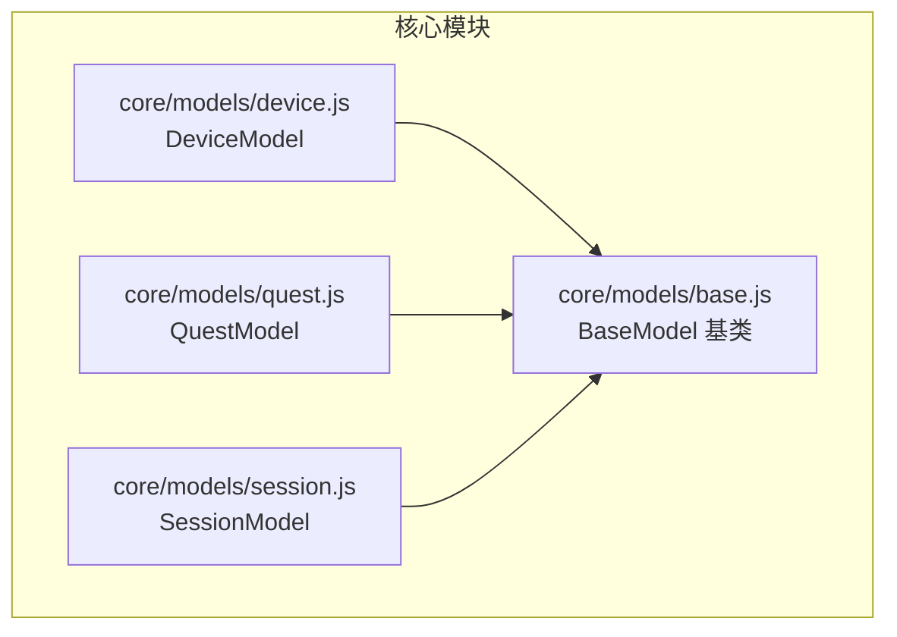
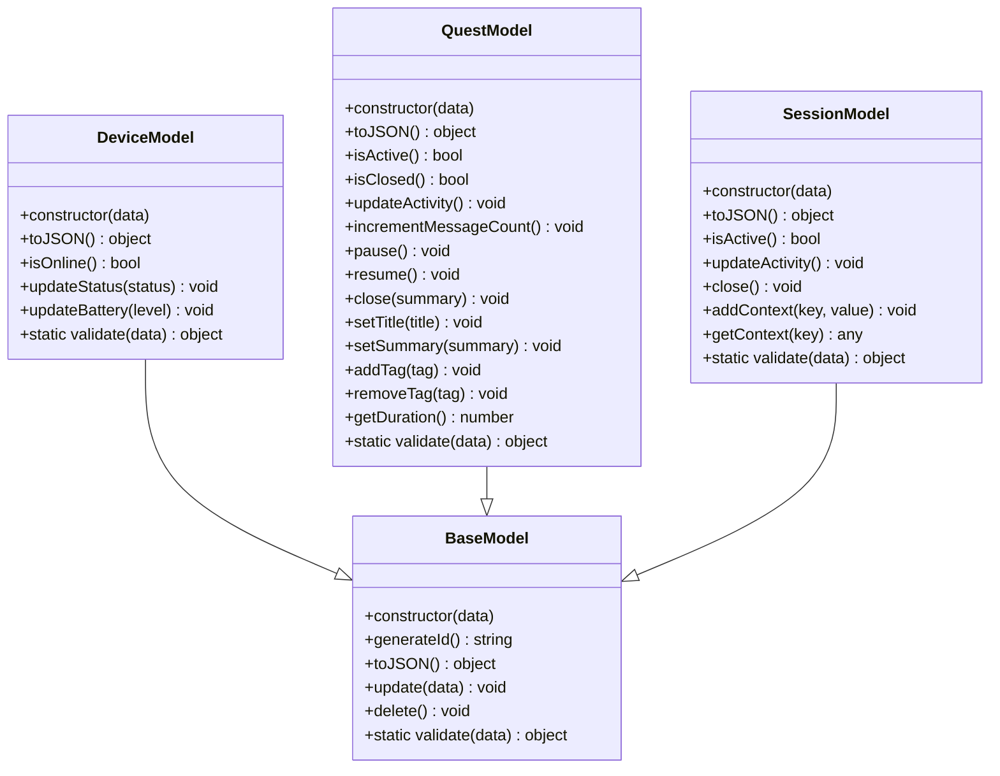
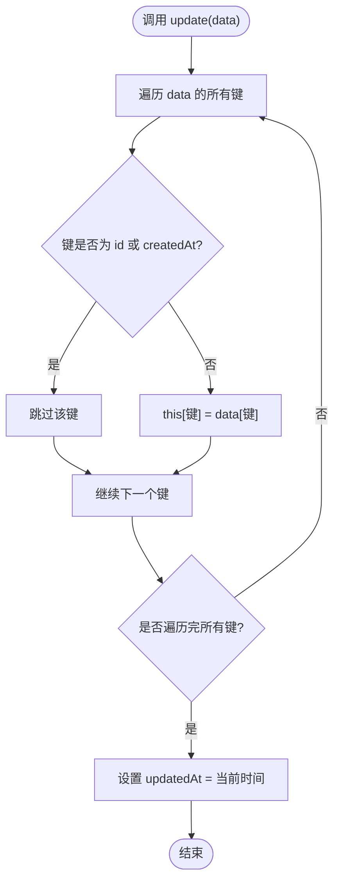
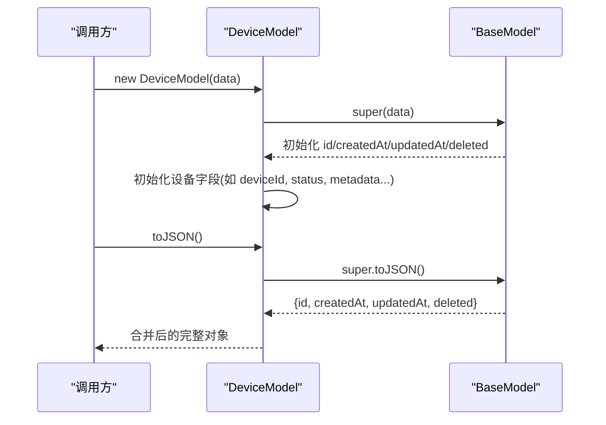
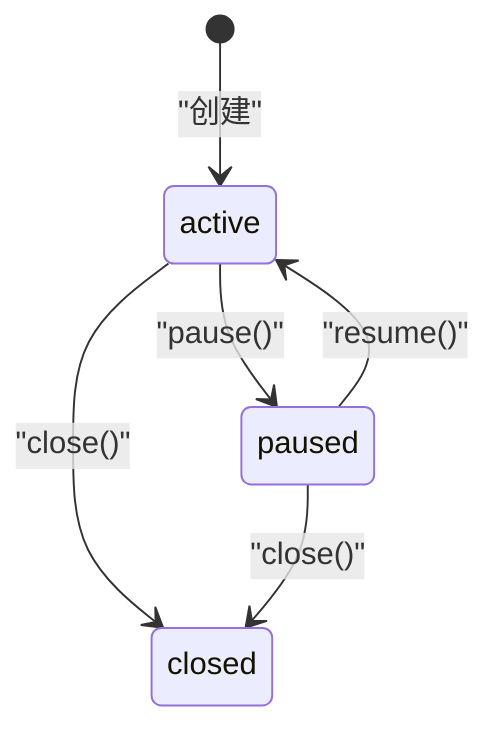
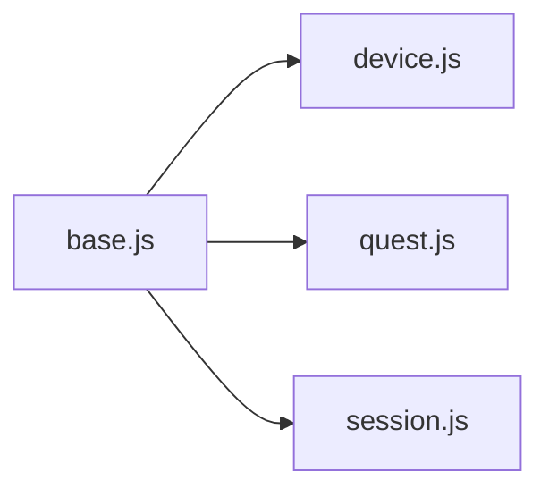

# BaseModel基类

<cite>
**本文引用的文件**   
- [core/models/base.js](file://core/models/base.js)
- [core/models/device.js](file://core/models/device.js)
- [core/models/quest.js](file://core/models/quest.js)
- [core/models/session.js](file://core/models/session.js)
</cite>

## 目录
1. [简介](#简介)
2. [项目结构](#项目结构)
3. [核心组件](#核心组件)
4. [架构总览](#架构总览)
5. [详细组件分析](#详细组件分析)
6. [依赖关系分析](#依赖关系分析)
7. [性能考虑](#性能考虑)
8. [故障排查指南](#故障排查指南)
9. [结论](#结论)
10. [附录：最佳实践与示例](#附录最佳实践与示例)

## 简介
本文围绕 BaseModel 基类进行系统化文档化，重点说明其设计模式、继承机制、通用属性（id、createdAt、updatedAt、deleted）的定义与初始化逻辑，以及核心方法 generateId()、toJSON()、update()、delete() 的实现原理和使用场景。同时解释 validate() 静态方法的扩展机制，并给出自定义模型继承 BaseModel 的最佳实践与示例路径。

## 项目结构
本项目采用按功能域组织文件的结构，数据模型集中在 core/models 目录下。BaseModel 作为所有领域模型的基类，被 DeviceModel、QuestModel、SessionModel 等具体模型继承使用。

图表来源
- [core/models/base.js:1-43](file://core/models/base.js#L1-L43)
- [core/models/device.js:1-96](file://core/models/device.js#L1-L96)
- [core/models/quest.js:1-178](file://core/models/quest.js#L1-L178)
- [core/models/session.js:1-82](file://core/models/session.js#L1-L82)

章节来源
- [core/models/base.js:1-43](file://core/models/base.js#L1-L43)
- [core/models/device.js:1-96](file://core/models/device.js#L1-L96)
- [core/models/quest.js:1-178](file://core/models/quest.js#L1-L178)
- [core/models/session.js:1-82](file://core/models/session.js#L1-L82)

## 核心组件
- BaseModel：提供通用生命周期字段与基础行为，包括 ID 生成、序列化、批量更新、软删除和可扩展的校验入口。
- DeviceModel：设备实体，继承 BaseModel，扩展设备相关字段与方法，并提供业务校验。
- QuestModel：对话任务实体，继承 BaseModel，扩展任务状态机与元数据管理。
- SessionModel：会话实体，继承 BaseModel，扩展会话上下文与活动追踪。

章节来源
- [core/models/base.js:1-43](file://core/models/base.js#L1-L43)
- [core/models/device.js:1-96](file://core/models/device.js#L1-L96)
- [core/models/quest.js:1-178](file://core/models/quest.js#L1-L178)
- [core/models/session.js:1-82](file://core/models/session.js#L1-L82)

## 架构总览
BaseModel 通过 ES Class 实现单继承体系，子类在构造函数中调用 super(data) 以复用通用字段的初始化，并在自身构造函数中初始化领域字段。序列化时通过展开父类的 toJSON() 结果来保证通用字段的一致性。

图表来源
- [core/models/base.js:1-43](file://core/models/base.js#L1-L43)
- [core/models/device.js:1-96](file://core/models/device.js#L1-L96)
- [core/models/quest.js:1-178](file://core/models/quest.js#L1-L178)
- [core/models/session.js:1-82](file://core/models/session.js#L1-L82)

## 详细组件分析

### BaseModel 基类设计与实现
- 通用属性与初始化
  - id：优先使用传入 data.id，否则调用 generateId() 生成。
  - createdAt：优先使用传入 data.createdAt，否则初始化为当前时间。
  - updatedAt：优先使用传入 data.updatedAt，否则初始化为当前时间。
  - deleted：优先使用传入 data.deleted，默认 false。
- 核心方法
  - generateId()：基于时间戳与随机字符串拼接生成唯一标识。
  - toJSON()：返回包含通用字段的对象，便于序列化输出。
  - update(data)：将 data 中的可写字段赋值到实例，排除 id 与 createdAt；每次更新后刷新 updatedAt。
  - delete()：标记 deleted 为 true，并刷新 updatedAt，实现软删除语义。
  - static validate(data)：预留校验钩子，子类应重写以实现领域校验。
- 设计要点
  - 不可变字段保护：update() 显式跳过 id 与 createdAt，避免意外覆盖关键标识与创建时间。
  - 软删除：通过 deleted 标志位配合 updatedAt 变更，便于审计与恢复。
  - 可扩展性：validate() 静态方法为子类提供统一的校验入口，便于集中处理输入合法性。

图表来源
- [core/models/base.js:23-30](file://core/models/base.js#L23-L30)

章节来源
- [core/models/base.js:1-43](file://core/models/base.js#L1-L43)

### DeviceModel 设备模型
- 继承与扩展
  - 继承 BaseModel，新增 deviceId、clientId、name、type、status、ip、mac、version、capabilities、lastActivity、battery、signal、location、metadata、connection 等字段。
  - 重写 toJSON()，合并父类通用字段与设备特有字段，并对 lastActivity 做 ISO 字符串转换。
- 业务方法
  - isOnline()：根据 status 与 lastActivity 判断在线状态（最近 2 分钟活跃）。
  - updateStatus(status)、updateBattery(level)：更新状态/电量并刷新 lastActivity 与 updatedAt。
- 校验
  - static validate(data)：对 deviceId、clientId、type、battery、lastActivity、metadata 等进行类型与范围校验，返回 { valid, errors }。

图表来源
- [core/models/device.js:3-42](file://core/models/device.js#L3-L42)
- [core/models/base.js:3-21](file://core/models/base.js#L3-L21)

章节来源
- [core/models/device.js:1-96](file://core/models/device.js#L1-L96)

### QuestModel 对话任务模型
- 继承与扩展
  - 继承 BaseModel，新增 questId、sessionId、clientId、deviceId、status、title、summary、messageCount、startTime、endTime、lastActivity、metadata、tags 等字段。
  - 重写 toJSON()，合并父类通用字段与任务特有字段。
- 业务方法
  - isActive()/isClosed()：状态查询。
  - updateActivity()：刷新 lastActivity 与 updatedAt。
  - incrementMessageCount()：消息计数自增并更新活动时间。
  - pause()/resume()/close()：状态机操作，维护 endTime 与 summary。
  - setTitle()/setSummary()/addTag()/removeTag()：元数据与标签管理。
  - getDuration()：计算任务持续时间。
- 校验
  - static validate(data)：校验 clientId 必填与 status 枚举值。

图表来源
- [core/models/quest.js:84-108](file://core/models/quest.js#L84-L108)

章节来源
- [core/models/quest.js:1-178](file://core/models/quest.js#L1-L178)

### SessionModel 会话模型
- 继承与扩展
  - 继承 BaseModel，新增 sessionId、clientId、userId、deviceId、status、startTime、endTime、lastActivity、metadata、context 等字段。
  - 重写 toJSON()，合并父类通用字段与会话特有字段。
- 业务方法
  - isActive()：根据 status 与 lastActivity 判断活跃（最近 5 分钟）。
  - updateActivity()：刷新 lastActivity 与 updatedAt。
  - close()：关闭会话，设置 endTime 与 updatedAt。
  - addContext()/getContext()：会话上下文读写。
- 校验
  - static validate(data)：校验 clientId 必填与 status 枚举值。

章节来源
- [core/models/session.js:1-82](file://core/models/session.js#L1-L82)

## 依赖关系分析
- 直接依赖
  - DeviceModel、QuestModel、SessionModel 均 import 并 extends BaseModel。
- 间接依赖
  - 各模型通过 super.toJSON() 复用 BaseModel 的序列化逻辑，确保通用字段一致。
- 耦合与内聚
  - BaseModel 保持高内聚（通用生命周期与基础能力），领域模型低耦合地扩展自身业务方法与校验。
- 外部依赖
  - 无第三方库依赖，仅使用 JavaScript 标准 API（Date、Math、Object）。

图表来源
- [core/models/base.js:1-43](file://core/models/base.js#L1-L43)
- [core/models/device.js:1-96](file://core/models/device.js#L1-L96)
- [core/models/quest.js:1-178](file://core/models/quest.js#L1-L178)
- [core/models/session.js:1-82](file://core/models/session.js#L1-L82)

章节来源
- [core/models/base.js:1-43](file://core/models/base.js#L1-L43)
- [core/models/device.js:1-96](file://core/models/device.js#L1-L96)
- [core/models/quest.js:1-178](file://core/models/quest.js#L1-L178)
- [core/models/session.js:1-82](file://core/models/session.js#L1-L82)

## 性能考虑
- ID 生成
  - BaseModel.generateId() 使用 Date.now() 与 Math.random() 拼接，时间复杂度 O(1)，空间开销极小。在高并发场景下建议结合分布式 ID 策略以避免碰撞。
- 序列化
  - toJSON() 仅拷贝必要字段，避免深层复制带来的额外开销。
- 更新
  - update() 使用 Object.keys 遍历，时间复杂度 O(n)（n 为传入对象键数），适合轻量级字段更新。
- 软删除
  - delete() 仅修改布尔标志与时间戳，O(1) 操作，便于后续过滤与审计。

[本节为通用性能讨论，不直接分析具体代码行]

## 故障排查指南
- 字段未生效
  - 检查是否在 update() 中传入了受保护的字段（id、createdAt），这些字段会被忽略。
- 时间戳异常
  - 确认传入的 createdAt/updatedAt 为有效日期对象或可解析的日期字符串。
- 校验失败
  - 查看各模型的 static validate(data) 返回值中的 errors 数组，定位非法字段与取值范围。
- 序列化不完整
  - 确保子类 toJSON() 正确调用 super.toJSON() 并合并自身字段。

章节来源
- [core/models/base.js:23-35](file://core/models/base.js#L23-L35)
- [core/models/device.js:61-93](file://core/models/device.js#L61-L93)
- [core/models/quest.js:158-174](file://core/models/quest.js#L158-L174)
- [core/models/session.js:63-79](file://core/models/session.js#L63-L79)

## 结论
BaseModel 提供了稳定、可扩展的数据模型基座，统一了通用字段与基础行为，并通过静态 validate() 钩子让子类聚焦领域校验。DeviceModel、QuestModel、SessionModel 在其之上实现了各自的业务语义与状态机，整体结构清晰、职责分离明确，便于维护与扩展。

[本节为总结性内容，不直接分析具体代码行]

## 附录：最佳实践与示例

- 继承 BaseModel 的步骤
  1. 在构造函数中调用 super(data) 以复用通用字段初始化。
  2. 在构造函数中初始化领域字段，必要时对输入做类型与范围校验。
  3. 重写 toJSON()，先调用 super.toJSON() 再合并自身字段。
  4. 如需业务方法，定义 instance 方法并遵循“更新即刷新 updatedAt”的约定。
  5. 重写 static validate(data) 返回 { valid, errors }，用于集中校验输入。

- 参考实现路径
  - 设备模型参考：[core/models/device.js:3-42](file://core/models/device.js#L3-L42)、[core/models/device.js:61-93](file://core/models/device.js#L61-L93)
  - 任务模型参考：[core/models/quest.js:8-49](file://core/models/quest.js#L8-L49)、[core/models/quest.js:158-174](file://core/models/quest.js#L158-L174)
  - 会话模型参考：[core/models/session.js:3-36](file://core/models/session.js#L3-L36)、[core/models/session.js:63-79](file://core/models/session.js#L63-L79)

- 常见注意事项
  - 不要在 update() 中尝试覆盖 id 与 createdAt，这是由基类保护的设计。
  - 软删除使用 delete()，而非物理删除，便于审计与恢复。
  - 校验逻辑尽量放在 static validate(data) 中，以便在构造前拦截非法数据。

[本节为概念性与指导性内容，不直接分析具体代码行]