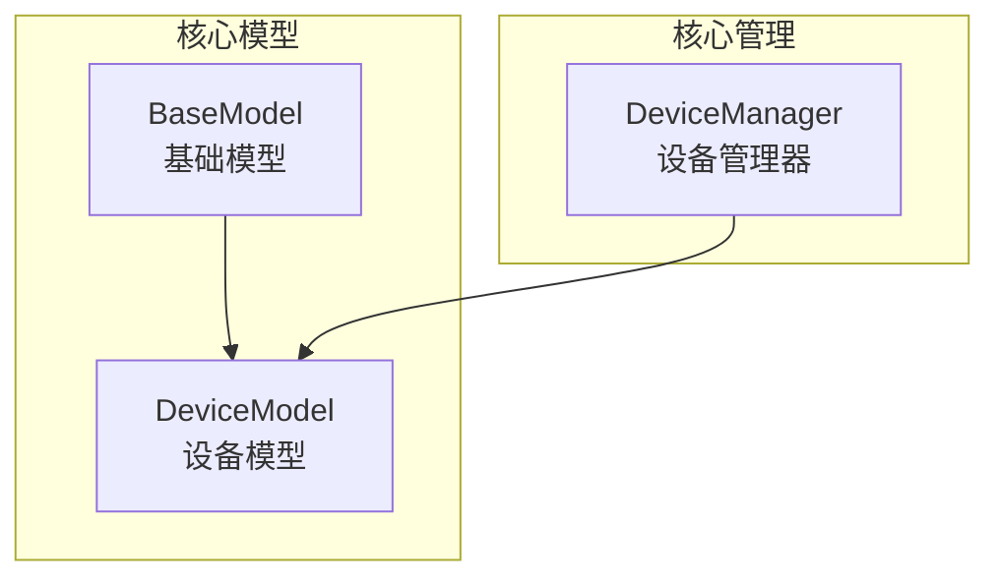
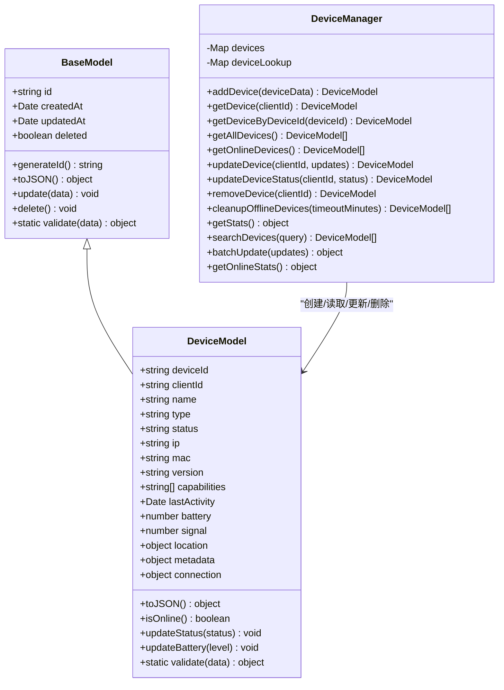
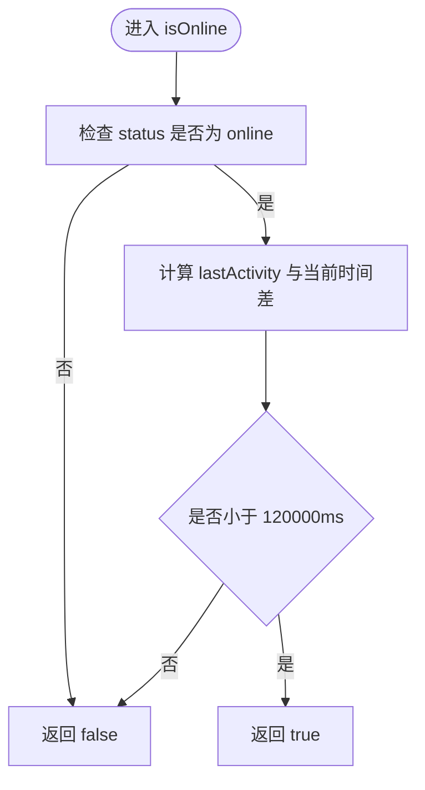
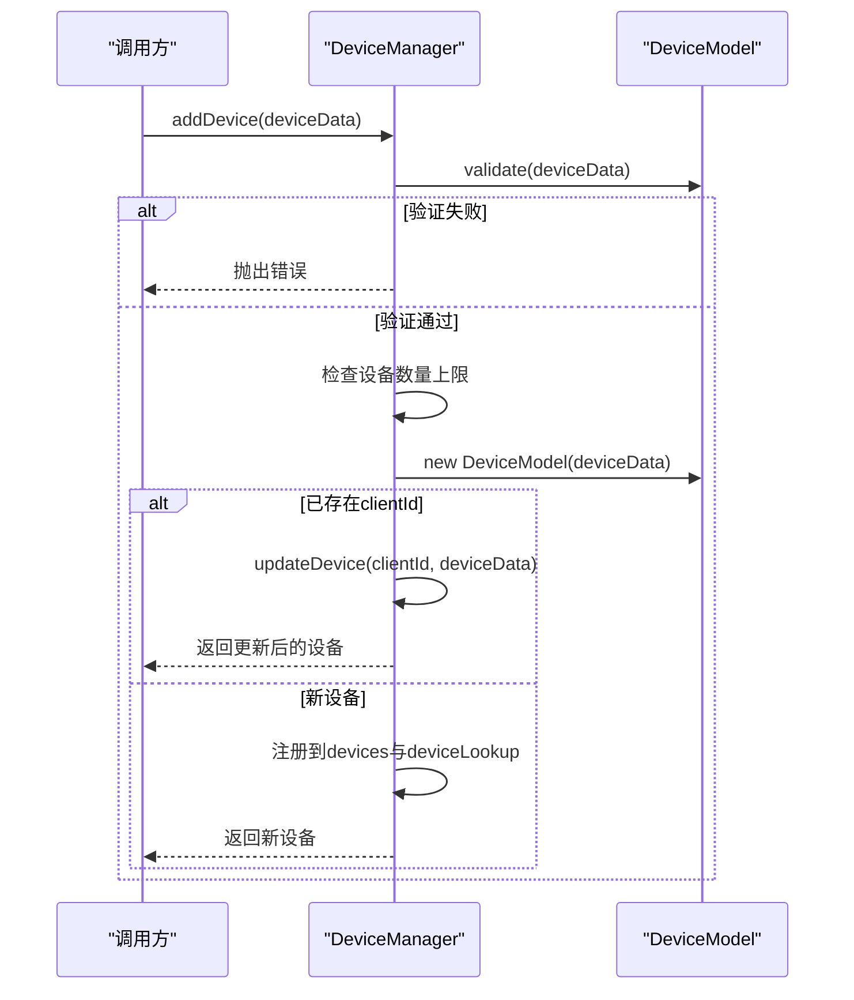
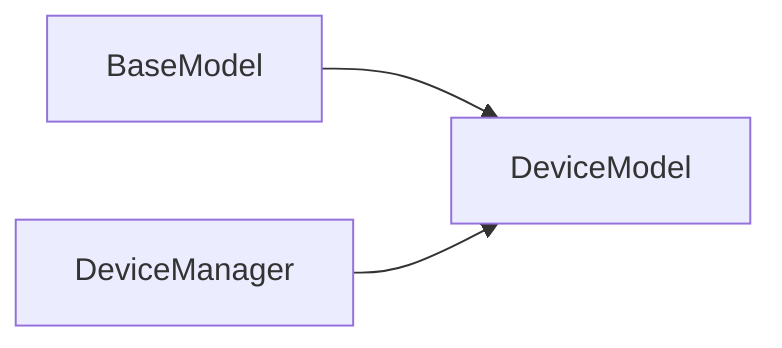
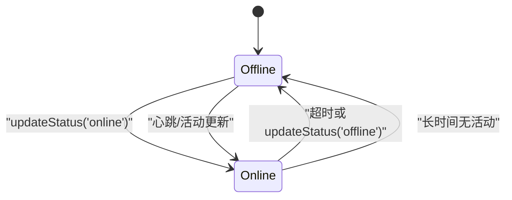

# DeviceModel设备模型

<cite>
**本文引用的文件**   
- [core/models/device.js](file://core/models/device.js)
- [core/models/base.js](file://core/models/base.js)
- [core/managers/device.js](file://core/managers/device.js)
</cite>

## 目录
1. [简介](#简介)
2. [项目结构](#项目结构)
3. [核心组件](#核心组件)
4. [架构总览](#架构总览)
5. [详细组件分析](#详细组件分析)
6. [依赖关系分析](#依赖关系分析)
7. [性能考虑](#性能考虑)
8. [故障排查指南](#故障排查指南)
9. [结论](#结论)
10. [附录：CRUD示例与状态转换](#附录crud示例与状态转换)

## 简介
本文件面向DeviceModel设备模型的实现与使用，覆盖以下主题：
- 设备实体属性定义（标识、连接状态、配置信息等）
- 设备状态管理机制与生命周期方法
- 数据验证规则与约束条件
- 设备实例的创建、更新、查询与删除操作示例
- 设备状态转换与业务规则细节

## 项目结构
围绕设备模型的相关代码主要位于以下位置：
- core/models/base.js：基础模型类，提供通用字段与生命周期方法
- core/models/device.js：设备模型类，继承基础模型并扩展设备相关能力
- core/managers/device.js：设备管理器，负责设备集合管理、统计、搜索与批量操作

图表来源
- [core/models/base.js:1-43](file://core/models/base.js#L1-L43)
- [core/models/device.js:1-96](file://core/models/device.js#L1-L96)
- [core/managers/device.js:1-201](file://core/managers/device.js#L1-L201)

章节来源
- [core/models/base.js:1-43](file://core/models/base.js#L1-L43)
- [core/models/device.js:1-96](file://core/models/device.js#L1-L96)
- [core/managers/device.js:1-201](file://core/managers/device.js#L1-L201)

## 核心组件
- BaseModel：提供id、createdAt、updatedAt、deleted等通用字段；提供generateId、toJSON、update、delete、validate等方法。
- DeviceModel：在BaseModel基础上扩展设备专属字段与方法，包括设备标识、连接状态、能力集、电量信号、位置、元数据、WebSocket连接引用等；提供isOnline、updateStatus、updateBattery、validate等。
- DeviceManager：维护clientId到DeviceModel的映射以及deviceId到clientId的反查表；提供添加、获取、更新、移除、清理离线、统计、搜索、批量更新等操作。

章节来源
- [core/models/base.js:1-43](file://core/models/base.js#L1-L43)
- [core/models/device.js:1-96](file://core/models/device.js#L1-L96)
- [core/managers/device.js:1-201](file://core/managers/device.js#L1-L201)

## 架构总览
设备模型与管理器的交互关系如下：

图表来源
- [core/models/base.js:1-43](file://core/models/base.js#L1-L43)
- [core/models/device.js:1-96](file://core/models/device.js#L1-L96)
- [core/managers/device.js:1-201](file://core/managers/device.js#L1-L201)

## 详细组件分析

### DeviceModel设备模型
- 继承自BaseModel，复用通用字段与生命周期方法。
- 新增设备专属字段：
  - 标识：deviceId、clientId
  - 基本信息：name、type、version、ip、mac
  - 连接与状态：status、lastActivity、connection（WebSocket连接引用）
  - 能力与扩展：capabilities、metadata、location
  - 运行指标：battery、signal
- 关键方法：
  - toJSON：序列化时包含所有设备字段，时间统一为ISO字符串
  - isOnline：判断在线需满足status为online且lastActivity在2分钟内
  - updateStatus：更新状态并刷新活动时间与更新时间
  - updateBattery：更新电量并刷新活动时间与更新时间
  - validate：校验输入数据的合法性

图表来源
- [core/models/device.js:44-47](file://core/models/device.js#L44-L47)

章节来源
- [core/models/device.js:1-96](file://core/models/device.js#L1-L96)

### BaseModel基础模型
- 通用字段：id、createdAt、updatedAt、deleted
- 生命周期方法：
  - generateId：生成唯一ID
  - toJSON：输出基础字段
  - update：批量更新字段（排除id与createdAt），并更新时间戳
  - delete：标记软删除并更新时间戳
  - validate：默认返回有效，子类可重写

章节来源
- [core/models/base.js:1-43](file://core/models/base.js#L1-L43)

### DeviceManager设备管理器
- 数据结构：
  - devices：以clientId为键的Map，存储DeviceModel实例
  - deviceLookup：以deviceId为键的Map，反向索引到clientId
  - maxDevices：最大设备数限制
- 核心能力：
  - 添加设备：先校验，再查重，超限则抛错
  - 获取设备：按clientId或deviceId查询
  - 更新设备：支持字段级更新与状态更新
  - 移除设备：从双表中同步删除
  - 清理离线设备：基于lastActivity阈值清理
  - 统计信息：总数、在线数、类型分布等
  - 搜索设备：支持按deviceId模糊匹配、type、status、仅在线过滤
  - 批量更新：逐条执行并汇总结果

图表来源
- [core/managers/device.js:12-41](file://core/managers/device.js#L12-L41)
- [core/models/device.js:61-93](file://core/models/device.js#L61-L93)

章节来源
- [core/managers/device.js:1-201](file://core/managers/device.js#L1-L201)

## 依赖关系分析
- DeviceModel依赖BaseModel提供的通用字段与生命周期方法。
- DeviceManager依赖DeviceModel进行数据校验与实例化，并通过Map维护设备集合与索引。
- 无循环依赖：BaseModel不依赖其他模型；DeviceModel仅依赖BaseModel；DeviceManager依赖DeviceModel。

图表来源
- [core/models/base.js:1-43](file://core/models/base.js#L1-L43)
- [core/models/device.js:1-96](file://core/models/device.js#L1-L96)
- [core/managers/device.js:1-201](file://core/managers/device.js#L1-L201)

章节来源
- [core/models/base.js:1-43](file://core/models/base.js#L1-L43)
- [core/models/device.js:1-96](file://core/models/device.js#L1-L96)
- [core/managers/device.js:1-201](file://core/managers/device.js#L1-L201)

## 性能考虑
- 设备查找：
  - 通过clientId直接访问Map，O(1)
  - 通过deviceId反查后访问Map，整体O(1)
- 在线判定：
  - isOnline每次计算时间差，O(1)
- 批量操作：
  - batchUpdate对每个设备逐一更新，复杂度O(n)
- 清理离线设备：
  - cleanupOfflineDevices遍历全部设备，复杂度O(n)
- 建议：
  - 高频查询场景优先使用clientId
  - 大规模设备清理可考虑定时任务与分批处理

[本节为通用性能讨论，不涉及具体文件分析]

## 故障排查指南
常见问题与定位要点：
- 添加设备失败
  - 可能原因：数据校验失败、设备数量已达上限、重复clientId触发更新逻辑
  - 定位依据：DeviceManager.addDevice中的校验与异常抛出
- 设备不存在
  - 可能原因：clientId错误或尚未添加
  - 定位依据：updateDevice/updateDeviceStatus/removeDevice中对存在的检查
- 在线状态不准确
  - 可能原因：status不为online或lastActivity超过2分钟
  - 定位依据：DeviceModel.isOnline的时间与状态判断
- 电池值异常
  - 可能原因：传入非数字或不在0-100范围
  - 定位依据：DeviceModel.validate对battery的校验

章节来源
- [core/managers/device.js:12-41](file://core/managers/device.js#L12-L41)
- [core/managers/device.js:64-98](file://core/managers/device.js#L64-L98)
- [core/models/device.js:44-59](file://core/models/device.js#L44-L59)
- [core/models/device.js:61-93](file://core/models/device.js#L61-L93)

## 结论
DeviceModel在BaseModel的基础上提供了完整的设备实体定义与状态管理能力，配合DeviceManager实现了设备的增删改查、统计与搜索等常用功能。其设计清晰、职责分离，便于扩展与维护。实际使用中应严格遵循数据校验规则，合理设置设备状态与活动时间，以获得准确的在线判定与统计结果。

[本节为总结性内容，不涉及具体文件分析]

## 附录：CRUD示例与状态转换

### 设备属性定义与约束
- 必填与类型约束（来自DeviceModel.validate）：
  - deviceId：必须为非空字符串
  - clientId：必须为非空字符串
  - type：可选，但必须在允许集合内
  - battery：可选，若提供必须是0-100的数字
  - lastActivity：可选，必须为合法日期
  - metadata：可选，必须为对象
- 运行时约束：
  - isOnline要求status为online且lastActivity在2分钟内

章节来源
- [core/models/device.js:61-93](file://core/models/device.js#L61-L93)
- [core/models/device.js:44-47](file://core/models/device.js#L44-L47)

### 设备状态管理与生命周期
- 状态更新：
  - updateStatus：更新status并刷新lastActivity与updatedAt
  - updateBattery：更新battery并刷新lastActivity与updatedAt
- 在线判定：
  - isOnline：综合status与lastActivity判断
- 生命周期方法（继承自BaseModel）：
  - update：批量更新字段并更新时间戳
  - delete：软删除并更新时间戳

图表来源
- [core/models/device.js:49-59](file://core/models/device.js#L49-L59)
- [core/models/device.js:44-47](file://core/models/device.js#L44-L47)

### CRUD操作示例（基于DeviceManager）
- 创建设备
  - 调用DeviceManager.addDevice，传入符合DeviceModel.validate的设备数据
  - 若clientId已存在，将转为更新逻辑
- 查询设备
  - getDevice：按clientId获取
  - getDeviceByDeviceId：按deviceId获取
  - getAllDevices：获取全部设备
  - searchDevices：按deviceId模糊、type、status、onlineOnly筛选
- 更新设备
  - updateDevice：按clientId更新字段
  - updateDeviceStatus：按clientId更新状态
- 删除设备
  - removeDevice：按clientId移除并从双表中清理

章节来源
- [core/managers/device.js:12-41](file://core/managers/device.js#L12-L41)
- [core/managers/device.js:43-57](file://core/managers/device.js#L43-L57)
- [core/managers/device.js:64-98](file://core/managers/device.js#L64-L98)
- [core/managers/device.js:138-162](file://core/managers/device.js#L138-L162)