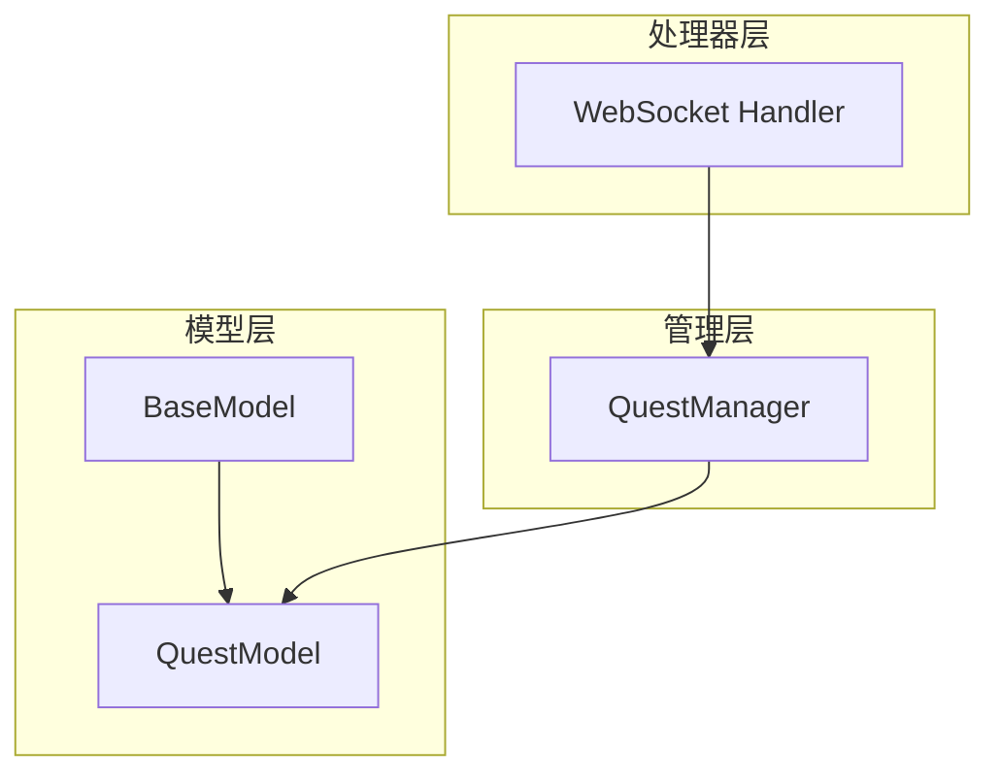
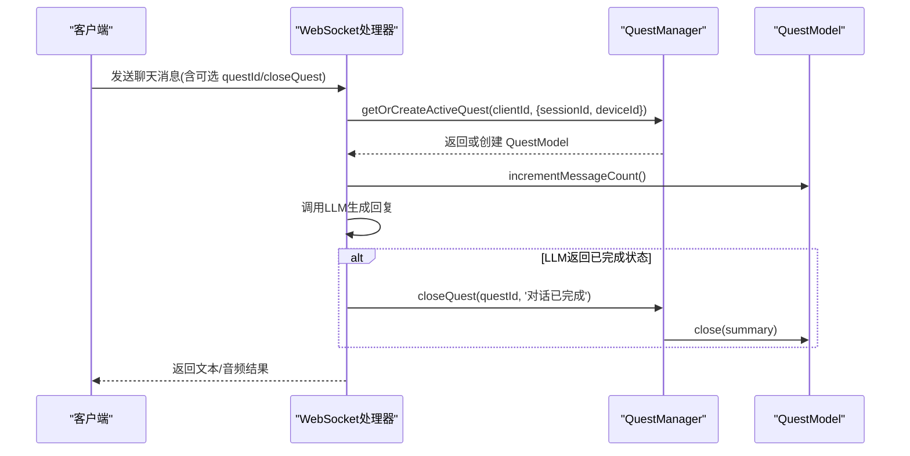
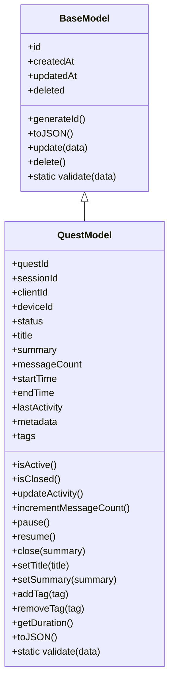
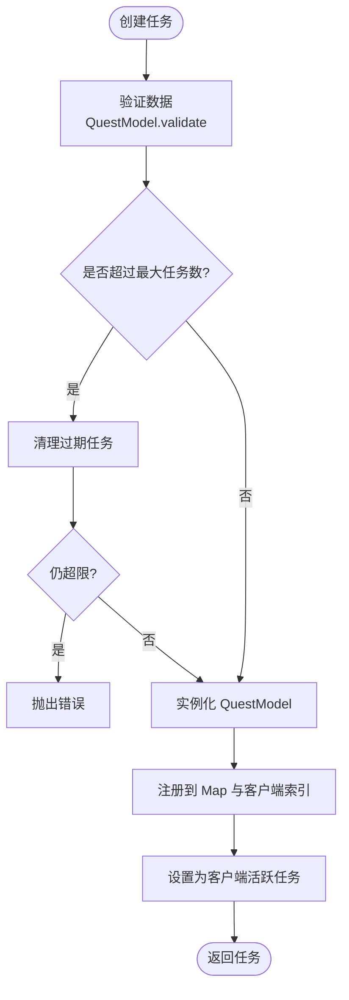
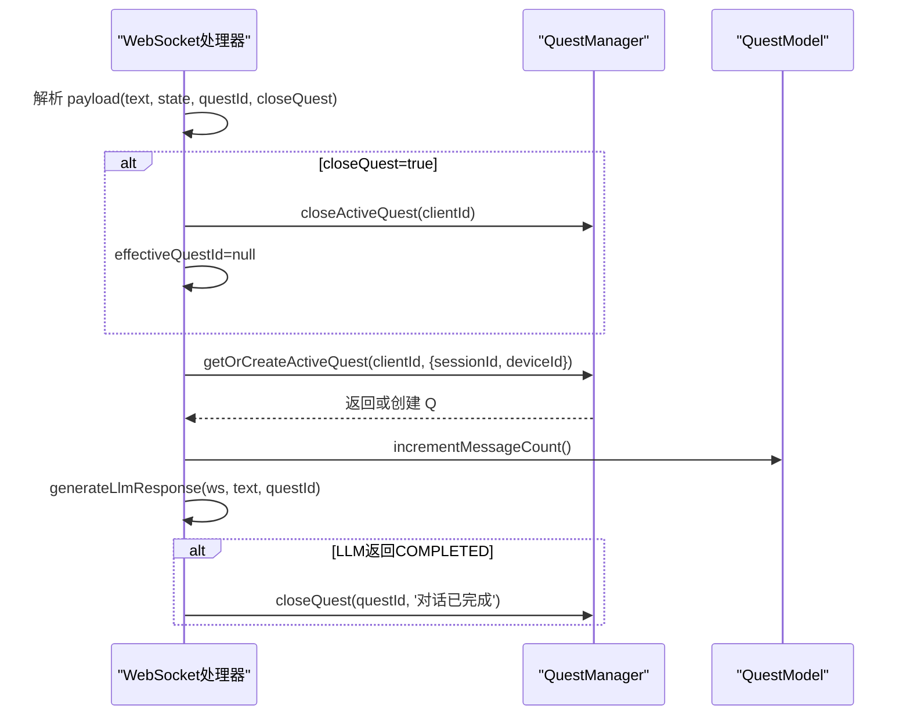
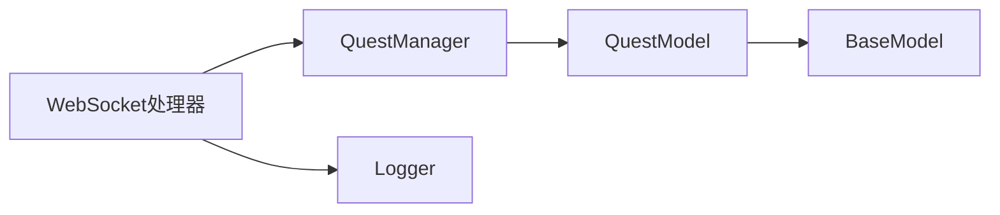
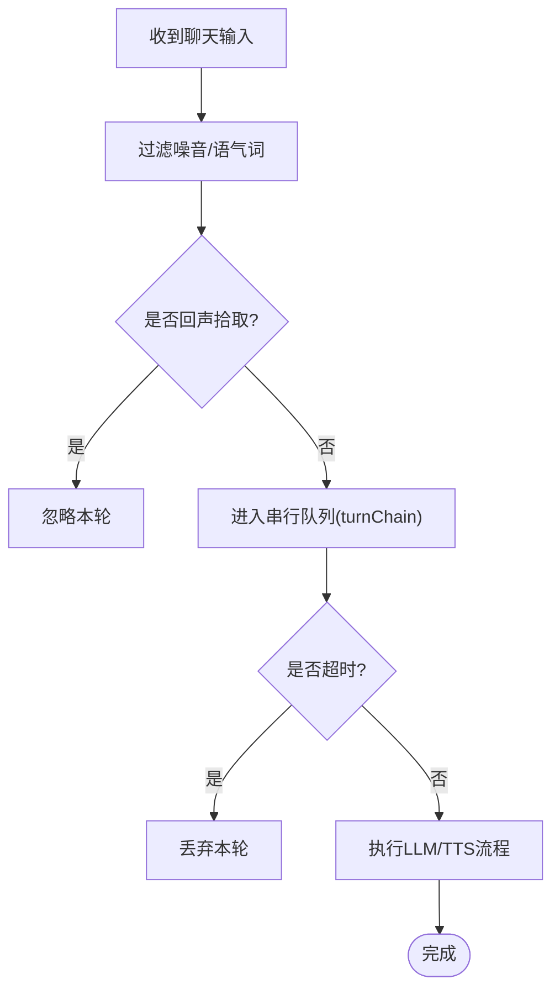

# QuestModel任务模型

<cite>
**本文引用的文件**   
- [core/models/quest.js](file://core/models/quest.js)
- [core/managers/quest.js](file://core/managers/quest.js)
- [core/models/base.js](file://core/models/base.js)
- [core/handlers/websocket.js](file://core/handlers/websocket.js)
</cite>

## 目录
1. [引言](#引言)
2. [项目结构](#项目结构)
3. [核心组件](#核心组件)
4. [架构总览](#架构总览)
5. [详细组件分析](#详细组件分析)
6. [依赖关系分析](#依赖关系分析)
7. [性能与队列机制](#性能与队列机制)
8. [故障排查指南](#故障排查指南)
9. [结论](#结论)
10. [附录：操作示例](#附录操作示例)

## 引言
本文围绕 QuestModel 任务模型，系统梳理其数据模型、生命周期管理、调度执行流程、状态转换规则、异常处理机制，以及任务队列管理与性能优化要点。文档面向不同技术背景的读者，提供从概念到代码级实现的完整说明，并附带可操作的创建、调度、监控与管理示例路径。

## 项目结构
QuestModel 相关代码位于 core 目录下，采用“模型 + 管理器 + 处理器”的分层组织方式：
- 模型层：定义任务实体（QuestModel）及其基础能力（BaseModel）。
- 管理层：维护任务集合、活跃任务映射、清理策略与统计信息（QuestManager）。
- 处理器层：WebSocket 消息入口，负责将用户输入转换为任务调度调用（WebsocketHandler）。

图示来源
- [core/models/base.js:1-43](file://core/models/base.js#L1-L43)
- [core/models/quest.js:1-178](file://core/models/quest.js#L1-L178)
- [core/managers/quest.js:1-332](file://core/managers/quest.js#L1-L332)
- [core/handlers/websocket.js:600-799](file://core/handlers/websocket.js#L600-L799)

章节来源
- [core/models/base.js:1-43](file://core/models/base.js#L1-L43)
- [core/models/quest.js:1-178](file://core/models/quest.js#L1-L178)
- [core/managers/quest.js:1-332](file://core/managers/quest.js#L1-L332)
- [core/handlers/websocket.js:600-799](file://core/handlers/websocket.js#L600-L799)

## 核心组件
- QuestModel：表示一个对话话题/任务，包含会话关联、客户端/设备标识、状态、时间戳、元数据与标签等属性，并提供状态变更、活动更新、计数、验证等方法。
- QuestManager：维护所有任务的内存集合，按客户端维度管理活跃任务，提供创建、获取、关闭、暂停、恢复、历史查询、过期清理、统计等能力。
- WebSocket Handler：作为外部接入点，解析聊天消息，驱动任务创建与调度，并在特定条件下关闭任务。

章节来源
- [core/models/quest.js:7-178](file://core/models/quest.js#L7-L178)
- [core/managers/quest.js:8-332](file://core/managers/quest.js#L8-L332)
- [core/handlers/websocket.js:600-799](file://core/handlers/websocket.js#L600-L799)

## 架构总览
QuestModel 的任务生命周期由 WebSocket 处理器触发，经由 QuestManager 协调，最终在业务逻辑中完成 LLM/TTS 等处理。关键交互如下：

图示来源
- [core/handlers/websocket.js:616-637](file://core/handlers/websocket.js#L616-L637)
- [core/handlers/websocket.js:745-770](file://core/handlers/websocket.js#L745-L770)
- [core/handlers/websocket.js:950-960](file://core/handlers/websocket.js#L950-L960)
- [core/managers/quest.js:22-55](file://core/managers/quest.js#L22-L55)
- [core/models/quest.js:73-108](file://core/models/quest.js#L73-L108)

## 详细组件分析

### QuestModel 数据模型与方法
- 主要属性
  - 标识与会话：questId、sessionId、clientId、deviceId
  - 状态：status（active/paused/closed）
  - 内容：title、summary、tags、metadata
  - 计数与时间：messageCount、startTime、endTime、lastActivity、createdAt、updatedAt
- 关键方法
  - 状态控制：pause、resume、close
  - 活动与计数：updateActivity、incrementMessageCount、getDuration
  - 标签管理：addTag、removeTag
  - 序列化：toJSON
  - 校验：validate（静态方法）

图示来源
- [core/models/base.js:1-43](file://core/models/base.js#L1-L43)
- [core/models/quest.js:1-178](file://core/models/quest.js#L1-L178)

章节来源
- [core/models/quest.js:7-178](file://core/models/quest.js#L7-L178)
- [core/models/base.js:1-43](file://core/models/base.js#L1-L43)

### QuestManager 任务管理
- 数据结构
  - quests：Map<questId, QuestModel>
  - clientActiveQuest：Map<clientId, questId>
  - clientQuests：Map<clientId, questId[]>
- 核心能力
  - 创建任务：createQuest（含数量上限检查与自动清理）
  - 获取任务：getQuest、getActiveQuest、getOrCreateActiveQuest
  - 生命周期：closeQuest、closeActiveQuest、pauseQuest、resumeQuest
  - 统计与历史：getStats、getQuestHistory、getClientQuests
  - 清理与删除：cleanupExpiredQuests、deleteQuest
  - 元数据设置：setQuestTitle、setQuestSummary

图示来源
- [core/managers/quest.js:22-55](file://core/managers/quest.js#L22-L55)
- [core/models/quest.js:158-174](file://core/models/quest.js#L158-L174)

章节来源
- [core/managers/quest.js:8-332](file://core/managers/quest.js#L8-L332)

### WebSocket 处理器中的任务调度
- 消息入口
  - 接收 CHAT 类型消息，支持 questId 与 closeQuest 标志
  - 若 closeQuest 为真，则关闭当前活跃任务并强制创建新任务
- 任务获取与使用
  - 优先使用传入的 questId；若已关闭则新建
  - 未指定时通过 getOrCreateActiveQuest 获取或创建
- 任务计数与结束
  - 每轮对话增加 messageCount
  - 当 LLM 返回“已完成”状态时，关闭当前任务

图示来源
- [core/handlers/websocket.js:616-637](file://core/handlers/websocket.js#L616-L637)
- [core/handlers/websocket.js:745-770](file://core/handlers/websocket.js#L745-L770)
- [core/handlers/websocket.js:950-960](file://core/handlers/websocket.js#L950-L960)
- [core/managers/quest.js:98-107](file://core/managers/quest.js#L98-L107)

章节来源
- [core/handlers/websocket.js:600-799](file://core/handlers/websocket.js#L600-L799)
- [core/handlers/websocket.js:950-970](file://core/handlers/websocket.js#L950-L970)

## 依赖关系分析
- 模块耦合
  - WebSocket 处理器依赖 QuestManager，间接依赖 QuestModel
  - QuestManager 直接依赖 QuestModel 进行实例化与状态操作
  - QuestModel 继承 BaseModel，复用通用字段与方法
- 外部依赖
  - 日志工具：utils/logger.js（用于记录创建、关闭、清理等操作）
  - 配置项：turnTimeoutSeconds、vad、stt.filterFillers 等影响任务调度的行为

图示来源
- [core/handlers/websocket.js:1-50](file://core/handlers/websocket.js#L1-L50)
- [core/managers/quest.js:1-15](file://core/managers/quest.js#L1-L15)
- [core/models/quest.js:1-10](file://core/models/quest.js#L1-L10)
- [core/models/base.js:1-10](file://core/models/base.js#L1-L10)

章节来源
- [core/handlers/websocket.js:1-50](file://core/handlers/websocket.js#L1-L50)
- [core/managers/quest.js:1-15](file://core/managers/quest.js#L1-L15)
- [core/models/quest.js:1-10](file://core/models/quest.js#L1-L10)
- [core/models/base.js:1-10](file://core/models/base.js#L1-L10)

## 性能与队列机制
- 任务队列串行化
  - 同一连接在同一时刻仅允许一条应答流程运行，避免音频帧交错
  - 通过 turnChain 串行化 Promise 链，配合超时保护防止单轮挂死
- 轮次序号与打断
  - 每次新输入递增 turnSeq，旧轮被打断后不会干扰新轮
  - abortUpTo 标记被中止到的最大轮次号，确保旧轮丢弃、新轮继续
- 回声与噪音过滤
  - 对短文本、语气词进行过滤，减少无效任务触发
  - 基于近期播放文本的回声判定，避免误触发导致任务中断
- 任务清理与上限
  - 默认最大任务数限制，达到上限时先尝试清理过期任务
  - 过期判断依据：closed 或 lastActivity 超过阈值（默认30分钟）

图示来源
- [core/handlers/websocket.js:651-694](file://core/handlers/websocket.js#L651-L694)
- [core/handlers/websocket.js:696-722](file://core/handlers/websocket.js#L696-L722)
- [core/managers/quest.js:218-238](file://core/managers/quest.js#L218-L238)

章节来源
- [core/handlers/websocket.js:651-694](file://core/handlers/websocket.js#L651-L694)
- [core/handlers/websocket.js:696-722](file://core/handlers/websocket.js#L696-L722)
- [core/managers/quest.js:218-238](file://core/managers/quest.js#L218-L238)

## 故障排查指南
- 常见错误与定位
  - 创建失败：数据验证不通过（如 clientId 为空、status 非法）
  - 数量超限：达到 maxQuests 且清理后仍不足空间
  - 任务未响应：轮次超时或 LLM/TTS 服务异常
- 建议排查步骤
  - 检查 WebSocket 消息是否携带有效 questId 或 closeQuest 标志
  - 查看 QuestManager 统计信息与活跃任务映射
  - 确认 LLM/TTS 服务可用性与返回值状态
  - 观察日志中关于“忽略无效输入”“回声拾取”“轮次处理异常/超时”的记录

章节来源
- [core/models/quest.js:158-174](file://core/models/quest.js#L158-L174)
- [core/managers/quest.js:22-55](file://core/managers/quest.js#L22-L55)
- [core/handlers/websocket.js:651-694](file://core/handlers/websocket.js#L651-L694)

## 结论
QuestModel 以简洁的数据模型和清晰的生命周期方法支撑了对话任务的核心语义；QuestManager 提供了健壮的内存级任务管理能力，包括活跃任务映射、过期清理与统计；WebSocket 处理器将外部输入转化为任务调度，并通过串行队列与超时保护保障稳定性。整体设计兼顾可读性与可扩展性，适合在语音对话场景中持续演进。

## 附录：操作示例
以下示例以“操作步骤 + 对应源码位置”的形式给出，便于快速定位实现细节。

- 创建任务
  - 步骤：调用 QuestManager.createQuest，传入 clientId、sessionId、deviceId 等数据
  - 参考路径：[core/managers/quest.js:22-55](file://core/managers/quest.js#L22-L55)
- 获取或创建活跃任务
  - 步骤：调用 QuestManager.getOrCreateActiveQuest，传入 clientId 与可选上下文
  - 参考路径：[core/managers/quest.js:98-107](file://core/managers/quest.js#L98-L107)
- 关闭任务
  - 步骤：根据 questId 调用 QuestManager.closeQuest，或在 LLM 返回 COMPLETED 时自动关闭
  - 参考路径：[core/handlers/websocket.js:950-960](file://core/handlers/websocket.js#L950-L960)、[core/managers/quest.js:115-130](file://core/managers/quest.js#L115-L130)
- 暂停/恢复任务
  - 步骤：调用 QuestManager.pauseQuest / resumeQuest
  - 参考路径：[core/managers/quest.js:151-176](file://core/managers/quest.js#L151-L176)
- 增加消息计数
  - 步骤：每轮对话调用 Quest.incrementMessageCount
  - 参考路径：[core/models/quest.js:73-79](file://core/models/quest.js#L73-L79)
- 清理过期任务
  - 步骤：定期调用 QuestManager.cleanupExpiredQuests
  - 参考路径：[core/managers/quest.js:218-238](file://core/managers/quest.js#L218-L238)
- 获取统计信息
  - 步骤：调用 QuestManager.getStats
  - 参考路径：[core/managers/quest.js:270-289](file://core/managers/quest.js#L270-L289)