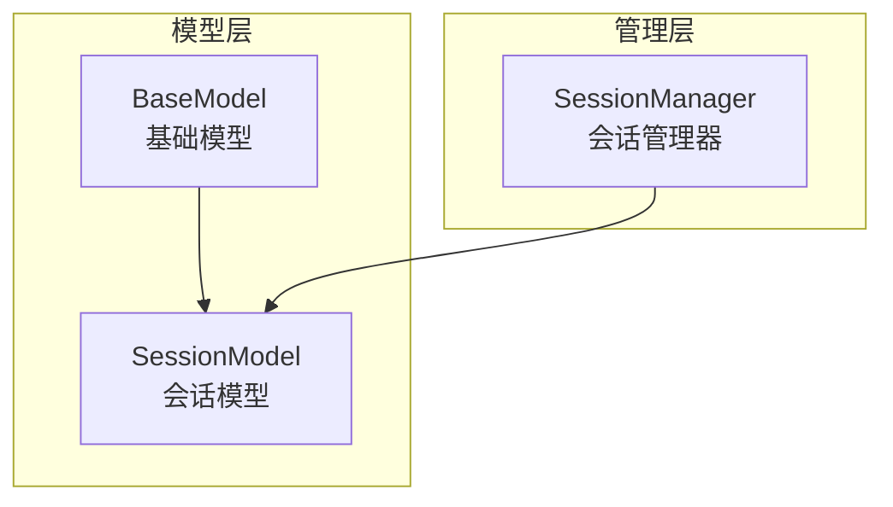
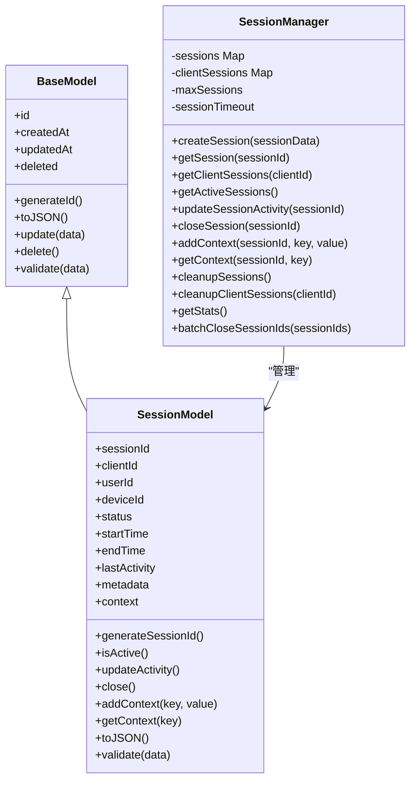
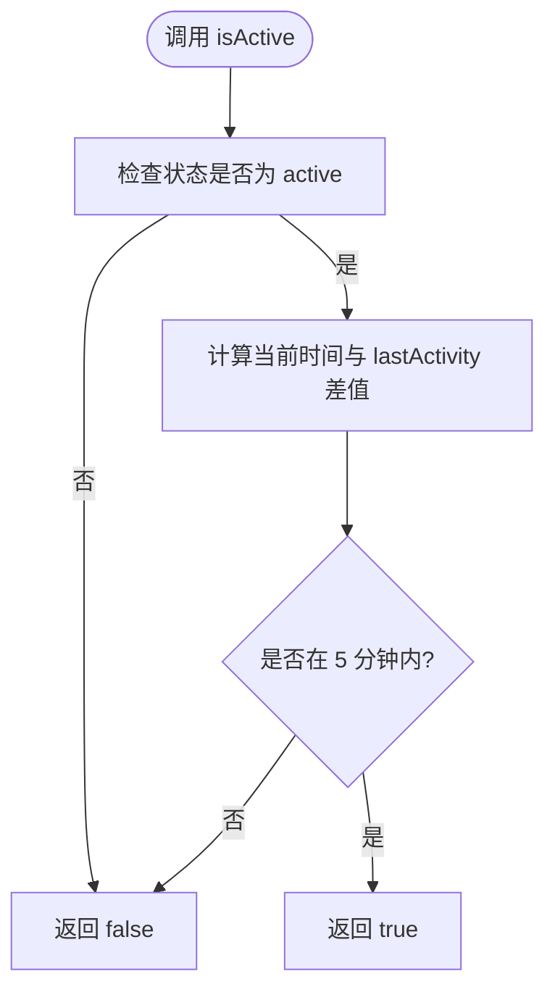
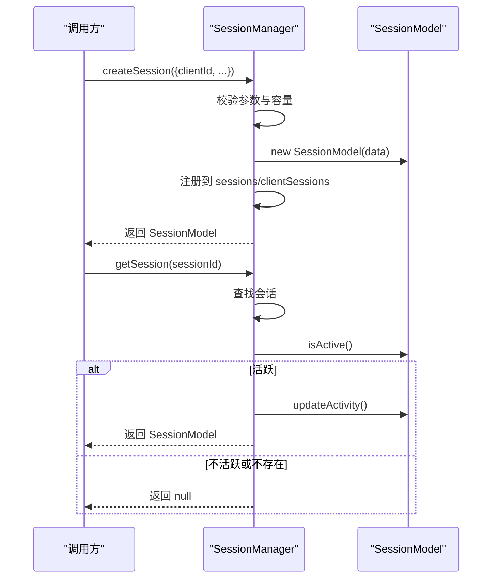
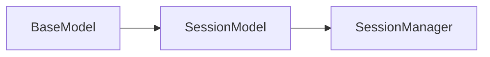
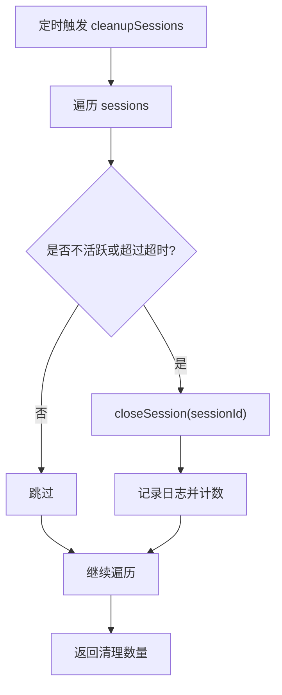

# SessionModel会话模型

<cite>
**本文引用的文件**   
- [core/models/session.js](file://core/models/session.js)
- [core/managers/session.js](file://core/managers/session.js)
- [core/models/base.js](file://core/models/base.js)
</cite>

## 目录
1. [简介](#简介)
2. [项目结构](#项目结构)
3. [核心组件](#核心组件)
4. [架构总览](#架构总览)
5. [详细组件分析](#详细组件分析)
6. [依赖关系分析](#依赖关系分析)
7. [性能与并发特性](#性能与并发特性)
8. [持久化与清理策略](#持久化与清理策略)
9. [操作示例](#操作示例)
10. [故障排查指南](#故障排查指南)
11. [结论](#结论)

## 简介
本文件面向SessionModel会话模型的实现与使用，覆盖以下方面：
- 会话实体属性定义（会话ID、关联设备、对话上下文、状态等）
- 会话生命周期管理与状态转换机制
- 会话数据的内存存储与清理策略
- 会话创建、维护、查询与销毁的完整操作流程
- 会话上下文保持与并发访问注意事项

## 项目结构
与SessionModel相关的代码主要位于core/models与core/managers两个目录：
- core/models/session.js：会话数据模型定义
- core/managers/session.js：会话管理器，负责会话的创建、查询、更新、关闭与清理
- core/models/base.js：基础模型类，提供通用字段与方法

图表来源
- [core/models/base.js:1-43](file://core/models/base.js#L1-L43)
- [core/models/session.js:1-82](file://core/models/session.js#L1-L82)
- [core/managers/session.js:1-190](file://core/managers/session.js#L1-L190)

章节来源
- [core/models/base.js:1-43](file://core/models/base.js#L1-L43)
- [core/models/session.js:1-82](file://core/models/session.js#L1-L82)
- [core/managers/session.js:1-190](file://core/managers/session.js#L1-L190)

## 核心组件
- SessionModel：会话数据模型，封装会话ID、客户端/用户/设备标识、状态、时间戳、元数据与对话上下文等。
- SessionManager：会话管理器，基于内存Map维护会话集合，提供创建、获取、更新活动、关闭、上下文读写、统计与批量关闭等方法，并实现过期清理逻辑。

章节来源
- [core/models/session.js:1-82](file://core/models/session.js#L1-L82)
- [core/managers/session.js:1-190](file://core/managers/session.js#L1-L190)

## 架构总览
SessionModel作为数据载体，SessionManager作为控制入口。两者通过继承与组合协作：
- SessionManager在创建会话前进行参数校验与容量检查
- 会话的生命周期由SessionModel的状态与活动时间驱动
- 会话的活跃性判断与超时清理由SessionManager统一调度

图表来源
- [core/models/base.js:1-43](file://core/models/base.js#L1-L43)
- [core/models/session.js:1-82](file://core/models/session.js#L1-L82)
- [core/managers/session.js:1-190](file://core/managers/session.js#L1-L190)

## 详细组件分析

### SessionModel：会话数据模型
- 关键属性
  - sessionId：会话唯一标识，默认自动生成
  - clientId：客户端标识
  - userId：用户标识（可为空）
  - deviceId：设备标识（可为空）
  - status：会话状态，支持active/inactive/closed
  - startTime/endTime：会话开始/结束时间
  - lastActivity：最后活动时间
  - metadata：扩展元数据
  - context：对话上下文键值对
- 关键方法
  - generateSessionId：生成会话ID
  - isActive：判断是否活跃（状态为active且距lastActivity不超过阈值）
  - updateActivity：刷新最后活动时间与更新时间
  - close：标记会话关闭并记录结束时间
  - addContext/getContext：读写对话上下文
  - toJSON：序列化输出
  - validate：参数校验（如clientId必填、status合法）

图表来源
- [core/models/session.js:38-41](file://core/models/session.js#L38-L41)

章节来源
- [core/models/session.js:1-82](file://core/models/session.js#L1-L82)

### SessionManager：会话管理器
- 数据结构
  - sessions：Map<sessionId, SessionModel>
  - clientSessions：Map<clientId, sessionIds[]>
  - maxSessions：最大会话数限制
  - sessionTimeout：会话超时阈值（毫秒）
- 核心能力
  - createSession：参数校验、容量检查、创建并注册会话
  - getSession：按ID获取活跃会话，并自动刷新活动时间
  - getClientSessions：按客户端获取活跃会话列表
  - getActiveSessions：获取所有活跃会话
  - updateSessionActivity：更新指定会话的活动时间
  - closeSession：关闭会话并从客户端映射中移除
  - addContext/getContext：会话上下文读写
  - cleanupSessions：全局清理过期会话
  - cleanupClientSessions：按客户端清理过期会话
  - getStats：统计信息（总数、活跃数、客户端数、上限）
  - batchCloseSessionIds：批量关闭会话并统计成功/失败数

图表来源
- [core/managers/session.js:12-55](file://core/managers/session.js#L12-L55)
- [core/models/session.js:38-46](file://core/models/session.js#L38-L46)

章节来源
- [core/managers/session.js:1-190](file://core/managers/session.js#L1-L190)

## 依赖关系分析
- SessionModel依赖BaseModel提供的通用字段（id、createdAt、updatedAt、deleted）与基础方法（toJSON、update、delete、validate）。
- SessionManager依赖SessionModel实例进行会话状态与上下文操作，并通过logger记录日志。
- 无循环依赖；SessionManager仅依赖SessionModel，SessionModel不反向依赖SessionManager。

图表来源
- [core/models/base.js:1-43](file://core/models/base.js#L1-L43)
- [core/models/session.js:1-82](file://core/models/session.js#L1-L82)
- [core/managers/session.js:1-190](file://core/managers/session.js#L1-L190)

章节来源
- [core/models/base.js:1-43](file://core/models/base.js#L1-L43)
- [core/models/session.js:1-82](file://core/models/session.js#L1-L82)
- [core/managers/session.js:1-190](file://core/managers/session.js#L1-L190)

## 性能与并发特性
- 数据结构选择
  - 使用Map存储会话与客户端映射，平均O(1)查找与插入。
- 活跃性判定
  - isActive基于时间差比较，避免频繁数据库查询。
- 清理策略
  - cleanupSessions遍历全部会话，复杂度O(n)，适合周期性后台任务执行。
- 并发注意
  - 当前实现未包含显式锁或同步机制，在多线程/多Worker环境下需外部保证互斥访问。
  - 建议在高并发场景下引入队列或锁保护关键路径（如createSession/closeSession）。

[本节为通用指导，不涉及具体文件分析]

## 持久化与清理策略
- 持久化
  - 当前实现为纯内存存储（Map），未集成数据库或缓存层。
  - 如需持久化，可在SessionManager的关键方法（如createSession、closeSession、updateActivity）中增加持久化调用。
- 清理机制
  - cleanupSessions：根据isActive与sessionTimeout判定过期会话并关闭。
  - cleanupClientSessions：针对特定客户端的过期会话进行清理。
  - createSession容量检查：当达到maxSessions时先尝试清理过期会话，仍满则拒绝创建。

图表来源
- [core/managers/session.js:117-138](file://core/managers/session.js#L117-L138)

章节来源
- [core/managers/session.js:117-154](file://core/managers/session.js#L117-L154)

## 操作示例
以下为常见操作的步骤说明（不包含具体代码内容）：
- 创建会话
  - 准备参数：至少包含clientId，可选userId/deviceId/status/metadata/context等
  - 调用SessionManager.createSession
  - 处理可能的异常（参数非法、会话数已达上限）
- 维护会话
  - 每次交互后调用SessionManager.updateSessionActivity或SessionManager.addContext以刷新活动时间与上下文
- 查询会话
  - 通过SessionManager.getSession获取单个会话
  - 通过SessionManager.getClientSessions获取某客户端的所有活跃会话
  - 通过SessionManager.getActiveSessions获取全局活跃会话
- 销毁会话
  - 正常关闭：SessionManager.closeSession
  - 批量关闭：SessionManager.batchCloseSessionIds
- 上下文保持
  - 写入：SessionManager.addContext(sessionId, key, value)
  - 读取：SessionManager.getContext(sessionId, key)

章节来源
- [core/managers/session.js:12-115](file://core/managers/session.js#L12-L115)
- [core/models/session.js:54-61](file://core/models/session.js#L54-L61)

## 故障排查指南
- 常见问题
  - 创建失败：参数校验失败（如缺少clientId）、会话数已达上限
  - 获取不到会话：会话已过期或被主动关闭
  - 上下文为空：未在会话活跃期间写入或未正确传入sessionId
- 定位建议
  - 查看日志：SessionManager在创建、关闭、清理等操作处有日志输出
  - 检查活跃性：确认lastActivity是否被及时更新，以及isActive判定条件
  - 统计信息：使用getStats了解当前会话总量、活跃量与客户端数

章节来源
- [core/managers/session.js:12-45](file://core/managers/session.js#L12-L45)
- [core/managers/session.js:80-99](file://core/managers/session.js#L80-L99)
- [core/managers/session.js:156-167](file://core/managers/session.js#L156-L167)

## 结论
SessionModel提供了清晰的会话数据模型，SessionManager实现了完整的会话生命周期管理。当前实现采用内存存储与基于时间的活跃性判定，具备简洁高效的特性。若需要生产级高可用与持久化，建议在SessionManager中扩展持久化适配层与并发安全机制，并结合监控指标优化清理策略与容量上限。