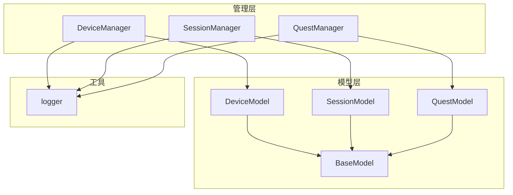
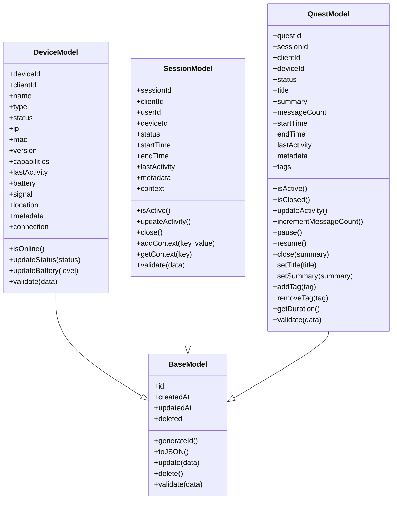
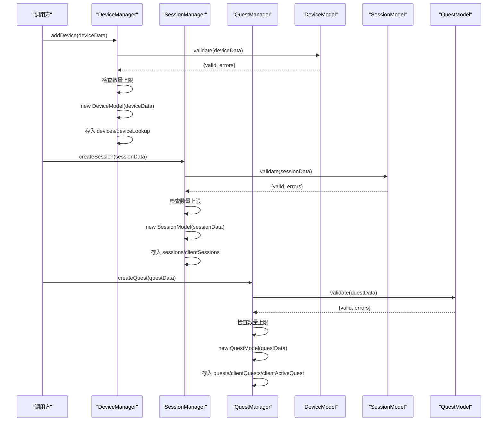
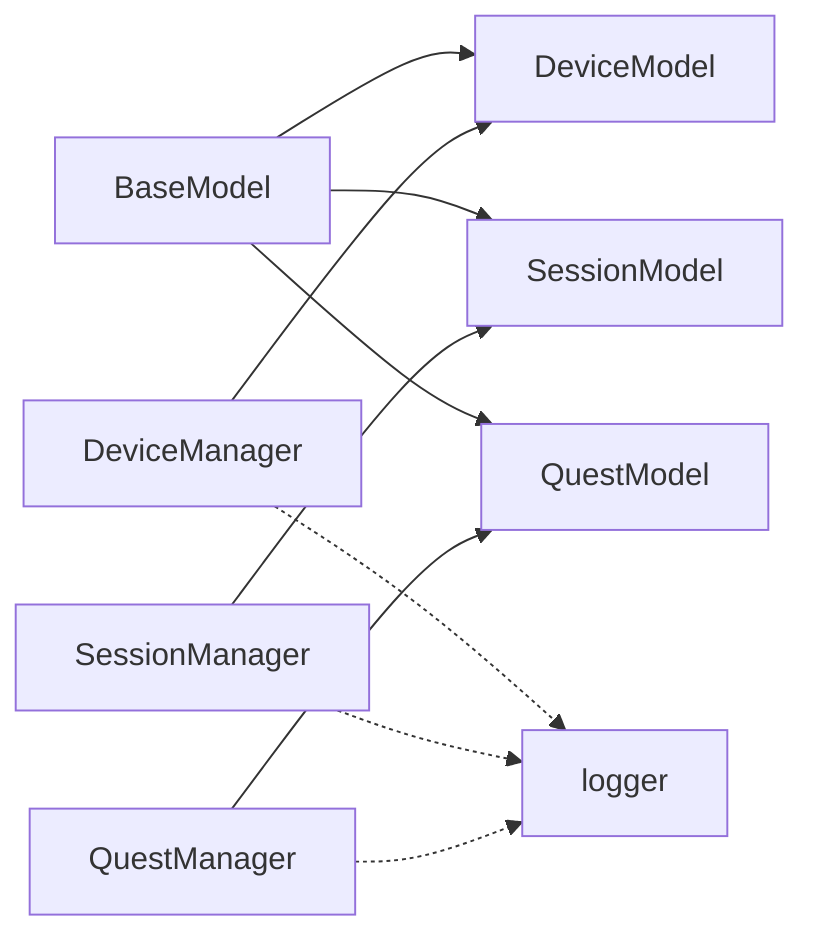

# 数据模型定义

<cite>
**本文引用的文件**   
- [core/models/base.js](file://core/models/base.js)
- [core/models/device.js](file://core/models/device.js)
- [core/models/session.js](file://core/models/session.js)
- [core/models/quest.js](file://core/models/quest.js)
- [core/managers/device.js](file://core/managers/device.js)
- [core/managers/session.js](file://core/managers/session.js)
- [core/managers/quest.js](file://core/managers/quest.js)
</cite>

## 目录
1. [简介](#简介)
2. [项目结构](#项目结构)
3. [核心组件](#核心组件)
4. [架构总览](#架构总览)
5. [详细组件分析](#详细组件分析)
6. [依赖关系分析](#依赖关系分析)
7. [性能与可扩展性](#性能与可扩展性)
8. [故障排查指南](#故障排查指南)
9. [结论](#结论)
10. [附录：CRUD与查询构建器使用指南](#附录crud与查询构建器使用指南)

## 简介
本文件聚焦于数据模型的定义与使用，系统阐述 BaseModel 基类的设计模式与继承机制，详解 DeviceModel、SessionModel、QuestModel 的属性定义、验证规则与生命周期方法，并说明模型间的关联关系与数据流转。文档同时提供模型实例化、CRUD 操作与查询构建器的使用方法，以及自定义模型扩展的最佳实践。

## 项目结构
本项目采用“模型 + 管理器”的分层组织方式：
- core/models：定义领域数据模型（BaseModel 及其子类）
- core/managers：封装模型的创建、查询、更新、删除与清理等业务流程
- utils/logger：日志工具（被管理器引用）

图表来源
- [core/models/base.js:1-43](file://core/models/base.js#L1-L43)
- [core/models/device.js:1-96](file://core/models/device.js#L1-L96)
- [core/models/session.js:1-82](file://core/models/session.js#L1-L82)
- [core/models/quest.js:1-178](file://core/models/quest.js#L1-L178)
- [core/managers/device.js:1-201](file://core/managers/device.js#L1-L201)
- [core/managers/session.js:1-190](file://core/managers/session.js#L1-L190)
- [core/managers/quest.js:1-332](file://core/managers/quest.js#L1-L332)

章节来源
- [core/models/base.js:1-43](file://core/models/base.js#L1-L43)
- [core/models/device.js:1-96](file://core/models/device.js#L1-L96)
- [core/models/session.js:1-82](file://core/models/session.js#L1-L82)
- [core/models/quest.js:1-178](file://core/models/quest.js#L1-L178)
- [core/managers/device.js:1-201](file://core/managers/device.js#L1-L201)
- [core/managers/session.js:1-190](file://core/managers/session.js#L1-L190)
- [core/managers/quest.js:1-332](file://core/managers/quest.js#L1-L332)

## 核心组件
- BaseModel：所有模型的基类，提供通用字段、ID生成、序列化、批量更新、软删除与静态验证钩子。
- DeviceModel：设备实体，包含连接信息、状态、能力、电量、信号、位置与元数据等。
- SessionModel：会话实体，表示一次客户端会话的生命周期与上下文。
- QuestModel：对话任务/话题实体，管理多轮对话的标题、摘要、消息计数、标签与状态机。

章节来源
- [core/models/base.js:1-43](file://core/models/base.js#L1-L43)
- [core/models/device.js:1-96](file://core/models/device.js#L1-L96)
- [core/models/session.js:1-82](file://core/models/session.js#L1-L82)
- [core/models/quest.js:1-178](file://core/models/quest.js#L1-L178)

## 架构总览
模型与管理器的职责分离清晰：
- 模型负责数据结构与业务语义（属性、校验、状态判断、序列化）。
- 管理器负责集合级操作（增删改查、统计、清理、索引维护）。

图表来源
- [core/models/base.js:1-43](file://core/models/base.js#L1-L43)
- [core/models/device.js:1-96](file://core/models/device.js#L1-L96)
- [core/models/session.js:1-82](file://core/models/session.js#L1-L82)
- [core/models/quest.js:1-178](file://core/models/quest.js#L1-L178)

## 详细组件分析

### BaseModel 基类
- 设计要点
  - 统一基础字段：id、createdAt、updatedAt、deleted。
  - ID 生成策略：时间戳+随机串，避免冲突。
  - 序列化：toJSON 输出基础字段，供上层聚合扩展。
  - 批量更新：update 忽略 id/createdAt，自动刷新 updatedAt。
  - 软删除：delete 标记 deleted 并更新时间。
  - 验证钩子：静态 validate 留给子类实现具体校验。

- 复杂度与行为
  - update 为 O(k)，k 为传入字段数。
  - toJSON 为 O(1)。
  - delete 为 O(1)。

章节来源
- [core/models/base.js:1-43](file://core/models/base.js#L1-L43)

### DeviceModel 设备模型
- 属性定义
  - 标识与关联：deviceId、clientId。
  - 基本信息：name、type、ip、mac、version。
  - 运行状态：status、lastActivity、capabilities。
  - 硬件指标：battery（0-100）、signal。
  - 其他：location、metadata、connection（WebSocket 引用）。

- 验证规则
  - deviceId/clientId 必填且为字符串。
  - type 必须属于允许集合。
  - battery 若存在需为 0-100 的数字。
  - lastActivity 必须为有效日期。
  - metadata 若存在须为对象。

- 生命周期与方法
  - isOnline：在线判定基于 status 与 lastActivity 时效。
  - updateStatus/updateBattery：更新状态或电量并刷新活动时间。
  - toJSON：扩展父类序列化，输出完整设备视图。

- 典型用法
  - 通过 DeviceManager.addDevice 完成校验与入库。
  - 通过 DeviceManager.updateDeviceStatus 更新在线/离线。
  - 通过 DeviceManager.getOnlineDevices 获取活跃设备列表。

章节来源
- [core/models/device.js:1-96](file://core/models/device.js#L1-L96)
- [core/managers/device.js:1-201](file://core/managers/device.js#L1-L201)

### SessionModel 会话模型
- 属性定义
  - 标识与关联：sessionId、clientId、userId、deviceId。
  - 生命周期：status（active/inactive/closed）、startTime、endTime、lastActivity。
  - 上下文：metadata、context（键值对）。

- 验证规则
  - clientId 必填。
  - status 必须属于允许集合。

- 生命周期与方法
  - isActive：基于 status 与 lastActivity 时效判定。
  - updateActivity/close：更新活动或关闭会话。
  - addContext/getContext：读写会话上下文。
  - toJSON：扩展父类序列化，输出会话视图。

- 典型用法
  - SessionManager.createSession 创建会话并建立客户端映射。
  - SessionManager.getSession 获取活跃会话并刷新活动。
  - SessionManager.closeSession 关闭会话并从客户端映射移除。

章节来源
- [core/models/session.js:1-82](file://core/models/session.js#L1-L82)
- [core/managers/session.js:1-190](file://core/managers/session.js#L1-L190)

### QuestModel 对话任务模型
- 属性定义
  - 标识与关联：questId、sessionId、clientId、deviceId。
  - 状态机：status（active/paused/closed）。
  - 内容：title、summary、messageCount、tags。
  - 时间线：startTime、endTime、lastActivity。
  - 扩展：metadata。

- 验证规则
  - clientId 必填。
  - status 必须属于允许集合。

- 生命周期与方法
  - isActive/isClosed：状态判断。
  - updateActivity/incrementMessageCount：活动与消息计数。
  - pause/resume/close：状态机转换。
  - setTitle/setSummary/addTag/removeTag：内容编辑。
  - getDuration：计算持续时间。
  - toJSON：扩展父类序列化。

- 典型用法
  - QuestManager.createQuest 创建任务并设置活跃映射。
  - QuestManager.getActiveQuest/getOrCreateActiveQuest 获取或创建活跃任务。
  - QuestManager.closeQuest/closeActiveQuest 关闭任务并清理映射。
  - QuestManager.incrementMessageCount 增加消息计数。

章节来源
- [core/models/quest.js:1-178](file://core/models/quest.js#L1-L178)
- [core/managers/quest.js:1-332](file://core/managers/quest.js#L1-L332)

### 模型间关联与数据流转
- 关联关系
  - SessionModel 与 QuestModel：通过 sessionId 关联，一个会话可包含多个对话任务。
  - DeviceModel 与 SessionModel：通过 deviceId 关联，会话由特定设备发起。
  - QuestModel 与 SessionModel：通过 sessionId 关联，Quest 隶属于某个会话。

- 数据流转
  - 设备上线：DeviceManager.addDevice -> DeviceModel.validate -> 存储到 Map。
  - 会话创建：SessionManager.createSession -> SessionModel.validate -> 存储与会话-客户端映射。
  - 任务创建：QuestManager.createQuest -> QuestModel.validate -> 存储与客户端活跃任务映射。
  - 活动刷新：各管理器在读取时调用模型的 updateActivity 以延长存活期。

图表来源
- [core/managers/device.js:12-41](file://core/managers/device.js#L12-L41)
- [core/managers/session.js:13-45](file://core/managers/session.js#L13-L45)
- [core/managers/quest.js:22-55](file://core/managers/quest.js#L22-L55)
- [core/models/device.js:61-93](file://core/models/device.js#L61-L93)
- [core/models/session.js:63-79](file://core/models/session.js#L63-L79)
- [core/models/quest.js:158-174](file://core/models/quest.js#L158-L174)

## 依赖关系分析
- 耦合度
  - 模型之间无直接依赖，仅通过外键（如 sessionId、deviceId、clientId）进行逻辑关联。
  - 管理器强依赖对应模型，但彼此独立，便于扩展与维护。
- 外部依赖
  - 管理器依赖 logger 用于记录关键事件与错误。
- 循环依赖
  - 未发现循环导入；模型仅依赖 BaseModel，管理器依赖各自模型。

图表来源
- [core/models/base.js:1-43](file://core/models/base.js#L1-L43)
- [core/models/device.js:1-96](file://core/models/device.js#L1-L96)
- [core/models/session.js:1-82](file://core/models/session.js#L1-L82)
- [core/models/quest.js:1-178](file://core/models/quest.js#L1-L178)
- [core/managers/device.js:1-201](file://core/managers/device.js#L1-L201)
- [core/managers/session.js:1-190](file://core/managers/session.js#L1-L190)
- [core/managers/quest.js:1-332](file://core/managers/quest.js#L1-L332)

章节来源
- [core/models/base.js:1-43](file://core/models/base.js#L1-L43)
- [core/models/device.js:1-96](file://core/models/device.js#L1-L96)
- [core/models/session.js:1-82](file://core/models/session.js#L1-L82)
- [core/models/quest.js:1-178](file://core/models/quest.js#L1-L178)
- [core/managers/device.js:1-201](file://core/managers/device.js#L1-L201)
- [core/managers/session.js:1-190](file://core/managers/session.js#L1-L190)
- [core/managers/quest.js:1-332](file://core/managers/quest.js#L1-L332)

## 性能与可扩展性
- 内存占用
  - 管理器使用 Map 存储实体，O(1) 查找；适合高并发读写的内存态存储。
  - 建议定期执行 cleanup 清理过期实体，防止内存泄漏。
- 时间复杂度
  - 新增/查询：O(1)
  - 过滤/搜索：O(n)
  - 批量操作：O(k)，k 为批次大小
- 可扩展性
  - 模型层通过继承 BaseModel 快速扩展新实体。
  - 管理器层提供统一的 CRUD 与统计接口，便于横向扩展。
- 优化建议
  - 将高频访问的 Map 改为分片或缓存层（如 Redis）以提升水平扩展能力。
  - 对大数据集查询引入索引结构（如按 clientId/deviceId 的二级索引）。
  - 对 JSON 序列化结果按需裁剪，减少传输体积。

[本节为通用指导，不直接分析具体文件]

## 故障排查指南
- 常见错误
  - 设备/会话/任务数据校验失败：检查必填字段、类型与取值范围。
  - 数量上限触发：检查 maxDevices/maxSessions/maxQuests 配置与清理策略。
  - 会话/任务未找到：确认 ID 是否正确，是否已被清理或关闭。
  - 活跃状态异常：检查 lastActivity 是否按时刷新，超时阈值是否合理。
- 定位步骤
  - 查看管理器日志，确认创建/更新/关闭流程是否成功。
  - 检查模型 validate 返回的错误数组，修正输入数据。
  - 核对客户端/设备/会话/任务的关联 ID 一致性。

章节来源
- [core/managers/device.js:12-41](file://core/managers/device.js#L12-L41)
- [core/managers/session.js:13-45](file://core/managers/session.js#L13-L45)
- [core/managers/quest.js:22-55](file://core/managers/quest.js#L22-L55)
- [core/models/device.js:61-93](file://core/models/device.js#L61-L93)
- [core/models/session.js:63-79](file://core/models/session.js#L63-L79)
- [core/models/quest.js:158-174](file://core/models/quest.js#L158-L174)

## 结论
本项目通过 BaseModel 抽象出通用数据模型能力，DeviceModel、SessionModel、QuestModel 分别承载设备、会话与对话任务的核心语义。管理器层提供完整的生命周期管理与查询能力，并通过严格的校验与清理策略保障系统稳定性。该设计具备良好的可读性与可扩展性，适合在后续演进中引入持久化与分布式能力。

[本节为总结性内容，不直接分析具体文件]

## 附录：CRUD与查询构建器使用指南

- 模型实例化
  - 直接使用 new DeviceModel(data)/new SessionModel(data)/new QuestModel(data)。
  - 建议在管理器中使用 createXxx 方法，以获得校验、去重与索引维护。

- 创建（Create）
  - DeviceManager.addDevice(deviceData)
  - SessionManager.createSession(sessionData)
  - QuestManager.createQuest(questData)

- 读取（Read）
  - DeviceManager.getDevice(clientId)/getDeviceByDeviceId(deviceId)/getAllDevices()/getOnlineDevices()
  - SessionManager.getSession(sessionId)/getClientSessions(clientId)/getActiveSessions()
  - QuestManager.getQuest(questId)/getActiveQuest(clientId)/getClientQuests(clientId)/getQuestHistory(clientId, limit)

- 更新（Update）
  - DeviceManager.updateDevice(clientId, updates)
  - DeviceManager.updateDeviceStatus(clientId, status)
  - SessionManager.updateSessionActivity(sessionId)
  - QuestManager.incrementMessageCount(questId)

- 删除（Delete）
  - DeviceManager.removeDevice(clientId)
  - SessionManager.closeSession(sessionId)
  - QuestManager.deleteQuest(questId)

- 查询构建器
  - 当前管理器提供基础过滤与统计方法，尚未提供链式查询构建器。
  - 可在管理器层扩展 queryBuilder 风格 API，支持条件组合、分页与排序。

- 自定义模型扩展指南
  - 继承 BaseModel，重写构造函数初始化自有字段。
  - 实现静态 validate(data) 返回 { valid, errors }。
  - 如需自定义序列化，重写 toJSON() 并扩展父类输出。
  - 在对应管理器中实现 CRUD 与索引维护，遵循现有命名与日志规范。

章节来源
- [core/models/base.js:1-43](file://core/models/base.js#L1-L43)
- [core/models/device.js:1-96](file://core/models/device.js#L1-L96)
- [core/models/session.js:1-82](file://core/models/session.js#L1-L82)
- [core/models/quest.js:1-178](file://core/models/quest.js#L1-L178)
- [core/managers/device.js:1-201](file://core/managers/device.js#L1-L201)
- [core/managers/session.js:1-190](file://core/managers/session.js#L1-L190)
- [core/managers/quest.js:1-332](file://core/managers/quest.js#L1-L332)