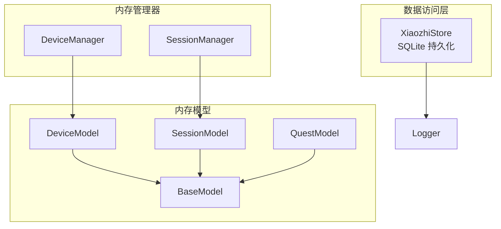
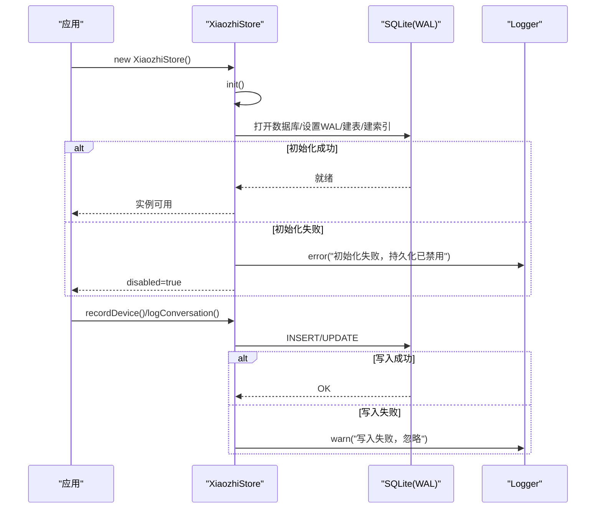
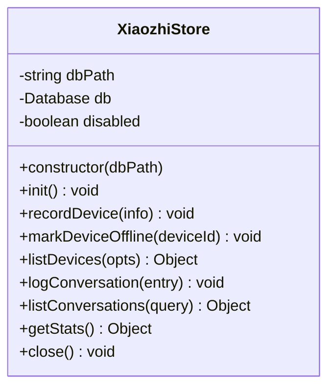
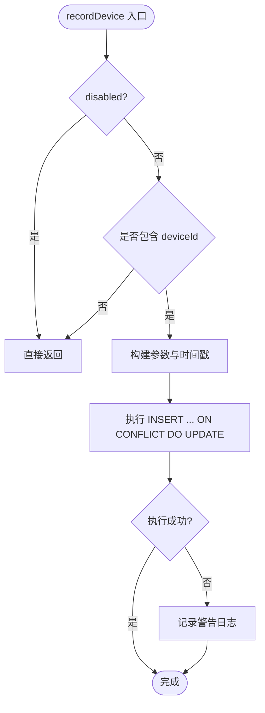
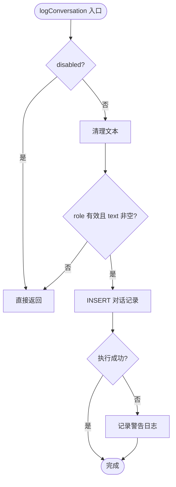
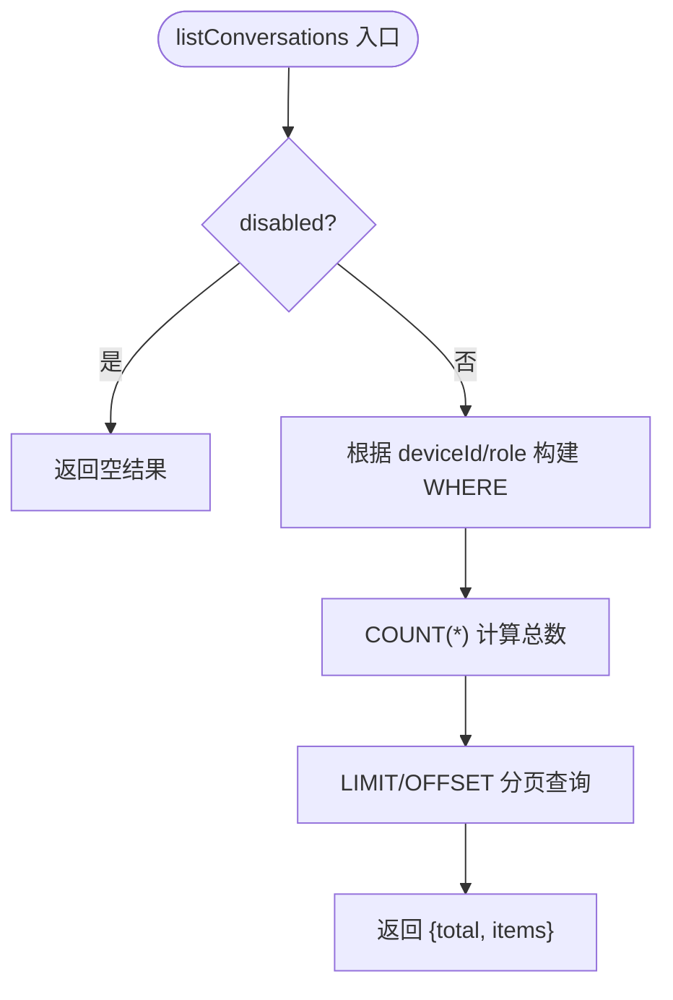
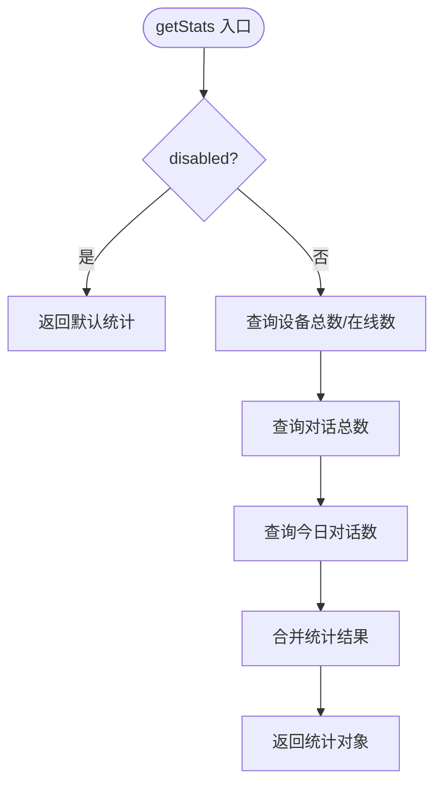
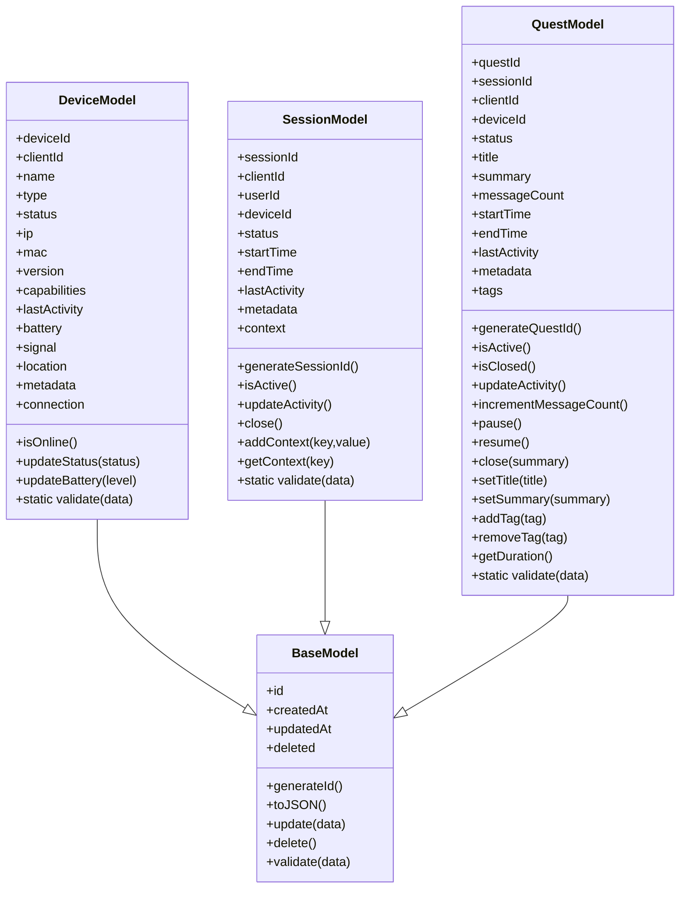
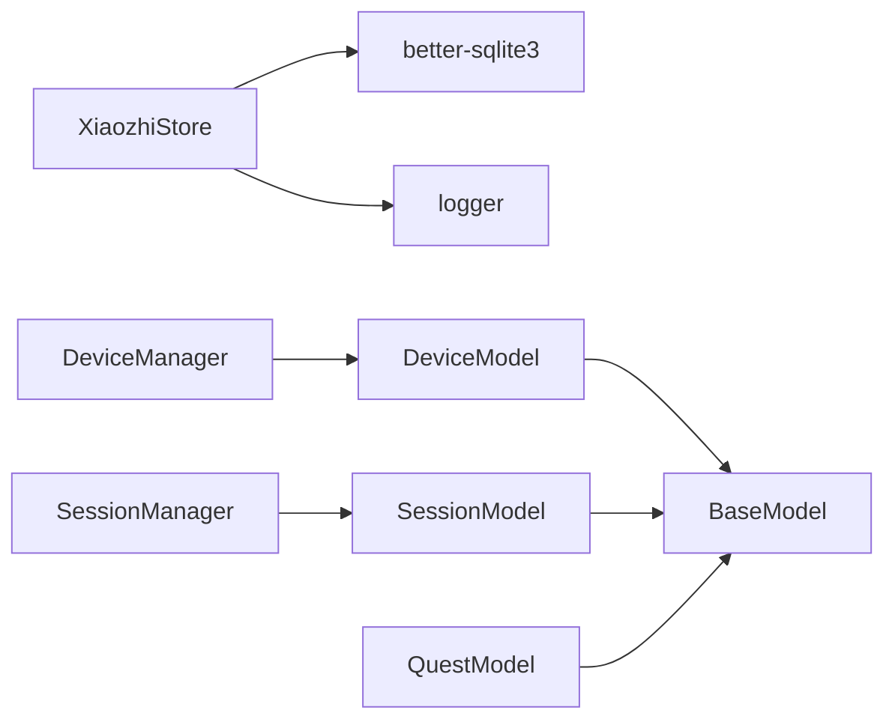

# 数据访问层

<cite>
**本文引用的文件**   
- [core/managers/store.js](file://core/managers/store.js)
- [core/models/base.js](file://core/models/base.js)
- [core/models/device.js](file://core/models/device.js)
- [core/models/session.js](file://core/models/session.js)
- [core/models/quest.js](file://core/models/quest.js)
- [core/managers/device.js](file://core/managers/device.js)
- [core/managers/session.js](file://core/managers/session.js)
- [utils/logger.js](file://utils/logger.js)
</cite>

## 目录
1. [引言](#引言)
2. [项目结构](#项目结构)
3. [核心组件](#核心组件)
4. [架构总览](#架构总览)
5. [详细组件分析](#详细组件分析)
6. [依赖关系分析](#依赖关系分析)
7. [性能与优化](#性能与优化)
8. [故障排查指南](#故障排查指南)
9. [结论](#结论)
10. [附录：接口使用示例与扩展指南](#附录接口使用示例与扩展指南)

## 引言
本章节聚焦数据访问层的实现，重点解析 XiaozhiStore 类的架构设计与核心功能。XiaozhiStore 负责设备注册、对话记录持久化与基础统计查询，采用 SQLite（better-sqlite3）作为存储后端，并通过 WAL 模式提升并发写入能力。其设计遵循“写失败不阻塞主流程”的原则，所有写操作均具备异常捕获与降级策略，确保语音对话链路的高可用。

## 项目结构
围绕数据访问层的相关代码主要分布在以下位置：
- 数据访问类：core/managers/store.js
- 内存模型基类与领域模型：core/models/{base,device,session,quest}.js
- 内存管理器（与 Store 职责互补）：core/managers/{device,session}.js
- 日志工具：utils/logger.js

图表来源
- [core/managers/store.js:29-83](file://core/managers/store.js#L29-L83)
- [core/models/base.js:1-43](file://core/models/base.js#L1-L43)
- [core/models/device.js:1-96](file://core/models/device.js#L1-L96)
- [core/models/session.js:1-82](file://core/models/session.js#L1-L82)
- [core/models/quest.js:1-178](file://core/models/quest.js#L1-L178)
- [core/managers/device.js:1-201](file://core/managers/device.js#L1-L201)
- [core/managers/session.js:1-190](file://core/managers/session.js#L1-L190)

章节来源
- [core/managers/store.js:1-237](file://core/managers/store.js#L1-L237)
- [core/models/base.js:1-43](file://core/models/base.js#L1-L43)
- [core/models/device.js:1-96](file://core/models/device.js#L1-L96)
- [core/models/session.js:1-82](file://core/models/session.js#L1-L82)
- [core/models/quest.js:1-178](file://core/models/quest.js#L1-L178)
- [core/managers/device.js:1-201](file://core/managers/device.js#L1-L201)
- [core/managers/session.js:1-190](file://core/managers/session.js#L1-L190)

## 核心组件
- XiaozhiStore：封装 SQLite 数据库连接、表结构初始化、设备登记、对话记录、统计查询等能力；提供 disabled 标志位以支持降级。
- 内存模型：BaseModel 提供通用字段与校验框架；DeviceModel、SessionModel、QuestModel 分别描述设备、会话、任务领域对象。
- 内存管理器：DeviceManager、SessionManager 维护进程内设备与会话状态，提供增删改查与批量操作。

章节来源
- [core/managers/store.js:29-237](file://core/managers/store.js#L29-L237)
- [core/models/base.js:1-43](file://core/models/base.js#L1-L43)
- [core/models/device.js:1-96](file://core/models/device.js#L1-L96)
- [core/models/session.js:1-82](file://core/models/session.js#L1-L82)
- [core/models/quest.js:1-178](file://core/models/quest.js#L1-L178)
- [core/managers/device.js:1-201](file://core/managers/device.js#L1-L201)
- [core/managers/session.js:1-190](file://core/managers/session.js#L1-L190)

## 架构总览
XiaozhiStore 通过 better-sqlite3 直接操作 SQLite 文件，启用 WAL 以提升并发读写性能。系统启动时尝试创建必要表结构与索引；若初始化失败，则进入禁用模式，后续写操作被忽略并记录警告日志，保证主流程不受影响。

图表来源
- [core/managers/store.js:37-83](file://core/managers/store.js#L37-L83)
- [core/managers/store.js:91-123](file://core/managers/store.js#L91-L123)
- [core/managers/store.js:158-175](file://core/managers/store.js#L158-L175)
- [utils/logger.js](file://utils/logger.js)

## 详细组件分析

### XiaozhiStore 类
- 职责
  - 数据库路径解析与环境变量覆盖
  - 数据库连接与 WAL 模式配置
  - 表结构与索引初始化
  - 设备登记与离线标记
  - 对话记录写入与分页查询
  - 基础统计查询
  - 资源关闭

- 关键方法
  - constructor/dbPath/init：构造与初始化，失败时置 disabled 并记录错误日志
  - recordDevice：设备登记/更新，包含增量计数与时间戳更新
  - markDeviceOffline：标记设备离线
  - listDevices：分页获取设备列表
  - logConversation：写入对话记录（user/bot），带文本清洗与角色校验
  - listConversations：按设备/角色过滤的分页查询
  - getStats：汇总设备总数/在线数、对话总数/今日数
  - close：安全关闭数据库连接

- 数据结构与复杂度
  - 设备表 xz_devices：以 device_id 为主键，last_seen 建立索引，便于最近活跃排序
  - 对话表 xz_conversations：自增 id，(device_id, created_at)、created_at 建立索引，加速按设备与时间的查询
  - 查询复杂度：单表扫描 + 索引过滤，分页 LIMIT/OFFSET 控制返回量

- 异常处理与降级
  - 所有写方法内部 try/catch，失败仅记录 warn 日志，不影响调用方
  - 初始化失败将 disabled 置为 true，后续写方法直接返回或空结果

- 事务处理
  - 当前未显式使用事务；考虑到 SQLite 单写者特性与 WAL 模式，单条语句原子性足以满足场景需求

- 连接池管理
  - 未实现连接池；better-sqlite3 为同步 API，适合单进程内串行访问

图表来源
- [core/managers/store.js:29-237](file://core/managers/store.js#L29-L237)

章节来源
- [core/managers/store.js:19-83](file://core/managers/store.js#L19-L83)
- [core/managers/store.js:85-150](file://core/managers/store.js#L85-L150)
- [core/managers/store.js:152-202](file://core/managers/store.js#L152-L202)
- [core/managers/store.js:204-237](file://core/managers/store.js#L204-L237)

### 设备登记流程

图表来源
- [core/managers/store.js:91-123](file://core/managers/store.js#L91-L123)

章节来源
- [core/managers/store.js:91-123](file://core/managers/store.js#L91-L123)

### 对话记录写入流程

图表来源
- [core/managers/store.js:158-175](file://core/managers/store.js#L158-L175)

章节来源
- [core/managers/store.js:158-175](file://core/managers/store.js#L158-L175)

### 对话查询流程

图表来源
- [core/managers/store.js:181-202](file://core/managers/store.js#L181-L202)

章节来源
- [core/managers/store.js:181-202](file://core/managers/store.js#L181-L202)

### 统计查询逻辑
- 统计项包括：enabled、devices.total/online、conversations.total/today
- 今日对话数基于当天零点时间戳筛选

图表来源
- [core/managers/store.js:206-226](file://core/managers/store.js#L206-L226)

章节来源
- [core/managers/store.js:206-226](file://core/managers/store.js#L206-L226)

### 内存模型与管理器
- BaseModel：统一 id、时间戳、软删除、序列化与更新方法
- DeviceModel：设备属性、在线判定、状态与电量更新、数据校验
- SessionModel：会话生命周期、上下文存取、活动检测、数据校验
- QuestModel：任务生命周期、标签、摘要、消息计数、数据校验
- DeviceManager：进程内设备集合、增删改查、搜索、批量更新、统计
- SessionManager：进程内会话集合、创建/关闭、上下文、过期清理、统计

图表来源
- [core/models/base.js:1-43](file://core/models/base.js#L1-L43)
- [core/models/device.js:1-96](file://core/models/device.js#L1-L96)
- [core/models/session.js:1-82](file://core/models/session.js#L1-L82)
- [core/models/quest.js:1-178](file://core/models/quest.js#L1-L178)

章节来源
- [core/models/base.js:1-43](file://core/models/base.js#L1-L43)
- [core/models/device.js:1-96](file://core/models/device.js#L1-L96)
- [core/models/session.js:1-82](file://core/models/session.js#L1-L82)
- [core/models/quest.js:1-178](file://core/models/quest.js#L1-L178)
- [core/managers/device.js:1-201](file://core/managers/device.js#L1-L201)
- [core/managers/session.js:1-190](file://core/managers/session.js#L1-L190)

## 依赖关系分析
- XiaozhiStore 依赖 better-sqlite3 进行本地文件数据库操作，依赖 logger 输出日志
- 内存模型与管理器之间通过继承与组合形成清晰的职责边界
- Store 与管理器解耦：Store 专注持久化，管理器专注内存状态

图表来源
- [core/managers/store.js:12-16](file://core/managers/store.js#L12-L16)
- [core/models/base.js:1-43](file://core/models/base.js#L1-L43)
- [core/models/device.js:1-96](file://core/models/device.js#L1-L96)
- [core/models/session.js:1-82](file://core/models/session.js#L1-L82)
- [core/models/quest.js:1-178](file://core/models/quest.js#L1-L178)
- [core/managers/device.js:1-201](file://core/managers/device.js#L1-L201)
- [core/managers/session.js:1-190](file://core/managers/session.js#L1-L190)

章节来源
- [core/managers/store.js:12-16](file://core/managers/store.js#L12-L16)
- [core/models/base.js:1-43](file://core/models/base.js#L1-L43)
- [core/models/device.js:1-96](file://core/models/device.js#L1-L96)
- [core/models/session.js:1-82](file://core/models/session.js#L1-L82)
- [core/models/quest.js:1-178](file://core/models/quest.js#L1-L178)
- [core/managers/device.js:1-201](file://core/managers/device.js#L1-L201)
- [core/managers/session.js:1-190](file://core/managers/session.js#L1-L190)

## 性能与优化
- WAL 模式：开启 journal_mode=WAL，提高并发读与写吞吐
- 索引优化：
  - idx_xz_conv_device_time：按设备+时间排序，利于设备维度的历史回溯
  - idx_xz_conv_time：全局时间维度聚合与分页
  - idx_xz_dev_last_seen：设备活跃度排序
- 分页限制：listDevices/listConversations 默认 limit/offset 控制返回规模，避免大结果集
- 文本清洗：logConversation 对 text 做 trim 与空值校验，减少无效写入
- 降级策略：disabled 模式下所有写方法无副作用，保障主流程稳定
- 连接管理：单连接 + 同步 API，避免连接池开销；在单进程场景下足够高效

[本节为通用性能建议，不直接分析具体文件]

## 故障排查指南
- 初始化失败
  - 现象：disabled=true，无法写入
  - 排查：检查 XZ_DB_PATH 环境变量与 data 目录权限；查看错误日志
  - 相关实现：初始化失败置 disabled 并记录错误日志
- 设备登记失败
  - 现象：warn 日志提示“设备登记失败（忽略）”
  - 排查：确认传入 deviceId 是否存在；检查 SQLite 约束冲突
  - 相关实现：recordDevice 的 try/catch 与 ON CONFLICT 更新
- 对话记录写入失败
  - 现象：warn 日志提示“对话记录写入失败（忽略）”
  - 排查：检查 role 是否为空、text 是否为空字符串；确认表结构完整
  - 相关实现：logConversation 的参数校验与异常捕获
- 查询结果为空
  - 现象：listDevices/listConversations 返回 total=0
  - 排查：确认 disabled=false；检查过滤条件与分页参数
  - 相关实现：各查询方法的 where 构建与 LIMIT/OFFSET

章节来源
- [core/managers/store.js:37-83](file://core/managers/store.js#L37-L83)
- [core/managers/store.js:91-123](file://core/managers/store.js#L91-L123)
- [core/managers/store.js:158-175](file://core/managers/store.js#L158-L175)
- [core/managers/store.js:181-202](file://core/managers/store.js#L181-L202)

## 结论
XiaozhiStore 以简洁可靠的 SQLite 持久化方案支撑设备注册与对话记录，通过 WAL、索引与分页优化查询与写入性能；同时以 disabled 降级机制确保主流程高可用。配合内存模型与管理器，系统在进程内状态管理与持久化之间取得良好平衡。

[本节为总结性内容，不直接分析具体文件]

## 附录：接口使用示例与扩展指南

### 使用示例（概念性步骤）
- 初始化 Store
  - 实例化 XiaozhiStore，自动完成数据库初始化与表结构创建
- 设备登记
  - 调用 recordDevice，传入设备信息对象；支持新连接计数与在线状态更新
- 对话记录
  - 调用 logConversation，传入会话/设备/角色/文本等信息
- 查询对话
  - 调用 listConversations，按设备与角色过滤，分页获取
- 统计查询
  - 调用 getStats，获取设备与对话的基础统计

章节来源
- [core/managers/store.js:29-237](file://core/managers/store.js#L29-L237)

### 扩展指南
- 新增字段
  - 在对应表结构中增加列，并在 recordDevice/logConversation 中映射参数
  - 注意保持 ON CONFLICT 更新逻辑的一致性
- 新增查询维度
  - 为常用过滤字段添加索引，如 (client_id)、(provider)
  - 在 listConversations 中扩展 where 条件与参数绑定
- 多库/多环境
  - 通过 XZ_DB_PATH 环境变量切换数据库路径，便于测试与生产隔离
- 迁移到连接池
  - 如需多进程并发写，可考虑替换为支持连接池的驱动，并引入事务批处理

章节来源
- [core/managers/store.js:19-24](file://core/managers/store.js#L19-L24)
- [core/managers/store.js:44-75](file://core/managers/store.js#L44-L75)
- [core/managers/store.js:91-123](file://core/managers/store.js#L91-L123)
- [core/managers/store.js:158-175](file://core/managers/store.js#L158-L175)
- [core/managers/store.js:181-202](file://core/managers/store.js#L181-L202)