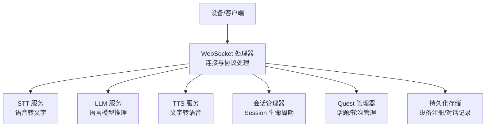
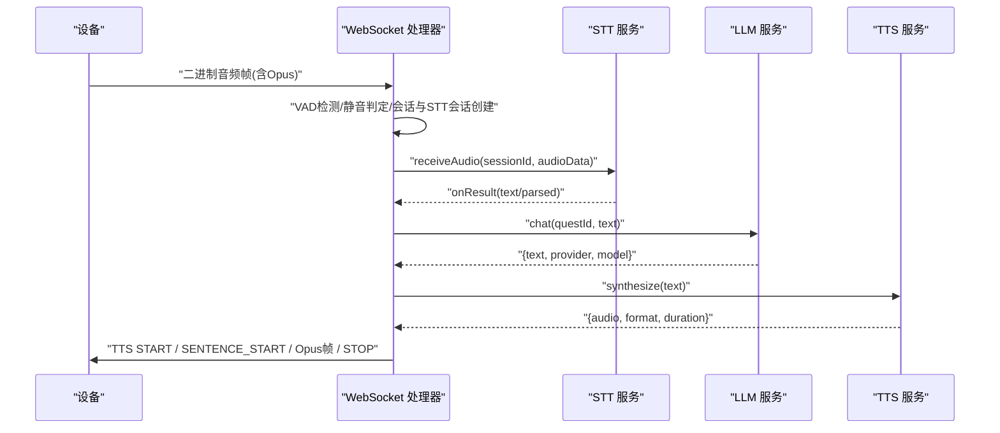
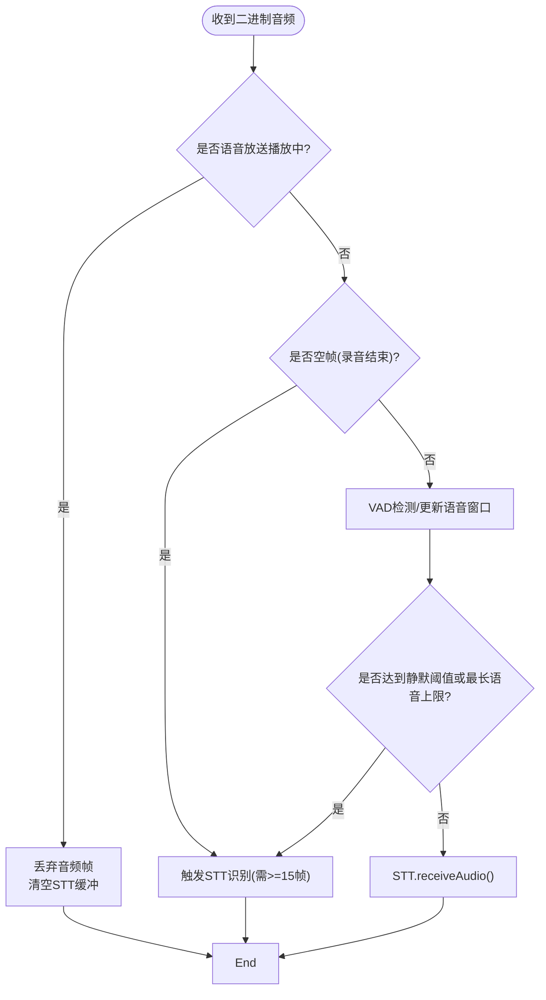
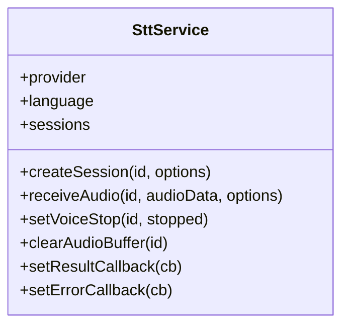
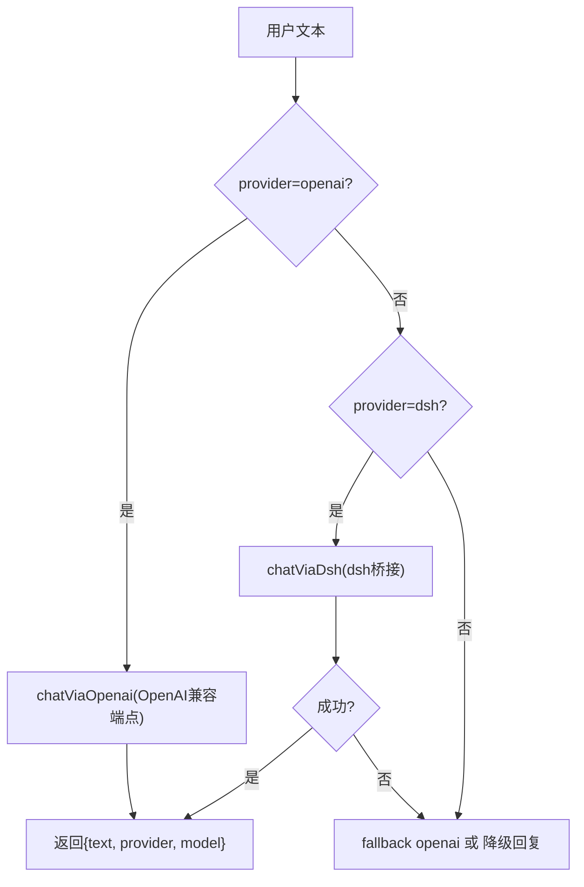
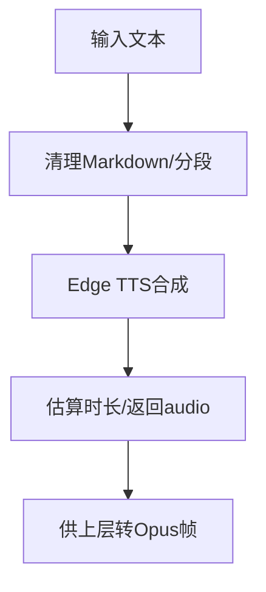
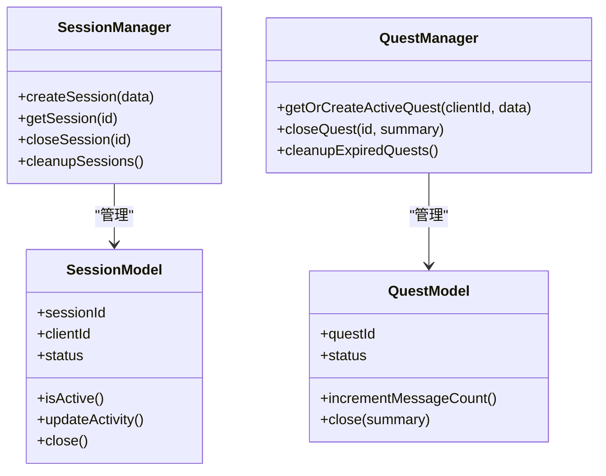
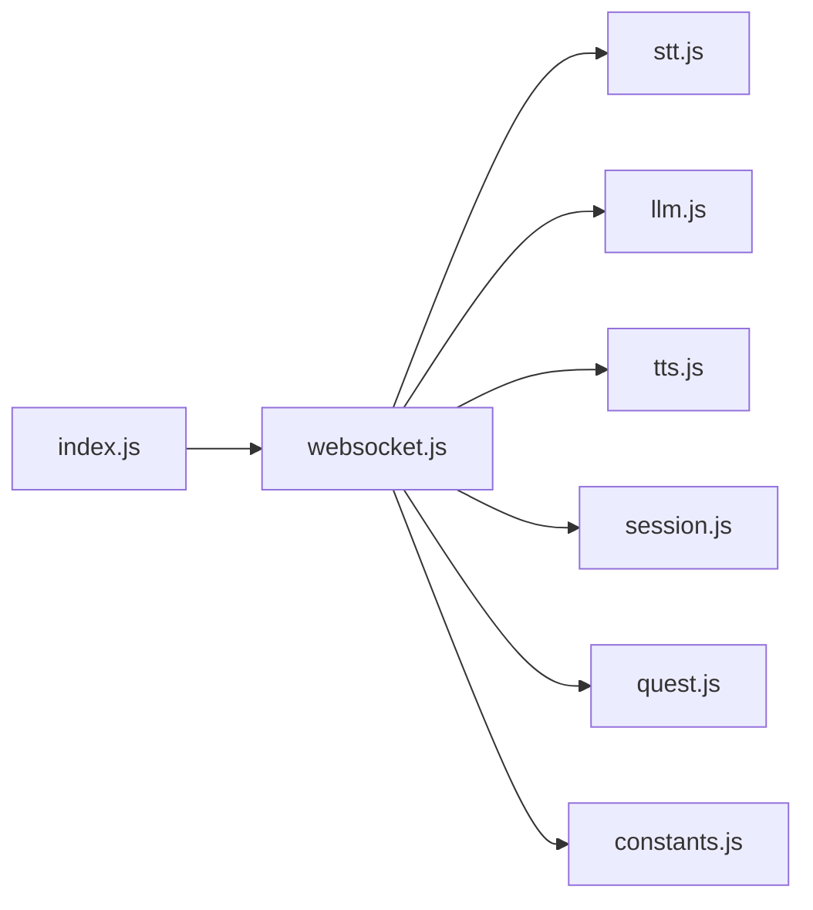

# 数据流设计

<cite>
**本文引用的文件**   
- [index.js](file://index.js)
- [core/handlers/websocket.js](file://core/handlers/websocket.js)
- [core/services/stt.js](file://core/services/stt.js)
- [core/services/llm.js](file://core/services/llm.js)
- [core/services/tts.js](file://core/services/tts.js)
- [core/managers/session.js](file://core/managers/session.js)
- [core/models/session.js](file://core/models/session.js)
- [core/models/quest.js](file://core/models/quest.js)
- [core/managers/quest.js](file://core/managers/quest.js)
- [config/constants.js](file://config/constants.js)
</cite>

## 目录
1. [引言](#引言)
2. [项目结构](#项目结构)
3. [核心组件](#核心组件)
4. [架构总览](#架构总览)
5. [详细组件分析](#详细组件分析)
6. [依赖关系分析](#依赖关系分析)
7. [性能与并发特性](#性能与并发特性)
8. [故障排查指南](#故障排查指南)
9. [结论](#结论)

## 引言
本文面向“从语音输入到AI回复”的完整数据处理链路，围绕 WebSocket 消息接收、STT 语音识别、LLM 语言模型处理、TTS 语音合成四个关键环节展开。文档重点说明：
- 各阶段的数据格式转换（二进制音频、Opus、PCM、WAV、JSON 文本等）
- 会话与任务状态管理（Session、Quest、轮次序号、打断归属）
- 异步处理机制（Promise 链、超时保护、队列串行化）
- 错误处理策略（服务降级、回声过滤、噪声过滤、断连清理）
- 数据流图与关键调用时序图，帮助读者快速定位问题与优化点

## 项目结构
本项目采用频道式入口 + 领域服务 + 管理器/模型的组合：
- 频道入口负责启动 Express/HTTP/WebSocket 服务器，装配并注入 STT/LLM/TTS/VAD/MCP 等服务
- WebSocket 处理器承担连接管理、协议解析、VAD 检测、STT 触发、LLM 调用、TTS 播放控制
- STT/LLM/TTS 为独立服务，支持多提供商配置与初始化探活
- Session/Quest 管理器维护对话上下文与会话生命周期

图表来源
- [index.js:17-27](file://index.js#L17-L27)
- [index.js:235-281](file://index.js#L235-L281)
- [core/handlers/websocket.js:22-59](file://core/handlers/websocket.js#L22-L59)

章节来源
- [index.js:44-281](file://index.js#L44-L281)

## 核心组件
- WebSocket 处理器：统一接入设备连接、消息分发、VAD 检测、STT 触发、LLM 调用、TTS 播放控制、打断与轮次串行化
- STT 服务：多提供商适配（FunASR、豆包、aibridge、阿里云 Qwen-ASR），Opus 解码、PCM 封装、结果回调
- LLM 服务：OpenAI 兼容端点直连或 dsh 桥接，带历史上下文与降级回复
- TTS 服务：Edge TTS 为主，支持分段合成、时长估算、音频保存
- Session/Quest：会话与话题的生命周期、活跃状态、消息计数、超时清理
- 常量定义：消息类型、监听状态、聊天状态、TTS 状态等

章节来源
- [core/handlers/websocket.js:22-59](file://core/handlers/websocket.js#L22-L59)
- [core/services/stt.js:39-87](file://core/services/stt.js#L39-L87)
- [core/services/llm.js:16-24](file://core/services/llm.js#L16-L24)
- [core/services/tts.js:3-21](file://core/services/tts.js#L3-L21)
- [core/managers/session.js:4-10](file://core/managers/session.js#L4-L10)
- [core/managers/quest.js:8-15](file://core/managers/quest.js#L8-L15)
- [config/constants.js:44-90](file://config/constants.js#L44-L90)

## 架构总览
下图展示一次典型语音交互的数据流转：设备通过 WebSocket 发送 Opus 音频帧，服务端进行 VAD 检测与静音判定，触发 STT；STT 返回文本后进入 LLM 生成回复；TTS 将回复文本合成为音频并以固定节拍推送 Opus 帧给设备。

图表来源
- [core/handlers/websocket.js:289-446](file://core/handlers/websocket.js#L289-L446)
- [core/handlers/websocket.js:651-818](file://core/handlers/websocket.js#L651-L818)
- [core/handlers/websocket.js:1025-1189](file://core/handlers/websocket.js#L1025-L1189)
- [core/services/stt.js:348-383](file://core/services/stt.js#L348-L383)
- [core/services/stt.js:515-583](file://core/services/stt.js#L515-L583)
- [core/services/llm.js:75-104](file://core/services/llm.js#L75-L104)
- [core/services/tts.js:62-104](file://core/services/tts.js#L62-L104)

## 详细组件分析

### WebSocket 处理器：连接、协议与数据流编排
职责要点
- 连接建立与设备注册、心跳与断线清理
- 协议消息路由（HELLO/LISTEN/ABORT/CHAT/IOT/MCP/AUDIO_DATA/WAKE_WORD_DETECTED）
- 二进制音频处理：空帧结束录音、VAD 窗口、静默阈值、最长语音兜底
- STT 触发：自动模式与手动停止
- 完整对话流程：噪声/回声过滤、轮次串行化、LLM 调用、TTS 播放控制
- 打断与轮次归属：abortUpTo 与 turnSeq 配合，避免旧轮与新轮交错

关键流程
- 二进制音频处理与 VAD
  - 广播期间丢弃麦克风输入，避免回声干扰
  - 空帧触发识别，缓冲不足则跳过
  - VAD 窗口统计最近帧是否有声，超过静默阈值或最长语音上限触发识别
- 完整对话处理
  - 噪声过滤：短文本、语气词过滤
  - 回声过滤：与近期在播 TTS 文本相似度判断
  - 轮次串行化：turnChain 保证同一连接只有一条应答流
  - LLM 超时保护：防止后端无响应导致队列永久阻塞
  - TTS 播放：先合成再发 START/SENTENCE_START，按 frameDuration 定距推帧，STOP 确保退出说话中

图表来源
- [core/handlers/websocket.js:289-446](file://core/handlers/websocket.js#L289-L446)

章节来源
- [core/handlers/websocket.js:67-169](file://core/handlers/websocket.js#L67-L169)
- [core/handlers/websocket.js:228-283](file://core/handlers/websocket.js#L228-L283)
- [core/handlers/websocket.js:289-446](file://core/handlers/websocket.js#L289-L446)
- [core/handlers/websocket.js:651-818](file://core/handlers/websocket.js#L651-L818)
- [core/handlers/websocket.js:1025-1189](file://core/handlers/websocket.js#L1025-L1189)

### STT 服务：多提供商语音识别
职责要点
- 多提供商初始化与探活（FunASR、豆包、aibridge、阿里云 Qwen-ASR）
- Opus 解码为 PCM，必要时封装 WAV
- 会话级音频缓冲、流式发送、语音停止标志
- 结果回调：结构化 parsed（content/language/emotion）与纯文本兼容

关键流程
- receiveAudio：缓存音频帧，限制缓冲区大小；流式模式下发送远端；自动模式下检测到 voiceStop 且缓冲足够时触发识别
- _handleVoiceStop：合并 PCM 帧，调用对应提供商识别，触发 onResult
- 提供商实现：
  - FunASR：WebSocket 长连接，累积识别结果，is_final 结束
  - aibridge：POST /api/bridge/stt，base64 WAV
  - 阿里云 Qwen-ASR：OpenAI 兼容 chat/completions，input_audio data URL

图表来源
- [core/services/stt.js:39-87](file://core/services/stt.js#L39-L87)
- [core/services/stt.js:293-383](file://core/services/stt.js#L293-L383)
- [core/services/stt.js:515-583](file://core/services/stt.js#L515-L583)
- [core/services/stt.js:846-959](file://core/services/stt.js#L846-L959)
- [core/services/stt.js:1065-1103](file://core/services/stt.js#L1065-L1103)
- [core/services/stt.js:1122-1185](file://core/services/stt.js#L1122-L1185)

章节来源
- [core/services/stt.js:89-121](file://core/services/stt.js#L89-L121)
- [core/services/stt.js:348-383](file://core/services/stt.js#L348-L383)
- [core/services/stt.js:515-583](file://core/services/stt.js#L515-L583)
- [core/services/stt.js:846-959](file://core/services/stt.js#L846-L959)
- [core/services/stt.js:1065-1103](file://core/services/stt.js#L1065-L1103)
- [core/services/stt.js:1122-1185](file://core/services/stt.js#L1122-L1185)

### LLM 服务：语言模型推理与降级
职责要点
- 支持 openai 直连与 dsh 桥接两种 provider
- 构建系统提示与历史消息，维护每连接的历史上下文
- 失败回退：dsh 不可用回退 openai，仍失败则返回降级友好回复

关键流程
- chat：根据 provider 选择路径，dsh 失败尝试 fallbackBaseUrl 的 openai
- chatViaOpenai/chatViaDsh：构造请求体，设置超时信号，解析 choices[0].message.content
- buildMessages/addToHistory：system + 最近 N 轮 + 新消息

图表来源
- [core/services/llm.js:75-104](file://core/services/llm.js#L75-L104)
- [core/services/llm.js:121-160](file://core/services/llm.js#L121-L160)
- [core/services/llm.js:166-203](file://core/services/llm.js#L166-L203)
- [core/services/llm.js:211-252](file://core/services/llm.js#L211-L252)

章节来源
- [core/services/llm.js:16-65](file://core/services/llm.js#L16-L65)
- [core/services/llm.js:75-104](file://core/services/llm.js#L75-L104)
- [core/services/llm.js:121-160](file://core/services/llm.js#L121-L160)
- [core/services/llm.js:166-203](file://core/services/llm.js#L166-L203)
- [core/services/llm.js:211-252](file://core/services/llm.js#L211-L252)

### TTS 服务：文字转语音与播放控制
职责要点
- Edge TTS 为主，支持讯飞/阿里云扩展
- 文本清洗、分段合成、时长估算
- 输出音频 Buffer，供上层转换为 Opus 帧

关键流程
- synthesize：清理 Markdown，按 provider 合成，返回 {audio, format, sampleRate, duration}
- synthesizeStream：按标点分段，逐段合成并通过回调推送
- _estimateDuration：基于中文/英文/标点字符数估算时长

图表来源
- [core/services/tts.js:62-104](file://core/services/tts.js#L62-L104)
- [core/services/tts.js:106-147](file://core/services/tts.js#L106-L147)
- [core/services/tts.js:163-202](file://core/services/tts.js#L163-L202)
- [core/services/tts.js:209-267](file://core/services/tts.js#L209-L267)

章节来源
- [core/services/tts.js:3-21](file://core/services/tts.js#L3-L21)
- [core/services/tts.js:62-104](file://core/services/tts.js#L62-L104)
- [core/services/tts.js:106-147](file://core/services/tts.js#L106-L147)
- [core/services/tts.js:163-202](file://core/services/tts.js#L163-L202)
- [core/services/tts.js:209-267](file://core/services/tts.js#L209-L267)

### 会话与任务管理：Session 与 Quest
- SessionManager：维护 sessionId -> SessionModel 映射，客户端会话列表，活动状态与超时清理
- SessionModel：会话元数据、状态机（active/inactive/closed）、上下文键值对
- QuestManager：维护 questId -> QuestModel，客户端活跃 Quest，消息计数、关闭/恢复/清理
- QuestModel：话题标题、摘要、标签、持续时间、验证

图表来源
- [core/managers/session.js:4-10](file://core/managers/session.js#L4-L10)
- [core/models/session.js:3-16](file://core/models/session.js#L3-L16)
- [core/managers/quest.js:8-15](file://core/managers/quest.js#L8-L15)
- [core/models/quest.js:7-23](file://core/models/quest.js#L7-L23)

章节来源
- [core/managers/session.js:12-45](file://core/managers/session.js#L12-L45)
- [core/models/session.js:18-57](file://core/models/session.js#L18-L57)
- [core/managers/quest.js:22-55](file://core/managers/quest.js#L22-L55)
- [core/models/quest.js:25-79](file://core/models/quest.js#L25-L79)

## 依赖关系分析
- index.js 作为频道入口，初始化并注入所有服务到 WebSocket 处理器
- WebSocket 处理器依赖 STT/LLM/TTS/Session/Quest/Store 等模块
- STT/LLM/TTS 各自维护内部状态与外部服务连接（FunASR、OpenAI/dsh、Edge TTS）
- 常量集中定义消息类型与状态枚举，降低耦合

图表来源
- [index.js:17-27](file://index.js#L17-L27)
- [index.js:235-281](file://index.js#L235-L281)
- [core/handlers/websocket.js:22-59](file://core/handlers/websocket.js#L22-L59)
- [config/constants.js:44-90](file://config/constants.js#L44-L90)

章节来源
- [index.js:17-27](file://index.js#L17-L27)
- [index.js:235-281](file://index.js#L235-L281)
- [core/handlers/websocket.js:22-59](file://core/handlers/websocket.js#L22-L59)
- [config/constants.js:44-90](file://config/constants.js#L44-L90)

## 性能与并发特性
- 音频帧定距发送：使用 ws.audioParams.frameDuration 或默认 60ms，避免设备缓冲溢出导致颤音
- 轮次串行化：turnChain 保证同一连接只有一条应答流，避免 Opus 帧交错
- 超时保护：
  - 单轮处理超时：TURN_TIMEOUT_MS 防止单轮挂死
  - LLM 超时：llmTimeoutSeconds 防止后端无响应拖垮队列
- 回声与噪声过滤：减少误触发与无效对话轮
- 广播期间丢弃麦克风输入：避免回声自杀式打断

章节来源
- [core/handlers/websocket.js:677-693](file://core/handlers/websocket.js#L677-L693)
- [core/handlers/websocket.js:933-971](file://core/handlers/websocket.js#L933-L971)
- [core/handlers/websocket.js:1149-1189](file://core/handlers/websocket.js#L1149-L1189)
- [core/handlers/websocket.js:697-722](file://core/handlers/websocket.js#L697-L722)
- [core/handlers/websocket.js:289-306](file://core/handlers/websocket.js#L289-L306)

## 故障排查指南
常见问题与建议
- STT 无法识别
  - 检查 STT 提供商初始化与连通性（FunASR 探活、aibridge whoami、阿里云 API Key）
  - 确认 Opus 解码器可用，frameSize 与采样率匹配
  - 查看音频缓冲帧数是否满足最低阈值（≥15）
- LLM 无响应或超时
  - 检查 openai/dsh 端点可达性与 apiKey
  - 调整 llmTimeoutSeconds，避免过短导致频繁降级
- TTS 合成失败
  - 确认 Edge TTS 库已安装并可动态导入
  - 检查文本长度与格式，避免过长或特殊字符
- 设备播放异常或卡顿
  - 核对 frameDuration 与设备期望一致
  - 检查 abortUpTo/turnSeq 是否正确标记打断轮次
- 回声拾取导致误打断
  - 启用回声判定逻辑，避免无AEC设备在播放时触发识别
  - 广播期间丢弃麦克风输入，播放完成后再恢复

章节来源
- [core/services/stt.js:89-121](file://core/services/stt.js#L89-L121)
- [core/services/stt.js:208-241](file://core/services/stt.js#L208-L241)
- [core/services/stt.js:1016-1039](file://core/services/stt.js#L1016-L1039)
- [core/services/stt.js:1122-1185](file://core/services/stt.js#L1122-L1185)
- [core/services/llm.js:30-65](file://core/services/llm.js#L30-L65)
- [core/services/llm.js:121-160](file://core/services/llm.js#L121-L160)
- [core/services/tts.js:40-50](file://core/services/tts.js#L40-L50)
- [core/handlers/websocket.js:1149-1189](file://core/handlers/websocket.js#L1149-L1189)
- [core/handlers/websocket.js:697-722](file://core/handlers/websocket.js#L697-L722)
- [core/handlers/websocket.js:289-306](file://core/handlers/websocket.js#L289-L306)

## 结论
本数据流设计以 WebSocket 处理器为核心编排节点，串联 STT/LLM/TTS 三大服务，并通过 Session/Quest 管理会话与话题生命周期。系统在多个层面引入健壮性保障：
- 数据层：Opus/PCM/WAV/JSON 的多格式转换与校验
- 状态层：VAD 窗口、静默阈值、最长语音兜底、轮次序号与打断归属
- 并发层：Promise 链串行化、超时保护、广播静音
- 容错层：回声/噪声过滤、服务降级、断连清理

该设计在保证低延迟的同时兼顾稳定性，适合硬件设备与 Web 客户端混合场景下的实时语音交互。