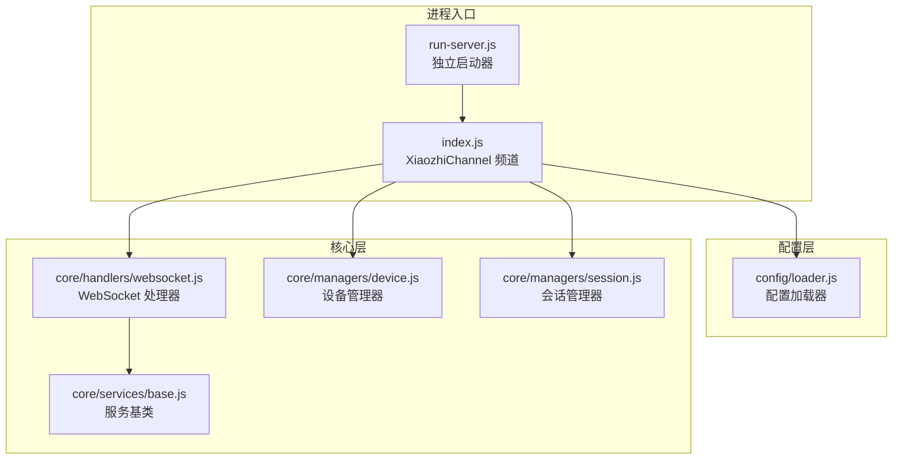
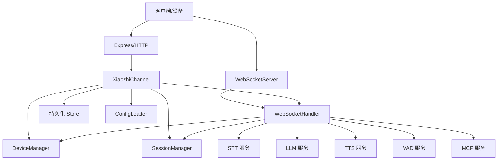
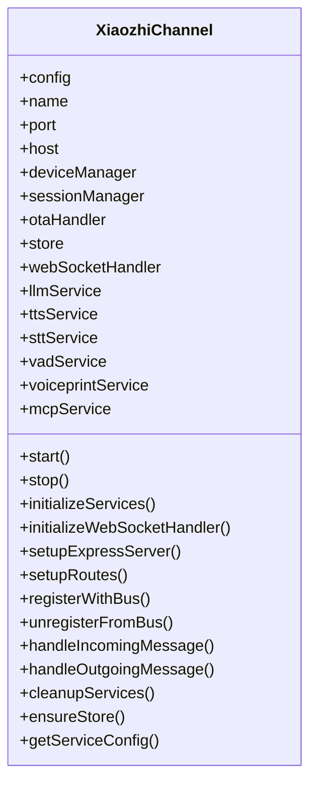
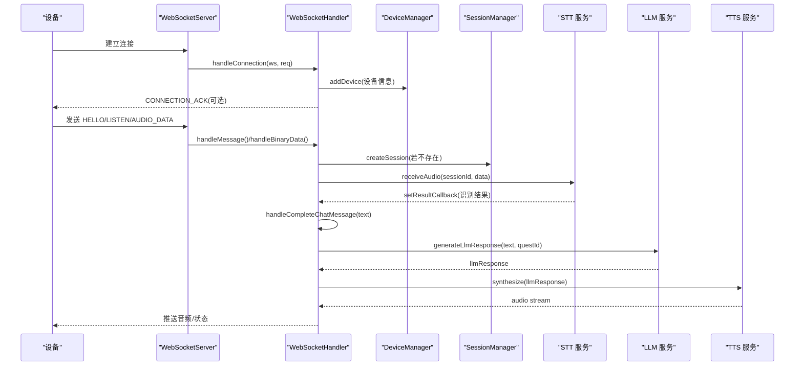
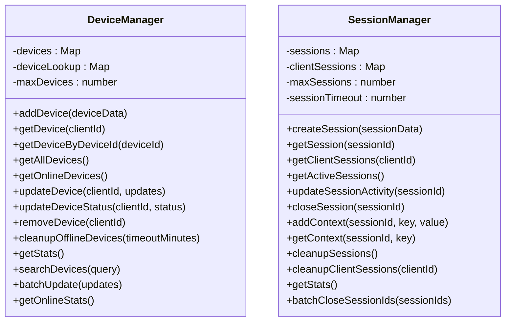
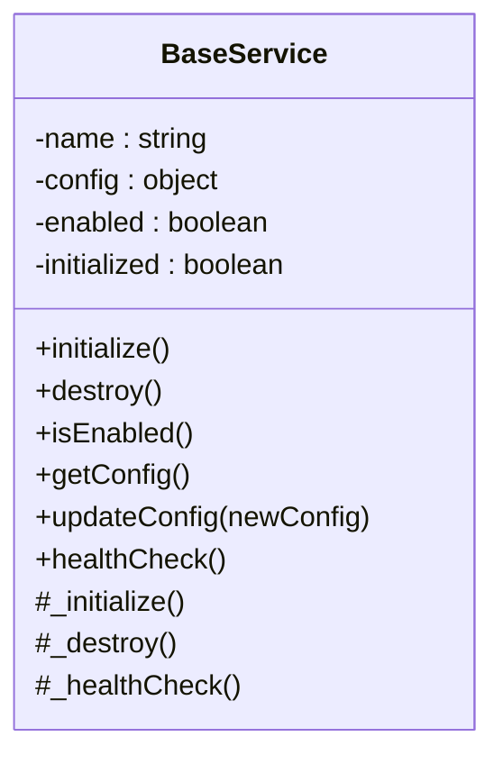
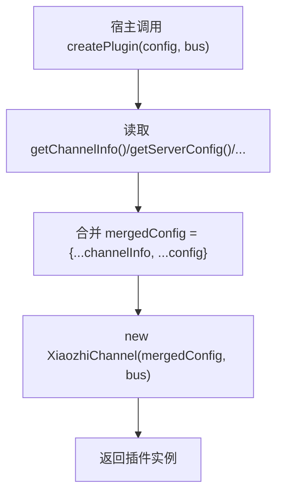
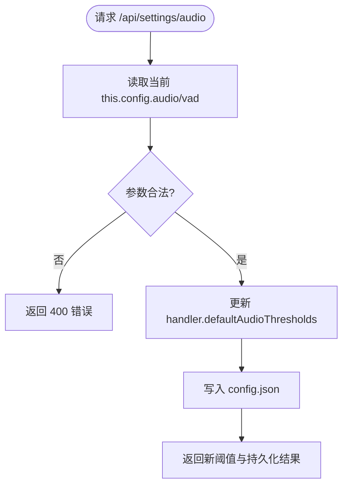
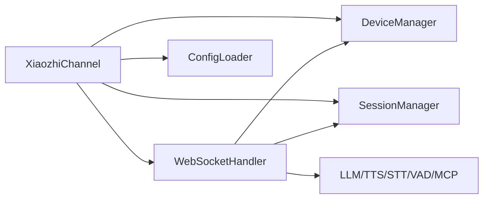

# 核心架构模式

<cite>
**本文引用的文件**   
- [index.js](file://index.js)
- [run-server.js](file://run-server.js)
- [config/loader.js](file://config/loader.js)
- [core/handlers/websocket.js](file://core/handlers/websocket.js)
- [core/managers/device.js](file://core/managers/device.js)
- [core/managers/session.js](file://core/managers/session.js)
- [core/services/base.js](file://core/services/base.js)
</cite>

## 目录
1. [引言](#引言)
2. [项目结构](#项目结构)
3. [核心组件](#核心组件)
4. [架构总览](#架构总览)
5. [详细组件分析](#详细组件分析)
6. [依赖关系分析](#依赖关系分析)
7. [性能与可扩展性](#性能与可扩展性)
8. [故障排查指南](#故障排查指南)
9. [结论](#结论)

## 引言
本文面向小智语音交互服务器的核心架构模式，重点说明分层设计（服务层、管理层、处理器层）、XiaozhiChannel 作为系统协调器的职责、插件化工厂 createPlugin、配置加载器与热更新机制，并通过架构图表展示各层之间的依赖和数据流向。文档力求在保持技术深度的同时，让非专业读者也能理解整体设计思路。

## 项目结构
仓库采用按职责分层的组织方式：
- 顶层入口与独立运行脚本负责启动服务器、挂载工作区与 OTA 路由。
- config 目录提供统一配置加载与环境变量覆盖。
- core 目录按领域划分：handlers（协议处理）、managers（设备与会话等状态管理）、services（LLM/TTS/STT/VAD/MCP 等服务抽象）、models（数据模型）、utils（工具）。
- public 为前端资源，studio 为固件工作台。

图表来源
- [run-server.js:25-35](file://run-server.js#L25-L35)
- [index.js:44-125](file://index.js#L44-L125)
- [config/loader.js:13-44](file://config/loader.js#L13-L44)
- [core/handlers/websocket.js:22-60](file://core/handlers/websocket.js#L22-L60)
- [core/managers/device.js:4-10](file://core/managers/device.js#L4-L10)
- [core/managers/session.js:4-10](file://core/managers/session.js#L4-L10)
- [core/services/base.js:2-8](file://core/services/base.js#L2-L8)

章节来源
- [run-server.js:1-75](file://run-server.js#L1-L75)
- [index.js:1-706](file://index.js#L1-L706)
- [config/loader.js:1-225](file://config/loader.js#L1-L225)

## 核心组件
- XiaozhiChannel：频道协调器，负责初始化服务、注册 Express/HTTP/WebSocket、暴露 API、对接消息总线、生命周期管理与清理。
- WebSocketHandler：协议处理器，负责连接管理、消息分发、音频流处理、VAD/STT/TTS/LLM 协作、轮次串行化与打断控制。
- DeviceManager：在线设备注册、查找、统计与清理。
- SessionManager：会话创建、查询、上下文、超时清理与批量关闭。
- BaseService：服务抽象，定义 initialize/destroy/healthCheck 等统一接口。
- ConfigLoader：统一配置加载、环境变量覆盖、校验与重载。

章节来源
- [index.js:44-125](file://index.js#L44-L125)
- [core/handlers/websocket.js:22-60](file://core/handlers/websocket.js#L22-L60)
- [core/managers/device.js:4-10](file://core/managers/device.js#L4-L10)
- [core/managers/session.js:4-10](file://core/managers/session.js#L4-L10)
- [core/services/base.js:2-8](file://core/services/base.js#L2-L8)
- [config/loader.js:13-44](file://config/loader.js#L13-L44)

## 架构总览
小智服务器采用“通道 + 处理器 + 管理器 + 服务”的分层架构：
- 通道层（XiaozhiChannel）：对外暴露 HTTP/WebSocket 能力，编排内部组件，提供插件化入口。
- 处理器层（WebSocketHandler）：实现协议解析、音频流处理、对话轮次调度。
- 管理层（DeviceManager/SessionManager）：维护设备与会话的状态与生命周期。
- 服务层（LLM/TTS/STT/VAD/MCP 等）：通过 BaseService 抽象，统一初始化与健康检查。
- 配置层（ConfigLoader）：集中读取 config.json，支持环境变量覆盖与运行时重载。

图表来源
- [index.js:254-281](file://index.js#L254-L281)
- [core/handlers/websocket.js:22-60](file://core/handlers/websocket.js#L22-L60)
- [core/managers/device.js:4-10](file://core/managers/device.js#L4-L10)
- [core/managers/session.js:4-10](file://core/managers/session.js#L4-L10)
- [config/loader.js:13-44](file://config/loader.js#L13-L44)

## 详细组件分析

### XiaozhiChannel：系统协调器
职责与行为要点：
- 生命周期：start() 初始化服务、设置 WebSocket 处理器、创建 Express/HTTP 服务器、启动监听、注册消息总线；stop() 注销总线、关闭 WSS/HTTP、清理服务。
- 服务编排：实例化并初始化 LLM/TTS/STT/VAD/Voiceprint/MCP 服务，以及 DeviceManager/SessionManager/OTAHandler 和 Store。
- WebSocket 处理器注入：将设备/会话/服务/Store 注入到 WebSocketHandler，确保协议处理能访问所有子系统。
- API 路由：健康检查、音频阈值配置（含热更新与持久化）、设备管理、会话管理、广播、OTA 路由、WebSocket URL 信息。
- 插件化：导出 pluginMetadata、pluginConfigSchema 与 createPlugin 工厂函数，供外部宿主加载。

图表来源
- [index.js:44-125](file://index.js#L44-L125)
- [index.js:180-249](file://index.js#L180-L249)
- [index.js:254-488](file://index.js#L254-L488)
- [index.js:516-580](file://index.js#L516-L580)

章节来源
- [index.js:44-125](file://index.js#L44-L125)
- [index.js:180-249](file://index.js#L180-L249)
- [index.js:254-488](file://index.js#L254-L488)
- [index.js:516-580](file://index.js#L516-L580)

### WebSocketHandler：协议与对话流程
职责与行为要点：
- 连接管理：解析 client-id/device-id，注册设备，设置心跳与错误处理，断连时清理设备与会话。
- 消息分发：根据消息类型分发到协议处理、MCP、识别控制、好友消息等分支。
- 音频流处理：二进制帧进入 VAD 检测、静默判定、STT 会话缓冲、触发识别。
- 对话轮次：对完整聊天文本进行噪声/回声过滤、中止旧轮、串行化执行 _runChatTurn，串联 LLM 生成与 TTS 播放，支持打断与超时保护。
- 广播与工具：提供广播目标获取与推送，集成 MCP 工具描述与消息处理。

图表来源
- [core/handlers/websocket.js:67-169](file://core/handlers/websocket.js#L67-L169)
- [core/handlers/websocket.js:228-283](file://core/handlers/websocket.js#L228-L283)
- [core/handlers/websocket.js:289-446](file://core/handlers/websocket.js#L289-L446)
- [core/handlers/websocket.js:651-694](file://core/handlers/websocket.js#L651-L694)

章节来源
- [core/handlers/websocket.js:22-60](file://core/handlers/websocket.js#L22-L60)
- [core/handlers/websocket.js:67-169](file://core/handlers/websocket.js#L67-L169)
- [core/handlers/websocket.js:228-283](file://core/handlers/websocket.js#L228-L283)
- [core/handlers/websocket.js:289-446](file://core/handlers/websocket.js#L289-L446)
- [core/handlers/websocket.js:651-694](file://core/handlers/websocket.js#L651-L694)

### 管理层：DeviceManager 与 SessionManager
- DeviceManager：以 Map 维护 clientId 与 deviceId 的双向映射，提供添加/更新/移除/搜索/统计/批量操作能力，限制最大设备数，支持离线清理。
- SessionManager：以 Map 维护 sessionId 与 clientId 的会话集合，提供创建/查询/上下文/关闭/清理/批量关闭能力，支持超时清理与统计。

图表来源
- [core/managers/device.js:4-10](file://core/managers/device.js#L4-L10)
- [core/managers/device.js:12-116](file://core/managers/device.js#L12-L116)
- [core/managers/device.js:118-198](file://core/managers/device.js#L118-L198)
- [core/managers/session.js:4-10](file://core/managers/session.js#L4-L10)
- [core/managers/session.js:12-154](file://core/managers/session.js#L12-L154)
- [core/managers/session.js:156-187](file://core/managers/session.js#L156-L187)

章节来源
- [core/managers/device.js:4-198](file://core/managers/device.js#L4-L198)
- [core/managers/session.js:4-187](file://core/managers/session.js#L4-L187)

### 服务层：BaseService 与具体服务
- BaseService：定义统一的 initialize/destroy/healthCheck 生命周期与配置更新接口，子类需实现 _initialize/_destroy/_healthCheck。
- 具体服务（LLM/TTS/STT/VAD/MCP/Voiceprint）：由 XiaozhiChannel 在初始化阶段构造并调用 initialize，遵循相同生命周期契约。

图表来源
- [core/services/base.js:2-87](file://core/services/base.js#L2-L87)

章节来源
- [core/services/base.js:2-87](file://core/services/base.js#L2-L87)

### 插件化架构与 createPlugin 工厂
- 插件元数据：从配置加载器获取频道 id/name/desc/type/category 等信息，形成 pluginMetadata。
- 插件配置 Schema：基于实际配置值生成端口、主机、LLM/TTS/STT 等字段默认值与描述，便于宿主验证。
- 工厂函数 createPlugin：合并传入配置与配置文件中的频道信息，返回 XiaozhiChannel 实例，实现“配置即插件”。

图表来源
- [index.js:607-697](file://index.js#L607-L697)
- [config/loader.js:157-166](file://config/loader.js#L157-L166)

章节来源
- [index.js:607-697](file://index.js#L607-L697)
- [config/loader.js:157-166](file://config/loader.js#L157-L166)

### 配置加载器与动态配置/热更新
- 配置加载：ConfigLoader 单例从 config.json 读取配置，应用环境变量覆盖（端口、主机、STT/TTS/FunASR/LLM 等），并提供 getConfig/getServerConfig/getSttConfig/getTtsConfig/getFunasrConfig/getLlmConfig/getChannelInfo 等便捷方法。
- 校验与重载：validateConfig 校验必填字段；reloadConfig 清空缓存后重新加载，用于运行时配置更新。
- 运行时热更新：XiaozhiChannel 暴露 /api/settings/audio 接口，允许更新振幅与静默阈值，即时刷新 WebSocketHandler 的默认阈值，并将变更持久化到 config.json。

图表来源
- [index.js:299-344](file://index.js#L299-L344)
- [config/loader.js:22-44](file://config/loader.js#L22-L44)
- [config/loader.js:49-74](file://config/loader.js#L49-L74)
- [config/loader.js:206-209](file://config/loader.js#L206-L209)

章节来源
- [config/loader.js:13-44](file://config/loader.js#L13-L44)
- [config/loader.js:49-74](file://config/loader.js#L49-L74)
- [config/loader.js:157-166](file://config/loader.js#L157-L166)
- [config/loader.js:206-209](file://config/loader.js#L206-L209)
- [index.js:299-344](file://index.js#L299-L344)

## 依赖关系分析
- 耦合与内聚：
  - XiaozhiChannel 高内聚地编排服务与管理器，低耦合地通过构造函数注入依赖给 WebSocketHandler，避免循环依赖。
  - WebSocketHandler 依赖管理器与服务，但不反向依赖 Channel，符合单向依赖原则。
  - 管理器之间无直接依赖，各自维护自身状态，提升内聚性。
- 外部依赖与集成点：
  - Express/HTTP/WebSocketServer：网络接入层。
  - ConfigLoader：配置源。
  - 消息总线（bus）：可选集成，standalone 模式下使用空实现。
- 潜在循环依赖：
  - 未发现显式循环导入；Channel 仅向下注入依赖，处理器不回调 Channel。

图表来源
- [index.js:180-249](file://index.js#L180-L249)
- [core/handlers/websocket.js:22-60](file://core/handlers/websocket.js#L22-L60)
- [config/loader.js:13-44](file://config/loader.js#L13-L44)

章节来源
- [index.js:180-249](file://index.js#L180-L249)
- [core/handlers/websocket.js:22-60](file://core/handlers/websocket.js#L22-L60)
- [config/loader.js:13-44](file://config/loader.js#L13-L44)

## 性能与可扩展性
- 音频流与 VAD：
  - 使用滑动窗口判断有声音/静默，结合可配置的静默阈值与最长语音兜底，避免长句被切碎或无限“倾听中”。
  - 广播期间暂停麦克风输入，防止回声干扰识别。
- 对话轮次串行化：
  - 通过 turnChain 与 turnSeq 保证同一连接同一时刻只有一条应答流程，避免 Opus 帧交错；配合超时保护防止单轮挂死阻塞后续轮次。
- 设备与会话上限：
  - DeviceManager/SessionManager 均设置上限并在超限时尝试清理过期对象，保障内存稳定。
- 可扩展性建议：
  - 新增服务应继承 BaseService，遵循统一生命周期，便于 Channel 自动初始化与健康检查。
  - 通过 createPlugin 工厂扩展不同频道场景，复用 Channel 编排逻辑。

[本节为通用指导，不直接分析具体文件]

## 故障排查指南
- 启动失败：
  - 检查 config.json 是否存在且包含必要字段（id/name/stt/tts 等），必要时使用 validateConfig 校验。
  - 确认端口与主机未被占用，环境变量 XIAOZHI_PORT/HOST 是否冲突。
- 设备无法注册：
  - 查看设备类型是否在白名单内，非法类型会被归一化为 unknown。
  - 检查 DeviceManager 是否达到 maxDevices 上限。
- 识别异常：
  - 检查 STT 服务是否已初始化，音频格式与采样率是否与设备一致。
  - 调整 /api/settings/audio 的阈值，观察静默与振幅门限效果。
- 对话卡顿或无响应：
  - 关注轮次超时与打断逻辑，确认是否有长时间未响应的 LLM 导致队列阻塞。
  - 检查 Echo 与噪声过滤是否误判有效输入。
- 停止服务：
  - 使用 stop() 清理 WSS/HTTP 与服务资源，确保 store.close() 释放持久化句柄。

章节来源
- [config/loader.js:171-209](file://config/loader.js#L171-L209)
- [core/handlers/websocket.js:67-169](file://core/handlers/websocket.js#L67-L169)
- [core/handlers/websocket.js:289-446](file://core/handlers/websocket.js#L289-L446)
- [core/handlers/websocket.js:651-694](file://core/handlers/websocket.js#L651-L694)
- [index.js:130-165](file://index.js#L130-L165)
- [index.js:299-344](file://index.js#L299-L344)

## 结论
小智语音交互服务器通过清晰的层次划分与明确的职责边界，实现了高内聚、低耦合的可扩展架构。XiaozhiChannel 作为协调器统一管理生命周期与依赖注入；WebSocketHandler 专注协议与对话流程；DeviceManager/SessionManager 分别管理设备与会话状态；BaseService 规范了服务生命周期。插件化工厂 createPlugin 使频道能力可配置化与可插拔；配置加载器与热更新机制保证了部署灵活性与运维友好性。该设计既满足实时音视频处理的性能要求，也为未来扩展新的服务与频道提供了坚实基础。