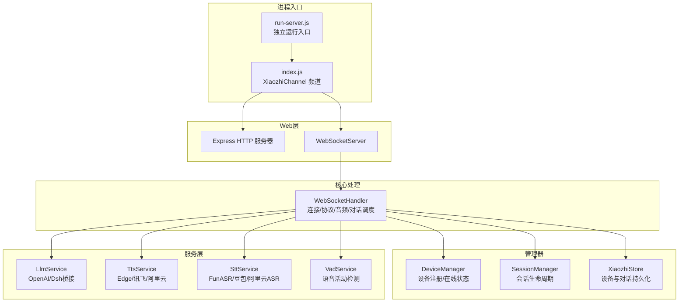
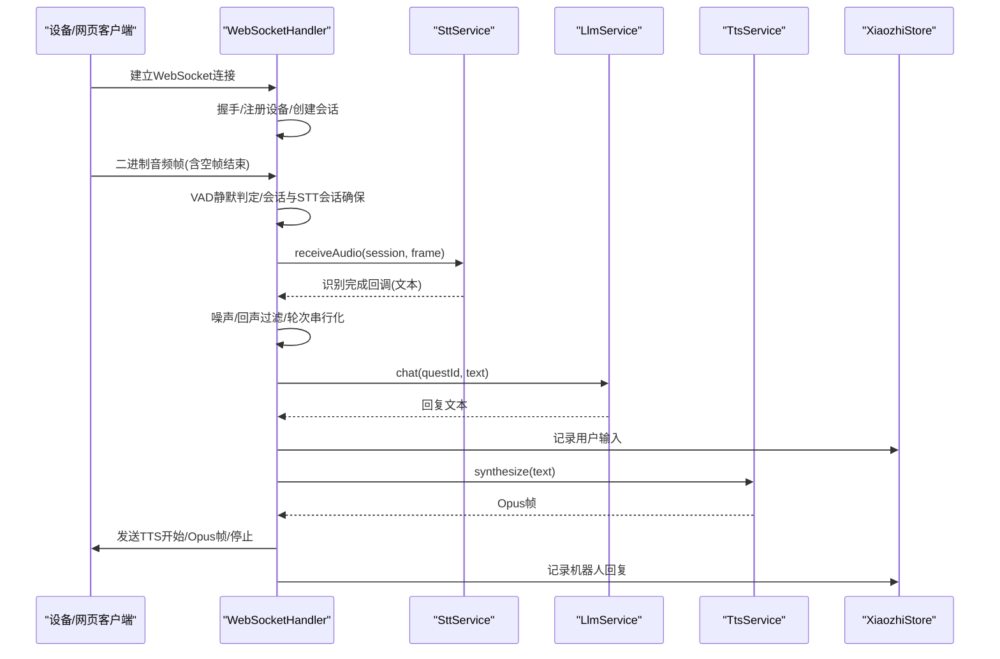
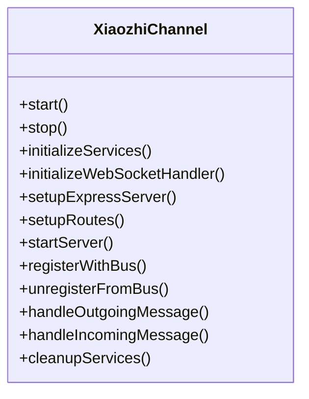
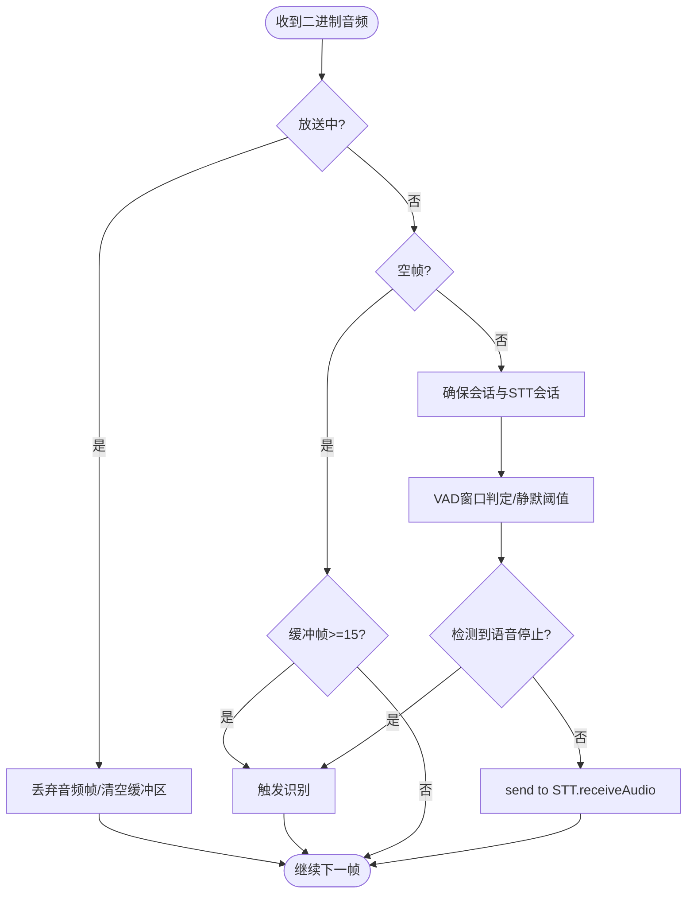
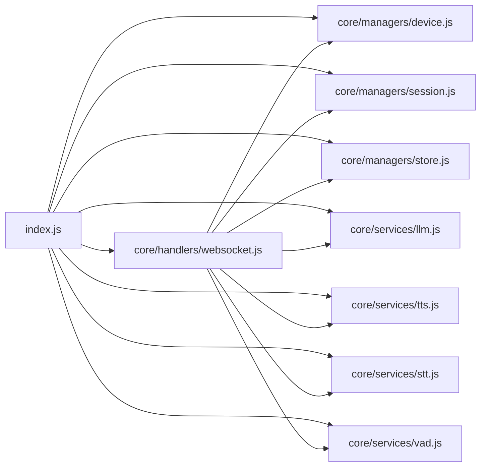

# 系统架构设计

<cite>
**本文引用的文件**   
- [index.js](file://index.js)
- [run-server.js](file://run-server.js)
- [package.json](file://package.json)
- [core/handlers/websocket.js](file://core/handlers/websocket.js)
- [core/managers/device.js](file://core/managers/device.js)
- [core/managers/session.js](file://core/managers/session.js)
- [core/services/llm.js](file://core/services/llm.js)
- [core/services/tts.js](file://core/services/tts.js)
- [core/services/stt.js](file://core/services/stt.js)
- [core/services/vad.js](file://core/services/vad.js)
- [core/managers/store.js](file://core/managers/store.js)
- [core/models/device.js](file://core/models/device.js)
- [core/models/session.js](file://core/models/session.js)
</cite>

## 目录
1. [引言](#引言)
2. [项目结构](#项目结构)
3. [核心组件](#核心组件)
4. [架构总览](#架构总览)
5. [详细组件分析](#详细组件分析)
6. [依赖关系分析](#依赖关系分析)
7. [性能与可靠性](#性能与可靠性)
8. [故障排查指南](#故障排查指南)
9. [结论](#结论)

## 引言
本文件面向开发者，系统性阐述小智语音交互服务器的整体架构、分层设计与关键组件职责。重点说明从设备语音输入到AI回复的完整处理链路，包括WebSocket接入、会话与设备管理、语音识别（STT）、语音活动检测（VAD）、大语言模型（LLM）对话、文本转语音（TTS）以及持久化记录等模块如何协作。文档同时提供架构图、类图与时序图，帮助读者快速把握系统设计思路与技术决策。

## 项目结构
项目采用“频道入口 + 核心处理器 + 管理器 + 服务 + 模型”的分层组织方式：
- 频道入口：XiaozhiChannel 负责启动HTTP/WS服务、装配服务与路由、对外暴露API与OTA能力。
- WebSocket处理器：集中处理连接、协议消息、音频流、对话轮次调度与TTS播放。
- 管理器：DeviceManager、SessionManager、Store分别负责设备在线状态、会话生命周期与持久化。
- 服务：LLM/TTS/STT/VAD/MCP等能力以独立服务形式存在，便于替换与扩展。
- 模型：DeviceModel、SessionModel为数据实体定义与校验。

图表来源
- [index.js:44-282](file://index.js#L44-L282)
- [run-server.js:25-55](file://run-server.js#L25-L55)

章节来源
- [index.js:44-282](file://index.js#L44-L282)
- [run-server.js:25-55](file://run-server.js#L25-L55)
- [package.json:1-29](file://package.json#L1-L29)

## 核心组件
- XiaozhiChannel：频道门面，负责初始化服务、创建Express/HTTP/WebSocket、挂载路由与OTA、向消息总线注册/注销、统一启停与清理。
- WebSocketHandler：连接与消息中枢，负责握手、协议分发、音频帧处理、VAD静默判定、STT触发、LLM调用、TTS合成与Opus帧发送、打断与轮次串行化。
- DeviceManager：设备注册表，维护clientId/deviceId映射、在线状态、统计与搜索。
- SessionManager：会话管理，维护sessionId与客户端映射、活跃性、超时清理。
- LlmService：LLM对话服务，支持openai直连与dsh桥接，维护每连接历史上下文，具备降级回复。
- TtsService：TTS合成服务，支持Edge/讯飞/阿里云，提供分段合成、时长估算与音频保存。
- SttService：STT识别服务，支持FunASR/豆包/阿里云ASR，实现Opus解码、流式识别、会话缓冲与结果回调。
- VadService：VAD服务，默认返回null由调用方使用本地VAD逻辑。
- XiaozhiStore：SQLite持久化，记录设备注册与对话历史，写失败不阻塞主流程。

章节来源
- [index.js:44-282](file://index.js#L44-L282)
- [core/handlers/websocket.js:22-100](file://core/handlers/websocket.js#L22-L100)
- [core/managers/device.js:4-41](file://core/managers/device.js#L4-L41)
- [core/managers/session.js:4-45](file://core/managers/session.js#L4-L45)
- [core/services/llm.js:16-104](file://core/services/llm.js#L16-L104)
- [core/services/tts.js:3-104](file://core/services/tts.js#L3-L104)
- [core/services/stt.js:39-121](file://core/services/stt.js#L39-L121)
- [core/services/vad.js:3-26](file://core/services/vad.js#L3-L26)
- [core/managers/store.js:29-83](file://core/managers/store.js#L29-L83)

## 架构总览
系统采用“接入层-业务编排层-能力服务层-存储层”的分层架构：
- 接入层：Express HTTP + WebSocket，承载REST API、OTA与设备WebSocket接入。
- 业务编排层：WebSocketHandler作为核心编排器，串联STT→LLM→TTS，并管理会话、设备与轮次并发。
- 能力服务层：LLM/TTS/STT/VAD/MCP等服务可插拔，通过配置切换提供商。
- 存储层：XiaozhiStore基于SQLite持久化设备与对话；内存中DeviceManager/SessionManager用于运行时状态。

图表来源
- [core/handlers/websocket.js:228-446](file://core/handlers/websocket.js#L228-L446)
- [core/handlers/websocket.js:651-818](file://core/handlers/websocket.js#L651-L818)
- [core/handlers/websocket.js:1025-1189](file://core/handlers/websocket.js#L1025-L1189)
- [core/services/stt.js:348-383](file://core/services/stt.js#L348-L383)
- [core/services/llm.js:75-104](file://core/services/llm.js#L75-L104)
- [core/services/tts.js:62-104](file://core/services/tts.js#L62-L104)
- [core/managers/store.js:158-175](file://core/managers/store.js#L158-L175)

## 详细组件分析

### XiaozhiChannel 频道门面
职责：
- 初始化核心服务（SessionManager、DeviceManager、LLM/TTS/STT/VAD/MCP）。
- 初始化WebSocket处理器并注入所有服务与会话/设备/Store。
- 创建Express应用与HTTP服务器，挂载健康检查、设置热更新、设备管理、广播、OTA等路由。
- 启动/停止服务器，注册/注销消息总线，资源清理。

关键点：
- 在standalone模式下gala实例为空，消息总线为空实现，LLM走bridge（openai/dsh）。
- OTA与固件下载路由保持兼容。
- 音频阈值可通过API热更新并持久化到config.json。

图表来源
- [index.js:44-282](file://index.js#L44-L282)
- [index.js:287-488](file://index.js#L287-L488)
- [index.js:493-580](file://index.js#L493-L580)

章节来源
- [index.js:44-282](file://index.js#L44-L282)
- [index.js:287-488](file://index.js#L287-L488)
- [index.js:493-580](file://index.js#L493-L580)

### WebSocketHandler 连接与对话编排
职责：
- 连接管理：解析client-id/device-id、注册设备、心跳、错误与关闭处理。
- 协议处理：HELLO/LISTEN/ABORT/IOT/CHAT/MCP等消息分发。
- 音频处理：二进制音频接收、VAD静默判定、会话与STT会话确保、触发识别。
- 对话轮次：噪声/回声过滤、轮次串行化与超时保护、LLM调用、TTS合成与Opus帧发送。
- 广播与好友消息：多设备广播、设备间消息转发与工具调用。

关键机制：
- 轮次串行化：turnChain保证同一连接同一时刻只有一条应答流程，避免Opus帧交错。
- 打断控制：abortUpTo按轮次归属中止旧轮，新轮不受影响。
- 回声抑制：lastSpoken与相似度判定忽略回声拾取，避免自杀式打断。
- 超时保护：单轮处理与LLM调用均设超时，防止队列挂死。

图表来源
- [core/handlers/websocket.js:289-446](file://core/handlers/websocket.js#L289-L446)

章节来源
- [core/handlers/websocket.js:22-100](file://core/handlers/websocket.js#L22-L100)
- [core/handlers/websocket.js:228-446](file://core/handlers/websocket.js#L228-L446)
- [core/handlers/websocket.js:651-818](file://core/handlers/websocket.js#L651-L818)
- [core/handlers/websocket.js:1025-1189](file://core/handlers/websocket.js#L1025-L1189)

### DeviceManager 设备管理
职责：
- 设备添加/更新/移除、按clientId与deviceId双向查找。
- 在线状态判断、离线清理、统计与搜索。
- 与WebSocketHandler配合，在连接建立/断开时同步设备状态。

复杂度：
- Map存取O(1)，遍历统计O(n)。

章节来源
- [core/managers/device.js:4-116](file://core/managers/device.js#L4-L116)
- [core/models/device.js:3-47](file://core/models/device.js#L3-L47)

### SessionManager 会话管理
职责：
- 会话创建/获取/关闭、客户端会话映射、活跃性更新与过期清理。
- 批量关闭与会话统计。

复杂度：
- Map存取O(1)，遍历清理O(n)。

章节来源
- [core/managers/session.js:4-138](file://core/managers/session.js#L4-L138)
- [core/models/session.js:3-52](file://core/models/session.js#L3-L52)

### LlmService 大语言模型服务
职责：
- 支持openai直连与dsh桥接两种provider。
- 构建system+历史+新消息的消息列表，维护每连接历史长度限制。
- 失败回退与降级回复，保障对话可用性。

章节来源
- [core/services/llm.js:16-104](file://core/services/llm.js#L16-L104)
- [core/services/llm.js:121-203](file://core/services/llm.js#L121-L203)
- [core/services/llm.js:211-252](file://core/services/llm.js#L211-L252)

### TtsService 文本转语音服务
职责：
- 支持Edge/讯飞/阿里云TTS，默认Edge。
- 文本清洗、分段合成、时长估算、音频保存与文件管理。
- 健康检查与语音/提供商动态更新。

章节来源
- [core/services/tts.js:3-104](file://core/services/tts.js#L3-L104)
- [core/services/tts.js:106-147](file://core/services/tts.js#L106-L147)
- [core/services/tts.js:209-267](file://core/services/tts.js#L209-L267)

### SttService 语音转文字服务
职责：
- 支持FunASR/豆包/阿里云ASR，默认FunASR。
- Opus解码、流式识别、会话缓冲、语音停止检测与结果回调。
- FunASR连通性探活与启动强校验（可跳过）。

章节来源
- [core/services/stt.js:39-121](file://core/services/stt.js#L39-L121)
- [core/services/stt.js:293-383](file://core/services/stt.js#L293-L383)
- [core/services/stt.js:391-477](file://core/services/stt.js#L391-L477)
- [core/services/stt.js:515-583](file://core/services/stt.js#L515-L583)

### VadService 语音活动检测
职责：
- 默认实现返回null，交由调用方使用本地VAD逻辑（如滑动窗口有声音比例）。

章节来源
- [core/services/vad.js:3-26](file://core/services/vad.js#L3-L26)

### XiaozhiStore 持久化存储
职责：
- SQLite设备注册表与对话记录，WAL模式提升并发写入性能。
- 设备登记/离线标记/列表查询/对话记录/统计。
- 写失败降级no-op，不影响主流程。

章节来源
- [core/managers/store.js:29-83](file://core/managers/store.js#L29-L83)
- [core/managers/store.js:85-175](file://core/managers/store.js#L85-L175)
- [core/managers/store.js:177-237](file://core/managers/store.js#L177-L237)

## 依赖关系分析
- XiaozhiChannel依赖：Express、ws、http、fs、path、utils/logger、core/handlers/websocket、core/managers/*、core/services/*。
- WebSocketHandler依赖：uuid、logger、constants/messageTypes、DeviceManager、DeviceModel、McpService、QuestManager、audioConverter、employeeBridge、STT/LLM/TTS/VAD服务、Store。
- 管理器与模型：DeviceManager/SessionManager依赖对应Model进行数据校验与序列化。
- 服务层：LLM/TTS/STT各自封装第三方或外部服务，通过BaseService统一初始化与健康检查。

图表来源
- [index.js:17-27](file://index.js#L17-L27)
- [core/handlers/websocket.js:1-15](file://core/handlers/websocket.js#L1-L15)

章节来源
- [index.js:17-27](file://index.js#L17-L27)
- [core/handlers/websocket.js:1-15](file://core/handlers/websocket.js#L1-L15)

## 性能与可靠性
- 音频帧定距发送：根据frameDuration（默认60ms）逐帧延时发送，避免设备缓冲溢出导致颤音。
- 轮次串行化与超时：turnChain与TURN_TIMEOUT_MS防止单轮挂死，保障后续请求不被阻塞。
- LLM超时保护：llmTimeoutSeconds兜底，避免后端无响应拖垮整条链路。
- 回声抑制与噪声过滤：减少误触发与无效对话轮，降低不必要的LLM/TTS开销。
- 持久化降级：Store写失败仅告警，不中断对话主流程。
- 服务探活：FunASR启动强校验（可跳过），LLM/TTS健康检查辅助运维。

[本节为通用指导，无需具体文件引用]

## 故障排查指南
常见问题与建议：
- 无法识别语音：
  - 检查STT服务是否初始化成功，FunASR连通性是否通过；若未配置真实服务地址将进入模拟模式。
  - 确认VAD静默阈值与maxUtteranceMs配置合理，避免长句被切分或无限倾听。
- 语音卡顿或颤音：
  - 检查TTS合成与Opus编码是否正常，确认frameDuration与设备端一致。
  - 观察sendOpusAudioFrames日志，确认帧间隔稳定。
- 对话无回复：
  - 检查LLM provider配置与网络可达性；若dsh不可用会尝试fallback openai或降级回复。
  - 查看轮次是否被新一轮接管或被打断（abortUpTo/turnSeq）。
- 设备离线/重复：
  - 检查DeviceManager设备注册与Store设备表一致性；关注WebSocket断开时的离线标记。
- 广播失败：
  - 确认webSocketHandler已初始化且存在在线目标设备；广播为异步任务，需关注日志输出。

章节来源
- [core/services/stt.js:186-201](file://core/services/stt.js#L186-L201)
- [core/handlers/websocket.js:1025-1189](file://core/handlers/websocket.js#L1025-L1189)
- [core/services/llm.js:75-104](file://core/services/llm.js#L75-L104)
- [core/managers/device.js:88-116](file://core/managers/device.js#L88-L116)
- [core/managers/store.js:125-135](file://core/managers/store.js#L125-L135)

## 结论
小智语音交互服务器以XiaozhiChannel为入口，通过WebSocketHandler编排STT→LLM→TTS的完整语音对话链路，结合DeviceManager/SessionManager/XiaozhiStore实现设备与会话的生命周期管理与持久化。系统在音频帧发送、轮次串行化、回声抑制与超时保护等方面做了工程化优化，确保在高并发与复杂网络环境下的稳定性与用户体验。服务层采用可插拔设计，便于对接不同LLM/TTS/STT提供商，满足多样化部署需求。