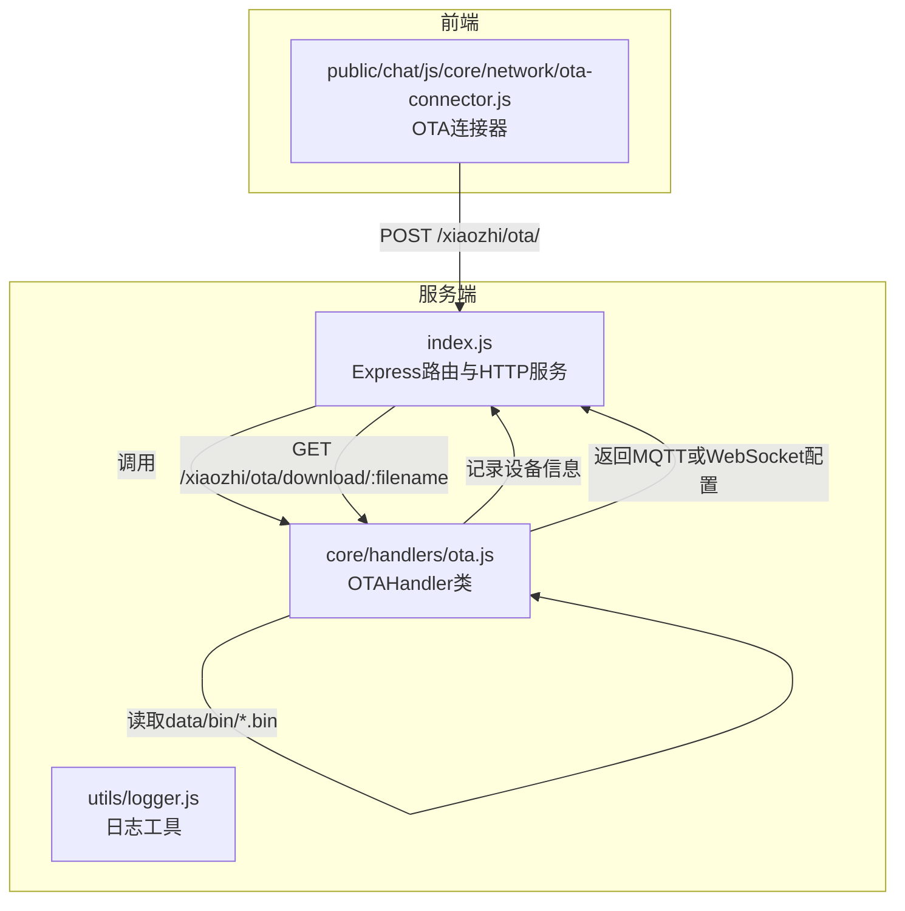
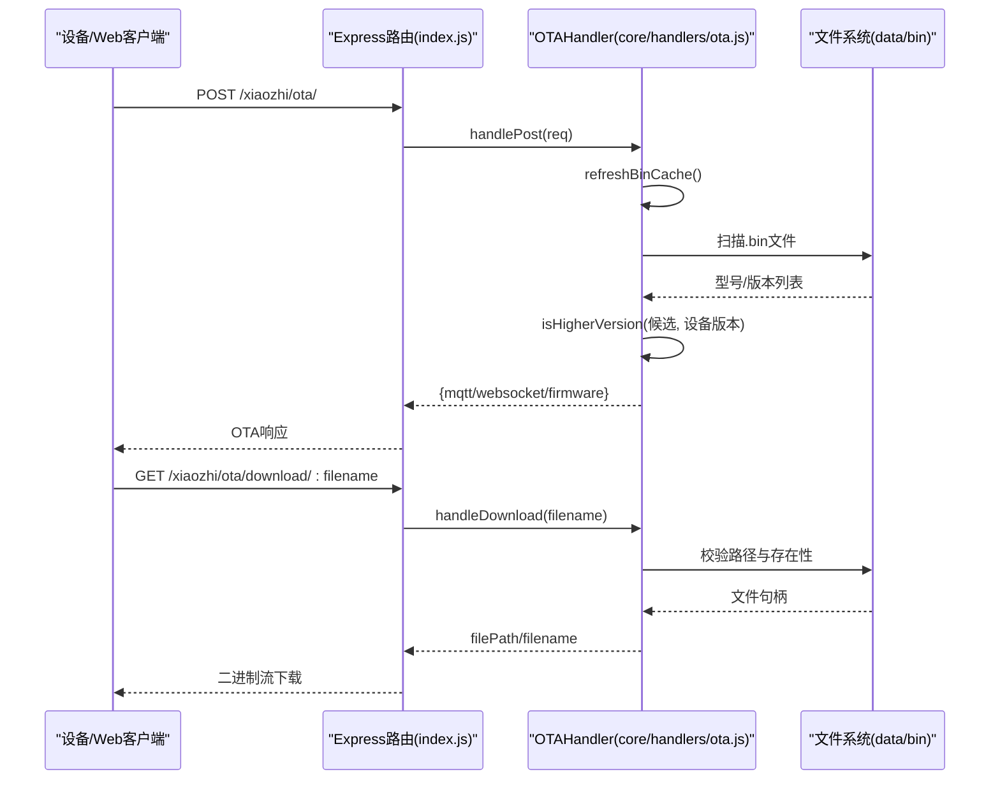
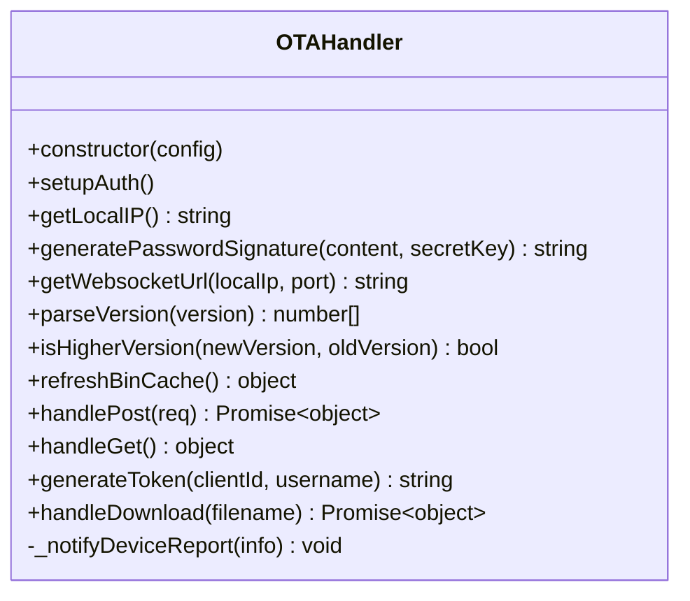
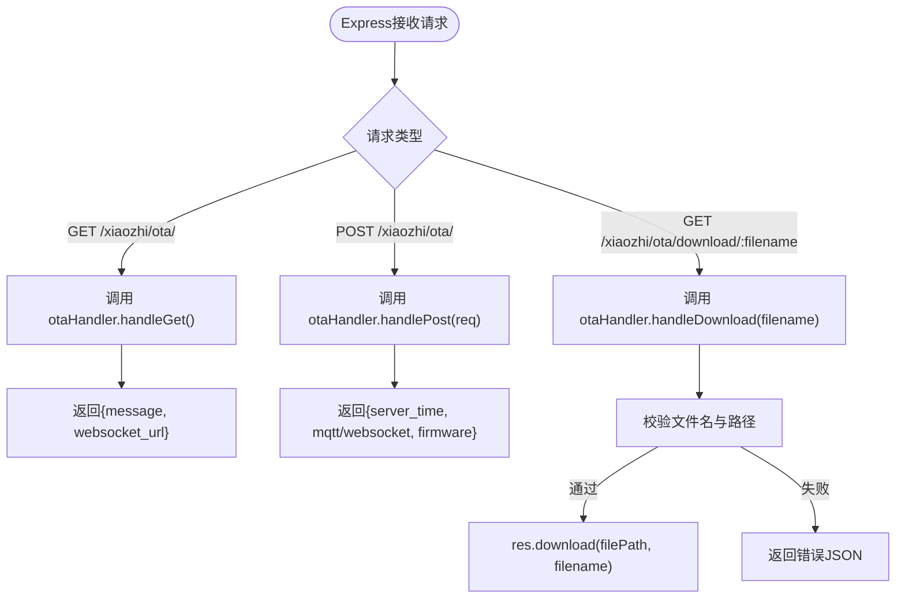
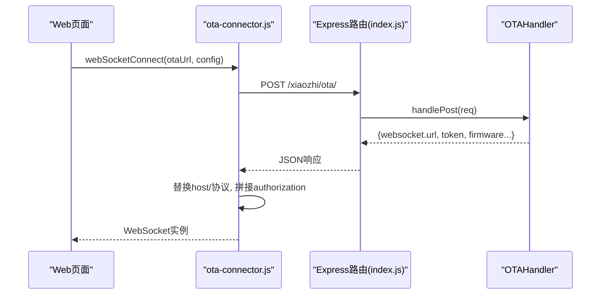
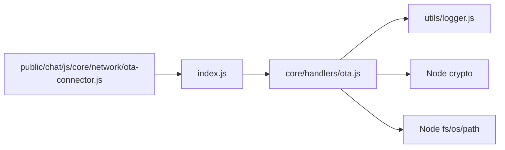
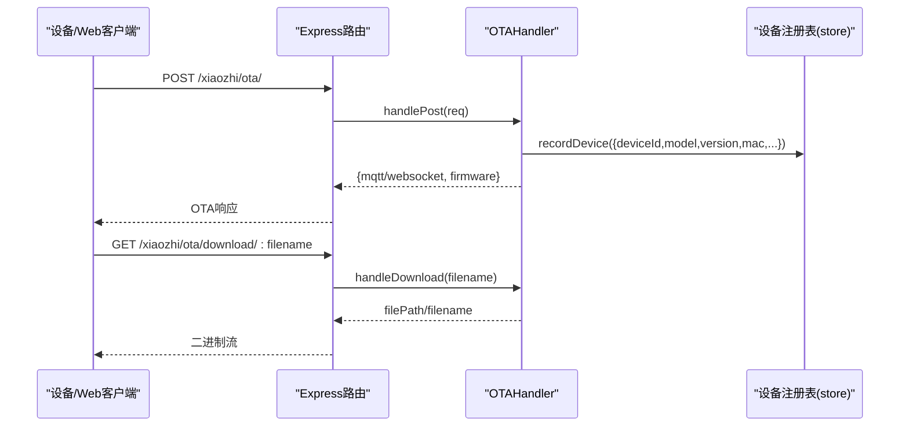
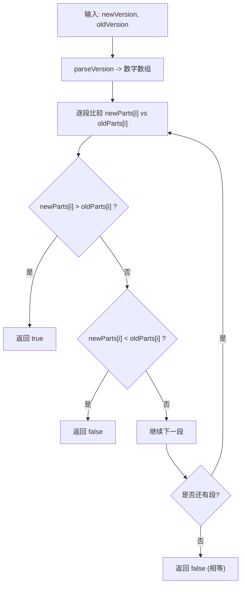

# OTA处理器

<cite>
**本文引用的文件**   
- [core/handlers/ota.js](file://core/handlers/ota.js)
- [index.js](file://index.js)
- [public/chat/js/core/network/ota-connector.js](file://public/chat/js/core/network/ota-connector.js)
</cite>

## 目录
1. [简介](#简介)
2. [项目结构](#项目结构)
3. [核心组件](#核心组件)
4. [架构总览](#架构总览)
5. [详细组件分析](#详细组件分析)
6. [依赖关系分析](#依赖关系分析)
7. [性能与扩展性](#性能与扩展性)
8. [故障排查指南](#故障排查指南)
9. [结论](#结论)
10. [附录：实现示例与最佳实践](#附录实现示例与最佳实践)

## 简介
本文件面向OTA（Over-The-Air）远程固件升级能力，围绕服务器端 OTAHandler 类、Express路由集成以及前端OTA连接器进行系统化说明。文档重点覆盖：
- 固件版本管理与比较算法
- 设备发现与注册上报
- 升级流程控制（检查、下发、下载）
- 安全机制（认证、签名、路径校验）
- 错误恢复策略与可观测性
- 前端连接与鉴权参数拼接

需要特别说明的是：当前仓库未实现断点续传与升级回滚逻辑；这些内容在“扩展建议”中给出工程化方案。

## 项目结构
OTA相关代码主要分布在以下位置：
- 服务端处理逻辑：core/handlers/ota.js
- Express路由与HTTP服务集成：index.js
- 前端OTA连接器（用于Web测试页发起OTA请求并建立WebSocket）：public/chat/js/core/network/ota-connector.js

图表来源
- [index.js:445-487](file://index.js#L445-L487)
- [core/handlers/ota.js:7-394](file://core/handlers/ota.js#L7-L394)
- [public/chat/js/core/network/ota-connector.js:4-72](file://public/chat/js/core/network/ota-connector.js#L4-L72)

章节来源
- [index.js:445-487](file://index.js#L445-L487)
- [core/handlers/ota.js:7-394](file://core/handlers/ota.js#L7-L394)
- [public/chat/js/core/network/ota-connector.js:4-132](file://public/chat/js/core/network/ota-connector.js#L4-L132)

## 核心组件
- OTAHandler：封装OTA协议处理、固件缓存刷新、版本比较、设备注册上报、MQTT/WebSocket配置下发、固件下载安全检查等。
- Express路由集成：将 /xiaozhi/ota 与 /xiaozhi/ota/download/:filename 暴露为HTTP接口，并桥接至 OTAHandler。
- OTA连接器：前端发起OTA请求，解析响应中的WebSocket地址与token，构造最终WS/WSS连接URL。

章节来源
- [core/handlers/ota.js:7-394](file://core/handlers/ota.js#L7-L394)
- [index.js:445-487](file://index.js#L445-L487)
- [public/chat/js/core/network/ota-connector.js:4-132](file://public/chat/js/core/network/ota-connector.js#L4-L132)

## 架构总览
下图展示从设备（或Web测试页）发起OTA到完成固件下载的端到端流程。

图表来源
- [index.js:445-487](file://index.js#L445-L487)
- [core/handlers/ota.js:115-156](file://core/handlers/ota.js#L115-L156)
- [core/handlers/ota.js:277-306](file://core/handlers/ota.js#L277-L306)
- [core/handlers/ota.js:358-391](file://core/handlers/ota.js#L358-L391)

## 详细组件分析

### OTAHandler 类设计
职责边界清晰：
- 配置与安全初始化：auth开关、白名单设备集合、MQTT签名密钥、WebSocket URL生成。
- 设备注册上报：通过 onDeviceReport 回调将设备信息持久化到上层Store。
- 固件缓存与版本比较：按型号分组、排序、比较新版本。
- OTA协议处理：POST请求解析、MQTT/WebSocket配置下发、固件更新判断。
- 固件下载安全：basename过滤、正则校验、路径根目录校验、存在性检查。

图表来源
- [core/handlers/ota.js:7-394](file://core/handlers/ota.js#L7-L394)

章节来源
- [core/handlers/ota.js:7-394](file://core/handlers/ota.js#L7-L394)

#### 关键方法说明
- setupAuth：根据 server.auth.enabled 与 allowed_devices 决定是否启用认证与白名单。
- getLocalIP：获取本机IPv4地址，作为内网访问的默认IP。
- generatePasswordSignature：基于HMAC-SHA256对MQTT用户名内容进行签名。
- getWebsocketUrl：根据是否HTTPS与自定义配置返回ws/wss地址。
- parseVersion/isHigherVersion：语义化版本号解析与比较，支持多段数字比较。
- refreshBinCache：扫描 data/bin 下 .bin 文件，按 {model}_{version}.bin 命名规则解析并按型号分组、降序排列。
- handlePost：解析设备头与body，登记设备，下发MQTT或WebSocket配置，并判断是否需要升级。
- handleGet：健康检查，返回WebSocket URL信息。
- generateToken：基于clientId/username/时间戳与secretKey生成带过期时间的token。
- handleDownload：严格的安全校验后返回可下载的文件路径与文件名。

章节来源
- [core/handlers/ota.js:30-39](file://core/handlers/ota.js#L30-L39)
- [core/handlers/ota.js:44-54](file://core/handlers/ota.js#L44-L54)
- [core/handlers/ota.js:59-68](file://core/handlers/ota.js#L59-L68)
- [core/handlers/ota.js:73-85](file://core/handlers/ota.js#L73-L85)
- [core/handlers/ota.js:90-110](file://core/handlers/ota.js#L90-L110)
- [core/handlers/ota.js:115-156](file://core/handlers/ota.js#L115-L156)
- [core/handlers/ota.js:162-311](file://core/handlers/ota.js#L162-L311)
- [core/handlers/ota.js:316-333](file://core/handlers/ota.js#L316-L333)
- [core/handlers/ota.js:338-353](file://core/handlers/ota.js#L338-L353)
- [core/handlers/ota.js:358-391](file://core/handlers/ota.js#L358-L391)

### Express路由集成
- GET /xiaozhi/ota/：返回OTA接口状态与WebSocket URL。
- POST /xiaozhi/ota/：转发至 OTAHandler.handlePost，统一异常处理。
- GET /xiaozhi/ota/download/:filename：转发至 OTAHandler.handleDownload，使用 res.download 输出二进制流。

图表来源
- [index.js:445-487](file://index.js#L445-L487)
- [core/handlers/ota.js:316-333](file://core/handlers/ota.js#L316-L333)
- [core/handlers/ota.js:358-391](file://core/handlers/ota.js#L358-L391)

章节来源
- [index.js:445-487](file://index.js#L445-L487)

### 前端OTA连接器
- webSocketConnect：发起POST请求获取OTA响应，提取websocket.url与token，替换host与协议(ws/wss)，附加authorization与设备标识参数，返回WebSocket实例。
- sendOTA：构造标准请求体，包含设备信息、板卡信息、分区表占位等，便于后端识别设备属性。

图表来源
- [public/chat/js/core/network/ota-connector.js:4-72](file://public/chat/js/core/network/ota-connector.js#L4-L72)
- [public/chat/js/core/network/ota-connector.js:88-132](file://public/chat/js/core/network/ota-connector.js#L88-L132)
- [index.js:454-465](file://index.js#L454-L465)
- [core/handlers/ota.js:162-311](file://core/handlers/ota.js#L162-L311)

章节来源
- [public/chat/js/core/network/ota-connector.js:4-132](file://public/chat/js/core/network/ota-connector.js#L4-L132)

## 依赖关系分析
- index.js 依赖 OTAHandler 以提供OTA能力，并通过 store.recordDevice 将设备上报信息持久化。
- OTAHandler 依赖 Node内置模块 crypto、fs、os、path 与 utils/logger。
- 前端 ota-connector.js 依赖浏览器fetch与WebSocket API。

图表来源
- [index.js:17-21](file://index.js#L17-L21)
- [index.js:187-191](file://index.js#L187-L191)
- [core/handlers/ota.js:1-5](file://core/handlers/ota.js#L1-L5)
- [public/chat/js/core/network/ota-connector.js:1-2](file://public/chat/js/core/network/ota-connector.js#L1-L2)

章节来源
- [index.js:17-21](file://index.js#L17-L21)
- [index.js:187-191](file://index.js#L187-L191)
- [core/handlers/ota.js:1-5](file://core/handlers/ota.js#L1-L5)
- [public/chat/js/core/network/ota-connector.js:1-2](file://public/chat/js/core/network/ota-connector.js#L1-L2)

## 性能与扩展性
- 固件缓存刷新：每次POST都会扫描 data/bin 目录，若固件数量较大，建议引入内存缓存与增量刷新策略（例如监听目录变更事件）。
- 版本比较：parseVersion/isHigherVersion为线性比较，复杂度O(n)，n为版本号段数，通常很小，性能影响可忽略。
- 下载性能：res.download会直接发送文件流，适合大文件；如需断点续传，需引入Range头支持与分片存储。
- 并发与锁：同一时刻多个设备同时下载不会冲突，但写入data/bin时需注意并发写保护。

[本节为通用指导，不直接分析具体文件]

## 故障排查指南
常见问题与定位要点：
- 无法获取WebSocket URL：检查 index.js 中 /api/websocket/urls 与 /xiaozhi/ota/ 返回结果，确认USE_HTTPS环境变量与端口配置。
- 设备未出现在已知设备列表：确认 OTAHandler._notifyDeviceReport 已绑定 store.recordDevice，且设备ID非空。
- 固件未下发：检查 data/bin 下是否存在符合 {model}_{version}.bin 命名的文件，且版本号高于设备上报版本。
- 下载失败：确认 handleDownload 的路径校验与存在性检查；确保data/bin目录权限正确。
- 认证失败：检查 server.auth.enabled 与 allowed_devices 配置，以及 generateToken 生成的token是否正确拼接到WebSocket URL。

章节来源
- [core/handlers/ota.js:19-28](file://core/handlers/ota.js#L19-L28)
- [core/handlers/ota.js:115-156](file://core/handlers/ota.js#L115-L156)
- [core/handlers/ota.js:358-391](file://core/handlers/ota.js#L358-L391)
- [index.js:445-487](file://index.js#L445-L487)

## 结论
当前OTA处理器实现了设备发现与注册、固件版本检查与比较、MQTT/WebSocket配置下发、安全的固件下载等核心能力。其设计简洁、职责清晰，易于扩展。尚未实现的断点续传与升级回滚可在现有框架上平滑补充，建议优先完善下载进度上报与原子化升级流程，以提升可靠性与用户体验。

[本节为总结性内容，不直接分析具体文件]

## 附录：实现示例与最佳实践

### 设备固件远程升级流程（端到端）
- 设备侧（或Web测试页）向 /xiaozhi/ota/ 发起POST，携带设备标识、型号、版本等信息。
- 服务器端解析请求，登记设备，计算并返回MQTT或WebSocket配置，以及可选的固件下载地址与目标版本。
- 设备侧根据返回的URL下载固件，校验通过后执行烧录与重启。

图表来源
- [index.js:445-487](file://index.js#L445-L487)
- [core/handlers/ota.js:162-311](file://core/handlers/ota.js#L162-L311)
- [core/handlers/ota.js:358-391](file://core/handlers/ota.js#L358-L391)

### 安全性与权限验证
- 认证开关与白名单：通过 server.auth.enabled 与 allowed_devices 控制是否启用认证与设备白名单。
- Token生成：generateToken基于clientId/username/时间戳与secretKey生成，支持过期时间。
- MQTT密码签名：generatePasswordSignature对用户名内容进行HMAC签名，增强MQTT接入安全性。
- 下载路径安全：handleDownload仅允许basename匹配的正则表达式，并校验实际路径位于data/bin目录下，防止路径穿越。

章节来源
- [core/handlers/ota.js:30-39](file://core/handlers/ota.js#L30-L39)
- [core/handlers/ota.js:338-353](file://core/handlers/ota.js#L338-L353)
- [core/handlers/ota.js:59-68](file://core/handlers/ota.js#L59-L68)
- [core/handlers/ota.js:358-391](file://core/handlers/ota.js#L358-L391)

### 版本比较算法
- 解析：parseVersion将字符串版本号拆分为数字数组。
- 比较：isHigherVersion逐段比较，较长版本高位补0，直到所有段比较完毕。
- 应用：refreshBinCache中对候选固件按版本号降序排序，handlePost中遍历选择首个高于设备版本的固件。

图表来源
- [core/handlers/ota.js:90-110](file://core/handlers/ota.js#L90-L110)

### 断点续传与回滚机制（扩展建议）
- 断点续传：
  - 服务端支持Range头，按块返回数据；维护每个设备的下载会话（偏移量、总大小、校验和）。
  - 客户端在断线重连时携带上次偏移量，服务端继续从断点处续传。
- 升级回滚：
  - 双分区A/B设计，升级前备份当前分区元数据。
  - 升级成功后标记新分区为“有效”，重启后验证成功再切换引导；否则回滚至旧分区。
- 进度同步：
  - 通过WebSocket推送下载进度与状态（开始、进行中、完成、失败），便于前端展示与重试。

[本节为概念性扩展建议，不直接分析具体文件]