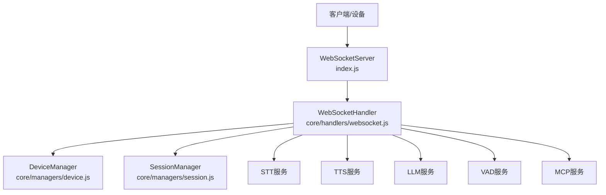
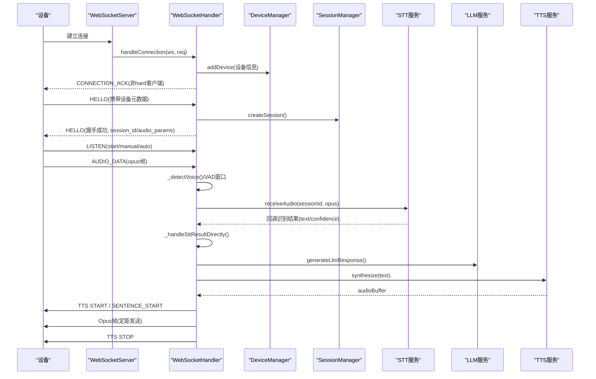
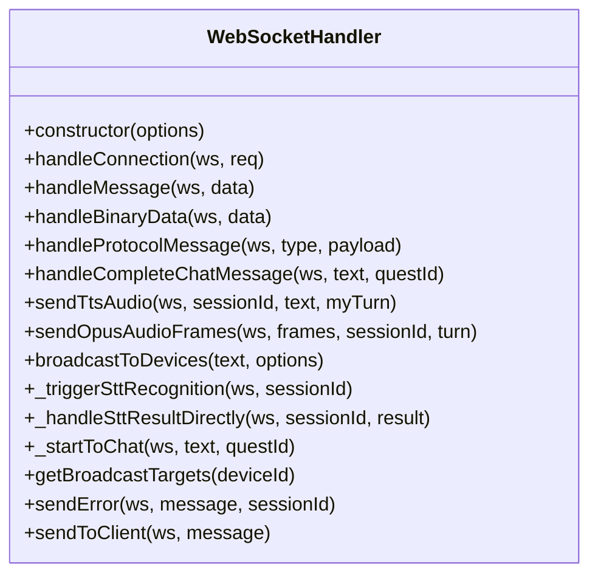
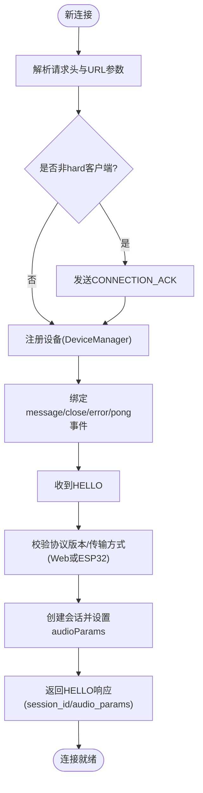
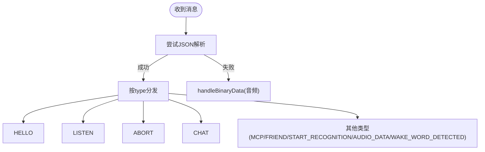
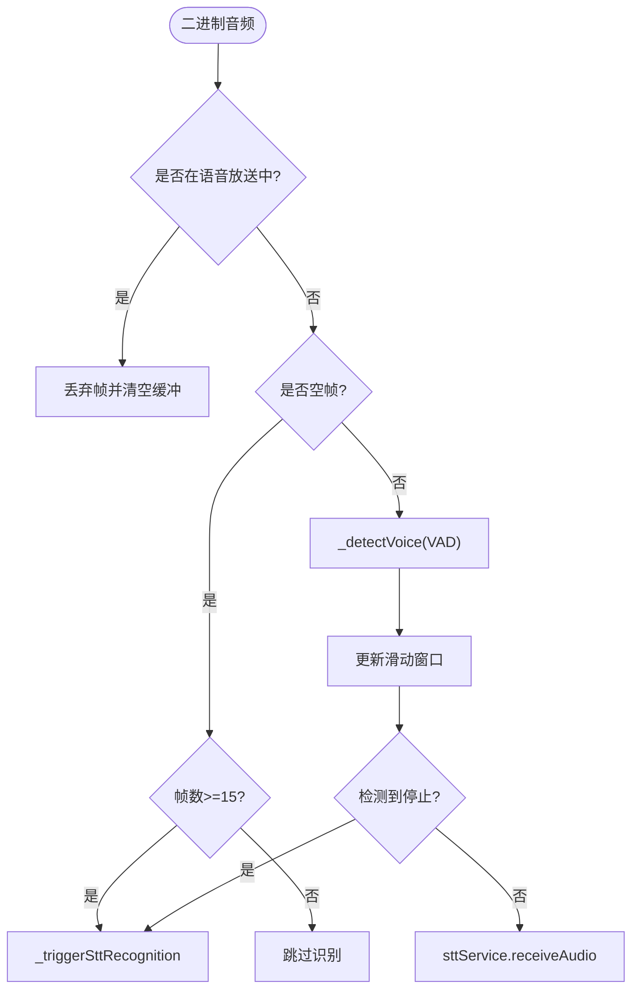
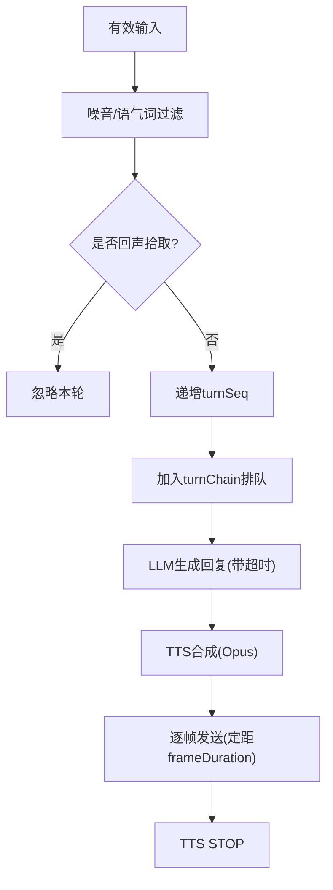
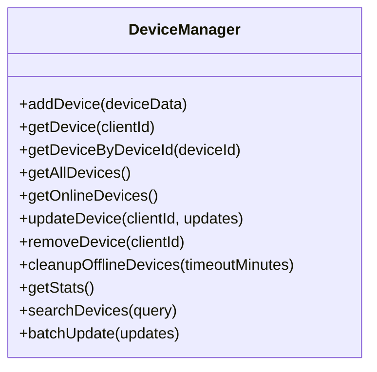
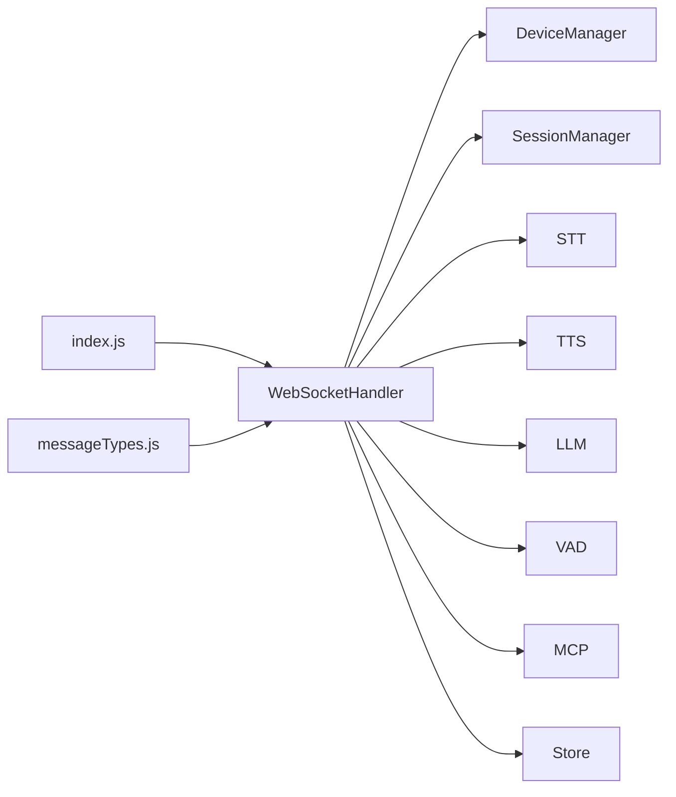

# WebSocket处理器

<cite>
**本文引用的文件**   
- [core/handlers/websocket.js](file://core/handlers/websocket.js)
- [core/constants/messageTypes.js](file://core/constants/messageTypes.js)
- [index.js](file://index.js)
- [core/managers/device.js](file://core/managers/device.js)
- [core/managers/session.js](file://core/managers/session.js)
</cite>

## 目录
1. [简介](#简介)
2. [项目结构](#项目结构)
3. [核心组件](#核心组件)
4. [架构总览](#架构总览)
5. [详细组件分析](#详细组件分析)
6. [依赖关系分析](#依赖关系分析)
7. [性能与稳定性](#性能与稳定性)
8. [故障排查指南](#故障排查指南)
9. [结论](#结论)

## 简介
本文件面向WebSocket处理器的实现，重点围绕 `WebSocketHandler` 类展开，系统说明连接建立、消息路由、事件处理、认证流程、心跳检测、连接池管理、消息协议规范、消息类型定义、格式转换、错误处理策略、重连机制以及连接状态管理。文档同时给出关键流程图和时序图，帮助读者快速理解从设备接入到语音对话的完整链路。

## 项目结构
本项目采用“频道+服务”的组织方式：
- `index.js` 负责启动HTTP/WS服务器、装配服务、注册路由、暴露管理API。
- `core/handlers/websocket.js` 提供 `WebSocketHandler`，集中处理WebSocket连接生命周期、消息解析与分发、音频流处理、TTS播放、会话与设备管理等。
- `core/constants/messageTypes.js` 集中定义客户端与服务端消息类型常量，便于统一维护。
- `core/managers/device.js` 与 `core/managers/session.js` 分别管理在线设备与会话。

**图表来源**
- [index.js:254-281](file://index.js#L254-L281)
- [core/handlers/websocket.js:22-60](file://core/handlers/websocket.js#L22-L60)

**章节来源**
- [index.js:1-120](file://index.js#L1-L120)
- [core/handlers/websocket.js:1-60](file://core/handlers/websocket.js#L1-L60)

## 核心组件
- WebSocketHandler：封装连接管理、消息路由、音频处理、TTS播放、会话与设备管理、广播与员工模式等能力。
- DeviceManager：维护在线设备Map、统计、搜索、批量更新等。
- SessionManager：维护会话生命周期、活动超时清理、按客户端映射会话。
- MessageTypes：集中定义客户端/服务端消息类型、子状态枚举及校验工具函数。

**章节来源**
- [core/handlers/websocket.js:22-60](file://core/handlers/websocket.js#L22-L60)
- [core/managers/device.js:4-41](file://core/managers/device.js#L4-L41)
- [core/managers/session.js:4-45](file://core/managers/session.js#L4-L45)
- [core/constants/messageTypes.js:1-144](file://core/constants/messageTypes.js#L1-L144)

## 架构总览
下图展示一次完整的语音对话流程：设备通过WebSocket连接，握手后进入监听；音频帧经VAD判断停顿后触发STT识别，识别结果进入意图过滤与员工模式分支，最终由LLM生成回复并交由TTS合成Opus帧逐帧推送。

**图表来源**
- [core/handlers/websocket.js:67-169](file://core/handlers/websocket.js#L67-L169)
- [core/handlers/websocket.js:450-513](file://core/handlers/websocket.js#L450-L513)
- [core/handlers/websocket.js:1025-1129](file://core/handlers/websocket.js#L1025-L1129)
- [core/handlers/websocket.js:1853-1969](file://core/handlers/websocket.js#L1853-L1969)

## 详细组件分析

### WebSocketHandler 类概览
- 职责边界
  - 连接生命周期：新建、关闭、错误、心跳。
  - 消息路由：根据消息类型分派到具体处理器。
  - 音频处理：二进制音频流接收、VAD检测、STT触发。
  - 对话流程：LLM调用、TTS合成、Opus帧发送、打断与轮次串行化。
  - 设备与会话：设备注册、会话创建、离线清理。
  - 广播与员工模式：服务端主动播报、数字员工桥接。

- 关键属性与方法（节选）
  - 构造器：注入服务、默认音频阈值、注册STT回调。
  - handleConnection：设置客户端信息、设备注册、消息/关闭/错误/pong监听。
  - handleMessage：JSON解析与二进制分流、消息类型分发。
  - handleProtocolMessage：HELLO/LISTEN/ABORT/IOT/CHAT协议处理。
  - handleCompleteChatMessage：噪音/回声过滤、轮次串行化、LLM/TTS调度。
  - sendTtsAudio：TTS合成、Opus编码、逐帧定时发送、状态控制。
  - broadcastToDevices：多设备并发但单设备串行的语音放送。
  - _triggerSttRecognition：音频有效性检测、STT识别、声纹并行可选。

**图表来源**
- [core/handlers/websocket.js:22-60](file://core/handlers/websocket.js#L22-L60)
- [core/handlers/websocket.js:67-169](file://core/handlers/websocket.js#L67-L169)
- [core/handlers/websocket.js:228-283](file://core/handlers/websocket.js#L228-L283)
- [core/handlers/websocket.js:450-643](file://core/handlers/websocket.js#L450-L643)
- [core/handlers/websocket.js:651-818](file://core/handlers/websocket.js#L651-L818)
- [core/handlers/websocket.js:1025-1189](file://core/handlers/websocket.js#L1025-L1189)
- [core/handlers/websocket.js:1654-1689](file://core/handlers/websocket.js#L1654-L1689)
- [core/handlers/websocket.js:1853-1969](file://core/handlers/websocket.js#L1853-L1969)

**章节来源**
- [core/handlers/websocket.js:22-60](file://core/handlers/websocket.js#L22-L60)
- [core/handlers/websocket.js:67-169](file://core/handlers/websocket.js#L67-L169)
- [core/handlers/websocket.js:228-283](file://core/handlers/websocket.js#L228-L283)
- [core/handlers/websocket.js:450-643](file://core/handlers/websocket.js#L450-L643)
- [core/handlers/websocket.js:651-818](file://core/handlers/websocket.js#L651-L818)
- [core/handlers/websocket.js:1025-1189](file://core/handlers/websocket.js#L1025-L1189)
- [core/handlers/websocket.js:1654-1689](file://core/handlers/websocket.js#L1654-L1689)
- [core/handlers/websocket.js:1853-1969](file://core/handlers/websocket.js#L1853-L1969)

### 连接建立与认证流程
- 连接建立
  - 从请求头提取 clientId、deviceId、clientIp，解析URL参数 client_type、timestamp。
  - 非 hard 客户端发送 CONNECTION_ACK。
  - 将设备信息写入 DeviceManager，必要时持久化设备表。
  - 绑定消息、关闭、错误、pong事件。

- 认证与握手
  - HELLO消息支持两种格式：Web客户端与ESP32设备。
  - 保存设备元信息（device_id/name/mac/token/features），初始化audioParams。
  - 标记 isAuthenticated=true，创建会话并返回 HELLO响应（含session_id/audio_params）。
  - 若设备声明支持MCP，延迟发送MCP初始化消息。

**图表来源**
- [core/handlers/websocket.js:67-169](file://core/handlers/websocket.js#L67-L169)
- [core/handlers/websocket.js:450-513](file://core/handlers/websocket.js#L450-L513)

**章节来源**
- [core/handlers/websocket.js:67-169](file://core/handlers/websocket.js#L67-L169)
- [core/handlers/websocket.js:450-513](file://core/handlers/websocket.js#L450-L513)

### 消息路由与协议处理
- 消息入口
  - handleMessage优先尝试JSON解析；失败则视为二进制音频数据，走handleBinaryData。
  - 根据CLIENT_MESSAGE_TYPES进行分发：hello/listen/abort/iot/chat/mcp/start_recognition/audio_data/wake_word_detected/friend。

- 协议消息
  - HELLO：设备握手，设置设备元信息与audioParams，创建会话，返回握手成功。
  - LISTEN：支持start/stop/detect三种状态，配合mode控制监听模式（auto/manual）。
  - ABORT：中止旧轮音频流，清理会话。
  - IOT：预留IoT控制消息。
  - CHAT：当state=complete时转发STT文本给客户端显示，并根据closeQuest决定是否关闭当前Quest。

**图表来源**
- [core/handlers/websocket.js:228-283](file://core/handlers/websocket.js#L228-L283)
- [core/handlers/websocket.js:450-643](file://core/handlers/websocket.js#L450-L643)

**章节来源**
- [core/handlers/websocket.js:228-283](file://core/handlers/websocket.js#L228-L283)
- [core/handlers/websocket.js:450-643](file://core/handlers/websocket.js#L450-L643)

### 音频处理与VAD检测
- 二进制音频流
  - 在handleBinaryData中，首先屏蔽语音放送期间的麦克风输入，避免回声自打断。
  - 空帧表示录音结束，触发识别（需满足最小帧数阈值）。
  - 使用VAD滑动窗口判断是否有声音，结合静默阈值与最长语音兜底，触发STT识别。
  - 确保会话与STT会话存在，调用sttService.receiveAudio。

- VAD检测
  - 手动模式跳过实时VAD，所有音频缓存。
  - 有VAD服务时优先使用；否则基于PCM能量双阈值+滑动窗口判定。
  - 记录诊断日志辅助调试麦克风输入质量。

**图表来源**
- [core/handlers/websocket.js:289-446](file://core/handlers/websocket.js#L289-L446)
- [core/handlers/websocket.js:2274-2399](file://core/handlers/websocket.js#L2274-L2399)
- [core/handlers/websocket.js:1853-1969](file://core/handlers/websocket.js#L1853-L1969)

**章节来源**
- [core/handlers/websocket.js:289-446](file://core/handlers/websocket.js#L289-L446)
- [core/handlers/websocket.js:2274-2399](file://core/handlers/websocket.js#L2274-L2399)
- [core/handlers/websocket.js:1853-1969](file://core/handlers/websocket.js#L1853-L1969)

### 对话流程与轮次串行化
- 输入过滤
  - 噪音/语气词过滤：短文本或特定语气词直接忽略。
  - 回声拾取判定：与近期正在/刚播放的TTS文本相似度较高则忽略，避免无AEC设备的回声打断。

- 轮次串行化
  - 每轮递增turnSeq，使用Promise链turnChain保证同一连接同一时刻只有一条应答流。
  - 设置轮次超时保护，防止LLM无响应导致队列永久阻塞。
  - 用户打断通过abortUpTo归属机制精准中止旧轮，不影响新轮。

- LLM与TTS
  - 调用LLM生成回复，带超时保护；失败回退默认回复。
  - TTS合成成功后发送TTS状态（start/sentence_start），随后以固定帧时长发送Opus帧，最后发送stop。

**图表来源**
- [core/handlers/websocket.js:651-818](file://core/handlers/websocket.js#L651-L818)
- [core/handlers/websocket.js:933-971](file://core/handlers/websocket.js#L933-L971)
- [core/handlers/websocket.js:1025-1189](file://core/handlers/websocket.js#L1025-L1189)

**章节来源**
- [core/handlers/websocket.js:651-818](file://core/handlers/websocket.js#L651-L818)
- [core/handlers/websocket.js:933-971](file://core/handlers/websocket.js#L933-L971)
- [core/handlers/websocket.js:1025-1189](file://core/handlers/websocket.js#L1025-L1189)

### 心跳检测机制
- 连接级pong监听：ws.on('pong')更新isAlive标志。
- 心跳定时器接口已预留startHeartbeat/stopHeartbeat方法，当前未启用。
- 空闲检测：在音频处理路径中检查长时间空闲，用于say goodbye逻辑（参考注释）。

建议：在生产环境启用周期性ping/pong检测，并在超时后断开不活跃连接，释放资源。

**章节来源**
- [core/handlers/websocket.js:165-168](file://core/handlers/websocket.js#L165-L168)
- [core/handlers/websocket.js:1523-1537](file://core/handlers/websocket.js#L1523-L1537)
- [core/handlers/websocket.js:347-348](file://core/handlers/websocket.js#L347-L348)

### 连接池管理与设备管理
- DeviceManager
  - 维护clientId到DeviceModel的Map，以及deviceId反向索引。
  - 提供添加、查询、更新、移除、统计、搜索、批量更新等方法。
  - 支持最大设备数限制与离线清理。

- 连接池视角
  - WebSocketHandler通过DeviceManager统一管理在线设备连接。
  - 广播功能遍历设备列表，筛选连接打开的目标设备。

**图表来源**
- [core/managers/device.js:4-199](file://core/managers/device.js#L4-L199)

**章节来源**
- [core/managers/device.js:4-199](file://core/managers/device.js#L4-L199)
- [core/handlers/websocket.js:1617-1630](file://core/handlers/websocket.js#L1617-L1630)

### 消息协议规范与类型定义
- 客户端消息类型（部分）
  - hello：设备握手
  - listen：监听控制
  - abort：中断
  - iot：IoT控制
  - chat：聊天消息
  - mcp：MCP协议消息
  - start_recognition：开始识别
  - audio_data：音频数据上传
  - wake_word_detected：唤醒词检测通知
  - friend：好友消息

- 服务端消息类型（部分）
  - connection_ack：连接确认
  - error：错误消息
  - hello：握手响应
  - recognition_started：识别开始确认
  - stt：语音识别结果
  - llm：大语言模型回复
  - tts：文本转语音状态
  - tts_fallback：TTS降级文本
  - tts_disabled：TTS未启用
  - sleep：设备休眠指令
  - audio_received：音频接收确认
  - wake_word_acknowledged：唤醒词确认
  - friend/friend_ack：好友消息转发与确认
  - status/message/user/bot/system：管理与界面消息

- 子状态枚举
  - TTS_STATES：start/sentence_start/playing/stop
  - LISTEN_STATES：start/stop/detect
  - CHAT_STATES：complete/processing/completed

- 工具函数
  - isValidMessageType/isClientMessageType/isServerMessageType：类型校验
  - getMessageTypeName：反向查找类型名

**章节来源**
- [core/constants/messageTypes.js:1-144](file://core/constants/messageTypes.js#L1-L144)

### 消息格式转换与音频编解码
- JSON消息：handleMessage先尝试JSON.parse，失败则走二进制音频处理。
- 二进制音频：
  - 客户端可发送Opus帧；服务端通过audioConverter.mp3ToOpusFrames将TTS合成的MP3转换为Opus帧。
  - 发送Opus帧时使用ws.send(frame)，并按frameDuration定距发送，避免设备缓冲溢出。

- 音频参数
  - audioParams包含format/sampleRate/channels/frameDuration等，默认opus/16000Hz/单声道/60ms帧。

**章节来源**
- [core/handlers/websocket.js:228-236](file://core/handlers/websocket.js#L228-L236)
- [core/handlers/websocket.js:1086-1092](file://core/handlers/websocket.js#L1086-L1092)
- [core/handlers/websocket.js:1139-1189](file://core/handlers/websocket.js#L1139-L1189)
- [core/handlers/websocket.js:486-491](file://core/handlers/websocket.js#L486-L491)

### 错误处理策略与异常恢复
- 连接层
  - ws.on('error')记录错误日志。
  - 设备注册失败时立即断开连接并返回错误。

- 消息层
  - handleMessage捕获JSON解析异常，转为二进制音频处理。
  - 各处理器内try/catch包裹业务逻辑，统一通过sendError返回错误消息。

- 音频与识别
  - STT服务回调_handleSttError向客户端发送错误。
  - TTS合成失败时发送tts_fallback文本作为降级。

- 超时保护
  - LLM调用与轮次处理均设置超时，避免挂死。

**章节来源**
- [core/handlers/websocket.js:160-163](file://core/handlers/websocket.js#L160-L163)
- [core/handlers/websocket.js:135-141](file://core/handlers/websocket.js#L135-L141)
- [core/handlers/websocket.js:228-236](file://core/handlers/websocket.js#L228-L236)
- [core/handlers/websocket.js:1510-1521](file://core/handlers/websocket.js#L1510-L1521)
- [core/handlers/websocket.js:1104-1115](file://core/handlers/websocket.js#L1104-L1115)
- [core/handlers/websocket.js:942-950](file://core/handlers/websocket.js#L942-L950)
- [core/handlers/websocket.js:679-693](file://core/handlers/websocket.js#L679-L693)

### 重连机制与连接状态管理
- 重连机制
  - 服务端未实现自动重连逻辑；重连应由客户端实现。
  - 建议在客户端实现指数退避重试、断线检测与状态同步。

- 连接状态
  - ws.isAlive：pong更新。
  - ws.isAuthenticated：握手成功后置true。
  - ws.sessionId：会话ID。
  - ws.clientIsSpeaking：TTS播放中标记，影响VAD打断判断。
  - ws.broadcastActive/broadcastIgnoreUntil：语音放送期间静音闸门。
  - ws.turnSeq/turnChain/abortUpTo：轮次串行化与打断归属。

**章节来源**
- [core/handlers/websocket.js:84-86](file://core/handlers/websocket.js#L84-L86)
- [core/handlers/websocket.js:165-168](file://core/handlers/websocket.js#L165-L168)
- [core/handlers/websocket.js:1025-1129](file://core/handlers/websocket.js#L1025-L1129)
- [core/handlers/websocket.js:1654-1689](file://core/handlers/websocket.js#L1654-L1689)
- [core/handlers/websocket.js:674-693](file://core/handlers/websocket.js#L674-L693)

### 代码示例与用法指引
- 处理设备握手（HELLO）
  - 参考路径：[core/handlers/websocket.js:450-513](file://core/handlers/websocket.js#L450-L513)
  - 要点：校验协议版本、保存设备元信息、创建会话、返回握手响应。

- 处理监听控制（LISTEN）
  - 参考路径：[core/handlers/websocket.js:515-590](file://core/handlers/websocket.js#L515-L590)
  - 要点：支持start/stop/detect状态，配合mode控制监听模式。

- 处理音频数据（AUDIO_DATA）
  - 参考路径：[core/handlers/websocket.js:289-446](file://core/handlers/websocket.js#L289-L446)
  - 要点：VAD检测、会话与STT会话管理、触发识别。

- 处理完整聊天消息（CHAT）
  - 参考路径：[core/handlers/websocket.js:615-638](file://core/handlers/websocket.js#L615-L638)
  - 要点：转发STT文本、Quest管理、进入对话流程。

- 发送TTS音频（TTS）
  - 参考路径：[core/handlers/websocket.js:1025-1189](file://core/handlers/websocket.js#L1025-L1189)
  - 要点：TTS合成、Opus编码、逐帧发送、状态控制。

- 广播语音（服务端主动播报）
  - 参考路径：[core/handlers/websocket.js:1654-1689](file://core/handlers/websocket.js#L1654-L1689)
  - 要点：目标设备筛选、轮次串行化、放送静音闸门。

**章节来源**
- [core/handlers/websocket.js:450-513](file://core/handlers/websocket.js#L450-L513)
- [core/handlers/websocket.js:515-590](file://core/handlers/websocket.js#L515-L590)
- [core/handlers/websocket.js:289-446](file://core/handlers/websocket.js#L289-L446)
- [core/handlers/websocket.js:615-638](file://core/handlers/websocket.js#L615-L638)
- [core/handlers/websocket.js:1025-1189](file://core/handlers/websocket.js#L1025-L1189)
- [core/handlers/websocket.js:1654-1689](file://core/handlers/websocket.js#L1654-L1689)

## 依赖关系分析
- WebSocketHandler依赖
  - DeviceManager：设备注册、查询、统计。
  - SessionManager：会话创建、关闭、活动管理。
  - STT/TTS/LLM/VAD/MCP服务：语音识别、文本转语音、大语言模型、语音活动检测、MCP工具。
  - Store：设备注册表与对话记录持久化。

- 外部集成点
  - index.js：装配服务、创建WebSocketServer、注册路由与管理API。
  - messageTypes.js：消息类型常量与校验工具。

**图表来源**
- [index.js:235-249](file://index.js#L235-L249)
- [core/handlers/websocket.js:22-60](file://core/handlers/websocket.js#L22-L60)
- [core/constants/messageTypes.js:1-144](file://core/constants/messageTypes.js#L1-L144)

**章节来源**
- [index.js:235-249](file://index.js#L235-L249)
- [core/handlers/websocket.js:22-60](file://core/handlers/websocket.js#L22-L60)
- [core/constants/messageTypes.js:1-144](file://core/constants/messageTypes.js#L1-L144)

## 性能与稳定性
- 音频帧发送
  - 使用固定frameDuration（默认60ms）逐帧发送，避免设备缓冲溢出与颤音。
  - 在TTS合成前检查轮次是否被接管，避免无效合成。

- 轮次串行化与超时
  - turnChain保证同一连接同一时刻仅一条应答流，杜绝Opus帧交错。
  - 轮次与LLM调用均设置超时，防止长尾阻塞。

- VAD与噪声抑制
  - 双阈值+滑动窗口降低误判；空帧与最小帧数阈值避免碎片识别。
  - 语音放送期间屏蔽麦克风输入，减少回声干扰。

- 资源清理
  - 连接关闭时清理设备注册、会话、MCP设备断开处理。
  - 会话管理器具备过期清理能力。

**章节来源**
- [core/handlers/websocket.js:1139-1189](file://core/handlers/websocket.js#L1139-L1189)
- [core/handlers/websocket.js:679-693](file://core/handlers/websocket.js#L679-L693)
- [core/handlers/websocket.js:289-446](file://core/handlers/websocket.js#L289-L446)
- [core/handlers/websocket.js:174-193](file://core/handlers/websocket.js#L174-L193)
- [core/managers/session.js:117-138](file://core/managers/session.js#L117-L138)

## 故障排查指南
- 常见问题定位
  - 无法握手：检查HELLO消息格式与协议版本/传输方式校验。
  - 无识别结果：检查VAD阈值、静默阈值、最小帧数阈值与音频有效性。
  - 音频卡顿或颤音：检查frameDuration配置与设备解码能力。
  - 回声打断：确认broadcastActive与echo判定逻辑，必要时调整阈值。
  - LLM无响应：检查超时配置与后端可用性。

- 诊断日志
  - 麦克风诊断：首次Opus包长度与RMS能量统计。
  - 振幅分析：最大/平均振幅与有效性判定。
  - 设备注册与连接状态日志。

- 管理API
  - /health：健康检查。
  - /api/settings/audio：读取与热更新音频阈值。
  - /api/disconnect：断开指定设备。
  - /api/devices、/api/devices/stats、/api/conversations：设备与对话统计。

**章节来源**
- [core/handlers/websocket.js:2274-2399](file://core/handlers/websocket.js#L2274-L2399)
- [core/handlers/websocket.js:1893-1902](file://core/handlers/websocket.js#L1893-L1902)
- [index.js:287-488](file://index.js#L287-L488)

## 结论
WebSocketHandler在本项目中承担连接管理、消息路由、音频处理与对话编排的核心职责。通过严格的协议校验、VAD检测、轮次串行化与超时保护，系统在复杂环境下仍能保持稳定的语音交互体验。建议在生产环境中启用心跳检测、完善客户端重连策略，并结合管理API进行运行时调优与监控。