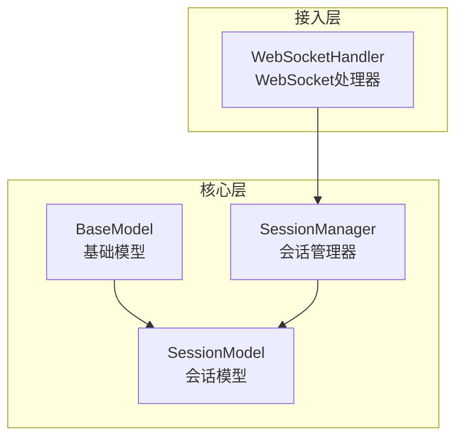
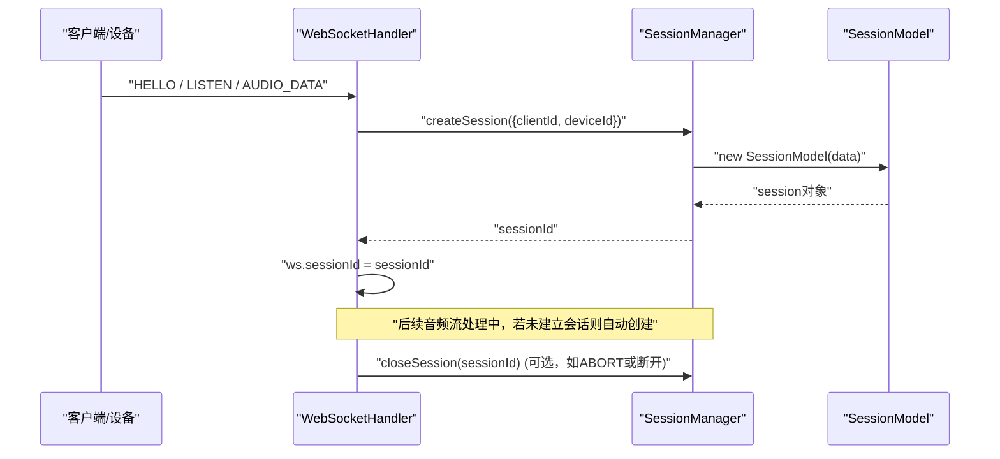
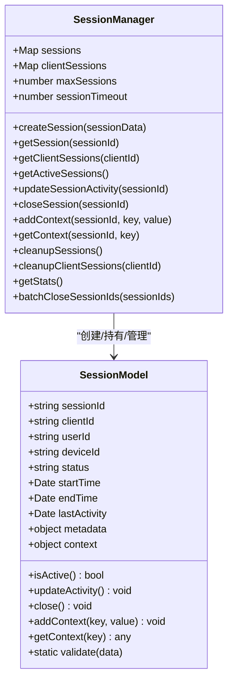
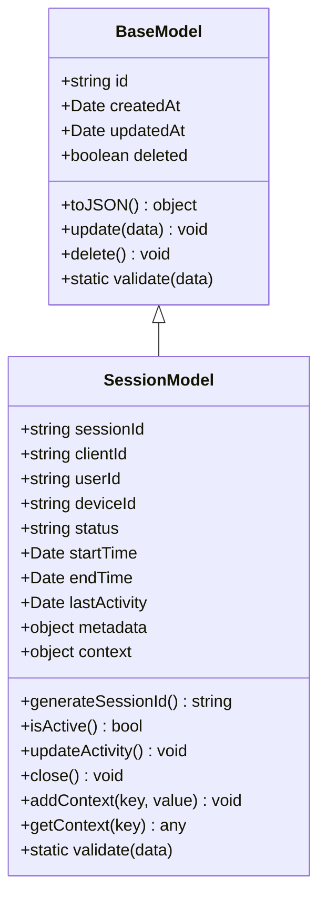
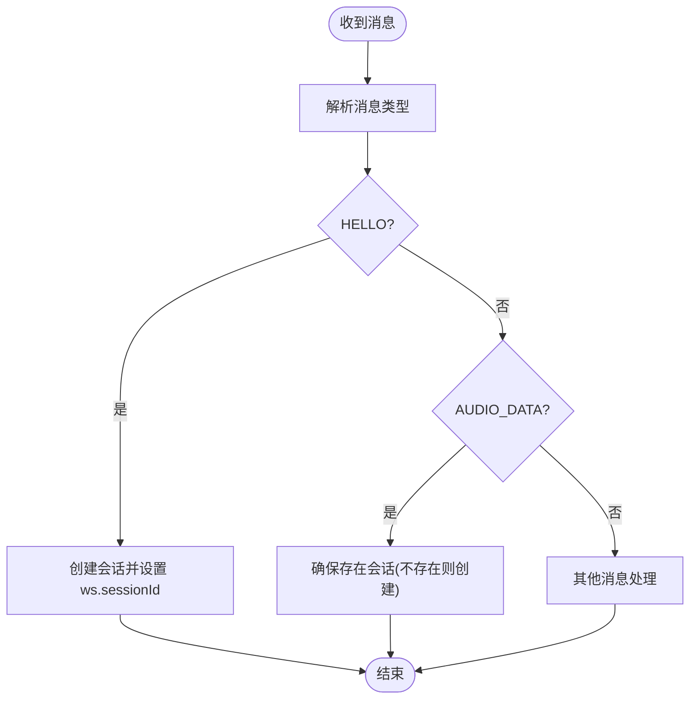
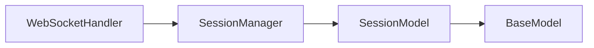
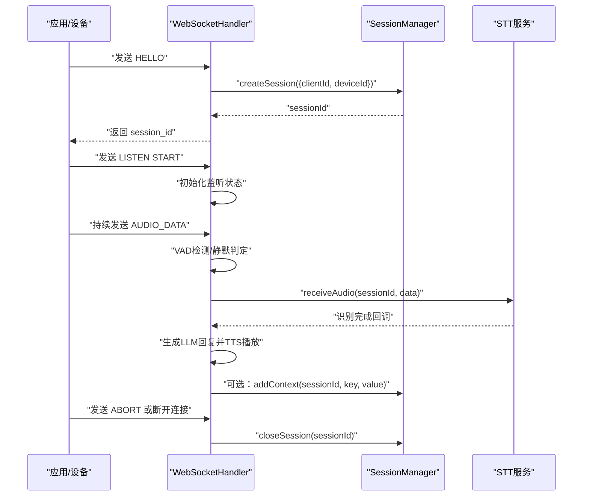

# 会话管理器

<cite>
**本文引用的文件**   
- [core/managers/session.js](file://core/managers/session.js)
- [core/models/session.js](file://core/models/session.js)
- [core/models/base.js](file://core/models/base.js)
- [core/handlers/websocket.js](file://core/handlers/websocket.js)
</cite>

## 目录
1. [简介](#简介)
2. [项目结构](#项目结构)
3. [核心组件](#核心组件)
4. [架构总览](#架构总览)
5. [详细组件分析](#详细组件分析)
6. [依赖关系分析](#依赖关系分析)
7. [性能与并发特性](#性能与并发特性)
8. [故障排查指南](#故障排查指南)
9. [结论](#结论)
10. [附录：使用示例与最佳实践](#附录使用示例与最佳实践)

## 简介
本文件围绕“会话管理器”展开，系统性解析 SessionManager 类及其关联的 SessionModel、WebSocket 处理器之间的协作关系。重点覆盖以下主题：
- 会话创建、状态维护与上下文管理
- 会话生命周期（初始化、活跃跟踪、超时处理、资源清理）
- 会话与设备的关联关系、对话历史存储与上下文保持机制
- 数据模型设计、内存管理与并发安全考量
- 语音对话场景下的会话创建与管理流程

## 项目结构
与会话管理相关的代码主要分布在以下模块：
- core/managers/session.js：SessionManager 实现，负责会话的创建、查询、关闭、上下文存取、统计与批量清理等
- core/models/session.js：SessionModel 数据模型，封装会话属性、状态机、活动更新、上下文存取与校验
- core/models/base.js：基础模型基类，提供通用字段与序列化能力
- core/handlers/websocket.js：WebSocket 处理器，负责连接建立、消息路由、音频流处理，并在关键路径中调用 SessionManager 完成会话创建与关闭

**图表来源**
- [core/managers/session.js:1-190](file://core/managers/session.js#L1-L190)
- [core/models/session.js:1-82](file://core/models/session.js#L1-L82)
- [core/models/base.js:1-43](file://core/models/base.js#L1-L43)
- [core/handlers/websocket.js:22-60](file://core/handlers/websocket.js#L22-L60)

**章节来源**
- [core/managers/session.js:1-190](file://core/managers/session.js#L1-L190)
- [core/models/session.js:1-82](file://core/models/session.js#L1-L82)
- [core/models/base.js:1-43](file://core/models/base.js#L1-L43)
- [core/handlers/websocket.js:22-60](file://core/handlers/websocket.js#L22-L60)

## 核心组件
- SessionManager：会话生命周期与资源管理的入口，提供创建、获取、关闭、上下文存取、统计与批量清理等方法
- SessionModel：会话实体，包含会话ID、客户端/设备标识、状态、时间戳、元数据与上下文等字段，并提供活跃性判断、活动更新、关闭、上下文读写与数据校验
- WebSocketHandler：在握手、音频流、协议消息等关键路径中调用 SessionManager，完成会话的自动创建与关闭

**章节来源**
- [core/managers/session.js:4-188](file://core/managers/session.js#L4-L188)
- [core/models/session.js:3-79](file://core/models/session.js#L3-L79)
- [core/handlers/websocket.js:22-60](file://core/handlers/websocket.js#L22-L60)

## 架构总览
下图展示 WebSocket 接入层与 SessionManager 的交互关系，以及会话在语音对话中的生命周期流转。

**图表来源**
- [core/handlers/websocket.js:493-503](file://core/handlers/websocket.js#L493-L503)
- [core/handlers/websocket.js:354-360](file://core/handlers/websocket.js#L354-L360)
- [core/handlers/websocket.js:600-607](file://core/handlers/websocket.js#L600-L607)
- [core/managers/session.js:13-45](file://core/managers/session.js#L13-L45)
- [core/models/session.js:3-16](file://core/models/session.js#L3-L16)

## 详细组件分析

### SessionManager 类
职责与关键点：
- 会话容器：使用 Map 维护 sessionId -> SessionModel 映射，并使用 clientId -> sessionIds[] 反向索引
- 会话上限与过期清理：支持最大会话数限制；当达到上限时尝试清理过期会话；定时或按需清理过期会话
- 活跃性维护：getSession/updateSessionActivity 会更新 lastActivity，结合 SessionModel.isActive() 判定是否活跃
- 上下文管理：addContext/getContext 委托给 SessionModel 的 context 字典
- 统计与批量操作：getStats 返回活跃会话数、客户端数等；batchCloseSessionIds 批量关闭并汇总结果

**图表来源**
- [core/managers/session.js:4-188](file://core/managers/session.js#L4-L188)
- [core/models/session.js:3-79](file://core/models/session.js#L3-L79)

**章节来源**
- [core/managers/session.js:4-188](file://core/managers/session.js#L4-L188)

### SessionModel 类
职责与关键点：
- 会话标识与归属：sessionId、clientId、userId、deviceId
- 状态机：status 为 active/inactive/closed；isActive() 基于状态与 lastActivity 计算活跃性（默认5分钟）
- 活动时间：updateActivity() 刷新 lastActivity 与 updatedAt
- 上下文：context 键值对用于保存对话上下文
- 数据校验：validate() 校验必填字段与状态枚举

**图表来源**
- [core/models/base.js:2-40](file://core/models/base.js#L2-L40)
- [core/models/session.js:3-79](file://core/models/session.js#L3-L79)

**章节来源**
- [core/models/session.js:3-79](file://core/models/session.js#L3-L79)
- [core/models/base.js:2-40](file://core/models/base.js#L2-L40)

### WebSocket 处理器中的会话集成
关键集成点：
- HELLO 握手成功后立即创建会话，并将 sessionId 写入 ws.sessionId
- 二进制音频数据处理时，若未建立会话则自动创建
- ABORT 或连接断开时，关闭对应会话并清理相关服务状态

**图表来源**
- [core/handlers/websocket.js:493-503](file://core/handlers/websocket.js#L493-L503)
- [core/handlers/websocket.js:354-360](file://core/handlers/websocket.js#L354-L360)

**章节来源**
- [core/handlers/websocket.js:493-503](file://core/handlers/websocket.js#L493-L503)
- [core/handlers/websocket.js:354-360](file://core/handlers/websocket.js#L354-L360)

## 依赖关系分析
- SessionManager 依赖 SessionModel 进行会话实体的构建与行为封装
- WebSocketHandler 依赖 SessionManager 完成会话的创建与关闭
- SessionModel 继承 BaseModel，复用通用字段与序列化逻辑

**图表来源**
- [core/handlers/websocket.js:22-60](file://core/handlers/websocket.js#L22-L60)
- [core/managers/session.js:1-190](file://core/managers/session.js#L1-L190)
- [core/models/session.js:1-82](file://core/models/session.js#L1-L82)
- [core/models/base.js:1-43](file://core/models/base.js#L1-L43)

**章节来源**
- [core/handlers/websocket.js:22-60](file://core/handlers/websocket.js#L22-L60)
- [core/managers/session.js:1-190](file://core/managers/session.js#L1-L190)
- [core/models/session.js:1-82](file://core/models/session.js#L1-L82)
- [core/models/base.js:1-43](file://core/models/base.js#L1-L43)

## 性能与并发特性
- 数据结构选择：使用 Map 作为会话容器，O(1) 查找与插入；clientSessions 反向索引提升按客户端查询效率
- 活跃性判定：isActive() 基于 lastActivity 与固定阈值（默认5分钟），避免频繁 I/O
- 会话上限与清理：当达到 maxSessions 时触发 cleanupExpiredSessions，减少内存占用
- 并发安全：当前实现未引入显式锁或队列保护，依赖 Node.js 单线程事件循环；在高并发下建议：
  - 将热点会话访问（如 updateActivity）合并为批处理
  - 对 closeSession 等写操作增加幂等性与重试策略
  - 如需跨进程共享会话状态，需引入外部存储（Redis 等）与分布式锁

[本节为通用指导，不直接分析具体文件]

## 故障排查指南
常见问题与定位要点：
- 会话无法创建
  - 检查 SessionModel.validate 是否通过（clientId 必填、status 枚举合法）
  - 查看日志中“会话数量已达上限”提示，确认是否需要扩容或调整清理策略
- 会话过早失效
  - 检查 isActive() 的时间阈值与 lastActivity 更新频率
  - 确认 WebSocketHandler 是否在关键路径中调用 updateSessionActivity 或 getSession（内部会更新活动）
- 上下文丢失
  - 确认 addContext/getContext 使用的 sessionId 是否正确
  - 检查会话是否被意外关闭或清理
- 内存增长
  - 定期调用 cleanupSessions 或 cleanupClientSessions
  - 监控 getStats 指标，关注 total/active/clients 变化趋势

**章节来源**
- [core/models/session.js:63-79](file://core/models/session.js#L63-L79)
- [core/managers/session.js:117-154](file://core/managers/session.js#L117-L154)
- [core/managers/session.js:156-167](file://core/managers/session.js#L156-L167)

## 结论
SessionManager 提供了简洁而健壮的会话管理能力，配合 SessionModel 的状态机与上下文机制，能够支撑语音对话场景下的会话创建、活跃跟踪、超时清理与上下文保持。WebSocketHandler 在握手与音频流处理的关键路径中无缝集成会话管理，形成从接入到业务处理的完整闭环。建议在大规模部署时补充并发保护与外部持久化方案，以进一步提升稳定性与可观测性。

[本节为总结性内容，不直接分析具体文件]

## 附录：使用示例与最佳实践

### 语音对话会话创建与管理流程（概念示例）
说明：以下为概念性步骤，不涉及具体代码片段，仅描述调用顺序与注意事项。

**图表来源**
- [core/handlers/websocket.js:493-503](file://core/handlers/websocket.js#L493-L503)
- [core/handlers/websocket.js:354-360](file://core/handlers/websocket.js#L354-L360)
- [core/handlers/websocket.js:600-607](file://core/handlers/websocket.js#L600-L607)
- [core/managers/session.js:13-45](file://core/managers/session.js#L13-L45)

### 最佳实践清单
- 在握手成功后立即创建会话，避免后续分支重复创建
- 在音频流处理中确保会话存在，必要时自动创建
- 定期调用 cleanupSessions 清理过期会话，控制内存占用
- 使用 addContext 保存关键上下文（如用户偏好、设备信息），在后续轮次中读取
- 在 ABORT 或连接断开时主动关闭会话，释放资源
- 监控 getStats 指标，评估系统负载与异常增长

[本节为通用指导，不直接分析具体文件]