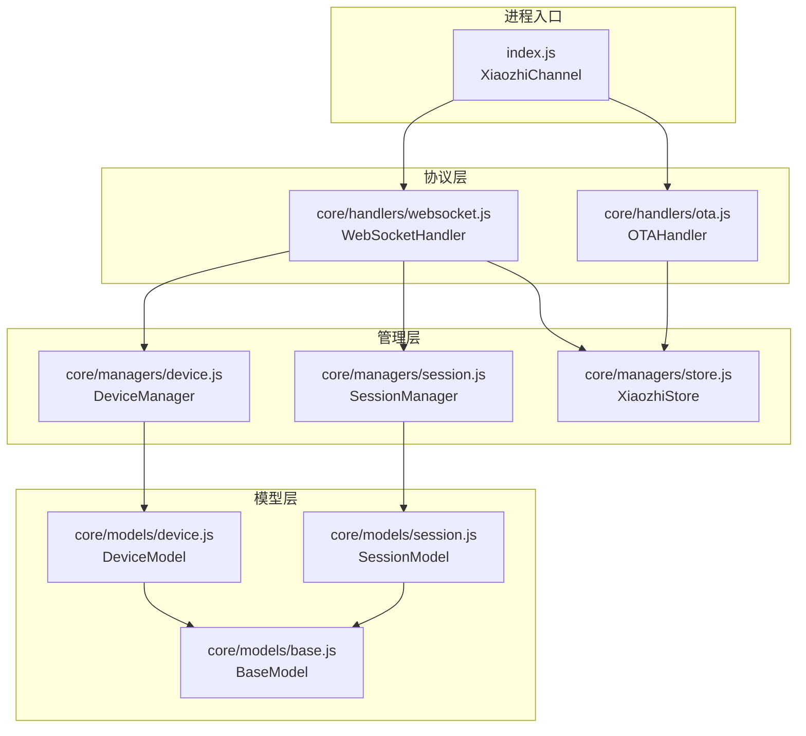
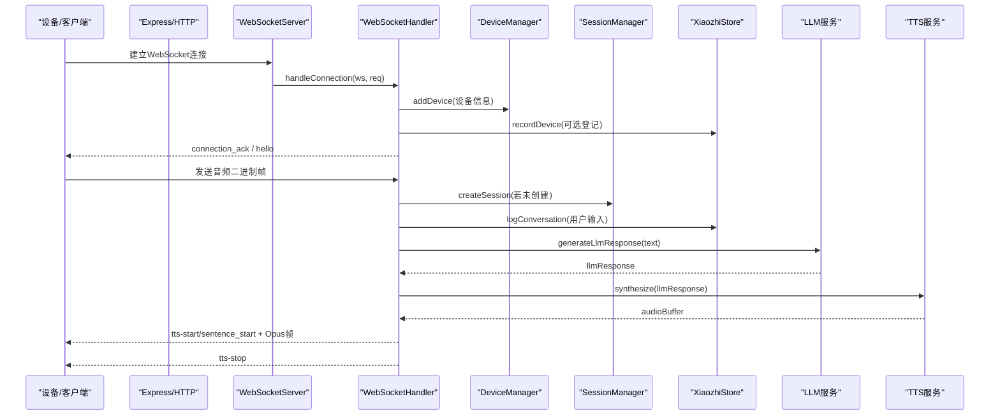
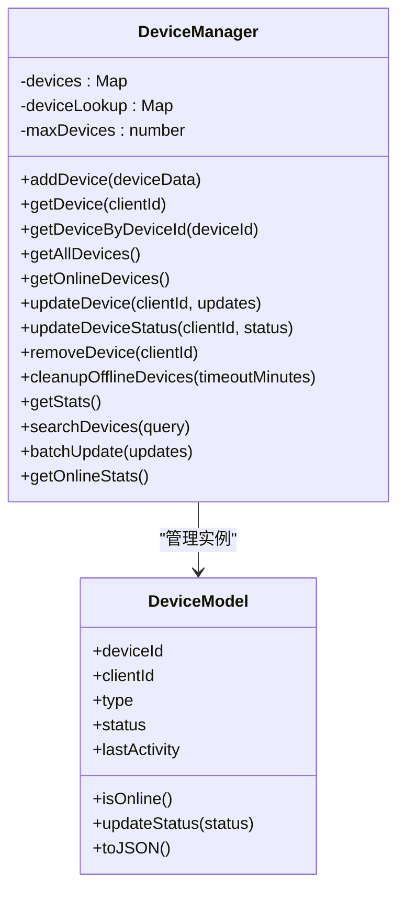
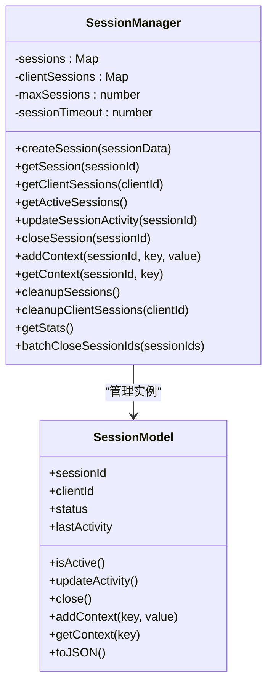
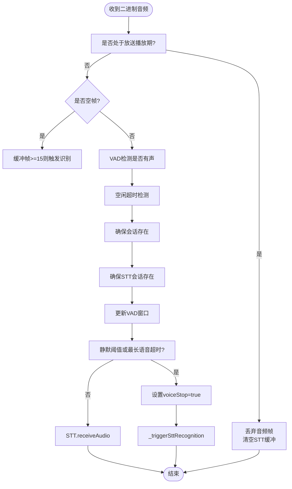
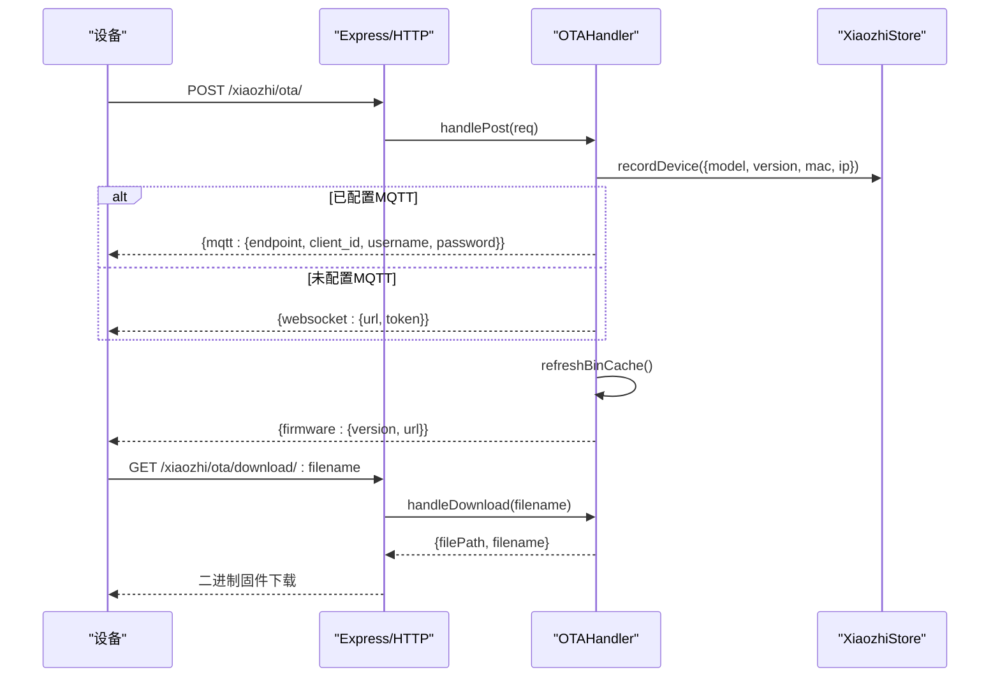
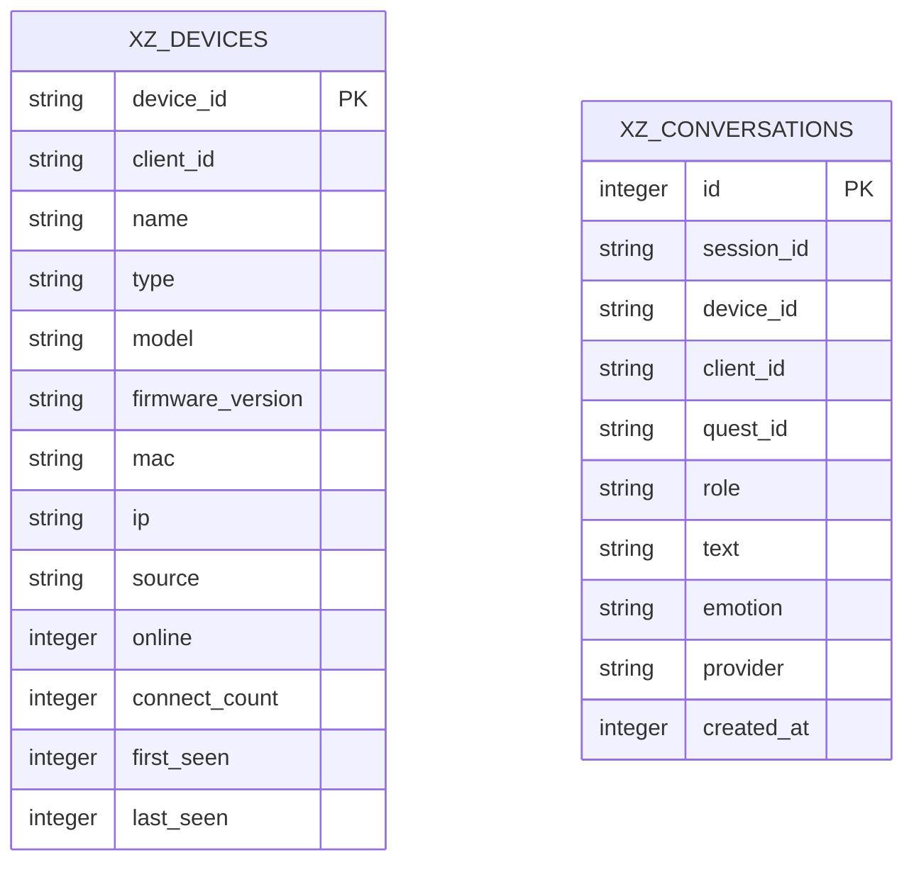
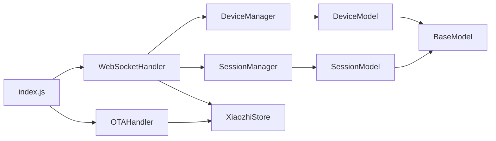

# 组件设计

<cite>
**本文引用的文件**   
- [index.js](file://index.js)
- [core/handlers/websocket.js](file://core/handlers/websocket.js)
- [core/handlers/ota.js](file://core/handlers/ota.js)
- [core/managers/device.js](file://core/managers/device.js)
- [core/managers/session.js](file://core/managers/session.js)
- [core/managers/store.js](file://core/managers/store.js)
- [core/models/base.js](file://core/models/base.js)
- [core/models/device.js](file://core/models/device.js)
- [core/models/session.js](file://core/models/session.js)
- [core/constants/messageTypes.js](file://core/constants/messageTypes.js)
</cite>

## 目录
1. [引言](#引言)
2. [项目结构](#项目结构)
3. [核心组件](#核心组件)
4. [架构总览](#架构总览)
5. [详细组件分析](#详细组件分析)
6. [依赖关系分析](#依赖关系分析)
7. [性能与可靠性考量](#性能与可靠性考量)
8. [故障排查指南](#故障排查指南)
9. [结论](#结论)

## 引言
本文件面向开发者，系统化梳理小智语音交互频道的组件设计。重点覆盖以下关键组件的职责、接口、状态与生命周期管理：设备管理器 DeviceManager、会话管理器 SessionManager、WebSocket 处理器 WebSocketHandler、OTA 处理器 OTAHandler，以及持久化 Store XiaozhiStore。文档同时给出组件关系图与关键交互时序图，帮助理解系统如何从设备接入、音频流处理、LLM/TTS 对话到固件升级的完整链路。

## 项目结构
仓库采用按职责分层组织：
- index.js：频道入口，负责服务装配、Express/HTTP/WebSocket 启动、API 路由、与消息总线集成。
- core/handlers：协议与业务处理器（WebSocket、OTA）。
- core/managers：领域管理器（设备、会话、存储）。
- core/models：数据模型（基础模型、设备、会话）。
- core/services：外部能力服务（LLM、TTS、STT、VAD、Voiceprint、MCP 等）。
- core/constants：消息类型常量。
- public/studio/utils：前端与工具代码（不在本次组件设计范围）。

**图表来源**
- [index.js:44-282](file://index.js#L44-L282)
- [core/handlers/websocket.js:22-60](file://core/handlers/websocket.js#L22-L60)
- [core/handlers/ota.js:7-16](file://core/handlers/ota.js#L7-L16)
- [core/managers/device.js:4-9](file://core/managers/device.js#L4-L9)
- [core/managers/session.js:4-10](file://core/managers/session.js#L4-L10)
- [core/managers/store.js:29-35](file://core/managers/store.js#L29-L35)
- [core/models/base.js:2-8](file://core/models/base.js#L2-L8)
- [core/models/device.js:3-22](file://core/models/device.js#L3-L22)
- [core/models/session.js:3-16](file://core/models/session.js#L3-L16)

**章节来源**
- [index.js:44-282](file://index.js#L44-L282)

## 核心组件
本节概述各组件的职责边界与对外能力。

- DeviceManager：维护在线设备映射、设备查找、统计、离线清理与批量更新。
- SessionManager：维护会话生命周期、活跃会话查询、上下文存取、过期清理。
- WebSocketHandler：连接管理、协议解析、音频流处理、VAD/STT/TTS/LLM 协作、广播与设备间通信、心跳与断开清理。
- OTAHandler：设备上报登记、MQTT/WS 配置下发、固件版本比较与下载。
- XiaozhiStore：设备注册表与会话记录持久化，提供列表、统计与降级 no-op。

**章节来源**
- [core/managers/device.js:4-199](file://core/managers/device.js#L4-L199)
- [core/managers/session.js:4-188](file://core/managers/session.js#L4-L188)
- [core/handlers/websocket.js:22-60](file://core/handlers/websocket.js#L22-L60)
- [core/handlers/ota.js:7-16](file://core/handlers/ota.js#L7-L16)
- [core/managers/store.js:29-35](file://core/managers/store.js#L29-L35)

## 架构总览
频道启动时，XiaozhiChannel 初始化核心服务与处理器，创建 Express/HTTP/WebSocket 服务器，并挂载 API 路由；WebSocket 连接建立后由 WebSocketHandler 接管，完成设备注册、会话创建、音频流处理与 LLM/TTS 对话流程；OTA 通过独立 HTTP 接口处理设备固件升级请求，并将设备信息回灌至 Store。

**图表来源**
- [index.js:254-282](file://index.js#L254-L282)
- [core/handlers/websocket.js:67-169](file://core/handlers/websocket.js#L67-L169)
- [core/handlers/websocket.js:289-446](file://core/handlers/websocket.js#L289-L446)
- [core/handlers/websocket.js:933-971](file://core/handlers/websocket.js#L933-L971)
- [core/handlers/websocket.js:1025-1130](file://core/handlers/websocket.js#L1025-L1130)
- [core/managers/store.js:91-123](file://core/managers/store.js#L91-L123)

## 详细组件分析

### DeviceManager 设备管理器
职责
- 维护 clientId -> DeviceModel 与 deviceId -> clientId 的双向索引。
- 设备添加、更新、移除、查询、搜索、统计与离线清理。
- 限制最大设备数，避免内存膨胀。

关键接口
- addDevice(deviceData)
- getDevice(clientId)
- getDeviceByDeviceId(deviceId)
- getAllDevices()
- getOnlineDevices()
- updateDevice(clientId, updates)
- updateDeviceStatus(clientId, status)
- removeDevice(clientId)
- cleanupOfflineDevices(timeoutMinutes)
- getStats()
- searchDevices(query)
- batchUpdate(updates)
- getOnlineStats()

状态与生命周期
- 构造时初始化 Map 与上限。
- 增删改查均对内部 Map 同步维护。
- 离线清理基于 lastActivity 时间阈值。

复杂度
- 增删改查均为 O(1) 平均复杂度（Map 操作）。
- 搜索为 O(n) 全量过滤。

错误处理
- 设备数量超限抛出错误。
- 不存在设备更新/删除抛错。
- 批量更新聚合成功/失败结果。

**图表来源**
- [core/managers/device.js:4-199](file://core/managers/device.js#L4-L199)
- [core/models/device.js:3-96](file://core/models/device.js#L3-L96)

**章节来源**
- [core/managers/device.js:4-199](file://core/managers/device.js#L4-L199)
- [core/models/device.js:3-96](file://core/models/device.js#L3-L96)

### SessionManager 会话管理器
职责
- 维护 sessionId -> SessionModel 与 clientId -> sessionIds 映射。
- 会话创建、获取、关闭、活动更新、上下文存取、过期清理与批量关闭。
- 统计活跃会话与客户端数。

关键接口
- createSession(sessionData)
- getSession(sessionId)
- getClientSessions(clientId)
- getActiveSessions()
- updateSessionActivity(sessionId)
- closeSession(sessionId)
- addContext(sessionId, key, value)
- getContext(sessionId, key)
- cleanupSessions()
- cleanupClientSessions(clientId)
- getStats()
- batchCloseSessionIds(sessionIds)

状态与生命周期
- 构造时设置最大会话数与超时时间。
- 访问会话时自动更新 lastActivity。
- 定期清理过期会话。

复杂度
- 增删改查为 O(1)。
- 批量关闭为 O(k)。

错误处理
- 会话数量超限先尝试清理过期会话，仍满则抛错。
- 批量关闭捕获异常并计数。

**图表来源**
- [core/managers/session.js:4-188](file://core/managers/session.js#L4-L188)
- [core/models/session.js:3-82](file://core/models/session.js#L3-L82)

**章节来源**
- [core/managers/session.js:4-188](file://core/managers/session.js#L4-L188)
- [core/models/session.js:3-82](file://core/models/session.js#L3-L82)

### WebSocketHandler WebSocket 处理器
职责
- 连接生命周期管理：握手、认证、设备注册、心跳、断开清理。
- 协议消息分发：hello/listen/chat/abort/mcp/friend/audio_data/wake_word_detected 等。
- 音频流处理：VAD 检测、静音判定、最长语音兜底、STT 会话管理。
- 对话轮次串行化：LLM 调用、TTS 合成、Opus 帧定距发送、打断与回声抑制。
- 广播与设备间通信：broadcastToDevices、好友消息转发。
- 与 Store 集成：设备登记、对话记录写入。

关键接口与行为
- constructor(options)
- handleConnection(ws, req)
- handleMessage(ws, data)
- handleBinaryData(ws, data)
- handleProtocolMessage(ws, type, payload)
- handleCompleteChatMessage(ws, text, questId)
- generateLlmResponse(ws, text, questId)
- sendTtsAudio(ws, sessionId, text, myTurn)
- sendOpusAudioFrames(ws, opusFrames, sessionId, turn)
- handleFriendMessage(ws, payload)
- getBroadcastTargets(deviceId)
- broadcastToDevices(text, options)
- closeDevice(clientId)
- updateAudioThresholds(thresholds)

状态与生命周期
- 连接建立时分配 clientId/deviceId，注册设备，必要时登记 Store。
- 首次收到音频或 HELLO 时创建会话。
- 音频流中维护 VAD 窗口、静默阈值、最长语音超时。
- 对话轮次使用 turnSeq/turnChain/abortUpTo 保证串行与可中断。
- 断开时清理设备、标记离线、通知 MCP。

错误处理
- 设备注册失败仅断开当前连接，不冒泡。
- LLM/TTS 调用失败有超时保护与降级文本。
- 音频发送期间检查连接状态与打断信号。

**图表来源**
- [core/handlers/websocket.js:289-446](file://core/handlers/websocket.js#L289-L446)

**章节来源**
- [core/handlers/websocket.js:22-60](file://core/handlers/websocket.js#L22-L60)
- [core/handlers/websocket.js:67-169](file://core/handlers/websocket.js#L67-L169)
- [core/handlers/websocket.js:228-283](file://core/handlers/websocket.js#L228-L283)
- [core/handlers/websocket.js:289-446](file://core/handlers/websocket.js#L289-L446)
- [core/handlers/websocket.js:450-643](file://core/handlers/websocket.js#L450-L643)
- [core/handlers/websocket.js:651-694](file://core/handlers/websocket.js#L651-L694)
- [core/handlers/websocket.js:933-971](file://core/handlers/websocket.js#L933-L971)
- [core/handlers/websocket.js:1025-1130](file://core/handlers/websocket.js#L1025-L1130)
- [core/handlers/websocket.js:1139-1189](file://core/handlers/websocket.js#L1139-L1189)
- [core/handlers/websocket.js:1300-1458](file://core/handlers/websocket.js#L1300-L1458)

### OTAHandler OTA 处理器
职责
- 设备上报登记：将型号/版本/MAC/IP 等信息注入 Store。
- 配置下发：根据是否配置 MQTT 网关返回 MQTT 或 WebSocket 连接信息。
- 固件版本比较与下载：扫描 bin 目录，选择更高版本并生成下载地址。
- 安全校验：文件名白名单与路径校验。

关键接口
- handlePost(req)
- handleGet()
- handleDownload(filename)
- refreshBinCache()
- isHigherVersion(newVersion, oldVersion)
- generateToken(clientId, username)
- getWebsocketUrl(localIp, port)

状态与生命周期
- 构造时读取 server.auth 配置，决定是否启用设备白名单与 token。
- onDeviceReport 回调由频道层注入，用于持久化设备信息。

错误处理
- 版本号解析/比较失败时记录日志。
- 下载路径非法或文件不存在返回相应错误码。

**图表来源**
- [core/handlers/ota.js:162-311](file://core/handlers/ota.js#L162-L311)
- [core/handlers/ota.js:358-391](file://core/handlers/ota.js#L358-L391)
- [core/managers/store.js:91-123](file://core/managers/store.js#L91-L123)

**章节来源**
- [core/handlers/ota.js:7-16](file://core/handlers/ota.js#L7-L16)
- [core/handlers/ota.js:162-311](file://core/handlers/ota.js#L162-L311)
- [core/handlers/ota.js:358-391](file://core/handlers/ota.js#L358-L391)

### XiaozhiStore 持久化存储
职责
- 设备注册表：记录已知设备（含离线），支持分页查询与统计。
- 对话记录：记录每轮 user/bot 对话，支持按设备/角色过滤与分页。
- 降级策略：数据库不可用时禁用持久化，所有写操作无副作用。

关键接口
- recordDevice(info)
- markDeviceOffline(deviceId)
- listDevices({limit, offset})
- logConversation(entry)
- listConversations({deviceId, role, limit, offset})
- getStats()
- close()

状态与生命周期
- 构造时初始化 SQLite 数据库与表结构。
- disabled 标志控制是否启用持久化。

错误处理
- 所有写方法捕获异常并降级为 no-op。
- 查询失败返回空结果集。

**图表来源**
- [core/managers/store.js:44-75](file://core/managers/store.js#L44-L75)

**章节来源**
- [core/managers/store.js:29-35](file://core/managers/store.js#L29-L35)
- [core/managers/store.js:91-123](file://core/managers/store.js#L91-L123)
- [core/managers/store.js:158-202](file://core/managers/store.js#L158-L202)
- [core/managers/store.js:206-233](file://core/managers/store.js#L206-L233)

## 依赖关系分析
- index.js 作为装配中心，持有 DeviceManager、SessionManager、OTAHandler、XiaozhiStore 与各 Service 实例，并通过 initializeWebSocketHandler 将服务注入 WebSocketHandler。
- WebSocketHandler 依赖 DeviceManager、SessionManager、Store 与外部服务（LLM/TTS/STT/VAD/MCP）。
- OTAHandler 依赖 Store 进行设备登记，并通过 Express 路由暴露 HTTP 接口。
- DeviceManager/SessionManager 分别依赖 DeviceModel/SessionModel，二者继承 BaseModel。

**图表来源**
- [index.js:17-27](file://index.js#L17-L27)
- [index.js:180-249](file://index.js#L180-L249)
- [core/handlers/websocket.js:22-60](file://core/handlers/websocket.js#L22-L60)
- [core/handlers/ota.js:7-16](file://core/handlers/ota.js#L7-L16)
- [core/managers/device.js:4-9](file://core/managers/device.js#L4-L9)
- [core/managers/session.js:4-10](file://core/managers/session.js#L4-L10)
- [core/models/base.js:2-8](file://core/models/base.js#L2-L8)

**章节来源**
- [index.js:17-27](file://index.js#L17-L27)
- [index.js:180-249](file://index.js#L180-L249)

## 性能与可靠性考量
- 音频帧定距发送：依据 audioParams.frameDuration 固定节拍发送 Opus 帧，避免设备缓冲溢出导致颤音。
- 对话轮次串行化：通过 turnChain 与 turnSeq 保证同一连接同一时刻只有一条应答流程，防止音频帧交错。
- 超时保护：LLM 调用与单轮处理均有超时机制，避免阻塞后续轮次。
- 回声抑制：在播语音与识别文本相似度判定，忽略回声拾取，避免自杀式打断。
- Store 降级：数据库不可用时禁用持久化，不影响主对话流程。
- 设备上限与会话上限：防止内存无限增长，配合离线/过期清理。

[本节为通用指导，不直接分析具体文件]

## 故障排查指南
常见问题与定位要点：
- 设备注册失败：检查 WebSocketHandler.handleConnection 中的设备注册逻辑与 Store.recordDevice 调用。
- 无法触发识别：确认 LISTEN STOP 或空帧路径是否设置 voiceStop 并调用 _triggerSttRecognition。
- LLM 无响应：查看 generateLlmResponse 的超时保护与默认回复分支。
- TTS 失败：检查 sendTtsAudio 的合成与 fallback 分支，确认 Opus 转换与帧发送。
- OTA 无法下载：验证 handleDownload 的文件名校验与路径安全检查。
- 持久化不可用：检查 XiaozhiStore.disabled 标志与 init 异常日志。

**章节来源**
- [core/handlers/websocket.js:67-169](file://core/handlers/websocket.js#L67-L169)
- [core/handlers/websocket.js:289-446](file://core/handlers/websocket.js#L289-L446)
- [core/handlers/websocket.js:933-971](file://core/handlers/websocket.js#L933-L971)
- [core/handlers/websocket.js:1025-1130](file://core/handlers/websocket.js#L1025-L1130)
- [core/handlers/ota.js:358-391](file://core/handlers/ota.js#L358-L391)
- [core/managers/store.js:37-83](file://core/managers/store.js#L37-L83)

## 结论
本组件设计以清晰的职责划分与稳定的生命周期管理为基础，围绕 WebSocketHandler 串联设备接入、音频流处理与 LLM/TTS 对话；DeviceManager 与 SessionManager 分别承担设备与会话的状态管理；OTAHandler 提供设备升级能力；XiaozhiStore 提供可靠的持久化与降级策略。整体架构具备良好的可扩展性与容错性，适合在多种设备与网络环境下稳定运行。