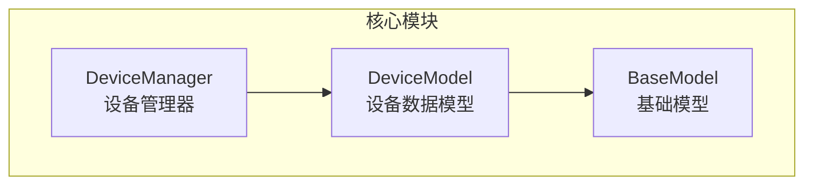
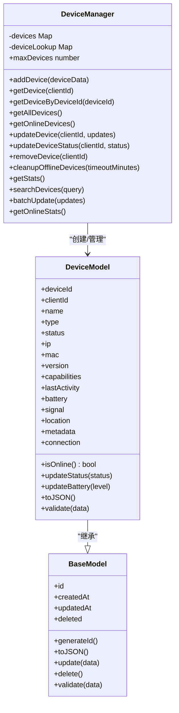
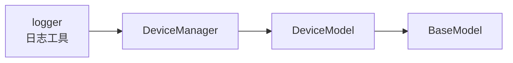
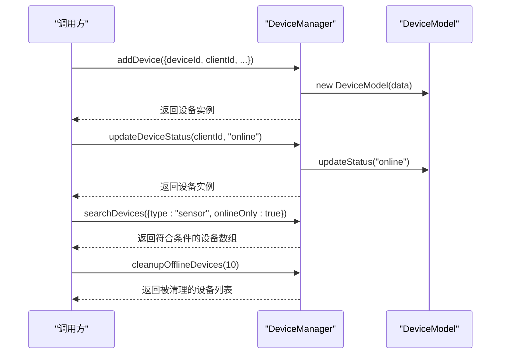

# 设备管理器

<cite>
**本文引用的文件**   
- [core/managers/device.js](file://core/managers/device.js)
- [core/models/device.js](file://core/models/device.js)
- [core/models/base.js](file://core/models/base.js)
</cite>

## 目录
1. [简介](#简介)
2. [项目结构](#项目结构)
3. [核心组件](#核心组件)
4. [架构总览](#架构总览)
5. [详细组件分析](#详细组件分析)
6. [依赖关系分析](#依赖关系分析)
7. [性能与内存优化](#性能与内存优化)
8. [故障排查指南](#故障排查指南)
9. [结论](#结论)
10. [附录：使用示例与最佳实践](#附录使用示例与最佳实践)

## 简介
本文件面向“设备管理器”子系统，系统性阐述 DeviceManager 类的职责边界、数据模型、状态管理、生命周期控制、在线监控、离线清理策略、统计与搜索能力，以及内存管理与性能优化建议。文档同时提供可操作的调用流程说明与排错指引，帮助开发者快速集成并稳定运行设备管理功能。

## 项目结构
围绕设备管理的代码主要位于 core/managers 与 core/models 两个目录：
- core/managers/device.js：设备管理器（DeviceManager）的实现，负责设备的注册、查询、更新、移除、批量操作、在线统计与搜索等。
- core/models/device.js：设备数据模型（DeviceModel），封装设备属性、校验、在线判定、状态与电量更新等方法。
- core/models/base.js：基础模型（BaseModel），提供通用字段、时间戳、ID生成、通用更新/删除逻辑。

图表来源
- [core/managers/device.js:1-201](file://core/managers/device.js#L1-L201)
- [core/models/device.js:1-96](file://core/models/device.js#L1-L96)
- [core/models/base.js:1-43](file://core/models/base.js#L1-L43)

章节来源
- [core/managers/device.js:1-201](file://core/managers/device.js#L1-L201)
- [core/models/device.js:1-96](file://core/models/device.js#L1-L96)
- [core/models/base.js:1-43](file://core/models/base.js#L1-L43)

## 核心组件
- DeviceManager：维护设备集合与索引，提供设备增删改查、批量更新、在线统计、离线清理、搜索等能力。
- DeviceModel：定义设备实体结构与行为，包含校验、在线判定、状态与电量更新、序列化等。
- BaseModel：为所有模型提供统一的基础能力（ID、时间戳、通用更新/删除）。

章节来源
- [core/managers/device.js:1-201](file://core/managers/device.js#L1-L201)
- [core/models/device.js:1-96](file://core/models/device.js#L1-L96)
- [core/models/base.js:1-43](file://core/models/base.js#L1-L43)

## 架构总览
设备管理采用“管理器 + 模型”的分层设计：
- 管理器（DeviceManager）负责业务编排与集合级操作。
- 模型（DeviceModel/BaseModel）负责数据合法性、状态计算与序列化。

图表来源
- [core/models/base.js:1-43](file://core/models/base.js#L1-L43)
- [core/models/device.js:1-96](file://core/models/device.js#L1-L96)
- [core/managers/device.js:1-201](file://core/managers/device.js#L1-L201)

## 详细组件分析

### DeviceManager 类
职责概览
- 设备注册与去重：通过 clientId 唯一键存储设备实例；若重复则走更新路径。
- 双向索引：维护 clientId->DeviceModel 与 deviceId->clientId 的映射，支持按 ID 或客户端 ID 查找。
- 状态与生命周期：提供状态更新、最后活动时间维护、在线判定辅助、离线清理。
- 统计与搜索：聚合在线/离线数量、类型分布；支持按 deviceId、type、status、onlineOnly 过滤。
- 批量操作：对多个设备执行更新，返回成功/失败计数与错误明细。

关键方法与行为
- addDevice(deviceData)
  - 先校验设备数据，再检查设备总数上限，随后创建 DeviceModel 实例。
  - 若 clientId 已存在，则转为 updateDevice 进行信息更新。
  - 成功后将设备加入 devices 与 deviceLookup 双索引。
- getDevice/getDeviceByDeviceId/getAllDevices
  - 分别支持按 clientId、deviceId、全量获取设备。
- getOnlineDevices
  - 基于 DeviceModel.isOnline 判断在线设备集合。
- updateDevice/updateDeviceStatus
  - 更新设备属性或状态，内部委托 DeviceModel.update 与 updateStatus。
- removeDevice
  - 从 devices 与 deviceLookup 中同步移除。
- cleanupOfflineDevices(timeoutMinutes)
  - 以 lastActivity 为基准，清理超过阈值的离线设备。
- getStats/getOnlineStats
  - 统计总量、在线数、离线数、类型分布等。
- searchDevices(query)
  - 支持多条件组合过滤：deviceId（模糊）、type、status、onlineOnly。
- batchUpdate(updates)
  - 遍历更新，收集成功/失败与错误原因。

复杂度与性能要点
- 查找 O(1)：clientId 与 deviceId 均通过 Map 实现。
- 列表与过滤 O(n)：getAllDevices、getOnlineDevices、searchDevices 均为线性扫描。
- 清理 O(n)：cleanupOfflineDevices 线性遍历。
- 批量更新 O(k)：k 为待更新设备数量。

章节来源
- [core/managers/device.js:1-201](file://core/managers/device.js#L1-L201)

### DeviceModel 类
职责概览
- 设备属性建模：设备标识、网络信息、版本、能力集、位置、元数据、连接引用等。
- 在线判定：结合 status 与 lastActivity 的时间差判断是否在线。
- 状态与电量更新：更新状态时刷新 lastActivity 与 updatedAt；电量更新同理。
- 数据校验：对必填字段、枚举值、数值范围等进行校验。
- 序列化：toJSON 输出标准 JSON 结构。

关键方法与行为
- constructor(data)
  - 初始化设备字段，确保类型安全与默认值。
- isOnline()
  - 当 status 为 online 且 lastActivity 在 2 分钟内视为在线。
- updateStatus(status)
  - 设置状态并更新时间戳。
- updateBattery(level)
  - 设置电量并更新时间戳。
- validate(data)
  - 校验 deviceId/clientId 非空且为字符串；type 属于允许集合；battery 范围 0-100；lastActivity 有效；metadata 为对象。
- toJSON()
  - 输出设备完整视图，便于日志与传输。

章节来源
- [core/models/device.js:1-96](file://core/models/device.js#L1-L96)

### BaseModel 类
职责概览
- 通用字段：id、createdAt、updatedAt、deleted。
- 工具方法：generateId、toJSON、update、delete。
- 扩展点：静态 validate 供子类覆写。

章节来源
- [core/models/base.js:1-43](file://core/models/base.js#L1-L43)

## 依赖关系分析
- DeviceManager 依赖 DeviceModel 完成设备实体的创建与行为封装。
- DeviceModel 继承 BaseModel，复用通用字段与工具方法。
- 外部依赖：utils/logger 用于记录关键事件与异常。

图表来源
- [core/managers/device.js:1-201](file://core/managers/device.js#L1-L201)
- [core/models/device.js:1-96](file://core/models/device.js#L1-L96)
- [core/models/base.js:1-43](file://core/models/base.js#L1-L43)

章节来源
- [core/managers/device.js:1-201](file://core/managers/device.js#L1-L201)
- [core/models/device.js:1-96](file://core/models/device.js#L1-L96)
- [core/models/base.js:1-43](file://core/models/base.js#L1-L43)

## 性能与内存优化
- 索引优化
  - 使用 Map 维护 clientId->DeviceModel 与 deviceId->clientId 的双向索引，保证 O(1) 查找。
- 容量控制
  - maxDevices 限制最大设备数，避免无限增长导致内存压力。
- 在线判定阈值
  - isOnline 使用 lastActivity 与当前时间差（2 分钟）判定在线，避免频繁状态抖动。
- 批量操作
  - batchUpdate 将多次更新合并处理，减少重复校验与日志开销。
- 清理策略
  - cleanupOfflineDevices 可按需配置超时阈值，定期回收长时间无活动的设备，降低内存占用。
- 序列化与日志
  - toJSON 仅输出必要字段，避免冗余数据；日志仅在关键路径打印，降低 I/O 压力。

[本节为通用性能建议，不直接分析具体文件]

## 故障排查指南
常见问题与定位思路
- 添加设备失败
  - 可能原因：设备数据校验失败（如 deviceId/clientId 为空或类型不符、type 不在允许集合、battery 越界、lastActivity 无效、metadata 非对象）。
  - 排查步骤：检查传入参数是否符合 DeviceModel.validate 规则；查看日志中的错误信息。
- 设备数量已达上限
  - 可能原因：已达到 maxDevices 限制。
  - 排查步骤：评估是否需要扩容；或调用 cleanupOfflineDevices 释放离线设备。
- 设备不存在
  - 可能原因：clientId 或 deviceId 不正确，或已被移除。
  - 排查步骤：使用 getAllDevices 或 searchDevices 确认设备是否存在。
- 设备未显示在线
  - 可能原因：status 不为 online，或 lastActivity 超过 2 分钟。
  - 排查步骤：调用 updateDeviceStatus 更新状态；确保心跳或活动上报正常。
- 搜索结果为空
  - 可能原因：过滤条件过于严格或字段不匹配。
  - 排查步骤：逐步放宽 searchDevices 的条件，定位问题字段。

章节来源
- [core/models/device.js:61-93](file://core/models/device.js#L61-L93)
- [core/managers/device.js:12-41](file://core/managers/device.js#L12-L41)
- [core/managers/device.js:65-86](file://core/managers/device.js#L65-L86)
- [core/managers/device.js:100-116](file://core/managers/device.js#L100-L116)
- [core/managers/device.js:138-162](file://core/managers/device.js#L138-L162)

## 结论
DeviceManager 提供了完整的设备管理能力，涵盖注册、查询、更新、移除、批量操作、在线统计与搜索，并通过 DeviceModel 与 BaseModel 实现了清晰的数据模型与通用能力。系统通过 Map 索引、容量限制、在线判定阈值与离线清理策略，兼顾了性能与稳定性。建议在接入侧遵循数据校验规范，合理配置清理阈值，并结合日志进行问题定位。

[本节为总结性内容，不直接分析具体文件]

## 附录：使用示例与最佳实践

### 典型操作流程（序列图）
以下序列图展示一次“添加设备 -> 更新状态 -> 搜索设备 -> 清理离线设备”的典型调用链。

图表来源
- [core/managers/device.js:12-41](file://core/managers/device.js#L12-L41)
- [core/managers/device.js:77-86](file://core/managers/device.js#L77-L86)
- [core/managers/device.js:138-162](file://core/managers/device.js#L138-L162)
- [core/managers/device.js:100-116](file://core/managers/device.js#L100-L116)
- [core/models/device.js:49-53](file://core/models/device.js#L49-L53)

### 使用建议
- 设备注册
  - 确保 deviceId 与 clientId 唯一且符合校验规则；首次注册后保存返回的设备实例以便后续操作。
- 状态维护
  - 设备上线时调用 updateDeviceStatus 设置为 online；心跳或活动上报时更新 lastActivity。
- 搜索与筛选
  - 优先使用 searchDevices 的多条件过滤，减少应用层二次过滤成本。
- 资源回收
  - 定时调度 cleanupOfflineDevices，根据业务场景调整超时阈值，平衡在线感知与内存占用。
- 批量更新
  - 使用 batchUpdate 集中更新设备属性，关注返回结果中的 failed 与 errors 字段进行重试或告警。

[本节为概念性指导，不直接分析具体文件]