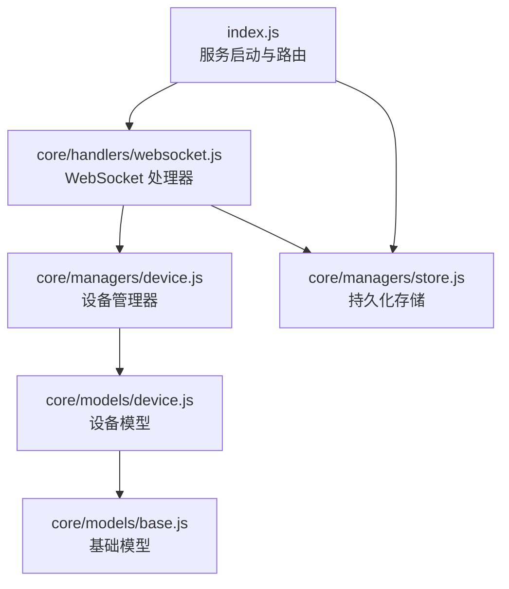
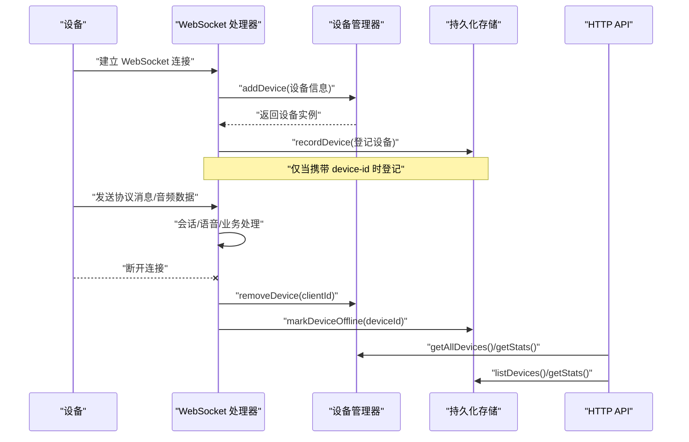
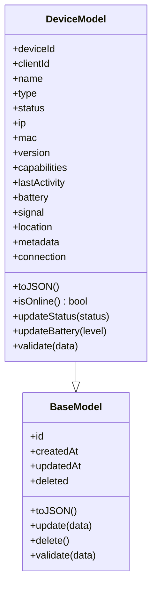
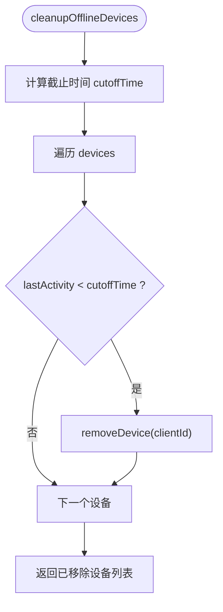
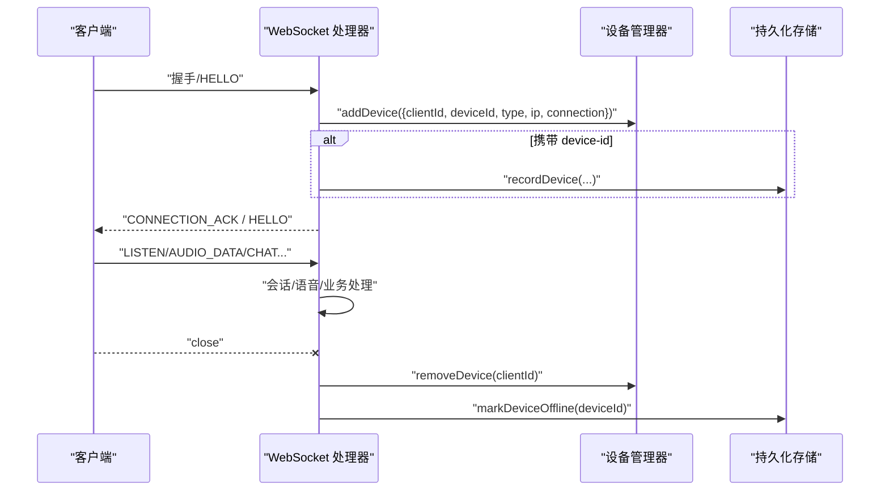
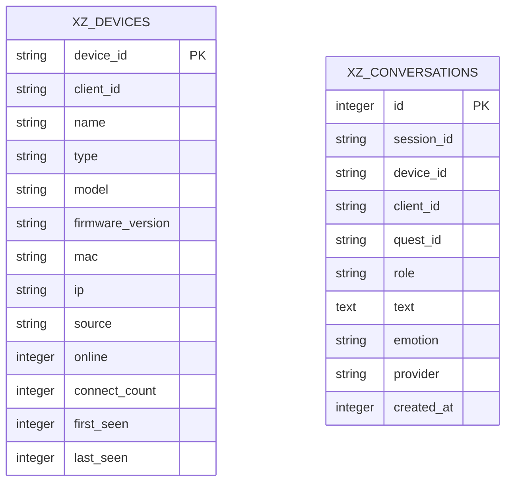
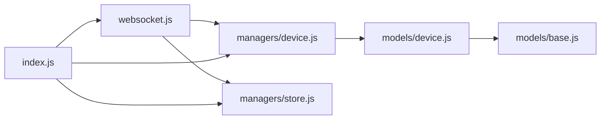

# 设备管理系统

<cite>
**本文引用的文件**   
- [index.js](file://index.js)
- [websocket.js](file://core/handlers/websocket.js)
- [device.js（管理器）](file://core/managers/device.js)
- [device.js（模型）](file://core/models/device.js)
- [base.js（基础模型）](file://core/models/base.js)
- [store.js（持久化存储）](file://core/managers/store.js)
</cite>

## 目录
1. [引言](#引言)
2. [项目结构](#项目结构)
3. [核心组件](#核心组件)
4. [架构总览](#架构总览)
5. [详细组件分析](#详细组件分析)
6. [依赖关系分析](#依赖关系分析)
7. [性能与扩展性](#性能与扩展性)
8. [故障排查指南](#故障排查指南)
9. [结论](#结论)
10. [附录：接入示例与配置模板](#附录接入示例与配置模板)

## 引言
本文件系统性地梳理并文档化“设备管理系统”的完整实现，覆盖设备注册、发现、状态监控、生命周期管理、连接状态维护、离线清理机制与资源管理。同时给出设备数据模型定义、存储策略与查询接口，并提供设备接入示例与配置模板，说明如何扩展现有设备类型与管理功能。

## 项目结构
围绕设备管理的核心代码主要分布在以下模块：
- 入口与服务装配：index.js
- WebSocket 接入与设备注册/断开处理：core/handlers/websocket.js
- 设备内存管理与在线状态：core/managers/device.js
- 设备数据模型与校验：core/models/device.js、core/models/base.js
- 设备与对话记录持久化：core/managers/store.js

图表来源
- [index.js:17-27](file://index.js#L17-L27)
- [index.js:235-281](file://index.js#L235-L281)
- [websocket.js:1-15](file://core/handlers/websocket.js#L1-L15)
- [device.js（管理器）:1-9](file://core/managers/device.js#L1-L9)
- [device.js（模型）:1-22](file://core/models/device.js#L1-L22)
- [base.js:1-43](file://core/models/base.js#L1-L43)
- [store.js:1-24](file://core/managers/store.js#L1-L24)

章节来源
- [index.js:44-281](file://index.js#L44-L281)
- [websocket.js:17-169](file://core/handlers/websocket.js#L17-L169)

## 核心组件
- 设备管理器 DeviceManager：负责设备实例的增删改查、在线过滤、统计、搜索与批量更新，以及离线清理。
- 设备模型 DeviceModel：封装设备属性、在线判定、状态更新、电池信号等元信息，并提供字段校验。
- WebSocket 处理器：在连接建立时完成设备注册，在连接关闭时完成设备移除与离线标记；同时处理协议消息、会话与语音流程。
- 持久化 Store XiaozhiStore：维护已知设备表与对话记录表，提供登记、离线标记、列表查询与统计能力。
- 服务入口 XiaozhiChannel：初始化各服务、装配 WebSocket 处理器、暴露 HTTP API（设备列表、已知设备、统计、对话记录等）。

章节来源
- [device.js（管理器）:4-201](file://core/managers/device.js#L4-L201)
- [device.js（模型）:3-96](file://core/models/device.js#L3-L96)
- [websocket.js:67-193](file://core/handlers/websocket.js#L67-L193)
- [store.js:29-237](file://core/managers/store.js#L29-L237)
- [index.js:180-249](file://index.js#L180-L249)

## 架构总览
设备从 WebSocket 接入到被纳入系统管理，再到持久化与查询的整体流程如下：

图表来源
- [websocket.js:67-142](file://core/handlers/websocket.js#L67-L142)
- [websocket.js:174-193](file://core/handlers/websocket.js#L174-L193)
- [index.js:357-395](file://index.js#L357-L395)
- [store.js:85-150](file://core/managers/store.js#L85-L150)

## 详细组件分析

### 设备数据模型与校验
- 继承自 BaseModel，增加设备专属字段：deviceId、clientId、name、type、status、ip、mac、version、capabilities、lastActivity、battery、signal、location、metadata、connection。
- isOnline() 基于 status 与 lastActivity 时间差判断在线。
- updateStatus()、updateBattery() 会更新时间戳。
- validate() 对 deviceId/clientId/type/battery/lastActivity/metadata 进行严格校验。

图表来源
- [base.js:1-43](file://core/models/base.js#L1-L43)
- [device.js（模型）:3-96](file://core/models/device.js#L3-L96)

章节来源
- [device.js（模型）:3-96](file://core/models/device.js#L3-L96)
- [base.js:1-43](file://core/models/base.js#L1-L43)

### 设备管理器（内存态）
- 数据结构：Map<clientId, DeviceModel> 与 Map<deviceId, clientId> 双索引。
- 关键方法：
  - addDevice：校验、上限检查、去重、注册。
  - getDevice/getDeviceByDeviceId：按客户端或设备ID获取。
  - getAllDevices/getOnlineDevices：全量/在线设备。
  - updateDevice/updateDeviceStatus：更新信息与状态。
  - removeDevice：移除并清理反向索引。
  - cleanupOfflineDevices：按 lastActivity 阈值清理离线设备。
  - searchDevices：支持按 deviceId、type、status、onlineOnly 过滤。
  - batchUpdate：批量更新并汇总结果。
  - getStats/getOnlineStats：统计总数、在线数、离线数与类型分布。

图表来源
- [device.js（管理器）:100-116](file://core/managers/device.js#L100-L116)

章节来源
- [device.js（管理器）:4-201](file://core/managers/device.js#L4-L201)

### WebSocket 接入与设备生命周期
- 连接建立：
  - 解析 client-id、device-id、clientType、timestamp 等。
  - 构造设备信息并调用 deviceManager.addDevice。
  - 若 store 可用且携带 device-id，则 recordDevice 登记设备。
  - 非 hard 客户端发送 CONNECTION_ACK。
- 消息处理：
  - 分发 HELLO/LISTEN/CHAT/IOT/MCP/AUDIO_DATA 等消息。
  - 自动创建会话、VAD/STT/TTS/LLM 协作。
- 连接断开：
  - deviceManager.removeDevice。
  - store.markDeviceOffline。
  - MCP 设备断开处理。

图表来源
- [websocket.js:67-142](file://core/handlers/websocket.js#L67-L142)
- [websocket.js:174-193](file://core/handlers/websocket.js#L174-L193)

章节来源
- [websocket.js:67-193](file://core/handlers/websocket.js#L67-L193)

### 持久化存储与查询接口
- 数据库表：
  - xz_devices：设备注册表（主键 device_id，含 online/connect_count/first_seen/last_seen 等）。
  - xz_conversations：对话记录（session_id/device_id/client_id/quest_id/role/text/emotion/provider/created_at）。
- 关键能力：
  - recordDevice：UPSERT 设备信息，支持 newConnection 增量 connect_count。
  - markDeviceOffline：标记离线并更新 last_seen。
  - listDevices：分页查询已知设备（含离线）。
  - logConversation/listConversations：写入与分页查询对话记录。
  - getStats：设备与对话统计。
- 容错设计：所有写操作捕获异常并降级为 no-op，确保不影响语音主流程。

图表来源
- [store.js:44-75](file://core/managers/store.js#L44-L75)

章节来源
- [store.js:29-237](file://core/managers/store.js#L29-L237)

### 服务入口与 HTTP API
- 服务启动：
  - initializeServices：初始化 SessionManager、DeviceManager、OTAHandler、LLM/TTS/STT/VAD/Voiceprint/MCP 服务。
  - initializeWebSocketHandler：注入设备管理器与会话管理等依赖。
  - setupExpressServer：创建 Express/HTTP/WebSocket 服务器，挂载路由。
- 设备相关 API：
  - GET /api/devices：当前在线设备（由 DeviceManager 提供）。
  - GET /api/devices/known：已知设备列表（由 Store 提供）。
  - GET /api/devices/stats：在线统计与注册统计。
  - GET /api/conversations：对话记录查询（支持 deviceId/role/limit/offset）。
  - POST /api/disconnect：主动断开指定设备连接。
  - GET /api/websocket/urls：WebSocket 地址信息。

章节来源
- [index.js:180-249](file://index.js#L180-L249)
- [index.js:287-488](file://index.js#L287-L488)

## 依赖关系分析
- 耦合关系：
  - WebSocket 处理器依赖 DeviceManager 与 Store，用于设备注册/移除与持久化。
  - DeviceManager 依赖 DeviceModel 进行数据建模与校验。
  - Store 使用 better-sqlite3 直接访问 SQLite，独立于 WebSocket 主流程。
- 外部依赖：
  - express、ws、better-sqlite3、uuid 等。
- 潜在循环依赖：
  - 无直接循环导入；通过构造函数参数注入依赖，降低耦合。

图表来源
- [websocket.js:1-15](file://core/handlers/websocket.js#L1-L15)
- [device.js（管理器）:1-9](file://core/managers/device.js#L1-L9)
- [device.js（模型）:1-22](file://core/models/device.js#L1-L22)
- [base.js:1-43](file://core/models/base.js#L1-L43)
- [index.js:17-27](file://index.js#L17-L27)

章节来源
- [websocket.js:1-15](file://core/handlers/websocket.js#L1-L15)
- [device.js（管理器）:1-9](file://core/managers/device.js#L1-L9)
- [device.js（模型）:1-22](file://core/models/device.js#L1-L22)
- [base.js:1-43](file://core/models/base.js#L1-L43)
- [index.js:17-27](file://index.js#L17-L27)

## 性能与扩展性
- 性能要点：
  - 设备查找使用 Map，O(1) 复杂度；在线过滤与搜索为 O(n)。
  - Store 使用 WAL 模式提升并发写性能；关键查询带索引。
  - 离线清理采用时间阈值扫描，建议周期性后台任务触发。
- 扩展点：
  - 新增设备类型：在 DeviceModel.validate 中扩展 validTypes，并在 WebSocket 处理器中保持白名单一致。
  - 自定义离线策略：在 DeviceManager.cleanupOfflineDevices 中调整阈值或加入更多维度（如心跳缺失次数）。
  - 扩展查询接口：在 index.js 中添加新的 REST 路由，组合 DeviceManager 与 Store 的能力。
  - 扩展持久化字段：在 Store 的 xz_devices/xz_conversations 表结构与 recordDevice/logConversation 中同步扩展。

[本节为通用指导，不直接分析具体文件]

## 故障排查指南
- 设备注册失败：
  - 现象：连接建立后立刻断开，日志提示“设备注册失败”。
  - 排查：检查 DeviceModel.validate 是否通过；确认传入的 deviceId/clientId/type 合法；查看 DeviceManager.addDevice 抛出的错误。
  - 参考路径：[websocket.js:120-142](file://core/handlers/websocket.js#L120-L142)、[device.js（管理器）:12-41](file://core/managers/device.js#L12-L41)、[device.js（模型）:61-93](file://core/models/device.js#L61-L93)
- 设备未出现在 /api/devices：
  - 现象：在线设备列表为空或不包含预期设备。
  - 排查：确认 addDevice 是否成功；检查 ws.clientId 是否正确设置；确认连接未提前关闭。
  - 参考路径：[websocket.js:67-122](file://core/handlers/websocket.js#L67-L122)、[device.js（管理器）:12-41](file://core/managers/device.js#L12-L41)
- 设备一直显示离线：
  - 现象：/api/devices/known 中 online=0。
  - 排查：确认 handleDisconnect 是否被调用；检查 store.markDeviceOffline 是否执行；检查 last_seen 是否更新。
  - 参考路径：[websocket.js:174-193](file://core/handlers/websocket.js#L174-L193)、[store.js:125-135](file://core/managers/store.js#L125-L135)
- 离线设备未清理：
  - 现象：内存中设备数量持续增长。
  - 排查：确认是否调用了 DeviceManager.cleanupOfflineDevices；检查 lastActivity 与阈值设置。
  - 参考路径：[device.js（管理器）:100-116](file://core/managers/device.js#L100-L116)
- 对话记录丢失：
  - 现象：/api/conversations 查询不到记录。
  - 排查：检查 Store 是否启用（disabled=false）；确认 logConversation 是否被调用；查看数据库文件是否存在与权限。
  - 参考路径：[store.js:158-175](file://core/managers/store.js#L158-L175)、[store.js:181-202](file://core/managers/store.js#L181-L202)

章节来源
- [websocket.js:120-193](file://core/handlers/websocket.js#L120-L193)
- [device.js（管理器）:12-41](file://core/managers/device.js#L12-L41)
- [device.js（模型）:61-93](file://core/models/device.js#L61-L93)
- [store.js:125-202](file://core/managers/store.js#L125-L202)

## 结论
本设备管理系统以 DeviceManager 为核心，结合 DeviceModel 的数据建模与校验，配合 WebSocket 处理器完成设备的接入、状态维护与生命周期管理；XiaozhiStore 提供设备与对话记录的持久化能力，并通过 index.js 暴露统一的 HTTP API。整体设计清晰、职责分离，具备较好的可扩展性与可观测性。

[本节为总结性内容，不直接分析具体文件]

## 附录：接入示例与配置模板

### 设备接入示例（概念步骤）
- 建立 WebSocket 连接至 /xiaozhi/v1/，携带必要请求头与 URL 参数：
  - 请求头：client-id、device-id（可选）、user-agent（可选）。
  - URL 参数：client_type（sensor/agent/hard/manager/unknown）、timestamp（可选）。
- 首次握手：
  - 发送 HELLO 消息，携带 version、transport、audio_params、device_id、device_name、device_mac、token、features 等。
  - 服务端返回 HELLO 与 session_id、audio_params。
- 开始监听：
  - 发送 LISTEN 消息，state=START，mode=auto/manual。
- 发送音频：
  - 二进制帧或 AUDIO_DATA 消息，服务端根据 VAD/STT 自动识别。
- 结束监听：
  - 发送 LISTEN 消息，state=STOP，或服务端检测到静默阈值后自动触发识别。
- 聊天交互：
  - 收到 STT 文本后，可发送 CHAT 消息或直接进入 LLM/TTS 流程。
- 断开连接：
  - 正常关闭 WebSocket，服务端将移除设备并标记离线。

章节来源
- [websocket.js:67-142](file://core/handlers/websocket.js#L67-L142)
- [websocket.js:450-513](file://core/handlers/websocket.js#L450-L513)
- [websocket.js:515-590](file://core/handlers/websocket.js#L515-L590)

### 配置模板（节选）
- 端口与主机：
  - port：整数，默认来自 serverConfig.port。
  - host：字符串，默认来自 serverConfig.host。
- LLM/TTS/STT：
  - llm.provider/model/apiKey
  - tts.provider/voice
  - stt.provider/language
- 音频与 VAD：
  - audio.minMaxAmplitude/minAvgAmplitude
  - vad.silenceThresholdMs/maxUtteranceMs
- OTA：
  - 通过 /xiaozhi/ota/ 与 /xiaozhi/ota/download/:filename 提供固件查询与下载。

章节来源
- [index.js:624-690](file://index.js#L624-L690)
- [index.js:298-344](file://index.js#L298-L344)
- [index.js:445-487](file://index.js#L445-L487)

### 扩展现有设备类型与管理功能
- 新增设备类型：
  - 在 DeviceModel.validate 的 validTypes 中加入新类型。
  - 在 WebSocket 处理器中保持 client_type 白名单一致。
- 扩展设备属性：
  - 在 DeviceModel 构造函数与 toJSON 中增加字段。
  - 在 Store 的 xz_devices 表结构中增加列，并在 recordDevice 中写入。
- 扩展查询接口：
  - 在 index.js 中添加新的路由，组合 DeviceManager.searchDevices 与 Store.listDevices。
- 自定义离线策略：
  - 在 DeviceManager.cleanupOfflineDevices 中引入更复杂的条件（如心跳缺失计数、信号强度阈值等）。

章节来源
- [device.js（模型）:61-93](file://core/models/device.js#L61-L93)
- [websocket.js:96-122](file://core/handlers/websocket.js#L96-L122)
- [store.js:44-75](file://core/managers/store.js#L44-L75)
- [store.js:91-123](file://core/managers/store.js#L91-L123)
- [device.js（管理器）:100-116](file://core/managers/device.js#L100-L116)