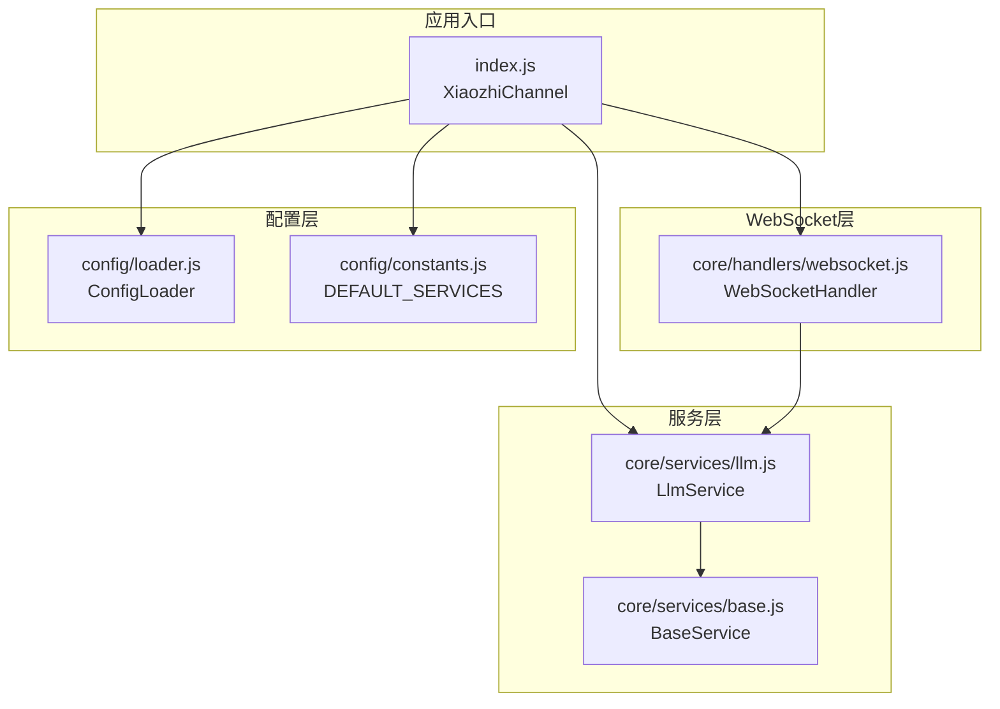
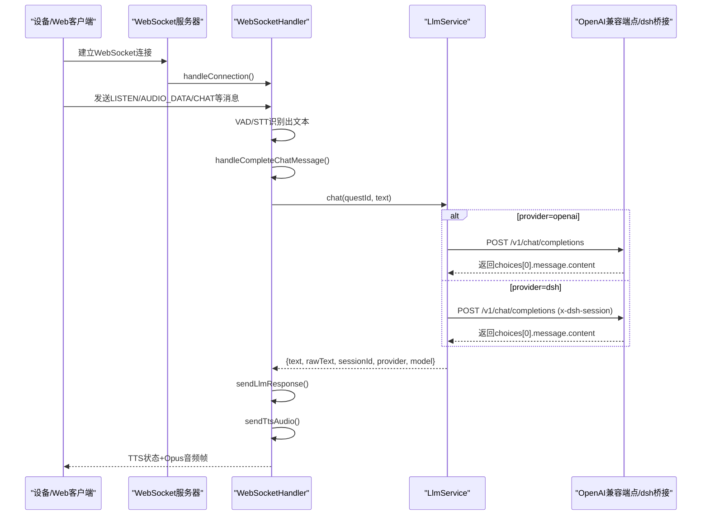
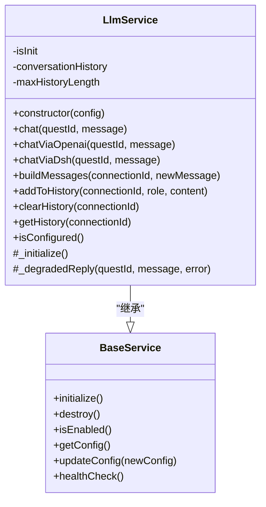
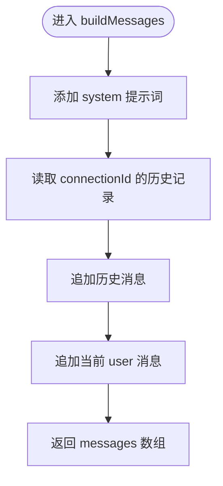
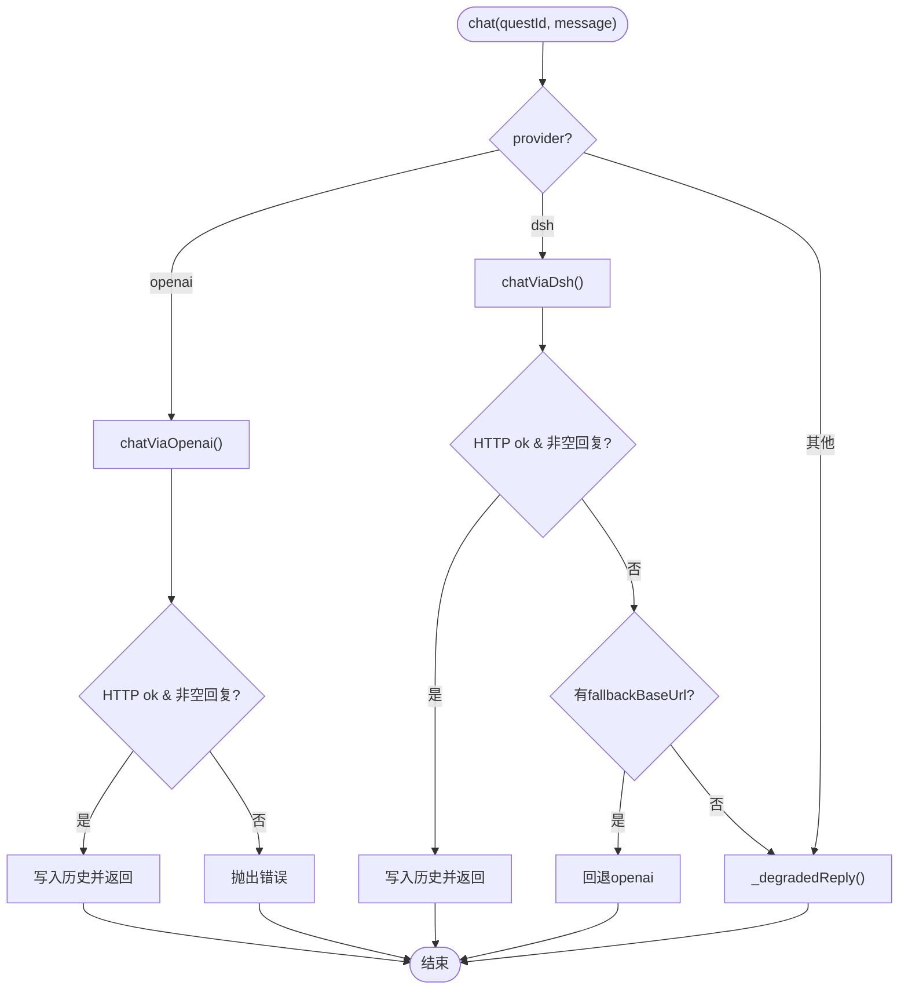
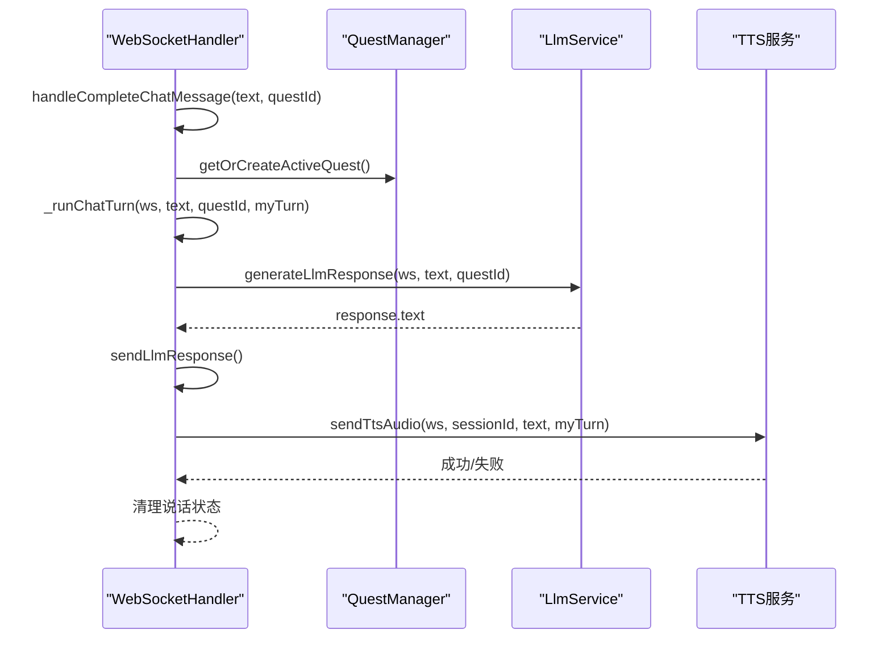
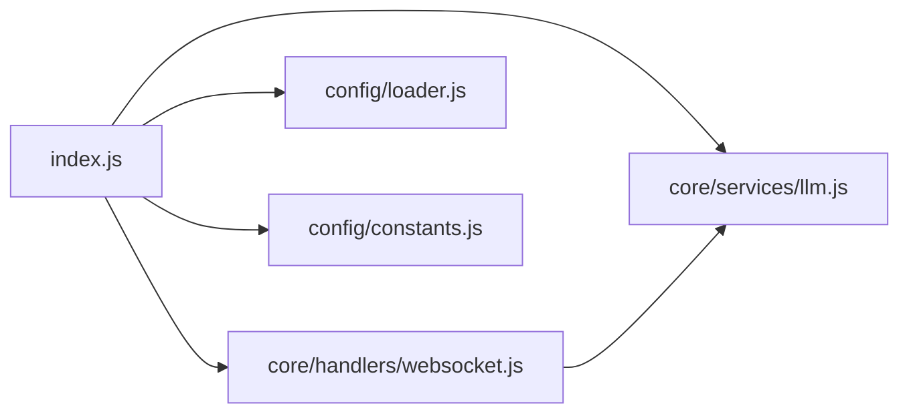

# LLM语言模型服务

<cite>
**本文引用的文件**   
- [core/services/llm.js](file://core/services/llm.js)
- [core/services/base.js](file://core/services/base.js)
- [config/loader.js](file://config/loader.js)
- [config/constants.js](file://config/constants.js)
- [index.js](file://index.js)
- [core/handlers/websocket.js](file://core/handlers/websocket.js)
</cite>

## 目录
1. [简介](#简介)
2. [项目结构](#项目结构)
3. [核心组件](#核心组件)
4. [架构总览](#架构总览)
5. [详细组件分析](#详细组件分析)
6. [依赖关系分析](#依赖关系分析)
7. [性能与可靠性](#性能与可靠性)
8. [配置与集成指南](#配置与集成指南)
9. [API调用示例与最佳实践](#api调用示例与最佳实践)
10. [故障排查](#故障排查)
11. [结论](#结论)

## 简介
本文件面向“LLM语言模型服务”，聚焦以下目标：
- 说明 LLM 服务的架构设计与外部 AI 模型的集成方式。
- 解释对话上下文管理、消息历史维护、系统提示词配置和响应处理机制。
- 文档化支持的 AI 服务提供商（OpenAI 兼容接口、本地推理桥接等）的配置方法与调用流程。
- 说明流式响应现状、错误重试机制、超时控制与性能优化策略。
- 提供完整的 API 调用示例与最佳实践，帮助开发者快速接入并稳定运行。

本项目采用 Node.js + WebSocket 的语音交互通道，LLM 服务作为独立模块通过 WebSocket 处理器被调度，负责将用户语音识别后的文本转换为 AI 回复，并与 TTS 服务协作输出音频。

## 项目结构
围绕 LLM 服务的关键代码分布如下：
- LLM 服务实现：`core/services/llm.js`
- 基础服务抽象：`core/services/base.js`
- 配置加载器：`config/loader.js`
- 常量与服务默认值：`config/constants.js`
- 频道入口与依赖注入：`index.js`
- WebSocket 处理器（会话、STT、LLM、TTS 编排）：`core/handlers/websocket.js`

**图表来源**
- [index.js:180-249](file://index.js#L180-L249)
- [core/handlers/websocket.js:22-60](file://core/handlers/websocket.js#L22-L60)
- [core/services/llm.js:16-24](file://core/services/llm.js#L16-L24)
- [core/services/base.js:1-23](file://core/services/base.js#L1-L23)
- [config/loader.js:143-152](file://config/loader.js#L143-L152)
- [config/constants.js:25-42](file://config/constants.js#L25-L42)

**章节来源**
- [index.js:180-249](file://index.js#L180-L249)
- [core/handlers/websocket.js:22-60](file://core/handlers/websocket.js#L22-L60)
- [core/services/llm.js:16-24](file://core/services/llm.js#L16-L24)
- [core/services/base.js:1-23](file://core/services/base.js#L1-L23)
- [config/loader.js:143-152](file://config/loader.js#L143-L152)
- [config/constants.js:25-42](file://config/constants.js#L25-L42)

## 核心组件
- LlmService：对外暴露 `chat(questId, message)` 接口，内部根据 provider 路由到 OpenAI 兼容端点或 dsh 桥接路径；维护每连接的消息历史，构建 system + history + user 消息列表。
- BaseService：统一初始化、销毁、健康检查与配置更新能力。
- WebSocketHandler：编排 STT→LLM→TTS 的完整对话轮次，包含轮次串行化、打断、回声过滤、超时保护等。
- ConfigLoader / Constants：集中加载 config.json，并提供 LLM/TTS/STT 默认配置。

关键职责边界：
- LLM 服务不直接处理 WebSocket，只负责“文本输入 → 文本回复”。
- WebSocket 处理器负责“设备协议解析、会话管理、音频流控制、LLM/TTS 编排”。

**章节来源**
- [core/services/llm.js:16-24](file://core/services/llm.js#L16-L24)
- [core/services/base.js:1-23](file://core/services/base.js#L1-L23)
- [core/handlers/websocket.js:645-818](file://core/handlers/websocket.js#L645-L818)
- [config/loader.js:143-152](file://config/loader.js#L143-L152)

## 架构总览
下图展示从设备连接到 LLM 调用的端到端流程：

**图表来源**
- [core/handlers/websocket.js:645-818](file://core/handlers/websocket.js#L645-L818)
- [core/services/llm.js:75-104](file://core/services/llm.js#L75-L104)
- [core/services/llm.js:121-160](file://core/services/llm.js#L121-L160)
- [core/services/llm.js:166-203](file://core/services/llm.js#L166-L203)

## 详细组件分析

### LlmService 类设计
- 继承 BaseService，支持 initialize/healthCheck 生命周期。
- 支持 provider：
  - openai：直连 OpenAI 兼容端点（如 aibridge），使用 x-api-key 鉴权。
  - dsh：经 dsh-xiaozhi-bridge 转发，失败时可按 fallbackBaseUrl 回退 openai，仍不可用则降级回复。
- 维护 per-connection 对话历史，限制最大轮数，避免上下文膨胀。
- buildMessages 固定注入 system 提示词，拼接最近历史与新消息。

**图表来源**
- [core/services/base.js:1-87](file://core/services/base.js#L1-L87)
- [core/services/llm.js:16-344](file://core/services/llm.js#L16-L344)

**章节来源**
- [core/services/llm.js:16-344](file://core/services/llm.js#L16-L344)
- [core/services/base.js:1-87](file://core/services/base.js#L1-L87)

### 对话上下文管理与消息历史
- 历史存储：基于 Map，键为 connectionId（或 questId），值为角色-内容数组。
- 构建策略：system 提示词 + 最近 N 轮历史 + 新消息。
- 长度控制：每轮两条消息（user/assistant），超过阈值移除最老一轮。
- 清理接口：按连接 ID 清除历史，便于会话重置。

**图表来源**
- [core/services/llm.js:211-231](file://core/services/llm.js#L211-L231)
- [core/services/llm.js:240-252](file://core/services/llm.js#L240-L252)

**章节来源**
- [core/services/llm.js:211-252](file://core/services/llm.js#L211-L252)

### 响应处理与降级策略
- openai 路径：校验 HTTP 状态码与返回体，提取 choices[0].message.content，写入历史后返回结构化对象。
- dsh 路径：透传 x-dsh-session 保持会话映射，失败时尝试 fallbackBaseUrl 回退 openai，最终不可用则返回友好降级文本。
- 降级回复：不依赖外部模型，保证用户体验。

**图表来源**
- [core/services/llm.js:75-115](file://core/services/llm.js#L75-L115)
- [core/services/llm.js:121-160](file://core/services/llm.js#L121-L160)
- [core/services/llm.js:166-203](file://core/services/llm.js#L166-L203)

**章节来源**
- [core/services/llm.js:75-203](file://core/services/llm.js#L75-L203)

### WebSocket 侧的 LLM 调用编排
- 触发时机：STT 识别完成或 listen 文本模式，收敛至 handleCompleteChatMessage。
- 轮次串行化：同一连接同一时刻仅一条应答流程，防止 Opus 帧交错。
- 超时保护：对单轮处理设置 turnTimeoutSeconds；对 LLM 调用设置 llmTimeoutSeconds。
- 打断机制：abortUpTo 带轮次归属，旧轮可被中止，新轮不受影响。
- 回声过滤：若识别文本与近期播放文本高度相似，忽略该输入，避免自激循环。

**图表来源**
- [core/handlers/websocket.js:645-818](file://core/handlers/websocket.js#L645-L818)
- [core/handlers/websocket.js:927-971](file://core/handlers/websocket.js#L927-L971)
- [core/handlers/websocket.js:1025-1130](file://core/handlers/websocket.js#L1025-L1130)

**章节来源**
- [core/handlers/websocket.js:645-818](file://core/handlers/websocket.js#L645-L818)
- [core/handlers/websocket.js:927-971](file://core/handlers/websocket.js#L927-L971)
- [core/handlers/websocket.js:1025-1130](file://core/handlers/websocket.js#L1025-L1130)

## 依赖关系分析
- index.js 在启动时实例化 LlmService，并通过 initializeWebSocketHandler 将服务注入 WebSocketHandler。
- WebSocketHandler 在对话轮次中调用 LlmService.chat，并将结果交给 TTS 服务。
- 配置由 ConfigLoader 统一加载，Constants 提供默认服务配置。

**图表来源**
- [index.js:180-249](file://index.js#L180-L249)
- [config/loader.js:143-152](file://config/loader.js#L143-L152)
- [config/constants.js:25-42](file://config/constants.js#L25-L42)

**章节来源**
- [index.js:180-249](file://index.js#L180-L249)
- [config/loader.js:143-152](file://config/loader.js#L143-L152)
- [config/constants.js:25-42](file://config/constants.js#L25-L42)

## 性能与可靠性
- 轮次串行化：通过 Promise 链与轮次序号确保同一连接不会并发发送多轮音频，避免帧交错。
- 超时控制：
  - 单轮处理超时：turnTimeoutSeconds（默认 90s）。
  - LLM 调用超时：llmTimeoutSeconds（默认 60s）。
  - 底层 fetch 请求也设置了 AbortSignal.timeout（openai 默认 60s，dsh 默认 120s）。
- 降级与容错：
  - dsh 失败可回退 openai；仍失败则返回降级文本。
  - LLM 调用异常时，WebSocket 层会返回默认回复，避免阻塞后续轮次。
- 回声与噪音过滤：减少误触发导致的无效 LLM 调用。
- 音频节拍：按固定 frameDuration（默认 60ms）发送 Opus 帧，避免设备缓冲溢出。

**章节来源**
- [core/handlers/websocket.js:677-693](file://core/handlers/websocket.js#L677-L693)
- [core/handlers/websocket.js:927-971](file://core/handlers/websocket.js#L927-L971)
- [core/services/llm.js:121-137](file://core/services/llm.js#L121-L137)
- [core/services/llm.js:166-179](file://core/services/llm.js#L166-L179)
- [core/handlers/websocket.js:1139-1189](file://core/handlers/websocket.js#L1139-L1189)

## 配置与集成指南

### 支持的 AI 服务提供商
- openai（默认）：直连 OpenAI 兼容端点（例如本地 aibridge），需要 apiKey。
- dsh：经 dsh-xiaozhi-bridge 调用 DeepSeek Harness agent，失败时可回退 openai。

### 配置项说明（config.json → llm）
- provider：提供商类型（openai 或 dsh）。
- baseUrl：LLM 服务端点（openai 直连或 dsh 桥接地址）。
- model：模型名称（openai 直连或 dsh 代理模型名）。
- timeoutMs：单次 LLM 请求超时（毫秒）。
- apiKey：openai 直连时的鉴权密钥（也可通过环境变量 AIBRIDGE_API_KEY 注入）。
- temperature/maxTokens：生成参数（温度、最大 token 数）。
- fallbackBaseUrl：dsh 失败时回退的 openai 端点。

默认值来自 ConfigLoader.getLlmConfig 与 DEFAULT_SERVICES.llm。

**章节来源**
- [core/services/llm.js:7-15](file://core/services/llm.js#L7-L15)
- [config/loader.js:143-152](file://config/loader.js#L143-L152)
- [config/constants.js:25-42](file://config/constants.js#L25-L42)

### 环境变量覆盖
- AIBRIDGE_API_KEY：用于 openai 直连鉴权。
- XIAOZHI_PORT/HOST：服务器端口与监听地址。
- STT_PROVIDER/LANGUAGE、TTS_PROVIDER/VOICE：STT/TTS 提供商与参数。

**章节来源**
- [config/loader.js:49-74](file://config/loader.js#L49-L74)

### 调用流程概览
- 设备通过 WebSocket 发送 LISTEN/AUDIO_DATA/CHAT 等消息。
- WebSocketHandler 进行 VAD/STT 识别，得到文本后调用 LlmService.chat。
- LlmService 根据 provider 选择 openai 或 dsh 路径，构造消息并发起 HTTP 请求。
- 成功后返回结构化回复，WebSocketHandler 继续 TTS 合成与音频发送。

**章节来源**
- [core/handlers/websocket.js:645-818](file://core/handlers/websocket.js#L645-L818)
- [core/services/llm.js:75-203](file://core/services/llm.js#L75-L203)

## API调用示例与最佳实践

### WebSocket 消息类型（设备侧）
- HELLO：握手，携带设备信息、音频参数等。
- LISTEN：控制监听状态（start/stop/detect），detect 模式可直接传入文本。
- AUDIO_DATA：二进制音频数据（Opus/PCM 等）。
- CHAT：完整聊天消息（complete 状态携带文本）。
- ABORT：主动中断当前轮次。
- MCP/IOT/FRIEND：扩展业务消息。

参考常量定义：
- CLIENT_MESSAGE_TYPES、SERVER_MESSAGE_TYPES、LISTEN_STATES、CHAT_STATES、TTS_STATES。

**章节来源**
- [config/constants.js:44-90](file://config/constants.js#L44-L90)
- [core/handlers/websocket.js:228-283](file://core/handlers/websocket.js#L228-L283)

### 典型对话流程（示例步骤）
1. 设备连接 WebSocket，发送 HELLO 完成握手。
2. 设备发送 LISTEN start，开始采集音频。
3. 设备持续发送 AUDIO_DATA，服务端进行 VAD/STT。
4. 检测到停顿或手动 STOP，触发 STT 识别，得到文本。
5. 服务端调用 LLM 生成回复，并通过 TTS 合成音频。
6. 服务端以 TTS START → sentence_start → Opus 帧 → TTS STOP 的顺序推送。
7. 设备可随时发送 ABORT 中断当前轮次。

**章节来源**
- [core/handlers/websocket.js:448-643](file://core/handlers/websocket.js#L448-L643)
- [core/handlers/websocket.js:1025-1130](file://core/handlers/websocket.js#L1025-L1130)

### 最佳实践
- 合理设置 timeoutMs 与 llmTimeoutSeconds，避免长尾请求拖垮队列。
- 使用 questId 管理对话上下文，必要时关闭 Quest 以重置上下文。
- 开启 TTS 服务以获得流畅语音体验；若禁用，服务端会回退文本消息。
- 对于无 AEC 设备，注意回声过滤已内置，但仍需避免频繁误触发。
- 生产环境建议通过环境变量注入 apiKey，避免硬编码。

**章节来源**
- [core/handlers/websocket.js:677-693](file://core/handlers/websocket.js#L677-L693)
- [core/handlers/websocket.js:927-971](file://core/handlers/websocket.js#L927-L971)
- [core/services/llm.js:121-137](file://core/services/llm.js#L121-L137)

## 故障排查
- LLM 调用失败：
  - 检查 provider、baseUrl、apiKey 是否正确。
  - 观察日志中的 openai/dsh bridge 状态码与错误信息。
  - 确认 fallbackBaseUrl 是否可用（dsh 场景）。
- 超时问题：
  - 调整 turnTimeoutSeconds 与 llmTimeoutSeconds。
  - 检查底层 fetch 超时配置（openai 默认 60s，dsh 默认 120s）。
- 音频卡顿或颤音：
  - 确认 frameDuration 与设备端一致（默认 60ms）。
  - 检查网络抖动与设备解码能力。
- 回声导致误触发：
  - 确认回声过滤逻辑生效，避免重复触发 LLM。
- 会话历史异常：
  - 使用 clearHistory 清理指定连接的历史。
  - 检查 maxHistoryLength 是否过小导致上下文丢失。

**章节来源**
- [core/services/llm.js:121-160](file://core/services/llm.js#L121-L160)
- [core/services/llm.js:166-203](file://core/services/llm.js#L166-L203)
- [core/handlers/websocket.js:927-971](file://core/handlers/websocket.js#L927-L971)
- [core/handlers/websocket.js:1139-1189](file://core/handlers/websocket.js#L1139-L1189)

## 结论
本 LLM 语言模型服务以模块化方式嵌入语音交互通道，支持 OpenAI 兼容端点与 dsh 桥接两种路径，具备完善的上下文管理、超时控制、降级策略与音频流编排。通过合理的配置与环境变量管理，可在本地推理或云端模型之间灵活切换，保障用户体验与系统稳定性。